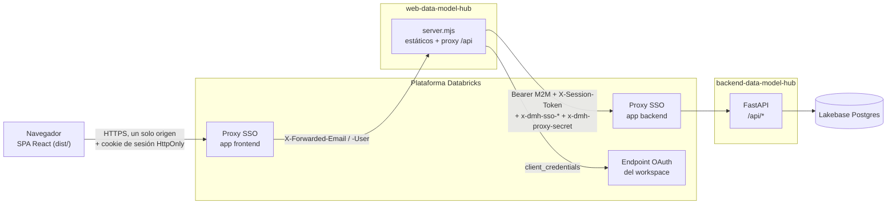

# Data Model Hub — Frontend

Aplicación web de Data Model Hub, una plataforma de modelado de datos. Este repositorio contiene la SPA en
React (diagramas ER, Model Explorer, revisión de versiones, Reporting, Data Standards y Admin) y
`server.mjs`, el servidor Node que la sirve en producción y reenvía `/api/*` al backend. La API, la
persistencia y las reglas de negocio viven en el repositorio `backend-data-model-hub`.

## Contenido

- [Visión general](#visión-general)
- [Stack tecnológico](#stack-tecnológico)
- [Estructura del repositorio](#estructura-del-repositorio)
- [Requisitos](#requisitos)
- [Puesta en marcha local](#puesta-en-marcha-local)
- [Scripts npm y comandos frecuentes](#scripts-npm-y-comandos-frecuentes)
- [Pruebas](#pruebas)
- [Despliegue](#despliegue)
- [Seguridad](#seguridad)
- [Documentación](#documentación)

## Visión general

La web es el lugar de trabajo del modelador. En **Model** se abre un proyecto, se navega su catálogo en el
Model Explorer y se dibujan tablas, vistas y relaciones sobre canvases (subject areas) con auto-layout,
alternando entre la vista lógica y la física. Cada edición se registra en una versión propia (draft) que
se guarda en segundo plano, admite Undo y se envía a revisión con **Publish**. En **Review** se aprueban o
rechazan las solicitudes; en **Reporting** se consulta y exporta a Excel la metadata de un proyecto; en
**Data Standards** se gestionan glosario, dominios, UDP, reglas de exportación DDL y temas de color; en
**Admin**, usuarios, roles y permisos.

Además de la edición en el canvas, la web carga modelos desde Excel (**Upload from Excel**), genera el DDL
de un modelo (**Export DDL**) y exporta diagramas y paquetes HTML o PDF desde el navegador. El backend es la
autoridad: la UI oculta lo que el rol no permite, pero cada operación la vuelve a autorizar la API.

En producción la web corre como una Databricks App. El navegador habla con un solo origen: `server.mjs`
sirve `dist/` y reenvía `/api/*` al backend servidor a servidor, con un token M2M del service principal del
front y la identidad SSO que atesta la plataforma. El diagrama muestra el sistema completo.



El detalle de capas, routing, stores y `server.mjs` está en [Arquitectura](docs/02-arquitectura.md); las
pantallas y lo que ve cada rol, en [Visión general](docs/01-vision-general.md).

## Stack tecnológico

| Área | Tecnología | Versión |
|---|---|---|
| Runtime | Node.js y npm | Node 20 o superior |
| Lenguaje | TypeScript | 5.9.3 |
| UI | React / React DOM | 19.2.4 |
| Build y servidor de desarrollo | Vite (`@vitejs/plugin-react` 4.7.0) | 6.4.3 |
| Routing | React Router (`react-router-dom`) | 7.18.4 |
| Estado global | Zustand | 5.0.12 |
| Canvas | React Flow (`@xyflow/react`) | 12.11.0 |
| Auto-layout | ELK (`elkjs`) | 0.11.1 |
| Listas virtualizadas | `@tanstack/react-virtual` | 3.14.5 |
| Excel / ZIP / YAML | `xlsx` (desde `vendor/`) / `fflate` / `yaml` | 0.20.3 / 0.8.3 / 2.9.0 |
| Íconos, toasts y tipografía | `lucide-react`, `sonner`, Geist (`@fontsource-variable`) | 1.21.0, 2.0.7, 5.2.x |
| Pruebas y calidad | Vitest / ESLint (`typescript-eslint` 8.58.1) | 2.1.9 / 9.39.4 |
| Servidor de producción | `server.mjs` (solo módulos `node:*`) | sin dependencias |

Todas las versiones están fijadas en `package.json`, sin rangos. `xlsx` se instala desde la copia
`vendor/xlsx-0.20.3.tgz`, porque SheetJS publica sus versiones corregidas solo en su CDN. Uso de cada dependencia y procedimiento para
actualizarlas en [Stack tecnológico](docs/04-stack-tecnologico.md).

## Estructura del repositorio

```text
web-data-model-hub/
├── src/
│   ├── main.tsx, App.tsx   # arranque, rutas y guardas
│   ├── screens/            # pantallas Home, Review y Reporting
│   ├── features/           # admin, auth, ddl, modeler, reporting, standards, upload
│   ├── components/         # layout (TopNav) y componentes UI compartidos
│   ├── services/           # cliente HTTP y servicios por dominio
│   ├── store/              # stores Zustand (auth, sesión, modelador, UI, Undo)
│   ├── lib/                # utilidades puras
│   ├── types/              # tipos compartidos con el contrato de la API
│   └── app/globals.css     # estilos globales
├── public/                 # íconos y plantilla de carga masiva
├── scripts/                # utilidades de desarrollo
├── vendor/                 # xlsx-0.20.3.tgz, paquete de SheetJS que instala npm
├── docs/                   # documentación técnica
├── server.mjs              # servidor de producción: dist/ + proxy /api + relay SSO + cookie de sesión
├── server.test.mjs         # pruebas del servidor de producción
├── vite.config.ts          # Vite (puerto 3000, /api → :8000 con el proxy de server.mjs) y Vitest
├── eslint.config.mjs       # ESLint, incluidas las reglas de importación
├── tsconfig.json
├── app.yaml                # comando y variables de entorno de la Databricks App
├── databricks.yml          # bundle: app, secretos, permisos y target
├── .env.example            # plantilla de variables VITE_* para desarrollo
└── .github/workflows/      # despliegue con GitHub Actions
```

Árbol comentado, anatomía de una feature y reglas de importación en
[Estructura del proyecto](docs/03-estructura-del-proyecto.md).

## Requisitos

- Node.js 20 o superior y npm.
- El backend (`backend-data-model-hub`) corriendo en `http://localhost:8000`, con su `.env` configurado y
  los roles y la cuenta `admin` creados con `scripts/create_admin.py` de ese repositorio.

## Puesta en marcha local

1. Instalar las dependencias exactas del lockfile:

   ```bash
   npm ci
   ```

2. Levantar el backend local en otra terminal (desde `backend-data-model-hub`, con su `.venv` activo):

   ```bash
   uvicorn app.main:app --reload --port 8000
   ```

3. Levantar la web en modo desarrollo:

   ```bash
   npm run dev
   ```

   Vite sirve la web en `http://localhost:3000` y reenvía `/api` a `http://localhost:8000` con el mismo
   proxy de `server.mjs`: la sesión viaja en la cookie HttpOnly `dmh_session`, como en producción.
   `VITE_API_URL` queda vacía (mismo origen). En local no hay muro SSO: **Continue with Databricks** entra
   con el usuario de desarrollo que configura el backend (`LOCAL_DEV_USER`, que debe estar en la whitelist),
   y la cuenta local `admin` entra con usuario y contraseña.

4. Para apuntar la web local a otro backend, se define la URL en `.env.local` y se reinicia Vite:

   ```bash
   VITE_API_URL=https://<url-del-backend>
   ```

5. Para simular producción con `server.mjs` (estáticos, fallback de SPA, cabeceras de caché y de
   seguridad, y relay):

   ```bash
   npm run build
   BACKEND_API_URL=http://localhost:8000 node server.mjs
   ```

   Sin `DATABRICKS_CLIENT_ID` ni `DATABRICKS_CLIENT_SECRET`, el proxy reenvía sin `Bearer` al Uvicorn
   local. Escucha en `PORT` o en `3000`.

## Scripts npm y comandos frecuentes

| Script o tarea | Comando | Qué hace |
|---|---|---|
| `dev` | `npm run dev` | Servidor de desarrollo de Vite en el puerto 3000 con proxy `/api`. |
| `build` | `npm run build` | `tsc --noEmit && vite build`: verifica tipos y deja el build en `dist/`. |
| `preview` | `npm run preview` | `vite preview`: sirve `dist/` y reenvía `/api` con el mismo manejador de `server.mjs`. |
| `start` | `npm run start` | `node server.mjs`: servidor de producción (lo usa `app.yaml`). |
| `test` | `npm test` | `vitest run`: suite completa. |
| `lint` | `npm run lint` | `eslint .`, incluidas las reglas de importación entre capas. |
| Verificación de tipos | `npx tsc --noEmit` | Compuerta de tipos sin generar el build. |
| Listar pruebas | `npx vitest list` | Lista las pruebas sin ejecutarlas. |

## Pruebas

Vitest corre en entorno `node` sobre `src/**/*.test.{ts,tsx}` y `server.test.mjs`: lógica pura, stores,
servicios con `fetch` simulado, componentes sin DOM, guardas que leen el código fuente, el servidor de
producción y las reglas de arquitectura (`src/architecture.test.ts`).

```bash
npm test                                   # suite completa
npx vitest run src/store                   # una carpeta
npx vitest run server.test.mjs             # servidor de producción
npx tsc --noEmit && npm run lint           # compuertas estáticas
```

Tipos de prueba, convenciones y ejemplos en [Pruebas](docs/10-pruebas.md).

## Despliegue

La plataforma de referencia es Databricks: la web se despliega como la Databricks App
`frnt-data-model-hub` con un bundle (`databricks.yml`) y un `app.yaml` cuyo comando es `npm run start`. En
cada despliegue y arranque, Databricks instala las dependencias (`xlsx` desde el tarball de `vendor/`),
ejecuta `npm run build` y levanta `server.mjs`; `dist/` no se versiona. `BACKEND_API_URL` apunta a la app backend y `PROXY_SHARED_SECRET` llega desde el secret
scope, el mismo que lee el backend.

GitHub Actions despliega con `deploy-databricks.yml` (`push` a `deploy-dev`, `develop` o `main`,
environments `dev`, `qa` y `prod`), que invoca `reusable-databricks-deploy.yml` con
`provider_app: bknd-data-model-hub`: al final de cada despliegue, el service principal del front recibe
`CAN_USE` sobre la app backend. En un workspace nuevo se despliega primero el backend, porque su URL es el
valor de `BACKEND_API_URL`.

En otra plataforma, `dist/` es un conjunto de archivos estáticos y `server.mjs` corre en cualquier host
con Node; lo que cambia es cómo llegan la identidad del usuario y la autorización hacia el backend.
Variables, opciones y checklist en [Despliegue](docs/09-despliegue.md).

## Seguridad

- El navegador habla con un solo origen; `server.mjs` es el único que cruza al backend, con un token M2M
  que nunca llega al navegador.
- `server.mjs` descarta cualquier cabecera `x-dmh-*` y `authorization` que envíe el cliente y solo copia la
  identidad atestada por el proxy de la plataforma, acompañada del secreto compartido del relay.
- La sesión del usuario viaja en una cookie HttpOnly (`__Host-dmh_session`, `Secure`, `SameSite=Strict`)
  que fija `server.mjs`: el JavaScript de la página no ve el token. Dura una hora, se renueva solo con
  actividad y, sin uso, se cierra. Las escrituras con la cookie exigen `X-Requested-With` (CSRF).
- `server.mjs` agrega cabeceras de seguridad a los estáticos: CSP de un solo origen, `nosniff`,
  `X-Frame-Options`, `Referrer-Policy`, `Permissions-Policy`, COOP y, por HTTPS, HSTS.
- El bundle no contiene secretos: solo las variables `VITE_*` llegan al build, y en producción ninguna se
  define.
- El control de acceso en la UI (menús, rutas y botones deshabilitados con su motivo, según permisos y
  proyectos asignados) es una comodidad de uso; la autorización real la aplica el backend en cada request.
- React escapa los textos del modelo y el código no usa `dangerouslySetInnerHTML`; los exports HTML y SVG
  escapan cada texto antes de componer el archivo.

Detalle, limitaciones y checklist en [Seguridad](docs/08-seguridad.md).

## Documentación

| Documento | Contenido |
|---|---|
| [docs/README.md](docs/README.md) | Índice, orden de lectura y rutas por perfil. |
| [01 · Visión general](docs/01-vision-general.md) | Qué hace la web, pantallas, conceptos desde la UI, qué ve cada rol, recorrido de un modelador. |
| [02 · Arquitectura](docs/02-arquitectura.md) | Sistema completo, capas del front, `server.mjs`, routing y guardas, stores, cliente HTTP, canvas, errores. |
| [03 · Estructura del proyecto](docs/03-estructura-del-proyecto.md) | Árbol de la raíz y de `src/`, anatomía de una feature, reglas de importación, cómo agregar una pantalla. |
| [04 · Stack tecnológico](docs/04-stack-tecnologico.md) | Node/npm, dependencias con versión exacta y uso, política de versiones fijadas. |
| [05 · Funcionalidades](docs/05-funcionalidades.md) | Cada pantalla y feature en detalle: Home, Model, Review, Reporting, Data Standards, Admin, cargas y exports. |
| [06 · Flujo de datos](docs/06-flujo-de-datos.md) | Arranque y login, sesión de edición, canvas, publicación, escrituras en segundo plano, Undo, revalidación. |
| [07 · Integración con la API](docs/07-integracion-con-la-api.md) | Cliente HTTP, cabeceras, envelope y errores, tiempos de espera, tabla servicio → endpoint. |
| [08 · Seguridad](docs/08-seguridad.md) | Un solo origen, relay SSO y M2M, sesión en el cliente, control de acceso en la UI, XSS, checklist. |
| [09 · Despliegue](docs/09-despliegue.md) | Databricks Apps, GitHub Actions, variables, ejecución local, otras plataformas. |
| [10 · Pruebas](docs/10-pruebas.md) | Vitest, tipos de prueba, compuertas estáticas, comandos y convenciones. |
| [11 · Sistema de diseño](docs/11-sistema-de-diseno.md) | Tokens, tipografía, estilos globales, componentes UI, patrones, accesibilidad, vocabulario del canvas. |
| [12 · Consideraciones técnicas](docs/12-consideraciones-tecnicas.md) | Auto-layout ELK, zoom semántico, virtualización, exports, límites conocidos. |
| [src/features/ddl/README.md](src/features/ddl/README.md) | Mapa del módulo de Export DDL. |

La documentación de la API, el modelo de datos, el RBAC y la carga desde Erwin está en el repositorio
`backend-data-model-hub`.
