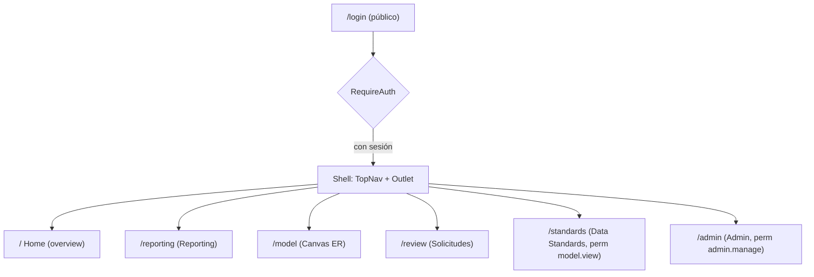
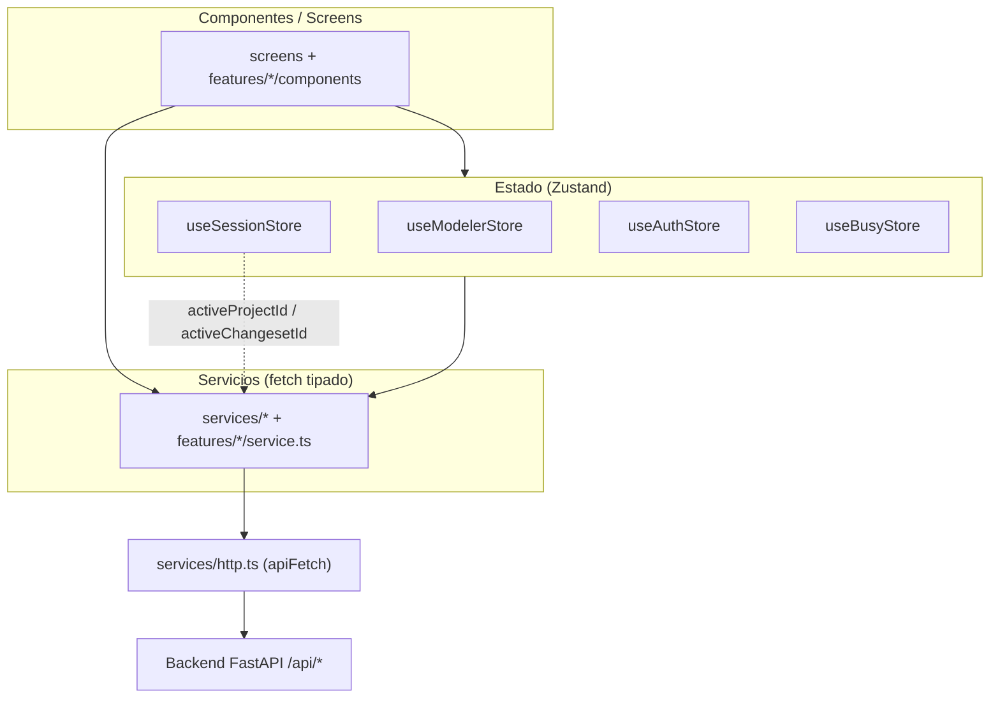
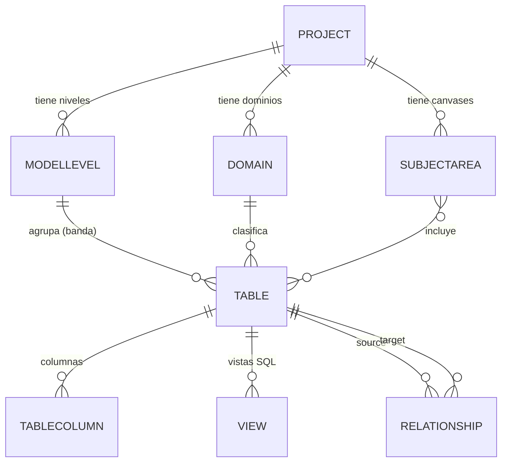
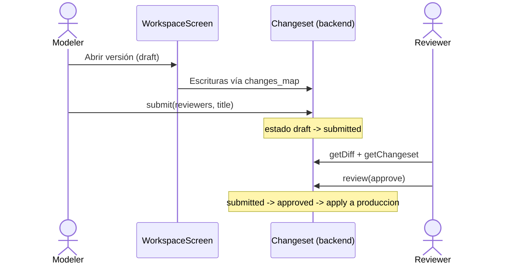

# Data Model Hub — Frontend

Aplicación web (SPA) para **diseñar, documentar, gobernar y reportar modelos de datos** al estilo de herramientas como erwin Data Modeler, pero pensada para la nube y el trabajo colaborativo. Es el **frontend** de la plataforma Data Model Hub: consume una API REST (FastAPI) que persiste en Databricks Lakebase Postgres y expone toda la experiencia visual — el canvas entidad-relación, el reporting de metadata, los estándares de datos y la administración/RBAC.

Este repositorio contiene **solo la capa de presentación** (Vite + React + TypeScript). El backend vive en un repositorio aparte (`backend-data-model-hub`).

---

## Índice

- [Qué es](#qué-es)
- [Módulos principales](#módulos-principales)
- [Stack tecnológico](#stack-tecnológico)
- [Arquitectura del frontend](#arquitectura-del-frontend)
- [Modelo de datos (dominio)](#modelo-de-datos-dominio)
- [Features por módulo](#features-por-módulo)
- [Cómo correrlo en local](#cómo-correrlo-en-local)
- [Variables de entorno](#variables-de-entorno)
- [Scripts de npm](#scripts-de-npm)
- [Estructura de carpetas](#estructura-de-carpetas)
- [Ejemplos concretos](#ejemplos-concretos)
- [Despliegue](#despliegue)
- [Documentación en `doc/`](#documentación-en-doc)

---

## Qué es

Data Model Hub resuelve el ciclo de vida completo de un modelo de datos empresarial:

1. **Modelar** visualmente tablas, columnas, vistas y relaciones sobre un canvas ER con notación de pata de gallo (crow's foot), auto-layout y bandas por "modelo/nivel" (por ejemplo RDV, UDV, DDV de un Data Vault).
2. **Gobernar** los cambios: cada edición ocurre dentro de una *sesión* que se materializa en un *changeset/solicitud*, se envía a revisión, un aprobador decide y recién ahí se publica a producción.
3. **Estandarizar** con glosario de términos/abreviaturas, dominios padre (plantillas de tipo de dato con cascada), reglas de nomenclatura y propiedades definidas por el usuario (UDP), todo versionado de forma independiente.
4. **Reportar** la metadata con un motor de consulta (builder visual + caja SQL) sobre columnas, tablas, relaciones y vistas, con exportación a Excel/CSV.
5. **Administrar** el acceso (whitelist de correos asignados a una matriz de rol, doc 38), los roles y la matriz de permisos (RBAC), con sesión por token y auditoría.

La navegación global se organiza en un *shell* con una barra superior persistente (`TopNav`) sobre la pantalla ruteada:



---

## Módulos principales

| Ruta | Pantalla | Descripción | Permiso |
|------|----------|-------------|---------|
| `/` | `HomeScreen` | Landing del workspace: contadores (tablas, vistas, relaciones, subject areas, proyectos), solicitudes asignadas y versiones (solo lectura). | sesión |
| `/model` | `WorkspaceScreen` | Canvas ER completo: explorador de proyecto/carpetas/canvases, edición de tablas/columnas/vistas/relaciones, auto-layout, publicación. | sesión |
| `/reporting` | `ReportingScreen` + `ReportDesigner` | Reporte tabular de metadata + diseñador de reportes (builder visual y SQL) con exportación. | sesión / `export` |
| `/review` | `ReviewScreen` | Bandeja global de solicitudes con chip y filtro de proyecto: diff, impacto, aprobación/rechazo (con confirmación crítica si el request borra su proyecto), comentarios. | `review.decide` para decidir |
| `/standards` | `StandardsScreen` | Glosario, dominios padre, definiciones de UDP, nomenclatura y reglas DDL **del proyecto elegido**, todo versionado con rollback por proyecto. | `model.view` (editar: `standards.edit`) |
| `/admin` | `AdminScreen` | Usuarios, roles, matriz de permisos y auditoría. | `admin.manage` |

Permisos del sistema (matriz RBAC, 1:1 con el backend): `model.view`, `model.edit`, `review.decide`, `publish`, `rollback`, `export`, `standards.edit`, `admin.manage`.

---

## Stack tecnológico

| Categoría | Tecnología | Versión | Rol |
|-----------|-----------|---------|-----|
| Build / dev server | **Vite** | 6.4.3 | Bundler y servidor de desarrollo (HMR, proxy `/api`). |
| UI | **React** + React DOM | 19.2.4 | Librería de vistas (StrictMode). |
| Lenguaje | **TypeScript** | 5.9.3 | Tipado estricto (`strict: true`). |
| Ruteo | **React Router** (`react-router-dom`) | 7.18.0 | Rutas del shell, guards de auth/permiso. |
| Estado | **Zustand** | 5.0.12 | Stores del canvas, sesión (proyecto + versión activos), auth, undo y overlay bloqueante. |
| Canvas ER | **@xyflow/react** (React Flow 12) | 12.11.0 | Nodos (tablas/figuras) y aristas (relaciones). |
| Auto-layout | **elkjs** | 0.11.1 | Distribución automática del diagrama (`layered`/Sugiyama). |
| Grillas | **@tanstack/react-virtual** | 3.14.5 | Virtualización de resultados de reporting a gran escala. |
| Notificaciones | **sonner** | 2.0.7 | Toasts globales. |
| Export Excel | **xlsx** (SheetJS) | 0.18.5 | Workbook multi-hoja desde el reporting. |
| Export imagen | **html-to-image** | 1.11.13 | Captura del canvas a **SVG** (`toSvg`). |
| Reglas DDL | **yaml** | 2.9.0 | Editor y parseo YAML de las reglas del Export DDL. |
| Íconos | **lucide-react** | 1.21.0 | Iconografía consistente. |
| Tipografías | **Geist** / **Geist Mono** (`@fontsource-variable/*`) | 5.2.9 / 5.2.8 | Fuente de UI y monoespaciada (self-hosted). |
| IDs | **uuid** | 13.0.0 | Identificadores estables cliente-side. |
| Testing | **Vitest** | 2.1.9 | Tests unitarios (`src/**/*.test.ts(x)`). |
| Linting | **ESLint** + `typescript-eslint` + `eslint-plugin-react-hooks` | 9.39.4 / 8.58.1 / 7.1.1 | Reglas de calidad y hooks. |

Todas las dependencias están **pineadas exactas** (sin `^` ni `~`; política 2026-07-31).

Configuración clave (`vite.config.ts` / `tsconfig.json`):

- Alias de imports: `@` → `./src` (por ejemplo `import { apiFetch } from '@/services/http'`).
- Servidor dev en el puerto **3000**; proxy `/api` → `http://localhost:8000` (backend FastAPI).
- Target `ES2020`, `moduleResolution: bundler`, `jsx: react-jsx`.

---

## Arquitectura del frontend

El código sigue un enfoque *feature-sliced*: cada módulo funcional vive bajo `src/features/<módulo>/` con sus componentes, servicios y estilos; lo transversal (cliente HTTP, stores, tipos, UI base y layout) se comparte.



Puntos de diseño relevantes:

- **Cliente HTTP único** (`src/services/http.ts`): `apiFetch<T>()` desempaqueta el envelope `{ success, data?, error? }` que devuelve toda la API, adjunta el token de sesión como `X-Session-Token: <token>` (y `X-Dev-User` solo en desarrollo; en Databricks Apps el header `Authorization: Bearer` le pertenece al proxy SSO de la plataforma), aplica un timeout global de 30 s (`AbortSignal.timeout`), usa `credentials: 'include'` para la cookie de sesión cross-origin y despacha un handler global ante `401` (logout + redirección a `/login`). Los errores se propagan como `ApiError` tipado con `status`.
- **Auth token-first** (`useAuthStore`): al arrancar, `restore()` lee el token de `localStorage` y valida contra `/api/auth/me`; mientras `status === 'loading'` los guards muestran un splash. Los guards `RequireAuth` y `RequirePermission` protegen las rutas.
- **Sesión de UN proyecto** (doc 75): `useSessionStore` guarda `activeProjectId` + `activeChangesetId` y es la única fuente que leen los servicios (`sessionProjectId()` arma las rutas `/api/projects/{pid}/…`) y los gates del canvas. Las acciones largas corren bajo `runBlocking()` (`useBusyStore`), que muestra un overlay bloqueante por sesión.
- **Base de la API configurable**: cada servicio construye sus URLs con `const API_BASE = import.meta.env.VITE_API_URL ?? ''`. Con `VITE_API_URL` vacío, las llamadas van al mismo origen y en dev el proxy de Vite las reenvía al backend.

---

## Modelo de datos (dominio)

Los tipos del frontend (`src/types/model.ts`) espejan los modelos de persistencia del backend. Jerarquía: **Project → Model/nivel (layer) + Domain (vertical) → Table (= layer × domain) → Column + View**, con relaciones que pueden cruzar niveles/dominios.



Conceptos clave del dominio:

- **Project**: agrupa `engines` (motores soportados: `postgresql`, `databricks_sql`, `sqlserver`, `mysql`, `cosmosdb`), `layers` (modelos/niveles con orden y color para las bandas del canvas) y `domains` (productos de datos verticales, con owner/steward y sensibilidad `Public…PII`).
- **SubjectArea (Canvas)**: vista temática que agrupa `tableIds`, guarda `layout` (posiciones), `drawings` (figuras: rectángulos, círculos, texto, etc.) y `routes` (trazos manuales de wires, doc 99: puntos de quiebre por relación o subcategoría; un wire sin trazo usa el camino automático). Las tablas se organizan en carpetas (`Folder`) dentro del proyecto.
- **Table / TableColumn**: la columna tiene `id` estable (sobrevive renames — las relaciones y los handles de React Flow se referencian por `id`, nunca por `name`), flags de clave (PK, surrogate, partition, FK con `fkManual`), `semanticTypeId`/`semanticValues` (tipo semántico transversal), `udpValues` (propiedades definidas por el usuario) y `tags`.
- **View**: proyección SQL por rol embebida en la tabla (`select` multilínea, `where` AND-joined), renderizada en el inspector y exportable como `CREATE VIEW`.
- **Relationship** (`src/services/governance.service.ts`): modelo v2 parent/child — `parentTableId`/`childTableId` + `pairs[]` (los pares de columnas de la FK), con `parentCardinality`/`childCardinality` (enum crow's foot por extremo), `identifying` y las frases de relación `parentToChildPhrase`/`childToParentPhrase` (doc 98: la etiqueta que el canvas y el export dibujan sobre el wire, formato Erwin `padre→hijo / hijo→padre`; se ocultan con el botón *Show/Hide relationship labels* del toolbar).
- **Versionado** (`src/types/versioning.ts`): un changeset tiene estado `draft → submitted → approved/rejected`; expone `diff` (buckets added/edited/deleted por colección), `impact` (tablas/columnas tocadas) y `approvals`/`comments`.

---

## Features por módulo

### Modeler — canvas ER (`/model`)

Componentes en `src/features/modeler/components/`: `WorkspaceScreen`, `ModelerCanvas`, `ModelExplorer`, `TableNode`, `ShapeNode`, `CrowFootEdge`/`CrowFootMarkers`, `PropertiesPanel`, `ColumnEditor`, `ViewEditor`, `Toolbar`, `NewTableModal`, `RelationshipPopup`, `RelationshipCreatePopup`/`KeyMappingRows`, `PublishModal`, `CtasModal`, `UdpAssign`.

- Explorador de árbol Proyecto → Carpetas → Canvases con caché por proyecto (`useModelerStore.trees`) para expandir varios a la vez.
- Edición de tablas, columnas (tipos de dato de un superset "Databricks-flavored"), relaciones con notación crow's foot que **migran la llave compuesta completa del padre** (doc 47: el wire nace de la cabecera del bloque, un popup N=N confirma el mapeo/creación de columnas con herencia de metadata, y las salidas se reparten en la zona de llave), vistas SQL por rol y asignación de UDP/tipos semánticos.
- Modos **lógico** y **físico**; auto-layout con `elkjs` (`lib/elkLayout.ts`); export del canvas a **SVG** con `html-to-image` (`toSvg`).
- **Trazos manuales de wires** (doc 99): con un wire seleccionado, en edición, aparecen sus tiradores (`WireRouteHandles`) — arrastrar el punto hueco de un tramo crea un punto de quiebre, arrastrar un punto lo mueve (imán a los ejes de sus vecinos), doble clic o `Supr` lo quita y el botón ↺ vuelve al camino automático. El camino es siempre ortogonal y pasa por todos los puntos (`lib/wireRoute.ts`, puro), calculado en píxeles enteros del canvas; el lado de cada extremo lo decide el trazo (primer y último punto) y solo cambia si por ese lado el wire tendría que volver sobre sí mismo (bloques apilados, recursivas). Al mover un bloque los puntos quedan fijos y solo se recalculan los extremos. Se guarda una vez por gesto en el documento del canvas (`routes`), con Undo; varias flechas seguidas cuentan como un solo gesto. Si el guardado falla, el wire vuelve a lo último grabado y se avisa. Un diagrama que llega tarde (pedido antes de terminar un guardado del canvas) no pisa lo recién grabado: `lib/canvasWrites.ts` anota cada escritura del canvas y `reload` / `selectSubjectArea` reponen posiciones y trazos. El auto-arrange reinicia los trazos del canvas (en edición confirma antes). En visor no hay tiradores.
- **Guard de cambios sin guardar**: al navegar fuera de `/model` con una versión en edición y estado `dirty`, `TopNav` intercepta y ofrece "Guardar y salir / Salir sin guardar / Cancelar"; el cierre de pestaña lo cubre un `beforeunload`.
- Generación de **DDL** (`features/ddl/generators.ts`): `CREATE TABLE`/`CREATE VIEW` con cláusula de particionado según el motor (`PARTITIONED BY` en Databricks, `PARTITION BY RANGE` en Postgres/MySQL, etc.).

### Governance — sesiones, changesets y revisión (`/review`)

- Toda edición corre bajo una sesión que se materializa en un changeset (colección `changeset_changes`, cambios solo vía `changes_map`).
- `ReviewScreen` es una bandeja global con chip y filtro de proyecto (doc 75 D20): filtros Project/From/Reviewer, tarjetas de solicitud, detalle con impacto, diff "Changes · N", aprobación/rechazo (deshabilitado si el actor no es el reviewer asignado) y hilo de comentarios.
- Servicios: `governance.service`, `changeset.service`, `versioning.service`.

### Reporting (`/reporting`)

- Reporte tabular de metadata (`ReportingScreen`) con filtros por nombre, schema, proyecto y subject area (client-side + re-query server-side autoritativo) y exportación a Excel multi-hoja con `xlsx`.
- **Report Designer** (`features/reporting/components/`: `ReportDesigner`, `FilterBuilder`, `ResultsGrid`, `SqlEditor`): motor de consulta basado en un `ReportSpec` compartido con el backend, generado tanto por el builder visual como por la caja SQL. Grilla virtualizada (`react-virtual`), paginación por cursor (`nextCursor`/`hasMore`), export CSV por streaming, queries guardadas e *insights* (scorecard de calidad, cobertura de UDP, uso de dominios/glosario, reporte de relaciones).

### Data Standards (`/standards`)

- `GlossaryPage` (términos y abreviaturas por columna o por tabla), `DomainsPage` (dominios padre = plantillas de tipo de dato con cascada por-dato que respeta overrides manuales), `UdpDefsPage` (definiciones de UDP key-value: texto/número/booleano/fecha/lista).
- Nomenclatura global (separador y casing por scope) que re-*physicaliza* nombres físicos a partir de los lógicos.
- Versionado independiente con snapshot, apply, history y **rollback** (`standards.service`).

### Admin / RBAC (`/admin`)

- `AdminScreen`, `UserModal`, `RoleModal`, `PermissionMatrix`: **whitelist de acceso** (correos asignados a un rol — dan el login SSO; sin contraseñas, doc 38), roles y matriz de permisos, más auditoría (`AuditEntry`). La cuenta local `admin` convive en la lista (con reset de contraseña, `hasPassword`). Todo gated por `admin.manage` (`admin.service`).

### Auth (`/login`)

- Dos caminos hacia la misma sesión por token (doc 38): **"Continue with Databricks"** (`ssoLogin` → `/api/auth/sso/login`; hereda la identidad del SSO de la plataforma, requiere el correo whitelisteado en Admin) y **"Administrator"** (solo contraseña → `/api/auth/login`). Guards `RequireAuth`/`RequirePermission`, `UserMenu` en la barra superior.

---

## Cómo correrlo en local

Requisitos: **Node.js 20+** y npm. El backend FastAPI debe estar accesible (por defecto en `http://localhost:8000`).

```bash
# 1. Instalar dependencias
npm install

# 2. Configurar el backend (opción A: mismo origen vía proxy de Vite)
cp .env.example .env
# En .env: VITE_API_URL=   (vacío → el proxy de Vite reenvía /api → :8000)

# 3. Levantar el servidor de desarrollo (http://localhost:3000)
npm run dev
```

Con `VITE_API_URL` vacío, el frontend llama a rutas `/api/...` en su mismo origen y el proxy de Vite (`vite.config.ts`) las reenvía al FastAPI en `:8000`. Si el backend corre en otro host (por ejemplo un despliegue remoto), configurá `VITE_API_URL` con su URL absoluta y las llamadas irán directo allí.

Build de producción y verificación de tipos:

```bash
npm run build      # tsc --noEmit && vite build → genera dist/
npm run preview    # sirve el build localmente
npm run test       # vitest run
npm run lint       # eslint .
```

---

## Variables de entorno

Solo se expone al browser lo prefijado con `VITE_` (Vite las inlinea en build time). En producción el navegador habla con un **solo origen**: el servidor `server.mjs` sirve la SPA y proxya `/api/*` al backend, así que `VITE_API_URL` queda vacía y la URL del backend se configura en el runtime del servidor con `BACKEND_API_URL`.

| Variable | Ámbito | Uso | Ejemplo |
|----------|--------|-----|---------|
| `VITE_API_URL` | build-time (cliente) | Base absoluta del backend. Vacío = mismo origen. En producción va **vacía** (el proxy de `server.mjs` resuelve `/api`); en dev, el proxy de Vite reenvía `/api` → `:8000`. | `` (vacío) |
| `BACKEND_API_URL` | runtime (`server.mjs`) | Destino al que `server.mjs` proxya `/api/*` en producción. Vive como `env` de `app.yaml` (sobrescribible por una GitHub Variable homónima). | `https://bknd-data-model-hub-....databricksapps.com` |

> Nota (2026-07-31): la única lectura de env del cliente está centralizada en `src/services/apiBase.ts` (`API_BASE = import.meta.env.VITE_API_URL ?? ''`); los servicios la importan. En producción `API_BASE` queda vacío y todas las llamadas van al mismo origen que sirve `server.mjs`. `.env.production` y la herencia `NEXT_PUBLIC_API_URL` fueron eliminados.

---

## Scripts de npm

| Script | Comando | Qué hace |
|--------|---------|----------|
| `dev` | `vite` | Servidor de desarrollo con HMR (`:3000`). |
| `build` | `tsc --noEmit && vite build` | Chequeo de tipos + bundle de producción en `dist/`. |
| `preview` | `vite preview` | Sirve el build de `dist/` para verificación local. |
| `start` | `node server.mjs` | Runtime en Databricks Apps: sirve `dist/` y proxya `/api` al backend con token M2M; lo invoca el `command` de `app.yaml`. En Apps, Databricks corre `npm run build` antes del `command`; en local, correr `npm run build` primero. |
| `test` | `vitest run` | Corre los tests unitarios (`src/**/*.test.ts(x)`). |
| `lint` | `eslint .` | Linter sobre todo el proyecto. |

---

## Estructura de carpetas

```text
web-data-model-hub/
├── index.html                # Punto de entrada (monta #root, carga /src/main.tsx)
├── vite.config.ts            # Vite/Vitest: alias @→src, proxy /api, puerto 3000
├── tsconfig.json             # TypeScript strict, paths @/*
├── public/                   # Íconos y assets estáticos servidos tal cual
├── doc/                      # Documentación técnica y de usuario (ver abajo)
├── scripts/                  # Utilidades node (seed de stress)
└── src/
    ├── main.tsx              # Bootstrap React (fuentes Geist, estilos globales)
    ├── App.tsx               # Router + shell (TopNav + Outlet), guards, Toaster
    ├── app/                  # globals.css (agrega los CSS de styles/)
    ├── screens/              # HomeScreen, ReportingScreen, ReviewScreen
    ├── features/             # Módulos: admin, auth, ddl, modeler, reporting,
    │                         #   standards, upload
    ├── components/
    │   ├── layout/           # TopNav, UserMenu
    │   ├── ui/               # Botones, diálogos, badges, tooltips, etc.
    │   └── ProjectPicker, NewProjectModal, OpenModelModal, BusyOverlay
    ├── store/                # Zustand: useModelerStore, useSessionStore,
    │                         #   useAuthStore, useUndoStore, useBusyStore
    ├── services/             # Cliente http + servicios transversales
    │                         #   (governance, changeset, versioning, projects, …)
    ├── types/                # model.ts, versioning.ts, api.ts
    ├── lib/                  # Utilidades puras (tags, facets, projects, zip)
    └── styles/               # tokens.css, base.css, shell.css, topnav.css,
                              #   home.css, reporting.css, review.css, ui.css…
```

---

## Ejemplos concretos

### 1. Llamada tipada a la API desde un servicio

Todos los servicios se apoyan en `apiFetch`, que desempaqueta el envelope y lanza `ApiError` en caso de fallo:

```ts
// src/services/http.ts (uso)
import { apiGet, apiPost } from '@/services/http';

const API_BASE = import.meta.env.VITE_API_URL ?? '';

export const login = (username: string, password: string) =>
  apiPost<{ token: string; user: SessionUser }>(
    `${API_BASE}/api/auth/login`,
    { username, password },
  );

// En un componente:
try {
  const { token, user } = await login('carlos', '••••••');
} catch (err) {
  if (err instanceof ApiError && err.status === 401) toast.error('Credenciales inválidas');
}
```

### 2. Probar el backend con `curl`

El envelope de respuesta es `{ success, data?, error? }`; las rutas autenticadas requieren el `Bearer`:

```bash
# Login → obtener token
curl -s -X POST http://localhost:8000/api/auth/login \
  -H "Content-Type: application/json" \
  -d '{"username":"carlos","password":"secreto"}'
# → {"success":true,"data":{"token":"eyJ...","user":{...}}}

# Listar proyectos con el token
curl -s http://localhost:8000/api/projects \
  -H "Authorization: Bearer eyJ..."
# → {"success":true,"data":[{"id":"...","name":"Core Banking"}]}
```

### 3. `ReportSpec` — IR compartido del reporting

El mismo objeto lo produce el builder visual y la caja SQL, y lo consumen la grilla y el export:

```jsonc
{
  "from": "columns",
  "select": ["table.name", "name", "dataType", "isPrimaryKey"],
  "where": {
    "op": "and",
    "conditions": [
      { "field": "isPrimaryKey", "op": "eq", "value": true },
      { "field": "dataType", "op": "in", "value": ["varchar", "string"] }
    ]
  },
  "groupBy": [],
  "aggregations": [],
  "orderBy": [{ "field": "table.name", "dir": "asc" }],
  "limit": 100
}
```

```ts
// Ejecutar y paginar por cursor
const page1 = await runQuery(spec);
if (page1.hasMore) {
  const page2 = await runQuery(spec, page1.nextCursor!);
}
```

### 4. Flujo de gobernanza (editar → revisar → publicar)



---

## Despliegue

En producción el frontend corre como una **Databricks App** servida por `server.mjs` (Node puro, cero dependencias): sirve el build estático de `dist/` y **proxya `/api/*`** al backend FastAPI con un token OAuth M2M de su service principal. Así el navegador habla con un **solo origen** — no hay CORS cross-origin ni el muro SSO por-app entre front y back.

**Dónde corre** (dos entornos objetivo):

- **Databricks Apps** (primario): el `command` (`node server.mjs`) y las `env` de runtime (`BACKEND_API_URL`) viven en el **`app.yaml`** de la raíz del repo; el bundle `databricks.yml` aporta las `variables:` por entorno y los permisos. El bloque `config:` del bundle **no** se usa: el CLI lo ignora (bug `databricks/cli` #4901).
- **Azure App Service** (alternativa): se puede correr el mismo `server.mjs`, o servir `dist/` estático tras un reverse-proxy que exponga `/api`.

**Consideraciones de configuración:**

- La URL del backend es de *runtime* (`BACKEND_API_URL`, consumida por `server.mjs`), no build-time: cambiarla no exige recompilar el bundle. `VITE_API_URL` (build-time, cliente) va vacía en producción.
- Auth/cookies: `apiFetch` manda el token propio como `X-Session-Token` y usa `credentials: 'include'` para la cookie del proxy SSO; como todo pasa por un solo origen, no hay preflight CORS cross-origin en producción.

**Base de datos:** la persistencia es **Databricks Lakebase Postgres** (el frontend nunca la toca directamente — siempre pasa por la API `/api/*` del backend). Colecciones relevantes del backend incluyen las de proyectos/tablas/columnas/relaciones publicadas y `changeset_changes` (cambios pendientes por changeset, mutados solo vía `changes_map`). Toda la escritura del modelo fluye por el ciclo de gobernanza descrito arriba.

---

## Documentación en `doc/`

La carpeta `doc/` contiene la documentación técnica y de usuario. Índice de los documentos disponibles:

| Documento | Contenido |
|-----------|-----------|
| [`architecture.md`](doc/architecture.md) | Arquitectura general del frontend: capas, ruteo, cliente HTTP, stores, canvas y el servidor de producción `server.mjs`. |
| [`consideraciones-tecnicas.md`](doc/consideraciones-tecnicas.md) | Decisiones técnicas grandes: auto-layout con ELK (`layered`/Sugiyama) y renderización a escala (LOD/zoom semántico, virtualización). |
| [`data-flow.md`](doc/data-flow.md) | Flujo de datos: componentes → stores → servicios → API, y el puente sesión/changeset. |
| [`api-reference.md`](doc/api-reference.md) | Referencia de los endpoints del backend que consume el frontend y el envelope de respuesta. |
| [`design-system.md`](doc/design-system.md) | Sistema de diseño: tokens (`styles/tokens.css`), tipografías Geist, componentes UI base. |
| [`seguridad.md`](doc/seguridad.md) | Autenticación en producción (SSO de Databricks Apps + un solo origen), token de sesión, gating RBAC y ausencia de secretos en el bundle. |
| [`deployment.md`](doc/deployment.md) | Dónde corre: `server.mjs`, bundle de Databricks Apps, GitHub Variables y `BACKEND_API_URL`. |
| [`testing.md`](doc/testing.md) | Estrategia de tests con Vitest (incluidos los del servidor de producción) y consideraciones conocidas. |

> El testing se ejecuta con Vitest (`npm run test`) sobre `src/**/*.test.ts(x)`; la seguridad se apoya en el login por token, los guards `RequireAuth`/`RequirePermission` del frontend y la matriz RBAC autoritativa del backend.
