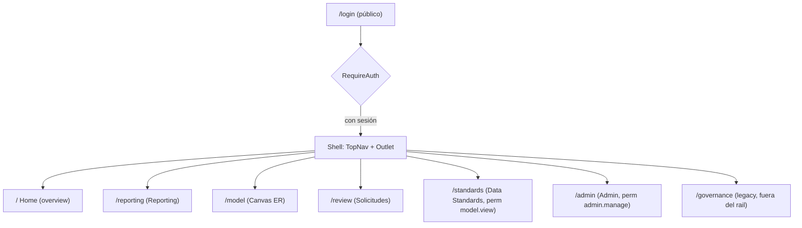
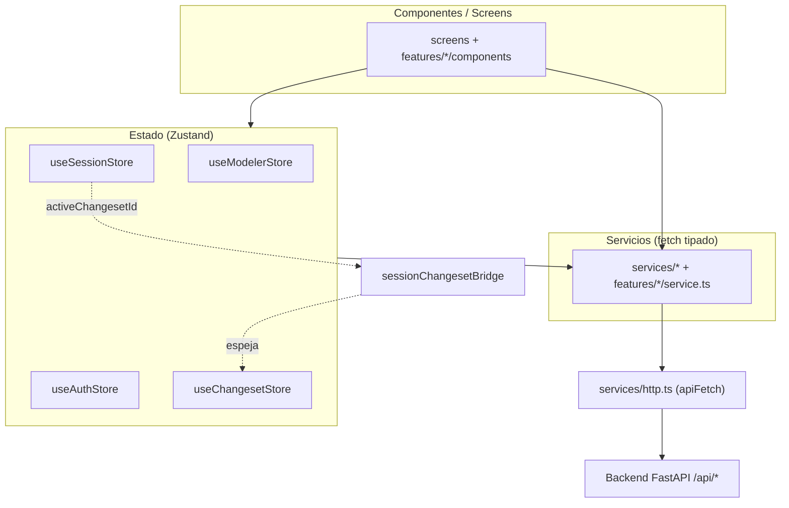
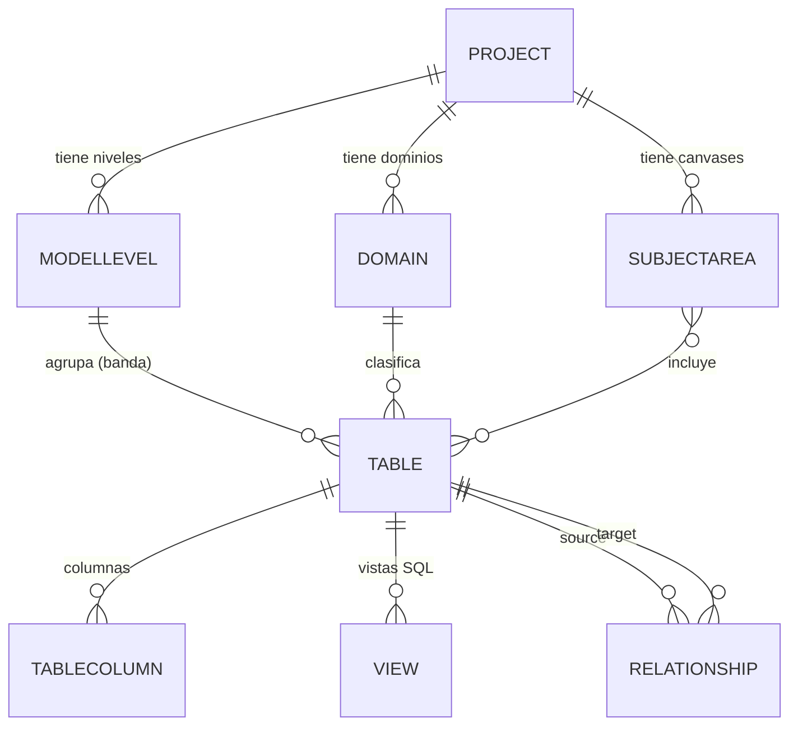
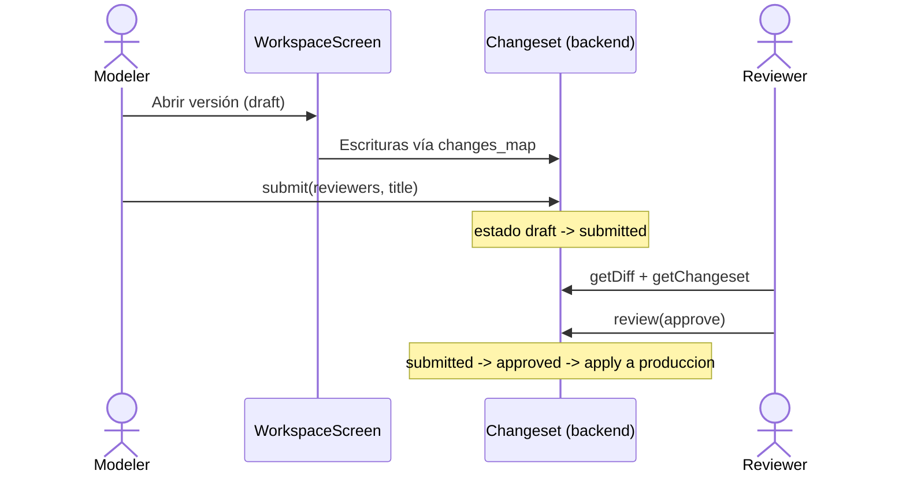

# Data Model Hub — Frontend

Aplicación web (SPA) para **diseñar, documentar, gobernar y reportar modelos de datos** al estilo de herramientas como erwin Data Modeler, pero pensada para la nube y el trabajo colaborativo. Es el **frontend** de la plataforma Data Model Hub: consume una API REST (FastAPI) que persiste en Azure Cosmos DB (API de Mongo) y expone toda la experiencia visual — el canvas entidad-relación, el reporting de metadata, los estándares de datos, la administración/RBAC y una guía de uso in-app.

Este repositorio contiene **solo la capa de presentación** (Vite + React + TypeScript). El backend vive en un repositorio aparte (`backend-data-model-hub`).

---

## Índice

- [Qué es](#qué-es)
- [Módulos principales](#módulos-principales)
- [Stack tecnológico](#stack-tecnológico)
- [Arquitectura del frontend](#arquitectura-del-frontend)
- [Modelo de datos (dominio)](#modelo-de-datos-dominio)
- [Features por módulo](#features-por-módulo)
- [Cómo correrlo en local](#cómo-correrlo-en-local)
- [Variables de entorno](#variables-de-entorno)
- [Scripts de npm](#scripts-de-npm)
- [Estructura de carpetas](#estructura-de-carpetas)
- [Ejemplos concretos](#ejemplos-concretos)
- [Despliegue](#despliegue)
- [Documentación en `doc/`](#documentación-en-doc)

---

## Qué es

Data Model Hub resuelve el ciclo de vida completo de un modelo de datos empresarial:

1. **Modelar** visualmente tablas, columnas, vistas y relaciones sobre un canvas ER con notación de pata de gallo (crow's foot), auto-layout y bandas por "modelo/nivel" (por ejemplo RDV, UDV, DDV de un Data Vault).
2. **Gobernar** los cambios: cada edición ocurre dentro de una *sesión* que se materializa en un *changeset/solicitud*, se envía a revisión, un aprobador decide y recién ahí se publica a producción.
3. **Estandarizar** con glosario de términos/abreviaturas, dominios padre (plantillas de tipo de dato con cascada), reglas de nomenclatura y propiedades definidas por el usuario (UDP), todo versionado de forma independiente.
4. **Reportar** la metadata con un motor de consulta (builder visual + caja SQL) sobre columnas, tablas, relaciones y vistas, con exportación a Excel/CSV.
5. **Administrar** usuarios, roles y una matriz de permisos (RBAC), con login propio (token) y auditoría.
6. **Guiar** al usuario con un Centro de ayuda in-app bilingüe (español/inglés) que documenta cada módulo.

La navegación global se organiza en un *shell* con una barra superior persistente (`TopNav`) sobre la pantalla ruteada:



---

## Módulos principales

| Ruta | Pantalla | Descripción | Permiso |
|------|----------|-------------|---------|
| `/` | `HomeScreen` | Landing del workspace: contadores (tablas, vistas, relaciones, subject areas, proyectos), solicitudes asignadas y versiones (solo lectura). | sesión |
| `/model` | `WorkspaceScreen` | Canvas ER completo: explorador de proyecto/carpetas/canvases, edición de tablas/columnas/vistas/relaciones, auto-layout, publicación. | sesión |
| `/reporting` | `ReportingScreen` + `ReportDesigner` | Reporte tabular de metadata + diseñador de reportes (builder visual y SQL) con exportación. | sesión / `export` |
| `/review` | `ReviewScreen` | Bandeja de solicitudes cross-project: diff, impacto, aprobación/rechazo, comentarios. | `review.decide` para decidir |
| `/standards` | `StandardsScreen` | Glosario, dominios padre, definiciones de UDP y nomenclatura, todo versionado con rollback. | `model.view` (editar: `standards.edit`) |
| `/admin` | `AdminScreen` | Usuarios, roles, matriz de permisos y auditoría. | `admin.manage` |
| `/governance` | `GovernanceScreen` | Pantalla legacy parkeada (fuera del rail de navegación). | sesión |

Permisos del sistema (matriz RBAC, 1:1 con el backend): `model.view`, `model.edit`, `review.decide`, `publish`, `export`, `standards.edit`, `admin.manage`.

---

## Stack tecnológico

| Categoría | Tecnología | Versión | Rol |
|-----------|-----------|---------|-----|
| Build / dev server | **Vite** | ^6.0.7 | Bundler y servidor de desarrollo (HMR, proxy `/api`). |
| UI | **React** + React DOM | 19.2.4 | Librería de vistas (StrictMode). |
| Lenguaje | **TypeScript** | ^5 | Tipado estricto (`strict: true`). |
| Ruteo | **React Router** (`react-router-dom`) | ^7.1.0 | Rutas del shell, guards de auth/permiso. |
| Estado | **Zustand** | ^5.0.12 | Stores del canvas, sesión, auth, changeset e identidad. |
| Canvas ER | **@xyflow/react** (React Flow 12) | ^12.3.5 | Nodos (tablas/figuras) y aristas (relaciones). |
| Auto-layout | **elkjs** | ^0.11.1 | Distribución automática del diagrama. |
| Grillas | **@tanstack/react-virtual** | ^3.14.5 | Virtualización de resultados de reporting a gran escala. |
| Notificaciones | **sonner** | ^2.0.7 | Toasts globales. |
| Export Excel | **xlsx** (SheetJS) | ^0.18.5 | Workbook multi-hoja desde el reporting. |
| Export imagen | **html-to-image** | ^1.11.13 | Captura del canvas a PNG. |
| Íconos | **lucide-react** | ^1.21.0 | Iconografía consistente. |
| Tipografías | **Geist** / **Geist Mono** (`@fontsource-variable/*`) | ^5.2.x | Fuente de UI y monoespaciada (self-hosted). |
| IDs | **uuid** | ^13.0.0 | Identificadores estables cliente-side. |
| Testing | **Vitest** | ^2.1.8 | Tests unitarios (`src/**/*.test.ts(x)`). |
| Linting | **ESLint** + `typescript-eslint` + `eslint-plugin-react-hooks` | ^9 / ^8.18 / ^7.1 | Reglas de calidad y hooks. |

Configuración clave (`vite.config.ts` / `tsconfig.json`):

- Alias de imports: `@` → `./src` (por ejemplo `import { apiFetch } from '@/services/http'`).
- Servidor dev en el puerto **3000**; proxy `/api` → `http://localhost:8000` (backend FastAPI).
- Target `ES2020`, `moduleResolution: bundler`, `jsx: react-jsx`.

---

## Arquitectura del frontend

El código sigue un enfoque *feature-sliced*: cada módulo funcional vive bajo `src/features/<módulo>/` con sus componentes, servicios y estilos; lo transversal (cliente HTTP, stores, tipos, UI base y layout) se comparte.



Puntos de diseño relevantes:

- **Cliente HTTP único** (`src/services/http.ts`): `apiFetch<T>()` desempaqueta el envelope `{ success, data?, error? }` que devuelve toda la API, adjunta `Authorization: Bearer <token>` y `X-Dev-User`, aplica un timeout global de 30 s (`AbortSignal.timeout`), usa `credentials: 'include'` para la cookie de sesión cross-origin y despacha un handler global ante `401` (logout + redirección a `/login`). Los errores se propagan como `ApiError` tipado con `status`.
- **Auth token-first** (`useAuthStore`): al arrancar, `restore()` lee el token de `localStorage` y valida contra `/api/auth/me`; mientras `status === 'loading'` los guards muestran un splash. Los guards `RequireAuth` y `RequirePermission` protegen las rutas.
- **Puente sesión → changeset** (`installSessionChangesetBridge`): espeja `useSessionStore.activeChangesetId` hacia `useChangesetStore.activeId` para que el changeset elegido al abrir un modelo alimente a todos los lectores del changeset activo (escrituras de gobernanza y gates del canvas).
- **Base de la API configurable**: cada servicio construye sus URLs con `const API_BASE = import.meta.env.VITE_API_URL ?? ''`. Con `VITE_API_URL` vacío, las llamadas van al mismo origen y en dev el proxy de Vite las reenvía al backend.

---

## Modelo de datos (dominio)

Los tipos del frontend (`src/types/model.ts`) espejan los modelos de persistencia del backend. Jerarquía: **Project → Model/nivel (layer) + Domain (vertical) → Table (= layer × domain) → Column + View**, con relaciones que pueden cruzar niveles/dominios.



Conceptos clave del dominio:

- **Project**: agrupa `engines` (motores soportados: `postgresql`, `databricks_sql`, `sqlserver`, `mysql`, `cosmosdb`), `layers` (modelos/niveles con orden y color para las bandas del canvas) y `domains` (productos de datos verticales, con owner/steward y sensibilidad `Public…PII`).
- **SubjectArea (Canvas)**: vista temática que agrupa `tableIds`, guarda `layout` (posiciones) y `drawings` (figuras: rectángulos, círculos, texto, etc.). Las tablas se organizan en carpetas (`Folder`) dentro del proyecto.
- **Table / TableColumn**: la columna tiene `id` estable (sobrevive renames — las relaciones y los handles de React Flow se referencian por `id`, nunca por `name`), flags de clave (PK, surrogate, partition, FK con `fkManual`), `semanticTypeId`/`semanticValues` (tipo semántico transversal), `udpValues` (propiedades definidas por el usuario) y `tags`.
- **View**: proyección SQL por rol embebida en la tabla (`select` multilínea, `where` AND-joined), renderizada en el inspector y exportable como `CREATE VIEW`.
- **Relationship**: `source`/`target` como `{ table, column }`, `cardinality` (`1:1`, `1:N`, `N:N`) y derivados no persistidos (`crossLayer`, `skip`) usados para avisos visuales.
- **Versionado** (`src/types/versioning.ts`): un changeset tiene estado `draft → submitted → approved/rejected`; expone `diff` (buckets added/edited/deleted por colección), `impact` (tablas/columnas tocadas) y `approvals`/`comments`.

---

## Features por módulo

### Modeler — canvas ER (`/model`)

Componentes en `src/features/modeler/components/`: `WorkspaceScreen`, `ModelerCanvas`, `ModelExplorer`, `TableNode`, `ShapeNode`, `CrowFootEdge`/`CrowFootMarkers`, `PropertiesPanel`, `ColumnEditor`, `ViewEditor`, `Toolbar`, `NewTableModal`, `RelationshipPopup`, `PublishModal`, `CtasModal`, `UdpAssign`.

- Explorador de árbol Proyecto → Carpetas → Canvases con caché por proyecto (`useModelerStore.trees`) para expandir varios a la vez.
- Edición de tablas, columnas (tipos de dato de un superset "Databricks-flavored"), relaciones con notación crow's foot, vistas SQL por rol y asignación de UDP/tipos semánticos.
- Modos **lógico** y **físico**; auto-layout con `elkjs` (`lib/elkLayout.ts`); export a PNG con `html-to-image`.
- **Guard de cambios sin guardar**: al navegar fuera de `/model` con una versión en edición y estado `dirty`, `TopNav` intercepta y ofrece "Guardar y salir / Salir sin guardar / Cancelar"; el cierre de pestaña lo cubre un `beforeunload`.
- Generación de **DDL** (`features/ddl/generators.ts`): `CREATE TABLE`/`CREATE VIEW` con cláusula de particionado según el motor (`PARTITIONED BY` en Databricks, `PARTITION BY RANGE` en Postgres/MySQL, etc.).

### Governance — sesiones, changesets y revisión (`/review`)

- Toda edición corre bajo una sesión que se materializa en un changeset (colección `changeset_changes`, cambios solo vía `changes_map`).
- `ReviewScreen` es cross-project: filtros From/Reviewer, tarjetas de solicitud, detalle con impacto, diff "Changes · N", aprobación/rechazo (deshabilitado si el actor no es el reviewer asignado) y hilo de comentarios.
- Servicios: `governance.service`, `changeset.service`, `versioning.service`.

### Reporting (`/reporting`)

- Reporte tabular de metadata (`ReportingScreen`) con filtros por nombre, schema, proyecto y subject area (client-side + re-query server-side autoritativo) y exportación a Excel multi-hoja con `xlsx`.
- **Report Designer** (`features/reporting/components/`: `ReportDesigner`, `FilterBuilder`, `ResultsGrid`, `SqlEditor`): motor de consulta basado en un `ReportSpec` compartido con el backend, generado tanto por el builder visual como por la caja SQL. Grilla virtualizada (`react-virtual`), paginación por cursor (`nextCursor`/`hasMore`), export CSV por streaming, queries guardadas e *insights* (scorecard de calidad, cobertura de UDP, uso de dominios/glosario, reporte de relaciones).

### Data Standards (`/standards`)

- `GlossaryPage` (términos/abreviaturas y tipo de palabra prime/class/modifier), `DomainsPage` (dominios padre = plantillas de tipo de dato con cascada por-dato que respeta overrides manuales), `UdpDefsPage` (definiciones de UDP key-value: texto/número/booleano/fecha/lista).
- Nomenclatura global (separador y casing por scope) que re-*physicaliza* nombres físicos a partir de los lógicos.
- Versionado independiente con snapshot, apply, history y **rollback** (`standards.service`).

### Admin / RBAC (`/admin`)

- `AdminScreen`, `UserModal`, `RoleModal`, `PermissionMatrix`: CRUD de usuarios, roles y matriz de permisos, más auditoría (`AuditEntry`). Todo gated por `admin.manage` (`admin.service`).

### Auth (`/login`)

- Login usuario/contraseña con token (`auth.service`: `/api/auth/login`, `/logout`, `/me`), guards `RequireAuth`/`RequirePermission`, `UserMenu` en la barra superior.

### Help — guía in-app

- `HelpCenter` bilingüe (es/en): conceptos clave, primeros pasos, FAQ y documentación por módulo generada leyendo el código real (`helpModules.generated.ts`). Botón "Help" en `TopNav`.

---

## Cómo correrlo en local

Requisitos: **Node.js 20+** y npm. El backend FastAPI debe estar accesible (por defecto en `http://localhost:8000`).

```bash
# 1. Instalar dependencias
npm install

# 2. Configurar el backend (opción A: mismo origen vía proxy de Vite)
cp .env.example .env
# En .env: VITE_API_URL=   (vacío → el proxy de Vite reenvía /api → :8000)

# 3. Levantar el servidor de desarrollo (http://localhost:3000)
npm run dev
```

Con `VITE_API_URL` vacío, el frontend llama a rutas `/api/...` en su mismo origen y el proxy de Vite (`vite.config.ts`) las reenvía al FastAPI en `:8000`. Si el backend corre en otro host (por ejemplo un despliegue remoto), configurá `VITE_API_URL` con su URL absoluta y las llamadas irán directo allí.

Build de producción y verificación de tipos:

```bash
npm run build      # tsc --noEmit && vite build → genera dist/
npm run preview    # sirve el build localmente
npm run test       # vitest run
npm run lint       # eslint .
```

---

## Variables de entorno

Solo se expone al browser lo prefijado con `VITE_` (Vite las inlinea en build time). La variable real que consume el código es `VITE_API_URL`.

| Variable | Uso | Ejemplo |
|----------|-----|---------|
| `VITE_API_URL` | Base absoluta del backend. Vacío = mismo origen (dev: el proxy de Vite reenvía `/api` → `:8000`). | `` (vacío) en dev; `https://bknd-....azuredatabricksapps.com` en prod |

> Nota (2026-07-19): `.env.example` y `.env.production` ya usan `VITE_API_URL` (se renombraron desde la herencia `NEXT_PUBLIC_API_URL` de la etapa Next.js). El código lee `import.meta.env.VITE_API_URL` (ver `src/vite-env.d.ts` y los ~14 servicios).

---

## Scripts de npm

| Script | Comando | Qué hace |
|--------|---------|----------|
| `dev` | `vite` | Servidor de desarrollo con HMR (`:3000`). |
| `build` | `tsc --noEmit && vite build` | Chequeo de tipos + bundle de producción en `dist/`. |
| `preview` | `vite preview` | Sirve el build de `dist/` para verificación local. |
| `start` | `vite preview --host 0.0.0.0 --port ${DATABRICKS_APP_PORT:-3000} --strictPort` | Runtime en Databricks Apps (lo invoca `app.yaml`); `prestart` corre `npm run build` antes. |
| `test` | `vitest run` | Corre los tests unitarios (`src/**/*.test.ts(x)`). |
| `lint` | `eslint .` | Linter sobre todo el proyecto. |

---

## Estructura de carpetas

```text
web-data-model-hub/
├── index.html                # Punto de entrada (monta #root, carga /src/main.tsx)
├── vite.config.ts            # Vite/Vitest: alias @→src, proxy /api, puerto 3000
├── tsconfig.json             # TypeScript strict, paths @/*
├── public/                   # Íconos y assets estáticos servidos tal cual
├── doc/                      # Documentación técnica y de usuario (ver abajo)
├── scripts/                  # Utilidades node (seed de stress, migración a Cosmos)
└── src/
    ├── main.tsx              # Bootstrap React (fuentes Geist, estilos globales)
    ├── App.tsx               # Router + shell (TopNav + Outlet), guards, Toaster
    ├── app/                  # globals.css (agrega los CSS de styles/)
    ├── screens/              # HomeScreen, ReportingScreen, ReviewScreen
    ├── features/             # Módulos: admin, auth, ddl, governance, help,
    │                         #   modeler, reporting, standards
    ├── components/
    │   ├── layout/           # TopNav, AppLayout, Header, Sidebar, UserMenu
    │   └── ui/               # Botones, diálogos, badges, tooltips, etc.
    ├── store/                # Zustand: useModelerStore, useSessionStore,
    │                         #   useAuthStore, useChangesetStore, useIdentityStore,
    │                         #   sessionChangesetBridge
    ├── services/             # Cliente http + servicios transversales
    ├── types/                # model.ts, versioning.ts, api.ts, identity.ts
    ├── hooks/, lib/          # Hooks e utilidades (tags, identidad)
    └── styles/               # tokens.css, base.css, shell.css, topnav.css,
                              #   home.css, reporting.css, review.css, ui.css…
```

---

## Ejemplos concretos

### 1. Llamada tipada a la API desde un servicio

Todos los servicios se apoyan en `apiFetch`, que desempaqueta el envelope y lanza `ApiError` en caso de fallo:

```ts
// src/services/http.ts (uso)
import { apiGet, apiPost } from '@/services/http';

const API_BASE = import.meta.env.VITE_API_URL ?? '';

export const login = (username: string, password: string) =>
  apiPost<{ token: string; user: SessionUser }>(
    `${API_BASE}/api/auth/login`,
    { username, password },
  );

// En un componente:
try {
  const { token, user } = await login('carlos', '••••••');
} catch (err) {
  if (err instanceof ApiError && err.status === 401) toast.error('Credenciales inválidas');
}
```

### 2. Probar el backend con `curl`

El envelope de respuesta es `{ success, data?, error? }`; las rutas autenticadas requieren el `Bearer`:

```bash
# Login → obtener token
curl -s -X POST http://localhost:8000/api/auth/login \
  -H "Content-Type: application/json" \
  -d '{"username":"carlos","password":"secreto"}'
# → {"success":true,"data":{"token":"eyJ...","user":{...}}}

# Listar proyectos con el token
curl -s http://localhost:8000/api/projects \
  -H "Authorization: Bearer eyJ..."
# → {"success":true,"data":[{"id":"...","name":"Core Banking"}]}
```

### 3. `ReportSpec` — IR compartido del reporting

El mismo objeto lo produce el builder visual y la caja SQL, y lo consumen la grilla y el export:

```jsonc
{
  "from": "columns",
  "select": ["table.name", "name", "dataType", "isPrimaryKey"],
  "where": {
    "op": "and",
    "conditions": [
      { "field": "isPrimaryKey", "op": "eq", "value": true },
      { "field": "dataType", "op": "in", "value": ["varchar", "string"] }
    ]
  },
  "groupBy": [],
  "aggregations": [],
  "orderBy": [{ "field": "table.name", "dir": "asc" }],
  "limit": 100
}
```

```ts
// Ejecutar y paginar por cursor
const page1 = await runQuery(spec);
if (page1.hasMore) {
  const page2 = await runQuery(spec, page1.nextCursor!);
}
```

### 4. Flujo de gobernanza (editar → revisar → publicar)



---

## Despliegue

El frontend es una SPA estática (salida de `vite build` en `dist/`). Puede alojarse detrás del mismo dominio del backend o servirse por separado.

**Dónde corre** (dos entornos objetivo):

- **Azure App Service**: se sirve el contenido estático de `dist/`; `VITE_API_URL` apunta a la URL pública del backend (o queda vacío si se sirve tras el mismo dominio/reverse-proxy que expone `/api`).
- **Databricks Apps**: el frontend se despliega como app estática y consume el backend FastAPI (otra Databricks App). En producción `VITE_API_URL` es la URL pública del backend, por ejemplo `https://bknd-data-model-hub-....azuredatabricksapps.com`.

**Consideraciones de configuración:**

- `VITE_API_URL` es *build-time*: se inlinea al compilar, así que hay que definirla antes de `npm run build` para cada entorno. No es secreto (es una URL pública).
- CORS/cookies: `apiFetch` usa `credentials: 'include'` y `Authorization: Bearer`; si frontend y backend viven en orígenes distintos, el backend debe permitir el origen del frontend y las cabeceras de auth.

**Base de datos:** la persistencia es **Azure Cosmos DB con API de Mongo** (el frontend nunca la toca directamente — siempre pasa por la API `/api/*` del backend). Colecciones relevantes del backend incluyen las de proyectos/tablas/columnas/relaciones publicadas y `changeset_changes` (cambios pendientes por changeset, mutados solo vía `changes_map`). Toda la escritura del modelo fluye por el ciclo de gobernanza descrito arriba.

---

## Documentación en `doc/`

La carpeta `doc/` contiene la documentación técnica y de usuario. Índice de los documentos disponibles:

| Documento | Contenido |
|-----------|-----------|
| [`architecture.md`](doc/architecture.md) | Arquitectura general del frontend: capas, ruteo, cliente HTTP, stores. |
| [`feature-architecture.md`](doc/feature-architecture.md) | Organización *feature-sliced*: cómo se estructura cada módulo (componentes/servicios/estilos). |
| [`data-flow.md`](doc/data-flow.md) | Flujo de datos: componentes → stores → servicios → API, y el puente sesión/changeset. |
| [`api-reference.md`](doc/api-reference.md) | Referencia de los endpoints del backend que consume el frontend y el envelope de respuesta. |
| [`design-system.md`](doc/design-system.md) | Sistema de diseño: tokens (`styles/tokens.css`), tipografías Geist, componentes UI base. |
| [`icons.md`](doc/icons.md) | Guía de uso de íconos (lucide-react) y convenciones. |
| [`user-guide.md`](doc/user-guide.md) | Guía funcional de usuario (equivalente escrito del Help in-app). |
| [`deployment.md`](doc/deployment.md) | Notas de despliegue: dónde corre, variables de entorno y consideraciones. |

> El testing se ejecuta con Vitest (`npm run test`) sobre `src/**/*.test.ts(x)`; la seguridad se apoya en el login por token, los guards `RequireAuth`/`RequirePermission` del frontend y la matriz RBAC autoritativa del backend.
