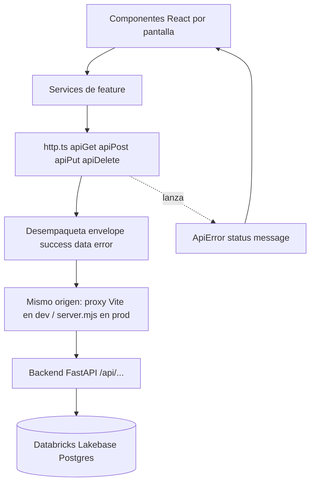
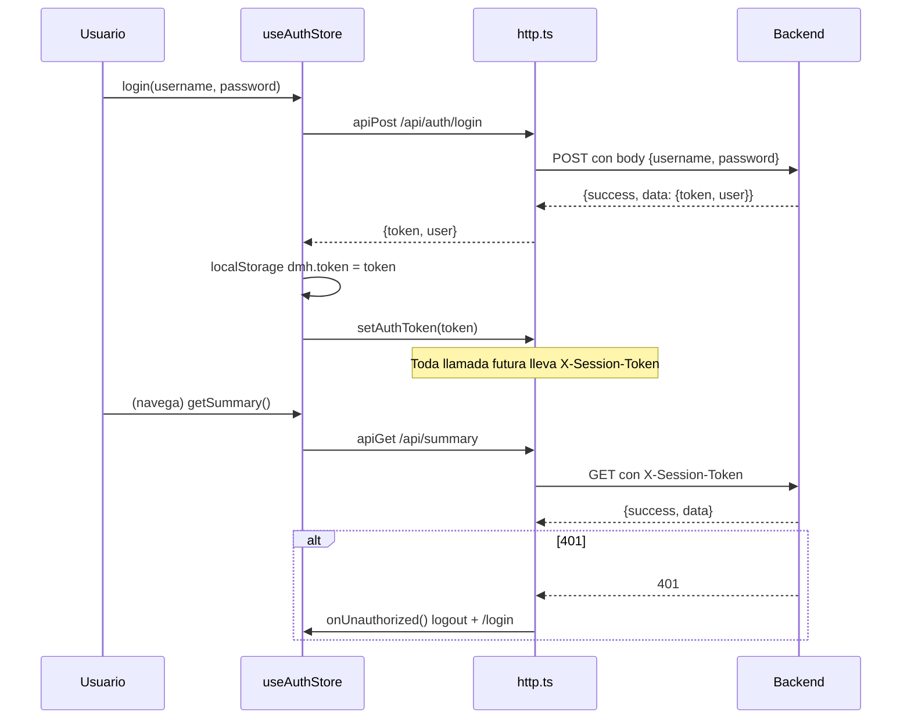
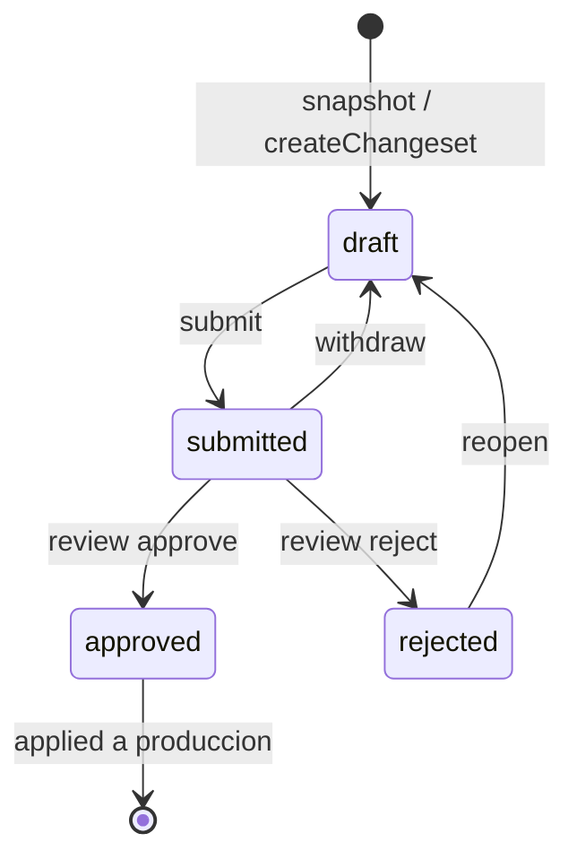
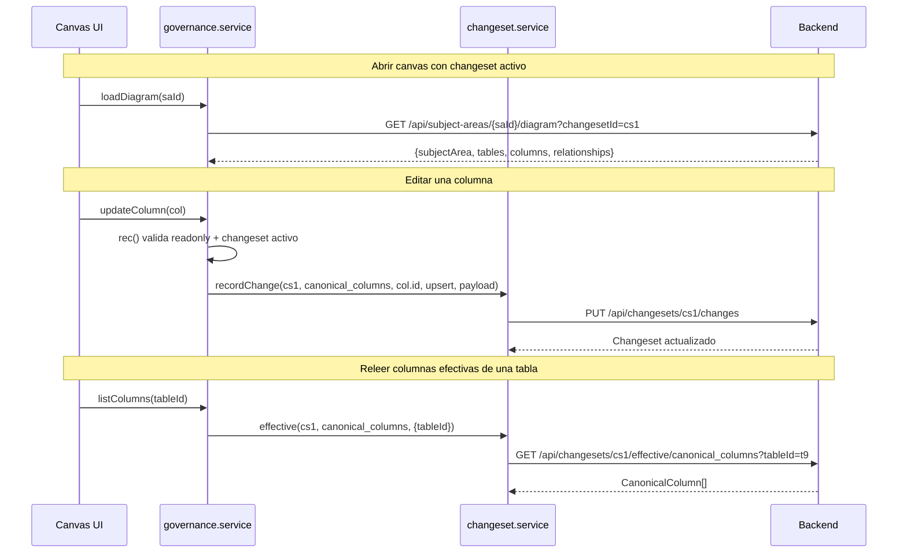
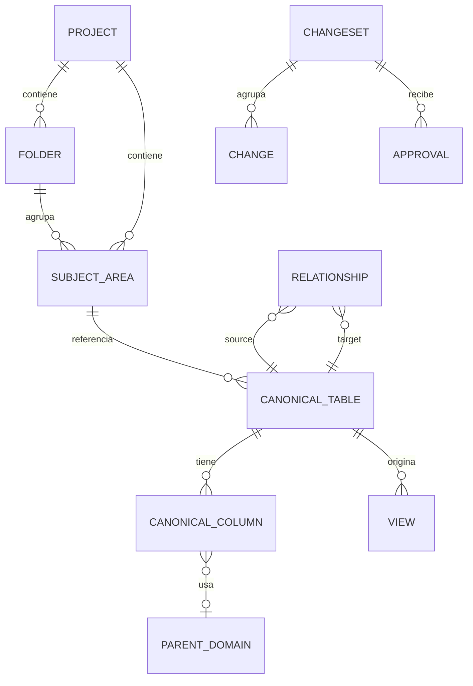

# Referencia de API consumida por el frontend — Data Model Hub (DMH)

Actualizado: 2026-07-31.

Este documento describe, a partir del código real, cómo el frontend (Vite + React + Zustand) del Data Model Hub consume la API del backend (FastAPI). Cubre el cliente HTTP compartido y, pantalla por pantalla / feature por feature, qué endpoints se llaman, con qué método, qué body envían y qué devuelven. Todos los ejemplos y firmas provienen de `src/services/*` y `src/features/*/services/*`.

---

## 1. Panorama general

El frontend habla con el backend siempre a través de un único cliente HTTP (`src/services/http.ts`). Ese cliente:

- Antepone la base URL `API_BASE` (`src/services/apiBase.ts`): vacía por defecto = mismo origen (en dev el proxy de Vite reenvía `/api` → `:8000`; en producción `server.mjs` sirve la SPA y proxya `/api` al backend).
- Adjunta el token de sesión como header **`X-Session-Token`** (NO `Authorization: Bearer` — ver §2.2).
- Adjunta el header `X-Dev-User` SOLO en desarrollo (`vite dev`), como fallback del seam local.
- Desempaqueta el envelope estándar `{ success, data, error }` y devuelve directamente `data`.
- Convierte cualquier fallo (red, timeout, 4xx/5xx, envelope inválido) en un `ApiError` tipado.

Encima de esa capa, cada feature tiene su propio "service" que solo aporta tipos y arma las URLs. Ningún componente inspecciona `json.success` a mano: todo pasa por los helpers `apiGet` / `apiPost` / `apiPut` / `apiDelete` / `apiFetch`.



El módulo **DDL** (`src/features/ddl`) genera el SQL base en el cliente a partir del modelo ya cargado; solo llama a la API cuando el usuario selecciona reglas de export en el modal: `rulesBridge.ts` → `POST /api/ddl-rules/render` (ver §3.5.3).

---

## 2. Cliente HTTP (`src/services/http.ts`)

### 2.1. Base URL (`src/services/apiBase.ts`)

Todos los services importan la base ÚNICA (homologación 2026-07-19):

```ts
export const API_BASE: string = import.meta.env.VITE_API_URL ?? '';
```

- **Vacía = mismo origen, el caso NORMAL en dev Y en producción**: en dev, el proxy de `vite.config.ts` reenvía `/api` → `http://localhost:8000`; en producción (doc 36), `server.mjs` sirve la SPA y proxya `/api` al backend servidor-a-servidor. Por eso `VITE_API_URL` NO se define en el build de Databricks Apps: definirla reactivaría el cruce navegador→backend y su doble muro SSO.
- `VITE_API_URL` queda solo para apuntar el front a otro backend en local (por ejemplo, probar contra el desplegado).

### 2.2. Estado de sesión en memoria

`http.ts` guarda tres piezas de estado a nivel de módulo, que otras capas empujan:

| Variable | Setter público | Uso |
|---|---|---|
| `_token` | `setAuthToken(t)` | Se envía como header **`X-Session-Token`** en TODA llamada. |
| `_devUser` | `setDevUser(u)` | Fallback del seam local; se envía como `X-Dev-User` SOLO en desarrollo (`import.meta.env.DEV`). |
| `_onUnauthorized` | `setOnUnauthorized(cb)` | Callback global que se dispara ante un 401 (cerrar sesión + ir a `/login`). |

Por qué `X-Session-Token` y no `Authorization: Bearer`: en Databricks Apps el header `Authorization` le pertenece al proxy SSO de la plataforma — lo consume para su propia autenticación y el backend nunca lo recibe (visto 2026-07-20: 401 con el Bearer en vuelo). Además, en producción `server.mjs` DESCARTA el `Authorization` entrante del cliente y pone SIEMPRE su propio Bearer M2M del service principal (conservando `X-Session-Token`). El backend acepta ambos headers: `Authorization` sigue sirviendo para `curl`/dev directo.

El `X-Dev-User` dejó de viajar en producción a propósito: la identidad es el token (`REQUIRE_AUTH`) y mandarlo solo hacía que el preflight CORS lo rechazara ("Disallowed CORS headers" → "Failed to fetch" en el login de Apps).

El token vive en `localStorage` bajo la clave `dmh.token` y lo administra el store de auth (ver §2.7). El cliente HTTP en sí solo conoce el valor en memoria; no lee `localStorage` directamente (salvo el export CSV del reporting, que sí lo hace de forma puntual).

### 2.3. `ApiError`

Error tipado que propagan todos los helpers. Lleva el `status` HTTP (o `0` para fallos de red / timeout):

```ts
export class ApiError extends Error {
  readonly status: number;
  constructor(message: string, status: number) {
    super(message);
    this.name = 'ApiError';
    this.status = status;
  }
}
```

Los consumidores hacen `try/catch (ApiError)` y deciden si muestran un toast, redirigen o reintentan.

### 2.4. `apiFetch<T>()` — el corazón del cliente

```ts
export async function apiFetch<T>(url: string, opts: RequestOptions = {}): Promise<T> {
  const { method = 'GET', body, headers = {}, signal } = opts;

  // Combina el signal del caller (cleanup de useEffect) con el timeout global.
  const timeout = AbortSignal.timeout(DEFAULT_TIMEOUT_MS); // 30_000 ms
  const combined = signal ? AbortSignal.any([signal, timeout]) : timeout;

  const init: RequestInit = {
    method,
    signal: combined,
    credentials: 'include',
    headers: {
      ...(_token ? { 'X-Session-Token': _token } : {}),
      ...(import.meta.env.DEV && _devUser ? { 'X-Dev-User': _devUser } : {}),
      ...headers,
    },
  };

  if (body !== undefined) {
    init.body = typeof body === 'string' ? body : JSON.stringify(body);
    init.headers = { 'Content-Type': 'application/json', ...init.headers };
  }
  // ... fetch, 401, parse de envelope ...
}
```

Detalles importantes del comportamiento:

- **Timeout global de 30 s** (`DEFAULT_TIMEOUT_MS`). Sin él, un backend colgado dejaría spinners eternos, porque `fetch` no tiene timeout propio. Si el caller pasa su propio `signal` (por ejemplo, el cleanup de un `useEffect`), ambos se combinan con `AbortSignal.any`.
- **`credentials: 'include'`**: en producción todo es mismo origen, pero cuando el front local apunta a un backend remoto (`VITE_API_URL` definida) el proxy SSO de Databricks Apps exige su cookie de sesión en requests cross-app; sin esto el navegador no la enviaría/aceptaría.
- **`Content-Type: application/json`** se agrega automáticamente solo cuando hay body.
- **Manejo del 401**: si la respuesta es `401` y hay `_onUnauthorized` registrado, se invoca (logout global). Igual se lanza `ApiError` para que el caller no siga con datos vacíos.

### 2.5. Manejo del envelope y de errores

```ts
if (!json || typeof json.success !== 'boolean') {
  // FastAPI HTTPException responde `{detail}` (sin envelope): propaga el
  // mensaje real (p.ej. 409 "versión ya no está en borrador").
  const detail = (json as { detail?: unknown } | null)?.detail;
  if (!response.ok && typeof detail === 'string' && detail) {
    throw new ApiError(detail, response.status);
  }
  throw new ApiError(`Unexpected response shape (HTTP ${response.status})`, response.status);
}

if (!json.success) {
  throw new ApiError(json.error ?? `Request failed (HTTP ${response.status})`, response.status);
}

return json.data as T;
```

Reglas de decodificación:

1. Respuesta con envelope válido y `success: true` → devuelve `json.data` (ya tipado como `T`).
2. Respuesta con envelope válido y `success: false` → lanza `ApiError(json.error, status)`.
3. Respuesta SIN envelope pero con `{ detail }` (típico `HTTPException` de FastAPI) → lanza `ApiError(detail, status)` para no perder el mensaje real (por ejemplo, un `409` con motivo).
4. JSON inválido → `ApiError("Invalid JSON response (HTTP ...)")`.
5. Red caída / DNS / abort / timeout → `ApiError(..., 0)`. Si fue el timeout, el mensaje es explícito: "The server didn't respond within 30s — try again in a moment." (la UI está en inglés).

El tipo del envelope está en `src/types/api.ts`:

```ts
export interface ApiResponse<T> {
  success: boolean;
  data?: T;
  error?: string;
}
```

### 2.6. Helpers de conveniencia

```ts
export function apiGet<T>(url, opts)         // GET
export function apiPost<T>(url, body, opts)  // POST
export function apiPut<T>(url, body, opts)   // PUT
export function apiDelete<T>(url, opts)      // DELETE
// apiFetch acepta method arbitrario, incluido PATCH
```

`apiFetch` se usa directamente cuando hace falta `PATCH` (por ejemplo, mover/renombrar carpetas).

`http.ts` exporta además dos helpers de error para los consumidores:

```ts
/** Mensaje legible de un error de API: el `detail` del backend si vino
 *  (ApiError lo conserva como `message`), o `fallback`. */
export function apiErrorMessage(e: unknown, fallback: string): string;

/** ¿Es un 409 de negocio del backend (p.ej. nombre duplicado)? */
export function isConflictError(e: unknown): boolean;
```

### 2.7. Ciclo de vida del token (auth store)

El token se administra en `src/store/useAuthStore.ts`, que actúa como fuente de verdad de la sesión y empuja el valor al cliente HTTP:

```ts
const TOKEN_KEY = 'dmh.token';

login: async (username, password) => {
  const { token, user } = await auth.login(username.trim(), password);
  // Defensa en profundidad: si la sesión anterior murió sin logout, el nuevo
  // actor arranca SIN estado heredado.
  resetAppState();
  localStorage.setItem(TOKEN_KEY, token);
  setAuthToken(token);       // ← empuja a http.ts (X-Session-Token)
  mirror(user);              // espeja el actor a useSessionStore (X-Dev-User en dev)
  set({ user, status: 'authed', error: null });
},

logout: async () => {
  try { await auth.logout(); } catch { /* best-effort */ }
  localStorage.removeItem(TOKEN_KEY);
  setAuthToken('');
  resetAppState();           // el logout es navegación SPA: sin esto los stores
  set({ user: null, status: 'anon' });   // singleton heredarían el canvas
},

restore: async () => {           // al arrancar la app
  const token = localStorage.getItem(TOKEN_KEY);
  if (!token) { set({ status: 'anon', user: null }); return; }
  setAuthToken(token);
  const user = await auth.fetchMe();
  // /me degrada al Principal básico si el actor no está registrado; sin
  // `permissions` no es una sesión válida de la auth propia.
},
```

Y el 401 global queda cableado una sola vez:

```ts
setOnUnauthorized(() => {
  if (useAuthStore.getState().status === 'authed') {
    localStorage.removeItem(TOKEN_KEY);
    setAuthToken('');
    resetAppState();
    useAuthStore.setState({ status: 'anon', user: null });
  }
});
```



---

## 3. Endpoints por pantalla / feature

A continuación, el detalle por área funcional. En todas las tablas, la ruta es relativa a `API_BASE` (vacía = mismo origen) y la respuesta ya viene desempaquetada (sin el envelope).

### 3.1. Autenticación e identidad

**Services:** `src/features/auth/auth.service.ts`, `src/services/identity.service.ts` y `src/services/warmup.ts`.

| Función | Método | Ruta | Body | Respuesta |
|---|---|---|---|---|
| `login(username, password)` | POST | `/api/auth/login` | `{ username, password }` | `{ token, user: SessionUser }` |
| `logout()` | POST | `/api/auth/logout` | — | `{ ok: boolean }` |
| `fetchMe()` | GET | `/api/auth/me` | — | `SessionUser` |
| `getMe()` | GET | `/api/me` | — | `Principal` |
| `ensureBackendSession()` | GET | `/api/health` (probe) + `/api/auth/warmup/{next_b64}` (navegación) | — | — |

El login está rate-limited en el backend (`5/minute` por IP). `SessionUser` incluye el rol, `projectIds`, `initials` y el mapa de permisos efectivos:

```ts
/** Permisos de la matriz (1:1 con el backend `PERMISSIONS`). */
export type Permission =
  | 'model.view' | 'model.edit' | 'review.decide' | 'publish'
  | 'rollback' | 'export' | 'standards.edit' | 'admin.manage';

export interface SessionUser {
  username: string;
  email?: string | null;
  name?: string | null;
  role?: string | null;
  roleName?: string | null;
  projectIds: string[];
  status?: string | null;
  initials?: string | null;
  permissions: Record<string, boolean>;   // 'model.view', 'model.edit', ...
  accessLevel?: 'full' | 'edit' | 'read' | null;
}
```

**Warm-up SSO (`warmup.ts`, doc 36)** — solo aplica cuando el front local apunta a un backend remoto de Databricks Apps (`API_BASE` no vacía): cada app vive detrás de su propio muro SSO por subdominio y un `fetch()` no puede completar ese SSO (redirect cross-origin). `ensureBackendSession()` hace un probe con `fetch` crudo a `GET /api/health`; si el fetch es rechazado, navega top-level (una sola vez, guard en `sessionStorage`) a `GET /api/auth/warmup/{next_b64}` — la URL de retorno viaja EN EL PATH como base64url sin padding, no como query string (el replay post-SSO del proxy de Databricks se atora con query strings). **Con `API_BASE` vacía (mismo origen, la producción actual) la función es inerte**: retorna sin hacer nada. La invoca `LoginScreen.tsx`.

Equivalente en `curl` (backend directo; acepta `X-Session-Token` o `Authorization: Bearer`):

```bash
curl -X POST "$BACKEND/api/auth/login" \
  -H "Content-Type: application/json" \
  -d '{"username":"cperez","password":"secreto"}'
# → {"success":true,"data":{"token":"eyJ...","user":{...}}}

curl "$BACKEND/api/auth/me" \
  -H "X-Session-Token: eyJ..."
# → {"success":true,"data":{"username":"cperez","permissions":{...}}}
```

### 3.2. Home / Dashboard (Screen 0)

Dos services alimentan el Home: los contadores (`dashboard.service`) y las versiones/solicitudes (`versioning.service`).

**Service:** `src/services/dashboard.service.ts`

| Función | Método | Ruta | Respuesta |
|---|---|---|---|
| `getSummary(projectIds?)` | GET | `/api/summary?projectId=...` | `DashboardSummary` |

`getSummary` acepta una lista de proyectos y los concatena como parámetros repetidos; sin proyectos, devuelve totales globales:

```ts
export function getSummary(projectIds?: string[]): Promise<DashboardSummary> {
  const ids = (projectIds ?? []).filter(Boolean);
  const qs = ids.length
    ? `?${ids.map((id) => `projectId=${encodeURIComponent(id)}`).join('&')}`
    : '';
  return apiGet<DashboardSummary>(`${API_BASE}/api/summary${qs}`);
}
```

```ts
export interface DashboardSummary {
  tables: number;
  views: number;
  relationships: number;
  subjectAreas: number;
  projects: number;
}
```

Ejemplo:

```bash
curl "$BACKEND/api/summary?projectId=p1&projectId=p2" -H "X-Session-Token: eyJ..."
# → {"success":true,"data":{"tables":812,"views":34,"relationships":455,"subjectAreas":21,"projects":2}}
```

**Service:** `src/services/versioning.service.ts` (comparte backend con los changesets)

| Función | Método | Ruta | Body | Respuesta |
|---|---|---|---|---|
| `listVersions()` | GET | `/api/versions` | — | `VersionRow[]` |
| `getPublished()` | GET | `/api/versions/published` | — | `VersionRow \| null` |
| `listRequests({reviewer, owner})` | GET | `/api/requests?reviewer=&owner=` | — | `VersionRow[]` |
| `snapshot(body)` | POST | `/api/changesets/snapshot` | `SnapshotBody` | `VersionRow` |
| `listUsers(can?)` | GET | `/api/users?can=` | — | `SimUserDto[]` |
| `submit(id, body)` | POST | `/api/changesets/{id}/submit` | `SubmitBody` | `VersionRow` |
| `getChangeset(id)` | GET | `/api/changesets/{id}` | — | `ChangesetDetail` |
| `getDiff(id)` | GET | `/api/changesets/{id}/diff` | — | `ChangesetDiff` |
| `getDiffDetails(id, items)` | POST | `/api/changesets/{id}/diff/details` | `{ items: {collection, entityId}[] }` | `{ items: DiffEntityDetail[] }` |
| `review(id, body)` | POST | `/api/changesets/{id}/review` | `ReviewBody` | `ChangesetDetail` |
| `addComment(id, {text})` | POST | `/api/changesets/{id}/comments` | `{ text }` | `ChangesetDetail` |
| `withdraw(id)` | POST | `/api/changesets/{id}/withdraw` | — | `ChangesetDetail` |
| `reopen(id)` | POST | `/api/changesets/{id}/reopen` | — | `ChangesetDetail` |
| `rollbackVersion(id)` | POST | `/api/changesets/{id}/rollback` | `{}` | `VersionRow` |

Notas por endpoint:

- `listUsers(can)`: con `can` (p.ej. `'review.decide'`) devuelve solo los usuarios cuyo ROL otorga ese permiso — el selector de revisores lo usa para no ofrecer gente que nunca podría aprobar.
- **Presentación de cambios (doc 31)**: la card "Changes summary" se arma con `summarizeDiff(diff)` — helper PURO del service, cero backend, que agrega el `GET /diff` ya cargado en conteos verde/ámbar/rojo por colección más proyectos/modelos afectados. El popup "Change details" usa `getDiffDetails()` (`POST /diff/details`, read-only): diff de campos ANTES→DESPUÉS de entidades puntuales, bajo demanda por selección y con tope de 200 ítems por llamada (el modal trocea). El `before` es la imagen estampada si la versión ya se aplicó, o el publicado vivo si está en revisión.
- `review()` propaga el `detail` real del backend en los 403 (distingue "sin permiso `review.decide`" de "no asignado como revisor"), con fallback legible:

```ts
export async function review(id: string, body: ReviewBody): Promise<ChangesetDetail> {
  try {
    return await apiPost<ChangesetDetail>(`${API_BASE}/api/changesets/${id}/review`, body);
  } catch (err) {
    if (err instanceof ApiError && err.status === 403) {
      throw new ApiError(err.message || 'You are not assigned as a reviewer of this change.', 403);
    }
    throw err;
  }
}
```

- `rollbackVersion()` (permiso propio `rollback`, doc 27): el backend crea un DRAFT con los cambios INVERSOS que restaura la base a esa versión (deshaciendo las posteriores). Producción no cambia hasta que ese draft pase submit → review → approve.

Bodies relevantes (de `src/types/versioning.ts`):

```ts
export interface SnapshotBody {
  title?: string; description?: string; versionLabel?: string; projectIds?: string[];
}
export interface SubmitBody {
  title?: string; description?: string; reviewers?: string[]; projectIds?: string[];
}
```

Máquina de estados de una versión / changeset (los endpoints que la mueven):



El `rollback` de una versión aplicada no altera esta máquina: crea un draft NUEVO (inverso) que recorre el mismo ciclo.

### 3.3. Model (Modeler): Project → Folders → Canvas

El editor de modelo se apoya en varios services complementarios: `modeler.service` (endpoints directos de estructura + armado del diagrama), `structure.service` (envoltorio changeset-aware de esa estructura — desde el doc 16 projects/folders/subject_areas son VERSIONADOS), `governance.service` + `changeset.service` (catálogo canónico y relaciones), `schemas.service` (esquemas como entidad), `views.service` (vistas versionadas) y `explorer.service` (Database Explorer draft-aware).

#### 3.3.1. Estructura: proyectos, carpetas y canvas (`modeler.service.ts` + `structure.service.ts`)

**La estructura es VERSIONADA** (fix del leak crítico 2026-07-16, doc 16: crear un proyecto o canvas en un draft escribía directo a producción). La UI llama a `structure.service.ts`, que espeja la regla de `rec()` de governance:

- ESCRITURAS con sesión de edición (`openMode='editing'` + changeset activo) → se REGISTRAN en el changeset (`csvc.recordChange`) con el payload SIEMPRE como doc COMPLETO (el overlay de lectura REEMPLAZA el doc publicado, no mergea) y publican recién en el approve.
- LECTURAS con changeset activo (edición O readonly de un request) → estado efectivo (`csvc.effective` de `projects` / `folders` / `subject_areas`), para que el dueño Y los revisores vean la estructura draft.
- Sin changeset (producción) → los endpoints directos de `modeler.service.ts` que siguen.

**Proyectos** (directos, `modeler.service.ts`)

| Función | Método | Ruta | Body | Respuesta |
|---|---|---|---|---|
| `listProjects()` | GET | `/api/projects` | — | `Project[]` |
| `createProject(name)` | POST | `/api/projects` | `{ name }` | `Project` |
| `renameProject(id, name)` | PUT | `/api/projects/{id}` | `{ name }` | `Project` |
| `deleteProject(id)` | DELETE | `/api/projects/{id}` | — | `{ deleted: boolean }` |

Nota: existe además `src/services/projects.service.ts`, un service paralelo legacy con tipos propios (`CreateProjectRequest` / `UpdateProjectRequest`) sobre las mismas rutas `/api/projects`.

**Carpetas** (jerarquía anidada del Model Explorer, vía `parentFolderId`)

| Función | Método | Ruta | Body | Respuesta |
|---|---|---|---|---|
| `listFolders(projectId)` | GET | `/api/projects/{projectId}/folders` | — | `Folder[]` |
| `createFolder(projectId, parentFolderId, name, order)` | POST | `/api/folders` | `{ projectId, parentFolderId, name, order }` | `Folder` |
| `renameFolder(id, name)` | PATCH | `/api/folders/{id}` | `{ name }` | `Folder` |
| `moveFolder(id, parentFolderId)` | PATCH | `/api/folders/{id}` | `{ parentFolderId }` | `Folder` |
| `deleteFolder(id)` | DELETE | `/api/folders/{id}` | — | `{ deleted: boolean }` |

`renameFolder` / `moveFolder` usan `apiFetch` directamente porque necesitan `PATCH`:

```ts
export const renameFolder = (id: string, name: string) =>
  apiFetch<Folder>(`${API_BASE}/api/folders/${encodeURIComponent(id)}`, { method: 'PATCH', body: { name } });
```

**Canvas (subject-areas)** — un canvas = una subject area = un diagrama ER

| Función | Método | Ruta | Body | Respuesta |
|---|---|---|---|---|
| `listSubjectAreas(projectId, folderId?)` | GET | `/api/projects/{projectId}/subject-areas?folderId=` | — | `SubjectArea[]` |
| `createSubjectArea(projectId, name, folderId)` | POST | `/api/subject-areas` | `{ projectId, name, folderId }` | `SubjectArea` |
| `updateSubjectArea(id, body)` | PUT | `/api/subject-areas/{id}` | `{ projectId, name, folderId? }` | `SubjectArea` |
| `deleteSubjectArea(id)` | DELETE | `/api/subject-areas/{id}` | — | `{ deleted: boolean }` |
| `getSubjectArea(saId)` | GET | `/api/subject-areas/{saId}` | — | `SubjectArea` |
| `setSubjectAreaTables(saId, tableIds)` | PUT | `/api/subject-areas/{saId}/tables` | `{ tableIds }` | `SubjectArea` |
| `setSubjectAreaLayout(saId, layout)` | PUT | `/api/subject-areas/{saId}/layout` | `{ layout }` | `SubjectArea` |
| `setSubjectAreaDrawings(saId, drawings)` | PUT | `/api/subject-areas/{saId}/drawings` | `{ drawings }` | `SubjectArea` |
| `setSubjectAreaUdp(saId, udpValues)` | PUT | `/api/subject-areas/{saId}/udp` | `{ udpValues }` | `SubjectArea` |
| `loadDiagram(saId)` | GET | `/api/subject-areas/{saId}/diagram?changesetId=` | — | `Diagram` |

Con changeset activo, `structure.service` reemplaza cada escritura de esta tabla por un `recordChange` sobre el doc efectivo completo (por ejemplo, `setSubjectAreaLayout` replica server-side el merge del PUT directo, y `removeTableFromCanvas` quita la tabla de `tableIds` Y de `layout` en un solo upsert, para no dejar nodos fantasma).

`loadDiagram` es la llamada clave de apertura de un canvas: en UNA sola request el backend arma tablas + columnas + relaciones + vistas aplicando el overlay del changeset activo del lado servidor. El `changesetId` sale del store:

```ts
export async function loadDiagram(saId: string): Promise<Diagram> {
  const cs = useChangesetStore.getState().activeId;
  const qs = cs ? `?changesetId=${encodeURIComponent(cs)}` : '';
  return apiGet<Diagram>(`${API_BASE}/api/subject-areas/${encodeURIComponent(saId)}/diagram${qs}`);
}
```

```ts
export interface Diagram {
  subjectArea: SubjectArea;
  tables: CanonicalTable[];
  columns: CanonicalColumn[];
  relationships: Relationship[];
  /** Vistas showOnCanvas con ≥1 fuente en este canvas (las filtra el backend). */
  views: View[];
}
```

#### 3.3.2. Catálogo, relaciones y escrituras versionadas (`governance.service.ts` + `changeset.service.ts`)

La governance es "consciente del changeset activo": si hay un changeset activo, LEE del estado efectivo (`/effective`) y ESCRIBE al changeset (`/changes`); sin changeset activo, LEE lo publicado y la UI queda de solo lectura.

**Lecturas de catálogo (publicado, sin changeset)**

| Función | Método | Ruta | Respuesta |
|---|---|---|---|
| `listTables()` (sin changeset) | GET | `/api/catalog/tables` | `CanonicalTable[]` |
| `searchTables(q, limit)` (sin changeset) | GET | `/api/catalog/tables?q=&limit=` | `CanonicalTable[]` |
| `listColumns(tableId)` (sin changeset) | GET | `/api/catalog/tables/{tableId}/columns` | `CanonicalColumn[]` |
| `listRelationships(tableId?)` (sin changeset) | GET | `/api/relationships?tableId=` | `Relationship[]` |
| `listDomains()` | GET | `/api/domains` | `ParentDomain[]` (solo lectura para el dropdown) |
| `physicalize(logical, scope?)` | POST | `/api/glossary/physicalize` | `{ physical }` |

**Lecturas globales overlay-aware** (pasan `changesetId` como query param cuando hay changeset activo, en vez de ir por `/effective`; el backend resuelve nombres server-side):

| Función | Método | Ruta | Respuesta |
|---|---|---|---|
| `tableUsage(tableId)` | GET | `/api/catalog/tables/{tableId}/usage?changesetId=` | `{ usage: TableUsageRow[], total }` — canvases que referencian la tabla, con carpeta y proyecto |
| `tableLinks(tableId)` | GET | `/api/relationships/links?tableId=&changesetId=` | `{ links: TableLinkRow[], total }` — relaciones GLOBALES de la tabla con los canvases donde son visibles (Properties · Links, doc 26) |
| `columnImpact(columnId)` | GET | `/api/relationships/impact?columnId=&changesetId=` | `RelationshipImpact` — relaciones donde la columna es extremo; alimenta el warning del delete |

La búsqueda de tablas es server-side por escala (a 15k tablas no se baja la colección completa):

```ts
export const searchTables = (q: string, limit = 50) => {
  const a = active();
  if (a) return csvc.effective<CanonicalTable>(a, 'canonical_tables', { q: q || undefined, limit });
  const params = new URLSearchParams();
  if (q) params.set('q', q);
  params.set('limit', String(limit));
  return apiGet<CanonicalTable[]>(`${CATALOG}/tables?${params.toString()}`);
};
```

**Lecturas con changeset activo (estado efectivo)** — `changeset.service.effective`

```ts
export const effective = <T>(
  id: string,
  collection: string,
  opts?: { tableId?: string; ids?: string[]; q?: string; limit?: number; schema?: string },
) => {
  const params = new URLSearchParams();
  if (opts?.tableId) params.set('tableId', opts.tableId);
  if (opts?.ids?.length) params.set('ids', opts.ids.join(','));
  if (opts?.q) params.set('q', opts.q);
  if (opts?.limit != null) params.set('limit', String(opts.limit));
  if (opts?.schema) params.set('schema', opts.schema);
  const qs = params.toString();
  return apiGet<T[]>(`${CS}/${encodeURIComponent(id)}/effective/${collection}${qs ? `?${qs}` : ''}`);
};
```

Ruta: `GET /api/changesets/{id}/effective/{collection}?tableId=&ids=&q=&limit=&schema=`. Las colecciones que consulta la UI son `canonical_tables`, `canonical_columns`, `relationships`, `views`, `schemas`, `projects`, `folders` y `subject_areas`. Los filtros son obligatorios en la práctica para no mover colecciones enteras (por ejemplo, `canonical_columns` puede tener cientos de miles de docs); `schema` acota a un esquema (Database Explorer draft-aware, doc 25).

**Escrituras (siempre al changeset)** — todas pasan por un choke-point único, `governance.service.rec()`, que:

1. Bloquea si el modo de apertura es `readonly`.
2. Exige un changeset activo.
3. Llama a `changeset.service.recordChange`.

```ts
const rec = (collection, id, op, payload?) => {
  if (useSessionStore.getState().openMode === 'readonly')
    throw new Error('The model is open read-only: it does not accept changes.');
  const a = active();
  if (!a) throw new Error('An active changeset is required to edit.');
  return csvc.recordChange(a, collection, id, op, payload);
};
```

```ts
export const recordChange = (id, collection, entityId, op: 'upsert' | 'delete', payload?) =>
  apiPut<Changeset>(`${CS}/${encodeURIComponent(id)}/changes`, { collection, entityId, op, payload });
```

Operaciones de modelo mapeadas a `PUT /api/changesets/{id}/changes`:

| Operación de UI | `collection` | `op` |
|---|---|---|
| `createTable(t)` | `canonical_tables` | `upsert` |
| `deleteTable(id)` — soft-delete versionado; el cascade (columnas/relaciones/vistas/membresías) lo orquesta el store, doc 23 | `canonical_tables` | `delete` |
| `createColumn(c)` / `updateColumn(c)` | `canonical_columns` | `upsert` |
| `deleteColumn(id)` | `canonical_columns` | `delete` |
| `markForeignKey(col, identifying, pkPosition?)` | `canonical_columns` | `upsert` |
| `markPrimaryKey(col, pkPosition?)` — el extremo padre de un wire se vuelve PK, doc 19 | `canonical_columns` | `upsert` |
| `createRelationship(r)` / `updateRelationship(r)` | `relationships` | `upsert` |
| `deleteRelationship(id)` | `relationships` | `delete` |

El backend valida en `add_change` el límite de longitud del nombre físico por scope (`maxLength` de `naming_config`, doc 24): crear/renombrar por encima del límite responde 400 (`NameTooLongError`) y la UI lo muestra como popup inline.

**Ciclo de vida del changeset** (`changeset.service.ts`):

| Función | Método | Ruta | Body | Respuesta |
|---|---|---|---|---|
| `listChangesets()` | GET | `/api/changesets` | — | `Changeset[]` |
| `getChangeset(id)` | GET | `/api/changesets/{id}` | — | `Changeset` |
| `createChangeset(title)` | POST | `/api/changesets` | `{ title }` | `Changeset` |
| `recordChange(...)` | PUT | `/api/changesets/{id}/changes` | `{ collection, entityId, op, payload }` | `Changeset` |
| `submitChangeset(id)` | POST | `/api/changesets/{id}/submit` | — | `Changeset` |
| `approveChangeset(id)` (legacy) | POST | `/api/changesets/{id}/approve` | — | `Changeset` |
| `rejectChangeset(id, note?)` (legacy) | POST | `/api/changesets/{id}/reject` | `{ note }` | `Changeset` |

`approve`/`reject` son el par legacy de la M-series; el flujo actual de Review usa `POST /{id}/review` (veredicto por revisor asignado) de `versioning.service` (§3.2).

Los cambios crudos NUNCA viajan al cliente: viven en la colección `changeset_changes` del backend (un documento por cambio) y se consumen únicamente vía `/effective` y `/diff`.



#### 3.3.3. Vistas (`views.service.ts`)

Las vistas son **VERSIONADAS** desde el doc 20 (tras la auditoría integral de la matriz del doc 20): siguen el MISMO patrón changeset-aware que governance/estructura/esquemas. Con changeset activo, las lecturas van al estado EFECTIVO (`/effective/views`) y las escrituras se registran en el changeset con el DOC COMPLETO; producción se toca solo en el apply del approve, y el rollback las revierte. Sin changeset (scripts/compat), sigue el REST directo:

| Función | Método/vía | Ruta | Body | Respuesta |
|---|---|---|---|---|
| `listViews(tableId)` | GET (o `/effective/views?tableId=`) | `/api/views?tableId=` | — | `View[]` |
| `listViewsForTables(tableIds)` | GET (o N × `/effective/views?tableId=` dedup por id) | `/api/views?tableIds=a,b,c` | — | `View[]` — Export DDL de un canvas en una request |
| `createView(body)` | POST (o `recordChange` upsert) | `/api/views` | `ViewInput` | `View` |
| `updateView(id, body)` | PUT (o `recordChange` upsert) | `/api/views/{id}` | `ViewInput` | `View` |
| `deleteView(id)` | DELETE (o `recordChange` delete) | `/api/views/{id}` | — | `{ deleted: boolean }` |

```ts
export interface ViewInput {
  tableId?: string;            // legacy: primera fuente (= sourceTableIds[0])
  sourceTableIds?: string[];   // F3: fuentes canónicas en orden (alias t1, t2…)
  showOnCanvas?: boolean;      // F3 (D3): la vista aparece en todo canvas con ≥1 fuente
  joinOverride?: string;       // F3 (D2): condición de JOIN manual
  name: string;
  schema?: string;
  tags?: Tag[];
  filter?: string;
  sources?: ViewSource[];      // proyección columna por columna (07b-2)
  outputAlias?: string;
  expression?: string;
  sql?: string;
  description?: string;        // F5: definición a nivel VISTA
}
```

Cada `ViewSource` admite además `description` propia (F5, doc 22: definición re-contextualizada de la columna en la vista; vacía = hereda la de la columna física). Antes de registrar el cambio, el service normaliza `tableId` ↔ `sourceTableIds` para que queden coherentes (espejo de la normalización del apply).

#### 3.3.4. Esquemas (`schemas.service.ts`)

La entidad `schemas` (doc 18) también es changeset-aware. La particularidad: **rename y delete van SIEMPRE por endpoints propios del changeset**, porque la propagación a tablas/vistas y el guard de uso se computan server-side.

| Función | Método | Ruta | Body | Respuesta |
|---|---|---|---|---|
| `listSchemas()` | GET (o `/effective/schemas`) | `/api/schemas` | — | `DbSchema[]` |
| `listPublishedSchemas()` | GET | `/api/schemas` | — | `DbSchema[]` (ignora el changeset activo) |
| `createSchema(name, desc?)` | POST (o `recordChange` upsert) | `/api/schemas` | `{ name, description }` | `DbSchema` |
| `schemaImpact(id)` | GET | `/api/changesets/{cs}/schemas/{id}/impact` | — | `{ name, tables, views, canvases }` — preview ANTES de guardar |
| `renameSchema(id, newName)` | POST | `/api/changesets/{cs}/schemas/{id}/rename` | `{ newName }` | `{ tables, views }` — cuántas se propagaron dentro del draft |
| `deleteSchema(id)` | POST (o DELETE directo sin changeset) | `/api/changesets/{cs}/schemas/{id}/delete` · `/api/schemas/{id}` | — | 409 si el esquema tiene tablas o vistas en su estado efectivo |

#### 3.3.5. Database Explorer (`explorer.service.ts`)

El Database Explorer es **draft-aware** (doc 25): con versión activa muestra el estado EFECTIVO (publicado + overlay del changeset); sin versión, el estado publicado vía reporting/catálogo. El componente solo consume filas `Dbx*` y no sabe de qué fuente vienen.

| Función | Producción (sin changeset) | Draft (con changeset) |
|---|---|---|
| `explorerSchemas()` | `GET /api/schemas` | `/effective/schemas` |
| `explorerTables(schema)` | `GET /api/reporting/tables?schema=&limit=500` | `/effective/canonical_tables?schema=&limit=500` |
| `explorerViews(schema)` | `GET /api/reporting/views?schema=` | `/effective/views?schema=` |
| `explorerColumns(tableId)` | `GET /api/reporting/columns?tableId=` | `/effective/canonical_columns?tableId=` |
| `explorerSearch(q, limit)` | `GET /api/catalog/tables?q=&limit=` | `/effective/canonical_tables?q=&limit=` |
| `explorerSearchColumns(q, limit)` | `GET /api/catalog/columns?q=&limit=` | `/effective/canonical_columns?q=&limit=` + resolución de tablas por `ids` |

La búsqueda por COLUMNA (doc 29, pedido de los modelers) devuelve cada hit con su `esquema.tabla` resuelto: en producción el join lo hace el backend (`GET /api/catalog/columns`, `q` mínimo 1 carácter, `limit` 1–500 default 50); en draft el service resuelve las tablas con una segunda llamada `/effective/canonical_tables?ids=` y descarta columnas cuya tabla no existe en el estado efectivo.

### 3.4. Reporting (Screen 11)

El reporting tiene dos capas: (a) la grilla tabular "clásica" (`reporting.service`) y (b) el motor de consulta configurable + insights (`query.service`).

#### 3.4.1. Grilla tabular clásica (`reporting.service.ts`)

Metadata tabular de solo lectura para la grilla y el export a Excel (también la consume el Database Explorer en modo producción, §3.3.5).

| Función | Método | Ruta | Respuesta |
|---|---|---|---|
| `listReportTables(filters)` | GET | `/api/reporting/tables?schema=&projectId=&limit=` | `ReportTableRow[]` |
| `listReportColumns(tableId?, tableIds?)` | GET | `/api/reporting/columns?tableId=` o `?tableIds=a,b,c` | `ReportColumnRow[]` |
| `listReportViews(tableIds?, schema?)` | GET | `/api/reporting/views?tableIds=&schema=` | `ReportViewRow[]` — fuentes resueltas + detalle por columna del editor de vistas |

```ts
export function listReportColumns(tableId?: string, tableIds?: string[]): Promise<ReportColumnRow[]> {
  const qs = new URLSearchParams();
  if (tableIds?.length) qs.set('tableIds', tableIds.join(','));
  else if (tableId) qs.set('tableId', tableId);
  const suffix = qs.toString() ? `?${qs.toString()}` : '';
  return apiGet<ReportColumnRow[]>(`${API_BASE}/api/reporting/columns${suffix}`);
}
```

#### 3.4.2. Motor de consulta + Report Designer (`query.service.ts`)

Todo gira alrededor del `ReportSpec` (mismo IR que el backend): lo produce tanto el builder visual como la caja SQL, y lo consumen la grilla, las queries guardadas y el export.

**Catálogo, ejecución y facetas**

| Función | Método | Ruta | Body | Respuesta |
|---|---|---|---|---|
| `getCatalog(from)` | GET | `/api/reporting/catalog?from=` | — | `{ from, fields: FieldDef[] }` (devuelve `.fields`) |
| `runQuery(spec, cursor?)` | POST | `/api/reporting/query?cursor=` | `ReportSpec` | `QueryResult` |
| `runSql(text, cursor?)` | POST | `/api/reporting/query/sql?cursor=` | `{ text }` | `QueryResult` |
| `validateSql(text)` | POST | `/api/reporting/query/validate` | `{ text }` | `SqlValidation` |
| `getFacets(from, field, q?)` | GET | `/api/reporting/facets?from=&field=&q=` | — | `{ value, label }[]` |

```ts
export const runQuery = (spec: ReportSpec, cursor?: string) =>
  apiPost<QueryResult>(`${R}/query${cursor ? `?cursor=${encodeURIComponent(cursor)}` : ''}`, spec);

export const runSql = (text: string, cursor?: string) =>
  apiPost<QueryResult>(`${R}/query/sql${cursor ? `?cursor=${encodeURIComponent(cursor)}` : ''}`, { text });
```

El `ReportSpec` (IR compartido) y el resultado paginado por cursor. `from` admite seis entidades — a las cuatro físicas se sumaron las virtuales `view_columns` (columnas de vistas, doc 22) y `models` (canvases):

```ts
export type ViewKey = 'columns' | 'tables' | 'relationships' | 'views' | 'view_columns' | 'models';

export interface ReportSpec {
  from: ViewKey;
  select: string[];
  where?: WhereGroup | null;
  groupBy: string[];
  aggregations: Aggregation[];
  orderBy: OrderBy[];
  limit: number;
}

export interface QueryResult {
  rows: Record<string, unknown>[];
  columns: ResultColumn[];
  nextCursor: string | null;
  hasMore: boolean;
  meta: { grouped: boolean; warnings: string[]; scan?: string };
}
```

**Vistas curadas / Insights**

| Función | Método | Ruta | Respuesta |
|---|---|---|---|
| `getScorecard()` | GET | `/api/reporting/insights/scorecard` | `Scorecard` |
| `getUdpCoverage()` | GET | `/api/reporting/insights/udp-coverage` | `UdpCoverage[]` |
| `getDomainUsage()` | GET | `/api/reporting/insights/domain-usage` | `DomainUsage[]` |
| `getGlossaryUsage()` | GET | `/api/reporting/insights/glossary-usage` | `GlossaryUsage[]` |
| `getRelationshipsReport(limit)` | GET | `/api/reporting/insights/relationships?limit=` | `RelationshipRow[]` |

**Queries guardadas (Saved Reports)**

| Función | Método | Ruta | Body | Respuesta |
|---|---|---|---|---|
| `listReports()` | GET | `/api/reporting/reports` | — | `SavedReport[]` |
| `createReport(b)` | POST | `/api/reporting/reports` | `{ name, description?, spec, shared? }` | `SavedReport` |
| `updateReport(id, b)` | PUT | `/api/reporting/reports/{id}` | `{ name, description?, spec, shared? }` | `SavedReport` |
| `deleteReport(id)` | DELETE | `/api/reporting/reports/{id}` | — | — |

**Export CSV por streaming** — único caso que NO usa el cliente `http.ts`, porque el stream no se bufferea bien vía JSON; hace `fetch` crudo y descarga un `Blob`. Lee el token directamente de `localStorage` y respeta el MISMO contrato de headers que `http.ts` (`X-Session-Token` + `credentials: 'include'`, no `Authorization`):

```ts
export async function exportCsv(spec: ReportSpec): Promise<void> {
  const token = localStorage.getItem('dmh.token');
  const res = await fetch(`${R}/export`, {
    method: 'POST',
    credentials: 'include',
    headers: { 'Content-Type': 'application/json', ...(token ? { 'X-Session-Token': token } : {}) },
    body: JSON.stringify(spec),
  });
  if (!res.ok) throw new Error(`Export failed (${res.status})`);
  const blob = await res.blob();
  const url = URL.createObjectURL(blob);
  const a = document.createElement('a');
  a.href = url; a.download = `report-${spec.from}.csv`;
  document.body.appendChild(a); a.click(); a.remove();
  URL.revokeObjectURL(url);
}
```

Endpoint: `POST /api/reporting/export` con body `ReportSpec`, respuesta `text/csv` en streaming.

### 3.5. Data Standards (Glossary + Parent Domains + UDP + Naming + DDL Export Rules)

Este módulo combina tres services: `naming.service` (configuración global de nombres y dominios, escritura directa e inmediata), `standards.service` (snapshot + versionado independiente con apply/rollback/history) y `ddlRules.service` (5ta pestaña "DDL export rules", doc 30).

#### 3.5.1. Glosario, naming y dominios globales (`naming.service.ts`)

Estos recursos son configuración a nivel de modelo (NO parte de un publish del canvas): editar un término o una regla de separador/casing re-fisicaliza nombres en todo el modelo de inmediato.

**Términos del glosario (Glossary)**

| Función | Método | Ruta | Body | Respuesta |
|---|---|---|---|---|
| `listTerms(scope)` | GET | `/api/glossary?scope=table\|column` | — | `DictTerm[]` |
| `createTerm(x)` | POST | `/api/glossary` | `{ term, abbrev, scope, wordType? }` | `DictTerm` |
| `updateTerm(id, x)` | PUT | `/api/glossary/{id}` | `{ term, abbrev, scope, wordType? }` | `DictTerm` |
| `deleteTerm(id)` | DELETE | `/api/glossary/{id}` | — | `{ id }` |
| `validateTerm(term, scope)` | POST | `/api/glossary/validate` | `{ term, scope }` | `GlossaryValidation` — duplicado en glosario + hits en el corpus de nombres lógicos (muestra capada a 50); cortesía de UX, el backend re-valida en cada write |
| `lockTerm(id)` / `unlockTerm(id)` | POST | `/api/glossary/{id}/lock` · `/unlock` | `{}` | `DictTerm` — solo `admin.manage`; una entrada bloqueada queda intocable para todos |

**Configuración de naming (separador / casing por scope)**

| Función | Método | Ruta | Body | Respuesta |
|---|---|---|---|---|
| `getNamingConfig()` | GET | `/api/settings/naming` | — | `{ column: NamingRule, table: NamingRule }` |
| `setNamingConfig(scope, rule)` | PUT | `/api/settings/naming/{scope}` | `{ separator, case }` | `NamingRule` |

El `naming_config` incluye además `maxLength` por scope (doc 24), que el backend hace cumplir en cada `add_change` (§3.3.2); su edición va versionada por `applyStandards` (§3.5.2).

**Fisicalización**

| Función | Método | Ruta | Body | Respuesta |
|---|---|---|---|---|
| `physicalize(logical, scope)` | POST | `/api/glossary/physicalize` | `{ logical, scope }` | `{ physical }` |
| `rephysicalize(scope?)` | POST | `/api/glossary/rephysicalize` | `{ scope? }` | `{ updated }` |

**Parent Domains globales**

| Función | Método | Ruta | Body | Respuesta |
|---|---|---|---|---|
| `listDomainsGlobal()` | GET | `/api/domains` | — | `ParentDomainFull[]` |
| `createDomainGlobal(d)` | POST | `/api/domains` | `Omit<ParentDomainFull,'id'>` | `ParentDomainFull` |
| `updateDomainGlobal(id, d)` | PUT | `/api/domains/{id}` | `Omit<ParentDomainFull,'id'>` | `ParentDomainFull` |
| `deleteDomainGlobal(id)` | DELETE | `/api/domains/{id}` | — | `{ id }` |
| `getDomainImpact(id, {q, offset, limit})` | GET | `/api/domains/{id}/impact?q=&offset=&limit=` | — | `DomainImpact` |
| `propagateDomain(id)` | POST | `/api/domains/{id}/propagate` | — | `{ updated }` |

`getDomainImpact` previsualiza el impacto de un cambio de tipo del dominio (totales globales + filas agrupadas por tabla, con búsqueda server-side por nombre de tabla y paginación; respeta overrides manuales); `propagateDomain` aplica el `defaultDataType` a las columnas sin override.

#### 3.5.2. Snapshot + versionado + UDP (`standards.service.ts`)

Backend `/api/standards/*`. Aquí se agrupa un batch de cambios y se aplica como UNA versión (con rollback e historial) sobre el stream `standards_versions`.

| Función | Método | Ruta | Body | Respuesta |
|---|---|---|---|---|
| `getSnapshot()` | GET | `/api/standards/snapshot` | — | `StandardsSnapshot` (incluye `ddlRules` + `ddlConfig`) |
| `getVersions()` | GET | `/api/standards/versions` | — | `StandardsVersion[]` |
| `applyStandards(body)` | POST | `/api/standards/apply` | `ApplyStandardsBody` | `StandardsVersion` (permiso `standards.edit`) |
| `rollbackStandards(targetSeq)` | POST | `/api/standards/rollback` | `{ targetSeq }` | `StandardsVersion` (permiso `rollback`) |
| `getUdpDefs()` | GET | `/api/udp` | — | `UdpDefinition[]` |

El `ApplyStandardsBody` permite mezclar upserts/deletes de términos, naming, dominios, UDP y reglas de DDL en una sola versión:

```ts
export interface ApplyStandardsBody {
  kind?: 'glossary' | 'udp' | 'domain' | 'naming' | 'ddl' | 'batch';
  title?: string;
  description?: string;
  termsUpsert?: TermEditInput[];
  termsDelete?: string[];
  namingConfig?: Partial<Record<UdpScope, NamingEditInput>>;   // separator + case + maxLength
  domainsUpsert?: DomainEditInput[];
  domainsDelete?: string[];
  udpUpsert?: UdpEditInput[];
  udpDelete?: string[];
  rulesUpsert?: DdlRuleEditInput[];       // DDL export rules (doc 30)
  rulesDelete?: string[];
  ddlConfigPatch?: { lookups?: Record<string, DdlLookup>; functions?: DdlRulesetConfig['functions'] };
}
```

Las definiciones UDP se LEEN por `GET /api/udp`, pero se MUTAN siempre por `applyStandards` con `kind='udp'` (para quedar versionadas). Los `UdpDefinition` cubren los niveles `table` | `column` | `canvas` y tipos `string` | `number` | `boolean` | `date` | `list` (enum vía `allowedValues`).

#### 3.5.3. DDL Export Rules (`ddlRules.service.ts` + `features/ddl/rulesBridge.ts`)

Motor de reglas del Export DDL (doc 30): reglas y generadores que transforman el DDL exportado según UDPs, con motor sqlglot en el backend. La lectura y las operaciones stateless van a `/api/ddl-rules/*`; las MUTACIONES son versionadas — pasan por `applyStandards` con `kind='ddl'` (`rulesUpsert` / `rulesDelete` / `ddlConfigPatch`), de modo que cada guardado es una versión del historial de Standards, con rollback incluido.

**Lectura + validación (pestaña "DDL export rules", `ddlRules.service.ts`)**

| Función | Método | Ruta | Body | Respuesta |
|---|---|---|---|---|
| `listDdlRules()` | GET | `/api/ddl-rules` | — | `DdlRule[]` |
| `getDdlConfig()` | GET | `/api/ddl-rules/config` | — | `DdlRulesetConfig` (lookups + functions) |
| `getDdlArtifacts()` | GET | `/api/ddl-rules/artifacts` | — | `DdlArtifact[]` |
| `getDdlTemplates()` | GET | `/api/ddl-rules/templates` | — | `{ templates, seedRules, seedLookups }` |
| `validateDdlRule(rule)` | POST | `/api/ddl-rules/validate` | `DdlRuleEditInput` | `DdlValidateResult` (los 5 checks + condición canonizada + `udpRefs`) |
| `testDdlRule(rule, tableId)` | POST | `/api/ddl-rules/test` | `{ rule, tableId }` | `DdlTestResult` (fragmentos SQL sobre una tabla real) |
| `impactDdlRule(rule)` | POST | `/api/ddl-rules/impact` | `{ rule }` | `{ columns, tables }` |

El editor serializa la regla a YAML y de vuelta client-side (`ruleToYaml` / `yamlToRule`, dependencia `yaml 2.9.0`); el YAML nunca viaja como tal a la API. El CTA del catálogo vacío (`seedStarterRules`) aplica el ruleset base (`seedRules` + `seedLookups` de `/templates`) como UNA versión vía `applyStandards`.

**Render en el export (`rulesBridge.ts`, modal Export DDL)**

| Función | Método | Ruta | Body | Respuesta |
|---|---|---|---|---|
| `fetchExportRules()` | GET | `/api/ddl-rules` | — | `ExportRule[]` (vista liviana para el selector) |
| `renderWithRules(args)` | POST | `/api/ddl-rules/render` | ver abajo | `RenderedExport` (permiso `export`) |

El payload del `render` se arma con el estado EFECTIVO que el canvas está exportando (drafts incluidos): `ruleIds`, `model` (nombre + `udpValues` del canvas), `options` del modal (`identifierCase`, `tableFormat`, `external`, `location`, `includePartitions`), `tables[]` (cada una con su doc, sus columnas con `udpValues` y su `baseSql` generado client-side) y `views[]` (con `sql`, `sourceTableIds` y el flag `businessView` = `showOnCanvas`). La respuesta trae `statements[]`, `log[]` (applied/skipped por regla), `rulesetVersion`, `applied` y `skipped`; el `.sql` final se ensambla en el cliente con el sello de la versión de reglas usada. Sin reglas seleccionadas, el export NO pasa por este endpoint y sale byte-idéntico al generador client-side.

### 3.6. Admin / RBAC (Screen 14)

**Service:** `src/features/admin/admin.service.ts`. Todo el módulo está gateado por el permiso `admin.manage`.

**Usuarios**

| Función | Método | Ruta | Body | Respuesta |
|---|---|---|---|---|
| `listUsers()` | GET | `/api/admin/users` | — | `AdminUser[]` |
| `createUser(body)` | POST | `/api/admin/users` | `CreateUserInput` | `AdminUser` |
| `updateUser(username, body)` | PUT | `/api/admin/users/{username}` | `UpdateUserInput` | `AdminUser` |
| `deleteUser(username)` | DELETE | `/api/admin/users/{username}` | — | `{ id }` |

**Roles + matriz de permisos**

| Función | Método | Ruta | Body | Respuesta |
|---|---|---|---|---|
| `listRoles()` | GET | `/api/admin/roles` | — | `Role[]` |
| `upsertRole(key, body)` | PUT | `/api/admin/roles/{key}` | `{ name, description?, permissions }` | `Role` |
| `deleteRole(key)` | DELETE | `/api/admin/roles/{key}` | — | `{ id }` |

**Catálogo de permisos y auditoría**

| Función | Método | Ruta | Respuesta |
|---|---|---|---|
| `getPermissions()` | GET | `/api/admin/permissions` | `Permission[]` |
| `getAudit(limit = 200)` | GET | `/api/admin/audit?limit=` | `AuditEntry[]` |

Los permisos del sistema son ocho, 1:1 con el backend (`rollback` se sumó con el doc 27):

```ts
export type Permission =
  | 'model.view' | 'model.edit' | 'review.decide' | 'publish'
  | 'rollback' | 'export' | 'standards.edit' | 'admin.manage';
```

Las etiquetas legibles de la matriz viven en `PERMISSION_LABELS` (`admin.service.ts`); por ejemplo `'rollback': 'Roll back to a published version'` y `'admin.manage': 'Manage users and permissions'`.

---

## 4. Tabla maestra de endpoints

Consolidado de todo lo que el frontend consume, con el guard que exige el backend (inventario de rutas del backend al 2026-07-31). Rutas relativas a `API_BASE` (vacía = mismo origen). Convención de la columna **Acceso**: "abierto" = sin token; "sesión" = en producción (`REQUIRE_AUTH=true`) exige token válido (401 sin él); un nombre de permiso = lo exige el endpoint (403 sin él). En los routers con `write_guard`, los GET solo exigen sesión y las escrituras exigen el permiso y auditan.

| Área | Método | Ruta | Acceso | Service |
|---|---|---|---|---|
| Auth | POST | `/api/auth/login` | abierto (rate limit 5/min) | auth.service |
| Auth | POST | `/api/auth/logout` | sesión | auth.service |
| Auth | GET | `/api/auth/me` | sesión | auth.service |
| Auth | GET | `/api/auth/warmup/{next_b64}` | abierto | warmup.ts (navegación top-level) |
| Salud | GET | `/api/health` | abierto | warmup.ts (probe con fetch crudo) |
| Identidad | GET | `/api/me` | sesión | identity.service |
| Identidad | GET | `/api/users?can=` | sesión | versioning.service |
| Home | GET | `/api/summary` | sesión | dashboard.service |
| Versiones | GET | `/api/versions` | sesión | versioning.service |
| Versiones | GET | `/api/versions/published` | sesión | versioning.service |
| Versiones | GET | `/api/requests` | sesión | versioning.service |
| Changesets | GET | `/api/changesets` | sesión | changeset.service |
| Changesets | POST | `/api/changesets` | model.edit | changeset.service |
| Changesets | POST | `/api/changesets/snapshot` | model.edit | versioning.service |
| Changesets | GET | `/api/changesets/{id}` | sesión | changeset / versioning |
| Changesets | PUT | `/api/changesets/{id}/changes` | model.edit | changeset.service (vía governance/structure/schemas/views) |
| Changesets | GET | `/api/changesets/{id}/effective/{collection}` | sesión | changeset.service (ídem) |
| Changesets | GET | `/api/changesets/{id}/diff` | sesión | versioning.service |
| Changesets | POST | `/api/changesets/{id}/diff/details` | sesión | versioning.service |
| Changesets | POST | `/api/changesets/{id}/submit` | model.edit | changeset / versioning |
| Changesets | POST | `/api/changesets/{id}/review` | review.decide | versioning.service |
| Changesets | POST | `/api/changesets/{id}/comments` | sesión | versioning.service |
| Changesets | POST | `/api/changesets/{id}/withdraw` | model.edit | versioning.service |
| Changesets | POST | `/api/changesets/{id}/reopen` | model.edit | versioning.service |
| Changesets | POST | `/api/changesets/{id}/rollback` | rollback | versioning.service |
| Changesets | GET | `/api/changesets/{id}/schemas/{sid}/impact` | sesión | schemas.service |
| Changesets | POST | `/api/changesets/{id}/schemas/{sid}/rename` | model.edit | schemas.service |
| Changesets | POST | `/api/changesets/{id}/schemas/{sid}/delete` | model.edit | schemas.service |
| Changesets | POST | `/api/changesets/{id}/approve` (legacy) | review.decide | changeset.service |
| Changesets | POST | `/api/changesets/{id}/reject` (legacy) | review.decide | changeset.service |
| Proyectos | GET | `/api/projects` | sesión | modeler / structure / projects.service |
| Proyectos | POST | `/api/projects` | model.edit | modeler / structure |
| Proyectos | PUT/DELETE | `/api/projects/{id}` | model.edit | modeler / structure / projects.service |
| Carpetas | GET | `/api/projects/{projectId}/folders` | sesión | modeler / structure |
| Carpetas | POST | `/api/folders` | model.edit | modeler / structure |
| Carpetas | PATCH/DELETE | `/api/folders/{id}` | model.edit | modeler / structure |
| Canvas | GET | `/api/projects/{projectId}/subject-areas` | sesión | modeler / structure |
| Canvas | POST | `/api/subject-areas` | model.edit | modeler / structure |
| Canvas | GET | `/api/subject-areas/{id}` | sesión | modeler / structure |
| Canvas | PUT/DELETE | `/api/subject-areas/{id}` | model.edit | modeler / structure |
| Canvas | PUT | `/api/subject-areas/{id}/tables` | model.edit | modeler / structure |
| Canvas | PUT | `/api/subject-areas/{id}/layout` | model.edit | modeler / structure |
| Canvas | PUT | `/api/subject-areas/{id}/drawings` | model.edit | modeler / structure |
| Canvas | PUT | `/api/subject-areas/{id}/udp` | model.edit | modeler / structure |
| Canvas | GET | `/api/subject-areas/{id}/diagram` | sesión | modeler.service |
| Catálogo | GET | `/api/catalog/tables` | sesión | governance / explorer |
| Catálogo | GET | `/api/catalog/columns` | sesión | explorer.service |
| Catálogo | GET | `/api/catalog/tables/{tableId}/columns` | sesión | governance.service |
| Catálogo | GET | `/api/catalog/tables/{tableId}/usage` | sesión | governance.service |
| Relaciones | GET | `/api/relationships` | sesión | governance.service |
| Relaciones | GET | `/api/relationships/impact` | sesión | governance.service |
| Relaciones | GET | `/api/relationships/links` | sesión | governance.service |
| Esquemas | GET | `/api/schemas` | sesión | schemas.service |
| Esquemas | POST | `/api/schemas` | model.edit | schemas.service |
| Esquemas | DELETE | `/api/schemas/{sid}` | model.edit | schemas.service (solo sin changeset) |
| Vistas | GET | `/api/views` | sesión | views.service |
| Vistas | POST | `/api/views` | model.edit | views.service (solo sin changeset) |
| Vistas | PUT/DELETE | `/api/views/{id}` | model.edit | views.service (solo sin changeset) |
| Reporting | GET | `/api/reporting/tables` | sesión | reporting.service |
| Reporting | GET | `/api/reporting/columns` | sesión | reporting.service |
| Reporting | GET | `/api/reporting/views` | sesión | reporting.service |
| Reporting | GET | `/api/reporting/catalog` | sesión | query.service |
| Reporting | POST | `/api/reporting/query` | sesión | query.service |
| Reporting | POST | `/api/reporting/query/sql` | sesión | query.service |
| Reporting | POST | `/api/reporting/query/validate` | sesión | query.service |
| Reporting | GET | `/api/reporting/facets` | sesión | query.service |
| Reporting | GET | `/api/reporting/insights/scorecard` | sesión | query.service |
| Reporting | GET | `/api/reporting/insights/udp-coverage` | sesión | query.service |
| Reporting | GET | `/api/reporting/insights/domain-usage` | sesión | query.service |
| Reporting | GET | `/api/reporting/insights/glossary-usage` | sesión | query.service |
| Reporting | GET | `/api/reporting/insights/relationships` | sesión | query.service |
| Reporting | GET/POST | `/api/reporting/reports` | sesión | query.service |
| Reporting | PUT/DELETE | `/api/reporting/reports/{id}` | sesión (por-usuario) | query.service |
| Reporting | POST | `/api/reporting/export` | sesión | query.service (fetch crudo) |
| Standards | GET | `/api/glossary` | sesión | naming.service |
| Standards | POST | `/api/glossary` | standards.edit | naming.service |
| Standards | PUT/DELETE | `/api/glossary/{id}` | standards.edit | naming.service |
| Standards | POST | `/api/glossary/validate` | sesión (cómputo) | naming.service |
| Standards | POST | `/api/glossary/physicalize` | sesión (cómputo) | naming / governance |
| Standards | POST | `/api/glossary/rephysicalize` | standards.edit | naming.service |
| Standards | POST | `/api/glossary/{id}/lock` · `/unlock` | admin.manage | naming.service |
| Standards | GET | `/api/settings/naming` | sesión | naming.service |
| Standards | PUT | `/api/settings/naming/{scope}` | standards.edit | naming.service |
| Standards | GET | `/api/domains` | sesión | naming / governance |
| Standards | POST | `/api/domains` | standards.edit | naming.service |
| Standards | PUT/DELETE | `/api/domains/{id}` | standards.edit | naming.service |
| Standards | GET | `/api/domains/{id}/impact` | sesión | naming.service |
| Standards | POST | `/api/domains/{id}/propagate` | standards.edit | naming.service |
| Standards | GET | `/api/standards/snapshot` | sesión | standards.service |
| Standards | GET | `/api/standards/versions` | sesión | standards.service |
| Standards | POST | `/api/standards/apply` | standards.edit | standards / ddlRules.service |
| Standards | POST | `/api/standards/rollback` | rollback | standards.service |
| Standards | GET | `/api/udp` | sesión | standards.service |
| DDL rules | GET | `/api/ddl-rules` | sesión | ddlRules.service / rulesBridge |
| DDL rules | GET | `/api/ddl-rules/config` | sesión | ddlRules.service |
| DDL rules | GET | `/api/ddl-rules/artifacts` | sesión | ddlRules.service |
| DDL rules | GET | `/api/ddl-rules/templates` | sesión | ddlRules.service |
| DDL rules | POST | `/api/ddl-rules/validate` | sesión (no escribe) | ddlRules.service |
| DDL rules | POST | `/api/ddl-rules/test` | sesión (no escribe) | ddlRules.service |
| DDL rules | POST | `/api/ddl-rules/impact` | sesión (no escribe) | ddlRules.service |
| DDL rules | POST | `/api/ddl-rules/render` | export | rulesBridge (features/ddl) |
| Admin | GET/POST | `/api/admin/users` | admin.manage | admin.service |
| Admin | PUT/DELETE | `/api/admin/users/{username}` | admin.manage | admin.service |
| Admin | GET | `/api/admin/roles` | admin.manage | admin.service |
| Admin | PUT/DELETE | `/api/admin/roles/{key}` | admin.manage | admin.service |
| Admin | GET | `/api/admin/permissions` | admin.manage | admin.service |
| Admin | GET | `/api/admin/audit` | admin.manage | admin.service |

Filas retiradas respecto de la edición 2026-07-06: `GET /api/projects/{id}` (la ruta no existe en el backend; `projects.service.getProject` apunta ahí pero ningún flujo la usa). Las escrituras directas de vistas/esquemas quedan anotadas "solo sin changeset" porque con versión activa esas mutaciones viajan como cambios del changeset (`PUT /{id}/changes`), no por su REST directo.

---

## 5. Modelo de datos que viaja por la API (resumen)

Relación de las entidades principales que el frontend intercambia:



Notas de mapeo relevantes:

- `SUBJECT_AREA` guarda `tableIds`, `layout` (posiciones por tabla), `drawings` (formas libres del canvas) y `udpValues` (UDP a nivel Modelo de Datos).
- Con changeset activo, TODO lo versionado se registra como `CHANGE` dentro del `CHANGESET` y se materializa al aplicar (publish): el modelo (`CANONICAL_TABLE`, `CANONICAL_COLUMN`, `RELATIONSHIP`), las vistas (`VIEW`, doc 20), los esquemas (`schemas`, doc 18) y la estructura (`PROJECT`, `FOLDER`, `SUBJECT_AREA`, doc 16).
- `PARENT_DOMAIN`, glosario, UDP, naming y reglas de DDL export son configuración GLOBAL (fuera del changeset del canvas); su versionado vive en el módulo Data Standards (stream `standards_versions`, con apply/rollback propios).

---

## 6. Consideraciones de despliegue

### 6.1. Dónde corre

La producción es **Databricks Apps** (workspace corporativo, docs 35+36): dos apps desplegadas por Asset Bundle (`frnt-data-model-hub` y `bknd-data-model-hub`), pero **UN SOLO origen para el navegador**. La app del front no es un sitio estático: corre `server.mjs` (Node sin dependencias externas), que sirve el build de `dist/` con fallback SPA y **proxya `/api` al backend servidor-a-servidor** con un token M2M del service principal:

- El mint del token es `POST {DATABRICKS_HOST}/oidc/v1/token` (`client_credentials`, scope `all-apis`) con las credenciales `DATABRICKS_CLIENT_ID/SECRET` que Databricks Apps inyecta; se cachea hasta `expires_in` menos 5 minutos y los mints concurrentes se deduplican (N usuarios = 1 mint).
- El proxy DESCARTA el header `Authorization` entrante del cliente (el Bearer lo pone siempre el server) y conserva el resto, incluido `X-Session-Token`. Ante 401/403 del upstream invalida el cache y reintenta UNA vez, solo en GET/HEAD.
- El destino sale de la variable runtime `BACKEND_API_URL` (variable del bundle); sin ella el proxy responde 502.

El navegador jamás habla directo con el backend en producción: eso evita el doble muro SSO por app de Databricks (cada app tiene su propia cookie SSO por subdominio, y un `fetch()` cross-app no puede completar ese SSO — el intento de warm-up por redirect fracasó, doc 36). **CORS solo es relevante en local contra un backend remoto** (`VITE_API_URL` definida): para ese caso el backend expone `CORS_ORIGIN_REGEX` y permite los headers `X-Session-Token` / `X-Dev-User`. En producción, al ser mismo origen, CORS no interviene.

En desarrollo el esquema es el mismo de un solo origen: `vite dev` en `:3000` con proxy `/api` → `http://localhost:8000` (`vite.config.ts`). `server.mjs` también corre en local sin credenciales (`BACKEND_API_URL=http://localhost:8000 node server.mjs`): sin CLIENT_ID/SECRET simplemente no adjunta Bearer.

### 6.2. Variables de entorno del frontend

| Variable | Momento | Rol |
|---|---|---|
| `VITE_API_URL` | build | Base URL del backend para el NAVEGADOR (`API_BASE`). NO se define en el build de producción (reactivaría el cruce navegador→backend y su doble SSO); queda para apuntar el front local a otro backend. Sin ella, `API_BASE = ''` → rutas relativas `/api/...`. |
| `BACKEND_API_URL` | runtime (`server.mjs`) | Destino del proxy `/api` en producción. Es variable del bundle (GitHub Variable), no se inlinea en el build. |

`VITE_API_URL` es la única variable que consume el cliente HTTP, centralizada en `src/services/apiBase.ts`. Al ser `VITE_*` se inyecta en build; el cambio de backend en producción NO requiere re-buildear el front, porque se resuelve en runtime vía `BACKEND_API_URL`.

Otras piezas de configuración del cliente son runtime, no variables de entorno:

- El token de sesión vive en `localStorage` bajo la clave `dmh.token`.
- El timeout global de request es una constante del código (`DEFAULT_TIMEOUT_MS = 30_000`).

### 6.3. Base de datos: Databricks Lakebase Postgres (Cosmos DB legacy)

El backend persiste sobre **Databricks Lakebase Postgres** (migración ejecutada 2026-07-19, doc 28): un adaptador JSONB con superficie estilo Motor traduce las operaciones a SQL/JSONB, así que el contrato de la API no cambió con la migración. **Azure Cosmos DB (API de Mongo) quedó como fallback legacy** (`DB_BACKEND=cosmos`, seam de rollback dormido en el código), no como base productiva. Las decisiones de escala del contrato siguen vigentes con cualquiera de los dos motores:

- **Nada de colecciones completas por request.** Endpoints como `GET /api/catalog/tables?q=&limit=`, `GET /api/changesets/{id}/effective/{collection}?tableId=` o `GET /api/reporting/columns?tableIds=` fuerzan filtros server-side. A escala real (2,108 tablas y ~96k columnas cargadas del modelo DDV) bajar la colección entera al cliente no es viable.
- **Cambios de modelo como documentos independientes.** Los cambios de un changeset se guardan uno por documento en la colección `changeset_changes` (decisión tomada por el límite de 2 MB por documento de Cosmos, que sigue siendo el diseño en Lakebase). El cliente nunca recibe esos cambios crudos: los ve derivados vía `/effective` y `/diff`.
- **Paginación por cursor en reporting.** `runQuery` / `runSql` devuelven `nextCursor` y `hasMore` (keyset/streaming), y el export es un stream (`POST /api/reporting/export`), pensados para no materializar resultados grandes en memoria.
- **Envelope y errores estables.** El backend responde siempre `{ success, data, error }`, salvo los `HTTPException` de FastAPI que devuelven `{ detail }`; el cliente los reconoce en el path de error para no perder el mensaje real (por ejemplo, un `409` de conflicto de versión). Esto es independiente del motor de base y del entorno de despliegue.

---

## 7. Archivos de referencia

Rutas absolutas de los archivos analizados:

- `/Users/carlosperez/Desktop/Projects/Agentes/GitHub/WebApp/MODELER/web-data-model-hub/src/services/http.ts`
- `/Users/carlosperez/Desktop/Projects/Agentes/GitHub/WebApp/MODELER/web-data-model-hub/src/services/apiBase.ts`
- `/Users/carlosperez/Desktop/Projects/Agentes/GitHub/WebApp/MODELER/web-data-model-hub/src/services/warmup.ts`
- `/Users/carlosperez/Desktop/Projects/Agentes/GitHub/WebApp/MODELER/web-data-model-hub/src/services/dashboard.service.ts`
- `/Users/carlosperez/Desktop/Projects/Agentes/GitHub/WebApp/MODELER/web-data-model-hub/src/services/versioning.service.ts`
- `/Users/carlosperez/Desktop/Projects/Agentes/GitHub/WebApp/MODELER/web-data-model-hub/src/services/projects.service.ts`
- `/Users/carlosperez/Desktop/Projects/Agentes/GitHub/WebApp/MODELER/web-data-model-hub/src/services/views.service.ts`
- `/Users/carlosperez/Desktop/Projects/Agentes/GitHub/WebApp/MODELER/web-data-model-hub/src/services/naming.service.ts`
- `/Users/carlosperez/Desktop/Projects/Agentes/GitHub/WebApp/MODELER/web-data-model-hub/src/services/reporting.service.ts`
- `/Users/carlosperez/Desktop/Projects/Agentes/GitHub/WebApp/MODELER/web-data-model-hub/src/services/identity.service.ts`
- `/Users/carlosperez/Desktop/Projects/Agentes/GitHub/WebApp/MODELER/web-data-model-hub/src/features/modeler/services/modeler.service.ts`
- `/Users/carlosperez/Desktop/Projects/Agentes/GitHub/WebApp/MODELER/web-data-model-hub/src/features/modeler/services/structure.service.ts`
- `/Users/carlosperez/Desktop/Projects/Agentes/GitHub/WebApp/MODELER/web-data-model-hub/src/features/modeler/services/schemas.service.ts`
- `/Users/carlosperez/Desktop/Projects/Agentes/GitHub/WebApp/MODELER/web-data-model-hub/src/features/modeler/services/explorer.service.ts`
- `/Users/carlosperez/Desktop/Projects/Agentes/GitHub/WebApp/MODELER/web-data-model-hub/src/features/governance/services/governance.service.ts`
- `/Users/carlosperez/Desktop/Projects/Agentes/GitHub/WebApp/MODELER/web-data-model-hub/src/features/governance/services/changeset.service.ts`
- `/Users/carlosperez/Desktop/Projects/Agentes/GitHub/WebApp/MODELER/web-data-model-hub/src/features/reporting/query.service.ts`
- `/Users/carlosperez/Desktop/Projects/Agentes/GitHub/WebApp/MODELER/web-data-model-hub/src/features/standards/standards.service.ts`
- `/Users/carlosperez/Desktop/Projects/Agentes/GitHub/WebApp/MODELER/web-data-model-hub/src/features/standards/ddlRules.service.ts`
- `/Users/carlosperez/Desktop/Projects/Agentes/GitHub/WebApp/MODELER/web-data-model-hub/src/features/ddl/rulesBridge.ts`
- `/Users/carlosperez/Desktop/Projects/Agentes/GitHub/WebApp/MODELER/web-data-model-hub/src/features/admin/admin.service.ts`
- `/Users/carlosperez/Desktop/Projects/Agentes/GitHub/WebApp/MODELER/web-data-model-hub/src/features/auth/auth.service.ts`
- `/Users/carlosperez/Desktop/Projects/Agentes/GitHub/WebApp/MODELER/web-data-model-hub/src/store/useAuthStore.ts`
- `/Users/carlosperez/Desktop/Projects/Agentes/GitHub/WebApp/MODELER/web-data-model-hub/src/types/api.ts`
- `/Users/carlosperez/Desktop/Projects/Agentes/GitHub/WebApp/MODELER/web-data-model-hub/src/types/versioning.ts`
- `/Users/carlosperez/Desktop/Projects/Agentes/GitHub/WebApp/MODELER/web-data-model-hub/server.mjs` (proxy de producción, §6)
