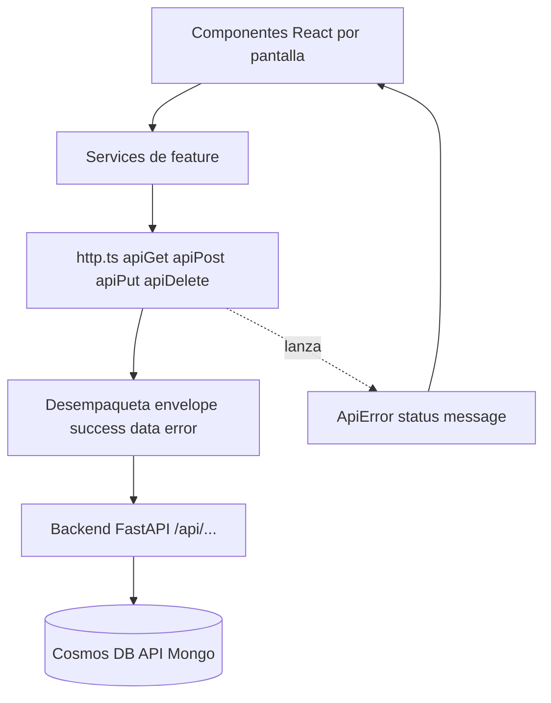
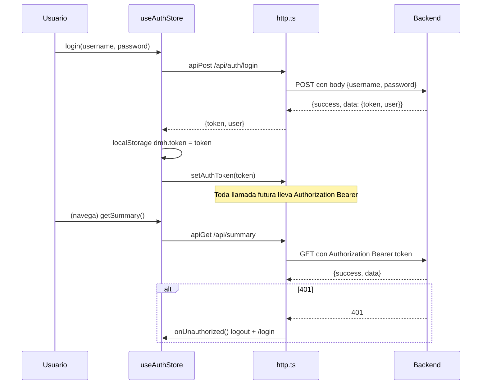
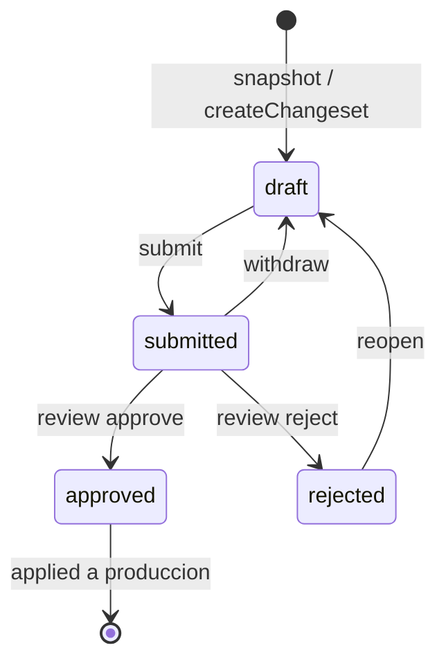
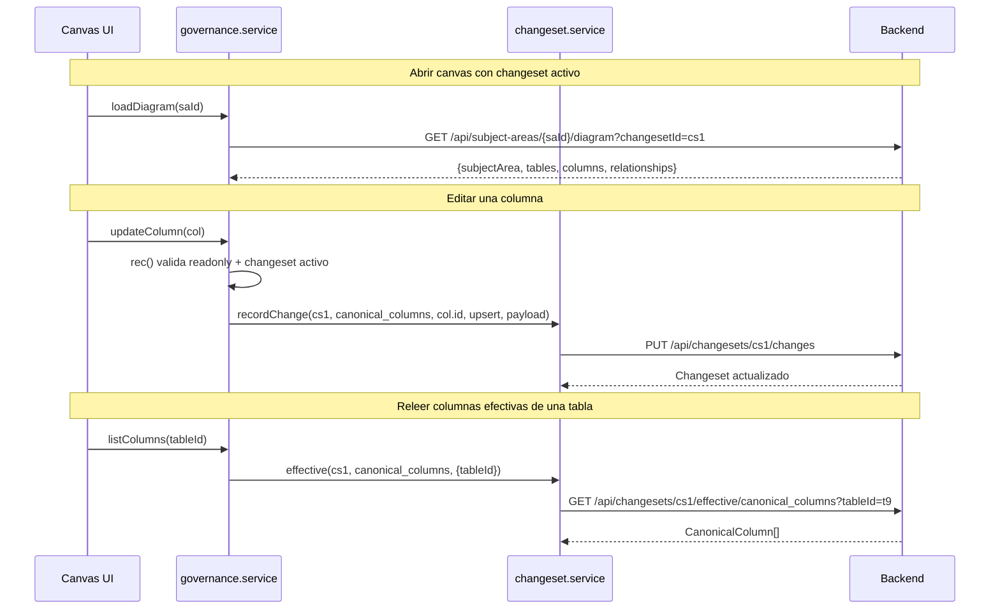
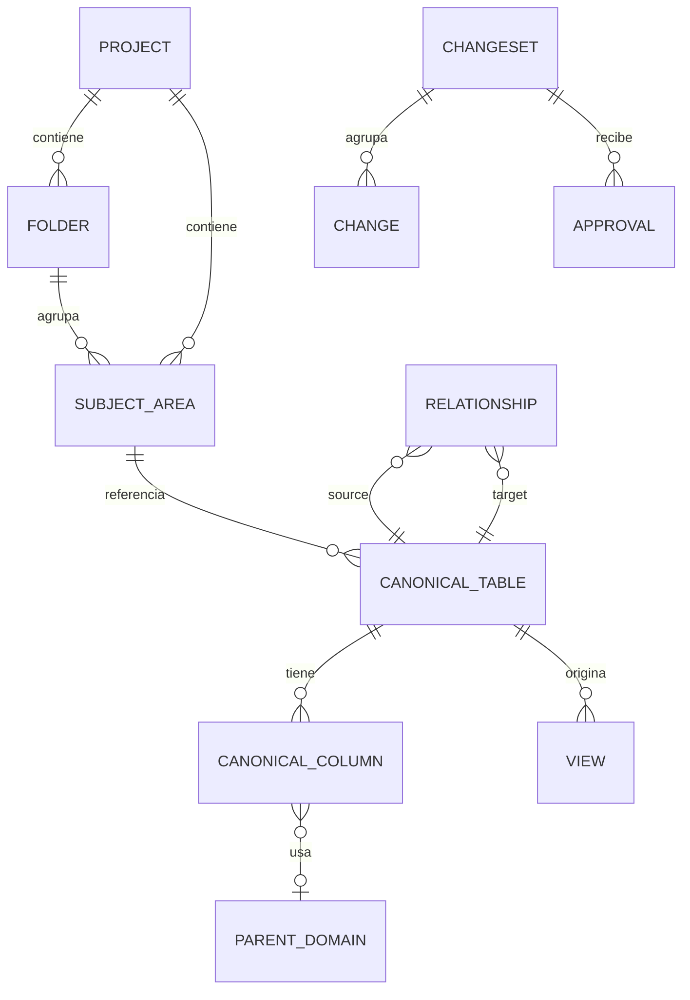

# Referencia de API consumida por el frontend — Data Model Hub (DMH)

Este documento describe, a partir del código real, cómo el frontend (Vite + React + Zustand) del Data Model Hub consume la API del backend (FastAPI). Cubre el cliente HTTP compartido y, pantalla por pantalla / feature por feature, qué endpoints se llaman, con qué método, qué body envían y qué devuelven. Todos los ejemplos y firmas provienen de `src/services/*` y `src/features/*/services/*`.

---

## 1. Panorama general

El frontend habla con el backend siempre a través de un único cliente HTTP (`src/services/http.ts`). Ese cliente:

- Antepone la base URL configurable `VITE_API_URL`.
- Adjunta el token de sesión como `Authorization: Bearer ...`.
- Adjunta, como fallback local, el header `X-Dev-User`.
- Desempaqueta el envelope estándar `{ success, data, error }` y devuelve directamente `data`.
- Convierte cualquier fallo (red, timeout, 4xx/5xx, envelope inválido) en un `ApiError` tipado.

Encima de esa capa, cada feature tiene su propio "service" que solo aporta tipos y arma las URLs. Ningún componente inspecciona `json.success` a mano: todo pasa por los helpers `apiGet` / `apiPost` / `apiPut` / `apiDelete` / `apiFetch`.



Feature que NO consume API: el módulo **DDL** (`src/features/ddl`) genera el SQL en el cliente a partir del modelo ya cargado; no realiza llamadas HTTP propias.

---

## 2. Cliente HTTP (`src/services/http.ts`)

### 2.1. Base URL

Todos los services calculan la base así:

```ts
const API_BASE = import.meta.env.VITE_API_URL ?? '';
```

- Si `VITE_API_URL` está definida (por ejemplo `https://mi-backend.azurewebsites.net`), las llamadas van a ese host.
- Si no está definida, `API_BASE` queda vacío y las rutas son relativas (`/api/...`), lo que sirve cuando el frontend y el backend comparten origen o cuando hay un proxy delante.

### 2.2. Estado de sesión en memoria

`http.ts` guarda tres piezas de estado a nivel de módulo, que otras capas empujan:

| Variable | Setter público | Uso |
|---|---|---|
| `_token` | `setAuthToken(t)` | Se envía como `Authorization: Bearer` en TODA llamada. |
| `_devUser` | `setDevUser(u)` | Fallback local; se envía como header `X-Dev-User`. El backend prefiere el token. |
| `_onUnauthorized` | `setOnUnauthorized(cb)` | Callback global que se dispara ante un 401 (cerrar sesión + ir a `/login`). |

El token vive en `localStorage` bajo la clave `dmh.token` y lo administra el store de auth (ver sección 2.6). El cliente HTTP en sí solo conoce el valor en memoria; no lee `localStorage` directamente (salvo el export CSV del reporting, que sí lo hace de forma puntual).

### 2.3. `ApiError`

Error tipado que propagan todos los helpers. Lleva el `status` HTTP (o `0` para fallos de red / timeout):

```ts
export class ApiError extends Error {
  readonly status: number;
  constructor(message: string, status: number) {
    super(message);
    this.name = 'ApiError';
    this.status = status;
  }
}
```

Los consumidores hacen `try/catch (ApiError)` y deciden si muestran un toast, redirigen o reintentan.

### 2.4. `apiFetch<T>()` — el corazón del cliente

```ts
export async function apiFetch<T>(url: string, opts: RequestOptions = {}): Promise<T> {
  const { method = 'GET', body, headers = {}, signal } = opts;

  // Combina el signal del caller (cleanup de useEffect) con el timeout global.
  const timeout = AbortSignal.timeout(DEFAULT_TIMEOUT_MS); // 30_000 ms
  const combined = signal ? AbortSignal.any([signal, timeout]) : timeout;

  const init: RequestInit = {
    method,
    signal: combined,
    credentials: 'include',
    headers: {
      ...(_token ? { Authorization: `Bearer ${_token}` } : {}),
      ...(_devUser ? { 'X-Dev-User': _devUser } : {}),
      ...headers,
    },
  };

  if (body !== undefined) {
    init.body = typeof body === 'string' ? body : JSON.stringify(body);
    init.headers = { 'Content-Type': 'application/json', ...init.headers };
  }
  // ... fetch, 401, parse de envelope ...
}
```

Detalles importantes del comportamiento:

- **Timeout global de 30 s** (`DEFAULT_TIMEOUT_MS`). Sin él, un backend colgado dejaría spinners eternos, porque `fetch` no tiene timeout propio. Si el caller pasa su propio `signal` (por ejemplo, el cleanup de un `useEffect`), ambos se combinan con `AbortSignal.any`.
- **`credentials: 'include'`**: el frontend (por ejemplo `:3000`) y el backend (por ejemplo `:8000`) pueden vivir en orígenes distintos; sin esto el navegador no enviaría/aceptaría la cookie de sesión cross-origin.
- **`Content-Type: application/json`** se agrega automáticamente solo cuando hay body.
- **Manejo del 401**: si la respuesta es `401` y hay `_onUnauthorized` registrado, se invoca (logout global). Igual se lanza `ApiError` para que el caller no siga con datos vacíos.

### 2.5. Manejo del envelope y de errores

```ts
if (!json || typeof json.success !== 'boolean') {
  // FastAPI HTTPException responde `{detail}` (sin envelope): propaga el
  // mensaje real (p.ej. 409 "versión ya no está en borrador").
  const detail = (json as { detail?: unknown } | null)?.detail;
  if (!response.ok && typeof detail === 'string' && detail) {
    throw new ApiError(detail, response.status);
  }
  throw new ApiError(`Unexpected response shape (HTTP ${response.status})`, response.status);
}

if (!json.success) {
  throw new ApiError(json.error ?? `Request failed (HTTP ${response.status})`, response.status);
}

return json.data as T;
```

Reglas de decodificación:

1. Respuesta con envelope válido y `success: true` → devuelve `json.data` (ya tipado como `T`).
2. Respuesta con envelope válido y `success: false` → lanza `ApiError(json.error, status)`.
3. Respuesta SIN envelope pero con `{ detail }` (típico `HTTPException` de FastAPI) → lanza `ApiError(detail, status)` para no perder el mensaje real (por ejemplo, un `409` con motivo).
4. JSON inválido → `ApiError("Invalid JSON response (HTTP ...)")`.
5. Red caída / DNS / abort / timeout → `ApiError(..., 0)`. Si fue el timeout, el mensaje es explícito: "El servidor no respondió en 30s...".

El tipo del envelope está en `src/types/api.ts`:

```ts
export interface ApiResponse<T> {
  success: boolean;
  data?: T;
  error?: string;
}
```

### 2.6. Helpers de conveniencia

```ts
export function apiGet<T>(url, opts)         // GET
export function apiPost<T>(url, body, opts)  // POST
export function apiPut<T>(url, body, opts)   // PUT
export function apiDelete<T>(url, opts)      // DELETE
// apiFetch acepta method arbitrario, incluido PATCH
```

`apiFetch` se usa directamente cuando hace falta `PATCH` (por ejemplo, mover/renombrar carpetas).

### 2.7. Ciclo de vida del token (auth store)

El token se administra en `src/store/useAuthStore.ts`, que actúa como fuente de verdad de la sesión y empuja el valor al cliente HTTP:

```ts
const TOKEN_KEY = 'dmh.token';

login: async (username, password) => {
  const { token, user } = await auth.login(username.trim(), password);
  localStorage.setItem(TOKEN_KEY, token);
  setAuthToken(token);       // ← empuja a http.ts
  mirror(user);              // espeja el actor a useSessionStore (X-Dev-User)
  set({ user, status: 'authed' });
},

logout: async () => {
  try { await auth.logout(); } catch { /* best-effort */ }
  localStorage.removeItem(TOKEN_KEY);
  setAuthToken('');
  set({ user: null, status: 'anon' });
},

restore: async () => {           // al arrancar la app
  const token = localStorage.getItem(TOKEN_KEY);
  if (!token) { set({ status: 'anon', user: null }); return; }
  setAuthToken(token);
  const user = await auth.fetchMe();
  // ...
},
```

Y el 401 global queda cableado una sola vez:

```ts
setOnUnauthorized(() => {
  if (useAuthStore.getState().status === 'authed') {
    localStorage.removeItem(TOKEN_KEY);
    setAuthToken('');
    useAuthStore.setState({ status: 'anon', user: null });
  }
});
```



---

## 3. Endpoints por pantalla / feature

A continuación, el detalle por área funcional. En todas las tablas, la ruta es relativa a `${VITE_API_URL}` y la respuesta ya viene desempaquetada (sin el envelope).

### 3.1. Autenticación e identidad

**Service:** `src/features/auth/auth.service.ts` y `src/services/identity.service.ts`.

| Función | Método | Ruta | Body | Respuesta |
|---|---|---|---|---|
| `login(username, password)` | POST | `/api/auth/login` | `{ username, password }` | `{ token, user: SessionUser }` |
| `logout()` | POST | `/api/auth/logout` | — | `{ ok: boolean }` |
| `fetchMe()` | GET | `/api/auth/me` | — | `SessionUser` |
| `getMe()` | GET | `/api/me` | — | `Principal` |

`SessionUser` incluye el rol, `projectIds`, `initials` y el mapa de permisos efectivos:

```ts
export interface SessionUser {
  username: string;
  email?: string | null;
  name?: string | null;
  role?: string | null;
  roleName?: string | null;
  projectIds: string[];
  status?: string | null;
  initials?: string | null;
  permissions: Record<string, boolean>;   // 'model.view', 'model.edit', ...
  accessLevel?: 'full' | 'edit' | 'read' | null;
}
```

Ejemplo real de llamada:

```ts
export const login = (username: string, password: string) =>
  apiPost<LoginResult>(`${API_BASE}/api/auth/login`, { username, password });

export const fetchMe = () => apiGet<SessionUser>(`${API_BASE}/api/auth/me`);
```

Equivalente en `curl`:

```bash
curl -X POST "$VITE_API_URL/api/auth/login" \
  -H "Content-Type: application/json" \
  -d '{"username":"cperez","password":"secreto"}'
# → {"success":true,"data":{"token":"eyJ...","user":{...}}}

curl "$VITE_API_URL/api/auth/me" \
  -H "Authorization: Bearer eyJ..."
# → {"success":true,"data":{"username":"cperez","permissions":{...}}}
```

### 3.2. Home / Dashboard (Screen 0)

Dos services alimentan el Home: los contadores (`dashboard.service`) y las versiones/solicitudes (`versioning.service`).

**Service:** `src/services/dashboard.service.ts`

| Función | Método | Ruta | Respuesta |
|---|---|---|---|
| `getSummary(projectIds?)` | GET | `/api/summary?projectId=...` | `DashboardSummary` |

`getSummary` acepta una lista de proyectos y los concatena como parámetros repetidos; sin proyectos, devuelve totales globales:

```ts
export function getSummary(projectIds?: string[]): Promise<DashboardSummary> {
  const ids = (projectIds ?? []).filter(Boolean);
  const qs = ids.length
    ? `?${ids.map((id) => `projectId=${encodeURIComponent(id)}`).join('&')}`
    : '';
  return apiGet<DashboardSummary>(`${API_BASE}/api/summary${qs}`);
}
```

```ts
export interface DashboardSummary {
  tables: number;
  views: number;
  relationships: number;
  subjectAreas: number;
  projects: number;
}
```

Ejemplo:

```bash
curl "$VITE_API_URL/api/summary?projectId=p1&projectId=p2" -H "Authorization: Bearer eyJ..."
# → {"success":true,"data":{"tables":812,"views":34,"relationships":455,"subjectAreas":21,"projects":2}}
```

**Service:** `src/services/versioning.service.ts` (comparte backend con los changesets)

| Función | Método | Ruta | Body | Respuesta |
|---|---|---|---|---|
| `listVersions()` | GET | `/api/versions` | — | `VersionRow[]` |
| `getPublished()` | GET | `/api/versions/published` | — | `VersionRow \| null` |
| `listRequests({reviewer, owner})` | GET | `/api/requests?reviewer=&owner=` | — | `VersionRow[]` |
| `snapshot(body)` | POST | `/api/changesets/snapshot` | `SnapshotBody` | `VersionRow` |
| `listUsers()` | GET | `/api/users` | — | `SimUserDto[]` |
| `submit(id, body)` | POST | `/api/changesets/{id}/submit` | `SubmitBody` | `VersionRow` |
| `getChangeset(id)` | GET | `/api/changesets/{id}` | — | `ChangesetDetail` |
| `getDiff(id)` | GET | `/api/changesets/{id}/diff` | — | `ChangesetDiff` |
| `review(id, body)` | POST | `/api/changesets/{id}/review` | `ReviewBody` | `ChangesetDetail` |
| `addComment(id, {text})` | POST | `/api/changesets/{id}/comments` | `{ text }` | `ChangesetDetail` |
| `withdraw(id)` | POST | `/api/changesets/{id}/withdraw` | — | `ChangesetDetail` |
| `reopen(id)` | POST | `/api/changesets/{id}/reopen` | — | `ChangesetDetail` |

`review()` reescribe el `403` (actor que no es reviewer) a un mensaje legible; el resto de errores se propaga tal cual:

```ts
export async function review(id: string, body: ReviewBody): Promise<ChangesetDetail> {
  try {
    return await apiPost<ChangesetDetail>(`${API_BASE}/api/changesets/${id}/review`, body);
  } catch (err) {
    if (err instanceof ApiError && err.status === 403) {
      throw new ApiError('You are not assigned as a reviewer of this change.', 403);
    }
    throw err;
  }
}
```

Bodies relevantes (de `src/types/versioning.ts`):

```ts
export interface SnapshotBody {
  title?: string; description?: string; versionLabel?: string; projectIds?: string[];
}
export interface SubmitBody {
  title?: string; description?: string; reviewers?: string[]; projectIds?: string[];
}
```

Máquina de estados de una versión / changeset (los endpoints que la mueven):



### 3.3. Model (Modeler): Project → Folders → Canvas

El editor de modelo se apoya en dos services complementarios: `modeler.service` (recursos directos, NO versionados: proyectos, carpetas, subject-areas/canvas) y `governance.service` + `changeset.service` (catálogo canónico y relaciones, que sí son "changeset-aware").

#### 3.3.1. Proyectos, carpetas y canvas (`modeler.service.ts`)

**Proyectos**

| Función | Método | Ruta | Body | Respuesta |
|---|---|---|---|---|
| `listProjects()` | GET | `/api/projects` | — | `Project[]` |
| `createProject(name)` | POST | `/api/projects` | `{ name }` | `Project` |
| `renameProject(id, name)` | PUT | `/api/projects/{id}` | `{ name }` | `Project` |
| `deleteProject(id)` | DELETE | `/api/projects/{id}` | — | `{ deleted: boolean }` |

Nota: existe además `src/services/projects.service.ts`, un service paralelo con tipos más ricos (`CreateProjectRequest` / `UpdateProjectRequest`) que apunta a las mismas rutas `/api/projects` (con `POST`/`PUT`/`DELETE`).

**Carpetas** (jerarquía anidada del Model Explorer, vía `parentFolderId`)

| Función | Método | Ruta | Body | Respuesta |
|---|---|---|---|---|
| `listFolders(projectId)` | GET | `/api/projects/{projectId}/folders` | — | `Folder[]` |
| `createFolder(projectId, parentFolderId, name, order)` | POST | `/api/folders` | `{ projectId, parentFolderId, name, order }` | `Folder` |
| `renameFolder(id, name)` | PATCH | `/api/folders/{id}` | `{ name }` | `Folder` |
| `moveFolder(id, parentFolderId)` | PATCH | `/api/folders/{id}` | `{ parentFolderId }` | `Folder` |
| `deleteFolder(id)` | DELETE | `/api/folders/{id}` | — | `{ deleted: boolean }` |

`renameFolder` / `moveFolder` usan `apiFetch` directamente porque necesitan `PATCH`:

```ts
export const renameFolder = (id: string, name: string) =>
  apiFetch<Folder>(`${API_BASE}/api/folders/${encodeURIComponent(id)}`, { method: 'PATCH', body: { name } });
```

**Canvas (subject-areas)** — un canvas = una subject area = un diagrama ER

| Función | Método | Ruta | Body | Respuesta |
|---|---|---|---|---|
| `listSubjectAreas(projectId, folderId?)` | GET | `/api/projects/{projectId}/subject-areas?folderId=` | — | `SubjectArea[]` |
| `createSubjectArea(projectId, name, folderId)` | POST | `/api/subject-areas` | `{ projectId, name, folderId }` | `SubjectArea` |
| `updateSubjectArea(id, body)` | PUT | `/api/subject-areas/{id}` | `{ projectId, name, folderId? }` | `SubjectArea` |
| `deleteSubjectArea(id)` | DELETE | `/api/subject-areas/{id}` | — | `{ deleted: boolean }` |
| `getSubjectArea(saId)` | GET | `/api/subject-areas/{saId}` | — | `SubjectArea` |
| `setSubjectAreaTables(saId, tableIds)` | PUT | `/api/subject-areas/{saId}/tables` | `{ tableIds }` | `SubjectArea` |
| `setSubjectAreaLayout(saId, layout)` | PUT | `/api/subject-areas/{saId}/layout` | `{ layout }` | `SubjectArea` |
| `setSubjectAreaDrawings(saId, drawings)` | PUT | `/api/subject-areas/{saId}/drawings` | `{ drawings }` | `SubjectArea` |
| `loadDiagram(saId)` | GET | `/api/subject-areas/{saId}/diagram?changesetId=` | — | `Diagram` |

`loadDiagram` es la llamada clave de apertura de un canvas: en UNA sola request el backend arma tablas + columnas + relaciones aplicando el overlay del changeset activo del lado servidor. El `changesetId` sale del store:

```ts
export async function loadDiagram(saId: string): Promise<Diagram> {
  const cs = useChangesetStore.getState().activeId;
  const qs = cs ? `?changesetId=${encodeURIComponent(cs)}` : '';
  return apiGet<Diagram>(`${API_BASE}/api/subject-areas/${encodeURIComponent(saId)}/diagram${qs}`);
}
```

```ts
export interface Diagram {
  subjectArea: SubjectArea;
  tables: CanonicalTable[];
  columns: CanonicalColumn[];
  relationships: Relationship[];
}
```

#### 3.3.2. Catálogo, relaciones y escrituras versionadas (`governance.service.ts` + `changeset.service.ts`)

La governance es "consciente del changeset activo": si hay un changeset activo, LEE del estado efectivo (`/effective`) y ESCRIBE al changeset (`/changes`); sin changeset activo, LEE lo publicado y la UI queda de solo lectura.

**Lecturas de catálogo (publicado, sin changeset)**

| Función | Método | Ruta | Respuesta |
|---|---|---|---|
| `listTables()` (sin changeset) | GET | `/api/catalog/tables` | `CanonicalTable[]` |
| `searchTables(q, limit)` (sin changeset) | GET | `/api/catalog/tables?q=&limit=` | `CanonicalTable[]` |
| `listColumns(tableId)` (sin changeset) | GET | `/api/catalog/tables/{tableId}/columns` | `CanonicalColumn[]` |
| `listRelationships(tableId?)` (sin changeset) | GET | `/api/relationships?tableId=` | `Relationship[]` |
| `listDomains()` | GET | `/api/domains` | `ParentDomain[]` (solo lectura para el dropdown) |
| `physicalize(logical, scope?)` | POST | `/api/glossary/physicalize` | `{ physical }` |

La búsqueda de tablas es server-side por escala (a 15k tablas no se baja la colección completa):

```ts
export const searchTables = (q: string, limit = 50) => {
  const a = active();
  if (a) return csvc.effective<CanonicalTable>(a, 'canonical_tables', { q: q || undefined, limit });
  const params = new URLSearchParams();
  if (q) params.set('q', q);
  params.set('limit', String(limit));
  return apiGet<CanonicalTable[]>(`${CATALOG}/tables?${params.toString()}`);
};
```

**Lecturas con changeset activo (estado efectivo)** — `changeset.service.effective`

```ts
export const effective = <T>(
  id: string,
  collection: string,
  opts?: { tableId?: string; ids?: string[]; q?: string; limit?: number },
) => {
  const params = new URLSearchParams();
  if (opts?.tableId) params.set('tableId', opts.tableId);
  if (opts?.ids?.length) params.set('ids', opts.ids.join(','));
  if (opts?.q) params.set('q', opts.q);
  if (opts?.limit != null) params.set('limit', String(opts.limit));
  const qs = params.toString();
  return apiGet<T[]>(`${CS}/${encodeURIComponent(id)}/effective/${collection}${qs ? `?${qs}` : ''}`);
};
```

Ruta: `GET /api/changesets/{id}/effective/{collection}?tableId=&ids=&q=&limit=`. Las colecciones que consulta la UI son `canonical_tables`, `canonical_columns` y `relationships`. Los filtros son obligatorios en la práctica para no mover colecciones enteras (por ejemplo, `canonical_columns` puede tener cientos de miles de docs).

**Escrituras (siempre al changeset)** — todas pasan por un choke-point único, `governance.service.rec()`, que:

1. Bloquea si el modo de apertura es `readonly`.
2. Exige un changeset activo.
3. Llama a `changeset.service.recordChange`.

```ts
const rec = (collection, id, op, payload?) => {
  if (useSessionStore.getState().openMode === 'readonly')
    throw new Error('El modelo está abierto en solo lectura: no admite cambios.');
  const a = active();
  if (!a) throw new Error('Se requiere un changeset activo para editar.');
  return csvc.recordChange(a, collection, id, op, payload);
};
```

```ts
export const recordChange = (id, collection, entityId, op: 'upsert' | 'delete', payload?) =>
  apiPut<Changeset>(`${CS}/${encodeURIComponent(id)}/changes`, { collection, entityId, op, payload });
```

Operaciones de modelo mapeadas a `PUT /api/changesets/{id}/changes`:

| Operación de UI | `collection` | `op` |
|---|---|---|
| `createTable(t)` | `canonical_tables` | `upsert` |
| `createColumn(c)` / `updateColumn(c)` | `canonical_columns` | `upsert` |
| `deleteColumn(id)` | `canonical_columns` | `delete` |
| `markForeignKey(col, identifying)` | `canonical_columns` | `upsert` |
| `createRelationship(r)` / `updateRelationship(r)` | `relationships` | `upsert` |
| `deleteRelationship(id)` | `relationships` | `delete` |

**Ciclo de vida del changeset** (`changeset.service.ts`):

| Función | Método | Ruta | Body | Respuesta |
|---|---|---|---|---|
| `listChangesets()` | GET | `/api/changesets` | — | `Changeset[]` |
| `getChangeset(id)` | GET | `/api/changesets/{id}` | — | `Changeset` |
| `createChangeset(title)` | POST | `/api/changesets` | `{ title }` | `Changeset` |
| `recordChange(...)` | PUT | `/api/changesets/{id}/changes` | `{ collection, entityId, op, payload }` | `Changeset` |
| `submitChangeset(id)` | POST | `/api/changesets/{id}/submit` | — | `Changeset` |
| `approveChangeset(id)` | POST | `/api/changesets/{id}/approve` | — | `Changeset` |
| `rejectChangeset(id, note?)` | POST | `/api/changesets/{id}/reject` | `{ note }` | `Changeset` |

Los cambios crudos NUNCA viajan al cliente: viven en la colección `changeset_changes` del backend (un documento por cambio) y se consumen únicamente vía `/effective` y `/diff`.



#### 3.3.3. Vistas (`views.service.ts`)

Las vistas NO son changeset-aware: son recursos REST directos sobre `/api/views`.

| Función | Método | Ruta | Body | Respuesta |
|---|---|---|---|---|
| `listViews(tableId)` | GET | `/api/views?tableId=` | — | `View[]` |
| `createView(body)` | POST | `/api/views` | `ViewInput` | `View` |
| `updateView(id, body)` | PUT | `/api/views/{id}` | `ViewInput` | `View` |
| `deleteView(id)` | DELETE | `/api/views/{id}` | — | `{ deleted: boolean }` |

```ts
export interface ViewInput {
  tableId?: string; name: string; schema?: string; tags?: Tag[];
  filter?: string; sources?: ViewSource[]; outputAlias?: string;
  expression?: string; sql?: string; description?: string;
}
```

### 3.4. Reporting (Screen 11)

El reporting tiene dos capas: (a) la grilla tabular "clásica" (`reporting.service`) y (b) el motor de consulta configurable + insights (`query.service`).

#### 3.4.1. Grilla tabular clásica (`reporting.service.ts`)

Metadata tabular de solo lectura para la grilla y el export a Excel.

| Función | Método | Ruta | Respuesta |
|---|---|---|---|
| `listReportTables(filters)` | GET | `/api/reporting/tables?schema=&projectId=&limit=` | `ReportTableRow[]` |
| `listReportColumns(tableId?, tableIds?)` | GET | `/api/reporting/columns?tableId=` o `?tableIds=a,b,c` | `ReportColumnRow[]` |

```ts
export function listReportColumns(tableId?: string, tableIds?: string[]): Promise<ReportColumnRow[]> {
  const qs = new URLSearchParams();
  if (tableIds?.length) qs.set('tableIds', tableIds.join(','));
  else if (tableId) qs.set('tableId', tableId);
  const suffix = qs.toString() ? `?${qs.toString()}` : '';
  return apiGet<ReportColumnRow[]>(`${API_BASE}/api/reporting/columns${suffix}`);
}
```

#### 3.4.2. Motor de consulta + Report Designer (`query.service.ts`)

Todo gira alrededor del `ReportSpec` (mismo IR que el backend): lo produce tanto el builder visual como la caja SQL, y lo consumen la grilla, las queries guardadas y el export.

**Catálogo, ejecución y facetas**

| Función | Método | Ruta | Body | Respuesta |
|---|---|---|---|---|
| `getCatalog(from)` | GET | `/api/reporting/catalog?from=` | — | `{ from, fields: FieldDef[] }` (devuelve `.fields`) |
| `runQuery(spec, cursor?)` | POST | `/api/reporting/query?cursor=` | `ReportSpec` | `QueryResult` |
| `runSql(text, cursor?)` | POST | `/api/reporting/query/sql?cursor=` | `{ text }` | `QueryResult` |
| `validateSql(text)` | POST | `/api/reporting/query/validate` | `{ text }` | `SqlValidation` |
| `getFacets(from, field, q?)` | GET | `/api/reporting/facets?from=&field=&q=` | — | `{ value, label }[]` |

```ts
export const runQuery = (spec: ReportSpec, cursor?: string) =>
  apiPost<QueryResult>(`${R}/query${cursor ? `?cursor=${encodeURIComponent(cursor)}` : ''}`, spec);

export const runSql = (text: string, cursor?: string) =>
  apiPost<QueryResult>(`${R}/query/sql${cursor ? `?cursor=${encodeURIComponent(cursor)}` : ''}`, { text });
```

El `ReportSpec` (IR compartido) y el resultado paginado por cursor:

```ts
export interface ReportSpec {
  from: 'columns' | 'tables' | 'relationships' | 'views';
  select: string[];
  where?: WhereGroup | null;
  groupBy: string[];
  aggregations: Aggregation[];
  orderBy: OrderBy[];
  limit: number;
}

export interface QueryResult {
  rows: Record<string, unknown>[];
  columns: ResultColumn[];
  nextCursor: string | null;
  hasMore: boolean;
  meta: { grouped: boolean; warnings: string[]; scan?: string };
}
```

**Vistas curadas / Insights**

| Función | Método | Ruta | Respuesta |
|---|---|---|---|
| `getScorecard()` | GET | `/api/reporting/insights/scorecard` | `Scorecard` |
| `getUdpCoverage()` | GET | `/api/reporting/insights/udp-coverage` | `UdpCoverage[]` |
| `getDomainUsage()` | GET | `/api/reporting/insights/domain-usage` | `DomainUsage[]` |
| `getGlossaryUsage()` | GET | `/api/reporting/insights/glossary-usage` | `GlossaryUsage[]` |
| `getRelationshipsReport(limit)` | GET | `/api/reporting/insights/relationships?limit=` | `RelationshipRow[]` |

**Queries guardadas (Saved Reports)**

| Función | Método | Ruta | Body | Respuesta |
|---|---|---|---|---|
| `listReports()` | GET | `/api/reporting/reports` | — | `SavedReport[]` |
| `createReport(b)` | POST | `/api/reporting/reports` | `{ name, description?, spec, shared? }` | `SavedReport` |
| `updateReport(id, b)` | PUT | `/api/reporting/reports/{id}` | `{ name, description?, spec, shared? }` | `SavedReport` |
| `deleteReport(id)` | DELETE | `/api/reporting/reports/{id}` | — | — |

**Export CSV por streaming** — único caso que NO usa el cliente `http.ts`, porque el stream no se bufferea bien vía JSON; hace `fetch` crudo y descarga un `Blob`. Nótese que lee el token directamente de `localStorage`:

```ts
export async function exportCsv(spec: ReportSpec): Promise<void> {
  const token = localStorage.getItem('dmh.token');
  const res = await fetch(`${R}/export`, {
    method: 'POST',
    headers: { 'Content-Type': 'application/json', ...(token ? { Authorization: `Bearer ${token}` } : {}) },
    body: JSON.stringify(spec),
  });
  if (!res.ok) throw new Error(`Export falló (${res.status})`);
  const blob = await res.blob();
  const url = URL.createObjectURL(blob);
  const a = document.createElement('a');
  a.href = url; a.download = `report-${spec.from}.csv`;
  document.body.appendChild(a); a.click(); a.remove();
  URL.revokeObjectURL(url);
}
```

Endpoint: `POST /api/reporting/export` con body `ReportSpec`, respuesta `text/csv` en streaming.

### 3.5. Data Standards (Glossary + Parent Domains + UDP + Naming)

Este módulo combina dos services: `naming.service` (configuración global de nombres y dominios, escritura directa e inmediata) y `standards.service` (snapshot + versionado independiente con apply/rollback/history).

#### 3.5.1. Glosario, naming y dominios globales (`naming.service.ts`)

Estos recursos son configuración a nivel de modelo (NO parte de un publish del canvas): editar un término o una regla de separador/casing re-fisicaliza nombres en todo el modelo de inmediato.

**Términos del glosario (Glossary)**

| Función | Método | Ruta | Body | Respuesta |
|---|---|---|---|---|
| `listTerms(scope)` | GET | `/api/glossary?scope=table\|column` | — | `DictTerm[]` |
| `createTerm(x)` | POST | `/api/glossary` | `{ term, abbrev, scope, wordType? }` | `DictTerm` |
| `updateTerm(id, x)` | PUT | `/api/glossary/{id}` | `{ term, abbrev, scope, wordType? }` | `DictTerm` |
| `deleteTerm(id)` | DELETE | `/api/glossary/{id}` | — | `{ id }` |

**Configuración de naming (separador / casing por scope)**

| Función | Método | Ruta | Body | Respuesta |
|---|---|---|---|---|
| `getNamingConfig()` | GET | `/api/settings/naming` | — | `{ column: NamingRule, table: NamingRule }` |
| `setNamingConfig(scope, rule)` | PUT | `/api/settings/naming/{scope}` | `{ separator, case }` | `NamingRule` |

**Fisicalización**

| Función | Método | Ruta | Body | Respuesta |
|---|---|---|---|---|
| `physicalize(logical, scope)` | POST | `/api/glossary/physicalize` | `{ logical, scope }` | `{ physical }` |
| `rephysicalize(scope?)` | POST | `/api/glossary/rephysicalize` | `{ scope? }` | `{ updated }` |

**Parent Domains globales**

| Función | Método | Ruta | Body | Respuesta |
|---|---|---|---|---|
| `listDomainsGlobal()` | GET | `/api/domains` | — | `ParentDomainFull[]` |
| `createDomainGlobal(d)` | POST | `/api/domains` | `Omit<ParentDomainFull,'id'>` | `ParentDomainFull` |
| `updateDomainGlobal(id, d)` | PUT | `/api/domains/{id}` | `Omit<ParentDomainFull,'id'>` | `ParentDomainFull` |
| `deleteDomainGlobal(id)` | DELETE | `/api/domains/{id}` | — | `{ id }` |
| `getDomainImpact(id)` | GET | `/api/domains/{id}/impact` | — | `DomainImpact` |
| `propagateDomain(id)` | POST | `/api/domains/{id}/propagate` | — | `{ updated }` |

`getDomainImpact` previsualiza cuántas columnas se verían afectadas por un cambio de tipo del dominio (respetando overrides manuales); `propagateDomain` aplica el `defaultDataType` a las columnas sin override.

#### 3.5.2. Snapshot + versionado + UDP (`standards.service.ts`)

Backend `/api/standards/*`. Aquí se agrupa un batch de cambios y se aplica como UNA versión (con rollback e historial).

| Función | Método | Ruta | Body | Respuesta |
|---|---|---|---|---|
| `getSnapshot()` | GET | `/api/standards/snapshot` | — | `StandardsSnapshot` |
| `getVersions()` | GET | `/api/standards/versions` | — | `StandardsVersion[]` |
| `applyStandards(body)` | POST | `/api/standards/apply` | `ApplyStandardsBody` | `StandardsVersion` |
| `rollbackStandards(targetSeq)` | POST | `/api/standards/rollback` | `{ targetSeq }` | `StandardsVersion` |
| `getUdpDefs()` | GET | `/api/udp` | — | `UdpDefinition[]` |

El `ApplyStandardsBody` permite mezclar upserts/deletes de términos, naming, dominios y UDP en una sola versión:

```ts
export interface ApplyStandardsBody {
  kind?: 'glossary' | 'udp' | 'domain' | 'naming' | 'batch';
  title?: string;
  description?: string;
  termsUpsert?: TermEditInput[];
  termsDelete?: string[];
  namingConfig?: Partial<Record<UdpScope, NamingEditInput>>;
  domainsUpsert?: DomainEditInput[];
  domainsDelete?: string[];
  udpUpsert?: UdpEditInput[];
  udpDelete?: string[];
}
```

Las definiciones UDP se LEEN por `GET /api/udp` (abierto), pero se MUTAN siempre por `applyStandards` con `kind='udp'` (para quedar versionadas).

### 3.6. Admin / RBAC (Screen 14)

**Service:** `src/features/admin/admin.service.ts`. Todo el módulo está gateado por el permiso `admin.manage`.

**Usuarios**

| Función | Método | Ruta | Body | Respuesta |
|---|---|---|---|---|
| `listUsers()` | GET | `/api/admin/users` | — | `AdminUser[]` |
| `createUser(body)` | POST | `/api/admin/users` | `CreateUserInput` | `AdminUser` |
| `updateUser(username, body)` | PUT | `/api/admin/users/{username}` | `UpdateUserInput` | `AdminUser` |
| `deleteUser(username)` | DELETE | `/api/admin/users/{username}` | — | `{ id }` |

**Roles + matriz de permisos**

| Función | Método | Ruta | Body | Respuesta |
|---|---|---|---|---|
| `listRoles()` | GET | `/api/admin/roles` | — | `Role[]` |
| `upsertRole(key, body)` | PUT | `/api/admin/roles/{key}` | `{ name, description?, permissions }` | `Role` |
| `deleteRole(key)` | DELETE | `/api/admin/roles/{key}` | — | `{ id }` |

**Catálogo de permisos y auditoría**

| Función | Método | Ruta | Respuesta |
|---|---|---|---|
| `getPermissions()` | GET | `/api/admin/permissions` | `Permission[]` |
| `getAudit(limit = 200)` | GET | `/api/admin/audit?limit=` | `AuditEntry[]` |

Los permisos del sistema (1:1 con el backend) y sus etiquetas legibles:

```ts
export type Permission =
  | 'model.view' | 'model.edit' | 'review.decide' | 'publish'
  | 'export' | 'standards.edit' | 'admin.manage';

export const PERMISSION_LABELS: Record<string, string> = {
  'model.view': 'Ver modelo / Canvas',
  'model.edit': 'Crear / editar tablas',
  'review.decide': 'Aprobar / rechazar solicitudes',
  'publish': 'Publicar a producción',
  'export': 'Exportar DDL / metadata',
  'standards.edit': 'Editar Data Standards',
  'admin.manage': 'Administrar usuarios y permisos',
};
```

---

## 4. Tabla maestra de endpoints

Consolidado de todo lo que el frontend consume. Rutas relativas a `${VITE_API_URL}`.

| Área | Método | Ruta | Service |
|---|---|---|---|
| Auth | POST | `/api/auth/login` | auth.service |
| Auth | POST | `/api/auth/logout` | auth.service |
| Auth | GET | `/api/auth/me` | auth.service |
| Identidad | GET | `/api/me` | identity.service |
| Identidad | GET | `/api/users` | versioning.service |
| Home | GET | `/api/summary` | dashboard.service |
| Versiones | GET | `/api/versions` | versioning.service |
| Versiones | GET | `/api/versions/published` | versioning.service |
| Versiones | GET | `/api/requests` | versioning.service |
| Changesets | GET | `/api/changesets` | changeset.service |
| Changesets | POST | `/api/changesets` | changeset.service |
| Changesets | POST | `/api/changesets/snapshot` | versioning.service |
| Changesets | GET | `/api/changesets/{id}` | changeset / versioning |
| Changesets | PUT | `/api/changesets/{id}/changes` | changeset.service |
| Changesets | GET | `/api/changesets/{id}/effective/{collection}` | changeset.service |
| Changesets | GET | `/api/changesets/{id}/diff` | versioning.service |
| Changesets | POST | `/api/changesets/{id}/submit` | changeset / versioning |
| Changesets | POST | `/api/changesets/{id}/approve` | changeset.service |
| Changesets | POST | `/api/changesets/{id}/reject` | changeset.service |
| Changesets | POST | `/api/changesets/{id}/review` | versioning.service |
| Changesets | POST | `/api/changesets/{id}/comments` | versioning.service |
| Changesets | POST | `/api/changesets/{id}/withdraw` | versioning.service |
| Changesets | POST | `/api/changesets/{id}/reopen` | versioning.service |
| Proyectos | GET/POST | `/api/projects` | modeler / projects.service |
| Proyectos | GET/PUT/DELETE | `/api/projects/{id}` | modeler / projects.service |
| Carpetas | GET | `/api/projects/{projectId}/folders` | modeler.service |
| Carpetas | POST | `/api/folders` | modeler.service |
| Carpetas | PATCH/DELETE | `/api/folders/{id}` | modeler.service |
| Canvas | GET | `/api/projects/{projectId}/subject-areas` | modeler.service |
| Canvas | POST | `/api/subject-areas` | modeler.service |
| Canvas | GET/PUT/DELETE | `/api/subject-areas/{id}` | modeler.service |
| Canvas | PUT | `/api/subject-areas/{id}/tables` | modeler.service |
| Canvas | PUT | `/api/subject-areas/{id}/layout` | modeler.service |
| Canvas | PUT | `/api/subject-areas/{id}/drawings` | modeler.service |
| Canvas | GET | `/api/subject-areas/{id}/diagram` | modeler.service |
| Catálogo | GET | `/api/catalog/tables` | governance.service |
| Catálogo | GET | `/api/catalog/tables/{tableId}/columns` | governance.service |
| Relaciones | GET | `/api/relationships` | governance.service |
| Vistas | GET/POST | `/api/views` | views.service |
| Vistas | PUT/DELETE | `/api/views/{id}` | views.service |
| Reporting | GET | `/api/reporting/tables` | reporting.service |
| Reporting | GET | `/api/reporting/columns` | reporting.service |
| Reporting | GET | `/api/reporting/catalog` | query.service |
| Reporting | POST | `/api/reporting/query` | query.service |
| Reporting | POST | `/api/reporting/query/sql` | query.service |
| Reporting | POST | `/api/reporting/query/validate` | query.service |
| Reporting | GET | `/api/reporting/facets` | query.service |
| Reporting | GET | `/api/reporting/insights/scorecard` | query.service |
| Reporting | GET | `/api/reporting/insights/udp-coverage` | query.service |
| Reporting | GET | `/api/reporting/insights/domain-usage` | query.service |
| Reporting | GET | `/api/reporting/insights/glossary-usage` | query.service |
| Reporting | GET | `/api/reporting/insights/relationships` | query.service |
| Reporting | GET/POST | `/api/reporting/reports` | query.service |
| Reporting | PUT/DELETE | `/api/reporting/reports/{id}` | query.service |
| Reporting | POST | `/api/reporting/export` | query.service (fetch crudo) |
| Standards | GET | `/api/glossary` | naming.service |
| Standards | POST | `/api/glossary` | naming.service |
| Standards | PUT/DELETE | `/api/glossary/{id}` | naming.service |
| Standards | POST | `/api/glossary/physicalize` | naming / governance |
| Standards | POST | `/api/glossary/rephysicalize` | naming.service |
| Standards | GET | `/api/settings/naming` | naming.service |
| Standards | PUT | `/api/settings/naming/{scope}` | naming.service |
| Standards | GET/POST | `/api/domains` | naming / governance |
| Standards | PUT/DELETE | `/api/domains/{id}` | naming.service |
| Standards | GET | `/api/domains/{id}/impact` | naming.service |
| Standards | POST | `/api/domains/{id}/propagate` | naming.service |
| Standards | GET | `/api/standards/snapshot` | standards.service |
| Standards | GET | `/api/standards/versions` | standards.service |
| Standards | POST | `/api/standards/apply` | standards.service |
| Standards | POST | `/api/standards/rollback` | standards.service |
| Standards | GET | `/api/udp` | standards.service |
| Admin | GET/POST | `/api/admin/users` | admin.service |
| Admin | PUT/DELETE | `/api/admin/users/{username}` | admin.service |
| Admin | GET | `/api/admin/roles` | admin.service |
| Admin | PUT/DELETE | `/api/admin/roles/{key}` | admin.service |
| Admin | GET | `/api/admin/permissions` | admin.service |
| Admin | GET | `/api/admin/audit` | admin.service |

---

## 5. Modelo de datos que viaja por la API (resumen)

Relación de las entidades principales que el frontend intercambia:



Notas de mapeo relevantes:

- `SUBJECT_AREA` guarda `tableIds`, `layout` (posiciones por tabla) y `drawings` (formas libres del canvas).
- Las escrituras de modelo (`CANONICAL_TABLE`, `CANONICAL_COLUMN`, `RELATIONSHIP`) NO se persisten directas: se registran como `CHANGE` dentro del `CHANGESET` activo y se materializan al aplicar (publish).
- `PARENT_DOMAIN`, glosario y UDP son configuración GLOBAL (fuera del changeset del canvas); su versionado vive en el módulo Data Standards.

---

## 6. Consideraciones de despliegue

### 6.1. Dónde corre

La arquitectura contempla dos frentes de despliegue, sin cambios en el código del cliente (solo cambia `VITE_API_URL`):

- **Azure App Service**: el frontend estático (build de Vite) y el backend FastAPI se publican como servicios web. Si comparten dominio (o hay un reverse proxy delante), `VITE_API_URL` puede quedar vacía y usar rutas relativas `/api/...`. Si están en hosts distintos, `VITE_API_URL` apunta al host del backend y `credentials: 'include'` cubre la cookie de sesión cross-origin (requiere CORS con `Allow-Credentials` en el backend).
- **Databricks Apps**: se despliegan dos apps (el frontend de Vite servido como sitio estático y el backend FastAPI). El frontend apunta al backend vía `VITE_API_URL`. El resto del contrato (token Bearer, envelope) no cambia.

### 6.2. Variables de entorno del frontend

| Variable | Rol | Comportamiento por defecto |
|---|---|---|
| `VITE_API_URL` | Base URL del backend para TODAS las llamadas. | Si no está definida, `API_BASE = ''` → rutas relativas `/api/...`. |

Es la ÚNICA variable de entorno que consume el cliente HTTP. Se lee vía `import.meta.env.VITE_API_URL` en cada service (15 archivos). Al ser una variable `VITE_*`, se inyecta en tiempo de build; cambiar de entorno implica re-buildear el frontend con el valor correcto.

Otras piezas de configuración del cliente son runtime, no variables de entorno:

- El token de sesión vive en `localStorage` bajo la clave `dmh.token`.
- El timeout global de request es una constante del código (`DEFAULT_TIMEOUT_MS = 30_000`).

### 6.3. Base de datos: Azure Cosmos DB con API de Mongo

El backend persiste sobre **Azure Cosmos DB usando la API de Mongo**. Aunque el frontend no habla con la base directamente, su contrato de API refleja decisiones tomadas por escala en Cosmos que conviene tener presentes al operar:

- **Nada de colecciones completas por request.** Endpoints como `GET /api/catalog/tables?q=&limit=`, `GET /api/changesets/{id}/effective/{collection}?tableId=` o `GET /api/reporting/columns?tableIds=` fuerzan filtros server-side. A escala (por ejemplo, cientos de miles de columnas) bajar la colección entera al cliente no es viable ni en costo de RU ni en payload.
- **Cambios de modelo como documentos independientes.** Los cambios de un changeset se guardan uno por documento en la colección `changeset_changes` (evita el límite de 2 MB por documento de Cosmos). El cliente nunca recibe esos cambios crudos: los ve derivados vía `/effective` y `/diff`.
- **Paginación por cursor en reporting.** `runQuery` / `runSql` devuelven `nextCursor` y `hasMore` (keyset/streaming), y el export es un stream (`POST /api/reporting/export`), pensados para no materializar resultados grandes en memoria.
- **Envelope y errores estables.** El backend responde siempre `{ success, data, error }`, salvo los `HTTPException` de FastAPI que devuelven `{ detail }`; el cliente los reconoce en el path de error para no perder el mensaje real (por ejemplo, un `409` de conflicto de versión). Esto es independiente del motor de base, pero es el contrato que la UI espera en cualquiera de los dos entornos de despliegue.

---

## 7. Archivos de referencia

Rutas absolutas de los archivos analizados:

- `/Users/carlosperez/Desktop/Projects/Agentes/GitHub/WebApp/MODELER/web-data-model-hub/src/services/http.ts`
- `/Users/carlosperez/Desktop/Projects/Agentes/GitHub/WebApp/MODELER/web-data-model-hub/src/services/dashboard.service.ts`
- `/Users/carlosperez/Desktop/Projects/Agentes/GitHub/WebApp/MODELER/web-data-model-hub/src/services/versioning.service.ts`
- `/Users/carlosperez/Desktop/Projects/Agentes/GitHub/WebApp/MODELER/web-data-model-hub/src/services/projects.service.ts`
- `/Users/carlosperez/Desktop/Projects/Agentes/GitHub/WebApp/MODELER/web-data-model-hub/src/services/views.service.ts`
- `/Users/carlosperez/Desktop/Projects/Agentes/GitHub/WebApp/MODELER/web-data-model-hub/src/services/naming.service.ts`
- `/Users/carlosperez/Desktop/Projects/Agentes/GitHub/WebApp/MODELER/web-data-model-hub/src/services/reporting.service.ts`
- `/Users/carlosperez/Desktop/Projects/Agentes/GitHub/WebApp/MODELER/web-data-model-hub/src/services/identity.service.ts`
- `/Users/carlosperez/Desktop/Projects/Agentes/GitHub/WebApp/MODELER/web-data-model-hub/src/features/modeler/services/modeler.service.ts`
- `/Users/carlosperez/Desktop/Projects/Agentes/GitHub/WebApp/MODELER/web-data-model-hub/src/features/governance/services/governance.service.ts`
- `/Users/carlosperez/Desktop/Projects/Agentes/GitHub/WebApp/MODELER/web-data-model-hub/src/features/governance/services/changeset.service.ts`
- `/Users/carlosperez/Desktop/Projects/Agentes/GitHub/WebApp/MODELER/web-data-model-hub/src/features/reporting/query.service.ts`
- `/Users/carlosperez/Desktop/Projects/Agentes/GitHub/WebApp/MODELER/web-data-model-hub/src/features/standards/standards.service.ts`
- `/Users/carlosperez/Desktop/Projects/Agentes/GitHub/WebApp/MODELER/web-data-model-hub/src/features/admin/admin.service.ts`
- `/Users/carlosperez/Desktop/Projects/Agentes/GitHub/WebApp/MODELER/web-data-model-hub/src/features/auth/auth.service.ts`
- `/Users/carlosperez/Desktop/Projects/Agentes/GitHub/WebApp/MODELER/web-data-model-hub/src/store/useAuthStore.ts`
- `/Users/carlosperez/Desktop/Projects/Agentes/GitHub/WebApp/MODELER/web-data-model-hub/src/types/api.ts`
- `/Users/carlosperez/Desktop/Projects/Agentes/GitHub/WebApp/MODELER/web-data-model-hub/src/types/versioning.ts`
