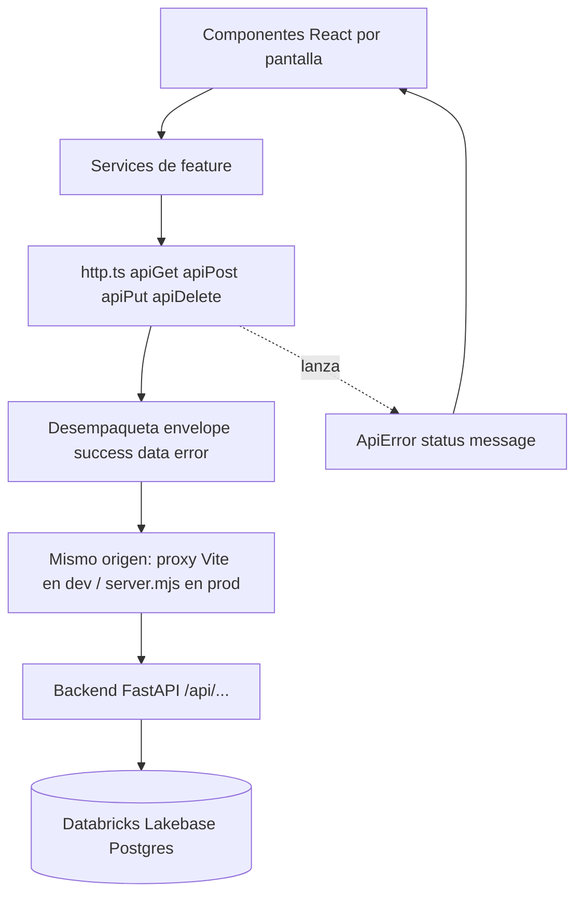
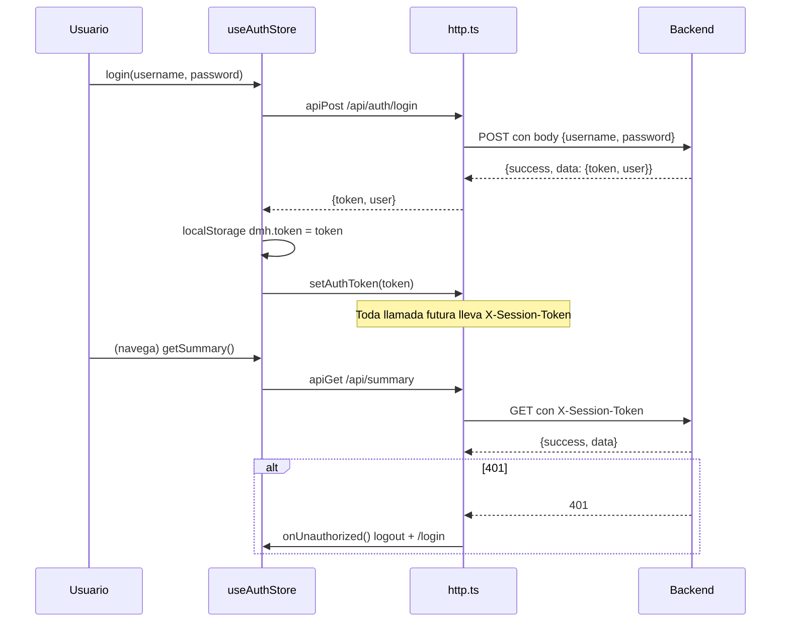
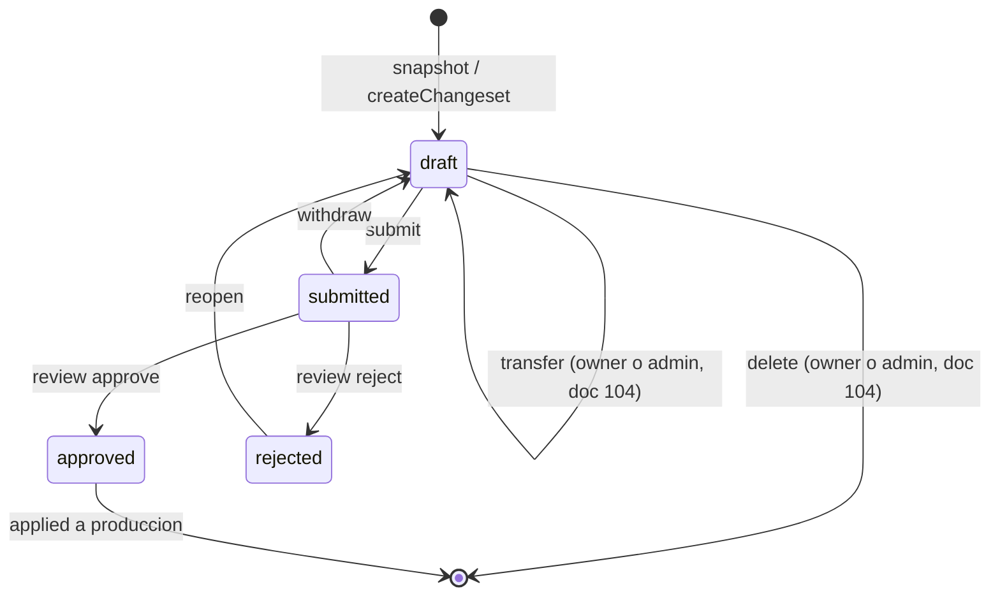
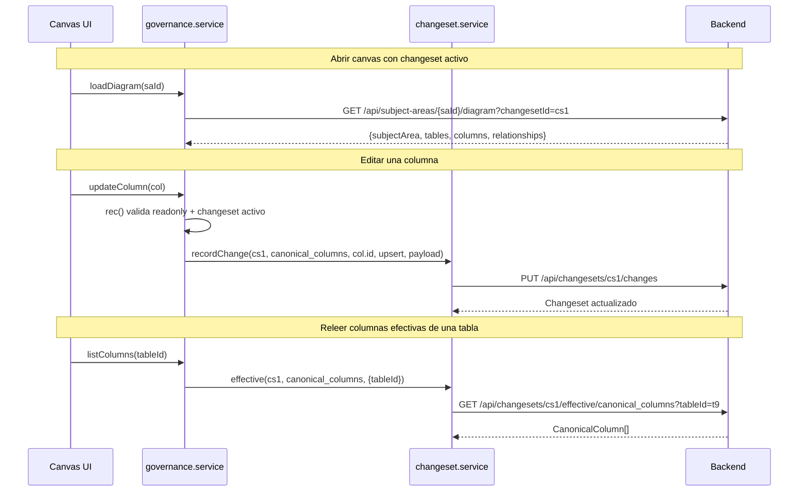
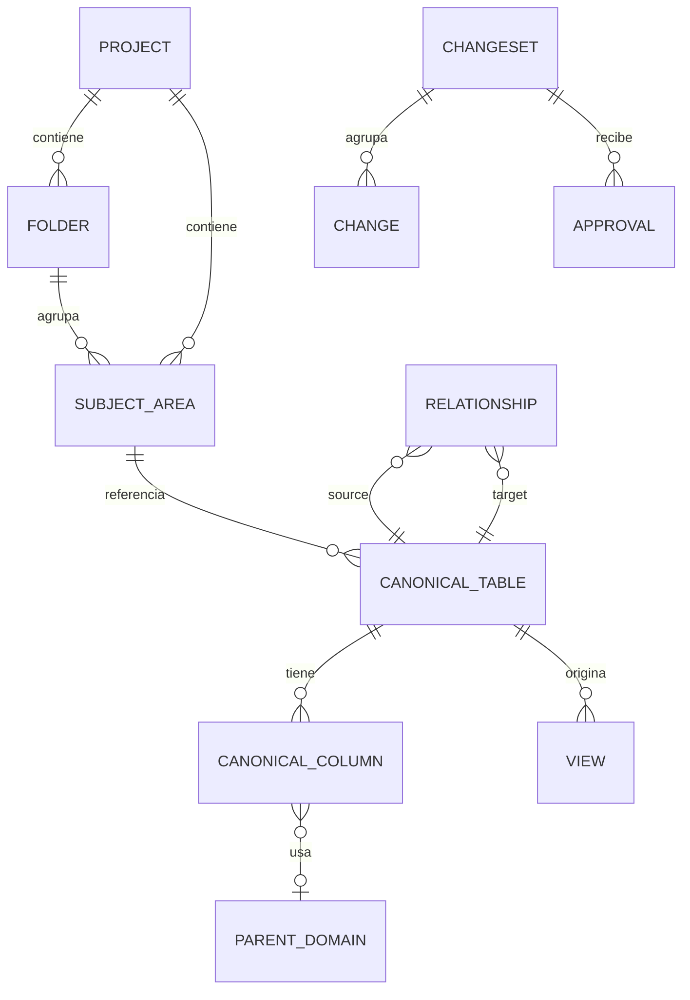

# Referencia de API consumida por el frontend — Data Model Hub (DMH)

Actualizado: 2026-09-08 (doc 75: proyectos independientes — `{pid}` en las rutas es `sessionProjectId()` para el Model y el `projectId` del selector en Standards/Reporting).

Este documento describe, a partir del código real, cómo el frontend (Vite + React + Zustand) del Data Model Hub consume la API del backend (FastAPI). Cubre el cliente HTTP compartido y, pantalla por pantalla / feature por feature, qué endpoints se llaman, con qué método, qué body envían y qué devuelven. Todos los ejemplos y firmas provienen de `src/services/*` y `src/features/*/services/*`.

---

## 1. Panorama general

El frontend habla con el backend siempre a través de un único cliente HTTP (`src/services/http.ts`). Ese cliente:

- Antepone la base URL `API_BASE` (`src/services/apiBase.ts`): vacía por defecto = mismo origen (en dev el proxy de Vite reenvía `/api` → `:8000`; en producción `server.mjs` sirve la SPA y proxya `/api` al backend).
- Adjunta el token de sesión como header **`X-Session-Token`** (NO `Authorization: Bearer` — ver §2.2).
- Adjunta el header `X-Dev-User` SOLO en desarrollo (`vite dev`), como fallback del seam local.
- Desempaqueta el envelope estándar `{ success, data, error }` y devuelve directamente `data`.
- Convierte cualquier fallo (red, timeout, 4xx/5xx, envelope inválido) en un `ApiError` tipado.

Encima de esa capa, cada feature tiene su propio "service" que solo aporta tipos y arma las URLs. Ningún componente inspecciona `json.success` a mano: todo pasa por los helpers `apiGet` / `apiPost` / `apiPut` / `apiDelete` / `apiFetch`.



El módulo **DDL** (`src/features/ddl`) genera el SQL base en el cliente a partir del modelo ya cargado; solo llama a la API cuando el usuario selecciona reglas de export en el modal: `rulesBridge.ts` → `POST /api/projects/{pid}/ddl-rules/render` (ver §3.5.3).

---

## 2. Cliente HTTP (`src/services/http.ts`)

### 2.1. Base URL (`src/services/apiBase.ts`)

Todos los services importan la base ÚNICA (homologación 2026-07-19):

```ts
export const API_BASE: string = import.meta.env.VITE_API_URL ?? '';
```

- **Vacía = mismo origen, el caso NORMAL en dev Y en producción**: en dev, el proxy de `vite.config.ts` reenvía `/api` → `http://localhost:8000`; en producción (doc 36), `server.mjs` sirve la SPA y proxya `/api` al backend servidor-a-servidor. Por eso `VITE_API_URL` NO se define en el build de Databricks Apps: definirla reactivaría el cruce navegador→backend y su doble muro SSO.
- `VITE_API_URL` queda solo para apuntar el front a otro backend en local (por ejemplo, probar contra el desplegado).

### 2.2. Estado de sesión en memoria

`http.ts` guarda cinco piezas de estado a nivel de módulo, que otras capas empujan:

| Variable | Setter público | Uso |
|---|---|---|
| `_token` | `setAuthToken(t)` | Se envía como header **`X-Session-Token`** en TODA llamada. |
| `_devUser` | `setDevUser(u)` | Fallback del seam local; se envía como `X-Dev-User` SOLO en desarrollo (`import.meta.env.DEV`). |
| `_onUnauthorized` | `setOnUnauthorized(cb)` | Callback global que se dispara ante un 401 (cerrar sesión + ir a `/login`). |
| `_onApiError` | `setOnApiError(cb)` | Observador de toda respuesta de error salvo el 401 (doc 104): el canvas revalida su versión ante un 403/404/409 de ESA versión. |
| `_onForbidden` | `setOnForbidden(cb)` | Doc 105 (F5): observador de los 403 fuera de `/api/auth/` — el store de auth re-lee `/me` (`refreshMe`, §2.7). |

Los dos observadores sólo miran: nunca cambian el `ApiError` que recibe el llamador (un observador que falla se ignora).

Por qué `X-Session-Token` y no `Authorization: Bearer`: en Databricks Apps el header `Authorization` le pertenece al proxy SSO de la plataforma — lo consume para su propia autenticación y el backend nunca lo recibe (visto 2026-07-20: 401 con el Bearer en vuelo). Además, en producción `server.mjs` DESCARTA el `Authorization` entrante del cliente y pone SIEMPRE su propio Bearer M2M del service principal (conservando `X-Session-Token`). El backend acepta ambos headers: `Authorization` sigue sirviendo para `curl`/dev directo.

El `X-Dev-User` dejó de viajar en producción a propósito: la identidad es el token (`REQUIRE_AUTH`) y mandarlo solo hacía que el preflight CORS lo rechazara ("Disallowed CORS headers" → "Failed to fetch" en el login de Apps).

El token vive en `localStorage` bajo la clave `dmh.token` y lo administra el store de auth (ver §2.7). El cliente HTTP en sí solo conoce el valor en memoria; no lee `localStorage` directamente (salvo el export CSV del reporting, que sí lo hace de forma puntual).

### 2.3. `ApiError`

Error tipado que propagan todos los helpers. Lleva el `status` HTTP (o `0` para fallos de red / timeout):

```ts
export class ApiError extends Error {
  readonly status: number;
  constructor(message: string, status: number) {
    super(message);
    this.name = 'ApiError';
    this.status = status;
  }
}
```

Los consumidores hacen `try/catch (ApiError)` y deciden si muestran un toast, redirigen o reintentan.

### 2.4. `apiFetch<T>()` — el corazón del cliente

```ts
export async function apiFetch<T>(url: string, opts: RequestOptions = {}): Promise<T> {
  const { method = 'GET', body, headers = {}, signal } = opts;

  const timeoutMs = opts.timeoutMs ?? DEFAULT_TIMEOUT_MS;   // 30_000 ms; LONG_TIMEOUT_MS = 120_000 en las acciones largas

  // Combina el signal del caller (cleanup de useEffect) con el timeout de la llamada.
  const timeout = AbortSignal.timeout(timeoutMs);
  const combined = signal ? AbortSignal.any([signal, timeout]) : timeout;

  const init: RequestInit = {
    method,
    signal: combined,
    credentials: 'include',
    headers: {
      ...(_token ? { 'X-Session-Token': _token } : {}),
      ...(import.meta.env.DEV && _devUser ? { 'X-Dev-User': _devUser } : {}),
      ...headers,
    },
  };

  if (body !== undefined) {
    init.body = typeof body === 'string' ? body : JSON.stringify(body);
    init.headers = { 'Content-Type': 'application/json', ...init.headers };
  }
  let response: Response;
  try {
    response = await fetch(url, init);
  } catch (err) {
    if (timeout.aborted && !(signal?.aborted)) {
      throw new ApiError(`The server didn't respond within ${Math.round(timeoutMs / 1000)}s — try again in a moment.`, 0, null, url);
    }
    // Cancelada por su llamador (cleanup de un efecto): nadie la muestra.
    if (signal?.aborted) throw new ApiError(err instanceof Error ? err.message : 'Aborted', 0, null, url);
    throw new ApiError(NETWORK_ERROR_TEXT, 0, null, url);   // doc 105
  }
  // ... 401 / observadores (403, errores de versión) / parse de envelope ...
}
```

Detalles importantes del comportamiento:

- **Timeout de 30 s** por defecto (`DEFAULT_TIMEOUT_MS`; las acciones largas del servidor pasan `timeoutMs: LONG_TIMEOUT_MS`, 120 s). Sin él, un backend colgado dejaría spinners eternos, porque `fetch` no tiene timeout propio. Si el caller pasa su propio `signal` (por ejemplo, el cleanup de un `useEffect`), ambos se combinan con `AbortSignal.any`.
- **Sin respuesta del servidor (doc 105)**: red caída, DNS o —en Apps— la sesión con el backend vencida lanzan `ApiError(NETWORK_ERROR_TEXT, 0)` = «Couldn't reach the server — check your connection or reload the page.» (antes llegaba a los avisos el «Failed to fetch» del navegador). Una llamada cancelada por su propio llamador conserva su error original (nadie la muestra) y el timeout tiene su texto propio.
- **`credentials: 'include'`**: en producción todo es mismo origen, pero cuando el front local apunta a un backend remoto (`VITE_API_URL` definida) el proxy SSO de Databricks Apps exige su cookie de sesión en requests cross-app; sin esto el navegador no la enviaría/aceptaría.
- **`Content-Type: application/json`** se agrega automáticamente solo cuando hay body.
- **Manejo del 401**: si la respuesta es `401` y hay `_onUnauthorized` registrado, se invoca (logout global). Igual se lanza `ApiError` para que el caller no siga con datos vacíos.
- **Manejo del 403 (doc 105, F5)**: un `403` de una ruta fuera de `/api/auth/` avisa a `_onForbidden` (un permiso que ya no se tiene: el rol cambió en Admin) y el error sigue su curso. Las rutas de `/api/auth/` no lo disparan: el 403 de la propia lectura de `/me` no la repite.

### 2.5. Manejo del envelope y de errores

```ts
if (!json || typeof json.success !== 'boolean') {
  // FastAPI HTTPException responde `{detail}` (sin envelope): propaga el
  // mensaje real (p.ej. 409 "versión ya no está en borrador").
  const detail = (json as { detail?: unknown } | null)?.detail;
  if (!response.ok && typeof detail === 'string' && detail) {
    throw new ApiError(detail, response.status);
  }
  throw new ApiError(`Unexpected response shape (HTTP ${response.status})`, response.status);
}

if (!json.success) {
  throw new ApiError(json.error ?? `Request failed (HTTP ${response.status})`, response.status);
}

return json.data as T;
```

Reglas de decodificación:

1. Respuesta con envelope válido y `success: true` → devuelve `json.data` (ya tipado como `T`).
2. Respuesta con envelope válido y `success: false` → lanza `ApiError(json.error, status)`.
3. Respuesta SIN envelope pero con `{ detail }` (típico `HTTPException` de FastAPI) → lanza `ApiError(detail, status)` para no perder el mensaje real (por ejemplo, un `409` con motivo).
4. JSON inválido (un `SyntaxError` al leer el cuerpo) → `ApiError("Invalid JSON response (HTTP ...)")`. Un corte MIENTRAS llega el cuerpo —timeout, cancelación o red— no es «JSON inválido»: sigue la regla 6 (doc 105).
5. `{ detail: { message, … } }` estructurado (doc 84 D1, p. ej. «Publish blocked») → `ApiError(message, status, detail)`: el mensaje va al usuario y el objeto completo queda en `ApiError.detail`.
6. Sin respuesta → `ApiError(..., 0)`: el timeout dice «The server didn't respond within 30s — try again in a moment.» (o los segundos de su `timeoutMs`); la red caída, `NETWORK_ERROR_TEXT` (doc 105); una cancelación del llamador, su propio error. La UI está en inglés.

El tipo del envelope está en `src/types/api.ts`:

```ts
export interface ApiResponse<T> {
  success: boolean;
  data?: T;
  error?: string;
}
```

### 2.6. Helpers de conveniencia

```ts
export function apiGet<T>(url, opts)         // GET
export function apiPost<T>(url, body, opts)  // POST
export function apiPut<T>(url, body, opts)   // PUT
export function apiDelete<T>(url, opts)      // DELETE
// apiFetch acepta method arbitrario, incluido PATCH
```

`apiFetch` acepta cualquier método, incluido `PATCH`. Desde el doc 105 ningún service lo llama directo: su único uso era mover/renombrar carpetas por `PATCH /api/folders/{id}`, y las carpetas se escriben ahora sólo como cambios de la versión en edición (`structure.service`, §3.3.1).

`http.ts` exporta además cuatro helpers de error para los consumidores:

```ts
/** Mensaje legible de un error de API: el `detail` del backend si vino
 *  (ApiError lo conserva como `message`), o `fallback`. */
export function apiErrorMessage(e: unknown, fallback: string): string;

/** Doc 105 (ronda 3): el motivo de un error para ir DENTRO de un aviso que ya
 *  dice cómo reintentar — sin punto final ni el consejo «— try again…» del
 *  texto de transporte (salía «…within 30s — try again in a moment. Use
 *  Refresh to try again.»). */
export function errorReason(e: unknown, fallback: string): string;

/** Doc 105 (ronda 5, R15-H2): un fallo TRANSITORIO — red o timeout (status 0)
 *  o un 5xx —: reintentar puede andar, y no dice que lo pedido no ocurrió.
 *  Un 4xx es la respuesta (p. ej. el 404 de un job que ya no está). */
export function isTransientError(e: unknown): boolean;

/** ¿Es un 409 de negocio del backend (p.ej. nombre duplicado)? */
export function isConflictError(e: unknown): boolean;
```

### 2.7. Ciclo de vida del token (auth store)

El token se administra en `src/store/useAuthStore.ts`, que actúa como fuente de verdad de la sesión y empuja el valor al cliente HTTP:

```ts
const TOKEN_KEY = 'dmh.token';

login: async (username, password) => {
  const { token, user } = await auth.login(username.trim(), password);
  // Defensa en profundidad: si la sesión anterior murió sin logout, el nuevo
  // actor arranca SIN estado heredado.
  resetAppState();
  localStorage.setItem(TOKEN_KEY, token);
  setAuthToken(token);       // ← empuja a http.ts (X-Session-Token)
  mirror(user);              // espeja el actor a useSessionStore (X-Dev-User en dev)
  set({ user, status: 'authed', error: null });
},

logout: async () => {
  try { await auth.logout(); } catch { /* best-effort */ }
  localStorage.removeItem(TOKEN_KEY);
  setAuthToken('');
  resetAppState();           // el logout es navegación SPA: sin esto los stores
  set({ user: null, status: 'anon' });   // singleton heredarían el canvas
},

restore: async () => {           // al arrancar la app
  const token = localStorage.getItem(TOKEN_KEY);
  if (!token) { set({ status: 'anon', user: null }); return; }
  setAuthToken(token);
  const user = await auth.fetchMe();
  if (get().status !== 'loading') return;                                 // doc 105 (ronda 5): otra sesión ya decidió
  if (localStorage.getItem(TOKEN_KEY) !== token) return get().restore();  // otra pestaña cambió el token
  // /me degrada al Principal básico si el actor no está registrado; sin
  // `permissions` no es una sesión válida de la auth propia.
},
```

Y el 401 global queda cableado una sola vez:

```ts
setOnUnauthorized(() => {
  if (useAuthStore.getState().status === 'authed') {
    localStorage.removeItem(TOKEN_KEY);
    setAuthToken('');
    resetAppState();
    useAuthStore.setState({ status: 'anon', user: null });
  }
});
```

**Permisos al día sin recargar (doc 105, F5).** `refreshMe()` re-lee `GET /api/auth/me` cuando la pestaña vuelve al foco (`focus` / `visibilitychange`, listeners que registra `App.tsx`) y ante un 403 (`setOnForbidden(() => refreshMe())`, §2.4). Tiene tope propio: una lectura en vuelo y como mucho una cada 10 s (`ME_GAP_MS`), así un proxy que responde 403 a todo no genera una tormenta; nunca rechaza. Sólo reemplaza el usuario si cambió su rol o sus permisos (sin cambios, cero re-renders); si `/me` ya no trae `permissions` (usuario deshabilitado en Admin: `/me` degrada al Principal básico) cierra la sesión por el mismo camino que `restore()` y el 401 global. No degrada una sesión de edición: cada escritura la sigue decidiendo el backend. Cuando la sesión termina sola, `useAuthStore.notice` guarda el porqué y el login lo muestra: «Your access to Data Model Hub was removed or disabled. Ask an administrator if you think this is a mistake.» (deshabilitado) o «Your session ended. Please sign in again.» (401); `logout` y un login nuevo lo borran (doc 105, O4). Al abrir la app, `restore()` dice lo mismo: con un token guardado, si `/me` responde sin `permissions` → el texto de acceso quitado; si responde 401 —y SÓLO entonces— se descarta el token con «Your session ended. Please sign in again.»; sin respuesta del servidor (`ApiError` status 0) o con una falla del servidor o del proxy (5xx, respuesta inválida) el token SE CONSERVA —recargar restaura la sesión— y el aviso es `NETWORK_ERROR_TEXT` o `SERVER_CHECK_TEXT`: «The server couldn't check your session right now — reload the page to try again.» (doc 105, ronda 3; antes cualquier error que no fuera de red cerraba la sesión). En el login el aviso es una región `role="status"` y el botón de SSO lo referencia con `aria-describedby`, así el lector de pantalla lo lee al enfocarlo. Ronda 5: un `restore()` que responde después de que el usuario entró de nuevo no toca la sesión nueva (antes la cerraba y, con un 401, borraba su token); si otra pestaña cambió el token mientras se verificaba, verifica el vigente; y `LoginScreen`, con la sesión ya restaurada, sigue al destino en vez de mostrar el formulario (mientras se verifica, el `Splash` de `guards.tsx`).



---

## 3. Endpoints por pantalla / feature

A continuación, el detalle por área funcional. En todas las tablas, la ruta es relativa a `API_BASE` (vacía = mismo origen) y la respuesta ya viene desempaquetada (sin el envelope).

### 3.1. Autenticación e identidad

**Services:** `src/features/auth/auth.service.ts` y `src/services/warmup.ts`. (El `identity.service` / `GET /api/me` se retiró en el doc 75 D14: la identidad autoritativa es `GET /api/auth/me`.)

| Función | Método | Ruta | Body | Respuesta |
|---|---|---|---|---|
| `ssoLogin()` | POST | `/api/auth/sso/login` | — (identidad en headers de relay del server, doc 38) | `{ token, user: SessionUser }` |
| `login(username, password)` | POST | `/api/auth/login` | `{ username, password }` | `{ token, user: SessionUser }` |
| `logout()` | POST | `/api/auth/logout` | — | `{ ok: boolean }` |
| `fetchMe()` | GET | `/api/auth/me` | — | `SessionUser` |
| `ensureBackendSession()` | GET | `/api/health` (probe) + `/api/auth/warmup/{next_b64}` (navegación) | — | — |

`ssoLogin()` es el carril principal (doc 38): el botón "Continue with Databricks" hereda la identidad del SSO de la plataforma — el server del front la releva en headers `x-dmh-sso-*` con secreto compartido — y entra solo si el correo está asignado a un rol en Admin (403 con mensaje accionable si no). `login()` queda como carril del administrador (la UI pide solo la contraseña de la cuenta `admin`). Ambos emiten el mismo token y comparten el pipeline del store (`enterSession`: resetAppState → localStorage → mirror). El login por contraseña está rate-limited en el backend (`5/minute` por IP; el SSO a `10/minute`). `SessionUser` incluye el rol, `projectIds`, `initials` y el mapa de permisos efectivos:

```ts
/** Permisos de la matriz (1:1 con el backend `PERMISSIONS`). */
export type Permission =
  | 'model.view' | 'model.edit' | 'review.decide' | 'publish'
  | 'rollback' | 'versions.view_all' | 'export' | 'standards.edit' | 'admin.manage';

export interface SessionUser {
  username: string;
  email?: string | null;
  name?: string | null;
  role?: string | null;
  roleName?: string | null;
  projectIds: string[];
  status?: string | null;
  initials?: string | null;
  permissions: Record<string, boolean>;   // 'model.view', 'model.edit', ...
  accessLevel?: 'full' | 'edit' | 'read' | null;
}
```

**Warm-up SSO (`warmup.ts`, doc 36)** — solo aplica cuando el front local apunta a un backend remoto de Databricks Apps (`API_BASE` no vacía): cada app vive detrás de su propio muro SSO por subdominio y un `fetch()` no puede completar ese SSO (redirect cross-origin). `ensureBackendSession()` hace un probe con `fetch` crudo a `GET /api/health`; si el fetch es rechazado, navega top-level (una sola vez, guard en `sessionStorage`) a `GET /api/auth/warmup/{next_b64}` — la URL de retorno viaja EN EL PATH como base64url sin padding, no como query string (el replay post-SSO del proxy de Databricks se atora con query strings). **Con `API_BASE` vacía (mismo origen, la producción actual) la función es inerte**: retorna sin hacer nada. La invoca `LoginScreen.tsx`.

Equivalente en `curl` (backend directo; acepta `X-Session-Token` o `Authorization: Bearer`):

```bash
curl -X POST "$BACKEND/api/auth/login" \
  -H "Content-Type: application/json" \
  -d '{"username":"cperez","password":"secreto"}'
# → {"success":true,"data":{"token":"eyJ...","user":{...}}}

curl "$BACKEND/api/auth/me" \
  -H "X-Session-Token: eyJ..."
# → {"success":true,"data":{"username":"cperez","permissions":{...}}}
```

### 3.2. Home / Dashboard (Screen 0)

Dos services alimentan el Home: los contadores (`dashboard.service`) y las versiones/solicitudes (`versioning.service`).

**Service:** `src/services/dashboard.service.ts`

| Función | Método | Ruta | Respuesta |
|---|---|---|---|
| `getSummary(projectIds?)` | GET | `/api/summary?projectId=...` | `DashboardSummary` |

`getSummary` acepta una lista de proyectos y los concatena como parámetros repetidos; sin proyectos, devuelve totales globales:

```ts
export function getSummary(projectIds?: string[]): Promise<DashboardSummary> {
  const ids = (projectIds ?? []).filter(Boolean);
  const qs = ids.length
    ? `?${ids.map((id) => `projectId=${encodeURIComponent(id)}`).join('&')}`
    : '';
  return apiGet<DashboardSummary>(`${API_BASE}/api/summary${qs}`);
}
```

```ts
export interface DashboardSummary {
  tables: number;
  views: number;
  relationships: number;
  subjectAreas: number;
  projects: number;
}
```

Ejemplo:

```bash
curl "$BACKEND/api/summary?projectId=p1&projectId=p2" -H "X-Session-Token: eyJ..."
# → {"success":true,"data":{"tables":812,"views":34,"relationships":455,"subjectAreas":21,"projects":2}}
```

**Service:** `src/services/versioning.service.ts` (comparte backend con los changesets)

| Función | Método | Ruta | Body | Respuesta |
|---|---|---|---|---|
| `listVersions(projectId?)` | GET | `/api/versions[?projectId=]` | — | `VersionRow[]` (cada fila con `projectId` y `deletesProject`) |
| `getPublished(projectId)` | GET | `/api/projects/{pid}/versions/published` | — | `VersionRow \| null` (producción DEL proyecto) |
| `compareVersions(fromId, toId)` | GET | `/api/versions/compare?fromId=&toId=` | — | `VersionCompare` (doc 65; mismo proyecto) |
| `compareVersionDetails(fromId, toId, items)` | POST | `/api/versions/compare/details` | `{ fromId, toId, items }` | detalle antes→después |
| `listRequests({reviewer, owner})` | GET | `/api/requests?reviewer=&owner=` | — | `VersionRow[]` |
| `snapshot(body)` | POST | `/api/changesets/snapshot` | `SnapshotBody` (`projectId` obligatorio) | `VersionRow` |
| `listUsers(can?)` | GET | `/api/users?can=` | — | `SimUserDto[]` (sólo usuarios activos) |
| `listUserNames()` | GET | `/api/users?includeDisabled=true` | — | `SimUserDto[]` — doc 105 (U1): también los deshabilitados, con `disabled: true`; sólo para resolver nombres |
| `submit(id, body)` | POST | `/api/changesets/{id}/submit` | `SubmitBody` | `VersionRow` |
| `getChangeset(id)` | GET | `/api/changesets/{id}` | — | `ChangesetDetail` |
| `getDiff(id)` | GET | `/api/changesets/{id}/diff` | — | `ChangesetDiff` |
| `getDiffDetails(id, items)` | POST | `/api/changesets/{id}/diff/details` | `{ items: {collection, entityId}[] }` | `{ items: DiffEntityDetail[] }` |
| `review(id, body)` | POST | `/api/changesets/{id}/review` | `ReviewBody` | `ChangesetDetail` |
| `addComment(id, {text})` | POST | `/api/changesets/{id}/comments` | `{ text }` | `ChangesetDetail` |
| `withdraw(id)` | POST | `/api/changesets/{id}/withdraw` | — | `ChangesetDetail` |
| `reopen(id)` | POST | `/api/changesets/{id}/reopen` | — | `ChangesetDetail` |
| `rollbackVersion(id)` | POST | `/api/changesets/{id}/rollback` | `{}` | `VersionRow` |
| `transferVersion(id, {to, note?})` | POST | `/api/changesets/{id}/transfer` | `{ to, note? }` | `ChangesetDetail` |
| `deleteVersion(id)` | DELETE | `/api/changesets/{id}` | — | `DeletedVersion` (`changes` = cambios borrados) |

Notas por endpoint:

- `listUsers(can)`: con `can` (p.ej. `'review.decide'`) devuelve solo los usuarios cuyo ROL otorga ese permiso — el selector de revisores lo usa para no ofrecer gente que nunca podría aprobar; el diálogo de transferencia (doc 104) usa `'model.edit'`. Siempre son usuarios ACTIVOS: es la lista para OFRECER personas.
- `listUserNames()` (doc 105, U1): la lista para RESOLVER NOMBRES — Home, Version tools, Review, Open model y los avisos del canvas. Suma a los deshabilitados (`SimUserDto.disabled: true`): quien dejó la empresa sigue siendo dueño o autor de su versión y se ve con su nombre, no con su correo. Con `can` el backend ignora `includeDisabled` (a un deshabilitado nunca se le ofrece revisar ni recibir una versión). Home y Review la piden con `.catch(() => [])`: si falla, se ven los ids en vez de una pantalla en blanco (A5-o2).
- `submit()` (doc 105, A5-o3): **400** «Disabled user(s) can't review: …» si un revisor asignado está deshabilitado — su voto nunca llegaría y la unanimidad tampoco. Si se deshabilita DESPUÉS del envío, Review lo marca «(disabled)» mientras no haya votado y al dueño le indica retirar el request y enviarlo de nuevo con revisores activos.
- **Administrar un draft (doc 104)**: `transferVersion` / `deleteVersion` los usa Home › Version tools › Version details (`VersionToolsModal` + `TransferVersionDialog`). Los botones siguen `lib/versionAdmin.ts` (`canManageVersion`: owner con `model.edit` o `admin.manage`; `versionActionBlock`: sólo drafts — en revisión el motivo es «withdraw first»; publicada, oculto), espejo de `changesets/access.can_manage` + `service._state_block`. `VersionRow`/`ChangesetDetail.transfers` (`OwnershipTransfer`: `from/to/by/at/note`) alimentan «Started by», el chip ⇄ del Home, «started by» en Review y «received from» en Open model; `HistoryItem.startedBy` el historial de Metadata.
- **Presentación de cambios (doc 31)**: la card "Changes summary" se arma con `summarizeDiff(diff)` — helper PURO del service, cero backend, que agrega el `GET /diff` ya cargado en conteos verde/ámbar/rojo por colección más proyectos/modelos afectados. El popup "Change details" usa `getDiffDetails()` (`POST /diff/details`, read-only): diff de campos ANTES→DESPUÉS de entidades puntuales, bajo demanda por selección y con tope de 200 ítems por llamada (el modal trocea). El `before` es la imagen estampada si la versión ya se aplicó, o el publicado vivo si está en revisión.
- `review()` propaga el `detail` real del backend en los 403 (distingue "sin permiso `review.decide`" de "no asignado como revisor"), con fallback legible:

```ts
export async function review(id: string, body: ReviewBody): Promise<ChangesetDetail> {
  try {
    return await apiPost<ChangesetDetail>(`${API_BASE}/api/changesets/${id}/review`, body);
  } catch (err) {
    if (err instanceof ApiError && err.status === 403) {
      throw new ApiError(err.message || 'You are not assigned as a reviewer of this change.', 403);
    }
    throw err;
  }
}
```

- `rollbackVersion()` (permiso propio `rollback`, doc 27): el backend crea un DRAFT con los cambios INVERSOS que restaura la base a esa versión (deshaciendo las posteriores). Producción no cambia hasta que ese draft pase submit → review → approve. Doc 105: los inversos se graban en lotes y el draft queda marcado (`restoreIncomplete`) hasta tenerlos todos; si el proceso muere en el medio, `submit` responde 409 «This restore draft wasn't fully created: delete it and restore the version again.» (se elimina desde Version tools y se restaura de nuevo).

Bodies relevantes (de `src/types/versioning.ts`):

```ts
export interface SnapshotBody {
  projectId: string;            // doc 75: la working copy es de UN proyecto
  title?: string; description?: string; versionLabel?: string;
}
export interface SubmitBody {
  title?: string; description?: string; reviewers?: string[];
}
```

Máquina de estados de una versión / changeset (los endpoints que la mueven):



El `rollback` de una versión aplicada no altera esta máquina: crea un draft NUEVO (inverso) que recorre el mismo ciclo.

### 3.3. Model (Modeler): Project → Folders → Canvas

El editor de modelo se apoya en varios services complementarios: `modeler.service` (LECTURAS directas de estructura + armado del diagrama; desde el doc 105 no escribe), `structure.service` (envoltorio changeset-aware de esa estructura — desde el doc 16 projects/folders/subject_areas son VERSIONADOS), `governance.service` + `changeset.service` (catálogo canónico y relaciones), `schemas.service` (esquemas como entidad), `views.service` (vistas versionadas) y `explorer.service` (Database Explorer draft-aware).

#### 3.3.1. Estructura: proyectos, carpetas y canvas (`modeler.service.ts` + `structure.service.ts`)

**La estructura es VERSIONADA** (fix del leak crítico 2026-07-16, doc 16: crear un proyecto o canvas en un draft escribía directo a producción). La UI llama a `structure.service.ts`, que espeja la regla de `rec()` de governance:

- ESCRITURAS con sesión de edición (`openMode='editing'` + changeset activo) → se REGISTRAN en el changeset (`csvc.recordChange`) con el payload SIEMPRE como doc COMPLETO (el overlay de lectura REEMPLAZA el doc publicado, no mergea) y publican recién en el approve.
- LECTURAS con changeset activo (edición O readonly de un request) → estado efectivo (`csvc.effective` de `projects` / `folders` / `subject_areas`), para que el dueño Y los revisores vean la estructura draft.
- Sin changeset (producción) → LECTURAS por los endpoints directos de `modeler.service.ts` que siguen. Las ESCRITURAS (carpetas, canvases, posiciones, auto-arrange, dibujos, trazos, UDPs) sin sesión de edición **fallan** con «… requires a working copy in edit mode.» — doc 104: la escritura directa a producción de antes sólo la alcanzaba un popup, un confirm o un guardado pendiente de una sesión que se degradó a solo lectura, y publicaba sin revisión. Doc 105 (D1, A2-o5): `modeler.service.ts` ya no tiene funciones de escritura (`modeler.service.readonly.test.ts` lo fija) y el backend responde **409** «This change requires a version in edit mode.» a los `POST/PUT/PATCH/DELETE` directos de carpetas, canvases, esquemas, vistas, relaciones y tablas/columnas del catálogo; sólo `POST /api/projects` (crear un proyecto) sigue directo.

**Proyectos** (`projects.service.ts` para crear/listar; el ciclo de vida por draft en `structure.service.ts`, doc 75 D5)

| Función | Método | Ruta | Body | Respuesta |
|---|---|---|---|---|
| `listProjects()` | GET | `/api/projects` | — | `Project[]` |
| `createProject(data)` | POST | `/api/projects` | `CreateProjectRequest = { name, description?, copyFrom?: { projectId, blocks[] } }` | `Project` (nace con estándares vacíos o copiados + `v1`; timeout largo + overlay) |
| `getProjectCounts(id)` | GET | `/api/projects/{id}/counts` | — | `ScopeCounts` (diálogo «Delete project…») |
| `structure.renameProject(id, name)` | PUT (changeset) | `/api/changesets/{cs}/changes` | upsert `projects/{id}` | `Project` — sólo por draft |
| `structure.deleteProject(id)` | PUT (changeset) | `/api/changesets/{cs}/changes` | delete `projects/{id}` | — (un solo cambio; «Deletion pending») |
| `structure.reviveProject(id, published)` / `projectDeletionPending(id)` | PUT / GET (changeset) | `/api/changesets/{cs}/changes` · `/effective/projects` | — | deshace el borrado / detecta el pending |

No existen `PUT/DELETE /api/projects/{id}` directos: renombrar, describir y borrar un proyecto van SIEMPRE por un draft del propio proyecto y se aplican al aprobar (el borrado con aviso crítico al revisor).

**Diálogo «Delete project…» (`DeleteProjectDialog`, doc 105).** Los conteos de `getProjectCounts` son de PRODUCCIÓN y sólo informan: «This working copy will delete project «X» and everything in it: <conteos> in production (plus anything this working copy adds), and its Data Standards.»; el aviso crítico del revisor dice «Approving it removes <conteos> (as published today, plus anything this request adds) from the platform, together with the project's Data Standards. This cannot be undone from the web.» (`lib/projectDeletion.ts`: al aprobar, el apply graba primero lo que agregó la working copy y la cascada lo borra con el resto). Si el conteo falla, el diálogo lo dice —«Couldn't count the project contents: <motivo>. Everything in the project will still be deleted.»— con **Retry** (desde la ronda 5 el motivo va sin el «— try again…» del texto de transporte, `errorReason`: el aviso ya ofrece Retry), y el nombre tipeado igual habilita «Delete project» (antes quedaba en «Counting project contents…» con el botón deshabilitado para siempre). El texto del conteo es una región viva (`role="status"`: el lector anuncia cuando llega o falla), Retry pasa el foco al nombre antes de desaparecer (no a `<body>`) y los conteos respetan singular y plural («1 folder», antes «1 folders»).

**Carpetas** (jerarquía anidada del Model Explorer, vía `parentFolderId`)

| Función | Método | Ruta | Body | Respuesta |
|---|---|---|---|---|
| `listFolders(projectId)` | GET (o `/effective/folders` con changeset) | `/api/projects/{projectId}/folders` | — | `Folder[]` |
| `structure.createFolder(projectId, parentFolderId, name, order)` | PUT (changeset) | `/api/changesets/{cs}/changes` | upsert `folders/{id}` (doc completo, id nuevo) | `Folder` |
| `structure.renameFolder(id, name)` / `moveFolder(id, parentFolderId)` | PUT (changeset) | `/api/changesets/{cs}/changes` | upsert del doc EFECTIVO con el cambio | `Folder` |
| `structure.deleteFolder(id)` | PUT (changeset) | `/api/changesets/{cs}/changes` | delete `folders/{id}` | `{ deleted: true }` |

Las escrituras de carpetas exigen una versión en edición (`requireWriteCs`): sin ella fallan con «… requires a working copy in edit mode.» sin llamar al backend. Doc 105: los `createFolder`/`renameFolder`/`moveFolder`/`deleteFolder` directos de `modeler.service` (`POST /api/folders`, `PATCH`/`DELETE /api/folders/{id}`) se retiraron; el backend responde 409 a esas rutas.

**Canvas (subject-areas)** — un canvas = una subject area = un diagrama ER

| Función | Método | Ruta | Body | Respuesta |
|---|---|---|---|---|
| `listSubjectAreas(projectId, folderId?)` | GET (o `/effective/subject_areas` con changeset) | `/api/projects/{projectId}/subject-areas?folderId=` | — | `SubjectArea[]` |
| `getSubjectArea(saId)` | GET (o `/effective/subject_areas?ids=` con changeset) | `/api/subject-areas/{saId}` | — | `SubjectArea` |
| `loadDiagram(saId)` | GET | `/api/subject-areas/{saId}/diagram?changesetId=` | — | `Diagram` |
| `structure.createSubjectArea(projectId, name, folderId)` · `updateSubjectArea(id, body)` | PUT (changeset) | `/api/changesets/{cs}/changes` | upsert `subject_areas/{id}` (doc completo) | `SubjectArea` |
| `structure.deleteSubjectArea(id)` | PUT (changeset) | `/api/changesets/{cs}/changes` | delete `subject_areas/{id}` | `{ deleted: true }` |
| `structure.addToCanvas` · `removeFromCanvas` · `setSubjectAreaLayout` · `arrangeSubjectArea` · `setSubjectAreaDrawings` · `setSubjectAreaUdp` · `setWireRoute` | PUT (changeset) | `/api/changesets/{cs}/changes` | upsert del doc EFECTIVO completo del canvas con el cambio | `SubjectArea` (o lo que entró / salió, ver abajo) |
| `structure.listedViews(saId, viewIds)` | GET (changeset) | `/api/changesets/{cs}/effective/subject_areas?ids=` | — | `{ viewIds, layout }` — doc 105, sólo lee |

Toda escritura del canvas es un `recordChange` sobre el doc efectivo completo y exige una versión en edición (por ejemplo, `setSubjectAreaLayout` hace sobre el layout efectivo el merge que antes hacía el PUT directo). Doc 105 (D1, A2-o5): los `createSubjectArea`/`updateSubjectArea`/`deleteSubjectArea`/`setSubjectAreaTables`/`setSubjectAreaViews`/`setSubjectAreaLayout`/`setSubjectAreaDrawings` directos de `modeler.service` se retiraron — el backend responde 409 a `POST /api/subject-areas`, `PUT`/`DELETE /api/subject-areas/{id}` y `PUT …/{id}/tables` · `/views` · `/layout` · `/drawings`. Doc 99: las escrituras de un mismo canvas van **en fila** (cada una es «leer el doc efectivo + grabar el doc completo»; dos casi simultáneas se pisaban), y los **trazos manuales de wires** (`routes`) no tienen endpoint directo — `setWireRoute(saId, wireId, points \| null, validIds?)` y `arrangeSubjectArea(saId, layout, routes = {})` (posiciones + trazos en UNA escritura; el auto-arrange los reinicia) graban siempre por el changeset. Doc 100: los **miembros** del canvas se cambian con `addToCanvas(saId, { tableIds?, viewIds?, layout?, routes? }, shownViews?)` y `removeFromCanvas(saId, { tableIds?, viewIds?, dropRouteIds? }, shownViews?)` — «agrega / quita estos ids»: la lista completa la arma el servicio DENTRO de la cola, sobre el canvas de ese momento (armada afuera, otra escritura de miembros que cayera en medio se perdía). `addToCanvas` devuelve lo que realmente entró y aplica posiciones y trazos en la misma escritura (el Undo de sacar una tabla es UNA escritura); `removeFromCanvas` saca también su posición (sin ella quedaría un nodo fantasma) y los trazos pedidos, y — doc 105 (F4) — devuelve lo que REALMENTE salió con sus posiciones (`{ tableIds, viewIds, layout }`, tipo `CanvasMembersOut`): el Undo de borrar una tabla lo repone tal cual. `listedViews(saId, viewIds)` (doc 105, F4 · A4-o4) dice cuáles de esas vistas lista EXPLÍCITAMENTE el canvas y dónde están, leído dentro de su cola y sin escribir: borrar una vista (o la tabla de la que sale) la saca de todo canvas que la lista en el mismo request (cascada del backend, doc 88 §4), así que quien borra lo anota ANTES para que su Undo la reponga en su sitio; un canvas sin lista explícita (legacy) no lista ninguna — su regla por fuentes la vuelve a mostrar sola. `shownViews` es la lista de vistas que el canvas MUESTRA: sólo se usa si el canvas todavía no tiene lista explícita (doc 70), cuya primera escritura la fija. Toda escritura del canvas graba las posiciones en píxeles enteros. Cada escritura del canvas deja anotado lo que grabó (`lib/canvasWrites.ts`, por working copy): el store lo usa para que un diagrama pedido ANTES de esa escritura no devuelva a la pantalla la posición o el trazo viejos. `setWireRoute` rechaza lo que no es una lista de puntos ni `null` (un `undefined` no borra un trazo) y más de 32 puntos.

`loadDiagram` es la llamada clave de apertura de un canvas: en UNA sola request el backend arma tablas + columnas + relaciones + vistas aplicando el overlay del changeset activo del lado servidor. El `changesetId` sale del store:

```ts
export async function loadDiagram(saId: string): Promise<Diagram> {
  const cs = useSessionStore.getState().activeChangesetId;
  const qs = cs ? `?changesetId=${encodeURIComponent(cs)}` : '';
  return apiGet<Diagram>(`${API_BASE}/api/subject-areas/${encodeURIComponent(saId)}/diagram${qs}`);
}
```

```ts
export interface Diagram {
  subjectArea: SubjectArea;
  tables: CanonicalTable[];
  columns: CanonicalColumn[];
  relationships: Relationship[];
  /** Vistas MIEMBRO del canvas (`viewIds`, doc 70; un canvas legacy sin lista
   *  usa showOnCanvas + ≥1 fuente) — las resuelve el backend. */
  views: View[];
}
```

#### 3.3.2. Catálogo, relaciones y escrituras versionadas (`governance.service.ts` + `changeset.service.ts`)

La governance es "consciente del changeset activo": si hay un changeset activo, LEE del estado efectivo (`/effective`) y ESCRIBE al changeset (`/changes`); sin changeset activo, LEE lo publicado y la UI queda de solo lectura. Ambos servicios viven en `src/services/` (doc 75 D14: `features/governance/` se eliminó) y arman las rutas de proyecto con `sessionProjectId()` (`/api/projects/{pid}/…`); si no hay proyecto en sesión, las funciones rechazan.

**Lecturas de catálogo (publicado, sin changeset)**

| Función | Método | Ruta | Respuesta |
|---|---|---|---|
| `listTables()` (sin changeset) | GET | `/api/projects/{pid}/catalog/tables` | `CanonicalTable[]` |
| `searchTables(q, limit)` (sin changeset) | GET | `/api/projects/{pid}/catalog/tables?q=&limit=` | `CanonicalTable[]` |
| `listColumns(tableId)` (sin changeset) | GET | `/api/catalog/tables/{tableId}/columns` | `CanonicalColumn[]` |
| `listRelationships(tableId?)` (sin changeset) | GET | `/api/relationships?tableId=` | `Relationship[]` |
| `listDomains()` | GET | `/api/projects/{pid}/domains` | `ParentDomain[]` (solo lectura para el dropdown) |
| `physicalize(logical, scope?)` | POST | `/api/projects/{pid}/glossary/physicalize` | `{ physical }` |
| `searchModel(q, opts)` | GET | `/api/projects/{pid}/catalog/search?q=&limit=&offset=&scope=&folderId=&canvasId=&changesetId=` | hits de tablas/columnas/definiciones (⌘K, doc 70 §11) |

**Lecturas globales overlay-aware** (pasan `changesetId` como query param cuando hay changeset activo, en vez de ir por `/effective`; el backend resuelve nombres server-side):

| Función | Método | Ruta | Respuesta |
|---|---|---|---|
| `tableUsage(tableId)` | GET | `/api/catalog/tables/{tableId}/usage?changesetId=` | `{ usage: TableUsageRow[], total }` — canvases que referencian la tabla, con carpeta y proyecto |
| `tableLinks(tableId)` | GET | `/api/relationships/links?tableId=&changesetId=` | `{ links: TableLinkRow[], total }` — relaciones GLOBALES de la tabla con los canvases donde son visibles (Properties · Links, doc 26); cada link trae sus frases `parentToChildPhrase`/`childToParentPhrase` (doc 98) |
| `columnImpact(columnId)` | GET | `/api/relationships/impact?columnId=&changesetId=` | `RelationshipImpact` — relaciones donde la columna es extremo; alimenta el warning del delete. Doc 105 (H8): con `changesetId` exige poder ver ese draft, como `/links` (doc 70 §12). Ronda 3: si no se puede leer, el panel de columna y el Object Inspector no ofrecen el borrado —«Couldn't check the relationships of this column: nothing was deleted. Try again.», «attribute» en el lógico— (antes el diálogo decía «will be removed» y la columna se borraba sin sus relaciones) |

La búsqueda de tablas es server-side por escala (a 15k tablas no se baja la colección completa):

```ts
export const searchTables = (q: string, limit = 50) => {
  const a = active();
  if (a) return csvc.effective<CanonicalTable>(a, 'canonical_tables', { q: q || undefined, limit });
  const params = new URLSearchParams();
  if (q) params.set('q', q);
  params.set('limit', String(limit));
  return apiGet<CanonicalTable[]>(`${CATALOG}/tables?${params.toString()}`);
};
```

**Lecturas con changeset activo (estado efectivo)** — `changeset.service.effective`

```ts
export const effective = <T>(
  id: string,
  collection: string,
  opts?: { tableId?: string; ids?: string[]; q?: string; limit?: number; schema?: string },
) => {
  const params = new URLSearchParams();
  if (opts?.tableId) params.set('tableId', opts.tableId);
  if (opts?.ids?.length) params.set('ids', opts.ids.join(','));
  if (opts?.q) params.set('q', opts.q);
  if (opts?.limit != null) params.set('limit', String(opts.limit));
  if (opts?.schema) params.set('schema', opts.schema);
  const qs = params.toString();
  return apiGet<T[]>(`${CS}/${encodeURIComponent(id)}/effective/${collection}${qs ? `?${qs}` : ''}`);
};
```

Ruta: `GET /api/changesets/{id}/effective/{collection}?tableId=&ids=&q=&limit=&schema=`. Las colecciones que consulta la UI son `canonical_tables`, `canonical_columns`, `relationships`, `views`, `schemas`, `projects`, `folders` y `subject_areas`. Los filtros son obligatorios en la práctica para no mover colecciones enteras (por ejemplo, `canonical_columns` puede tener cientos de miles de docs); `schema` acota a un esquema (Database Explorer draft-aware, doc 25).

**Escrituras (siempre al changeset)** — todas pasan por el guard único `governance.service.writableCs()`, que:

1. Bloquea si el modo de apertura es `readonly`.
2. Exige un changeset activo (y devuelve su id).

Sobre ese guard hay dos caminos: `rec()` (un cambio → `changeset.service.recordChange`) y `recordChangesBulk()` (un LOTE de cambios → `changeset.service.recordChangesBulk`, doc 39 — cascadas de borrar tabla / crear tabla desde fuentes en una sola llamada; los ítems se arman con los builders de `governance.service.bulk` para que los nombres de colecciones versionadas no salgan de los services).

```ts
const writableCs = (): string => {
  if (useSessionStore.getState().openMode === 'readonly')
    throw new Error('The model is open read-only: it does not accept changes.');
  const a = active();
  if (!a) throw new Error('An active changeset is required to edit.');
  return a;
};
const rec = (collection, id, op, payload?) => csvc.recordChange(writableCs(), collection, id, op, payload);
export const recordChangesBulk = (changes: BulkChange[]) => csvc.recordChangesBulk(writableCs(), changes);
```

```ts
export const recordChange = (id, collection, entityId, op: 'upsert' | 'delete', payload?) =>
  apiPut<Changeset>(`${CS}/${encodeURIComponent(id)}/changes`, { collection, entityId, op, payload });
// Lote: tandas de 1000 SECUENCIALES contra PUT /changes/bulk; lote vacío = cero requests.
export const recordChangesBulk = async (id, changes: BulkChange[], chunkSize = 1000) => { /* doc 39 */ };
```

Operaciones de modelo mapeadas a `PUT /api/changesets/{id}/changes`:

| Operación de UI | `collection` | `op` |
|---|---|---|
| `createTable(t)` | `canonical_tables` | `upsert` |
| `deleteTable(id)` — soft-delete versionado; el cascade (columnas/relaciones/vistas/membresías) lo orquesta el store, doc 23; desde doc 39 vistas+relaciones+columnas viajan EN LOTE (`recordChangesBulk`) y la tabla cierra la cascada. Doc 105 (A3/A5, F4, H2): las lecturas van primero (vistas, relaciones, columnas, canvases que la contienen y —H2— los canvases de sus vistas: una vista multi-fuente puede estar en un canvas SIN esta tabla; más qué vistas lista cada uno) y TODAS deben llegar — si falla alguna no se borra nada («Couldn't check what depends on this table: nothing was deleted. Try again.»; «entity» en el modelo lógico, `facetNouns`); el FK de las columnas hijas se decide ANTES de escribir, con sus relaciones leídas en ese mismo paso (ronda 3: antes se leían después del lote y una caída apagaba el FK de una hija que seguía en otra relación); de los canvases que sólo listaban sus vistas salen sólo las vistas (`removeFromCanvas` con `viewIds`); el Undo repone la tabla en su posición en TODOS los canvases que la tenían y, en los que tenían lista explícita, sus vistas en la suya —en los que sólo listaban vistas, sólo las vistas—. Todo el borrado (también como inversa de «Create table» o «Paste table») es de la sesión donde empezó: cada escritura verifica el pin (doc 105, H1) | `canonical_tables` | `delete` |
| `createColumn(c)` / `updateColumn(c)` | `canonical_columns` | `upsert` |
| `deleteColumn(id)` — la baja con sus relaciones la orquesta el store (`deleteColumn`). Doc 105 (ronda 3): TODAS sus lecturas (relaciones y vistas de la tabla, columnas hijas y sus relaciones) van antes de la primera escritura y el FK huérfano de las hijas se decide con lo leído; si falla alguna no se borra nada («Couldn't check what depends on this column: nothing was deleted. Try again.»; «attribute» en el lógico) | `canonical_columns` | `delete` |
| `createRelationship(r)` / `updateRelationship(r)` — el payload es el doc completo, incluidas las frases de relación `parentToChildPhrase`/`childToParentPhrase` (doc 98: etiqueta del wire) | `relationships` | `upsert` |
| `deleteRelationship(id)` | `relationships` | `delete` |

El backend valida en `add_change` el límite de longitud del nombre físico por scope (`maxLength` de `naming_config`, doc 24): crear/renombrar por encima del límite responde 400 (`NameTooLongError`) y la UI lo muestra como popup inline.

**Ciclo de vida del changeset** (`changeset.service.ts`):

| Función | Método | Ruta | Body | Respuesta |
|---|---|---|---|---|
| `listChangesets()` | GET | `/api/changesets` | — | `Changeset[]` |
| `getChangeset(id)` | GET | `/api/changesets/{id}` | — | `Changeset` |
| `createChangeset(title)` | POST | `/api/changesets` | `{ title }` | `Changeset` |
| `recordChange(...)` | PUT | `/api/changesets/{id}/changes` | `{ collection, entityId, op, payload }` | `Changeset` |
| `recordChangesBulk(id, changes)` (doc 39) | PUT | `/api/changesets/{id}/changes/bulk` | `{ changes: BulkChange[] }` (tandas de 1000) | `Changeset` |
| `submitChangeset(id)` | POST | `/api/changesets/{id}/submit` | — | `Changeset` |
| `approveChangeset(id)` (legacy) | POST | `/api/changesets/{id}/approve` | — | `Changeset` |
| `rejectChangeset(id, note?)` (legacy) | POST | `/api/changesets/{id}/reject` | `{ note }` | `Changeset` |

`approve`/`reject` son el par legacy de la M-series; el flujo actual de Review usa `POST /{id}/review` (veredicto por revisor asignado) de `versioning.service` (§3.2).

Los cambios crudos NUNCA viajan al cliente: viven en la colección `changeset_changes` del backend (un documento por cambio) y se consumen únicamente vía `/effective` y `/diff`.



#### 3.3.3. Vistas (`views.service.ts`)

Las vistas son **VERSIONADAS** desde el doc 20 (tras la auditoría integral de la matriz del doc 20): siguen el MISMO patrón changeset-aware que governance/estructura/esquemas. Con changeset activo, las lecturas van al estado EFECTIVO (`/effective/views`) y las escrituras se registran en el changeset con el DOC COMPLETO; producción se toca solo en el apply del approve, y el rollback las revierte. Sin changeset, las LECTURAS siguen el REST directo; las ESCRITURAS exigen una versión en EDICIÓN (doc 104: «Editing a view requires a version in edit mode.» — tampoco escriben en una versión abierta en solo lectura):

| Función | Método/vía | Ruta | Body | Respuesta |
|---|---|---|---|---|
| `listViews(tableId)` | GET (o `/effective/views?tableId=`) | `/api/views?tableId=` | — | `View[]` |
| `listViewsForTables(tableIds)` | GET en lotes de 100 tablas (`VIEW_IDS_PER_GET`); con changeset, `/effective/views?tableIds=` también en lotes de 100 (doc 105, P2: antes un GET por tabla) | `/api/views?tableIds=a,b,c` | — | `View[]` — dedup por id + filtro de respaldo por fuentes; todo o nada (un lote que falla hace fallar la lectura). La usa «Import existing tables» con sus vistas; el Export DDL NO (exporta las vistas miembro del canvas, `canvasDdlViews`; guard en `src/architecture.test.ts`, doc 105 C3) |
| `createView(body)` | `recordChange` upsert (sólo en edición) | `/api/changesets/{cs}/changes` | `ViewInput` | `View` |
| `updateView(id, body)` | `recordChange` upsert (sólo en edición) | `/api/changesets/{cs}/changes` | `ViewInput` | `View` |
| `deleteView(id)` | `recordChange` delete (sólo en edición) | `/api/changesets/{cs}/changes` | — | `{ deleted: boolean }` |

```ts
export interface ViewInput {
  tableId?: string;            // legacy: primera fuente (= sourceTableIds[0])
  sourceTableIds?: string[];   // F3: fuentes canónicas en orden (alias t1, t2…); 2+ ⇒ `FROM t1, t2` (doc 91 D5)
  showOnCanvas?: boolean;      // F3 (D3): canvas legacy sin `viewIds` → se muestra si tiene ≥1 fuente; al CREAR, «Show on this canvas» la suma a la membresía; en el Export DDL con reglas marca la vista de NEGOCIO (doc 105, C2)
  name: string;
  schema?: string;
  sources?: ViewSource[];      // proyección columna por columna (07b-2); el DDL sale SIEMPRE de acá (doc 96 D6)
  outputAlias?: string;
  expression?: string;
  sql?: string;                // referencia congelada (preview / SQL de Erwin)
  description?: string;        // F5: definición a nivel VISTA
  customSql?: string;          // doc 96 D6: User-Defined SQL — texto INFORMATIVO, sin validar, NO se exporta
  udpValues?: Record<string, string>;  // doc 61: UDPs de nivel 'view'
}
```

Cada `ViewSource` admite además `description` propia (F5, doc 22: definición re-contextualizada de la columna en la vista; vacía = hereda la de la columna física). Antes de registrar el cambio, el service normaliza `tableId` ↔ `sourceTableIds` para que queden coherentes (espejo de la normalización del apply).

> Doc 91 (2026-09-17): `tags`, `filter`, `joinOverride` y `customColumns` se **retiraron** del contrato (los UDP de vista reemplazan a las etiquetas; WHERE/JOIN viven en el User-Defined SQL; las columnas de salida son siempre `sources`). El sandbox `parseViewSql` (`POST /api/views/sql/parse`, Validate) también se eliminó: el User-Defined SQL se guarda tal cual. El generador `viewDDL(view, opts, tableById)` emite `FROM a t1,\n  b t2` con 2+ fuentes. Doc 96 D6 (decisión del owner): la User-Defined SQL es texto informativo — el generador ya no la conoce (`DdlView` no tiene `customSql`); toda vista sale de `sources`, y el editor, Properties e Inspector permiten editar fuentes y columnas siempre.

#### 3.3.4. Esquemas (`schemas.service.ts`)

La entidad `schemas` (doc 18) también es changeset-aware. La particularidad: **rename y delete van SIEMPRE por endpoints propios del changeset**, porque la propagación a tablas/vistas y el guard de uso se computan server-side.

| Función | Método | Ruta | Body | Respuesta |
|---|---|---|---|---|
| `listSchemas()` | GET (o `/effective/schemas`) | `/api/projects/{pid}/schemas` | — | `DbSchema[]` (los del proyecto en sesión) |
| `listPublishedSchemas()` | GET | `/api/projects/{pid}/schemas` | — | `DbSchema[]` (ignora el changeset activo) |
| `createSchema(name, desc?, kind?)` | `recordChange` upsert (sólo en edición) | `/api/changesets/{cs}/changes` | doc completo `{ id, name, description, kind }` | `DbSchema` (nombre único POR proyecto) |
| `schemaImpact(id)` | GET | `/api/changesets/{cs}/schemas/{id}/impact` | — | `{ name, tables, views, canvases }` — preview ANTES de guardar |
| `renameSchema(id, newName)` | POST | `/api/changesets/{cs}/schemas/{id}/rename` | `{ newName }` | `{ tables, views }` — cuántas se propagaron dentro del draft |
| `deleteSchema(id)` | POST (sólo en edición) | `/api/changesets/{cs}/schemas/{id}/delete` | — | 409 si el esquema tiene tablas o vistas en su estado efectivo |

Sin versión en edición, `createSchema` y `deleteSchema` fallan en el cliente («Creating a schema requires a version in edit mode.» / «Deleting a schema requires a version in edit mode.», doc 104): el `POST /api/projects/{pid}/schemas` y el `DELETE /api/schemas/{id}` directos ya no se usan y el backend los rechaza con 409 (doc 105, D1).

**Alta desde un combo (doc 96 D1-D5).** Todo combo que elige el esquema de una tabla o una vista (`SchemaSelect`: New Table, New View / View Editor, CTAS paso 2, Properties e Inspector) ofrece al pie del menú «+ Create schema…» cuando la sesión está en una versión en edición (no histórica); nunca en solo lectura ni en `kind="all"` (Output settings del DDL). Abre `SchemaCreateDialog` con lo tipeado y el `kind` del contexto, valida con `schemaNameError` (la misma regla del gestor) y sigue un orden fijo (`createSchemaAndPick`, puro y testeado): `createSchema` registra el cambio en el changeset activo → `loadSchemas()` recarga el catálogo del combo → recién entonces se selecciona. Si la creación falla (nombre repetido, red), no se selecciona nada y el popup muestra el error; no recarga el canvas, así que el formulario de origen conserva sus demás campos. El esquema queda en la versión aunque se cancele el formulario de origen (se ve en el Review y se borra desde Schemas). La fila de acción es genérica: `SearchSelect` acepta `action = { label(query), onRun(query) }`.

**`SearchSelect` accesible (doc 105).** Sigue el patrón ARIA 1.2 de combobox: el input lleva `role="combobox"`, `aria-expanded`, `aria-controls` (el id del menú, sólo abierto), `aria-autocomplete="list"` y `aria-activedescendant` (la opción resaltada); el menú es `role="listbox"` y cada fila `role="option"` con su id y `aria-selected` en la resaltada — la fila de acción del pie es una opción más de la navegación; sin coincidencias ni fila de acción no hay opción activa. Antes un lector de pantalla lo leía como un campo de texto suelto. `ariaLabel` le da nombre cuando no hay un `<label>` (B9) y `ariaDescribedBy`, el id de un texto que lo DESCRIBE (p. ej. por qué está deshabilitado) sin tocar su nombre. Dentro de un diálogo (`aria-modal`), elegir o cerrar con ESC no suelta el foco del input (fuera de un diálogo sí, como siempre): el blur lo dejaba en `<body>` y Tab salía a la página de atrás; ↓/↑ reabren el menú. La acción del pie (p. ej. «+ New schema…») tampoco hace blur antes de abrir su diálogo: así ese diálogo sabe quién lo abrió y, al cerrarse, le devuelve el foco al input (doc 105, R6). Ese foco devuelto no reabre el menú —el usuario acaba de elegir—, tampoco el que devuelve un diálogo que abrió `onPick` (p. ej. «Inherit from domain»); el foco del usuario (Tab o clic) sí lo abre: el `onFocus` los distingue con `isFocusReturn` (`components/ui/focusTrap.ts`, doc 105). Con el foco en el input y el menú cerrado (tras elegir o ESC dentro de un diálogo, o tras la acción del pie), tipear lo abre y lo tipeado cae en la búsqueda —sin `preventDefault`; antes se perdía—, igual Backspace y Delete, pero no un atajo con ⌘/Ctrl (R11); desde R14 también lo abren pegar, el inicio de una composición (IME, teclas muertas), el texto dictado (`beforeinput`) y AltGr (Ctrl+Alt en Windows; un atajo con Ctrl+Alt sin AltGr, no).

#### 3.3.5. Database Explorer (`explorer.service.ts`)

El Database Explorer es **draft-aware** (doc 25): con versión activa muestra el estado EFECTIVO (publicado + overlay del changeset); sin versión, el estado publicado vía reporting/catálogo. El componente solo consume filas `Dbx*` y no sabe de qué fuente vienen.

| Función | Ruta | Nota |
|---|---|---|
| `projectInventory(projectId)` | `GET /api/projects/{id}/catalog/inventory?changesetId=` | inventario del proyecto en UNA request (tablas con `columnCount` + vistas), con overlay del draft si hay changeset (doc 72; antes eran ~1 request por tabla) |
| `explorerColumns(tableId)` | `listColumns` de governance (publicado o `/effective/canonical_columns?tableId=`) | columnas de un nodo al expandirlo |
| `mapInventory` / `mapView` | — | puros: filas `Dbx*` del árbol |

La búsqueda profunda del Model (tablas/columnas/definiciones) vive en `governance.searchModel()` (`GET /api/projects/{pid}/catalog/search`, doc 70 §11 / 72 r2) y el inspector de objetos en `GET /api/catalog/inspect/tables/{id}` · `/inspect/views/{id}` (doc 72).

#### 3.3.6. Carga masiva desde Excel y perfiles de carga (`features/upload/upload.service.ts`, docs 55 · 78)

El popup «Upload from Excel» del toolbar lee el `.xlsx` en el navegador (`lib/parseWorkbook.ts`, SheetJS) como grillas CRUDAS de todas las hojas (`{name, rows: [{row, cells}]}`, con el origen forzado a A1 para que `row` sea la fila Excel absoluta; doc 105: cada celda se limpia de lo que la base no puede guardar — se quita U+0000, que SheetJS decodifica del escape de Excel `_x0000_` y es invisible, y un surrogate UTF-16 suelto pasa a U+FFFD —, porque el backend respondería 400 a TODA la carga; desde la ronda 5 también el nombre de cada hoja y el del archivo; y una celda numérica con formato de FECHA viaja como `YYYY-MM-DD` —con `HH:MM[:SS]` sólo si el formato muestra la hora (ronda 6)—, calculada desde su número de serie con el sistema de fechas del libro, 1900 o 1904 —SheetJS lee con `cellNF`—: antes viajaba con el formato local de la celda, p. ej. «1/2/24»; es fecha el formato con año o día, o el de sólo mes que no muestra la hora («mmmm», ronda 7), y una celda de sólo hora, una duración o «general» viajan como texto) y las manda junto con el **perfil de carga** elegido; el backend aplica el perfil (hojas, fila de cabecera, mapeo cabecera → campo / UDP lógico y/o físico, reglas, políticas), valida y aplica dentro del draft como **job asíncrono**; el front hace polling hasta un estado terminal.

| Función | Método | Ruta | Body | Respuesta |
|---|---|---|---|---|
| `startUpload(csId, body)` | POST | `/api/changesets/{cs}/uploads` | `{ fileName, profileId, sheets: RawSheet[] }` | `UploadJob` (202, `validating`); 404 perfil inexistente; 413 topes |
| `getUploadJob(csId, jobId)` | GET | `/api/changesets/{cs}/uploads/{job}` | — | `UploadJob` (`status`, `progress`, `report` con `profile` y `sheets`, `result`, `error`); 404 = expiró |
| `pollUploadJob(csId, jobId, {onTick, intervalMs, signal, maxTransient})` | GET (×n) | ídem | — | Promesa que resuelve en `validated \| applied \| failed`; abortable. Doc 105 (ronda 5): reintenta hasta 10 fallos transitorios seguidos (`isTransientError`: status 0 o 5xx) y un 404 falla en el acto |
| `applyUpload(csId, jobId)` | POST | `/api/changesets/{cs}/uploads/{job}/apply` | — | `UploadJob` (202, `applying`); 409 sin validar / con errores / otro apply en curso |
| `discardUpload(csId, jobId)` | DELETE | `/api/changesets/{cs}/uploads/{job}` | — | `{ deleted }`; 409 mientras aplica |
| `listProfiles(pid)` | GET | `/api/projects/{pid}/upload-profiles` | — | `UploadProfile[]` (default primero) |
| `createProfile(pid, body)` · `updateProfile(pid, id, body)` | POST · PUT | `…/upload-profiles[/{id}]` | `UploadProfileBody` | `UploadProfile`; 422 `{message, problems}` (→ `profileProblemsOf(e)`); 409 nombre repetido |
| `getProfile(pid, id)` · `deleteProfile(pid, id)` · `setDefaultProfile(pid, id)` | GET · DELETE · POST | `…/upload-profiles/{id}[/default]` | — | `UploadProfile` · `{ deleted }` · `UploadProfile` |
| `getProfileCatalog(pid)` | GET | `…/upload-profiles/catalog` | — | `ProfileCatalog` (campos por hoja, tipos de regla, políticas) |
| `validateProfile(pid, body)` | POST | `…/upload-profiles/validate` | `UploadProfileBody` | `{ problems: ProfileProblem[] }` sin guardar |
| `suggestMappings(pid, sheet, headers)` | POST | `…/upload-profiles/suggest` | `{ sheet, headers }` | `Suggestion[]` (mapeo propuesto por nombre) |
| `createDefaultProfile(pid)` | POST | `…/upload-profiles/default` | — | `{ profile, warnings }` (built-in «Plantilla BCP»); 409 si ya existe |

Doc 105 (X1): el estado del job vive en la BD del backend, así el polling, el apply o el descarte pueden caer en cualquiera de los dos procesos del backend (`uvicorn --workers 2`) sin el 404 de antes («validate again»). Un job activo cuyo proceso murió (sin avance en 10 min) llega `failed` con «The upload stopped unexpectedly (the server restarted). Part of it may already be in the version: validate the workbook again to finish it.». Mientras una carga se escribe en la versión, enviarla a revisión, transferirla o eliminarla responde 409 («An Excel upload is being written into this version right now…»; `ChangesetDetail.uploadLock`).

Del lado del front (doc 105, ronda 4): cerrar el popup ya no corta una carga pedida —el apply, su polling (sin el `signal` del popup) y el arrange siguen; el arrange corta antes de escribir si se abrió otra versión (desde la ronda 7, por VERSIÓN: `inVersion`)— y el job se marca `applying` ANTES del POST, así desmontar en ese instante no lo descarta (`discardUpload` queda para un job no aplicado). Rondas 5 a 7: si el polling se rinde, o recibe un 403, el resultado queda «unconfirmed» («Couldn't confirm the result of the upload: …») y no «failed»; un POST del apply sin respuesta lo decide el polling (si el job sigue `validated`, lo relee a los 2 s y a los 4 s); y la pila de Undo queda vacía y cerrada desde antes del apply. Ver [architecture.md](architecture.md) §8.

### 3.4. Reporting (Screen 11)

El reporting tiene dos capas: (a) la grilla tabular "clásica" (`reporting.service`) y (b) el motor de consulta configurable + insights (`query.service`).

#### 3.4.1. Grilla tabular clásica (`reporting.service.ts`)

Metadata tabular de solo lectura para la grilla y el export a Excel (también la consume el Database Explorer en modo producción, §3.3.5).

| Función | Método | Ruta | Respuesta |
|---|---|---|---|
| `listReportTables(projectId, filters?, changesetId?)` | GET | `/api/reporting/tables?projectId=&schema=&limit=&offset=&changesetId=` | `ReportTableRow[]` |
> Doc 92: `listReportTables(projectId, { limit, offset })` pagina el scroll infinito (sólo sin filtros) y `countReportTables(projectId, changesetId?)` (`GET /api/reporting/tables/count`) trae el total real de tablas.
| `listReportColumns(projectId, tableId?)` | GET | `/api/reporting/columns?projectId=&tableId=` | `ReportColumnRow[]` (una tabla: Database Explorer) |
| `queryReportColumns(projectId, tableIds, changesetId?)` | POST | `/api/reporting/columns/query` | `ReportColumnRow[]` — doc 102: ids en el CUERPO |
| `queryReportViews(projectId, tableIds, changesetId?)` | POST | `/api/reporting/views/query` | `ReportViewRow[]` — doc 102: ids en el CUERPO; fuentes resueltas + detalle por columna del editor de vistas |

> **Doc 102.** `changesetId` = una versión PROPIA sin publicar (combo *Version* de la pantalla); sin él, producción. Los lotes van por POST: con 300 ids en la URL el servidor del front (`server.mjs`, 16 KB de línea de pedido + cabeceras) respondía **431** sin cuerpo («Invalid JSON response (HTTP 431)»). La pantalla usa `fetchColumnsFor` (tandas de 300 tablas) y `fetchViewsFor` (tandas de 2 000, sin repetir) de `features/reporting/lib/reportFetch.ts`, por el barrel `@/features/reporting`. `ReportTableRow.spaces` = carpetas raíz (sub-proyecto) de sus canvases.

> **Doc 105 (B8, A3-o1).** Las tandas corren por `mapPool` (`src/lib/pool.ts`) con a lo sumo **4 lotes en vuelo** (`LOTS_IN_FLIGHT`): el timeout de 30 s de cada pedido corre desde que SALE, y con 50 POST a la vez los últimos se vencían en la cola sin haber empezado. El resultado conserva el orden de los lotes; al primer lote que falla deja de despachar y la lectura falla con ese error (lo que ya estaba en vuelo termina y se descarta). `fetchRelationshipsFor` arma la hoja Relationships del export con el mismo patrón: lotes de 300 ids (`RELATIONSHIP_BATCH`) contra `POST /api/reporting/insights/relationships/query` (§3.4.2) — antes se pedían las primeras 5 000 relaciones del PROYECTO y se filtraban en el navegador, y en proyectos grandes faltaban relaciones sin aviso. Una relación con el padre en un lote y el hijo en otro llega en ambos: queda la del primer lote, con todas sus filas de par.

```ts
export function queryReportColumns(projectId: string, tableIds: string[], changesetId?: string | null): Promise<ReportColumnRow[]> {
  if (tableIds.length === 0) return Promise.resolve([]);
  return apiPost<ReportColumnRow[]>(`${API_BASE}/api/reporting/columns/query`, lotBody(projectId, tableIds, changesetId));
}
```

#### 3.4.2. Motor de consulta + Report Designer (`query.service.ts`)

Todo gira alrededor del `ReportSpec` (mismo IR que el backend): lo produce tanto el builder visual como la caja SQL, y lo consumen la grilla, las queries guardadas y el export.

**Catálogo, ejecución y facetas**

| Función | Método | Ruta | Body | Respuesta |
|---|---|---|---|---|
| `getCatalog(from)` | GET | `/api/reporting/catalog?from=` | — | `{ from, fields: FieldDef[] }` (devuelve `.fields`) |
| `runQuery(spec, cursor?)` | POST | `/api/reporting/query?cursor=` | `ReportSpec` | `QueryResult` |
| `runSql(text, cursor?)` | POST | `/api/reporting/query/sql?cursor=` | `{ text }` | `QueryResult` |
| `validateSql(text)` | POST | `/api/reporting/query/validate` | `{ text }` | `SqlValidation` |
| `getFacets(from, field, q?)` | GET | `/api/reporting/facets?from=&field=&q=` | — | `{ value, label }[]` |

```ts
export const runQuery = (spec: ReportSpec, cursor?: string) =>
  apiPost<QueryResult>(`${R}/query${cursor ? `?cursor=${encodeURIComponent(cursor)}` : ''}`, spec);

export const runSql = (text: string, cursor?: string) =>
  apiPost<QueryResult>(`${R}/query/sql${cursor ? `?cursor=${encodeURIComponent(cursor)}` : ''}`, { text });
```

El `ReportSpec` (IR compartido) y el resultado paginado por cursor. `from` admite seis entidades — a las cuatro físicas se sumaron las virtuales `view_columns` (columnas de vistas, doc 22) y `models` (canvases):

```ts
export type ViewKey = 'columns' | 'tables' | 'relationships' | 'views' | 'view_columns' | 'models';

export interface ReportSpec {
  projectId: string;                 // doc 75: el backend lo exige en el spec
  from: ViewKey;
  select: string[];
  where?: WhereGroup | null;
  groupBy: string[];
  aggregations: Aggregation[];
  orderBy: OrderBy[];
  limit: number;                     // tamaño de PÁGINA (1..5000)
  maxRows?: number | null;           // doc 105: tope TOTAL que arma el `LIMIT n` del editor SQL
  resultColumns?: string[] | null;   // doc 105 (ronda 5): orden del SELECT de un agrupado SQL
}

export interface QueryResult {
  rows: Record<string, unknown>[];
  columns: ResultColumn[];
  nextCursor: string | null;
  hasMore: boolean;
  meta: { grouped: boolean; warnings: string[]; scan?: string };
}
```

Doc 105: el Builder no usa `maxRows` ni `resultColumns` —«Validate → builder» y abrir un reporte guardado pasan por `toBuilderSpec` (`lib/reportBuilder.ts`), que los quita y deja la página de 100— y `FieldDef.sortable` dice por qué campos se puede ordenar: la grilla sólo ofrece ésos (al resto el backend responde 422 «Can't sort by '…': it has no index. …»), y un orden por un campo que no lo es (p. ej. de un reporte guardado antes) se quita con aviso al correr, exportar y guardar (`withoutUnsortableOrder`, rondas 6 y 7). El resto del comportamiento del Report Designer (respuestas tardías, la página siguiente del scroll, el orden y `SqlEditor`) está en [architecture.md](architecture.md) §7.

**Vistas curadas / Insights**

| Función | Método | Ruta | Respuesta |
|---|---|---|---|
| `getScorecard()` | GET | `/api/reporting/insights/scorecard` | `Scorecard` |
| `getUdpCoverage()` | GET | `/api/reporting/insights/udp-coverage` | `UdpCoverage[]` |
| `getDomainUsage()` | GET | `/api/reporting/insights/domain-usage` | `DomainUsage[]` |
| `getGlossaryUsage()` | GET | `/api/reporting/insights/glossary-usage` | `GlossaryUsage[]` |
| `queryRelationshipsReport(projectId, tableIds, changesetId?)` | POST | `/api/reporting/insights/relationships/query` — body `{ projectId, tableIds (1..300), changesetId? }` | `RelationshipRow[]` — doc 105 (A3-o1): las mismas filas que el GET (una por PAR de columnas), sólo de las relaciones con el padre o el hijo en el lote y sin tope; con `changesetId`, las de la versión propia (doc 102). Los lotes los arma `fetchRelationshipsFor` (§3.4.1) |

`getRelationshipsReport` (`GET /api/reporting/insights/relationships?limit=`, tope de 5 000 del proyecto) se retiró del front con el doc 105; la ruta sigue en el backend sin consumidor en el front.

**Queries guardadas (Saved Reports)**

| Función | Método | Ruta | Body | Respuesta |
|---|---|---|---|---|
| `listReports()` | GET | `/api/reporting/reports` | — | `SavedReport[]` |
| `createReport(b)` | POST | `/api/reporting/reports` | `{ name, description?, spec, shared? }` | `SavedReport` |
| `updateReport(id, b)` | PUT | `/api/reporting/reports/{id}` | `{ name, description?, spec, shared? }` | `SavedReport` |
| `deleteReport(id)` | DELETE | `/api/reporting/reports/{id}` | — | — |

**Export CSV por streaming** — único caso que NO usa el cliente `http.ts`, porque el stream no se bufferea bien vía JSON; hace `fetch` crudo y descarga un `Blob`. Lee el token directamente de `localStorage` y respeta el MISMO contrato de headers que `http.ts` (`X-Session-Token` + `credentials: 'include'`, no `Authorization`):

```ts
export async function exportCsv(spec: ReportSpec): Promise<void> {
  const token = localStorage.getItem('dmh.token');
  let res: Response;
  try {
    res = await fetch(`${R}/export`, {
      method: 'POST',
      credentials: 'include',
      headers: { 'Content-Type': 'application/json', ...(token ? { 'X-Session-Token': token } : {}) },
      body: JSON.stringify(spec),
    });
  } catch {
    throw new Error(NETWORK_ERROR_TEXT);   // doc 105: no el «Failed to fetch» del navegador
  }
  if (!res.ok) {
    // Doc 105: el motivo del backend, leído como `apiFetch` (`detail`, su `message`
    // si es estructurado, o el `error` del envelope).
    const body = (await res.json().catch(() => null)) as { detail?: unknown; error?: unknown } | null;
    const d = body?.detail;
    const msg = typeof d === 'string' ? d : (d && typeof d === 'object' ? (d as { message?: unknown }).message : undefined) ?? body?.error;
    throw new Error(typeof msg === 'string' && msg ? msg : `Export failed (${res.status})`);
  }
  let blob: Blob;
  try {
    blob = await res.blob();
  } catch {
    throw new Error(NETWORK_ERROR_TEXT);   // doc 105 (ronda 3): corte a mitad de la descarga
  }
  const url = URL.createObjectURL(blob);
  const a = document.createElement('a');
  a.href = url; a.download = `report-${spec.from}.csv`;
  document.body.appendChild(a); a.click(); a.remove();
  URL.revokeObjectURL(url);
}
```

Endpoint: `POST /api/reporting/export` con body `ReportSpec`, respuesta `text/csv` en streaming.

#### 3.4.3. Plantillas de hoja Excel (`sheetTemplates.service.ts`, doc 95 D11)

Formato Excel FIJO guardado como dato del proyecto (nombre de hoja + columnas encabezado → dato del modelo). La card «Export with a template» de Reporting (`SheetTemplateCard`) baja UNA hoja con la plantilla elegida sobre la MISMA selección y filtros que el export por niveles; «Manage templates…» (`SheetTemplateEditor`) las crea y edita sin redesplegar. Permisos de los saved reports (spec D11): cada uno ve las suyas + las compartidas y crea las suyas; edita y borra el dueño y un admin (`admin.manage`) también las compartidas (`canEditTemplate`, espejo del backend); una compartida ajena se ve en solo lectura y se puede duplicar («Duplicate»). La built-in «QA_MODELO» (14 columnas) la siembra el one-shot (compartida, dueño `system`) o el botón «Create QA_MODELO template».

| Función | Método | Ruta | Body | Respuesta |
|---|---|---|---|---|
| `listSheetTemplates(pid)` | GET | `/api/projects/{pid}/sheet-templates` | — | `SheetTemplate[]` (las suyas + las compartidas, por nombre; cada una con `owner` y `shared`) |
| `createSheetTemplate(pid, body)` | POST | `…/sheet-templates` | `SheetTemplateBody` `{ name, sheetName, description?, columns: [{header, source}], shared, fileName? }` | `SheetTemplate` (dueño = quien la crea); 422 forma; 409 nombre repetido |
| `updateSheetTemplate(pid, id, body)` | PUT | `…/sheet-templates/{id}` | `SheetTemplateBody` | `SheetTemplate`; 404 (no existe o no es tuya) · 409 · 422 |
| `deleteSheetTemplate(pid, id)` | DELETE | `…/sheet-templates/{id}` | — | `{ deleted }` |
| `createDefaultSheetTemplate(pid)` | POST | `…/sheet-templates/default` | — | `SheetTemplate` «QA_MODELO»; 409 si ya la tiene |

La lógica pura vive en `features/reporting/lib/sheetTemplates.ts` (testeada con vitest): el catálogo `SHEET_SOURCES` (`table.<campo>` · `column.<campo>`; los UDP van como `table.udp:<nombre>` · `column.udp:<nombre>`), `sourceOptions`, `templateRows` (arma las filas con las MISMAS filas ordenadas del export tabular, `reportRows`; un `source` desconocido deja la celda vacía), `templateProblems` (validación del editor, espejo de la del backend) y `templateFileName(tpl, date)` (doc 102: el `fileName` de la plantilla con los marcadores `{yyyy}` `{MM}` `{dd}` `{HH}` `{mm}` `{ss}` a la hora LOCAL — la QA_MODELO sale `QA_REPORTE_2026-09-28 153045.xlsx`; sin `fileName`, `<plantilla>-<AAAA-MM-DD>.xlsx`), `cleanFileName` / `fileNameProblem` (espejo del backend) y los campos `table.space` / `table.subject` / `table.diagram` (Space · Subject · Diagram). Sumar un dato nuevo al catálogo es solo front: el backend valida únicamente la FORMA del `source`.

Doc 105: `fileNameProblem` mide el largo en code points, como `len()` del backend (B7: un emoji cuenta 1, no 2), y el nombre de hoja se mide en unidades UTF-16 en ambos lados (el tope de 31 de Excel y de SheetJS). En el editor, «Next export:» tiene su propio reloj de 1 s (`NextExportName`, B6: antes los segundos quedaban congelados hasta la siguiente tecla), y elegir, crear («New template») o duplicar («Duplicate») reinicia el borrador en el MISMO evento, con cada campo actualizando sobre el último borrador encolado (P3: una tecla en esa ventana revivía la plantilla anterior con su id y «Save changes» la pisaba).

Doc 95 D12: el botón CSV del Report Designer exporta, en modo SQL, la SQL escrita (validada por el servidor a `QuerySpec`, `lib/exportSpec.ts` `specForExport`), no el spec que quedó del Builder.

### 3.5. Data Standards (Glossary + Parent Domains + UDP + Naming + DDL Export Rules)

Este módulo combina tres services: `naming.service` (lecturas y cómputos del glosario, el naming y los dominios; desde el doc 105 no escribe), `standards.service` (snapshot + versionado independiente con apply/rollback/history) y `ddlRules.service` (5ta pestaña "DDL export rules", doc 30).

#### 3.5.1. Glosario, naming y dominios globales (`naming.service.ts`)

Estos recursos son configuración **del proyecto** (doc 75 D3; NO parte de un publish del canvas). Doc 105 (D1b, A2-o5): `naming.service.ts` sólo LEE y CALCULA (validar, impacto, fisicalizar, bloquear/desbloquear); todo cambio de términos, naming o dominios va por `applyStandards` (Data Standards › «Save & apply», §3.5.2: una versión con historial y rollback). Las funciones de escritura directa (`createTerm`/`updateTerm`/`deleteTerm`, `setNamingConfig`, `rephysicalize`, `createDomainGlobal`/`updateDomainGlobal`/`deleteDomainGlobal`, `propagateDomain`) y `listTerms` se retiraron — ninguna tenía consumidor — y el backend responde **409** «Standards changes go through Data Standards (Save & apply) so they keep a version and can be rolled back.» a esas rutas (sin `standards.edit`, 403). Los términos se leen del snapshot de Standards (`getSnapshot(pid).dict`). Todas las funciones de `naming.service.ts` reciben el `projectId` como primer argumento (el del selector de `StandardsScreen`).

**Términos del glosario (Glossary)**

| Función | Método | Ruta | Body | Respuesta |
|---|---|---|---|---|
| `validateTerm(projectId, term, scope)` | POST | `/api/projects/{pid}/glossary/validate` | `{ term, scope }` | `GlossaryValidation` — duplicado en glosario + hits en el corpus de nombres lógicos DEL SCOPE (lista COMPLETA desde el doc 95 D1; antes muestra de 50); cortesía de UX, el backend re-valida en cada write. La pinta `GlossaryConflictDialog` (columnas vs tablas, «blocked») |
| `glossaryImpact(projectId, body)` | POST | `/api/projects/{pid}/glossary/impact` | `{ scope, termsUpsert, termsDelete, namingConfig? }` | `GlossaryImpact` `{ renamed, outOfSync }` — dry-run (docs 94 D7 · 95 D3): listas COMPLETAS de `GlossaryImpactRow` `{ entity: 'column' \| 'table', tableId, table, from, to }`; `renamed` = lo que renombra el borrador, `outOfSync` = nombres ya desfasados de la regla vigente que el apply repara de paso. «Save & apply» aplica directo si ambas vienen vacías; si no, `GlossaryApplyDialog` las muestra en tablas separadas (caracteres invisibles visibles) |
| `lockTerm(projectId, id)` / `unlockTerm(projectId, id)` | POST | `/api/projects/{pid}/glossary/{id}/lock` · `/unlock` | `{}` | `DictTerm` — solo `admin.manage`; una entrada bloqueada queda intocable para todos |

**Configuración de naming (separador / casing por scope)**

| Función | Método | Ruta | Body | Respuesta |
|---|---|---|---|---|
| `getNamingConfig(projectId)` | GET | `/api/projects/{pid}/settings/naming` | — | `{ column: NamingRule, table: NamingRule }` (el canvas lo cachea, doc 83) |

El `naming_config` incluye además `maxLength` por scope (doc 24), que el backend hace cumplir en cada `add_change` (§3.3.2). Separador, casing y `maxLength` se editan SÓLO versionados por `applyStandards` (`namingConfig`, §3.5.2); el `PUT …/settings/naming/{scope}` directo responde 409 desde el doc 105.

**Fisicalización**

| Función | Método | Ruta | Body | Respuesta |
|---|---|---|---|---|
| `physicalize(projectId, logical, scope)` | POST | `/api/projects/{pid}/glossary/physicalize` | `{ logical, scope }` | `{ physical }` |

**Parent Domains del proyecto**

| Función | Método | Ruta | Body | Respuesta |
|---|---|---|---|---|
| `listDomainsGlobal(projectId)` | GET | `/api/projects/{pid}/domains` | — | `ParentDomainFull[]` |
| `getDomainColumnImpact(projectId, id, {physicalTo, logicalTo, q, status, offset, limit})` | GET | `/api/projects/{pid}/domains/{id}/impact/columns?…` | — | `DomainColumnImpact` `{ domain, targets, totals, matched, rows }` |

`getDomainColumnImpact` (doc 95 D7; reemplaza a `getDomainImpact`, retirado del front) devuelve el impacto EXACTO por columna con la misma regla que la cascada del apply (`cascade.py`): `totals` globales `{ columns, tables, change, changeTables, override, differs, models }` y una fila por columna (`DomainColumnImpactRow`: tabla, columna, atributo, tipos actuales, estado por faceta y `status` `change` \| `override` \| `differs`), con búsqueda (`q`) y filtro (`status`) server-side y paginación (`limit` ≤ 2000; `limit=0` = solo totales, para el panel del dominio: «Used by N columns in M tables across K data models»). Lo pinta `DomainCascadeDialog` con `AffectedTable` (§3.5.4); cada página se une con `mergePage` (una respuesta repetida o fuera de orden se descarta) y hay una sola en vuelo. Re-tipar las columnas que siguen al dominio lo hace la cascada del apply versionado (`domainsUpsert` de `applyStandards`); el `POST …/domains/{id}/propagate` directo (y su `propagateDomain`) se retiró con el doc 105.

#### 3.5.2. Snapshot + versionado + UDP (`standards.service.ts`)

Backend `/api/projects/{pid}/standards/*`. Aquí se agrupa un batch de cambios y se aplica como UNA versión (con rollback e historial) sobre el stream `standards_versions` **del proyecto** (`seq`/`vN` independientes por proyecto). `applyStandards`/`rollbackStandards` corren bajo `runBlocking` (overlay bloqueante).

| Función | Método | Ruta | Body | Respuesta |
|---|---|---|---|---|
| `getSnapshot(projectId)` | GET | `/api/projects/{pid}/standards/snapshot` | — | `StandardsSnapshot` (incluye `ddlRules` + `ddlConfig`) |
| `getVersions(projectId)` | GET | `/api/projects/{pid}/standards/versions` | — | `StandardsVersion[]` |
| `applyStandards(projectId, body)` | POST | `/api/projects/{pid}/standards/apply` | `ApplyStandardsBody` | `StandardsVersion` (permiso `standards.edit`) |
| `rollbackStandards(projectId, targetSeq)` | POST | `/api/projects/{pid}/standards/rollback` | `{ targetSeq }` | `StandardsVersion` (permiso `rollback`) |
| `getRollbackPreview(projectId, targetSeq)` | GET | `/api/projects/{pid}/standards/rollback-preview?targetSeq=N` | — | `RollbackPreview` `{ target: {seq, label}, domains: RollbackPreviewDomain[], namesRederived }` — doc 95 D9: qué dominios re-tipa (`{id, name, physical: {from,to}\|null, logical: {from,to}\|null, columns}`) y si re-deriva nombres; lo muestra el confirm del rollback en `StandardsScreen` |
| `getDomainHistory(projectId, domainId)` | GET | `/api/projects/{pid}/standards/domains/{domainId}/history` | — | `DomainHistoryEntry[]` `{ seq, label, title, author, createdAt, kind, state, changed }`, más reciente primero — doc 95 D8: panel «History» del dominio con «Revert to vN» (carga `state` en el editor; se aplica con el popup de cascada) |
| `getUdpDefs(projectId)` | GET | `/api/projects/{pid}/udp` | — | `UdpDefinition[]` |
| `getStandardsSummary(projectId)` | GET | `/api/projects/{pid}/standards/summary` | — | `{ glossary, domains, udp, rules, naming }` (asistente «New project», bloques `STANDARDS_BLOCKS`) |

Doc 105 (P1, P1-bis): un lote sin cambios efectivos responde **422** «There are no changes to apply.» y no registra versión — el backend guarda los términos recortados y descarta los upserts idénticos a lo vigente (términos, dominios, UDP, reglas y bloques de config DDL, `namingConfig`) y las bajas de ids que no son del proyecto. El front no manda lotes así: el Glossary compara recortado (`termEdited` / `termsToUpsert` de `glossaryValidation.ts`: un blanco alrededor no cuenta como edición ni viaja), y Parent Domains («Apply changes», también tras un «Revert to vN» igual a lo vigente), UDP («Save & apply»), la regla DDL («Save rule»), Lookups & Functions y Output settings («Save changes») deshabilitan su botón sin un cambio real, con la nota «No changes to apply» (`features/standards/standardsDiff.ts`: compara lo que se ENVIARÍA con lo vigente, normalizado igual). Si igual llega el 422, el aviso es neutro (`toast.info`, `applyErrorNotice`), no un error. En UDP, vaciar el default o la descripción guardados viaja como `''` (antes no viajaba y no había forma de limpiarlos).

Dos matices del diff (doc 105): una regla DDL guardada que no quedó `valid` (`invalid`/`stale`, p. ej. sembrada antes de que el kit trajera sus UDPs) SIEMPRE se puede re-guardar aunque no se toque nada (`ruleChanged`: el backend graba la validación recalculada y, sin esto, la regla quedaba fuera del export sin salida); y en Lookups & Functions un valor mapeado a «nada» (`null`) equivale a «sin mapear» SÓLO si el lookup no tiene default (`lookupShape`, espejo de `_resolve_lookup` del backend: un valor mapeado gana —`null` = no emitir, `''` = emitir vacío— y, sin mapear, rige el default). Por eso `DdlLookupsEditor` muestra tres estados por valor (`lookupRow`, la misma regla; vaciar una celda la deja «sin mapear» —emite el default—: «nothing» se elige sólo con «Emit nothing», doc 105 R6): el placeholder dice qué emite con el input vacío —«— default (X)» sin mapear, «— nothing (not emitted)» mapeado a nada, «— empty value ('')» mapeado a vacío— y cada fila lleva la acción que la pasa al otro estado: «Unmap X — emit the default (X)» (sin default, sólo «Unmap X») y, sólo si hay default, «Emit nothing for X (instead of the default)». Los inputs se nombran «Emitted value for X» y «Default value (unmapped)», y la cabecera lo resume: «Unmapped values emit the default; a value set to “nothing” is not emitted.» Las claves mapeadas que salieron de la lista del UDP (stale) se muestran igual; las del config INICIAL siguen visibles hasta guardar aunque se vacíen —antes la fila desaparecía con el foco adentro (R11)— y al BORRAR el lookup se descartan: uno nuevo con el mismo nombre no hereda sus filas (R14). El editor de reglas (`DdlRuleEditor`) apaga en la limpieza de cada efecto la corrida entera (guarda `alive`), no sólo el debounce, y sus efectos dependen del `projectId`: la respuesta tardía de un borrador anterior ya no pisa la vigente en la validación, el impacto, el Test ni el buscador de tablas, y con el editor abierto un cambio de proyecto valida, estima y busca contra el nuevo.

El `ApplyStandardsBody` permite mezclar upserts/deletes de términos, naming, dominios, UDP y reglas de DDL en una sola versión:

```ts
export interface ApplyStandardsBody {
  kind?: 'glossary' | 'udp' | 'domain' | 'naming' | 'ddl' | 'batch';
  title?: string;
  description?: string;
  termsUpsert?: TermEditInput[];
  termsDelete?: string[];
  namingConfig?: Partial<Record<UdpScope, NamingEditInput>>;   // separator + case + maxLength
  domainsUpsert?: DomainEditInput[];
  domainsDelete?: string[];
  udpUpsert?: UdpEditInput[];
  udpDelete?: string[];
  rulesUpsert?: DdlRuleEditInput[];       // DDL export rules (doc 30)
  rulesDelete?: string[];
  ddlConfigPatch?: { lookups?: Record<string, DdlLookup>; functions?: DdlRulesetConfig['functions'] };
}
```

Las definiciones UDP se LEEN por `GET /api/projects/{pid}/udp`, pero se MUTAN siempre por `applyStandards` con `kind='udp'` (para quedar versionadas). Los `UdpDefinition` cubren los niveles `table` | `column` | `canvas` | `view` (con faceta `view: logical | physical`, doc 69) y tipos `string` | `number` | `boolean` | `date` | `list` (enum vía `allowedValues`). Doc 105 (ronda 5): el `boolean` se ELIGE con un select `true`/`false` —en el panel de valores (`UdpAssign`) y en el Default de la definición (Data Standards → UDP)—: antes se tipeaba como texto libre y quedaban «Sí», «yes», «1»… (el Reporting los normaliza al filtrar, pero GROUP BY agrupaba por grafía). Las opciones las da `lib/udpChoices.ts` (`udpChoices`): en el panel de valores y en el Default de la definición (lista o booleano), un valor guardado que no está entre ellas —un booleano legado o un valor que salió de la lista— se sigue viendo como una opción más (antes el select mostraba «—» con un valor presente). Ronda 6: `UdpAssign` graba un UDP `number` en su forma canónica (`canonicalNumberText`, `lib/udpNumber.ts`), al salir del campo o al cerrar el panel sin salir —el Reporting busca `udp."X" = 10.5` por el literal y por su forma canónica, y un «10.50» tipeado no aparecía—: un entero exacto (sin pasar por float) o, si no, un valor entero menor que 2^53 o un decimal entre 1e-4 y 1e16, los casos en que coincide con `canonical_number` del backend; lo que no es un número, o queda fuera de ese rango, se graba tal cual.

#### 3.5.3. DDL Export Rules (`ddlRules.service.ts` + `features/ddl/rulesBridge.ts`)

Motor de reglas del Export DDL (doc 30): reglas y generadores que transforman el DDL exportado según UDPs, con motor sqlglot en el backend. La lectura y las operaciones stateless van a `/api/projects/{pid}/ddl-rules/*`; las MUTACIONES son versionadas — pasan por `applyStandards` con `kind='ddl'` (`rulesUpsert` / `rulesDelete` / `ddlConfigPatch`), de modo que cada guardado es una versión del historial de Standards, con rollback incluido.

**Lectura + validación (pestaña "DDL export rules", `ddlRules.service.ts`)**

| Función | Método | Ruta | Body | Respuesta |
|---|---|---|---|---|
| `listDdlRules(projectId)` | GET | `/api/projects/{pid}/ddl-rules` | — | `DdlRule[]` |
| `getDdlConfig(projectId)` | GET | `/api/projects/{pid}/ddl-rules/config` | — | `DdlRulesetConfig` (lookups + functions + `output` = Output settings, doc 93) |
| `getDdlArtifacts(projectId)` | GET | `/api/projects/{pid}/ddl-rules/artifacts` | — | `DdlArtifact[]` |
| `getDdlTemplates(projectId)` | GET | `/api/projects/{pid}/ddl-rules/templates` | — | `{ templates, seedRules, seedLookups, seedOutput }` |
| `validateDdlRule(projectId, rule)` | POST | `/api/projects/{pid}/ddl-rules/validate` | `DdlRuleEditInput` | `DdlValidateResult` (los 5 checks + condición canonizada + `udpRefs`) |
| `testDdlRule(projectId, rule, tableId)` | POST | `/api/projects/{pid}/ddl-rules/test` | `{ rule, tableId }` | `DdlTestResult` (fragmentos SQL sobre una tabla real) |
| `impactDdlRule(projectId, rule)` | POST | `/api/projects/{pid}/ddl-rules/impact` | `{ rule }` | `{ columns, tables }` |

El editor serializa la regla a YAML y de vuelta client-side (`ruleToYaml` / `yamlToRule`, dependencia `yaml 2.9.0`); el YAML nunca viaja como tal a la API. El CTA del catálogo vacío (`seedStarterRules(projectId)`) aplica el ruleset base (`seedRules` + `seedLookups` + `seedOutput` de `/templates`) como UNA versión vía `applyStandards`. `saveDdlOutput(projectId, output)` guarda las Output settings del proyecto (doc 93) como una versión (`ddlConfigPatch.output`; un valor inválido responde 422).

**Render en el export (`rulesBridge.ts`, modal Export DDL)**

| Función | Método | Ruta | Body | Respuesta |
|---|---|---|---|---|
| `fetchExportRules(projectId)` | GET | `/api/projects/{pid}/ddl-rules` | — | `ExportRule[]` (vista liviana para el selector) |
| `fetchDdlConfig(projectId)` | GET | `/api/projects/{pid}/ddl-rules/config` | — | `{ output? }` — el modal arranca desde las Output settings del proyecto (doc 93) y abre con su `output.dialect` (doc 101: `databricks` \| `oracle`) |
| `renderWithRules(args)` | POST | `/api/projects/{pid}/ddl-rules/render` | ver abajo | `RenderedExport` (permiso `export`) |

El payload del `render` se arma con el estado EFECTIVO que el canvas está exportando (drafts incluidos): `ruleIds`, `model` (nombre + `udpValues` del canvas), `options` del modal (`identifierCase`, `quoteIdentifiers`, `typeCase`, `createTable`, `viewTagsAs`, `includeKeys`, `tableFormat`, `external`, `location`, `locationFolderCase`, `includePartitions`, `partitionsLast` — doc 93), `tables[]` (cada una con su doc, sus columnas con `udpValues` y `ddlType`, y su `baseSql` generado client-side) y `views[]` — las vistas MIEMBRO del canvas (`canvasDdlViews`, doc 102) — (con `sql`, `sourceTableIds` y el flag `businessView` = `showOnCanvas`, que sólo marca la vista de negocio de las reglas y no decide qué vistas se exportan, doc 105 C2). La respuesta trae `statements[]`, `log[]` (applied/skipped por regla), `rulesetVersion`, `applied` y `skipped`; el `.sql` final se ensambla en el cliente con el sello de la versión de reglas usada. Sin reglas seleccionadas, el export NO pasa por este endpoint y sale byte-idéntico al generador client-side.

#### 3.5.4. Listas de afectados (`AffectedTable`, doc 95 D4)

Componente genérico del design system (`@/components/ui`: `AffectedTable` + tipos `AffectedColumn<T>` / `AffectedTableProps<T>`) para toda lista de «a qué afecta» dentro de un popup: tabla virtualizada (`@tanstack/react-virtual`, miles de filas sin costo), encabezado fijo, buscador, contador «N of M», `toolbar` opcional y `onEndReached` para paginar en el servidor. Las columnas se declaran como dato (`{ key, header, width, mono?, render, title? }`). La lógica pura vive en `components/ui/affectedRows.ts` (`showInvisible` —pinta cada NBSP o carácter de ancho cero como `⍽`— e `invisibleChars` —los nombra, p. ej. `U+00A0 no-break space`—, `filterRows` «contiene» sin tildes ni mayúsculas, `countLabel` y `mergePage` para el paginado del servidor), testeada con vitest. Lo usan: conflictos y apply del glosario (`GlossaryConflictDialog`, `GlossaryApplyDialog`), borrado de un término usado, la cascada de un dominio (`DomainCascadeDialog`) y el confirm del rollback de Data Standards.

Doc 96 D7: los bordes del encabezado se arrastran — una columna crece y la vecina se achica en lo mismo (`resizeColumns`, puro y testeado; el ancho total no cambia, sin scroll horizontal) y doble clic en el borde vuelve a los anchos declarados. Doc 95 (final review #9): el paginado del servidor une cada página con `mergePage` y hay una sola en vuelo. Doc 96: el borde solo se arrastra con el botón principal y el encabezado muestra su texto completo como tooltip.

### 3.6. Admin / RBAC (Screen 14)

**Service:** `src/features/admin/admin.service.ts`. Todo el módulo está gateado por el permiso `admin.manage`.

**Usuarios**

| Función | Método | Ruta | Body | Respuesta |
|---|---|---|---|---|
| `listUsers()` | GET | `/api/admin/users` | — | `AdminUser[]` |
| `createUser(body)` | POST | `/api/admin/users` | `CreateUserInput` | `AdminUser` |
| `updateUser(username, body)` | PUT | `/api/admin/users/{username}` | `UpdateUserInput` | `AdminUser` |
| `deleteUser(username)` | DELETE | `/api/admin/users/{username}` | — | `{ id }` |

**Roles + matriz de permisos**

| Función | Método | Ruta | Body | Respuesta |
|---|---|---|---|---|
| `listRoles()` | GET | `/api/admin/roles` | — | `Role[]` |
| `upsertRole(key, body)` | PUT | `/api/admin/roles/{key}` | `{ name, description?, permissions }` | `Role` |
| `deleteRole(key)` | DELETE | `/api/admin/roles/{key}` | — | `{ id }` |

**Catálogo de permisos y auditoría**

| Función | Método | Ruta | Respuesta |
|---|---|---|---|
| `getPermissions()` | GET | `/api/admin/permissions` | `Permission[]` |
| `getAudit(limit = 200)` | GET | `/api/admin/audit?limit=` | `AuditEntry[]` |

Los permisos del sistema son nueve, 1:1 con el backend (`rollback` se sumó con el doc 27 y `versions.view_all` con el doc 70 §12):

```ts
export type Permission =
  | 'model.view' | 'model.edit' | 'review.decide' | 'publish'
  | 'rollback' | 'versions.view_all' | 'export' | 'standards.edit' | 'admin.manage';
```

Las etiquetas legibles de la matriz viven en `PERMISSION_LABELS` (`admin.service.ts`); por ejemplo `'rollback': 'Roll back to a published version'` y `'admin.manage': 'Manage users and permissions'`.

---

## 4. Tabla maestra de endpoints

Consolidado de todo lo que el frontend consume, con el guard que exige el backend (inventario de rutas del backend al 2026-07-31). Rutas relativas a `API_BASE` (vacía = mismo origen). Convención de la columna **Acceso**: "abierto" = sin token; "sesión" = en producción (`REQUIRE_AUTH=true`) exige token válido (401 sin él); un nombre de permiso = lo exige el endpoint (403 sin él). En los routers con `write_guard`, los GET solo exigen sesión y las escrituras exigen el permiso y auditan; desde el doc 105 los del modelo (y los de estándares, con `standards_read_only`) responden 409 a toda escritura directa — sólo `POST /api/projects` sigue directo —, por eso esas filas ya no figuran acá.

| Área | Método | Ruta | Acceso | Service |
|---|---|---|---|---|
| Auth | POST | `/api/auth/login` | abierto (rate limit 5/min) | auth.service |
| Auth | POST | `/api/auth/logout` | sesión | auth.service |
| Auth | GET | `/api/auth/me` | sesión | auth.service |
| Auth | GET | `/api/auth/warmup/{next_b64}` | abierto | warmup.ts (navegación top-level) |
| Salud | GET | `/api/health` | abierto | warmup.ts (probe con fetch crudo) |
| Identidad | GET | `/api/users?can=` · `/api/users?includeDisabled=true` | sesión | versioning.service (`listUsers` · `listUserNames`, doc 105) |
| Home | GET | `/api/summary` | sesión | dashboard.service |
| Versiones | GET | `/api/versions[?projectId=]` · `/api/versions/compare` | sesión | versioning.service |
| Versiones | GET | `/api/projects/{pid}/versions/published` | sesión | versioning.service |
| Versiones | GET | `/api/requests` | sesión | versioning.service |
| Changesets | GET | `/api/changesets` | sesión | changeset.service |
| Changesets | POST | `/api/changesets` | model.edit | changeset.service |
| Changesets | POST | `/api/changesets/snapshot` | model.edit | versioning.service |
| Changesets | GET | `/api/changesets/{id}` | sesión | changeset / versioning |
| Changesets | PUT | `/api/changesets/{id}/changes` | model.edit | changeset.service (vía governance/structure/schemas/views) |
| Changesets | PUT | `/api/changesets/{id}/changes/bulk` | model.edit | changeset.service (`recordChangesBulk`, doc 39) |
| Upload | POST | `/api/changesets/{id}/uploads` | model.edit + owner del draft | upload.service (`startUpload`, docs 55/78) |
| Upload | GET/POST/PUT/DELETE | `/api/projects/{pid}/upload-profiles[/…]` | model.edit | upload.service (perfiles de carga: `listProfiles`, `createProfile`, `updateProfile`, `deleteProfile`, `setDefaultProfile`, `getProfileCatalog`, `validateProfile`, `suggestMappings`, `createDefaultProfile`, doc 78) |
| Upload | GET | `/api/changesets/{id}/uploads/{job}` | model.edit + owner | upload.service (`getUploadJob` / `pollUploadJob`) |
| Upload | POST | `/api/changesets/{id}/uploads/{job}/apply` | model.edit + owner | upload.service (`applyUpload`) |
| Upload | DELETE | `/api/changesets/{id}/uploads/{job}` | model.edit + owner | upload.service (`discardUpload`) |
| Changesets | GET | `/api/changesets/{id}/effective/{collection}` | sesión | changeset.service (ídem; `?tableIds=` de 1 a 300 tablas sólo en `views`, doc 105 — `listViewsForTables`) |
| Changesets | GET | `/api/changesets/{id}/diff` | sesión | versioning.service |
| Changesets | POST | `/api/changesets/{id}/diff/details` | sesión | versioning.service |
| Changesets | POST | `/api/changesets/{id}/submit` | model.edit | changeset / versioning |
| Changesets | POST | `/api/changesets/{id}/review` | review.decide | versioning.service |
| Changesets | POST | `/api/changesets/{id}/comments` | sesión | versioning.service |
| Changesets | POST | `/api/changesets/{id}/withdraw` | model.edit | versioning.service |
| Changesets | POST | `/api/changesets/{id}/reopen` | model.edit | versioning.service |
| Changesets | POST | `/api/changesets/{id}/rollback` | rollback | versioning.service |
| Changesets | POST | `/api/changesets/{id}/transfer` | owner con model.edit · admin.manage | versioning.service (`transferVersion`) |
| Changesets | DELETE | `/api/changesets/{id}` | owner con model.edit · admin.manage | versioning.service (`deleteVersion`) |
| Changesets | GET | `/api/changesets/{id}/schemas/{sid}/impact` | sesión | schemas.service |
| Changesets | POST | `/api/changesets/{id}/schemas/{sid}/rename` | model.edit | schemas.service |
| Changesets | POST | `/api/changesets/{id}/schemas/{sid}/delete` | model.edit | schemas.service |
| Changesets | POST | `/api/changesets/{id}/approve` (legacy) | review.decide | changeset.service |
| Changesets | POST | `/api/changesets/{id}/reject` (legacy) | review.decide | changeset.service |
| Proyectos | GET | `/api/projects` | sesión | projects.service / modeler / structure |
| Proyectos | POST | `/api/projects` | model.edit | projects.service (NewProjectModal) |
| Proyectos | GET | `/api/projects/{id}/counts` | sesión | projects.service (DeleteProjectDialog, CriticalDeletionBlock) |
| Carpetas | GET | `/api/projects/{projectId}/folders` | sesión | modeler / structure |
| Canvas | GET | `/api/projects/{projectId}/subject-areas` | sesión | modeler / structure |
| Canvas | GET | `/api/subject-areas/{id}` | sesión | modeler / structure |
| Canvas | GET | `/api/subject-areas/{id}/diagram` | sesión | modeler.service |
| Catálogo | GET | `/api/projects/{pid}/catalog/tables` | sesión | governance.service |
| Catálogo | GET | `/api/projects/{pid}/catalog/search` | sesión | governance.service (⌘K) |
| Catálogo | GET | `/api/projects/{pid}/catalog/inventory` | sesión | explorer.service |
| Catálogo | GET | `/api/catalog/inspect/tables/{id}` · `/inspect/views/{id}` | sesión | inspector (doc 72) |
| Catálogo | GET | `/api/catalog/tables/{tableId}/columns` | sesión | governance.service |
| Catálogo | GET | `/api/catalog/tables/{tableId}/usage` | sesión | governance.service |
| Relaciones | GET | `/api/relationships` | sesión | governance.service |
| Relaciones | GET | `/api/relationships/impact` | sesión | governance.service |
| Relaciones | GET | `/api/relationships/links` | sesión | governance.service |
| Esquemas | GET | `/api/projects/{pid}/schemas` | sesión | schemas.service |
| Standards | GET | `/api/projects/{pid}/standards/summary` | sesión | standards.service |
| Vistas | GET | `/api/views` | sesión | views.service |
| Reporting | GET | `/api/reporting/tables` | sesión | reporting.service |
| Reporting | GET | `/api/reporting/tables/count` | sesión | reporting.service (`countReportTables`, doc 92 D4: total real de la barra y del «Select all») |
| Reporting | GET | `/api/reporting/filters` | sesión | reporting.service (`listReportFilters`, doc 70: esquemas y canvases de los combos de filtro) |
| Reporting | GET | `/api/reporting/columns` | sesión | reporting.service |
| Reporting | POST | `/api/reporting/columns/query` · `/api/reporting/views/query` | sesión | reporting.service (lotes de ids en el cuerpo, doc 102) |
| Reporting | GET | `/api/reporting/catalog` | sesión | query.service |
| Reporting | POST | `/api/reporting/query` | sesión | query.service |
| Reporting | POST | `/api/reporting/query/sql` | sesión | query.service |
| Reporting | POST | `/api/reporting/query/validate` | sesión | query.service |
| Reporting | GET | `/api/reporting/facets` | sesión | query.service |
| Reporting | GET | `/api/reporting/insights/scorecard` | sesión | query.service |
| Reporting | GET | `/api/reporting/insights/udp-coverage` | sesión | query.service |
| Reporting | GET | `/api/reporting/insights/domain-usage` | sesión | query.service |
| Reporting | GET | `/api/reporting/insights/glossary-usage` | sesión | query.service |
| Reporting | POST | `/api/reporting/insights/relationships/query` | sesión | query.service (`queryRelationshipsReport`, doc 105 — lotes de `fetchRelationshipsFor`) |
| Reporting | GET/POST | `/api/reporting/reports` | sesión | query.service |
| Reporting | PUT/DELETE | `/api/reporting/reports/{id}` | sesión (por-usuario) | query.service |
| Reporting | POST | `/api/reporting/export` | sesión | query.service (fetch crudo) |
| Reporting | GET | `/api/projects/{pid}/sheet-templates` | sesión | sheetTemplates.service (doc 95) |
| Reporting | POST/PUT/DELETE | `/api/projects/{pid}/sheet-templates[/default \| /{id}]` | sesión (dueño; admin.manage en las compartidas) | sheetTemplates.service (doc 95) |
| Standards | POST | `/api/projects/{pid}/glossary/validate` | sesión (cómputo) | naming.service |
| Standards | POST | `/api/projects/{pid}/glossary/impact` | sesión (cómputo) | naming.service |
| Standards | POST | `/api/projects/{pid}/glossary/physicalize` | sesión (cómputo) | naming / governance |
| Standards | POST | `/api/projects/{pid}/glossary/{id}/lock` · `/unlock` | admin.manage | naming.service |
| Standards | GET | `/api/projects/{pid}/settings/naming` | sesión | naming.service |
| Standards | GET | `/api/projects/{pid}/domains` | sesión | naming / governance |
| Standards | GET | `/api/projects/{pid}/domains/{id}/impact/columns` | sesión | naming.service (`getDomainColumnImpact`, doc 95) |
| Standards | GET | `/api/projects/{pid}/standards/snapshot` | sesión | standards.service |
| Standards | GET | `/api/projects/{pid}/standards/versions` | sesión | standards.service |
| Standards | POST | `/api/projects/{pid}/standards/apply` | standards.edit | standards / ddlRules.service |
| Standards | POST | `/api/projects/{pid}/standards/rollback` | rollback | standards.service |
| Standards | GET | `/api/projects/{pid}/standards/rollback-preview` | sesión | standards.service (`getRollbackPreview`, doc 95) |
| Standards | GET | `/api/projects/{pid}/standards/domains/{id}/history` | sesión | standards.service (`getDomainHistory`, doc 95) |
| Standards | GET | `/api/projects/{pid}/udp` | sesión | standards.service |
| DDL rules | GET | `/api/projects/{pid}/ddl-rules` | sesión | ddlRules.service / rulesBridge |
| DDL rules | GET | `/api/projects/{pid}/ddl-rules/config` | sesión | ddlRules.service |
| DDL rules | GET | `/api/projects/{pid}/ddl-rules/artifacts` | sesión | ddlRules.service |
| DDL rules | GET | `/api/projects/{pid}/ddl-rules/templates` | sesión | ddlRules.service |
| DDL rules | POST | `/api/projects/{pid}/ddl-rules/validate` | sesión (no escribe) | ddlRules.service |
| DDL rules | POST | `/api/projects/{pid}/ddl-rules/test` | sesión (no escribe) | ddlRules.service |
| DDL rules | POST | `/api/projects/{pid}/ddl-rules/impact` | sesión (no escribe) | ddlRules.service |
| DDL rules | POST | `/api/projects/{pid}/ddl-rules/render` | export | rulesBridge (features/ddl) |
| Admin | GET/POST | `/api/admin/users` | admin.manage | admin.service |
| Admin | PUT/DELETE | `/api/admin/users/{username}` | admin.manage | admin.service |
| Admin | GET | `/api/admin/roles` | admin.manage | admin.service |
| Admin | PUT/DELETE | `/api/admin/roles/{key}` | admin.manage | admin.service |
| Admin | GET | `/api/admin/permissions` | admin.manage | admin.service |
| Admin | GET | `/api/admin/audit` | admin.manage | admin.service |

Filas retiradas: `GET /api/projects/{id}` (2026-07-06; la ruta no existe en el backend) y, con el doc 75 (2026-09-08), `GET /api/me`, `POST …/glossary/logicalize`, `PUT /api/subject-areas/{id}/udp`, `PUT/DELETE /api/projects/{id}` y `GET /api/versions/published` global (ahora por proyecto). Con el doc 95 (2026-09-25), `GET /api/projects/{pid}/domains/{id}/impact` (agrupado por tabla): el front usa `…/impact/columns`; la ruta vieja sigue en el backend. Desde el doc 104 el front ya no usa las escrituras directas de vistas, esquemas, carpetas ni canvases: toda mutación viaja como cambio de la versión en edición (`PUT /{id}/changes`). Con el doc 105 (2026-09-30) esas filas salen de la tabla — `POST /api/folders`, `PATCH`/`DELETE /api/folders/{id}`, `POST /api/subject-areas`, `PUT`/`DELETE /api/subject-areas/{id}`, `PUT /api/subject-areas/{id}/tables` · `/layout` · `/drawings` · `/views`, `POST /api/projects/{pid}/schemas`, `DELETE /api/schemas/{sid}`, `POST /api/views` y `PUT`/`DELETE /api/views/{id}` — y el backend las rechaza con 409 «This change requires a version in edit mode.» (D1; `POST /api/projects` sigue directo). También salen las escrituras directas de estándares, que el front no usaba — `POST /api/projects/{pid}/glossary`, `PUT`/`DELETE …/glossary/{id}`, `POST …/glossary/rephysicalize`, `PUT …/settings/naming/{scope}`, `POST …/domains`, `PUT`/`DELETE …/domains/{id}` y `POST …/domains/{id}/propagate`: 409 «Standards changes go through Data Standards (Save & apply) so they keep a version and can be rolled back.» (D1b) —, `GET /api/projects/{pid}/glossary` (el glosario se lee del snapshot de Standards) y `GET /api/reporting/insights/relationships` (reemplazado por el POST por lotes; la ruta sigue en el backend). `GET /api/reporting/views` tampoco tenía consumidor desde el doc 102 (las vistas del Reporting van por `POST /api/reporting/views/query`).

---

## 5. Modelo de datos que viaja por la API (resumen)

Relación de las entidades principales que el frontend intercambia:



Notas de mapeo relevantes:

- `SUBJECT_AREA` guarda `tableIds`, `layout` (posiciones por tabla), `drawings` (formas libres del canvas), `udpValues` (UDP a nivel Modelo de Datos) y `routes` (trazos manuales de wires, doc 99).
- Con changeset activo, TODO lo versionado se registra como `CHANGE` dentro del `CHANGESET` y se materializa al aplicar (publish): el modelo (`CANONICAL_TABLE`, `CANONICAL_COLUMN`, `RELATIONSHIP`), las vistas (`VIEW`, doc 20), los esquemas (`schemas`, doc 18) y la estructura (`PROJECT`, `FOLDER`, `SUBJECT_AREA`, doc 16).
- `PARENT_DOMAIN`, glosario, UDP, naming y reglas de DDL export son configuración GLOBAL (fuera del changeset del canvas); su versionado vive en el módulo Data Standards (stream `standards_versions`, con apply/rollback propios) y, desde el doc 105, es su ÚNICA vía de escritura.

---

## 6. Consideraciones de despliegue

### 6.1. Dónde corre

La producción es **Databricks Apps** (workspace corporativo, docs 35+36): dos apps desplegadas por Asset Bundle (`frnt-data-model-hub` y `bknd-data-model-hub`), pero **UN SOLO origen para el navegador**. La app del front no es un sitio estático: corre `server.mjs` (Node sin dependencias externas), que sirve el build de `dist/` con fallback SPA y **proxya `/api` al backend servidor-a-servidor** con un token M2M del service principal:

- El mint del token es `POST {DATABRICKS_HOST}/oidc/v1/token` (`client_credentials`, scope `all-apis`) con las credenciales `DATABRICKS_CLIENT_ID/SECRET` que Databricks Apps inyecta; se cachea hasta `expires_in` menos 5 minutos y los mints concurrentes se deduplican (N usuarios = 1 mint).
- El proxy DESCARTA el header `Authorization` entrante del cliente (el Bearer lo pone siempre el server) y conserva el resto, incluido `X-Session-Token`. Ante 401/403 del upstream invalida el cache y reintenta UNA vez, solo en GET/HEAD.
- El destino sale de la variable runtime `BACKEND_API_URL` (variable del bundle); sin ella el proxy responde 502.

El navegador jamás habla directo con el backend en producción: eso evita el doble muro SSO por app de Databricks (cada app tiene su propia cookie SSO por subdominio, y un `fetch()` cross-app no puede completar ese SSO — el intento de warm-up por redirect fracasó, doc 36). **CORS solo es relevante en local contra un backend remoto** (`VITE_API_URL` definida): para ese caso el backend expone `CORS_ORIGIN_REGEX` y permite los headers `X-Session-Token` / `X-Dev-User`. En producción, al ser mismo origen, CORS no interviene.

En desarrollo el esquema es el mismo de un solo origen: `vite dev` en `:3000` con proxy `/api` → `http://localhost:8000` (`vite.config.ts`). `server.mjs` también corre en local sin credenciales (`BACKEND_API_URL=http://localhost:8000 node server.mjs`): sin CLIENT_ID/SECRET simplemente no adjunta Bearer.

### 6.2. Variables de entorno del frontend

| Variable | Momento | Rol |
|---|---|---|
| `VITE_API_URL` | build | Base URL del backend para el NAVEGADOR (`API_BASE`). NO se define en el build de producción (reactivaría el cruce navegador→backend y su doble SSO); queda para apuntar el front local a otro backend. Sin ella, `API_BASE = ''` → rutas relativas `/api/...`. |
| `BACKEND_API_URL` | runtime (`server.mjs`) | Destino del proxy `/api` en producción. Es variable del bundle (GitHub Variable), no se inlinea en el build. |

`VITE_API_URL` es la única variable que consume el cliente HTTP, centralizada en `src/services/apiBase.ts`. Al ser `VITE_*` se inyecta en build; el cambio de backend en producción NO requiere re-buildear el front, porque se resuelve en runtime vía `BACKEND_API_URL`.

Otras piezas de configuración del cliente son runtime, no variables de entorno:

- El token de sesión vive en `localStorage` bajo la clave `dmh.token`.
- El timeout global de request es una constante del código (`DEFAULT_TIMEOUT_MS = 30_000`).

### 6.3. Base de datos: Databricks Lakebase Postgres

El backend persiste sobre **Databricks Lakebase Postgres**: un adaptador JSONB con superficie estilo pymongo traduce las operaciones a SQL/JSONB. Las decisiones de escala del contrato siguen vigentes:

- **Nada de colecciones completas por request.** Endpoints como `GET /api/projects/{pid}/catalog/tables?q=&limit=`, `GET /api/changesets/{id}/effective/{collection}?tableId=` o `GET /api/reporting/columns?tableIds=` fuerzan filtros server-side. A escala real (2,108 tablas y ~96k columnas cargadas del modelo DDV) bajar la colección entera al cliente no es viable.
- **Cambios de modelo como documentos independientes.** Los cambios de un changeset se guardan uno por documento en la colección `changeset_changes` (decisión del versionado por changesets: updates chicos y diffs por slice). El cliente nunca recibe esos cambios crudos: los ve derivados vía `/effective` y `/diff`.
- **Paginación por cursor en reporting.** `runQuery` / `runSql` devuelven `nextCursor` y `hasMore` (keyset/streaming), y el export es un stream (`POST /api/reporting/export`), pensados para no materializar resultados grandes en memoria.
- **Envelope y errores estables.** El backend responde siempre `{ success, data, error }`, salvo los `HTTPException` de FastAPI que devuelven `{ detail }`; el cliente los reconoce en el path de error para no perder el mensaje real (por ejemplo, un `409` de conflicto de versión). Esto es independiente del motor de base y del entorno de despliegue.

---

## 7. Archivos de referencia

Rutas absolutas de los archivos analizados:

- `/Users/carlosperez/Desktop/Projects/Agentes/GitHub/WebApp/MODELER/web-data-model-hub/src/services/http.ts`
- `/Users/carlosperez/Desktop/Projects/Agentes/GitHub/WebApp/MODELER/web-data-model-hub/src/services/apiBase.ts`
- `/Users/carlosperez/Desktop/Projects/Agentes/GitHub/WebApp/MODELER/web-data-model-hub/src/services/warmup.ts`
- `/Users/carlosperez/Desktop/Projects/Agentes/GitHub/WebApp/MODELER/web-data-model-hub/src/services/dashboard.service.ts`
- `/Users/carlosperez/Desktop/Projects/Agentes/GitHub/WebApp/MODELER/web-data-model-hub/src/services/versioning.service.ts`
- `/Users/carlosperez/Desktop/Projects/Agentes/GitHub/WebApp/MODELER/web-data-model-hub/src/services/projects.service.ts`
- `/Users/carlosperez/Desktop/Projects/Agentes/GitHub/WebApp/MODELER/web-data-model-hub/src/services/views.service.ts`
- `/Users/carlosperez/Desktop/Projects/Agentes/GitHub/WebApp/MODELER/web-data-model-hub/src/services/naming.service.ts`
- `/Users/carlosperez/Desktop/Projects/Agentes/GitHub/WebApp/MODELER/web-data-model-hub/src/services/reporting.service.ts`
- `/Users/carlosperez/Desktop/Projects/Agentes/GitHub/WebApp/MODELER/web-data-model-hub/src/features/modeler/services/modeler.service.ts`
- `/Users/carlosperez/Desktop/Projects/Agentes/GitHub/WebApp/MODELER/web-data-model-hub/src/features/modeler/services/structure.service.ts`
- `/Users/carlosperez/Desktop/Projects/Agentes/GitHub/WebApp/MODELER/web-data-model-hub/src/features/modeler/services/schemas.service.ts`
- `/Users/carlosperez/Desktop/Projects/Agentes/GitHub/WebApp/MODELER/web-data-model-hub/src/features/modeler/services/explorer.service.ts`
- `/Users/carlosperez/Desktop/Projects/Agentes/GitHub/WebApp/MODELER/web-data-model-hub/src/services/governance.service.ts`
- `/Users/carlosperez/Desktop/Projects/Agentes/GitHub/WebApp/MODELER/web-data-model-hub/src/services/changeset.service.ts`
- `/Users/carlosperez/Desktop/Projects/Agentes/GitHub/WebApp/MODELER/web-data-model-hub/src/features/reporting/query.service.ts`
- `/Users/carlosperez/Desktop/Projects/Agentes/GitHub/WebApp/MODELER/web-data-model-hub/src/features/standards/standards.service.ts`
- `/Users/carlosperez/Desktop/Projects/Agentes/GitHub/WebApp/MODELER/web-data-model-hub/src/features/standards/ddlRules.service.ts`
- `/Users/carlosperez/Desktop/Projects/Agentes/GitHub/WebApp/MODELER/web-data-model-hub/src/features/ddl/rulesBridge.ts`
- `/Users/carlosperez/Desktop/Projects/Agentes/GitHub/WebApp/MODELER/web-data-model-hub/src/features/admin/admin.service.ts`
- `/Users/carlosperez/Desktop/Projects/Agentes/GitHub/WebApp/MODELER/web-data-model-hub/src/features/auth/auth.service.ts`
- `/Users/carlosperez/Desktop/Projects/Agentes/GitHub/WebApp/MODELER/web-data-model-hub/src/store/useAuthStore.ts`
- `/Users/carlosperez/Desktop/Projects/Agentes/GitHub/WebApp/MODELER/web-data-model-hub/src/types/api.ts`
- `/Users/carlosperez/Desktop/Projects/Agentes/GitHub/WebApp/MODELER/web-data-model-hub/src/types/versioning.ts`
- `/Users/carlosperez/Desktop/Projects/Agentes/GitHub/WebApp/MODELER/web-data-model-hub/server.mjs` (proxy de producción, §6)
