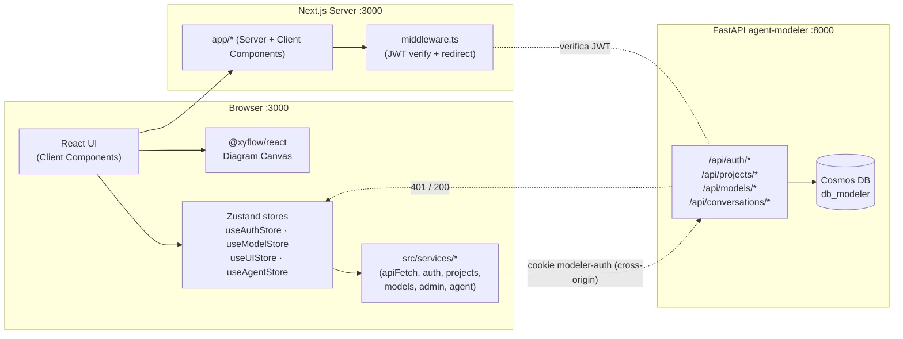
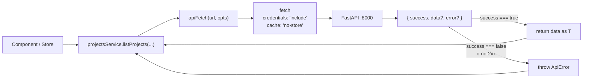
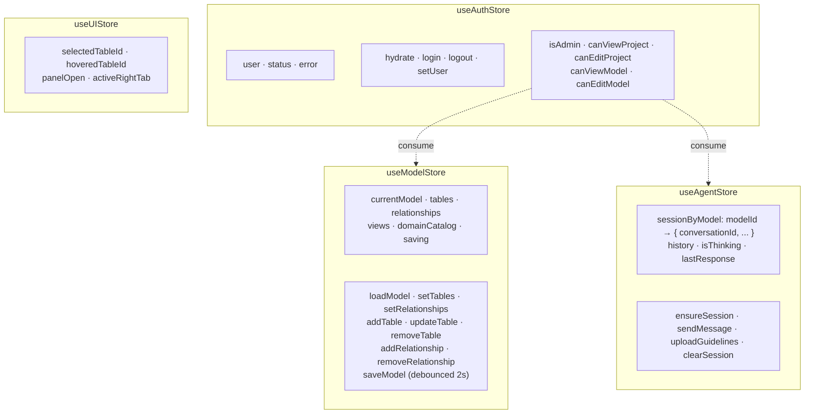
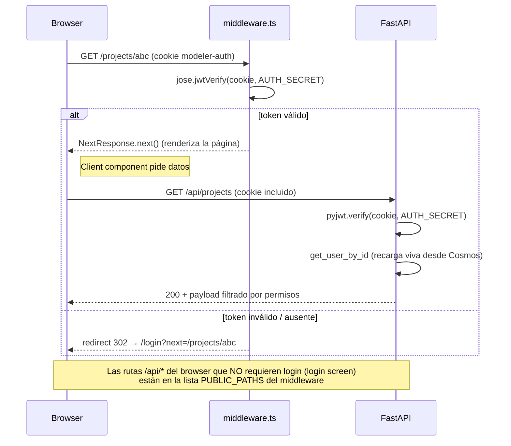
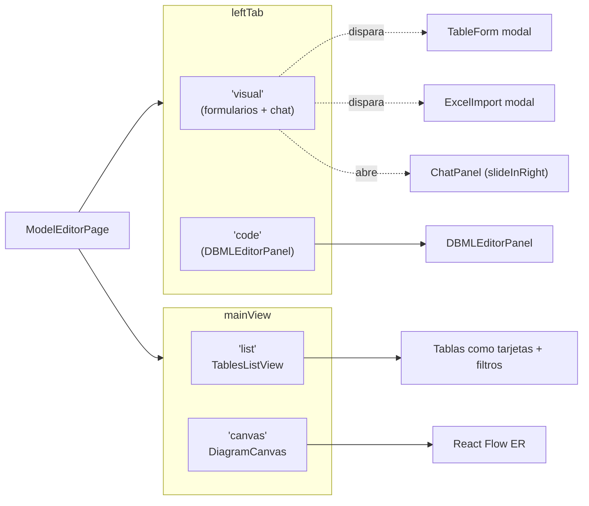
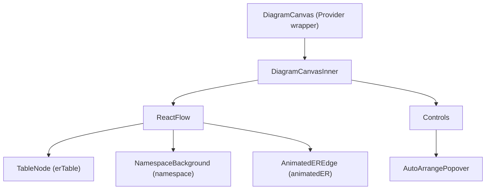
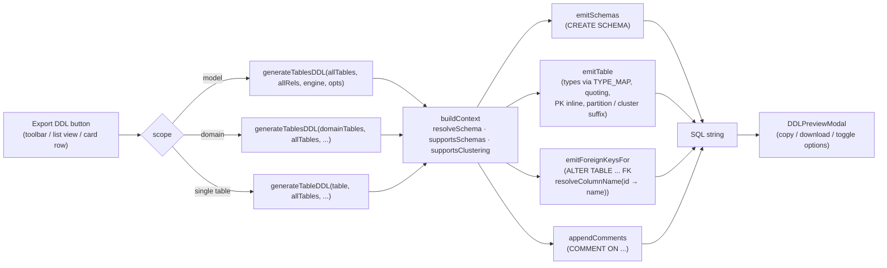

# Arquitectura del Frontend — `web-data-model-hub`

> Este documento refleja el estado **post-migración** a backend
> centralizado: el frontend ya **no expone rutas API propias** (la
> carpeta `src/app/api/` fue eliminada). Todo el tráfico — auth, CRUD
> de proyectos / modelos / usuarios y el agente de modelado — apunta
> directamente al backend FastAPI `agent-modeler` cross-origin.

## 1. Visión General

`web-data-model-hub` es la UI Next.js (App Router) del sistema de
modelamiento. Sus responsabilidades:

- Render del editor visual de modelos (canvas ER + lista de tablas).
- Captura del input del usuario (formulario, DBML, Excel, SQL, chat
  con el agente).
- Estado local efímero (Zustand) y sincronización persistente con el
  backend mediante `apiFetch`.
- Generación cliente-side de DDL y DBML a partir del modelo en memoria
  (no requiere round-trip al backend).
- Validación de sesión vía middleware de Next.js que verifica el JWT
  cookie firmado por el backend.



> **No hay storage local en el frontend**. La carpeta `data/` del
> proyecto y el módulo `jsonStore.ts` desaparecieron en la migración a
> Cosmos DB. Si el backend está caído, el frontend muestra estados de
> error pero no almacena nada offline.

---

## 2. Estructura del repositorio

```
web-data-model-hub/
├── src/
│   ├── app/                       # App Router (sin /api/*)
│   │   ├── layout.tsx
│   │   ├── page.tsx               # Dashboard / Projects landing
│   │   ├── login/page.tsx
│   │   ├── admin/                 # Admin de usuarios + permisos
│   │   ├── dashboard/             # Dashboard con métricas
│   │   ├── docs/                  # Documentación in-app
│   │   └── projects/[projectId]/
│   │       ├── page.tsx           # Lista de modelos del proyecto
│   │       ├── global/page.tsx    # Canvas global (todos los modelos)
│   │       └── models/[modelId]/page.tsx   # Editor del modelo
│   ├── components/                # Components compartidos (UI primitives)
│   ├── features/                  # Feature modules (componentes + utils)
│   │   ├── admin-users/           # CRUD users + permission editor
│   │   ├── chat-agent/            # ChatPanel + useAgentConversation
│   │   ├── ddl/                   # Generators y modal de DDL preview
│   │   ├── diagram/               # DiagramCanvas + TableNode + edges
│   │   ├── domains/               # DomainManager
│   │   ├── engines/               # EngineSelect + EngineBadge + capabilities
│   │   ├── excel-import/          # Modal + parser de Excel
│   │   ├── projects/              # Tarjetas y forms de proyectos
│   │   ├── table-editor/          # TableForm, DBML editor, SQL importer
│   │   └── views/                 # ViewForm
│   ├── hooks/
│   ├── lib/
│   │   ├── columnRef.ts           # findColumnId / resolveColumnName / ensureColumnId
│   │   ├── auth/permissions.ts    # canViewModel, canEditProject, ...
│   │   └── agent/
│   │       ├── mapping.ts         # ModelingResponse → Tables/Relationships
│   │       └── types.ts
│   ├── server/
│   │   └── auth/jwt.ts            # signAuthToken / verifyAuthToken (jose)
│   ├── services/
│   │   ├── http.ts                # apiFetch + ApiError envelope
│   │   ├── auth.service.ts
│   │   ├── projects.service.ts
│   │   ├── models.service.ts
│   │   ├── admin.service.ts
│   │   ├── agent.service.ts
│   │   └── index.ts               # barrel
│   ├── store/
│   │   ├── useAuthStore.ts
│   │   ├── useModelStore.ts
│   │   ├── useUIStore.ts
│   │   └── useAgentStore.ts
│   ├── types/
│   │   ├── model.ts               # TableModel, TableColumn (con id estable), Relationship, ...
│   │   ├── api.ts                 # ApiResponse envelope
│   │   └── auth.ts                # AuthUser, AuthJwtClaims, Permission
│   └── middleware.ts              # JWT cookie verification
├── doc/                           # Esta carpeta
└── package.json
```

---

## 3. Capa de servicios (`src/services/`)

Toda comunicación con el backend pasa por aquí. La capa es fina
y tipada — un wrapper sobre `fetch` que desempaqueta el envelope
`{success, data?, error?}` y arroja `ApiError` en cualquier ruta no-OK.



| Service | Endpoints que consume | Notas |
|---------|-----------------------|-------|
| `authService` | `/api/auth/login`, `/logout`, `/me` | `getCurrentUser` retorna `null` ante 401 (no lanza). |
| `projectsService` | `/api/projects/*` | Funciones puras sin estado. |
| `modelsService` | `/api/models/*` | Soporta `projectId` y `full` query params. |
| `adminService` | `/api/admin/users/*` | CRUD usuarios + edición de permisos. |
| `agentService` | `/api/conversations/*` | Cliente especializado: usa `AgentClientError` (con `code` y `detail`) en vez del envelope genérico, porque el backend del agente devuelve `{detail, code}` directo (no envuelve). |
| `apiFetch` | base genérica | Agrega `Content-Type: application/json` automático cuando hay body, propaga `AbortSignal`, lanza `ApiError(message, status)` ante errores. |

**`NEXT_PUBLIC_API_URL`**: la base URL del backend la lee cada service
de `process.env.NEXT_PUBLIC_API_URL` (default vacío → mismo origen).
En desarrollo típico se setea a `http://localhost:8000`.

---

## 4. Stores de Zustand



| Store | Persistencia | Cuándo se hidrata |
|-------|--------------|--------------------|
| `useAuthStore` | sin persist; `hydrate()` consulta `/api/auth/me` | una vez por mount del app shell |
| `useModelStore` | sin persist; `loadModel(id)` consulta `/api/models/{id}` | al entrar al editor |
| `useUIStore` | sin persist | local a la sesión del browser |
| `useAgentStore` | sin persist; `conversationId` por `modelId` | en el primer `ensureSession` por modelo |

> Mantener los stores **sin `persist`** es deliberado: la fuente de
> verdad es Cosmos DB. Persistir en localStorage agrega complejidad y
> no aporta — el modelo siempre se rehidrata desde el backend.

---

## 5. Auth y middleware



**Detalles importantes**:

- **Mismo `AUTH_SECRET`** en `web-data-model-hub/.env` y
  `agent-modeler/.env`. El frontend firma con `jose`, el backend con
  `pyjwt`, ambos HS256.
- El middleware **no consulta DB**: solo verifica firma + expiración.
  Eso lo hace edge-compatible y rápido. Las verificaciones de
  permisos finos (admin? puedo editar este proyecto?) las hace el
  backend en cada request — el frontend usa `useAuthStore.canEdit*`
  solo para esconder/deshabilitar UI.
- El cookie es **`HttpOnly`** + `SameSite=Lax`. JS no lo ve, no
  hay riesgo XSS de robo del token. Pero como ambos servidores corren
  en orígenes distintos en dev (`:3000` ↔ `:8000`), el browser solo
  envía el cookie si el fetch usa `credentials: 'include'`. Ambos
  clientes (`apiFetch` y `agentService`) lo activan explícitamente.

---

## 6. Editor de modelos — vistas y navegación

`ModelEditorPage` (`src/app/projects/[projectId]/models/[modelId]/page.tsx`)
gestiona dos toggles independientes:



`TablesListView` y `DiagramCanvas` comparten el **mismo store**
(`useModelStore`); cambiar de vista nunca refetcha datos.

---

## 7. Diagrama (`features/diagram/`)



### `DiagramCanvasInner` gestiona

- **Estado de hover/selección** (`hoveredTableId` + `selectedTableId`)
  → derivado `activeTableId`.
- **Columnas activas** (`activeColsByTable`): mapa
  `tableId → Set<columnId>`. Se rellena recorriendo las relaciones
  conectadas a `activeTableId`. **Las relaciones almacenan `column.id`
  estables, no nombres** — ver §9.
- **Asignación de `highlighted` / `dimmed` / `edgeIndex`** a cada
  arista para enrutar conexiones paralelas con offset escalonado.
- **Auto-distribución al cargar**: cuando cambia la "huella estructural"
  del set de tablas (hash de IDs + nombres + columnas), se ejecuta
  `layoutCompact` por defecto. Las posiciones arrastradas se conservan
  en memoria mientras dure la sesión, **pero no se persisten al backend**.

### `TableNode`

- Encabezado con nombre + conteo de columnas.
- Una fila por columna con: ícono PK/FK/SK/PT, nombre, ◇ nullable,
  tipo en mono.
- **Handles** (`react-flow`) por columna, con id `${col.id}-source` y
  `${col.id}-target`. La estabilidad del id de columna es lo que evita
  que renombrar una columna rompa los edges existentes.
- Tooltip on hover con `logicalName / name`, tipo, `functionalDefinition`,
  FK ref.

### `AnimatedEdge`

- Enrutamiento inteligente: lado mismo (L→L o R→R) cuando los nodos
  se solapan horizontalmente; lado opuesto (R→L) cuando hay espacio.
- `offset = 20 + edgeIndex × 16` para separar conexiones paralelas.
- Animación `stroke-dashoffset` cuando la arista está activa.

---

## 8. Generación de DDL (`features/ddl/`)

Todo client-side, sin round-trip al backend:



| Archivo | Rol |
|---------|-----|
| `engines/engines.ts` | Define `EngineDefinition` con `defaultSchema`, `partitionStrategies`, `supportsClustering`, `partitionHint`. La UI filtra opciones de partition usando este metadato. |
| `ddl/typeMappings.ts` | `TYPE_MAP` (canónico → dialect) + `quoteIdent()` + `qualifyTable()`. |
| `ddl/generators.ts` | Punto de entrada `generateTableDDL()` y `generateTablesDDL()`. Resuelve `Relationship.sourceColumn` (id) → nombre físico vía `resolveColumnName`. |
| `ddl/components/DDLPreviewModal.tsx` | Diálogo unificado (model / domain / single-table). Toggles `emitSchemas` · `emitForeignKeys` · `emitComments`. |

---

## 9. Identidad estable de columnas (column IDs)

Cambio importante introducido durante la migración: cada `TableColumn`
tiene un `id` UUIDv4 estable.

| Por qué | Antes | Ahora |
|---------|-------|-------|
| Renombrar una columna no debe romper sus relaciones | `Relationship.sourceColumn` guardaba el **nombre** → renombrar dejaba edges huérfanos y warnings de React Flow | guarda el `id` UUID; el nombre se resuelve solo al emitir DDL/DBML |
| Handles de React Flow | `${col.name}-source` | `${col.id}-source` |
| Edge construction | matching por nombre | matching por id (con fallback a nombre para compat) |

**Punto único de verdad**: `src/lib/columnRef.ts`.

```typescript
findColumnId(tables, tableRef, columnName): string | null     // name → id (en imports)
resolveColumnName(tables, tableRef, columnRef): string | null // id → name (al emitir SQL)
ensureColumnId(col): col with id guaranteed                    // backfill defensivo
ensureTableColumnIds(table): table con todos sus cols con id
```

**Cobertura**:

- `TableForm.emptyColumn()` siempre stamp un `uuidv4()`.
- Importadores (`excelParser`, `dbmlParser`, `sqlToTable`,
  `agentColumnToTableColumn`) idem.
- El backend (`models_db._ensure_column_ids`) hace **safety net** en
  cada write: si llega una columna sin `id`, la stampa antes de
  persistir.
- Hay un **script de migración one-shot**
  (`agent-modeler/scripts/backfill_column_ids.py`) para datos
  pre-migración: backfillea los IDs en `model_tables` y purga las
  relaciones legacy (que apuntaban por nombre).

---

## 10. Lienzo Global

`GlobalPage` (`src/app/projects/[projectId]/global/page.tsx`) carga
todos los modelos del proyecto con `modelsService.list({ projectId, full: true })`,
fusiona sus tablas en un único `DiagramCanvas` y las colorea según
modelo de origen vía `namespaces` (background nodes).

Es de **solo lectura**: no permite agregar/editar tablas. Útil para
ver el linaje completo cuando un proyecto agrupa varios modelos.

---

## 11. Decisiones tecnológicas

### Next.js 16 (App Router) sin rutas API propias
El frontend solo usa Next.js para SSR / routing / middleware. Las
rutas API se eliminaron al migrar a Cosmos DB porque mantenerlas como
proxy era redundante: cualquier feature de auth o permisos que
exponíamos en `/api/*` ya vivía mejor en FastAPI con permission
helpers compartidos. La consecuencia es que el frontend funciona
incluso desplegado en **Vercel / serverless** sin filesystem propio.

### `@xyflow/react` v12
Misma decisión que en versiones previas: hooks-first
(`useInternalNode`, `useReactFlow`), tipos custom de nodo y arista,
`getSmoothStepPath` con `offset` para edges paralelos.

### Zustand v5 sin `persist`
Cosmos DB es la fuente de verdad. Persistir en localStorage añadiría
una capa más de divergencia que no compensa.

### `jose` (Edge runtime) para verificar JWT
El middleware corre en el Edge runtime de Next.js. `jsonwebtoken`
no funciona ahí; `jose` sí. El backend Python usa `pyjwt`. Misma
firma HS256, claves idénticas → cookie firmado por uno verificable
por el otro.

### Sin storage local para el diagrama
Las posiciones del canvas son **solo en memoria**. Algoritmos de
auto-layout (`layoutCompact`, `layoutLeftRight`, `layoutSnowflake`) se
recalculan cada vez que se carga el modelo. Esto evita el infierno de
tener posiciones obsoletas tras renombres / borrados.
