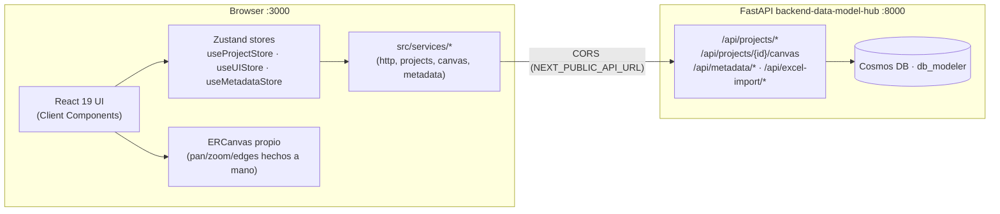
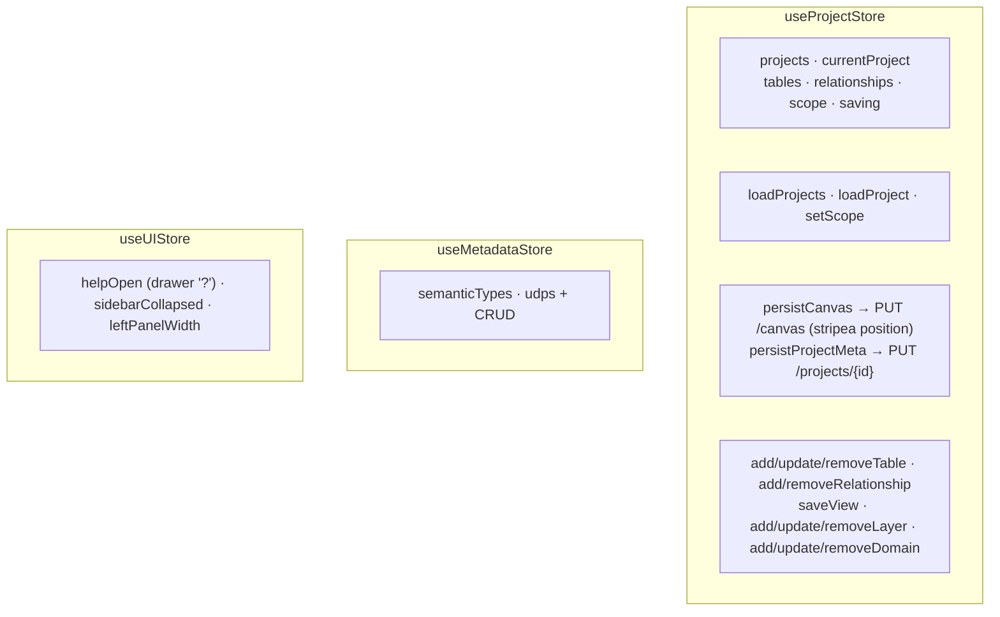

# Arquitectura del Frontend — `web-data-model-hub`

> UI Next.js (App Router) del Data Modeler, rediseño **"Aurora"**
> (project-centric). El frontend **no expone rutas API propias**: llama
> directamente al backend FastAPI `backend-data-model-hub` cross-origin (CORS) vía
> `src/services/*`. **MVP abierto/anónimo** (sin login ni permisos). El agente de
> modelado IA está **fuera del MVP** (vive en `app-agents-modeler`).

## 1. Visión general



**Stack**: Next.js 16 (Turbopack) · React 19 · TypeScript · **sin Tailwind**
(CSS custom properties, sistema *Aurora*) · `next/font` (Manrope + JetBrains
Mono) · Zustand 5 · `sonner` (toasts) · `uuid` · `xlsx`.

> **No hay storage local.** La fuente de verdad es Cosmos DB vía el backend. Las
> **posiciones del canvas son per-sesión** (se auto-organizan al abrir; no se persisten).

---

## 2. Jerarquía del dominio

```
Proyecto → Modelo (nivel: RDV·UDV·DDV…) → Dominio (vertical) → Tabla → Columnas + Vistas
```

- Un **Proyecto** posee `engines`, `layers` (los "Modelos / niveles") y
  `domains` (productos de datos verticales). Tiene **un único canvas**.
- Una **Tabla** vive en una `layer` y (opcional) un `domain`, hereda su color del
  dominio, y embebe `views` (SQL por rol).
- Las **Relaciones** son `source`/`target`/`cardinality`; `crossLayer`/`skip` se
  derivan del orden de los niveles.

---

## 3. Estructura del repositorio

> **Convención de features:** cada `features/<name>/` es autocontenida y expone su
> API pública por `index.ts` (barrel). El código de fuera importa **solo** desde
> `@/features/<name>` (lo vigila un guard de ESLint). Las rutas de `app/` son
> **shells finos**. Detalle en **`doc/feature-architecture.md`**.

```
web-data-model-hub/
├── src/
│   ├── app/                       # App Router — shells finos (sin /api/*, sin middleware)
│   │   ├── layout.tsx             # fuentes + import único de globals.css
│   │   ├── page.tsx               # → <ModelCenterScreen/>  (features/model-center)
│   │   ├── projects/page.tsx      # → <ProjectsScreen/>     (features/projects)
│   │   ├── projects/[projectId]/page.tsx          # → <ProjectHubScreen/>
│   │   ├── projects/[projectId]/editor/page.tsx   # → <EditorScreen/>  (features/editor)
│   │   ├── docs/page.tsx          # → <HelpCenterScreen/>   (features/help)
│   │   └── globals.css            # solo @import de styles/ + el .css de cada feature
│   ├── components/
│   │   ├── layout/ (AppLayout · Header · Sidebar [rail 64px])
│   │   └── ui/ (Icon · Modal · ConfirmDialog · TagEditor · …)
│   ├── features/<name>/           # components/ [hooks/ lib/ services/ store/]
│   │   │                          #   + <name>.css + index.ts (API pública) + README.md
│   │   ├── projects/      ProjectsScreen · ProjectHubScreen · CreateProjectModal
│   │   ├── model-center/  ModelCenterScreen + grids/overview/inspector (lib/catalog · hooks)
│   │   ├── editor/        EditorScreen · useEditorController · EditorListView
│   │   ├── diagram/       ERCanvas · Inspector · ScopeControl · layout/layouts · builders
│   │   ├── table-editor/  TablesListView · TableForm · CreateFromSqlModal · DBMLModal
│   │   ├── views/         ViewForm        · ddl/ generators · DDLPreviewModal
│   │   ├── levels/        LevelModal      · domains/ DomainModal
│   │   ├── engines/       engines · EngineBadge · EngineSelect
│   │   ├── excel-import/  ExcelImportModal + service
│   │   ├── metadata/      MetadataAdmin (Semantic Types & UDP)
│   │   ├── help/          HelpCenterScreen · HelpDrawer · HelpContent
│   │   └── _template/     esqueleto para una feature nueva
│   ├── styles/  tokens.css · base.css · ui.css · shell.css   (CSS global compartido)
│   ├── store/   useProjectStore · useUIStore · useMetadataStore
│   ├── services/ http · projects · canvas · metadata · index
│   ├── types/   model.ts (project-centric) · api.ts
│   └── lib/     hierarchy.ts (scope/layerGap) · tags.ts · columnRef.ts
└── doc/                      # esta carpeta (incl. feature-architecture.md)
```

> **CSS:** `app/globals.css` solo hace `@import` (en orden de cascada) de
> `src/styles/{tokens,base,ui,shell}.css` + el `<name>.css` de cada feature.
> Todo sigue siendo **global** (sin CSS Modules); los nombres de clase no cambian.

---

## 4. Capa de servicios (`src/services/`)

Wrapper fino y tipado sobre `fetch` que desempaqueta el envelope
`{success, data?, error?}` y arroja `ApiError` ante cualquier ruta no-OK.

| Service | Endpoints | Notas |
|---|---|---|
| `projectsService` | `/api/projects/*` | `list/get/create/update/delete`. |
| `canvasService` | `/api/projects/{id}/canvas`, `/positions` | `getCanvas` · `saveCanvas` · `updatePositions`. |
| `metadataService` | `/api/metadata/*` | Semantic Types / UDP. |
| `apiFetch` | base genérica | agrega `Content-Type` cuando hay body, lanza `ApiError(message, status)`. |

`NEXT_PUBLIC_API_URL` (p. ej. `http://localhost:8000`) es la base que cada
service antepone (cross-origin con el backend).

---

## 5. Stores de Zustand



| Store | Persistencia | Hidratación |
|---|---|---|
| `useProjectStore` | sin persist; `loadProject(id)` → `/api/projects/{id}` + `/canvas` | al entrar al hub / editor |
| `useMetadataStore` | sin persist; `load()` → `/api/metadata/*` | en el Model Center |
| `useUIStore` | `localStorage` para preferencias de panel | local a la sesión |

Sin `persist` (salvo prefs de UI): Cosmos es la fuente de verdad; el estado
siempre se rehidrata del backend.

---

## 6. Identidad (MVP abierto)

El MVP **no tiene autenticación ni permisos**: no hay login, ni cookie, ni
middleware. La app carga directamente. El modelo de roles (`admin/editor/viewer`)
y los permisos por proyecto se **reintroducirán al final** como una matriz
robusta; entonces la identidad la proveerá el proxy de **Databricks Apps** (OBO,
`X-Forwarded-Email`). Ver `../plan-migracion-databricks.md` y `../DEPLOY-databricks.md`.

---

## 7. Editor (`app/projects/[projectId]/editor/page.tsx`)

Orquestador de un **único canvas por proyecto**, scope-driven (`useEditorController`).
Coordina:

- **Barra superior**: breadcrumb `Proyecto › <scope>` + engine badge ·
  `ScopeControl` · toggle `List/Canvas` · `Export` (DDL) · indicador `Saved/Saving…`.
- **Rail izquierdo** (`TablesListView`): contador + `New ▾` (Nueva tabla · Desde
  existentes · Escribir DBML · Importar Excel) · búsqueda · agrupar por
  Dominio/Modelo.
- **Canvas** (`ERCanvas`) o **lista** según el toggle.
- **Inspector** (`Inspector`): auto-abre al seleccionar; tabs Columns / Views / Links.
- **Modales**: TableForm, CreateFromSqlModal, ViewForm, DDLPreviewModal,
  DBMLModal, ExcelImportModal, ConfirmDialog.
- **Autosave**: debounce 800 ms → `persistCanvas()` (que stripea `position`).

El **Scope** (`src/lib/hierarchy.ts::Scope = {layers, domains}`) filtra qué
tablas/relaciones son visibles y editables. El scope inicial viene de
`?layer=` / `?domain=`.

---

## 8. Canvas ER propio (`features/diagram/components/ERCanvas.tsx`)

Lienzo **hecho a mano** (sin React Flow ni librerías de grafos):

- `er-world` con `transform: translate(x,y) scale(s)`; pan arrastrando el fondo,
  zoom con la rueda hacia el cursor, dock con Fit / zoom %.
- **Nodos** tintados por color de dominio: header `schema.name` + pill de capa +
  partición + contador de vistas/columnas + engranaje. Fila por columna con chip
  PK/FK/SK/PT, nombre, punto nullable, tipo; tooltip al hover.
- **Edges** SVG con curva Bézier + crow's-foot derivado de la cardinalidad;
  *flow* animado en la relación activa; **cross-layer**: gap 1 = etiqueta teal
  `A→B`, gap ≥2 = ámbar/punteado + "!".
- **Modo Conectar**: clic en columna origen → columna destino de otra tabla →
  crea la relación con la cardinalidad elegida y marca la columna origen como FK.
- **Dock**: Seleccionar · Conectar · Auto-organizar (Por modelo / Snowflake /
  Compacto) · Ajustar a pantalla · zoom. **Minimapa** abajo a la derecha.

### Layouts (`features/diagram/layout/layouts.ts`)
`nodeHeight(t)` estima la altura real de cada nodo. Los tres layouts empaquetan
por esa altura (masonry) para que **nunca se solapen**:

- `layoutByLayer` — bandas por nivel (orden), 1–3 sub-columnas balanceadas.
- `layoutCompact` — grilla cuasi-cuadrada, más altos primero.
- `layoutSnowflake` — radial; si no hay relaciones, cae a compacto.

---

## 9. Generación de DDL (`features/ddl/`)

Client-side, sin round-trip:

| Archivo | Rol |
|---|---|
| `engines/engines.ts` | `EngineDefinition` (defaultSchema, partitionStrategies, supportsClustering…) por engine. |
| `ddl/generators.ts` | `genDDL(tables, opts)` → `CREATE TABLE` (+ NOT NULL, PRIMARY KEY) + `ALTER TABLE … ADD FOREIGN KEY`. `genViewDDL` → `CREATE VIEW … AS SELECT …`. |
| `ddl/components/DDLPreviewModal.tsx` | Toggles "Solo el scope actual" / "Incluir vistas" + "Copiar DDL". |

DBML (`features/diagram/builders.ts`): `genDBML` serializa el canvas; `parseDBML`
lo reconstruye (Aplicar **reemplaza** el canvas). `tableFromSources` deriva una
tabla heredando columnas de ≤2 padres (FromSQL).

---

## 10. Identidad estable de columnas

Cada `TableColumn` tiene un `id` estable que sobrevive a renames. Las relaciones
referencian `column.id`, **no `name`**. El backend
(`canvas/repository._ensure_column_ids`) stampa un UUID defensivo en cualquier
columna que llegue sin id.

---

## 11. Decisiones tecnológicas

| Decisión | Razón |
|---|---|
| **Sin Tailwind** | El sistema *Aurora* se modela con CSS custom properties (`rd-*`/`dmh-*`/`ed-*`/`mc-*`/`doc-*`). Ver `doc/design-system.md`. |
| **Canvas propio, sin React Flow** | El prototipo definía interacciones específicas (flow animado, cross-layer, dock). Hacerlo a mano elimina dependencias pesadas (`@xyflow/react`, `elkjs`). |
| **Zustand sin `persist`** | Cosmos es la fuente de verdad. |
| **Posiciones per-sesión** | El editor auto-organiza al abrir; evita posiciones obsoletas tras renombres/borrados. (`PATCH /positions` existe para persistirlas a futuro.) |
| **MVP sin auth** | Se quitó la auth/permisos para iterar rápido; vuelve al final como matriz robusta, con identidad del proxy de Databricks Apps. |
