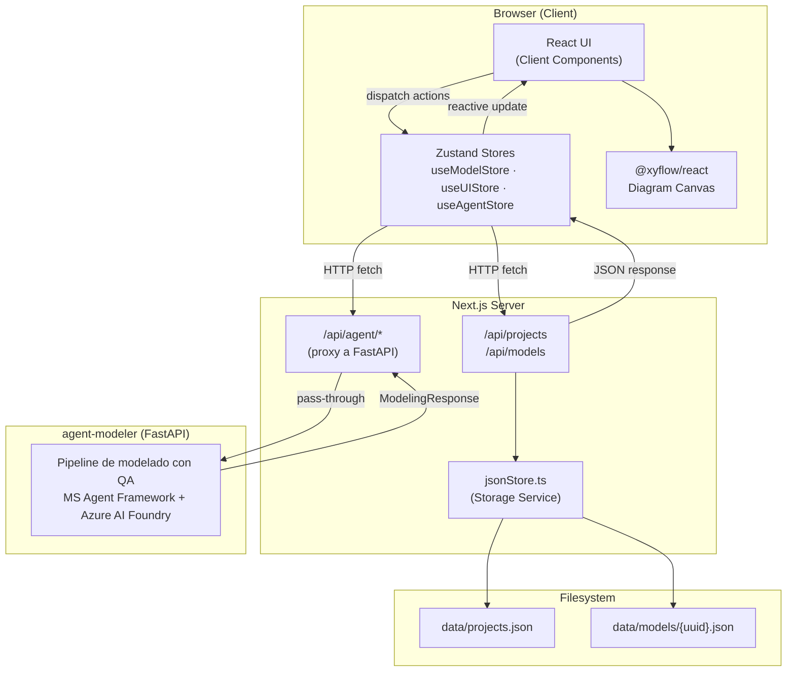
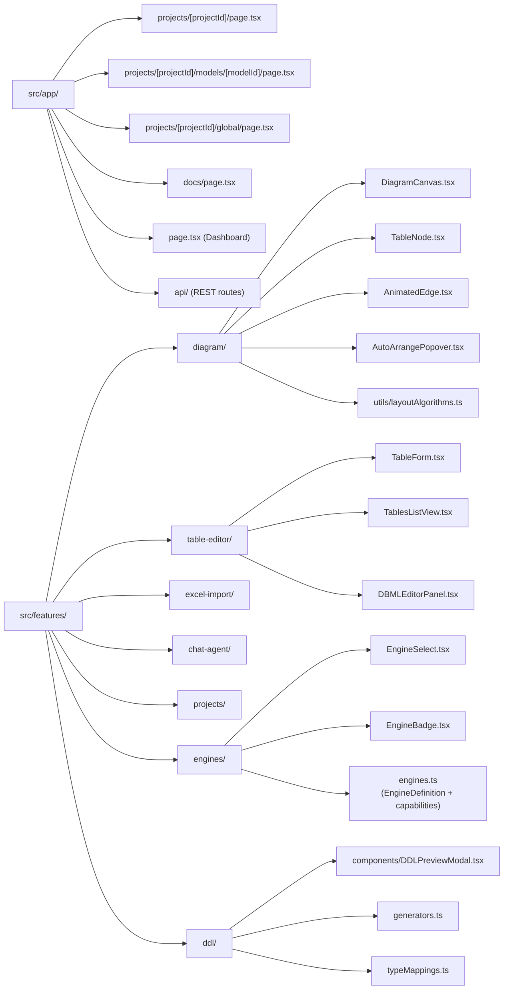
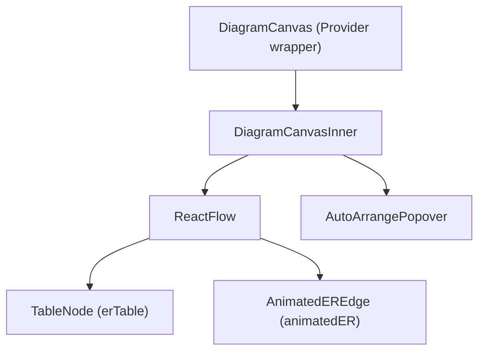

# Arquitectura

## Visión General del Sistema

Data Model Hub es una aplicación unificada de **Next.js 16 (App Router)** que sirve tanto el frontend React como la API REST. La arquitectura sigue un **patrón de módulos por funcionalidad** — cada dominio funcional vive bajo `src/features/` con sus propios componentes y utilidades.

## Arquitectura de Alto Nivel



## Arquitectura de Componentes

### Módulos por Funcionalidad



> El parser DBML vive en `src/utils/dbmlParser.ts` (no en `features/table-editor/`). Acepta tanto `Table name { … }` como `Table schema.name { … }`.

### Característica de Diagrama — Árbol de Componentes Interno



**`DiagramCanvasInner`** gestiona:
- `hoveredTableId` + `selectedTableId` → `activeTableId`
- Derivación de columnas activas (`activeColsByTable`)
- Asignación de `highlighted`/`dimmed` + `edgeIndex` por arista
- **Auto-distribución al cargar** — cuando las tablas se renderizan por primera vez o cambia la estructura, `layoutLeftRight()` calcula las posiciones iniciales (ninguna posición se persiste en el backend)
- Callback `handleAutoArrange` → llama al algoritmo de distribución → actualiza posiciones en memoria

**`AnimatedEdge`** gestiona:
- Enrutamiento inteligente (mismo lado vs lado opuesto según superposición horizontal)
- `offset` por arista desde `edgeIndex` para separar conexiones paralelas
- Estado de hover (`isHovered`) → superposición de animación de flujo

### Página del Editor de Modelos — Arquitectura de Vistas

`ModelEditorPage` (`src/app/projects/[projectId]/models/[modelId]/page.tsx`) gestiona un estado `mainView` (`'list' | 'canvas'`) que controla qué componente de área de trabajo se renderiza:

```
mainView === 'list'   → <TablesListView>  (cuadrícula de tarjetas con búsqueda + filtro de etiquetas)
mainView === 'canvas' → <DiagramCanvas>   (diagrama ER con React Flow)
```

El panel izquierdo (estado `leftTab`) controla de forma independiente:

```
leftTab === 'visual' → disparador del modal TableForm + importación Excel + chat IA
leftTab === 'code'   → DBMLEditorPanel
```

**`TablesListView`** gestiona:
- Estado local `search` (filtra por nombre, descripción, código de app, dominio, subdominio, etiquetas)
- Estado local `activeTag` (filtrado por clic en chips de etiquetas)
- `allTags` derivado (unión de etiquetas de todas las tablas, ordenado)
- Renderiza tarjetas de tabla con insignias de clasificación (`applicationCode`, `domain`, `subdomain`) y chips de etiquetas
- Botones de acción editar/eliminar delegados a los manejadores de `ModelEditorPage`

**`EngineSelect`** gestiona:
- Popover con posición fija (evita recorte por ancestros con `overflow: hidden`)
- Posicionamiento dinámico calculado desde `getBoundingClientRect()` en el botón disparador
- Lista de opciones de motor con íconos dentro de un listener DOM adjunto por `useEffect` para cierre al hacer clic afuera

### Generación DDL — Característica `ddl/`

La característica `src/features/ddl/` está separada del editor para mantener una frontera limpia entre el modelo en memoria y la salida SQL.

- **`engines/engines.ts`** — declara cada `EngineDefinition` con `defaultSchema`, `partitionStrategies`, `supportsClustering` y un `partitionHint`. La UI filtra opciones de partition usando este metadato.
- **`ddl/typeMappings.ts`** — matriz `TYPE_MAP` de tipo canónico → tipo dialect-specific (PostgreSQL / Oracle / Databricks). También expone `quoteIdent()` (comillas dobles vs backticks) y `qualifyTable()` (`schema.name` con quoting correcto).
- **`ddl/generators.ts`** — punto de entrada `generateTableDDL()` y `generateTablesDDL()`. El primero produce DDL para una tabla aislada con sus FKs salientes; el segundo agrupa CREATE SCHEMA al inicio, CREATE TABLE en el medio, y ALTER TABLE de FKs al final. Ambos respetan los toggles `emitSchemas` / `emitForeignKeys` / `emitComments`.
- **`ddl/components/DDLPreviewModal.tsx`** — diálogo unificado que muestra el SQL generado, ofrece toggles para las opciones, copia al portapapeles y descarga como `.sql`. Es invocado desde:
  - el botón _Export DDL_ del toolbar del editor (scope = modelo)
  - el icono `↓` de cada cabecera de grupo en la Vista de Lista (scope = dominio / schema)
  - el icono `↓` de cada tarjeta en la Vista de Lista (scope = tabla)

### Página del Lienzo Global

`GlobalPage` (`src/app/projects/[projectId]/global/page.tsx`) obtiene todos los modelos de un proyecto y fusiona sus tablas en un único render de `DiagramCanvas`. Las tablas se colorean según su modelo de origen.

## Decisiones Tecnológicas

### Next.js 16 (App Router)
- Un solo repositorio para frontend + rutas de API backend — sin servidor separado
- Server Components para estructuras de diseño; Client Components para todas las funcionalidades interactivas
- `DiagramCanvas` usa `dynamic(..., { ssr: false })` porque `@xyflow/react` requiere el DOM

### @xyflow/react v12
- Librería de grafos React con API de hooks (`useInternalNode`, `useReactFlow`)
- Tipos de nodo (`erTable`) y arista (`animatedER`) personalizados vía `nodeTypes`/`edgeTypes`
- `useInternalNode` provee posiciones absolutas en tiempo real dentro de componentes de arista — usado para enrutamiento inteligente
- `getSmoothStepPath` con parámetro `offset` permite aristas paralelas separadas
- El componente `Controls` acepta hijos — usado para incrustar el popover de Auto-Arrange

### Zustand v5
- Sin boilerplate de provider; los stores se importan directamente en cualquier componente
- `useModelStore` — tablas, relaciones, acciones CRUD, debounce de auto-guardado
- `useUIStore` — `selectedTableId`, estado abierto del panel derecho

### Almacenamiento JSON Local
- Cero infraestructura para desarrollo; solo módulo `fs` de Node.js
- Interfaz abstracta: reemplaza `jsonStore.ts` por un adaptador de base de datos (Cosmos DB, SharePoint) sin cambiar las firmas de las rutas de API

## Estrategia de Renderizado

| Capa | Estrategia | Razón |
|------|------------|---------|
| Estructuras de diseño, nav | Server Component | Estructura estática, sin interactividad |
| Dashboard, lista de proyectos | Server Component | Puede pre-renderizarse |
| Lienzo de diagrama | `'use client'` + `dynamic(ssr:false)` | React Flow requiere el DOM |
| Modales, formularios, paneles | `'use client'` | Estado interactivo |
| Rutas de API | Node.js (servidor) | Acceso al sistema de archivos |

## Arquitectura Futura

**Migración a una base de datos (Cosmos DB / SharePoint):**
1. Crea `cosmosStore.ts` implementando las mismas firmas de función que `jsonStore.ts`
2. Reemplaza la importación en cada archivo de ruta de API
3. Sin cambios en el frontend — el contrato HTTP de la API permanece idéntico

**Conexión del agente IA (implementada):**
1. El proxy `/api/agent/*` (en `src/app/api/agent/`) hace pass-through a
   `AGENT_BACKEND_URL` (FastAPI del repo hermano `agent-modeler`). La URL
   del backend es server-only; nunca se expone al navegador.
2. El hook `useAgentConversation` (en `src/features/chat-agent/hooks/`)
   mantiene un `conversation_id` (UUID v4) estable por `modelId` en
   `useAgentStore`, gestiona guidelines por sesión y orquesta los turnos
   de modelado.
3. El `ModelingResponse` (`src/lib/agent/types.ts`) se convierte a
   `TableModel[]` + `Relationship[]` con `modelingResponseToCanvas`
   (`src/lib/agent/mapping.ts`) y se aplica al lienzo vía
   `useModelStore.setTables` / `setRelationships` cuando el usuario
   pulsa "Aplicar al canvas" en el bloque de resultado.
