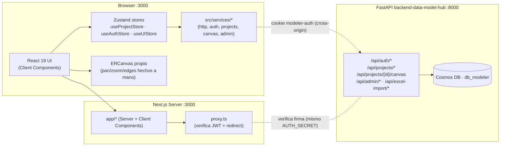
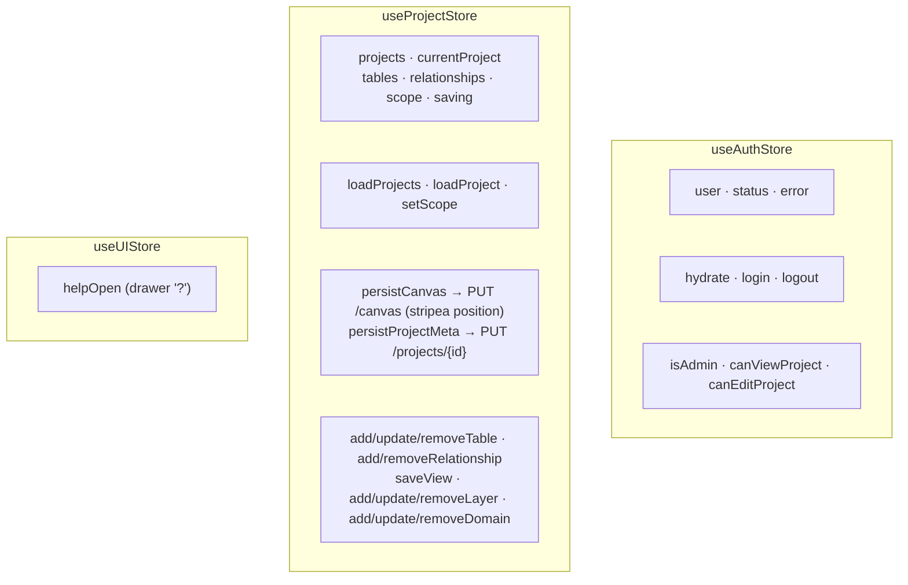
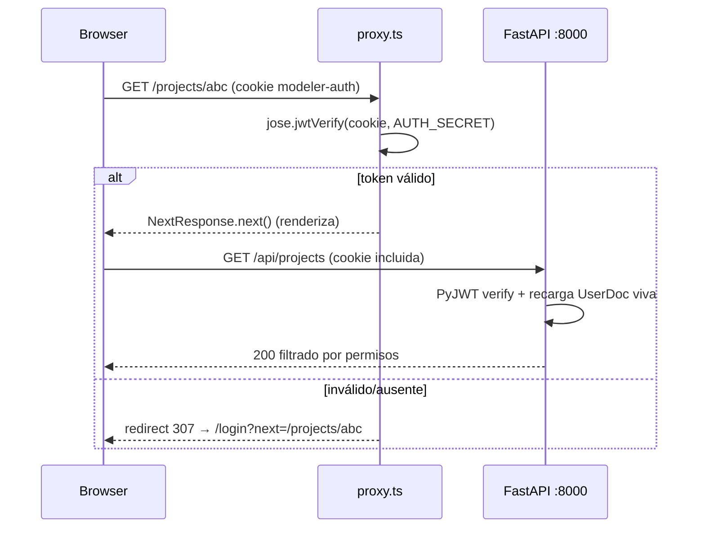

# Arquitectura del Frontend — `web-data-model-hub`

> UI Next.js (App Router) del Data Modeler, rediseño **"Aurora"**
> (project-centric). El frontend **no expone rutas API propias**: llama
> directamente al backend FastAPI `backend-data-model-hub` cross-origin con la
> cookie `modeler-auth`. El agente de modelado IA está **desacoplado** (vive en
> `app-agents-modeler`) y por ahora su botón solo avisa que se reconectará.

## 1. Visión general



**Stack**: Next.js 16 (Turbopack) · React 19 · TypeScript · **sin Tailwind**
(CSS custom properties en `globals.css`, sistema *Aurora*) · `next/font`
(Manrope + JetBrains Mono) · Zustand 5 · `sonner` (toasts) · `uuid` · `xlsx` ·
`jose` (verificación JWT en el proxy).

> **No hay storage local.** La fuente de verdad es Cosmos DB vía el backend. Si
> el backend está caído, la UI muestra estados de error pero no guarda nada
> offline. Las **posiciones del canvas son per-sesión** (se auto-organizan al
> abrir; no se persisten).

---

## 2. Jerarquía del dominio

```
Proyecto → Modelo (nivel: RDV·UDV·DDV…) → Dominio (vertical) → Tabla → Columnas + Vistas
```

- Un **Proyecto** posee `engines`, `layers` (los "Modelos / niveles") y
  `domains` (productos de datos verticales). Tiene **un único canvas**.
- Una **Tabla** vive en una `layer` y (opcional) un `domain`, hereda su color del
  dominio, y embebe `views` (SQL por rol).
- Las **Relaciones** son `source`/`target`/`cardinality`; `crossLayer`/`skip` se
  derivan del orden de los niveles.

---

## 3. Estructura del repositorio

> **Convención de features:** cada `features/<name>/` es autocontenida y expone su
> API pública por `index.ts` (barrel). El código de fuera importa **solo** desde
> `@/features/<name>`, nunca rutas internas (lo vigila un guard de ESLint). Las
> rutas de `app/` son **shells finos** que renderizan el *screen* de una feature.
> Detalle y "cómo agregar una feature" en **`doc/feature-architecture.md`**.

```
web-data-model-hub/
├── src/
│   ├── app/                       # App Router — shells finos (sin /api/*)
│   │   ├── layout.tsx             # fuentes + import único de globals.css
│   │   ├── page.tsx               # → <ModelCenterScreen/>  (features/model-center)
│   │   ├── login/page.tsx         # → <LoginScreen/>        (features/auth)
│   │   ├── projects/page.tsx      # → <ProjectsScreen/>     (features/projects)
│   │   ├── projects/[projectId]/page.tsx          # → <ProjectHubScreen/>
│   │   ├── projects/[projectId]/editor/page.tsx   # → <EditorScreen/>  (features/editor)
│   │   ├── docs/page.tsx          # → <HelpCenterScreen/>   (features/help)
│   │   └── admin/users/page.tsx   # → <AdminUsersScreen/>   (features/admin-users)
│   ├── components/
│   │   ├── layout/ (AppLayout · Header · Sidebar [rail 64px])
│   │   └── ui/ (Icon · Modal · ConfirmDialog · TagEditor · …)
│   ├── features/<name>/           # components/ [hooks/ lib/ services/ store/]
│   │   │                          #   + <name>.css + index.ts (API pública) + README.md
│   │   ├── auth/          LoginScreen
│   │   ├── projects/      ProjectsScreen · ProjectHubScreen · CreateProjectModal
│   │   ├── model-center/  ModelCenterScreen + grids/overview/inspector (lib/catalog · hooks)
│   │   ├── editor/        EditorScreen · useEditorController · EditorListView
│   │   ├── diagram/       ERCanvas · Inspector · ScopeControl · layout/layouts · builders
│   │   ├── table-editor/  TablesListView · TableForm · CreateFromSqlModal · DBMLModal
│   │   ├── views/         ViewForm        · ddl/ generators · DDLPreviewModal
│   │   ├── levels/        LevelModal      · domains/ DomainModal
│   │   ├── engines/       engines · EngineBadge · EngineSelect
│   │   ├── excel-import/  ExcelImportModal + service
│   │   ├── metadata/      MetadataAdmin (Semantic Types & UDP)
│   │   ├── admin-users/   AdminUsersScreen · UserFormModal
│   │   ├── help/          HelpCenterScreen · HelpDrawer · HelpContent
│   │   ├── chat-agent/    DESACOPLADO (agente :8001)
│   │   └── _template/     esqueleto para una feature nueva
│   ├── styles/  tokens.css · base.css · ui.css · shell.css   (CSS global compartido)
│   ├── store/   useProjectStore · useAuthStore · useUIStore · useMetadataStore
│   ├── services/ http · auth · projects · canvas · admin · metadata · index
│   ├── types/   model.ts (project-centric) · api.ts · auth.ts
│   ├── lib/     hierarchy.ts (scope/layerGap) · auth/permissions.ts · tags.ts · columnRef.ts
│   └── server/auth/jwt.ts   # signAuthToken / verifyAuthToken (jose)
├── proxy.ts                  # middleware Next 16 (export `proxy`) — verifica JWT
├── doc/                      # esta carpeta (incl. feature-architecture.md)
└── package.json
```

> **CSS:** `app/globals.css` solo hace `@import` (en orden de cascada) de
> `src/styles/{tokens,base,ui,shell}.css` + el `<name>.css` de cada feature.
> Todo sigue siendo **global** (sin CSS Modules); los nombres de clase no cambian.

> Next.js 16 renombró el archivo de middleware de `middleware.ts` a **`proxy.ts`**
> (con un export `proxy`). El matcher funciona igual.

---

## 4. Capa de servicios (`src/services/`)

Wrapper fino y tipado sobre `fetch` que desempaqueta el envelope
`{success, data?, error?}` y arroja `ApiError` ante cualquier ruta no-OK.

| Service | Endpoints | Notas |
|---|---|---|
| `authService` | `/api/auth/login`, `/logout`, `/me` | `getCurrentUser` retorna `null` ante 401 (no lanza). |
| `projectsService` | `/api/projects/*` | `list/get/create/update/delete`. |
| `canvasService` | `/api/projects/{id}/canvas`, `/positions` | `getCanvas` · `saveCanvas` · `updatePositions`. |
| `adminService` | `/api/admin/users/*` | CRUD usuarios + permisos. |
| `apiFetch` | base genérica | `credentials: 'include'`, agrega `Content-Type` cuando hay body, lanza `ApiError(message, status)`. |

`NEXT_PUBLIC_API_URL` (p. ej. `http://localhost:8000`) es la base que cada
service antepone. **Es cross-origin con el backend** → `credentials: 'include'`
es obligatorio para que viaje la cookie.

> El chat-agent es decoupled: cuando se reconecte, hablará con
> `app-agents-modeler` con su propio cliente, no con este backend.

---

## 5. Stores de Zustand



| Store | Persistencia | Hidratación |
|---|---|---|
| `useAuthStore` | sin persist; `hydrate()` → `/api/auth/me` | una vez en `AppLayout` |
| `useProjectStore` | sin persist; `loadProject(id)` → `/api/projects/{id}` + `/canvas` | al entrar al hub / editor |
| `useUIStore` | sin persist | local a la sesión |

Sin `persist` a propósito: Cosmos es la fuente de verdad; el estado siempre se
rehidrata del backend.

---

## 6. Auth y proxy



- **Mismo `AUTH_SECRET`** en `web-data-model-hub/.env` y
  `backend-data-model-hub/.env`. El proxy firma/valida con `jose` (Edge), el
  backend con `PyJWT`; ambos HS256, cookie `modeler-auth`, 10 h. Si divergen →
  401 silencioso (login parece colgarse).
- El proxy **no consulta DB**: solo verifica firma + expiración. Los permisos
  finos los revalida el backend en cada request; el frontend usa
  `useAuthStore.can*Project` solo para esconder/deshabilitar UI.
- La cookie es `HttpOnly` + `SameSite=Lax`. Como `localhost:3000` y
  `localhost:8000` son el **mismo site** (distinto puerto = distinto origen, pero
  mismo site), el cookie se guarda y se envía bien con `credentials: 'include'`.

---

## 7. Editor (`app/projects/[projectId]/editor/page.tsx`)

Orquestador de un **único canvas por proyecto**, scope-driven. Coordina:

- **Barra superior**: breadcrumb `Proyecto › <scope>` + engine badge ·
  `ScopeControl` · toggle `List/Canvas` · `Export` (DDL) · indicador
  `Saved/Saving…` · botón `AI Agent` (violeta, decoupled).
- **Rail izquierdo** (`TablesListView`): contador + `New ▾` (Nueva tabla · Desde
  existentes · Escribir DBML · Importar Excel) · búsqueda · agrupar por
  Dominio/Modelo · lista agrupada (chip PK/FK + pill de capa + nº columnas).
- **Canvas** (`ERCanvas`) o **lista** según el toggle.
- **Inspector** (`Inspector`): auto-abre al seleccionar; tabs Columns / Views / Links.
- **Modales**: TableForm, CreateFromSqlModal, ViewForm, DDLPreviewModal,
  DBMLModal, ExcelImportModal, ConfirmDialog.
- **Autosave**: debounce 800 ms → `persistCanvas()` (que stripea `position`).

El **Scope** (`src/lib/hierarchy.ts::Scope = {layers, domains}`) filtra qué
tablas/relaciones son visibles y editables. El scope inicial viene de
`?layer=` / `?domain=` (al entrar desde una tarjeta de Modelo o fila de Dominio).

---

## 8. Canvas ER propio (`features/diagram/components/ERCanvas.tsx`)

Lienzo **hecho a mano** (sin React Flow ni librerías de grafos):

- `er-world` con `transform: translate(x,y) scale(s)`; pan arrastrando el fondo,
  zoom con la rueda hacia el cursor, dock con Fit / zoom %.
- **Nodos** tintados por color de dominio: header `schema.name` + pill de capa +
  indicador de partición + contador de vistas/columnas + engranaje
  (Editar · color · Eliminar). Fila por columna con chip PK/FK/SK/PT, nombre,
  punto nullable, tipo; tooltip al hover.
- **Edges** SVG con curva Bézier + crow's-foot derivado de la cardinalidad;
  *flow* animado (dash) en la relación activa; estilo **cross-layer**: gap 1 =
  etiqueta teal `A→B`, gap ≥2 = ámbar/punteado + "!" (aviso).
- **Modo Conectar**: clic en columna origen → clic en columna destino de otra
  tabla → crea la relación con la cardinalidad elegida y marca la columna origen
  como FK.
- **Dock**: Seleccionar · Conectar · Auto-organizar (Por modelo / Snowflake /
  Compacto) · Ajustar a pantalla · zoom. **Minimapa** abajo a la derecha.

### Layouts (`features/diagram/layout/layouts.ts`)
`nodeHeight(t)` estima la altura real de cada nodo (varía mucho con el nº de
columnas). Los tres layouts empaquetan por esa altura real (masonry) para que
**nunca se solapen**, incluso con tablas de 4 vs 38 columnas:

- `layoutByLayer` — bandas por nivel (orden), 1–3 sub-columnas balanceadas.
- `layoutCompact` — grilla cuasi-cuadrada, más altos primero.
- `layoutSnowflake` — radial con separación basada en el círculo envolvente del
  nodo más alto (si no hay relaciones, cae a compacto).

---

## 9. Generación de DDL (`features/ddl/`)

Client-side, sin round-trip:

| Archivo | Rol |
|---|---|
| `engines/engines.ts` | `EngineDefinition` (defaultSchema, partitionStrategies, supportsClustering…) por engine. |
| `ddl/generators.ts` | `genDDL(tables, opts)` → `CREATE TABLE` (+ NOT NULL, PRIMARY KEY) + `ALTER TABLE … ADD FOREIGN KEY`. `genViewDDL(table, view)` → `CREATE VIEW … AS SELECT … FROM … [WHERE …]`. `includeViews` añade un `CREATE VIEW` por vista. |
| `ddl/components/DDLPreviewModal.tsx` | Toggles "Solo el scope actual" / "Incluir vistas" + "Copiar DDL". |

DBML (`features/diagram/builders.ts`): `genDBML` serializa el canvas; `parseDBML`
lo reconstruye (Aplicar **reemplaza** el canvas). `tableFromSources` deriva una
tabla heredando columnas de ≤2 padres (FromSQL).

---

## 10. Identidad estable de columnas

Cada `TableColumn` tiene un `id` estable que sobrevive a renames. Las relaciones
referencian `column.id`, **no `name`**, así que renombrar una columna no rompe
sus vínculos. El backend (`canvas_db._ensure_column_ids`) stampa un UUID
defensivo en cualquier columna que llegue sin id.

---

## 11. Decisiones tecnológicas

| Decisión | Razón |
|---|---|
| **Sin Tailwind** | El sistema *Aurora* se modela con CSS custom properties en `globals.css` (`rd-*`/`dmh-*`/`ed-*`/`mc-*`/`doc-*`). Ver `doc/design-system.md`. |
| **Canvas propio, sin React Flow** | El prototipo definía interacciones específicas (flow animado, cross-layer, dock). Hacerlo a mano elimina dependencias pesadas (se quitaron `@xyflow/react`, `elkjs`). |
| **Zustand sin `persist`** | Cosmos es la fuente de verdad. |
| **`jose` (Edge) en el proxy** | El proxy corre en el Edge runtime; `jsonwebtoken` no funciona ahí. El backend usa `PyJWT`. Misma firma HS256. |
| **Posiciones per-sesión** | El editor auto-organiza al abrir; evita posiciones obsoletas tras renombres/borrados. (`PATCH /positions` existe para persistirlas a futuro.) |
| **Agente IA desacoplado** | Se integra en una versión próxima desde `app-agents-modeler`; su código compila aislado vía `chat-agent/lib/legacyModel.ts`. |
