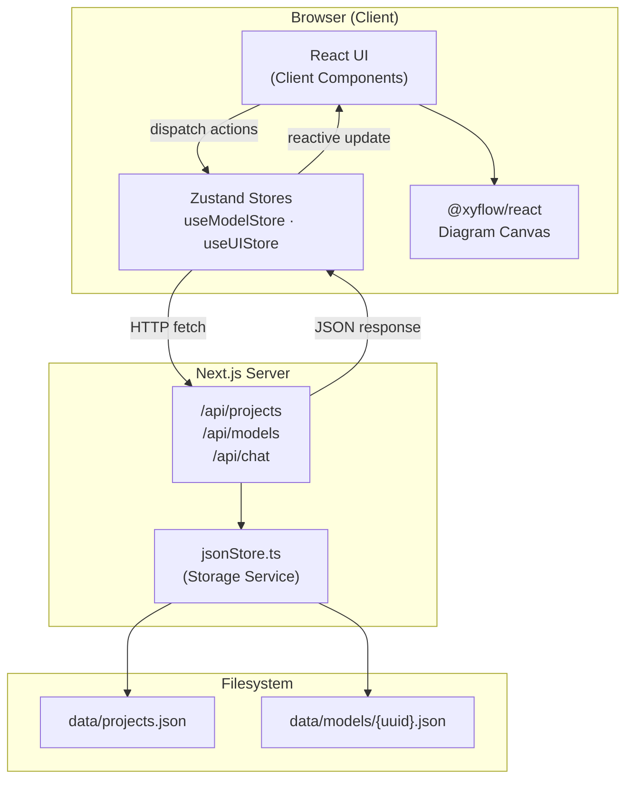
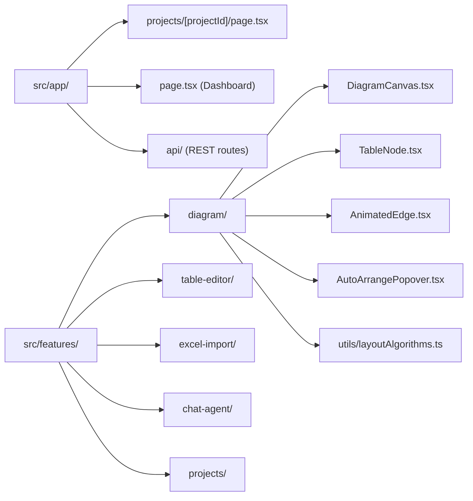
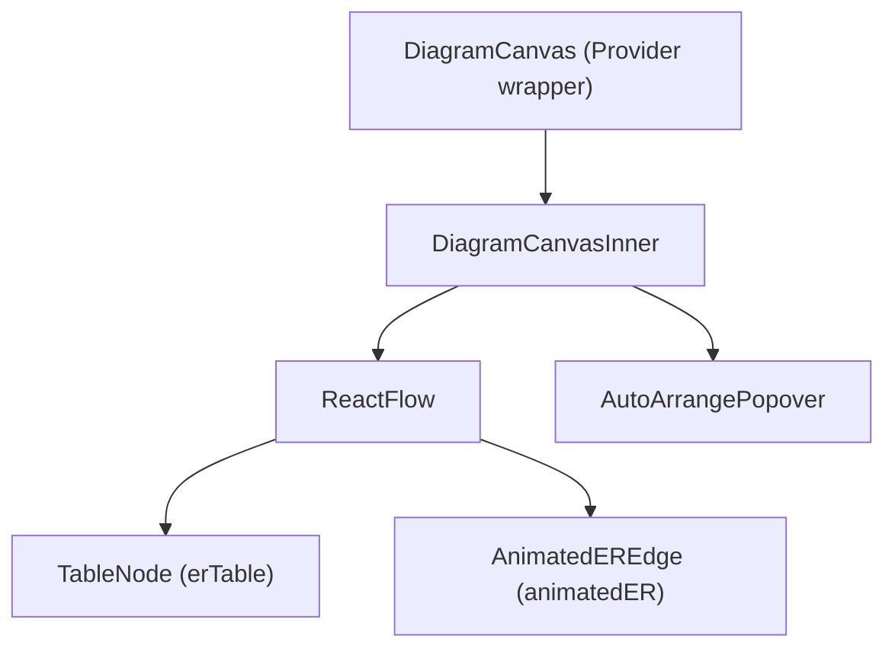

# Architecture

## System Overview

Data Model Hub is a unified **Next.js 16 (App Router)** application serving both the React frontend and REST API. The architecture follows a **feature-based module pattern** — each functional domain lives under `src/features/` with its own components and utilities.

## High-Level Architecture

## Component Architecture

### Feature Modules

### Diagram Feature — Internal Component Tree

**`DiagramCanvasInner`** owns:
- `hoveredTableId` + `selectedTableId` → `activeTableId`
- Active column derivation (`activeColsByTable`)
- Edge `highlighted`/`dimmed` + `edgeIndex` assignment
- `handleAutoArrange` callback → calls layout algorithm → updates node positions + persists

**`AnimatedEdge`** owns:
- Smart routing (same-side vs opposite-side based on horizontal overlap)
- Per-edge `offset` from `edgeIndex` to separate parallel wires
- Hover state (`isHovered`) → flow animation overlay

## Technology Decisions

### Next.js 16 (App Router)
- Single repo for frontend + backend API routes — no separate server
- Server Components for layout shells; Client Components for all interactive features
- `DiagramCanvas` uses `dynamic(..., { ssr: false })` because `@xyflow/react` requires DOM

### @xyflow/react v12
- Purpose-built React graph library with hooks API (`useInternalNode`, `useReactFlow`)
- Custom node (`erTable`) and edge (`animatedER`) types via `nodeTypes`/`edgeTypes`
- `useInternalNode` provides real-time absolute node positions inside edge components — used for smart routing
- `getSmoothStepPath` with `offset` parameter enables separated parallel edges
- `Controls` component accepts children — used to embed the Auto-Arrange popover

### Zustand v5
- No provider boilerplate; stores imported directly in any component
- `useModelStore` — tables, relationships, CRUD actions, auto-save debounce
- `useUIStore` — `selectedTableId`, right panel open state

### Local JSON Storage
- Zero infrastructure for development; Node.js `fs` module only
- Abstract interface: swap `jsonStore.ts` for a database adapter (Cosmos DB, SharePoint) without changing API route signatures

## Rendering Strategy

| Layer | Strategy | Reason |
|-------|----------|--------|
| Layout shells, nav | Server Component | Static structure, no interactivity |
| Dashboard, project list | Server Component | Can be pre-rendered |
| Diagram canvas | `'use client'` + `dynamic(ssr:false)` | React Flow requires DOM |
| Modals, forms, panels | `'use client'` | Interactive state |
| API routes | Node.js (server) | File system access |

## Future Architecture

**Migrating to a database (Cosmos DB / SharePoint):**
1. Create `cosmosStore.ts` implementing the same function signatures as `jsonStore.ts`
2. Swap the import in each API route file
3. No frontend changes — the HTTP API contract stays identical

**Connecting the AI agent:**
1. Implement `/api/chat` to forward to the agent backend
2. Parse agent responses into `TableModel[]` + `Relationship[]`
3. Call `useModelStore.addTable()` / `addRelationship()` — the canvas auto-reacts
