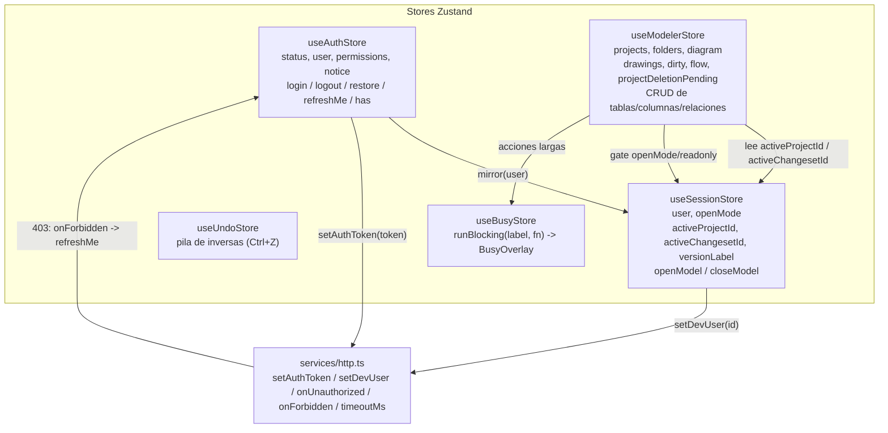
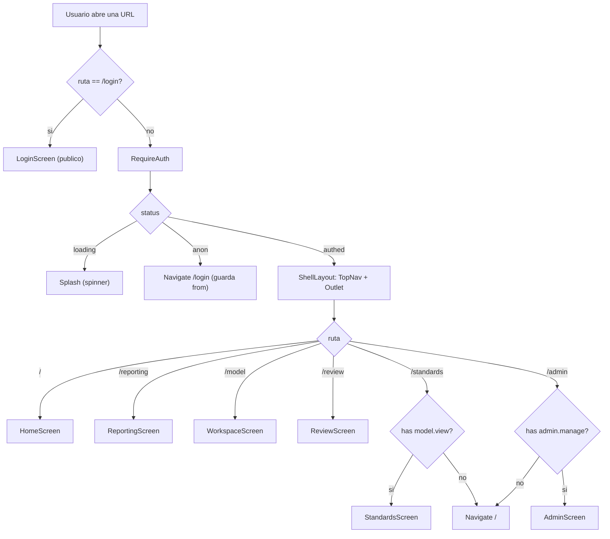
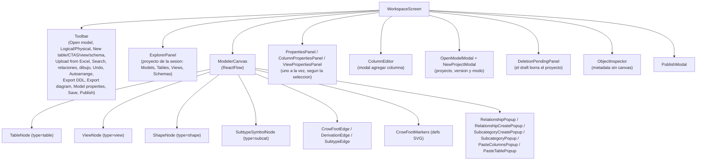
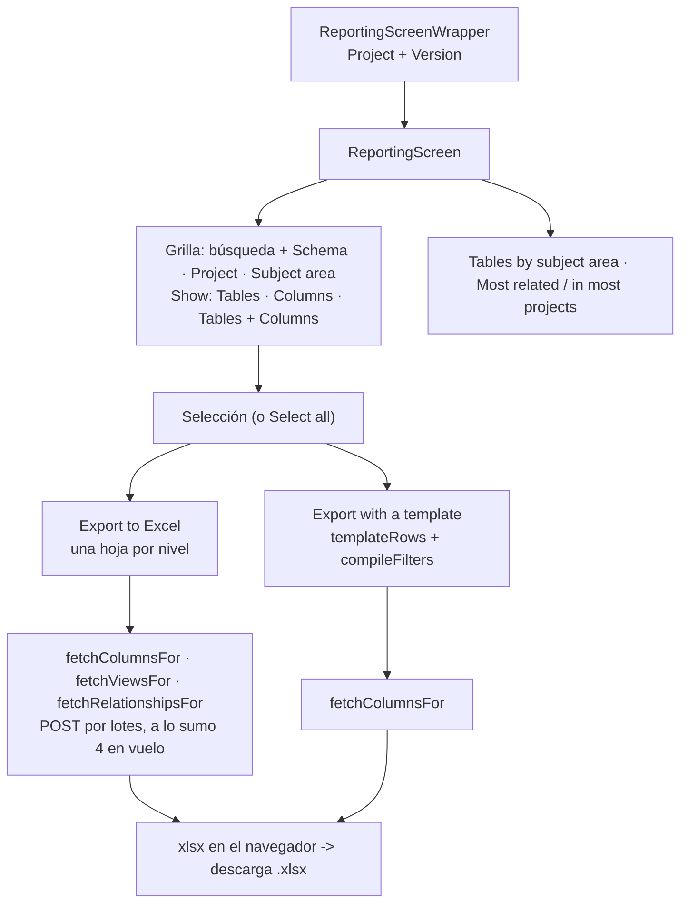
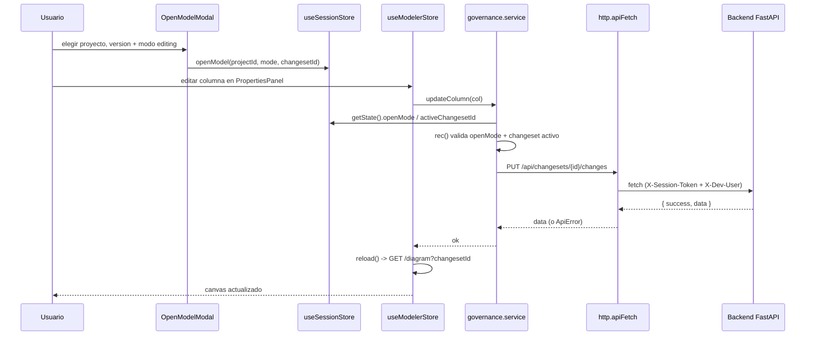

# Arquitectura del Frontend — web-data-model-hub

> **Actualizado 2026-09-08** — proyectos independientes (doc 75 de plan-implementacion/): la sesión es de UN proyecto (`useSessionStore.activeProjectId`), Data Standards / Reporting / versiones por proyecto, borrado de proyecto por draft con aviso crítico en Review, overlay bloqueante por sesión (`useBusyStore`) y limpieza del legado (`/governance`, `useChangesetStore`, `useIdentityStore`, `AppLayout`). Ediciones previas: dependencias pineadas exactas, `server.mjs` (§3.1), LOD del canvas (§6.7), review con `ChangesSummary`/`ChangesDetailModal`, 5.ª pestaña "DDL Export rules" (§8), despliegue de un solo origen (§10).

## 1. Visión

`web-data-model-hub` es la interfaz web del **Data Model Hub (DMH)**: una plataforma para diseñar, visualizar, gobernar y reportar modelos de datos empresariales. Reemplaza el flujo tradicional de una herramienta de modelado de escritorio (tipo Erwin) por una aplicación de una sola página (SPA) que corre en el navegador y conversa con un backend FastAPI.

La aplicación se organiza como una *shell* con navegación superior persistente y cinco grandes áreas de trabajo:

| Área | Ruta | Qué resuelve |
|------|------|--------------|
| **Home** | `/` | Panel de bienvenida: contadores del workspace, solicitudes asignadas al usuario y versiones agrupadas **por proyecto** (no se editan acá), «New project» y «Version tools» (comparar, detalle y — doc 104 — transferir o eliminar un draft: su dueño o un administrador). |
| **Reporting** | `/reporting` | Grilla de la metadata de **un proyecto** (o de una versión propia sin publicar) con filtros y selección, «Export to Excel» por niveles (tablas, columnas, relaciones, vistas, definiciones), «Export with a template» (plantillas de hoja con filtros de filas) e indicadores. |
| **Model** | `/model` | El **canvas** de modelado ER de **un proyecto** (Open model en 2 pasos: proyecto → versión): carpetas → canvases (subject areas), con tablas, columnas y relaciones editables. |
| **Data Standards** | `/standards` | Glosario, Parent Domains, UDP, naming y reglas DDL **del proyecto elegido**, versionados de forma independiente al canvas. |
| **Admin** | `/admin` | Usuarios, roles y matriz de permisos (RBAC). |
| **Requests** | `/review` | Bandeja global de solicitudes de cambio con chip y filtro de proyecto; aprobación con bloque crítico cuando el request borra su proyecto. |

El diseño rector es **DMH-Erwin v20260625-2**: un sistema visual claro (light-only), de acento *navy* y azul, con tipografía Geist. Todo el estado de sesión, edición y gobernanza vive en el cliente mediante **Zustand**, y todas las escrituras de modelo pasan por un *choke-point* consciente del *changeset* activo (la unidad de versionado del backend).

Un principio transversal es que **el frontend nunca toca la base de datos directamente**: consume exclusivamente endpoints REST `/api/*` con un envelope uniforme `{ success, data, error }`. La persistencia (Databricks Lakebase Postgres) es responsabilidad del backend.

---

## 2. Stack tecnológico

El proyecto es 100% TypeScript, construido con **Vite** (que también sirve el dev server; en producción sirve `server.mjs`, §3.1). No usa Next.js (migró desde Next a Vite); desde 2026-07-19 los `.env` y manifiestos de deploy ya usan `VITE_API_URL` (la herencia `NEXT_PUBLIC_*` fue eliminada) y el código lee `import.meta.env.VITE_API_URL` (centralizado en `src/services/apiBase.ts`; en producción la variable no se define, ver §10).

**Política de versiones (2026-07-31, ambos repos)**: todas las dependencias — `dependencies` y `devDependencies` — van pineadas **exactas**, sin `^` ni `~` (el backend aplica el mismo criterio con `==` en pip). Actualizar una versión es siempre un cambio deliberado y revisable en el `package.json`, nunca un efecto lateral de un `npm install`.

| Categoría | Tecnología | Versión | Rol en la app |
|-----------|-----------|---------|---------------|
| Build / dev server | **Vite** | `6.4.3` | Bundler, HMR, proxy `/api` en dev, build estático. |
| Runtime de producción | **`server.mjs`** (Node puro) | — | Sirve `dist/` con fallback SPA y proxya `/api` al backend con token M2M. No es una dependencia npm (cero deps, solo módulos `node:*`); es pieza del stack (§3.1). |
| UI runtime | **React** + **React DOM** | `19.2.4` | Componentes, `StrictMode`, hooks. |
| Lenguaje | **TypeScript** | `5.9.3` | Tipado estricto (`strict: true`), alias `@ → ./src`. |
| Routing | **react-router-dom** | `7.18.0` | `BrowserRouter`, rutas anidadas, guards, `useSearchParams`. |
| Estado | **Zustand** | `5.0.12` | Los 5 stores globales de `src/store/` (`useAuthStore`, `useSessionStore`, `useModelerStore`, `useUndoStore`, `useBusyStore`) + `dialogs.tsx`. |
| Canvas ER | **@xyflow/react** (React Flow) | `12.11.0` | Nodos/aristas, viewport, minimapa, virtualización. |
| Auto-layout | **elkjs** | `0.11.1` | Algoritmo `layered` (Sugiyama); único import en `lib/elkLayout.ts`. |
| Lista virtual | **@tanstack/react-virtual** | `3.14.5` | Render virtualizado de las listas de afectados de los popups; único uso en `components/ui/AffectedTable.tsx`. |
| Toasts | **sonner** | `2.0.7` | Notificaciones globales (`richColors`, `bottom-center`). |
| Excel | **xlsx** (SheetJS) | `0.18.5` | Exports del Reporting —el workbook por niveles en `ReportingScreen.tsx` y la hoja de plantilla en `SheetTemplateCard.tsx`— y lectura del libro de la carga masiva (`features/upload/lib/parseWorkbook.ts`). |
| Export SVG | **html-to-image** | `1.11.13` | Export SVG del canvas (`toSvg`, import dinámico en `Toolbar.tsx`). |
| Íconos | **lucide-react** | `1.21.0` | Set de íconos SVG (~40 archivos). |
| Tipografía | **@fontsource-variable/geist** + **geist-mono** | `5.2.9` / `5.2.8` | Geist (UI) y Geist Mono (datos/SQL, feature GSUB `liga` para `<>`), self-hosted. |
| IDs | **uuid** | `13.0.0` | `v4` para ids cliente-side; único import en `governance.service.ts`. |
| YAML | **yaml** | `2.9.0` | Round-trip YAML del editor de DDL Export Rules; único import en `ddlRules.service.ts`. |
| Testing | **Vitest** | `2.1.9` | Tests unitarios (`src/**/*.test.{ts,tsx}` + `server.test.mjs`). |
| Linting | **ESLint** + **typescript-eslint** + **eslint-plugin-react-hooks** | `9.39.4` / `8.58.1` / `7.1.1` | Reglas TS, hooks, y guard de límites de feature. |

Configuración clave (`vite.config.ts`):

```ts
export default defineConfig({
  plugins: [react()],
  resolve: { alias: { '@': fileURLToPath(new URL('./src', import.meta.url)) } },
  server: {
    port: 3000,
    proxy: { '/api': { target: 'http://localhost:8000', changeOrigin: true } },
  },
  test: { environment: 'node', include: ['src/**/*.test.{ts,tsx}', 'server.test.mjs'] },
});
```

El punto de entrada (`src/main.tsx`) monta la app y carga las fuentes y el CSS de React Flow una sola vez:

```tsx
import '@fontsource-variable/geist';
import '@fontsource-variable/geist-mono';
import '@xyflow/react/dist/style.css';
import '@/app/globals.css';
import App from './App';

createRoot(document.getElementById('root')!).render(
  <StrictMode><App /></StrictMode>,
);
```

Una regla de ESLint (`no-restricted-imports`) refuerza los **límites de feature**: cada feature se importa por su *barrel* `@/features/<name>`, nunca por rutas internas. Excepción a propósito (la regla es `warn`): `features/upload` importa piezas de `modeler` por su ruta interna —`services/modeler.service`, `services/structure.service`, `lib/arrangeGraph`, `components/SearchSelect` y, desde el doc 105, `lib/sessionGuard` (`pinSession`)—, porque el barrel `@/features/modeler` exporta `WorkspaceScreen`, cuya `Toolbar` importa `@/features/upload`: pasar por el barrel crearía un ciclo entre las dos features.

---

## 3. Scaffolding de `src/`

La estructura separa el *chrome* global (shell, layout, UI primitives) de las *features* verticales (modeler, reporting, standards, admin, ddl, auth, upload). Cada feature es autocontenida (componentes + servicios + estilos + barrel).

```
src/
├── main.tsx                 # Punto de entrada: monta <App/> en StrictMode
├── App.tsx                  # Router + ShellLayout + guards + bridge + hosts globales
├── app/
│   └── globals.css          # Orquesta @imports de tokens + base + estilos por feature
├── components/
│   ├── ui/                  # Design-system: Button, Dialog, Badge, Avatar, Icon,
│   │                        #   SegmentedControl, Tooltip, Modal, ConfirmDialog,
│   │                        #   TagEditor, dialogs (DialogHost), focusTrap (trampa de
│   │                        #   Tab de los diálogos, doc 105), index (barrel)
│   ├── layout/              # TopNav, UserMenu
│   ├── BusyOverlay.tsx      # Overlay bloqueante por sesión (useBusyStore, doc 75 D18)
│   ├── ProjectPicker.tsx    # Selector de proyecto (Open model paso 1, Standards, Reporting)
│   ├── NewProjectModal.tsx  # «New project»: vacío o copiando bloques de Data Standards de otro
│   └── OpenModelModal.tsx   # Open model en 2 pasos: proyecto → versión/modo
├── features/
│   ├── modeler/             # El canvas ER (ver §6)
│   │   ├── components/      #   WorkspaceScreen, ModelerCanvas, TableNode, ViewNode,
│   │   │                    #   ExplorerPanel, DeleteProjectDialog, DeletionPendingPanel,
│   │   │                    #   ShapeNode, CrowFootEdge, DerivationEdge, CrowFootMarkers,
│   │   │                    #   Toolbar, ModelExplorer, DatabaseExplorer, PropertiesPanel,
│   │   │                    #   ColumnEditor, ViewEditor, ComplexTypeBuilder,
│   │   │                    #   RelationshipPopup, RelationshipCreatePopup,
│   │   │                    #   KeyMappingRows, RelIcon, NewTableModal, CtasModal,
│   │   │                    #   PublishModal, SchemaManagerModal, SchemaSelect, SearchSelect,
│   │   │                    #   ModelPropertiesModal, UdpAssign
│   │   ├── lib/             #   elkLayout (auto-layout ELK), lodSize (LOD, §6.7), projectDeletion,
│   │   │                    #   edgeFanout (fan-out de wires, doc 47), complexTypes,
│   │   │                    #   keyOrder, nameSync, relationshipPairs,
│   │   │                    #   schemaStaging, viewEditorLogic, viewGraph, viewSync
│   │   ├── services/        #   modeler.service, structure.service, schemas.service,
│   │   │                    #   explorer.service (Database Explorer draft-aware)
│   │   └── index.ts         #   Barrel: exporta WorkspaceScreen
│   ├── reporting/           # Exports y plantillas del Reporting (ver §7)
│   │   ├── components/      #   SheetTemplateCard, SheetTemplateEditor
│   │   ├── lib/             #   reportRows, sheetTemplates (columnas + filtros de filas), reportFetch
│   │   │                    #   (lotes POST; doc 105: 4 en vuelo y relaciones por lotes),
│   │   │                    #   reportVersions (doc 102; doc 105: textos 403/404)
│   │   ├── sheetTemplates.service.ts  # CRUD de plantillas de hoja (doc 95 D11)
│   │   └── index.ts         #   Barrel (doc 102): lo que usa ReportingScreen
│   ├── standards/           # Glossary / Parent Domains / UDP / DDL Export rules (ver §8)
│   │   ├── components/      #   StandardsScreen, GlossaryPage, DomainsPage, UdpDefsPage,
│   │   │                    #   DdlRulesTab, DdlRuleCatalog, DdlRuleEditor,
│   │   │                    #   DdlRuleTemplates, DdlLookupsEditor
│   │   ├── standards.service.ts, ddlRules.service.ts (YAML round-trip),
│   │   ├── domainImpact.ts, glossaryValidation.ts
│   │   └── index.ts
│   ├── admin/               # RBAC: usuarios, roles, matriz
│   │   ├── components/      #   AdminScreen, UserModal, RoleModal, PermissionMatrix…
│   │   ├── admin.service.ts
│   │   └── index.ts
│   ├── ddl/                 # generators (genViewDDL y helpers), rulesBridge, ExportDdlModal
│   └── auth/                # LoginScreen, guards (RequireAuth/RequirePermission), auth.service
├── screens/                 # Pantallas de alto nivel montadas por el router
│   ├── HomeScreen.tsx
│   ├── ReportingScreen.tsx
│   ├── ReviewScreen.tsx
│   ├── home/                #   VersionToolsModal (compare/details por proyecto) + TransferVersionDialog (doc 104)
│   └── review/              #   ChangesSummary, ChangesDetailModal, DiffTree,
│                            #   CriticalDeletionBlock, ApproveDeletionDialog (ver §8)
├── store/                   # Stores Zustand + reset (ver §4)
│   ├── useAuthStore.ts
│   ├── useSessionStore.ts   #   proyecto + versión activos (única fuente del changeset activo)
│   ├── useModelerStore.ts
│   ├── useUndoStore.ts
│   ├── useBusyStore.ts      #   runBlocking(): overlay bloqueante por sesión (doc 75 D18)
│   └── resetAppState.ts     #   Limpia el estado de trabajo por usuario (logout/401/login)
├── services/                # Clientes HTTP transversales
│   ├── http.ts              #   apiFetch + envelope + X-Session-Token + 401 global + observadores de 403/errores
│   ├── apiBase.ts           #   API_BASE = import.meta.env.VITE_API_URL ?? ''
│   ├── warmup.ts            #   Warm-up SSO cross-app (inerte con API_BASE vacía)
│   ├── versioning.service.ts, dashboard.service.ts, projects.service.ts,
│   ├── reporting.service.ts, views.service.ts, naming.service.ts,
│   ├── governance.service.ts, changeset.service.ts   # choke-point de escrituras + ledger
├── lib/                     # Utilidades puras (tags, facets, projects, zip, versionAdmin — doc 104 —,
│                            #   pool: `mapPool`, lotes con tope de concurrencia — doc 105 —, udpChoices:
│                            #   opciones de un UDP que se elige, lista o booleano — doc 105 —, udpNumber:
│                            #   forma canónica de un número de UDP — doc 105)
├── types/                   # api.ts, model.ts, versioning.ts
└── styles/                  # tokens, base, ui, components, topnav, shell, home,
                             #   review, reporting (CSS global, sin CSS Modules)
```

Fuera de `src/`, en la raíz del repo, viven **`server.mjs`** (el servidor de producción, §3.1) y **`server.test.mjs`** (sus 15 tests, incluidos en el `include` de Vitest). `server.mjs` no está bajo `tsc` (el `tsconfig.json` solo incluye `src/`).

**Convención de estilos**: el CSS es global y se compone en cascada desde `app/globals.css`, que hace `@import` de los tokens y de las hojas por feature. No hay CSS Modules ni CSS-in-JS por defecto (aunque algunos componentes usan estilos inline puntuales, como `AdminScreen` o `SheetTemplateEditor`).

### 3.1 El servidor de producción (`server.mjs`)

En producción el bundle estático no se sirve suelto: lo sirve `server.mjs`, un servidor Node propio de **cero dependencias** (solo módulos `node:fs`, `node:http`, `node:https`, `node:path`, `node:url`) que reemplaza a `vite preview` y cumple dos roles:

1. **Estáticos + fallback SPA**: sirve `dist/` (solo GET/HEAD; otros métodos → 405), con guardia anti path-traversal (`safeJoin`), cache inmutable para `/assets/*` (`public, max-age=31536000, immutable`) y `no-cache` para el resto (incluido `index.html`). Cualquier ruta no encontrada cae a `index.html` — el requisito del `BrowserRouter` (§5).
2. **Proxy `/api` → backend**: reenvía `/api` y `/api/*` al backend FastAPI (destino en `BACKEND_API_URL`) adjuntando un token OAuth **M2M** del service principal del front (`POST {DATABRICKS_HOST}/oidc/v1/token`, grant `client_credentials`, scope `all-apis`). La clase `TokenCache` cachea el token hasta su expiry **menos 5 minutos** y deduplica mints concurrentes (N requests simultáneas = 1 solo mint). El tráfico es **streaming puro** en ambos sentidos (pipe, sin bufferear cuerpos). Ante `401/403` del backend invalida el cache y reintenta UNA vez con token fresco, **solo para GET/HEAD** (el body de un POST ya se consumió del stream). El header `Authorization` entrante del cliente **se descarta** — el Bearer siempre lo pone este server; el JWT propio de la plataforma viaja aparte en `X-Session-Token` y pasa intacto al backend.

El motivo (doc 36 de plan-implementacion/): en Databricks Apps cada app tiene su propio muro SSO y `databricksapps.com` está en la Public Suffix List, así que la cookie de sesión es **por app** — un `fetch()` del navegador hacia la app backend no puede completar el baile SSO cross-origin. La solución definitiva es **un solo origen**: el navegador solo habla con el front, y `server.mjs` habla con el backend servidor-a-servidor.

Variables de entorno: `BACKEND_API_URL` (destino del proxy; sin ella el proxy responde 502), `DATABRICKS_HOST` + `DATABRICKS_CLIENT_ID`/`DATABRICKS_CLIENT_SECRET` (inyectadas por Databricks Apps; sin credenciales el proxy no adjunta Bearer — el modo local: `BACKEND_API_URL=http://localhost:8000 node server.mjs`) y `DATABRICKS_APP_PORT` (fallback `PORT`, fallback 3000). El archivo exporta `contentTypeFor`, `safeJoin`, `TokenCache`, `buildUpstreamHeaders` y `createServer` para los tests. Detalle operativo del deploy en [deployment.md](deployment.md).

---

## 4. Gestión de estado (Zustand)

El estado se reparte en cinco stores Zustand, cada uno con una responsabilidad clara, más un módulo de limpieza (`resetAppState.ts`) que borra el estado de trabajo por usuario en logout/401/login — aísla la sesión entre usuarios en la misma máquina. No hay Context API ni Redux: los componentes leen con selectores (`useStore(s => s.campo)`) y los servicios leen/escriben con `getState()`. `useSessionStore` es la **única fuente** del proyecto y del changeset activos (`activeProjectId` + `activeChangesetId`, doc 75).



### 4.1 `useAuthStore` — identidad autoritativa

Fuente de verdad del usuario logueado y sus permisos, con **auth propia por token** (bcrypt + JWT en el backend). Persiste el token en `localStorage` (`dmh.token`) y lo empuja al cliente HTTP.

- `status`: `'loading'` (restaurando al boot) · `'anon'` (sin sesión) · `'authed'`.
- `login(username, password)` → guarda token, espeja el actor a `useSessionStore`, marca `authed`.
- `restore()` → al boot, si hay token llama `GET /api/auth/me`; sin `permissions` en la respuesta, la sesión se considera inválida (token fuera y aviso de acceso quitado). Si `/me` falla, SÓLO un 401 descarta el token («Your session ended. Please sign in again.»); sin respuesta (status 0) o con una falla del servidor o del proxy (5xx, respuesta inválida) el token queda en `localStorage` —recargar restaura la sesión— y la app queda `anon` con `NETWORK_ERROR_TEXT` o `SERVER_CHECK_TEXT`: «The server couldn't check your session right now — reload the page to try again.» (doc 105, ronda 3; antes cualquier error que no fuera de red cerraba la sesión). Ronda 5: si mientras `/me` demoraba el usuario entró de nuevo (`status` ya no es `'loading'`), la respuesta del token viejo no decide nada —antes cerraba la sesión nueva y, con un 401, borraba su token—; si fue OTRA pestaña la que cambió el token (`localStorage` es compartido), se verifica el vigente (`restore()` otra vez). Y si se recarga `/login` con un token que `restore()` valida (el aviso de red o de servidor pide recargar), `LoginScreen` sigue al destino que motivó el login (o a Home) en vez de pedir entrar otra vez; mientras se verifica, muestra el mismo `Splash` de los guards (`guards.tsx` lo exporta).
- `refreshMe()` (doc 105, F5) → vuelve a leer `GET /api/auth/me` para tener rol y permisos al día sin recargar: cuando la pestaña vuelve al foco (`focus`/`visibilitychange`, listeners que registra `App`, §5) y ante un 403 de cualquier ruta fuera de `/api/auth/`. Tope propio: una lectura en vuelo y como mucho una cada 10 s (`ME_GAP_MS`); nunca rechaza. Sólo reemplaza el usuario si cambió su rol o sus permisos; si `/me` ya no trae `permissions` (usuario deshabilitado en Admin) cierra la sesión como `restore()` → `anon`. No degrada la sesión de edición: cada escritura la sigue decidiendo el backend.
- `has(perm)` → consulta del permiso. Doc 105 (F5): para que un componente se re-gatee cuando `refreshMe` cambia los permisos hay que suscribirse a `s.user?.permissions` (`TopNav`, Version tools, Review) o llamar `s.has('x')` DENTRO del selector (guards, Home, Standards, plantillas del Reporting), nunca a `s.has` a secas: es siempre la misma función y el componente no se entera.
- `notice` (doc 105, O4) → por qué terminó la sesión SIN que el usuario saliera; el login lo muestra como estado (`role="status"`, no como error): «Your access to Data Model Hub was removed or disabled. Ask an administrator if you think this is a mistake.» (deshabilitado en Admin, detectado por `refreshMe`) o «Your session ended. Please sign in again.» (un 401 de cualquier pedido). Salir a propósito (`logout`) o entrar (`login`/SSO) lo borra.

Al montarse, registra el *handler* global de 401 (si el backend responde `401`, cierra sesión y el guard redirige a `/login`) y el observador de 403 (`setOnForbidden` → `refreshMe()`).

### 4.2 `useSessionStore` — proyecto + versión activos (la sesión es de UN proyecto)

Centraliza el actor de la sesión (para el header `X-Dev-User` en modo local) y la intención con la que se abre el modelo — desde el doc 75 D8 siempre de **un proyecto**:

```ts
export type OpenMode = 'readonly' | 'editing';

openModel({ projectId, mode, changesetId, versionLabel }: OpenModelArgs) => void;
// setea activeProjectId, openMode, activeChangesetId y activeVersionLabel;
// recuerda el último proyecto en localStorage ('dmh:lastProject')
closeModel() => void;   // vuelve al estado sin modelo abierto (p. ej. el proyecto fue borrado: 404/409)
sessionProjectId(): string;   // helper de módulo: el proyecto activo, o lanza si no hay sesión
```

El `openModel` NO navega: quien lo invoca (el `OpenModelModal` o `ReviewScreen`) decide el `navigate('/model')`. En modo `editing` el changeset es la *working copy* a mutar; en `readonly` con changeset, el canvas LEE su overlay pero las escrituras quedan bloqueadas. Todos los servicios de proyecto (`governance.service`, `schemas.service`, `structure.service`, `explorer.service`) arman sus rutas `/api/projects/{pid}/…` con `sessionProjectId()`; Standards y Reporting reciben el `projectId` explícito de su propio selector.

### 4.3 `useBusyStore` — overlay bloqueante por sesión (doc 75 D18)

`runBlocking(label, fn)` envuelve cualquier acción lenta (crear working copy, publicar, aprobar, restaurar, aplicar estándares, borrar tabla, pegar, crear proyecto) y monta `BusyOverlay` con el rótulo mientras la promesa está en vuelo. Es anidable (una llamada interna no apaga el overlay externo) y el cliente HTTP acepta `timeoutMs` (`LONG_TIMEOUT_MS = 120 s` para esas acciones).

### 4.4 `useUndoStore` — deshacer por inversas

Pila de inversas de las mutaciones del canvas (Ctrl+Z, doc 50). Es de la SESIÓN de canvas: se vacía al cambiar de proyecto, de modo o de versión (doc 105, F3 — también editar → solo lectura → editar la MISMA versión, p. ej. transferida de ida y vuelta, que antes dejaba inversas de antes; suscripción de módulo en `useModelerStore`) y al cerrar sesión (`resetAppState`).

Doc 105 (H1): cada inversa es de la sesión en que se pidió el Undo. `undoLast` toma un pin de la sesión (`pinSession`, §4.5) y se lo pasa a la inversa (`run(pin)`), que hace `pin.check()` antes de cada escritura que siga a un `await`: si mientras corre se abre otra versión (u otro modo o proyecto), lo que le falta NO se escribe en ella. Sin overlay bloqueante (sería un flash en cada Ctrl+Z): `busy` impide dos Undo a la vez y suprime la instrumentación (una inversa no apila su propia inversa). `pushUndo(label, run, pin)` recibe el pin de la ACCIÓN: una que termina después de un cambio de sesión no deja su inversa en la pila de la nueva. Si la inversa falla sin haber escrito nada (`NothingDoneError`, p. ej. su lectura previa), la entrada vuelve a la pila y el aviso dice «<qué falló>: nothing was undone. Press Undo to try again.»; si la sesión cambió mientras corría, no se avisa nada (un 403/404/409 de la versión espera antes la revalidación). Ronda 3 (R7-F): una inversa que falla por TRANSPORTE (timeout o red: `ApiError` status 0) tampoco se pierde —las inversas reponen pre-imágenes y re-correrla converge—: vuelve a la pila con «Couldn't undo <acción>: <motivo>. Press Undo to try again.» (antes se descartaba y el siguiente Undo deshacía OTRA acción); un error con respuesta (409, 500) la sigue descartando. Mientras corre una inversa, `push` ignora lo que ella apila (reusa acciones del store que apilan su propia inversa) sólo si su sesión sigue vigente (`runningPin`): lo que apila una acción de la sesión nueva no se pierde.

Doc 105 (ronda 5, R15-H2; rondas 6 y 7): `clear({ until })` vacía la pila y además la deja CERRADA —no apila ni deshace— hasta que termine la promesa `until`, en la versión donde se pidió y sólo mientras esa versión esté abierta en edición: ir a otra y volver a ella la encuentra cerrada, y en solo lectura no cuenta (R17a-6). La usa la carga Excel desde ANTES del apply (§8): la carga no está en la pila, y una inversa vieja —o la de algo editado con el popup ya cerrado, por el botón del toolbar o Ctrl+Z— pisaría lo cargado. Los cierres se llevan POR VERSIÓN (`Map<cs, Set<token>>`, R18a-3: con una sola ranura, una segunda carga en otra versión abría la pila de la primera, que seguía aplicándose); dos cargas en la misma versión la dejan cerrada hasta que terminen las dos. Una inversa que falla con la pila cerrada no vuelve a ella y su aviso ya no invita a reintentar («…: nothing was undone.», «Couldn't undo <acción>: <motivo>.»); y con una inversa en vuelo (`busy`) la carga no empieza: «Undo is still running — upload when it finishes.» (R17a-5).

### 4.5 `useModelerStore` — el corazón del canvas

El store más grande (~600 líneas). Gestiona:

- **Árbol del explorer**: `projects`, `folders`, `subjectAreas` y el árbol del proyecto de la sesión (`ExplorerPanel`, doc 71/75: UN proyecto; «Switch…» reabre el Open model).
- **Sesión de canvas**: `activeProjectId` (espejo del de `useSessionStore`), `activeFolderId`, `activeSaId`, `diagram`, `viewMode` (`logical`/`physical`). Doc 105 (ronda 3, R7-A): al cambiar la sesión (otra versión, modo o proyecto) el canvas de la anterior se va EN EL ACTO —diagrama, dibujos, `openingSaId`, la selección y los popups del store (Object Inspector, ⌘K, menú de columnas)— y `_loadSeq` sube para descartar las cargas en vuelo; `activeSaId` queda para que el refresco lo reabra si existe en la nueva (antes el canvas de la versión A seguía editable hasta la reapertura y sus escrituras llevaban documentos de A a la versión B). Cada carga sella el diagrama con el pin de su sesión (`sealDiagram`) y las acciones que escriben lo leen por `liveDiagram()`: uno de otra sesión (reinstalado por un set tardío) no sirve para armar escrituras. Ronda 4 (R10-D): las ediciones del canvas lo toman por `editableDiagram()`, que con un diagrama de otra sesión en pantalla lanza `StaleCanvasError` («This canvas is from a version that is no longer open — open it again from the explorer.»): antes esas ediciones no hacían nada sin avisar y Save resolvía como éxito («Saved»); ahora se avisa —también en los guardados de fondo: mover un bloque, un trazo— y Save falla con ese motivo. `applyCanvasDrop` (soltar una fila en el bloque: llave y reorden) toma su pin al empezar y, si mientras grababa la llave se abrió otra versión, no hace su `set` optimista (reinstalaba en pantalla el diagrama de la anterior). Ronda 5 (R15-H1): la llave nueva se aplica sobre el diagrama VIGENTE —el capturado al empezar reinstalaba lo de antes de otra edición que recargó mientras se grababa, o pintaba el canvas A bajo el B recién abierto, y un arrastre en esa ventana grababa bloques de A en el layout de B—, y cada escritura de la llave y del reorden (`reorderColumns`) re-graba el documento VIGENTE de la columna (`currentColumn`: el del diagrama en pantalla si su tabla está ahí; si no, se relee del servidor, una sola lectura por tabla y por tanda —ronda 7, R18a-2—): no pisa una edición que terminó en el medio, y una columna borrada mientras tanto no revive —no se escribe— (ronda 6). Con la tabla fuera del canvas en pantalla, el orden se arma con sus columnas vigentes del modelo (antes se perdía), y el Undo del reorden sólo devuelve el orden, también sobre el documento vigente. `Toolbar`, `ModelerCanvas` y `WorkspaceScreen` cierran sus diálogos cuando cambia `canvasSessionKey` (los de fondo de canvas dejan clicables el Toolbar y el TopNav: se podía abrir otra versión y grabar en ella lo armado en la anterior). `reload()` no invalida un canvas que se está abriendo (`openingSaId`, R7-D/E) —antes la recarga lo invalidaba y el spinner quedaba fijo—; si la apertura en vuelo es la del MISMO canvas (el Refresh lo reabre justo cuando termina una edición), la recarga se hace al terminarla —su foto pudo pedirse antes del guardado— y el Explorer se entera una sola vez si el cambio fue estructural (ronda 4, R10-B: `_reloadAfterOpening`; una pendiente de la sesión anterior no se hereda). Desde la ronda 5 (R15-H3) también queda pendiente si la apertura en vuelo es la de OTRO canvas —antes se descartaba—: si ese canvas se instala, sube `explorerTick` (el Explorer se entera de un cambio estructural); si su apertura falla, se recarga el canvas editado (antes quedaba en pantalla el diagrama de antes de la edición y la siguiente edición de la misma columna pisaba la anterior); y si el refresco del Explorer ya no reabre ningún canvas, se descarta. Lo que sigue a la recarga de `createTable` (seleccionar la tabla, apilar su Undo) sólo corre si la sesión es la de la acción. Ronda 7 (R18a-1): un `reload()` que falla por red, tiempo agotado, un 5xx o cualquier otra falla que no sea un 404 CIERRA el canvas con «Couldn't reload the canvas: <motivo>. Open it again from the explorer.», sin reintento automático: lo que había en pantalla era de antes de la escritura que acababa de terminar, y editar desde ahí —el store, los paneles y los popups arman el documento COMPLETO con el diagrama— pisaba lo grabado. Un 404 lo cierra con su propio aviso («This canvas is no longer in this version, so it was closed. Open another one from the explorer.»), y un error de la versión espera antes la revalidación: si ésta cambió la sesión, calla. Antes de cerrar se guardan los dibujos pendientes del debounce (`flushPendingDrawings`, el mismo flush que al cambiar de canvas; con el 404 no, el canvas ya no está). Si falla la apertura de otro canvas y también la recarga pendiente del editado, la recarga no suma su «Couldn't reload the canvas: …» y queda sólo el aviso de la apertura (R18a-6); un 404 de esa recarga, en cambio, avisa igual —son dos hechos distintos—.
- **Ciclo de vida del proyecto (doc 75 D5)**: `projectDeletionPending` (el draft contiene `projects/<pid> delete`) alimenta el panel «Deletion pending» (Undo / Send for approval) y el chip del explorer; `undoProjectDeletion` revive el proyecto; `refreshExplorer` maneja 404/409 (proyecto borrado) con `closeModel()`. Doc 105 (A4-o2, A4-o3): sólo el refresco MÁS RECIENTE escribe (`_explorerSeq`; también `loadProjects`, `loadSchemas` y `_refreshProject` descartan una respuesta de un refresco anterior — se abrió otra versión, modo o proyecto mientras cargaba), y lo que antes fallaba en silencio se avisa si la sesión sigue siendo la pedida (criterio de `lib/sessionGuard.ts`, `stillAskedSession`): «Couldn't load the schemas: … Use Refresh in the explorer to try again.» y, si el canvas abierto no se puede recargar, se cierra con «Couldn't reload the canvas: … Open it again from the explorer.» (un toast por sesión). Si el refresco entero falla, `WorkspaceScreen` avisa «Couldn't load the explorer: … Use Refresh to try again.» (F2) — antes quedaba «Open a project…» sin aviso. Una caída es UN aviso (doc 105, H6): el error de los esquemas se avisa sólo si el resto del refresco anduvo, y `WorkspaceScreen` ya no carga los proyectos al montar (con sesión los trae `refreshExplorer`; la carga del montaje sumaba su propio aviso). Además, cada refresco invalida las cargas del diagrama que estaban en vuelo (sube `_loadSeq` y limpia `openingSaId`: eran de otra sesión o de un árbol viejo; H4a), y lo que relee el árbol tras una mutación del Explorer escribe sólo si sigue la sesión en que se pidió y no empezó un refresco más nuevo (`explorerRequest().isCurrent`, H4b). Ronda 3: con el mismo criterio, las lecturas del árbol —`loadProjectTree` (expandir un proyecto), `selectProject` y `loadFolders`— descartan la respuesta que llega con otra sesión (R7-C); un error de la versión en el refresco se da por «sesión movida» si cambió la clave COMPLETA —modo, proyecto y versión (`sessionNow()`): pasar a solo lectura de la misma versión también es otra sesión—, y el botón Refresh del Explorer toma la sesión AL HACER CLIC para decidir si su aviso («Couldn't refresh the explorer: …») sigue siendo de la pantalla. El motivo que intercalan los avisos del Explorer, de los esquemas y de la recarga del canvas sale de `errorReason` (`http.ts`): sin punto final ni el «— try again…» del texto de transporte (antes salía «…within 30s — try again in a moment. Use Refresh to try again.»).
- **Selección e interacción**: `selectedTableId`, `selectedEdgeId`, `hoverEdgeId`, `hoverNodeId`, la instancia de React Flow (`flow`) y `focusTable`.
- **LOD del canvas**: `lod` (default `true` — la primera pintura de un canvas grande ya sale compacta) y `lodLock` (candado que fuerza detalle completo durante el export SVG). Ver §6.7.
- **Focus cross-canvas**: `openCanvasAndFocus` / `pendingFocusTableId` — el Finder del Database Explorer abre otro canvas y centra la tabla pedida.
- **Capa DRAWING**: formas libres (`drawings`) persistidas con *debounce* de 500 ms por canvas.
- **Checkpoint `dirty`**: alimenta el guard de salida (guardar y salir / salir sin guardar). `saveAll()` persiste layout + drawings y limpia `dirty`.
- **CRUD de modelo**: `createTable`, `addColumn`, `updateColumn`, `reorderColumns`, `deleteColumn`, etc. Todas marcan `dirty`, escriben vía `governance.service` (changeset-aware) y hacen `reload()`. (Crear relaciones ya NO pasa por el store — doc 47: el `RelationshipCreatePopup` graba el lote directamente.) Doc 105: `deleteTable` lee TODO lo que depende de la tabla antes de borrar —también los canvases de sus vistas: una vista multi-fuente puede estar en un canvas sin esta tabla (H2)— y, si una lectura falla, no borra nada («Couldn't check what depends on this table: nothing was deleted. Try again.», con «entity» en el modelo lógico: los textos siguen la faceta, `facetNouns`); si esa lectura falla con un 403/404/409 de la versión (p. ej. recién transferida), se espera la revalidación y, si la sesión cambió, sigue el error original —la revalidación ya avisó y el llamador lo calla; «Try again» sería falso—, también al borrar una vista (H5, `readFailure`); su Undo la repone en su posición en cada canvas, con las vistas que cada canvas listaba, y en los que sólo listaban sus vistas repone sólo las vistas (F4, H2); la acción nueva `deleteView(view, { canvasIds? })` (A4-o4) es la MISMA desde los paneles del canvas (Properties › Views, View properties) y el Object Inspector: anota antes dónde la lista cada canvas (`structure.listedViews`) y su Undo repone el doc y la vuelve a listar, en su posición, en cada uno. Doc 105 (O2): el diálogo de «Delete table» (`components/deleteConfirm.tsx`, el mismo en Properties y el Object Inspector) dice lo que no se pudo contar en vez de mostrar «0» —«Couldn't count the canvases it appears on», «Couldn't count its related tables (their relationships are removed)» («entities» en el lógico) y «Couldn't count its views (they are deleted too)»—: Properties lo lee con `readTableDeleteCounts` (`null` = no se pudo contar; antes, con la lectura de vistas caída, decía «0 views» y el borrado se las llevaba igual). Ronda 3: `deleteColumn` también hace TODAS sus lecturas —relaciones y vistas de la tabla, columnas hijas y sus relaciones— antes de la primera escritura (antes leía las relaciones de la hija DESPUÉS de borrar las elegidas: una caída dejaba relaciones borradas con la columna viva y sin Undo), con su texto por faceta: «Couldn't check what depends on this column: nothing was deleted. Try again.» («attribute» en el lógico). En los dos borrados el FK huérfano de las columnas hijas se decide con lo leído ANTES de escribir, descontando las relaciones que ese mismo borrado se lleva: una hija que sigue en OTRA relación conserva su flag (antes `deleteTable` las leía después del lote con `.catch(() => [])` y una caída apagaba ese FK). Si no se puede leer el impacto de la columna, el panel de columna y el Object Inspector no ofrecen el borrado: «Couldn't check the relationships of this column: nothing was deleted. Try again.» («attribute» en el lógico; antes el diálogo decía «will be removed» y se borraba con `relIds = []`, dejando relaciones con pares hacia una columna borrada). Los diálogos de borrado usan también los sustantivos del modelo abierto («Its attributes and relationships go too», «Attribute “…” will be removed from this entity»).
- **Acciones atadas a su sesión (doc 105, H1)**: los servicios toman la versión AL LLAMARLOS, así que una acción de varias escrituras (borrar una tabla con su cascada, pegar columnas, la inversa de un Undo) que sigue corriendo cuando se abre otra versión escribiría lo que le falta en ELLA. Toda acción así toma `pinSession()` al empezar (una época que sube en CADA cambio de la sesión de canvas, también si vuelve a la misma) y hace `pin.check()` antes de cada escritura que sigue a un `await`: si la sesión cambió, corta con `SessionChangedError` («Another version was opened while this change was being saved: the rest of it was not saved.»), que nadie avisa — la sesión en pantalla no es la suya. `lib/pinnedWrites.ts` reúne las piezas: `pinned(pin, fn)` (verifica antes de escribir), `pinnedViewDeps(pin)` (los sync de vistas cortan antes de escribir), `bestEffort` (un paso cuyo error se traga, salvo el corte de sesión), `undoColumnsBatch` (la inversa de un lote que creó o renombró columnas —pegar columnas, crear una relación o una subcategoría que migran la llave—: el lote inverso y, best-effort, sus vistas) y `pinnedDebouncer` (escrituras diferidas —debounce por clave y `flush` al cerrar el panel— con el pin de cuando se EDITÓ: al dispararse en otra sesión, se descartan); el commit de nombres del panel de columna (tras `physicalize` y su debounce) usa, igual, el pin de la última edición de nombres. Había un defecto real: el flush del panel de columna al cerrarse, tras cambiar de versión, escribía lo tipeado en la versión NUEVA. Los avisos de las escrituras de los componentes pasan por `reportWriteError` (`lib/sessionGuard.ts`: toma la sesión al pedir; un 403/404/409 de la versión espera la revalidación y calla si la sesión cambió) con el texto «<contexto>: <motivo>.» de `failureText` (O1). Tres tests revisan el FUENTE, sin DOM, para que ningún flujo nuevo se salte estas reglas: `pinnedFlows.test.ts` con el analizador de TypeScript (toda escritura que sigue a un `await` va precedida de su `.check()` o pasa por `pinned`/`pinnedViewDeps`), y `undoPins.test.ts` y `workspaceWriteErrors.test.ts` leyéndolo como texto (cada `pushUndo` con su pin; avisos por `reportWriteError`). Ronda 3: todas las escrituras de los componentes avisan por `reportWriteError` —también pegar una tabla con Ctrl+V en el canvas y agregar una tabla existente desde `NewTableModal` (antes sin `catch`: rechazo sin manejar)—; `syncNewColumnsToMirrorViews` (`lib/viewSync.ts`) ya no se traga `SessionChangedError` (corta y lo propaga; el error de una columna sigue siendo best-effort), y la cola del alta y de la baja de columna (aviso de vistas espejo, `reload`, Undo) sólo corre si la sesión sigue siendo la de la acción. El Undo se apila con el pin de su acción también al trazar un wire («Reroute wire»); el auto-arrange toma la pre-imagen de su Undo (posiciones de los nodos vivos y trazos) ANTES de calcular con ELK —si en el medio se abre otro canvas, los nodos vivos ya serían de ése— y verifica el pin antes de grabar; mover un punto de un wire con las flechas graba tras una pausa con la sesión de CUANDO se movió: si al dispararse ya es otra, el borrador se descarta. El analizador de `pinnedFlows` se amplió (R7): sigue el flujo por los callbacks que corren en el acto (`forEach`/`map`, `runBlocking`, la IIFE) y por los de `.then/.catch/.finally` (cuentan un `await` al empezar), ve las acciones del store por alias o desestructuradas y los helpers y callbacks de props que escriben, cuenta sólo el `.check()`/`.holds()` de un PIN (y el `.holds()` sólo si protege la escritura), y revisa también `features/upload`. Ronda 4 (R10): los borrados que leen el impacto antes de confirmar —la tabla en `PropertiesPanel`; la columna en `ColumnPropertiesPanel` y en el Object Inspector— toman el pin y crean su aviso de error AL PEDIRLOS: si mientras leen se abre otra versión, el confirm no se abre en ella, y la acción del confirm verifica ESE pin al clic (la del store tomaría el del momento del clic); «Reorder view columns» (`alignView`) toma el pin antes de su confirm. El auto-arrange en solo lectura aplica sus posiciones sólo si siguen la sesión y el canvas donde empezó (R10-C): si mientras ELK calculaba se abría el draft del mismo canvas, sus bloques quedaban movidos (y un Save los grababa), y en otro canvas se movían sus tablas homónimas. `pasteTable` devuelve `null` si mientras recargaba cambió la sesión —quien llama ya no avisa «… pasted as …» sobre la versión nueva— y el «Table created from sources» del CTAS sale sólo si sigue la sesión (6c); pegar una tabla desde el menú de la columna y agregar una existente («Import existing» de `NewTableModal`) avisan con el sustantivo del modelo abierto («Entity pasted as …», «Couldn't add the entity to this canvas»; 6b), y el borrado del panel de columna dice el motivo, como Properties y el Inspector (6a). `UdpAssign` descarta lo tipeado sin blur si el panel se cierra porque cambió la sesión —guarda el pin de la ÚLTIMA edición (6d)—: antes el flush escribía en la versión nueva o avisaba «read-only» encima del aviso de la revalidación. El analizador de `pinnedFlows` suma: un `catch` que espera y termina (`return`/`throw`) no precede a lo que sigue al `try`; un `action:` creado tras un `await` necesita antes el check del pin de afuera (el confirm no abre en otra sesión) y sus escrituras, uno de un pin de afuera; un `reportWriteError(…)` creado tras un `await` necesita el pin de afuera (tomaría la sesión de ese momento); y en un `for await` cada vuelta llega después de un `await`.
- **Posiciones**: `saveNodePositions(positions)` (doc 105, A4-o1) graba en UNA escritura las posiciones de todos los bloques soltados juntos (selección múltiple); `saveLayout(tableId, pos)` es su caso de uno. Corre en segundo plano: un fallo se avisa con el criterio de los dibujos (F1). Sólo graba los bloques del canvas en pantalla (ronda 5, R15-H1): uno de otro canvas —pintado por error bajo éste— no entra a su layout.
- **Copy/paste de columnas y tablas (docs 48, 50 y 118)**: `colSel` (filas seleccionadas, una tabla fuente), `colClipboard` y `tblClipboard` (snapshots por valor, excluyentes), `colMenu`, `pasteTarget` (monta `PasteColumnsPopup`), `tablePasteOpen` (monta `PasteTablePopup`) y `panelFocusColId` (deep-link del panel: click simple en fila → Columns con la columna expandida) viven en el store. Pegar pasa SIEMPRE por su popup de revisión (`lib/pasteReview.ts`, §6.4): las columnas las graba `PasteColumnsPopup` (bulk + vistas espejo + `reload`, patrón doc 47) y la tabla, `pasteTable(prepared)` con lo que el popup mostró. Copiar deselecciona (`copySelectedColumns` limpia `colSel`). El clipboard anota de qué proyecto viene (`source`: id y nombre, el de la sesión) y sobrevive al cambio de canvas, de versión y de proyecto —se pega en otro proyecto tras su revisión—; lo limpian el logout y el login (`resetAppState`). La selección, el menú, los popups y el foco se van al cambiar de canvas, de versión o de proyecto (subscribe a nivel de módulo sobre `useSessionStore`).

Incluye protecciones de concurrencia notables: un contador de secuencia (`_loadSeq`) descarta respuestas de diagrama fuera de orden, otro (`_explorerSeq`, doc 105) las de un refresco del Explorer ya reemplazado, y `reorderColumns` persiste en tandas de 5 para no saturar el backend con ráfagas de PUT.

Los selectores derivados (`selectActiveTree`, `buildProjectTree`) arman el árbol anidado a partir del estado plano.

### 4.6 Un solo origen del changeset activo

El flujo de "Open model" decide el proyecto y la *working copy* en `useSessionStore` (`activeProjectId`, `activeChangesetId`) y TODOS los lectores (`governance.service`, `structure.service`, el canvas, los paneles) leen de ahí con `getState()`. No hay espejo ni puente (doc 75 D14), y la identidad autoritativa es `useAuthStore`: `src/architecture.test.ts` verifica que no existan `store/useChangesetStore.ts` ni `store/useIdentityStore.ts`.

### 4.7 El cliente HTTP (`services/http.ts`)

Todos los servicios se construyen sobre `apiFetch<T>`, que:

1. Envía en **cada** llamada el token de sesión como header `X-Session-Token: <token>` (si hay token) — NO como `Authorization: Bearer`: en Databricks Apps ese header lo consume el proxy SSO de la plataforma (y `server.mjs` lo descarta, §3.1). El backend acepta ambos headers (`Authorization` sigue sirviendo para `curl`/dev). `X-Dev-User: <id>` (actor simulado) viaja **solo en desarrollo** (`import.meta.env.DEV`). Todo con `credentials: 'include'`.
2. Aplica un **timeout de 30 s** (120 s en las acciones largas, `LONG_TIMEOUT_MS`) combinando el `AbortSignal` del caller con `AbortSignal.timeout(...)`. Doc 105: sin respuesta del servidor lanza `NETWORK_ERROR_TEXT` («Couldn't reach the server — check your connection or reload the page.»); una llamada cancelada por su llamador conserva su error.
3. Desempaqueta el envelope `{ success, data, error }` y devuelve `data`; ante error lanza `ApiError` tipado (con `status`).
4. Ante `401` dispara el handler global de sesión inválida; ante un `403` fuera de `/api/auth/`, el observador `onForbidden` (doc 105, F5: `refreshMe()` pone al día rol y permisos). Los observadores sólo miran: el `ApiError` llega igual al llamador.
5. Propaga el `detail` de un `HTTPException` de FastAPI cuando la respuesta no trae envelope (por ejemplo, un `409` con mensaje legible).

Ejemplo de llamada real (equivalente en `curl` de lo que emite el navegador):

```bash
curl -s http://localhost:8000/api/projects \
  -H "X-Session-Token: eyJhbGciOi..." \
  -H "X-Dev-User: mr"
```

Respuesta (envelope):

```json
{
  "success": true,
  "data": [
    { "id": "p-001", "name": "Ventas", "description": "Modelo comercial" },
    { "id": "p-002", "name": "Finanzas" }
  ]
}
```

En caso de error:

```json
{ "success": false, "error": "La versión ya no está en borrador (submitted)." }
```

Los atajos `apiGet`, `apiPost`, `apiPut`, `apiDelete` envuelven `apiFetch` con el método correspondiente.

---

## 5. Routing (React Router v7)

El árbol de rutas vive completo en `App.tsx`. Usa `BrowserRouter` (rutas limpias, requiere fallback a `index.html` en el servidor) y anida los guards con rutas *layout* sin path.

```tsx
<BrowserRouter>
  <Routes>
    <Route path="/login" element={<LoginScreen />} />           {/* público */}
    <Route element={<RequireAuth />}>                            {/* exige sesión */}
      <Route element={<ShellLayout />}>                          {/* TopNav + Outlet */}
        <Route path="/" element={<HomeScreen />} />
        <Route path="/reporting" element={<ReportingScreen />} />
        <Route path="/model" element={<div className="dmh-model-route"><WorkspaceScreen /></div>} />
        <Route path="/review" element={<ReviewScreen />} />
        <Route path="/standards" element={<RequirePermission perm="model.view"><StandardsScreen /></RequirePermission>} />
        <Route path="/admin" element={<RequirePermission perm="admin.manage"><AdminScreen /></RequirePermission>} />
      </Route>
    </Route>
  </Routes>
  <DialogHost />   {/* host global de confirm/prompt estilizados */}
  <Toaster richColors position="bottom-center" />
</BrowserRouter>
```

`App` también dispara `restore()` una vez al montar (para recuperar la sesión del token), registra los listeners de `focus` y `visibilitychange` (pestaña visible) que llaman a `refreshMe()` — doc 105, F5: rol y permisos al día sin recargar; el tope de frecuencia lo pone el store — y monta `BusyOverlay` (el overlay bloqueante de `useBusyStore`).

### 5.1 Los guards (`features/auth/guards.tsx`)

- **`RequireAuth`**: si `status === 'loading'` muestra un *splash* (evita el parpadeo login→app); si `'anon'` navega a `/login` recordando el destino (`state.from`); si `'authed'` renderiza el `<Outlet/>`.
- **`RequirePermission`**: consulta `useAuthStore.has(perm)`; sin el permiso redirige a `/` (además, el módulo ni aparece en el `TopNav`).

### 5.2 El `ShellLayout` y el `TopNav`

`ShellLayout` renderiza el `TopNav` persistente sobre el `<Outlet/>` de la página. El `TopNav` filtra sus ítems por permiso (`Data Standards` requiere `model.view`, `Admin` requiere `admin.manage`) y ejecuta un **guard de navegación**: si se sale de `/model` con una versión en edición y cambios sin guardar (`dirty`), intercepta la navegación y ofrece *Guardar y salir* / *Salir sin guardar* / *Cancelar* («Save and leave» / «Leave without saving» / «Cancel»). Si el guardado de «Save and leave» falla, no sale y el aviso dice por qué: «Couldn't save — you're still on the canvas: <motivo>.» (doc 105, ronda 7, R18a-5: antes iba sin el motivo y el usuario quedaba entre Cancel y Leave without saving sin saber qué pasó); un error de la versión espera la revalidación y calla si la sesión cambió (`reportWriteError`).



### 5.3 Los permisos (matriz RBAC)

El tipo `Permission` es 1:1 con el backend:

```ts
type Permission =
  | 'model.view' | 'model.edit' | 'review.decide' | 'publish'
  | 'rollback' | 'versions.view_all' | 'export' | 'standards.edit' | 'admin.manage';
```

`SessionUser` (de `GET /api/auth/me`) trae `permissions: Record<string, boolean>` ya resueltos por rol, más `projectIds`, `role`, `accessLevel`, etc.

---

## 6. El canvas de modelado (`features/modeler`)

El canvas es la pieza técnica más rica. Se construye sobre **@xyflow/react** (React Flow 12) para el viewport, los nodos y las aristas, y sobre **elkjs** para el auto-layout.

### 6.1 Composición de la pantalla

`WorkspaceScreen` orquesta el layout y el ciclo de vida de la sesión de canvas:



Al entrar a `/model` sin una versión elegida, `WorkspaceScreen` **fuerza** el `OpenModelModal`: no se puede interactuar con un canvas de "producción" hasta escoger versión y modo (`readonly` o `editing`). Además:

- Un `useEffect` con `beforeunload` avisa (nativo del navegador) si se cierra la pestaña con cambios sin guardar en modo `editing`.
- **Defensa en profundidad (docs 104 y 105)**: `WorkspaceScreen` revalida la sesión de canvas con `lib/sessionGuard.ts` (`sessionFate`) al entrar o cambiar de sesión y cuando una respuesta 403/404/409 de ESA versión lo avisa (`setOnApiError` + `touchesChangeset`). Eliminada → vuelve al Open model con aviso; transferida → solo lectura de la misma versión si todavía puede verla (revisor o `versions.view_all`) o de producción si no; propia pero ya no en `draft` (enviada o decidida en otra pestaña) → solo lectura. Una revalidación a la vez por versión (un pedido que llega mientras corre la repite al terminar), y la lectura de la cabecera que hace ella misma no la redispara. Quien recibe un error de esa versión (carga del canvas, Explorer, guardados) espera el veredicto (`trackRevalidation`/`afterRevalidation`) y sólo lo muestra si la sesión sigue siendo la misma. Así el canvas nunca queda respondiendo 403/404/409 en cada edición ni mostrando otra versión sin avisar.
- **Escrituras sólo por la working copy**: tablas, columnas y relaciones (`governance.service`), carpetas, canvases, posiciones, dibujos, trazos y UDPs (`structure.service`), vistas (`views.service`) y esquemas (`schemas.service`) se registran en la versión en edición; sin ella fallan en el cliente sin llamar al backend (doc 104), y el backend escribe el modelo sólo dentro de una versión (fuera de ella, sólo acepta `POST /api/projects`). Un guardado agendado (dibujos, «Save and leave») se descarta si la sesión ya no edita esa versión.
- **Qué contiene un esquema (`DbSchema.kind`)**: `tables`, `views` o `both`, tal como está guardado; el backend no lo calcula al leer. Los combos (`SchemaSelect`, `lib/schemaPick.schemasForKind`) ofrecen los del kind pedido, los `both` y los sin clasificar; `defaultViewSchema` acepta un `_VU` `both`; el fast-path de CTAS/New table (`lib/ctasPick.tableSchemasFromCatalog`) cuenta `both` como clasificado y como de tablas. Structure · Schemas (`SchemaManagerModal`) lo muestra en un badge, ofrece «Both» al crear y permite cambiarlo desde la fila como un pendiente más del staging (`stageSetKind` → `setSchemaKind` → `POST …/schemas/{id}/kind`: el servidor arma el upsert desde el doc efectivo de la versión, como el rename; el cliente nunca manda el doc de un esquema existente).
- La pila de Undo se vacía en todo cambio de sesión — proyecto, modo o versión (§4.4, doc 105 F3) —, toda acción de varias escrituras (y cada inversa del Undo) es de la sesión donde empezó y corta antes de escribir en otra (pin de sesión, §4.5, doc 105 H1), y los permisos se mantienen al día con `refreshMe` (§4.1: foco de la pestaña y 403), que no degrada la sesión de edición.

### 6.2 `ModelerCanvas` — el `ReactFlow`

Registra los tipos de nodo y arista y sincroniza el `diagram` del store con el estado interno de React Flow:

```tsx
const nodeTypes = { table: TableNode, shape: ShapeNode, view: ViewNode };
const edgeTypes = { crowfoot: CrowFootEdge, derivation: DerivationEdge };
```

Puntos de diseño relevantes:

- **Virtualización**: `onlyRenderVisibleElements` monta DOM solo para lo visible. Con ~100 tablas × ~30 columnas hay ~3.000 filas y ~6.000 *handles*; sin virtualización el navegador se ahoga. (En fit view esta poda no alcanza — de eso se encarga el LOD, §6.7.)
- **Zoom amplio**: `minZoom={0.02}` y `fitView` para ver canvases enormes (un auto-arrange de 100 tablas puede medir ~14000×19000 px).
- **Conexión desde la cabecera** (doc 47): `connectionMode={ConnectionMode.Loose}`, pero el gesto SOLO nace en el header del padre (los handles de columna llevan `isConnectableStart={false}`); el drop cae en una columna puntual del hijo o en su cabecera.
- **Viewer-lock**: en `readonly` los *handles* no conectan y nada se persiste. Los bloques sí se pueden mover (`nodesDraggable`, doc 84 E) para leer mejor el diagrama: el movimiento vive sólo en la sesión (`viewerLayout`); los dibujos quedan fijos.
- **Sin borrado por teclado** (`deleteKeyCode={null}`): el default de React Flow borraba solo en pantalla (sin persistir), engañoso; los borrados reales van por UI explícita.
- **Persistencia al soltar**: `onNodeDragStop` recibe TODOS los nodos arrastrados (varios con selección múltiple) y `draggedPositions` (`lib/viewerLayout.ts`) los separa: las posiciones de tablas, vistas y símbolos van en UNA escritura (`saveNodePositions`) y las de los dibujos a `drawings`, marcando `dirty` (doc 105, A4-o1: antes sólo se guardaba el bloque tomado con el mouse). En `readonly` esas posiciones van a `viewerLayout` y no viajan al backend.

La creación de relaciones (`onConnect`, doc 47) es **popup-gated**: el drop no persiste nada — valida los guards (padre con PK; recursiva solo non-identifying), pinta un **edge fantasma** (`pending`) desde la cabecera del padre y abre `RelationshipCreatePopup`. El popup (`Modal lg`) muestra N filas fijas (una por PK del padre, en orden de llave — `buildKeyMapping` sugiere homónimas del hijo o `Create`), y POR FILA el role name y el `Inherit: Yes/No` (default Yes; en filas `Create` el role name nombra la columna nueva, en existentes la **renombra** — rename in place con re-apunte de vistas, igual que el Apply del popup de edición); **Confirm** arma UN `PUT /changes/bulk` (`mappingToBulk`: columnas + relación con N pares) y **Cancel** deja cero rastro. La regla N=N también la garantiza el backend (409). Como React Flow normaliza la dirección de la conexión, el canvas guarda dónde empezó el gesto (`onConnectStart`) para reorientar los extremos.

### 6.3 `TableNode` — nodo de tabla con ancho dinámico

Cada tabla es un nodo custom, **memoizado** (`React.memo`) porque React Flow repinta los custom nodes en cada pan/zoom/drag — los cuatro componentes custom (`TableNode`, `ViewNode`, `CrowFootEdge`, `DerivationEdge`) van envueltos en `React.memo`. Renderiza el encabezado (esquema + nombre), separa PK del resto, y por cada columna emite dos *handles* (`{id}__src` a la derecha, `{id}__tgt` a la izquierda). El ancho no es fijo: se adapta al contenido (nombre físico/lógico + tipo), y ese ancho **medido** es el que consume el auto-layout.

Detalle de rendimiento: los selectores son **booleanos derivados**, no ids crudos. Por ejemplo `selected = useModelerStore(s => s.selectedTableId === table.id)` — así cambiar la selección solo re-renderiza los 2 nodos afectados, no los 100.

El modo edición (`canEdit`) exige changeset activo y no-readonly; el *tool* "Dibujar relación" armado (`relPreset != null`) es lo que vuelve conectables los *handles*. Con la herramienta armada, el handle del header (`__hdr_src`) cubre la cabecera entera (`.wk-hdr-handle.armed`, cursor de mira) y es el ÚNICO origen posible del gesto; las columnas solo reciben el drop (doc 47). Affordances: la cabecera armada se marca con anillo primario + tooltip nativo (`.wk-node-head.armed`, el "+" se oculta), los puntos de columna se encienden SOLO como candidatos de drop durante la conexión en curso (`connectionindicator`; azules con el wire encima) y la cabecera destino se ilumina al pasar el wire sobre ella (`connectingto`).

### 6.4 `CrowFootEdge` — aristas con notación pata de gallo

Cada relación se dibuja con `getSmoothStepPath` (ruteo ortogonal H/V con esquinas redondeadas provisto por React Flow, sin matemática manual). El lado por el que sale/entra el wire se recalcula según la posición absoluta de los nodos (se voltea solo al mover las tablas). Los marcadores crow's-foot (`markerStart`/`markerEnd`) se eligen por cardinalidad:

```ts
type Cardinality = 'one' | 'many' | 'one-only' | 'zero-one' | 'one-many' | 'zero-many';
```

El resaltado al hover (relación bajo el mouse, o relaciones conectadas a la tabla bajo el mouse) usa selectores booleanos derivados para no re-renderizar todas las aristas.

**Fan-out (doc 47)**: los wires ya no salen de la fila de su columna — anclan en `__hdr_src` y la **Y de salida** se calcula en render: los K edges del mismo padre se reparten equiespaciados en la *zona de llave* (cabecera 32px + franja PK `pkRows × 28px`, `lib/edgeFanout.ts`), ordenados por la posición del hijo (menos cruces); si el espaciado cae bajo 9px se usa todo el alto del bloque. El canvas asigna `fanSlot/fanCount/parentPkRows` al armar los edges; nada se persiste. Además cada relación lleva `drifted` (sus pares vs la llave efectiva del padre, `relationshipDrift`): un wire drifteado se pinta **ámbar** y su popup ofrece `Sync with parent key`.

**Copy/paste de columnas (doc 48)**: las filas del bloque se **seleccionan** con click (Ctrl/Cmd+click alterna, Shift+click rango en orden visual; UNA tabla fuente a la vez, clase `.selcol` con selector de clave estable — patrón `hotColsKey`; sin selección mientras la herramienta de relación está armada). El click SIMPLE además abre el PropertiesPanel en **Columns, con esa columna expandida y a la vista** (`focusColumnInPanel` → `panelFocusColId`; el panel lo consume una sola vez: pestaña + limpia el buscador + expande + scroll vía `data-colid`) — la multi-selección NO navega el panel. Deseleccionar es trivial: copiar LIMPIA la selección, igual que un click en el cuerpo de cualquier nodo o en el fondo; `nodeDragThreshold={4}` y `paneClickDistance={4}` evitan que el jitter del mouse (defaults de React Flow: 1px y click suprimido tras el micro-drag) se coma esos clicks. El hover de fila es un tinte tenue SOLO CSS (cero estado React, cero re-renders; se apaga con `.rel-armed`). `Ctrl/Cmd+C` copia un snapshot POR VALOR en orden físico al clipboard del store (`colClipboard` — no es el portapapeles del SO; sobrevive al cambio de canvas, de versión y de proyecto, y muere con el logout), y `Ctrl/Cmd+V` sobre la tabla seleccionada abre `PasteColumnsPopup` (`Modal lg`): cada fila muestra su metadata y estado — `New`, `Logical name exists` (warning, se pega igual) o `Name exists — skipped` (físico duplicado CI: se excluye automáticamente, espejo del guard 409 del backend). Confirm arma UN `PUT /changes/bulk` (`pasteColumnsToBulk`, gemela pura de `mappingToBulk`: id nuevo por columna, `ordinal` al final del destino —las PK pegadas entran tras las PK del destino, doc 94—, la metadata de las dos facetas y payload limpio; SIN relaciones, sin la marca FK y sin vistas) y propaga best-effort a las vistas espejo del destino. `ColumnContextMenu` (click derecho en fila o bloque) es el espejo descubrible de los atajos; los listeners de teclado ignoran modales abiertos, campos editables y texto seleccionado. Una PK pegada en una tabla que es padre driftea sus wires (ámbar + Sync) — comportamiento esperado, avisado en el popup. Doc 105 (rondas 5 y 6, R15-H9 y R17a-11): el menú contextual, los avisos de copiar y pegar, `PasteColumnsPopup` y las etiquetas del Undo usan los sustantivos de la faceta abierta (`facetNouns`) y el nombre que ella muestra —el lógico en Logical; antes, el físico—: en el modelo lógico, «Copy 3 attributes», «3 attributes copied — paste with Ctrl+V on the target entity» (⌘V en macOS), «Paste 2 attributes» o «Paste entity <nombre de la copia>» (el Undo de pegar una tabla).

**Revisión del pegado (doc 118)**: pegar una tabla (Ctrl/Cmd+V con el clipboard de tabla, o «Paste table …» del menú) abre `PasteTablePopup`, y pegar columnas, `PasteColumnsPopup`. Los dos muestran lo mismo con `PasteDetails`:
- checks por grupo, con cuántos UDPs y dominios distintos se reutilizan: «Logical UDPs», «Physical UDPs» y «Parent domains» (uno solo: el dominio es UNO para las dos facetas); las filas muestran sólo lo que viaja;
- el selector Logical | Physical con la metadata de esa faceta: la tabla agrupada; las columnas una por una, 10 por página con «Load more» y un buscador «contiene», desplegables para ver su definición o comment, su dominio y sus UDP;
- lo que no se puede copiar («Can't be copied») y lo que bloquea («Fix before pasting»).

La revisión es pura (`lib/pasteReview.ts`) y el pegado graba exactamente su `payload`:
- viajan las dos facetas: nombres, definición y comment físico, tipos lógico y físico con sus overrides, PK, nullable, partición, orden y marcas de faceta; la marca FK no (la relación no se copia);
- los UDP y el dominio que existen viajan tal cual —también un valor fuera de la lista—; lo que ya no existe (una definición UDP, un dominio o un theme borrados) se quita y se avisa; sin el check de dominios, la columna queda sin dominio y sin overrides;
- el físico de las columnas sale con el case del proyecto, y un nombre sobre el tope de largo (`maxLength` del naming, en caracteres) bloquea el pegado, como el backend rechazaría todo el lote;
- el historial (doc 51, «Copied from …») nombra la tabla y las columnas de ORIGEN, no los nombres finales de la copia.

El nombre de la tabla se conserva si está libre en el proyecto; si no, `_copy_n` (el primero libre), y el popup nombra las copias que ya existen (`pasteNames` + `tableNamesTaken`: la vista efectiva de la versión + el diagrama). Su esquema es el del proyecto con esa grafía si existe; si no, se crea en la versión (kind `tables`) en el MISMO lote —salvo un nombre que el catálogo no admite (`SCHEMA_NAME_RE`, texto legado), que la tabla conserva sin crearlo—, y el Undo lo borra con la tabla si nadie más lo usa; los combos de esquema y el Explorer se refrescan en los dos casos. Si confirmar falla (otro tomó el nombre o el esquema), el popup vuelve a revisar con los datos de ese momento.

**Entre proyectos**: lo copiado en otro proyecto se revisa contra los estándares de los DOS —los del origen salen de su `standards/snapshot` (`services/pasteSource.service.ts`), en paralelo con los del destino— y el subtítulo nombra el origen («T_CLIENTE from «Modelo A» → this canvas»). Cada proyecto tiene sus propios UDP, dominios y themes (los ids no se comparten), así que se emparejan por nombre, comparado como en la carga Excel (`norm_name`: sin bordes, sin tildes, espacios internos colapsados y sin mayúsculas):
- el UDP por nombre + nivel + faceta, con el valor validado contra la definición del destino (`lib/udpValue.ts`, lo que acepta la carga Excel del backend: la grafía de la lista del destino, el número, la fecha ISO, el booleano); un valor que el destino no admite no viaja, aunque su check esté apagado (los conteos no cambian al tocarlo); dos UDP del origen que caen en el mismo del destino viajan una vez si traen el mismo valor y, si no, ninguno;
- el dominio por nombre, con los overrides recalculados contra el del destino; si allá tiene otro tipo que en el origen (físico, lógico o los dos), la columna conserva el suyo y se avisa;
- el theme por nombre; uno que no existe en el destino, o existe dos veces, se pega como su color fijo, con aviso.

Lo que no existe en el destino, o existe dos veces, no viaja y se avisa: el pegado NUNCA crea UDP ni dominios (Data Standards los edita sólo un administrador). Si el proyecto de origen ya no existe o no se puede ver (404/403), no viajan sus UDP, dominios ni colores de theme, y un aviso lo dice; otra falla al leerlos (red, timeout, 5xx) se muestra con Retry en vez de pegar sin ellos. El store sólo pega desde otro proyecto lo que tradujo esa revisión (`pasteTable` sin `prepared` lo rechaza) y el clipboard guarda el nombre de su proyecto aunque el Explorer esté recargando la lista. El historial nombra también el proyecto de origen («Copied from table T_CLIENTE (project Modelo A)»).

### 6.5 Auto-layout con ELK (`lib/elkLayout.ts`)

`autoOrganize()` del store importa ELK dinámicamente y ejecuta el algoritmo `layered` (Sugiyama), que resuelve asignación de capas, orden dentro de capa (minimización de cruces) y coordenadas:

```ts
const opts = {
  'elk.algorithm': 'layered',
  'elk.direction': 'RIGHT',
  'elk.edgeRouting': 'ORTHOGONAL',
  'elk.separateConnectedComponents': 'true',
  'elk.layered.spacing.nodeNodeBetweenLayers': '140',
  'elk.spacing.nodeNode': '72',
  'elk.layered.nodePlacement.strategy': 'BRANDES_KOEPF',
  'elk.layered.crossingMinimization.strategy': 'LAYER_SWEEP',
  'elk.layered.thoroughness': '10',
  // …
};
```

ELK usa el ancho/alto **medido** de cada nodo (`n.measured`), de modo que respeta el tamaño real de tablas altas (30 columnas ≈ 700 px). El resultado (posiciones) se persiste con `arrangeSubjectArea` (posiciones MERGEADAS sobre el layout efectivo + trazos reiniciados, en UNA escritura a la versión en edición, docs 99 y 104) y se recarga; en solo lectura queda sólo en la sesión (`viewerLayout`, doc 84 E).

### 6.6 Carga del diagrama y escrituras changeset-aware

El diagrama se trae en **una sola request** que arma tablas + columnas + relaciones + vistas miembro del canvas y aplica el overlay del changeset del lado del servidor:

```ts
GET /api/subject-areas/{saId}/diagram?changesetId={csId}
```

Las **escrituras** de tablas, columnas y relaciones pasan por `governance.service`, cuyo *choke-point* `writableCs()` (de `rec()` y del lote `recordChangesBulk`) decide según el estado:

- En `readonly` → lanza «The model is open read-only: it does not accept changes.» (no muta).
- Sin changeset activo → lanza «An active changeset is required to edit.».
- Con changeset → `PUT /api/changesets/{id}/changes` (o `/changes/bulk`; un cambio por documento en la colección `changeset_changes`).

Carpetas y canvases (`structure.service`: «… requires a working copy in edit mode.»), vistas (`views.service`: «Editing a view requires a version in edit mode.») y esquemas (`schemas.service`: «Creating a schema requires a version in edit mode.») tienen su guard equivalente; del lado del backend, el modelo sólo se escribe dentro de una versión.

Las **lecturas** también son changeset-aware: con changeset activo leen el estado efectivo (`/effective/{collection}` con slices server-side por `tableId`/`ids`/`q`/`limit`); sin changeset leen el catálogo publicado (y la UI queda read-only).

Ejemplo de escritura (equivalente `curl`):

```bash
curl -s -X PUT http://localhost:8000/api/changesets/cs-42/changes \
  -H "X-Session-Token: <token>" -H "X-Dev-User: mr" \
  -H "Content-Type: application/json" \
  -d '{
    "collection": "canonical_columns",
    "entityId": "col-88",
    "op": "upsert",
    "payload": { "id": "col-88", "tableId": "t-7", "physicalName": "cust_id",
                 "logicalName": "Customer ID", "dataType": "BIGINT",
                 "isPrimaryKey": true, "ordinal": 0, "typeOverridden": false }
  }'
```

### 6.7 LOD — zoom semántico para canvases gigantes

Desde 2026-07-25 el canvas tiene **nivel de detalle** (LOD, doc 33 de plan-implementacion/). El disparador: en fit view TODOS los nodos son "visibles" y `onlyRenderVisibleElements` no poda nada — un canvas de 392 nodos con ~99 mil filas de columna/source generaba ~450 mil elementos DOM y se trababa; en modo compacto ese mismo fit view baja a ~2 mil elementos.

- **Umbrales con histéresis** en `lib/lodSize.ts`: `LOD_ENTER = 0.10` / `LOD_EXIT = 0.20` (calibrados en vivo el 2026-07-25). En compacto se sale recién con zoom > 0.20; en detalle se entra recién con zoom < 0.10 — la banda muerta evita el parpadeo al orbitar el umbral. `onMove` evalúa `nextLod` con *throttle* por rAF y solo parchea `data.lod` de los nodos al CRUZAR el umbral.
- **Caja compacta del mismo tamaño**: en modo LOD, `TableNode`/`ViewNode` pintan solo la caja (`schema.nombre` + conteo) replicando las métricas del nodo detallado (`lodSize.ts`, espejo de las fórmulas de `arrange_all` del backend) — el layout no salta. Las tablas conservan una franja PK proporcional y las vistas su *hatch* con borde punteado: no se pierde información visual.
- **Edges intactos — handles fantasma**: la caja compacta emite *handles* con los MISMOS ids que las filas del modo detallado (más `__hdr_src`/`__hdr_tgt`), y el cruce de umbral es un patch atómico: los wires nunca se re-arman ni pierden ancla, cero frames sin edges.
- **`lod` default `true`** en `useModelerStore`: la primera pintura de un canvas grande ya sale compacta; `onInit` + doble rAF la corrige en canvases chicos.
- **`lodLock` en el export**: el export SVG (`Toolbar`) fuerza detalle completo siempre — activa el candado, apaga el LOD, captura con `toSvg` y restaura al terminar.

El diagnóstico completo (por qué NO era Lakebase ni el backend) y la calibración están en [consideraciones-tecnicas.md](consideraciones-tecnicas.md).

---

## 7. Reporting (`screens/ReportingScreen.tsx` + `features/reporting`)

La ruta `/reporting` monta `ReportingScreenWrapper`, que elige el proyecto (obligatorio: el de la sesión, si no el último abierto, si no el primero A–Z; doc 75 D13) y la versión, y renderiza `ReportingScreen`. La pantalla tiene dos zonas:

1. **Grilla de metadata con filtros y selección** (default): tabla de tablas del proyecto (Table · Schema · Subject area · #Columns · #Relations · Projects · Functional definition) con búsqueda por nombre y **filtros facetados** (Schema · Project · Subject area) que se acotan mutuamente: cada faceta calcula sus opciones excluyendo su propia selección, y los combos listan el catálogo COMPLETO del proyecto (`GET /api/reporting/filters`, doc 70). El switch **Show** pinta la grilla como Tables · Columns · Tables + Columns con las MISMAS funciones puras que arman las hojas (`lib/reportRows`). Sin filtros, la grilla carga páginas de 50 tablas y pide la siguiente cuando la fila centinela entra en vista (doc 92); la barra muestra el total real (`/tables/count`) y «Select all» selecciona TODAS las tablas del proyecto, cargadas o no. Al aplicar el primer filtro (con *debounce*) se descarga el set completo para que el *faceting* sea exacto sobre todo.

2. **El rail de la derecha**, con cuatro cards:
   - **«Export to Excel»** — el export por niveles: un **workbook Excel** armado en el navegador con `xlsx`, con una hoja por nivel marcado — «Tables overview» (hoja Tables), «Columns detail» (Columns), «Tables + Columns (joined)», «Relationships» (una fila por par de columnas, con cardinalidad y frases), «Views detail» (hojas Views y View columns) y «Definitions» — y sólo con las filas seleccionadas (con «Select all», todas las del proyecto que pasan los filtros). Columnas, vistas y relaciones se leen por lotes de ids (`fetchColumnsFor`, `fetchViewsFor` y `fetchRelationshipsFor`, que llama a `queryRelationshipsReport`). El archivo se llama `data-model-hub-report-<proyecto>[-<versión>]-<AAAA-MM-DD>.xlsx` (`levelsFileName`).
   - **«Export with a template»** (`SheetTemplateCard`, doc 95 D11): UNA hoja con el formato fijo de una plantilla guardada del proyecto (p. ej. QA_MODELO), sobre la MISMA selección y filtros; los filtros de la plantilla eligen, además, qué filas salen (§7.1).
   - Los indicadores **«Tables by subject area»** (las 5 carpetas con más tablas, en barras) y **«Most related / in most projects»** (las 5 tablas con más relaciones, con su número de proyectos), calculados sobre las filas filtradas en pantalla.



**Doc 102 — versión del reporte.** Junto al combo de proyecto hay un combo **Version**: producción (default) o una versión PROPIA sin publicar del proyecto (borrador o en revisión, `ownOpenVersions`). Con una versión propia, la grilla (cargada completa), los filtros y los dos exports (por niveles y con plantilla) leen el estado de esa versión — todas las lecturas mandan `changesetId` y el backend superpone sus cambios a producción. Si una lectura de la versión falla (p. ej. se publicó o se cerró en otra pestaña), el wrapper vuelve a pedir la lista de versiones: si ya no está abierta, el combo deja de ofrecerla y la pantalla vuelve a producción con el aviso «That version is no longer open — showing Production.». Las lecturas por lote (columnas, vistas y relaciones de muchas tablas) viajan por `POST` con los ids en el cuerpo: con 300 ids en la URL, `server.mjs` respondería 431.

**Doc 105 — errores, exports y lotes.** En modo versión, el error de una lectura y el aviso «showing Production» comparten UN toast (`VERSION_TOAST`: antes salían dos, uno sobre una pantalla ya desmontada), y un 403/404 dice qué pasó y vuelve a Production sin esperar la lista: «This version is no longer available to you — showing Production.» (transferida) o «This version was deleted — showing Production.» (`versionGoneText`, A5-o4). Sólo cuenta un 403/404 que respondió el BACKEND (trae `detail`): el del proxy de la plataforma, una página HTML o el «Not Found» genérico de una ruta que el backend no tiene (front desplegado antes que el back) no se atribuye a la versión — el error se muestra tal cual y la versión sigue elegida. La lista de versiones se vuelve a pedir al volver el foco a la pestaña (un draft creado o publicado en otra pestaña aparece o deja de ofrecerse, R2-B5), y sólo se aplica el listado MÁS RECIENTE (`versionsSeq`, como `_explorerSeq` del canvas): una respuesta vieja que llegaba tarde pisaba a la nueva — aviso falso, vuelta a Production y el draft recién elegido fuera del combo. Si la versión elegida ya no está entre las propias abiertas, se lee su cabecera para decir por qué (`vanishedVersionText`): eliminada (404), ya no tuya (403, o con otro dueño: se transfirió) o publicada/cerrada («That version is no longer open — showing Production.», también si la cabecera no se pudo leer). Si el listado más reciente falla, vale la última lista buena que haya llegado desde el cambio de proyecto (aunque la trajera un pedido anterior); si no hubo ninguna, un toast lo dice: «Couldn't load your versions of this project — only Production is available.» (B4, `VERSIONS_TOAST`: sale una vez por proyecto o por lista buena —los re-listados que siguen fallando no lo re-emiten— y se retira cuando la lista vuelve o al cambiar de proyecto) — antes el fallo del re-listado se callaba y el combo quedaba vacío. Mientras corre un export (por niveles o con plantilla), los combos Project y Version quedan deshabilitados con el motivo «Wait for the export to finish» (B3: el export terminaba y bajaba el archivo de la versión anterior); en los combos el motivo también llega al lector de pantalla por `aria-describedby` (un texto oculto, sin tocar su nombre accesible). Si falla la carga de tablas de la grilla, se ve «Couldn't load the tables» con **Retry**, que relanza sólo la carga que falló (la paginada o la completa) — antes se veía «No tables to report yet», como un proyecto vacío (R2-B4); si falla la página siguiente del scroll infinito, el pie dice «Couldn't load more tables.» con **Retry** de la MISMA página, la barra pasa de «… · scroll to load more» a «… · couldn't load more (Retry below)» y la lista no se da por terminada (antes la barra decía «N tables» como si estuviera completa y «Select all» cubría sólo lo cargado). La hoja Relationships del export se arma por lotes de ids (`fetchRelationshipsFor`, A3-o1) y todas las lecturas por lote corren con a lo sumo 4 en vuelo (`mapPool`, B8). Los combos Project y Version tienen nombre accesible (`ariaLabel`, B9).

### 7.1 Plantillas de hoja y sus filtros de filas

Una plantilla (`SheetTemplate`, `lib/sheetTemplates.ts`) es dato del proyecto: nombre, nombre de hoja, columnas (encabezado → dato del modelo o UDP), **filtros de filas** y nombre del archivo; se crean y editan en «Manage templates…» (`SheetTemplateEditor`) sin redesplegar. La card arma la hoja con `templateRows`: las MISMAS filas ordenadas del export tabular (una por columna, por tabla y orden único, PK primero) que pasan los filtros (`compileFilters`, preparados una vez por export). Filtrar ocurre en el navegador, sin endpoint propio (el backend guarda y valida la forma de `filters`, [api-reference.md](api-reference.md) §3.4.2):

- Sale la fila que cumple TODOS los filtros, sin distinguir mayúsculas ni espacios al borde.
- En Space, Subject y Diagram (varios valores: una tabla puede estar en varios canvases) basta que cumpla uno; «is not» y «does not contain» piden que no cumpla ninguno.
- «Column position» es la posición real de la columna en su tabla: filtrar no renumera.
- Un dato que no existe en el proyecto (p. ej. un UDP borrado) se ve vacío.

**Editor «Manage templates…».** Bajo las columnas, la sección «Filters · a row is exported only if it meets every filter» lista cada filtro como dato + operador + valor, con «Add filter» y la X «Remove filter»; sin filtros, dice «No filters: every column of the selected tables is exported.». Los operadores son «is», «is not», «is one of», «contains», «does not contain», «starts with», «is empty» e «is not empty»; a las banderas PK, FK, Partition y Nullable (valen «X» o vacío) sólo se les ofrece «is marked» e «is not marked» (`filterOps`), y al elegir una bandera un operador que no le corresponde pasa a «is marked». «is one of» se escribe separado por comas (placeholder «e.g. STRING, VARCHAR»; la coma dentro de () o <> es parte del valor, como en `DECIMAL(10,2)` o `MAP<STRING, INT>`, y si un ( o < queda sin cerrar se corta en todas las comas); un operador guardado que no es de la lista del dato (por ejemplo, creado por API) se muestra igual; «is empty», «is not empty» y las banderas no muestran caja de valor. Un dato que el proyecto no tiene se ve como «— not found», con el aviso «This data doesn't exist in this project — the filter sees it empty.». Guardar valida con las mismas reglas del backend (`templateProblems`: hasta 20 filtros, valor obligatorio, hasta 50 valores en «is one of», 200 caracteres por valor) y manda cada filtro con la forma de su operador (`toFilterBody`). La lista de plantillas dice cuántos filtros tiene cada una (p. ej. «sheet QA · 14 columns · 2 filters · yours»).

**Card «Export with a template».** Si la plantilla elegida tiene filtros, la card dice «N filter(s) · only matching rows are exported» (p. ej. «1 filter · only matching rows are exported»). Si ninguna fila cumple, avisa «No rows match the template filters — nothing was exported.» y no descarga nada; con filtros, el aviso de éxito dice cuántas filas salieron («Exported 12 rows with the QA_MODELO template.»), y sin ellos, «Exported with the QA_MODELO template.».

---

## 8. Los otros módulos de feature

Para completar el mapa funcional:

- **Data Standards** (`features/standards`): `StandardsScreen` con un selector de proyecto (`SearchSelect`; `initialProjectId` = el de la sesión) y cinco sub-tabs — *Overview / Glossary / Parent Domains / UDP / DDL Export rules* — todas con la prop `projectId`. El glosario, los Parent Domains, las definiciones UDP, el naming y las reglas DDL son **del proyecto** (doc 75 D3) y se versionan **independientemente** del canvas, en el stream `standards_versions` de ese proyecto (snapshot + `apply` + `rollback` por `seq`; `applyStandards`/`rollbackStandards` corren bajo `runBlocking`). Doc 105 (D1b): es la ÚNICA vía de escritura — `naming.service` sólo lee y calcula, y para glosario, dominios y naming el backend expone sólo lecturas y cómputos; un apply sin cambios efectivos responde 422 «There are no changes to apply.». El front no lo envía: el Glossary compara los términos recortados (P1-bis) y Domains, UDP, reglas DDL, Lookups & Functions y Output settings deshabilitan su botón de guardar sin un cambio real con «No changes to apply» (`standardsDiff.ts`; una regla DDL guardada que no quedó `valid` siempre se puede re-guardar); si igual llega el 422, el aviso es neutro (`toast.info`). Ver requiere `model.view`; editar requiere `standards.edit`. El servicio (`standards.service.ts`) expone `getSnapshot(pid)`, `getVersions(pid)`, `getStandardsSummary(pid)`, `applyStandards(pid, body)`, `rollbackStandards(pid, seq)`, `getUdpDefs(pid)`; `STANDARDS_BLOCKS` son los bloques copiables al crear un proyecto.
  - La 5.ª pestaña **"DDL Export rules"** (2026-07-20, doc 30 de plan-implementacion/) autora reglas que transforman el texto SQL del Export DDL según los valores de UDP del modelo (doc 76: expresiones y exclusión de columnas en vistas, tags `ALTER TABLE … SET TAGS` (también en vistas, como la macro), TBLPROPERTIES, sentencias libres `before`/`after`, layout de particiones desde el UDP «Particion», generación de tabla `_rej` y de las vistas técnicas/de rechazos NoDAC y DAC), sin tocar el modelo ni la data. Componentes: `DdlRulesTab` (overview → catálogo → editor), `DdlRuleCatalog`, `DdlRuleEditor` (split Form ↔ YAML con 5 checks de validación y bloque Test/Impact), `DdlRuleTemplates`, `DdlLookupsEditor`, `DdlOutputSettingsEditor` (doc 93: las *Output settings* del proyecto — comillas, casing de tipos, CREATE, tags en vistas, location y nombres de archivo — con el mismo `DdlOutputForm` del modal Export DDL; doc 101: además el dialecto por default del proyecto y una pestaña por dialecto, Databricks y Oracle). La pestaña toma reglas y configuración del snapshot de Standards (`ddlRules`, `ddlConfig`); el servicio `ddlRules.service.ts` (con la dependencia `yaml 2.9.0` para el round-trip) consume los endpoints read-only `/api/projects/{pid}/ddl-rules/artifacts` · `/templates` · `/validate` · `/test` · `/impact`, y el modal Export DDL usa `rulesBridge.ts` (`GET …/ddl-rules` y `…/config`, `POST …/render` con permiso `export`); las mutaciones van SOLO por `POST /api/projects/{pid}/standards/apply` extendido.
- **Admin** (`features/admin`): `AdminScreen` con sidebar de roles + tabla de usuarios + `PermissionMatrix` editable en borrador (nada se persiste hasta Guardar). Todo bajo `admin.manage`. El servicio cubre el CRUD de usuarios y roles y el catálogo de permisos (con sus etiquetas, `PERMISSION_LABELS`).
- **Governance (servicios)** (`src/services/changeset.service.ts` + `src/services/governance.service.ts`): `changeset.service` habla con el ledger (`recordChange`, `recordChangesBulk`, `effective`, `entityHistory`) y `governance.service` es el choke-point de escrituras del canvas (`rec()` valida `openMode` + changeset activo; el `projectId` de cada payload lo estampa el backend con el del changeset). Sus rutas de proyecto (`/api/projects/{pid}/catalog/…`, `…/domains`, `…/glossary/physicalize`) salen de `sessionProjectId()`. No hay pantalla ni feature de governance aparte (doc 75 D14): `src/architecture.test.ts` (vitest) verifica que no exista `features/governance/`.
- **DDL** (`features/ddl`): `generators.ts` (`genViewDDL` y helpers) genera `CREATE VIEW` y el DDL base que consume `ExportDdlModal`; `rulesBridge.ts` conecta con las DDL Export rules del proyecto — el modal genera el DDL base y lo manda a `POST /api/projects/{pid}/ddl-rules/render` con las reglas marcadas (sin reglas seleccionadas, el export es byte-identical al flujo previo). Doc 93: `outputSettings.ts` + `components/DdlOutputForm.tsx` (Output settings del proyecto, compartidos con Data Standards) y `ddlExportBundle.ts` (zip con `TABLE-` / `VIEW_NEG-` / `VIEW_TEC-` por objeto). Doc 101: `oracle.ts` genera el DDL Oracle (puro, mismo input que el de Databricks; sin reglas) y el modal abre con el dialecto por default del proyecto.
- **Auth** (`features/auth`): `LoginScreen` (dos caminos: SSO de Databricks + contraseña del admin, doc 38), los guards y `auth.service` (`ssoLogin`/`login`/`logout`/`fetchMe`).
- **Upload** (`features/upload`, docs 55 y 78 de plan-implementacion/): botón «Upload from Excel» del toolbar del Model (solo en sesión de edición con changeset). `lib/parseWorkbook.ts` lee el `.xlsx` con SheetJS como grillas CRUDAS de todas las hojas (sin semántica; origen forzado a A1) y `UploadModal` las manda junto con el **perfil de carga** elegido (`SearchSelect` con el default del proyecto, recordado por proyecto en `localStorage`) a `POST /api/changesets/{cs}/uploads`; el backend aplica el perfil. `upload.service.ts` hace el polling del job (`validating → validated → applying → applied | failed`) y expone el CRUD de perfiles (`/api/projects/{pid}/upload-profiles`). `ProfileManagerModal` (lista: editar, duplicar, default, borrar, «Create default profile» = built-in «Plantilla BCP») y `ProfileEditor` (pestañas Tables sheet · Columns sheet · Policies; por hoja: nombre, fila de cabecera, requerida, tabla de mapeos `MappingRow` — cabecera → campo / uno o varios UDP con chip de faceta / ignorar, valor por defecto, `RulesEditor` con severidad — y «Read headers from a workbook…» que sugiere el mapeo por nombre vía `/suggest`) viven sobre `lib/profileDraft.ts` (estado puro: `localProblems` espejo del 422 del backend, `mergeSuggestions`, reglas). El popup muestra el reporte — cabecera con el perfil y las hojas halladas, tiles de conteos create/update/unchanged, errores (bloquean Upload) y warnings con su referencia de celda `Hoja · row N · CABECERA` (nombres reales del perfil), desglose por tabla — y al aplicar corre `arrangeCanvases.ts` (ELK «headless» sobre los canvases tocados, mismo motor que Autoarrange vía `modeler/lib/arrangeGraph.ts`), vacía la pila de Undo y refresca el explorer. Doc 105 (ronda 3, R7-B): la carga es de la versión donde se pidió —`UploadModal` toma `pinSession()` al empezar y el arrange corre con un pin: si mientras tanto se abre otra versión, corta antes de escribir en ella (antes los canvases que faltaban se grababan en la nueva)—. Ronda 4: cerrar el popup (cambiar Logical/Physical cierra los modales; salir por el TopNav lo desmonta) ya NO corta una carga pedida —el apply, su polling y el arrange siguen— y el job queda marcado `applying` ANTES del POST (desmontar en ese instante no lo descarta). Ronda 7: el pin del arrange es el de la VERSIÓN de la carga (`inVersion`: esa versión abierta en edición, con el mismo usuario), no la época de la sesión —ir a otra versión y volver a ésta ya no deja canvases sin arreglar; con otra abierta, o con otro usuario, corta antes de escribir—. Al terminar bien, vaciar otra vez el Undo, refrescar el explorer y avisar «Uploaded <resumen>» ocurren sólo si la versión abierta es la de la carga (`ours()`; ronda 6: por VERSIÓN, no por la época de la sesión); con OTRA abierta, el resultado se avisa nombrando la versión de la carga, en UN aviso: «Uploaded <resumen> to “v3”» (ronda 7, R18a-4: antes, sólo si algo quedaba sin arreglar) o, si quedaron canvases sin arreglar, el de `notArrangedNotice`. El corte por sesión no es un error: `arrangeCanvases` devuelve `{ arranged, failed, skipped }`, con `skipped` = los que no llegó a arreglar. Lo que el popup ya no muestra se avisa con un toast (`lib/arrangeNotice.ts`, `notArrangedNotice`: nombra hasta tres canvases si conoce sus nombres; si no, dice cuántos): con el popup cerrado, «Couldn't auto-arrange 2 canvases: “Clientes”, “Cuentas” — open them and use Autoarrange.»; si se abrió otra versión a mitad, «The upload to “Draft 3” was applied, but 1 canvas wasn't auto-arranged: “Clientes” — open it in that version and use Autoarrange.»; y un fallo de la carga con el popup cerrado también sale como toast. Al leer el libro, `storable()` quita el NUL que deja el escape `_x0000_` y cambia un surrogate suelto por U+FFFD —desde la ronda 5 también en el nombre de cada hoja y en el del archivo—, y una celda numérica con formato de FECHA sale `YYYY-MM-DD`, calculada desde su número de serie con el sistema de fechas del libro —1900 o 1904 (ronda 6)— y sin husos horarios de por medio (SheetJS lee con `cellNF` para reconocer el formato): antes salía el texto con el formato local de la celda («1/2/24», «02-ene-24») y un UDP de fecha lo guardaba así. Es fecha el formato con año o día, o el de sólo mes que no muestra la hora («mmmm», ronda 7; en «mm:ss» la «m» son minutos); una celda de sólo hora, una duración (`[h]:mm`) o «general» en minúsculas (SheetJS la toma por fecha) viajan como texto, tal como los muestra Excel —antes, como una fecha inventada de 1900: «1900-01-00 08:30»—; y la hora (`HH:MM[:SS]`) va sólo si el formato la muestra y no es 00:00 (ronda 6: con `=NOW()` y un formato de fecha, Excel muestra sólo la fecha). La plantilla se sirve desde `public/templates/Plantilla.xlsx` (verbatim).
  - **El Undo durante la carga (doc 105, rondas 5 a 7).** Desde ANTES del apply la pila de Undo queda vacía y CERRADA hasta que la carga termina, en la versión de la carga (`useUndoStore.clear({ until })`, §4.4): la carga no está en la pila, y una inversa vieja —o la de algo editado con el popup ya cerrado— pisaría lo cargado. Mientras dura nada se re-apila, y con una inversa del Undo en vuelo (`busy`) la carga no empieza («Undo is still running — upload when it finishes.»). Antes, la pila se vaciaba recién al terminar, y sólo si la sesión seguía siendo la de la carga.
  - **Resultado sin confirmar (doc 105, rondas 5 a 7).** `pollUploadJob` reintenta los fallos transitorios —red o tiempo agotado (status 0) o un 5xx: `isTransientError` de `http.ts`— hasta 10 seguidos, con espera creciente; un 404 (el job ya no está) falla en el acto. Si se rinde, la carga NO se da por fallida —el servidor pudo terminarla—: fase «unconfirmed» con «Couldn't confirm the result of the upload: <motivo>. It may still be applied — check the model before continuing.», y se refresca el explorer (si ese refresco falla: «Couldn't reload the explorer: <motivo>. Use Refresh to try again.»). Un 403 del polling también es «unconfirmed»; un 401 (sesión vencida o logout) no se avisa, ni nada de la carga si ya entró otro usuario (R17a-3). Un POST del apply con respuesta de error deja el job validado (cerrar el popup lo descarta); uno SIN respuesta (red, timeout, 5xx) lo decide el polling: si el job sigue `validated`, se relee a los 2 s y a los 4 s —el POST pudo llegar tarde— antes de darlo por no llegado («failed»). Una falla del job (pudo quedar a mitad, con tandas grabadas) es «failed» y también refresca el explorer. Con OTRA versión abierta, la falla y el resultado sin confirmar se avisan nombrando la versión de la carga: «The upload to “v3” failed: <motivo>.» y «Couldn't confirm the result of the upload to “v3”: <motivo>. It may still be applied — check that version before continuing.»; un error de esa versión se avisa siempre (la revalidación no la mira), y con la misma sesión espera la revalidación y calla si ésta la cambió.

El flujo de gobernanza (crear draft → editar en canvas → enviar a revisión → aprobar/rechazar/retirar/reabrir) se maneja en `ReviewScreen`, que consume `versioning.service` (`listVersions`, `listUserNames`, `getChangeset`, `getDiff`, `getDiffDetails`, `review`, `withdraw`, `reopen`, `addComment`) con detección de conflictos contra producción. Doc 105: «Open/View in canvas» sigue `canvasAction` (`screens/review/requestState.ts`, espejo de `canOpenVersion` y del backend — U2): sólo lo habilita a quien puede abrir el request (dueño, revisor asignado, `versions.view_all` o `admin.manage`); si no, queda deshabilitado con el motivo, también como `aria-label`. Un revisor deshabilitado se marca «(disabled)» y al dueño se le indica retirar y reenviar con revisores activos (U1, A5-o3), y en anchos chicos (≈1024 px) las acciones de la cabecera bajan a su propia fila en vez de aplastar el título o recortar Approve (U3, `review.css`). Es una **bandeja global** con chip de proyecto en cada request y filtro Project (doc 75 D20); las decisiones corren bajo `runBlocking`. Cuando el request **borra su proyecto** (`deletesProject`), la pantalla muestra `CriticalDeletionBlock` (conteos de lo que desaparece, `GET /api/projects/{pid}/counts`) y `ApproveDeletionDialog` exige escribir el nombre del proyecto para aprobar (`lib/projectDeletion.ts`: `deletionSummary`, `nameMatches`, `criticalDeletionText`). Del lado del Workspace, `DeleteProjectDialog` registra el cambio `projects/<pid> delete` en el draft y `DeletionPendingPanel` ofrece Undo / Send for approval; `PublishModal` avisa antes de enviar. Desde 2026-07-24 (doc 31 de plan-implementacion/) la presentación de cambios vive en `src/screens/review/`:

- **`ChangesSummary`**: card de resumen del request — chips de proyectos y modelos afectados + matriz de conteos Created/Modified/Deleted (verde/ámbar/rojo) por tipo de entidad (Tables, Columns, Views, Relationships, Schemas, Projects, Folders, Canvases; solo filas con conteo > 0). Todo derivado del `GET /diff` ya cargado (`summarizeDiff()`), cero backend nuevo.
- **`ChangesDetailModal`**: popup master-detail con el árbol jerárquico tintado por verbo (`DiffTree`), sección propia de **Relationships** (antes invisibles en modo jerárquico) y panel de diff de campos ANTES→DESPUÉS bajo demanda vía el endpoint read-only `POST /api/changesets/{id}/diff/details`, con UDP, dominios y tablas resueltos a NOMBRE (no ids).

---

## 9. Diagrama del flujo de estado end-to-end

Este `sequenceDiagram` traza un caso completo: abrir un modelo en edición y editar una columna.



---

## 10. Despliegue y entorno

### 10.1 Dónde corre

En producción el frontend es una **Databricks App** (`frnt-data-model-hub`). En cada deploy o arranque Databricks instala las dependencias y corre el script `build` (`tsc --noEmit && vite build` → carpeta `dist/`); después ejecuta el `command` de `app.yaml`, `npm run start`, que levanta **`node server.mjs`** (§3.1), que sirve el bundle estático y proxya `/api` al backend con el token M2M del service principal. Al usar `BrowserRouter` (rutas limpias sin `#`), es `server.mjs` quien hace el *fallback* de cualquier ruta no encontrada a `index.html`, para que el enrutado del lado del cliente funcione al recargar en `/model`, `/reporting`, etc. (Cualquier otro host estático necesitaría replicar ese fallback y un proxy equivalente.)

Arquitectura de **un solo origen** (desde 2026-07-31, doc 36 de plan-implementacion/): el navegador solo habla con el front; el cruce al backend lo hace `server.mjs` servidor-a-servidor. En desarrollo, el dev server de Vite (`:3000`) reenvía `/api` al FastAPI (`:8000`) vía proxy — mismo contrato de rutas relativas. La simulación local de producción es `BACKEND_API_URL=http://localhost:8000 node server.mjs` (sin credenciales de SP, el proxy va sin Bearer).

La suite del repo al 2026-10-17: `npx vitest run` = **2 505 tests en 234 archivos** (233 `*.test.ts`/`.tsx` bajo `src/` + `server.test.mjs`), verdes —también en orden aleatorio, con `--sequence.shuffle`—, `npx tsc --noEmit` sin errores y `npx eslint .` con 0 errores y 149 warnings, todos del guard de barrels `no-restricted-imports` (detalle en [testing.md](testing.md)).

### 10.2 Variables de entorno

Desde 2026-07-31 la URL del backend es una variable de **runtime** que consume `server.mjs`; ya no se inlinea nada en el build:

| Variable | Ámbito | Significado |
|----------|--------|-------------|
| `BACKEND_API_URL` | **Runtime** (env de la app; `databricks.yml` → variable `backend_api_url` ← GitHub Variable `BACKEND_API_URL`) | Destino del proxy `/api` de `server.mjs`. Cambiarla no exige tocar el bundle JS: el navegador siempre llama rutas relativas `/api`. |
| `VITE_API_URL` | **Solo local** (build-time, `import.meta.env`) | En dev va vacía (`.env`) — el proxy de Vite reenvía `/api` → `:8000`. Sirve para apuntar el dev local a otro backend. **NO debe definirse en Databricks Apps**: reactivaría el cruce directo navegador→backend y el doble SSO. |

Todos los servicios anteponen `API_BASE` (centralizado en `src/services/apiBase.ts`: `import.meta.env.VITE_API_URL ?? ''`) a sus rutas `/api/...`. Con `VITE_API_URL` sin definir, `API_BASE` queda vacío y **todas las llamadas son relativas `/api`** — que es exactamente el estado de producción: mismo origen, atendido por `server.mjs`. `.env.production` y la herencia `NEXT_PUBLIC_API_URL` fueron eliminados en la homologación de 2026-07-19.

### 10.3 Consideraciones de base de datos

El frontend **no accede a la base de datos**: toda la persistencia la resuelve el backend contra **Databricks Lakebase Postgres** (adaptador JSONB estilo pymongo). Lo relevante para el front es el contrato y sus implicancias de escala:

- **Envelope uniforme** `{ success, data, error }` en todo `/api/*`, desempaquetado por `http.ts`. Los `HTTPException` de FastAPI (`{ detail }`) también se propagan legibles.
- **Escala**: el modelo puede tener decenas de miles de tablas y cientos de miles de columnas. Por eso el front nunca baja colecciones completas: usa slices server-side (`?tableId=`, `?ids=`, `?q=`, `?limit=`), armado del diagrama en una sola request y, en el reporting, páginas de 50 tablas y lotes de ids por POST con a lo sumo 4 en vuelo.
- **Changesets**: los cambios de una versión viven en una colección `changeset_changes` (un documento por cambio — patrón del versionado por changesets, que mantiene los updates chicos y los diffs por slice) y nunca viajan crudos al cliente; se consumen vía `/effective` y `/diff`.
- **Sesión**: el token JWT se guarda en `localStorage` (`dmh.token`) y viaja como `X-Session-Token` (§4.7); en modo local el actor simulado viaja como `X-Dev-User`. Un `401` limpia el token y redirige a `/login`.

En resumen, el front es un cliente delgado y consciente de la escala: delega toda la lógica de persistencia, versionado y consulta al backend, y se concentra en el modelado visual, la gobernanza y el reporting sobre un contrato REST estable.

---

Rutas de referencia (absolutas) de los archivos clave descritos:
- `/Users/carlosperez/Desktop/Projects/Agentes/GitHub/WebApp/MODELER/web-data-model-hub/server.mjs` y `server.test.mjs`
- `/Users/carlosperez/Desktop/Projects/Agentes/GitHub/WebApp/MODELER/web-data-model-hub/src/App.tsx`
- `/Users/carlosperez/Desktop/Projects/Agentes/GitHub/WebApp/MODELER/web-data-model-hub/src/services/http.ts` y `.../services/apiBase.ts`
- `/Users/carlosperez/Desktop/Projects/Agentes/GitHub/WebApp/MODELER/web-data-model-hub/src/store/` (`useAuthStore`, `useSessionStore`, `useModelerStore`, `useUndoStore`, `useBusyStore`, `resetAppState`)
- `/Users/carlosperez/Desktop/Projects/Agentes/GitHub/WebApp/MODELER/web-data-model-hub/src/features/modeler/components/ModelerCanvas.tsx`, `.../TableNode.tsx`, `.../CrowFootEdge.tsx`, `.../lib/elkLayout.ts`, `.../lib/lodSize.ts`
- `/Users/carlosperez/Desktop/Projects/Agentes/GitHub/WebApp/MODELER/web-data-model-hub/src/screens/ReportingScreen.tsx`, `.../src/features/reporting/components/SheetTemplateCard.tsx`, `.../components/SheetTemplateEditor.tsx` y `.../lib/sheetTemplates.ts`
- `/Users/carlosperez/Desktop/Projects/Agentes/GitHub/WebApp/MODELER/web-data-model-hub/src/screens/review/` (`ChangesSummary`, `ChangesDetailModal`, `DiffTree`)
