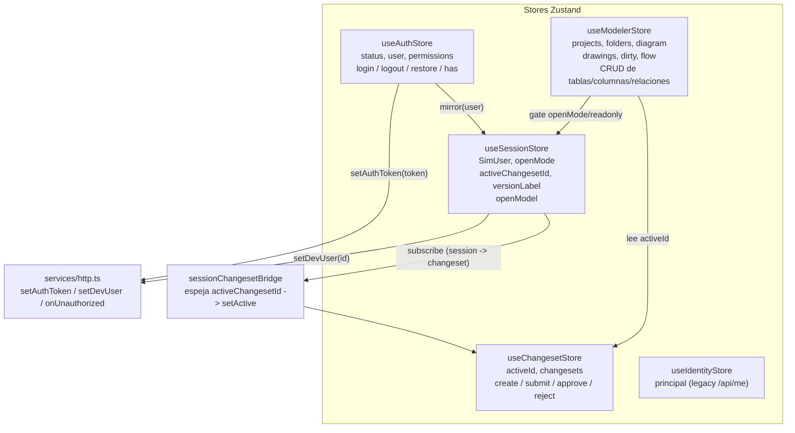
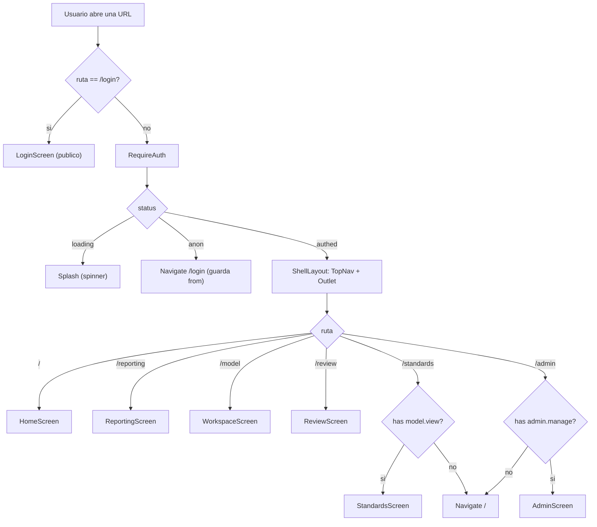
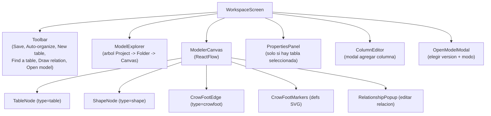
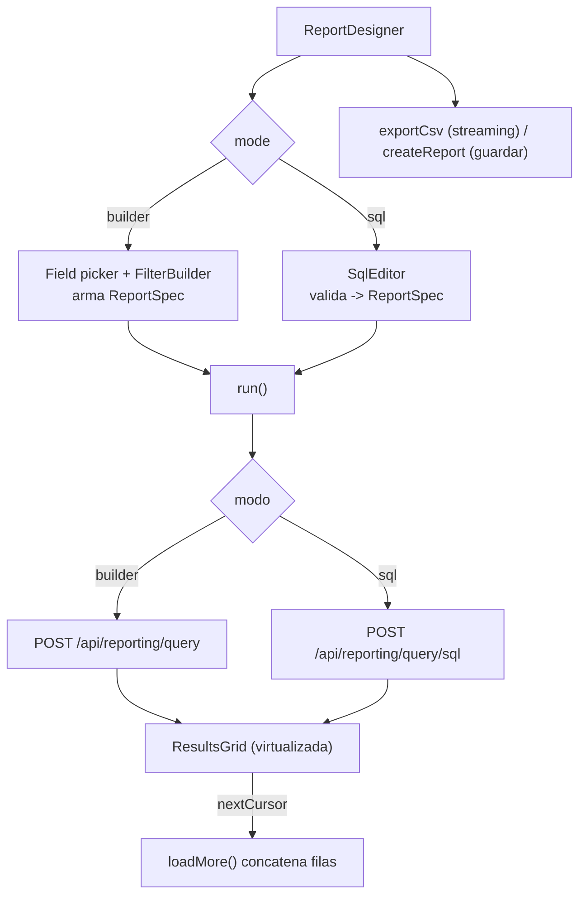
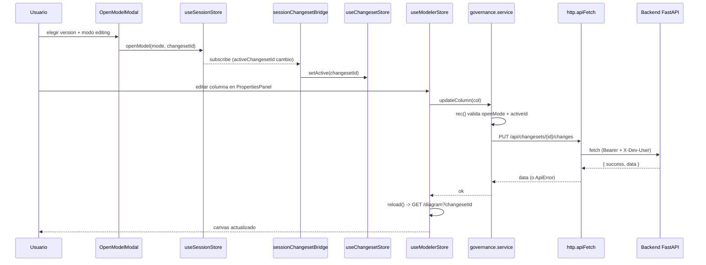

# Arquitectura del Frontend — web-data-model-hub

## 1. Visión

`web-data-model-hub` es la interfaz web del **Data Model Hub (DMH)**: una plataforma para diseñar, visualizar, gobernar y reportar modelos de datos empresariales. Reemplaza el flujo tradicional de una herramienta de modelado de escritorio (tipo Erwin) por una aplicación de una sola página (SPA) que corre en el navegador y conversa con un backend FastAPI.

La aplicación se organiza como una *shell* con navegación superior persistente y cinco grandes áreas de trabajo:

| Área | Ruta | Qué resuelve |
|------|------|--------------|
| **Home** | `/` | Panel de bienvenida: contadores del workspace, solicitudes asignadas al usuario y lista de versiones (solo lectura). |
| **Reporting** | `/reporting` | Vista tabular de la metadata (tablas, columnas, relaciones), exportación a Excel y un **Report Designer** con motor de consulta y SQL. |
| **Model** | `/model` | El **canvas** de modelado ER: proyectos → carpetas → canvases (subject areas), con tablas, columnas y relaciones editables. |
| **Data Standards** | `/standards` | Glosario, Parent Domains y UDP versionados de forma independiente al canvas. |
| **Admin** | `/admin` | Usuarios, roles y matriz de permisos (RBAC). |
| **Requests** | `/review` | Revisión y aprobación de solicitudes de cambio (governance), cruzando proyectos. |

El diseño rector es **DMH-Erwin v20260625-2**: un sistema visual claro (light-only), de acento *navy* y azul, con tipografía Geist. Todo el estado de sesión, edición y gobernanza vive en el cliente mediante **Zustand**, y todas las escrituras de modelo pasan por un *choke-point* consciente del *changeset* activo (la unidad de versionado del backend).

Un principio transversal es que **el frontend nunca toca la base de datos directamente**: consume exclusivamente endpoints REST `/api/*` con un envelope uniforme `{ success, data, error }`. La persistencia (Azure Cosmos DB con API de Mongo) es responsabilidad del backend.

---

## 2. Stack tecnológico

El proyecto es 100% TypeScript, construido y servido con **Vite**. No usa Next.js (migró desde Next a Vite); cualquier referencia a `NEXT_PUBLIC_*` en archivos `.env` es legado y el código real lee `import.meta.env.VITE_API_URL`.

| Categoría | Tecnología | Versión | Rol en la app |
|-----------|-----------|---------|---------------|
| Build / dev server | **Vite** | `^6.0.7` | Bundler, HMR, proxy `/api` en dev, build estático. |
| UI runtime | **React** + **React DOM** | `19.2.4` | Componentes, `StrictMode`, hooks. |
| Lenguaje | **TypeScript** | `^5` | Tipado estricto (`strict: true`), alias `@ → ./src`. |
| Routing | **react-router-dom** | `^7.1.0` | `BrowserRouter`, rutas anidadas, guards, `useSearchParams`. |
| Estado | **Zustand** | `^5.0.12` | Stores globales (`create`), suscripciones, selectores. |
| Canvas ER | **@xyflow/react** (React Flow) | `^12.3.5` | Nodos/aristas, viewport, minimapa, virtualización. |
| Auto-layout | **elkjs** | `^0.11.1` | Algoritmo `layered` (Sugiyama) para auto-organizar el diagrama. |
| Grilla virtual | **@tanstack/react-virtual** | `^3.14.5` | Render virtualizado de resultados del reporting. |
| Toasts | **sonner** | `^2.0.7` | Notificaciones globales (`richColors`, `bottom-center`). |
| Export Excel | **xlsx** (SheetJS) | `^0.18.5` | Workbook multi-hoja desde el reporting. |
| Export PNG | **html-to-image** | `^1.11.13` | Captura del canvas a imagen. |
| Íconos | **lucide-react** | `^1.21.0` | Set de íconos SVG. |
| Tipografía | **@fontsource-variable/geist** + **geist-mono** | `^5.2.x` | Geist (UI) y Geist Mono (datos/SQL), self-hosted. |
| IDs | **uuid** | `^13.0.0` | Identificadores de entidades cliente-side. |
| Testing | **Vitest** | `^2.1.8` | Tests unitarios (`src/**/*.test.ts`). |
| Linting | **ESLint** + **typescript-eslint** + **eslint-plugin-react-hooks** | `^9` / `^8` / `^7` | Reglas TS, hooks, y guard de límites de feature. |

Configuración clave (`vite.config.ts`):

```ts
export default defineConfig({
  plugins: [react()],
  resolve: { alias: { '@': fileURLToPath(new URL('./src', import.meta.url)) } },
  server: {
    port: 3000,
    proxy: { '/api': { target: 'http://localhost:8000', changeOrigin: true } },
  },
  test: { environment: 'node', include: ['src/**/*.test.{ts,tsx}'] },
});
```

El punto de entrada (`src/main.tsx`) monta la app y carga las fuentes y el CSS de React Flow una sola vez:

```tsx
import '@fontsource-variable/geist';
import '@fontsource-variable/geist-mono';
import '@xyflow/react/dist/style.css';
import '@/app/globals.css';
import App from './App';

createRoot(document.getElementById('root')!).render(
  <StrictMode><App /></StrictMode>,
);
```

Una regla de ESLint (`no-restricted-imports`) refuerza los **límites de feature**: cada feature se importa por su *barrel* `@/features/<name>`, nunca por rutas internas.

---

## 3. Scaffolding de `src/`

La estructura separa el *chrome* global (shell, layout, UI primitives) de las *features* verticales (modeler, reporting, standards, admin, governance, ddl, auth, help). Cada feature es autocontenida (componentes + servicios + estilos + barrel).

```
src/
├── main.tsx                 # Punto de entrada: monta <App/> en StrictMode
├── App.tsx                  # Router + ShellLayout + guards + bridge + hosts globales
├── app/
│   └── globals.css          # Orquesta @imports de tokens + base + estilos por feature
├── components/
│   ├── ui/                  # Design-system: Button, Dialog, Badge, Avatar,
│   │                        #   SegmentedControl, Tooltip, Modal, ConfirmDialog,
│   │                        #   TagEditor, dialogs (DialogHost), index (barrel)
│   ├── layout/              # TopNav, UserMenu, Header, Sidebar, AppLayout
│   └── OpenModelModal.tsx   # Selector de versión/modo al entrar al canvas
├── features/
│   ├── modeler/             # El canvas ER (ver §6)
│   │   ├── components/      #   WorkspaceScreen, ModelerCanvas, TableNode,
│   │   │                    #   ShapeNode, CrowFootEdge, CrowFootMarkers,
│   │   │                    #   Toolbar, ModelExplorer, PropertiesPanel,
│   │   │                    #   ColumnEditor, ViewEditor, RelationshipPopup,
│   │   │                    #   NewTableModal, CtasModal, PublishModal, UdpAssign…
│   │   ├── lib/elkLayout.ts #   Auto-layout con ELK
│   │   ├── services/modeler.service.ts
│   │   └── index.ts         #   Barrel: exporta WorkspaceScreen
│   ├── reporting/           # Grilla + Report Designer (ver §7)
│   │   ├── components/      #   ReportDesigner, FilterBuilder, ResultsGrid, SqlEditor
│   │   └── query.service.ts #   ReportSpec, runQuery/runSql, insights, export
│   ├── standards/           # Glossary / Parent Domains / UDP versionados
│   │   ├── components/      #   StandardsScreen, GlossaryPage, DomainsPage, UdpDefsPage
│   │   ├── standards.service.ts
│   │   └── index.ts
│   ├── admin/               # RBAC: usuarios, roles, matriz
│   │   ├── components/      #   AdminScreen, UserModal, RoleModal, PermissionMatrix…
│   │   ├── admin.service.ts
│   │   └── index.ts
│   ├── governance/          # Changesets / aprobaciones (legacy + servicios vivos)
│   │   ├── components/      #   GovernanceScreen, ChangesetBar, ApprovalInbox, CatalogPanel
│   │   └── services/        #   changeset.service, governance.service
│   ├── ddl/                 # Generación de DDL (genDDL/genViewDDL) + ExportDdlModal
│   ├── auth/                # LoginScreen, guards (RequireAuth/RequirePermission), auth.service
│   └── help/                # HelpCenter bilingüe + contenido + PDF técnico
├── screens/                 # Pantallas de alto nivel montadas por el router
│   ├── HomeScreen.tsx
│   ├── ReportingScreen.tsx
│   └── ReviewScreen.tsx
├── store/                   # Stores Zustand + bridge (ver §4)
│   ├── useAuthStore.ts
│   ├── useSessionStore.ts
│   ├── useChangesetStore.ts
│   ├── useIdentityStore.ts
│   ├── useModelerStore.ts
│   └── sessionChangesetBridge.ts
├── services/                # Clientes HTTP transversales
│   ├── http.ts              #   apiFetch + envelope + token + X-Dev-User + 401
│   ├── versioning.service.ts, dashboard.service.ts, projects.service.ts,
│   ├── reporting.service.ts, views.service.ts, naming.service.ts, identity.service.ts
├── hooks/                   # useIdentity (+ README de convenciones)
├── lib/                     # Utilidades puras (tags.ts)
├── types/                   # api.ts, model.ts, versioning.ts, identity.ts
└── styles/                  # tokens, base, ui, components, topnav, shell, home,
                             #   review, reporting (CSS global, sin CSS Modules)
```

**Convención de estilos**: el CSS es global y se compone en cascada desde `app/globals.css`, que hace `@import` de los tokens y de las hojas por feature. No hay CSS Modules ni CSS-in-JS por defecto (aunque algunos componentes usan estilos inline puntuales, como `AdminScreen` o `ReportDesigner`).

---

## 4. Gestión de estado (Zustand)

El estado se reparte en cinco stores Zustand, cada uno con una responsabilidad clara, más un *bridge* que sincroniza dos de ellos. No hay Context API ni Redux: los componentes leen con selectores (`useStore(s => s.campo)`) y los servicios leen/escriben con `getState()`.



### 4.1 `useAuthStore` — identidad autoritativa

Fuente de verdad del usuario logueado y sus permisos, con **auth propia por token** (bcrypt + JWT en el backend). Persiste el token en `localStorage` (`dmh.token`) y lo empuja al cliente HTTP.

- `status`: `'loading'` (restaurando al boot) · `'anon'` (sin sesión) · `'authed'`.
- `login(username, password)` → guarda token, espeja el actor a `useSessionStore`, marca `authed`.
- `restore()` → al boot, si hay token llama `GET /api/auth/me`; sin `permissions` en la respuesta, la sesión se considera inválida.
- `has(perm)` → booleano reactivo consultado por el `TopNav`, los guards y las pantallas.

Al montarse, registra el *handler* global de 401: si el backend responde `401`, cierra sesión y el guard redirige a `/login`.

### 4.2 `useSessionStore` — actor simulado + intención de apertura del canvas

Centraliza el actor de la sesión (para el header `X-Dev-User` en modo local) y la intención con la que se abre el modelo:

```ts
export type OpenMode = 'readonly' | 'editing';

openModel({ mode, changesetId, versionLabel }: OpenModelArgs) => void;
// setea openMode, activeChangesetId y activeVersionLabel
```

El `openModel` NO navega: quien lo invoca (el `OpenModelModal` o `ReviewScreen`) decide el `navigate('/model')`. En modo `editing` el changeset es la *working copy* a mutar; en `readonly` con changeset, el canvas LEE su overlay pero las escrituras quedan bloqueadas.

### 4.3 `useChangesetStore` — changeset activo

Mantiene `activeId` (el changeset que están leyendo/escribiendo los servicios de governance) y la lista de changesets con sus operaciones (`create`, `submit`, `approve`, `reject`). También conserva el `devUser` y lo propaga con `setDevUser`.

### 4.4 `useIdentityStore` — legado

Carga idempotente de `GET /api/me` (Principal). Es un store de compatibilidad; la identidad autoritativa vive en `useAuthStore`.

### 4.5 `useModelerStore` — el corazón del canvas

El store más grande (~600 líneas). Gestiona:

- **Árbol del explorer**: `projects`, `folders`, `subjectAreas`, y un cache por-proyecto `trees` para expandir varios proyectos a la vez.
- **Sesión de canvas**: `activeProjectId`, `activeFolderId`, `activeSaId`, `diagram`, `viewMode` (`logical`/`physical`).
- **Selección e interacción**: `selectedTableId`, `selectedEdgeId`, `hoverEdgeId`, `hoverNodeId`, la instancia de React Flow (`flow`) y `focusTable`.
- **Capa DRAWING**: formas libres (`drawings`) persistidas con *debounce* de 500 ms por canvas.
- **Checkpoint `dirty`**: alimenta el guard de salida (guardar y salir / salir sin guardar). `saveAll()` persiste layout + drawings y limpia `dirty`.
- **CRUD de modelo**: `createTable`, `addColumn`, `createRelationship`, `updateColumn`, `reorderColumns`, `deleteColumn`, etc. Todas marcan `dirty`, escriben vía `governance.service` (changeset-aware) y hacen `reload()`.

Incluye protecciones de concurrencia notables: un contador de secuencia (`_loadSeq`) descarta respuestas de diagrama fuera de orden, y `reorderColumns` persiste en tandas de 5 para no saturar el backend con ráfagas de PUT.

Los selectores derivados (`selectActiveTree`, `buildProjectTree`) arman el árbol anidado a partir del estado plano.

### 4.6 `sessionChangesetBridge` — el puente sesión ↔ changeset

Es la pieza que evita duplicar lógica. El flujo de "Open model" decide la *working copy* en `useSessionStore.activeChangesetId`, pero los lectores existentes (`governance.service`, el canvas, los paneles) leen `useChangesetStore.activeId`. El bridge **espeja unidireccionalmente** session → changeset:

```ts
useSessionStore.subscribe((state, prev) => {
  if (state.activeChangesetId === prev.activeChangesetId) return;
  useChangesetStore.getState().setActive(state.activeChangesetId);
});
```

Se instala una sola vez desde `App.tsx` (`installSessionChangesetBridge()`), es idempotente y no genera ciclos de import ni de actualización.

### 4.7 El cliente HTTP (`services/http.ts`)

Todos los servicios se construyen sobre `apiFetch<T>`, que:

1. Envía en **cada** llamada el header `Authorization: Bearer <token>` (si hay token) y `X-Dev-User: <id>` (actor local), con `credentials: 'include'`.
2. Aplica un **timeout global de 30 s** combinando el `AbortSignal` del caller con `AbortSignal.timeout(...)`.
3. Desempaqueta el envelope `{ success, data, error }` y devuelve `data`; ante error lanza `ApiError` tipado (con `status`).
4. Ante `401` dispara el handler global de sesión inválida.
5. Propaga el `detail` de un `HTTPException` de FastAPI cuando la respuesta no trae envelope (por ejemplo, un `409` con mensaje legible).

Ejemplo de llamada real (equivalente en `curl` de lo que emite el navegador):

```bash
curl -s http://localhost:8000/api/projects \
  -H "Authorization: Bearer eyJhbGciOi..." \
  -H "X-Dev-User: mr"
```

Respuesta (envelope):

```json
{
  "success": true,
  "data": [
    { "id": "p-001", "name": "Ventas", "description": "Modelo comercial" },
    { "id": "p-002", "name": "Finanzas" }
  ]
}
```

En caso de error:

```json
{ "success": false, "error": "La versión ya no está en borrador (submitted)." }
```

Los atajos `apiGet`, `apiPost`, `apiPut`, `apiDelete` envuelven `apiFetch` con el método correspondiente.

---

## 5. Routing (React Router v7)

El árbol de rutas vive completo en `App.tsx`. Usa `BrowserRouter` (rutas limpias, requiere fallback a `index.html` en el servidor) y anida los guards con rutas *layout* sin path.

```tsx
<BrowserRouter>
  <Routes>
    <Route path="/login" element={<LoginScreen />} />           {/* público */}
    <Route element={<RequireAuth />}>                            {/* exige sesión */}
      <Route element={<ShellLayout />}>                          {/* TopNav + Outlet */}
        <Route path="/" element={<HomeScreen />} />
        <Route path="/reporting" element={<ReportingScreen />} />
        <Route path="/model" element={<div className="dmh-model-route"><WorkspaceScreen /></div>} />
        <Route path="/review" element={<ReviewScreen />} />
        <Route path="/standards" element={<RequirePermission perm="model.view"><StandardsScreen /></RequirePermission>} />
        <Route path="/admin" element={<RequirePermission perm="admin.manage"><AdminScreen /></RequirePermission>} />
        <Route path="/governance" element={<GovernanceScreen />} /> {/* legacy, fuera del rail */}
      </Route>
    </Route>
  </Routes>
  <DialogHost />   {/* host global de confirm/prompt estilizados */}
  <Toaster richColors position="bottom-center" />
</BrowserRouter>
```

`App` también dispara `restore()` una vez al montar (para recuperar la sesión del token) y monta el bridge sesión↔changeset.

### 5.1 Los guards (`features/auth/guards.tsx`)

- **`RequireAuth`**: si `status === 'loading'` muestra un *splash* (evita el parpadeo login→app); si `'anon'` navega a `/login` recordando el destino (`state.from`); si `'authed'` renderiza el `<Outlet/>`.
- **`RequirePermission`**: consulta `useAuthStore.has(perm)`; sin el permiso redirige a `/` (además, el módulo ni aparece en el `TopNav`).

### 5.2 El `ShellLayout` y el `TopNav`

`ShellLayout` renderiza el `TopNav` persistente sobre el `<Outlet/>` de la página. El `TopNav` filtra sus ítems por permiso (`Data Standards` requiere `model.view`, `Admin` requiere `admin.manage`) y ejecuta un **guard de navegación**: si se sale de `/model` con una versión en edición y cambios sin guardar (`dirty`), intercepta la navegación y ofrece *Guardar y salir* / *Salir sin guardar* / *Cancelar*.



### 5.3 Los permisos (matriz RBAC)

El tipo `Permission` es 1:1 con el backend:

```ts
type Permission =
  | 'model.view' | 'model.edit' | 'review.decide' | 'publish'
  | 'export' | 'standards.edit' | 'admin.manage';
```

`SessionUser` (de `GET /api/auth/me`) trae `permissions: Record<string, boolean>` ya resueltos por rol, más `projectIds`, `role`, `accessLevel`, etc.

---

## 6. El canvas de modelado (`features/modeler`)

El canvas es la pieza técnica más rica. Se construye sobre **@xyflow/react** (React Flow 12) para el viewport, los nodos y las aristas, y sobre **elkjs** para el auto-layout.

### 6.1 Composición de la pantalla

`WorkspaceScreen` orquesta el layout y el ciclo de vida de la sesión de canvas:



Al entrar a `/model` sin una versión elegida, `WorkspaceScreen` **fuerza** el `OpenModelModal`: no se puede interactuar con un canvas de "producción" hasta escoger versión y modo (`readonly` o `editing`). Además:

- Un `useEffect` con `beforeunload` avisa (nativo del navegador) si se cierra la pestaña con cambios sin guardar en modo `editing`.
- Una defensa en profundidad degrada la sesión a solo lectura si el changeset dejó de estar en `draft` o el actor ya no es su dueño (evita 409/403 en cada edición).

### 6.2 `ModelerCanvas` — el `ReactFlow`

Registra los tipos de nodo y arista y sincroniza el `diagram` del store con el estado interno de React Flow:

```tsx
const nodeTypes = { table: TableNode, shape: ShapeNode };
const edgeTypes = { crowfoot: CrowFootEdge };
```

Puntos de diseño relevantes:

- **Virtualización**: `onlyRenderVisibleElements` monta DOM solo para lo visible. Con ~100 tablas × ~30 columnas hay ~3.000 filas y ~6.000 *handles*; sin virtualización el navegador se ahoga.
- **Zoom amplio**: `minZoom={0.02}` y `fitView` para ver canvases enormes (un auto-arrange de 100 tablas puede medir ~14000×19000 px).
- **Viewer-lock**: en `readonly` los nodos no son arrastrables (`nodesDraggable={!readonly}`) y los *handles* no conectan.
- **Sin borrado por teclado** (`deleteKeyCode={null}`): el default de React Flow borraba solo en pantalla (sin persistir), engañoso; los borrados reales van por UI explícita.
- **Persistencia al soltar**: `onNodeDragStop` guarda el layout de la tabla (o la posición del shape), marcando `dirty`.

La creación de relaciones (`onConnect`) usa un **edge fantasma optimista**: al soltar aparece un wire semitransparente (`pending`) mientras se persiste, y el `reload()` lo reemplaza por el real. Como React Flow normaliza la dirección de la conexión, el canvas guarda dónde empezó el gesto (`onConnectStart`) para reorientar los extremos antes de persistir.

### 6.3 `TableNode` — nodo de tabla con ancho dinámico

Cada tabla es un nodo custom, **memoizado** (`memo`) porque React Flow repinta los custom nodes en cada pan/zoom/drag. Renderiza el encabezado (esquema + nombre), separa PK del resto, y por cada columna emite dos *handles* (`{id}__src` a la derecha, `{id}__tgt` a la izquierda). El ancho no es fijo: se adapta al contenido (nombre físico/lógico + tipo), y ese ancho **medido** es el que consume el auto-layout.

Detalle de rendimiento: los selectores son **booleanos derivados**, no ids crudos. Por ejemplo `selected = useModelerStore(s => s.selectedTableId === table.id)` — así cambiar la selección solo re-renderiza los 2 nodos afectados, no los 100.

El modo edición (`canEdit`) exige changeset activo y no-readonly; el *tool* "Dibujar relación" armado (`relPreset != null`) es lo que vuelve conectables los *handles*.

### 6.4 `CrowFootEdge` — aristas con notación pata de gallo

Cada relación se dibuja con `getSmoothStepPath` (ruteo ortogonal H/V con esquinas redondeadas provisto por React Flow, sin matemática manual). El lado por el que sale/entra el wire se recalcula según la posición absoluta de los nodos (se voltea solo al mover las tablas). Los marcadores crow's-foot (`markerStart`/`markerEnd`) se eligen por cardinalidad:

```ts
type Cardinality = 'one' | 'many' | 'one-only' | 'zero-one' | 'one-many' | 'zero-many';
```

El resaltado al hover (relación bajo el mouse, o relaciones conectadas a la tabla bajo el mouse) usa selectores booleanos derivados para no re-renderizar todas las aristas.

### 6.5 Auto-layout con ELK (`lib/elkLayout.ts`)

`autoOrganize()` del store importa ELK dinámicamente y ejecuta el algoritmo `layered` (Sugiyama), que resuelve asignación de capas, orden dentro de capa (minimización de cruces) y coordenadas:

```ts
const opts = {
  'elk.algorithm': 'layered',
  'elk.direction': 'RIGHT',
  'elk.edgeRouting': 'ORTHOGONAL',
  'elk.separateConnectedComponents': 'true',
  'elk.layered.spacing.nodeNodeBetweenLayers': '140',
  'elk.spacing.nodeNode': '72',
  'elk.layered.nodePlacement.strategy': 'BRANDES_KOEPF',
  'elk.layered.crossingMinimization.strategy': 'LAYER_SWEEP',
  'elk.layered.thoroughness': '10',
  // …
};
```

ELK usa el ancho/alto **medido** de cada nodo (`n.measured`), de modo que respeta el tamaño real de tablas altas (30 columnas ≈ 700 px). El resultado (posiciones) se persiste con `setSubjectAreaLayout` (que mergea en el backend) y se recarga.

### 6.6 Carga del diagrama y escrituras changeset-aware

El diagrama se trae en **una sola request** que arma tablas + columnas + relaciones y aplica el overlay del changeset del lado del servidor:

```ts
GET /api/subject-areas/{saId}/diagram?changesetId={csId}
```

Todas las **escrituras de modelo** pasan por `governance.service`, cuyo *choke-point* `rec()` decide el destino según el estado:

- En `readonly` → lanza error (no muta).
- Sin changeset activo → lanza "Se requiere un changeset activo para editar".
- Con changeset → `PUT /api/changesets/{id}/changes` (un cambio por documento en la colección `changeset_changes`).

Las **lecturas** también son changeset-aware: con changeset activo leen el estado efectivo (`/effective/{collection}` con slices server-side por `tableId`/`ids`/`q`/`limit`); sin changeset leen el catálogo publicado (y la UI queda read-only).

Ejemplo de escritura (equivalente `curl`):

```bash
curl -s -X PUT http://localhost:8000/api/changesets/cs-42/changes \
  -H "Authorization: Bearer <token>" -H "X-Dev-User: mr" \
  -H "Content-Type: application/json" \
  -d '{
    "collection": "canonical_columns",
    "entityId": "col-88",
    "op": "upsert",
    "payload": { "id": "col-88", "tableId": "t-7", "physicalName": "cust_id",
                 "logicalName": "Customer ID", "dataType": "BIGINT",
                 "isPrimaryKey": true, "ordinal": 0, "typeOverridden": false }
  }'
```

---

## 7. Reporting: grilla + Report Designer (`features/reporting`)

La ruta `/reporting` tiene dos modos, controlados por `ReportingScreenWrapper`:

1. **Grilla de metadata** (default): tabla de tablas del modelo con búsqueda por nombre y **filtros facetados** (Schema · Project · Subject area) que se acotan mutuamente. Cada faceta calcula sus opciones excluyendo su propia selección. La carga es perezosa: primero 50 tablas; al aplicar el primer filtro (con *debounce*) se descarga el set completo para que el *faceting* sea exacto sobre todo. La exportación arma un **workbook Excel** con `xlsx`, una hoja por nivel de detalle marcado (Tables / Columns / Relationships / Definitions) y solo con las filas seleccionadas.

2. **Report Designer** (`onDesign`): un constructor de consultas con dos modos, `builder` y `sql`, sobre un IR común `ReportSpec`.

### 7.1 El motor de consulta (`query.service.ts`)

Todo gira alrededor de `ReportSpec`, el mismo IR que produce el builder visual y la caja SQL, y que consumen la grilla, las consultas guardadas y el export:

```ts
interface ReportSpec {
  from: 'columns' | 'tables' | 'relationships' | 'views';
  select: string[];
  where?: WhereGroup | null;         // and / or / not, anidable
  groupBy: string[];
  aggregations: Aggregation[];       // count, sum, avg, min, max, countDistinct
  orderBy: OrderBy[];
  limit: number;
}
```

Endpoints principales:

| Función | Endpoint | Rol |
|---------|----------|-----|
| `getCatalog(from)` | `GET /api/reporting/catalog?from=` | Campos disponibles (incluye UDP dinámico marcado `udp:true`). |
| `runQuery(spec, cursor?)` | `POST /api/reporting/query` | Ejecuta el `ReportSpec`; paginación por **keyset** (`nextCursor`). |
| `runSql(text, cursor?)` | `POST /api/reporting/query/sql` | Ejecuta SQL de texto (validado con sqlglot en backend). |
| `validateSql(text)` | `POST /api/reporting/query/validate` | Devuelve el `ReportSpec` derivado o errores con línea/columna. |
| `exportCsv(spec)` | `POST /api/reporting/export` | Descarga por **streaming** (fetch directo, sin bufferear en JS). |
| `getScorecard()`, `getUdpCoverage()`, … | `GET /api/reporting/insights/*` | Vistas curadas / KPIs. |

`ReportDesigner` mantiene el `spec` y el `sqlText`, ejecuta `run()` según el modo, y en modo builder re-ejecuta al cambiar el orden. La caja SQL, al validar, produce un `ReportSpec` y salta al builder. Los resultados se pintan en `ResultsGrid`, una **grilla virtualizada** con `@tanstack/react-virtual` que soporta *load more* por cursor hasta cientos de miles de filas.



---

## 8. El módulo Help (`features/help`)

`HelpCenter` es una guía de uso in-app, renderizada con `createPortal` como modal a pantalla completa (`z-index 1000`). Características:

- **Bilingüe** ES/EN con un selector propio (`lang`), sin depender de i18n externo: el contenido (`helpContent.ts`, `helpModules.generated.ts`) trae variantes `...En`/`...Es`.
- **Buscable**: filtra los módulos por texto (título, blurb, bullets).
- **Estructurado**: módulos (home, canvas, standards, reporting, admin, workflow), conceptos, pasos (STEPS) y FAQ, cada uno con su ícono lucide.
- **PDF técnico**: `openTechnicalDocPdf(lang)` abre la documentación técnica; si el navegador bloquea el pop-up, avisa con un toast.
- **Contacto**: enlace `mailto:` al soporte.

Se abre desde el botón "Help" del `TopNav` y se cierra con `Escape` o clic en el *backdrop*.

---

## 9. Los otros módulos de feature

Para completar el mapa funcional:

- **Data Standards** (`features/standards`): `StandardsScreen` con sub-tabs *Overview / Glossary / Parent Domains / UDP*. El glosario, los Parent Domains y las definiciones UDP se versionan **independientemente** del canvas (snapshot + `apply` + `rollback` por `seq`). Ver requiere `model.view`; editar requiere `standards.edit`. El servicio (`standards.service.ts`) expone `getSnapshot`, `getVersions`, `applyStandards`, `rollbackStandards`, `getUdpDefs`.
- **Admin** (`features/admin`): `AdminScreen` con sidebar de roles + tabla de usuarios + `PermissionMatrix` editable en borrador (nada se persiste hasta Guardar). Todo bajo `admin.manage`. El servicio cubre CRUD de usuarios/roles, catálogo de permisos y auditoría (`getAudit`).
- **Governance** (`features/governance`): hoy provee sobre todo los servicios `changeset.service` (cabecera del changeset, `recordChange`, `effective`, `submit`/`approve`/`reject`) y `governance.service` (el choke-point de escrituras). La `GovernanceScreen` quedó parkeada fuera del rail; la revisión real vive en `ReviewScreen`.
- **DDL** (`features/ddl`): `genDDL`/`genViewDDL` generan `CREATE TABLE`/`CREATE VIEW` con cláusula de partición según el engine (Databricks SQL, PostgreSQL, MySQL, SQL Server), expuestos por `ExportDdlModal`.
- **Auth** (`features/auth`): `LoginScreen`, los guards y `auth.service` (`login`/`logout`/`fetchMe`).

El flujo de gobernanza (crear draft → editar en canvas → enviar a revisión → aprobar/rechazar/retirar/reabrir) se maneja en `ReviewScreen`, que consume `versioning.service` (`listVersions`, `getChangeset`, `getDiff`, `review`, `withdraw`, `reopen`, `addComment`) y muestra el *diff* paginado por colección con detección de conflictos contra producción.

---

## 10. Diagrama del flujo de estado end-to-end

Este `sequenceDiagram` traza un caso completo: abrir un modelo en edición y editar una columna.



---

## 11. Despliegue y entorno

### 11.1 Dónde corre

El frontend es un **build estático de Vite** (`npm run build` → `tsc --noEmit && vite build` → carpeta `dist/`). Ese bundle estático se sirve como un sitio web; hay dos destinos previstos:

- **Azure App Service**: sirviendo la carpeta `dist/` como sitio estático.
- **Databricks Apps**: como una app que publica los estáticos (la app front separada del backend FastAPI).

En ambos casos, al usar `BrowserRouter` (rutas limpias sin `#`), el servidor debe hacer *fallback* de cualquier ruta no encontrada a `index.html` para que el enrutado del lado del cliente funcione al recargar en `/model`, `/reporting`, etc.

Arquitectura de dos orígenes: el **front** y el **backend FastAPI** viven en orígenes distintos. En desarrollo, el dev server de Vite (`:3000`) reenvía `/api` al FastAPI (`:8000`) vía proxy; en producción, el front apunta al backend con `VITE_API_URL`.

### 11.2 Variables de entorno

La única variable que el código consume es `VITE_API_URL` (inyectada en *build-time* por Vite; `import.meta.env.VITE_API_URL`):

| Archivo | Valor | Significado |
|---------|-------|-------------|
| `.env` (dev) | `VITE_API_URL=` (vacío) | Mismo origen: el proxy de Vite reenvía `/api` → `:8000`. |
| Producción | `VITE_API_URL=https://<backend>...` | URL absoluta del backend (Databricks App / App Service). |

Todos los servicios anteponen `const API_BASE = import.meta.env.VITE_API_URL ?? ''` a sus rutas `/api/...`, de modo que con `VITE_API_URL` vacío las llamadas son relativas (ideal para dev con proxy o para despliegues donde front y back comparten dominio).

**Caveat de legado**: los archivos `.env.example` y `.env.production` todavía nombran `NEXT_PUBLIC_API_URL` (herencia de la etapa Next.js). Esa variable **ya no se usa**; al configurar un entorno nuevo hay que definir `VITE_API_URL`. Conviene actualizar esos ejemplos para evitar confusión.

Como `VITE_API_URL` se inlinea en el bundle al construir, no es secreto (es una URL pública) y cambiarla implica reconstruir.

### 11.3 Consideraciones de base de datos

El frontend **no accede a la base de datos**: toda la persistencia la resuelve el backend contra **Azure Cosmos DB con la API de Mongo**. Lo relevante para el front es el contrato y sus implicancias de escala:

- **Envelope uniforme** `{ success, data, error }` en todo `/api/*`, desempaquetado por `http.ts`. Los `HTTPException` de FastAPI (`{ detail }`) también se propagan legibles.
- **Escala**: el modelo puede tener decenas de miles de tablas y cientos de miles de columnas. Por eso el front nunca baja colecciones completas: usa slices server-side (`?tableId=`, `?ids=`, `?q=`, `?limit=`), armado del diagrama en una sola request, y paginación por **keyset/cursor** en el reporting.
- **Changesets**: los cambios de una versión viven en una colección `changeset_changes` (un documento por cambio, para no chocar con el límite de 2 MB por documento de Cosmos) y nunca viajan crudos al cliente; se consumen vía `/effective` y `/diff`.
- **Sesión**: el token JWT se guarda en `localStorage` (`dmh.token`) y viaja como `Authorization: Bearer`; en modo local el actor simulado viaja como `X-Dev-User`. Un `401` limpia el token y redirige a `/login`.

En resumen, el front es un cliente delgado y consciente de la escala: delega toda la lógica de persistencia, versionado y consulta al backend, y se concentra en el modelado visual, la gobernanza y el reporting sobre un contrato REST estable.

---

Rutas de referencia (absolutas) de los archivos clave descritos:
- `/Users/carlosperez/Desktop/Projects/Agentes/GitHub/WebApp/MODELER/web-data-model-hub/src/App.tsx`
- `/Users/carlosperez/Desktop/Projects/Agentes/GitHub/WebApp/MODELER/web-data-model-hub/src/services/http.ts`
- `/Users/carlosperez/Desktop/Projects/Agentes/GitHub/WebApp/MODELER/web-data-model-hub/src/store/` (`useAuthStore`, `useSessionStore`, `useChangesetStore`, `useIdentityStore`, `useModelerStore`, `sessionChangesetBridge`)
- `/Users/carlosperez/Desktop/Projects/Agentes/GitHub/WebApp/MODELER/web-data-model-hub/src/features/modeler/components/ModelerCanvas.tsx`, `.../TableNode.tsx`, `.../CrowFootEdge.tsx`, `.../lib/elkLayout.ts`
- `/Users/carlosperez/Desktop/Projects/Agentes/GitHub/WebApp/MODELER/web-data-model-hub/src/features/reporting/query.service.ts` y `.../components/ReportDesigner.tsx`
