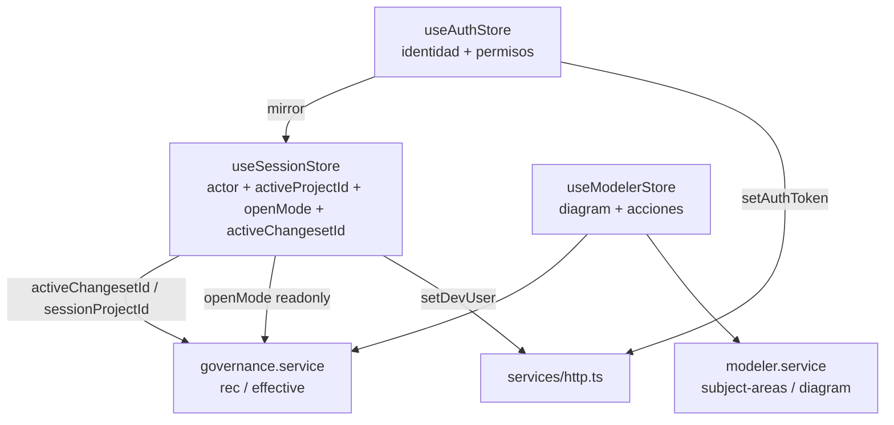
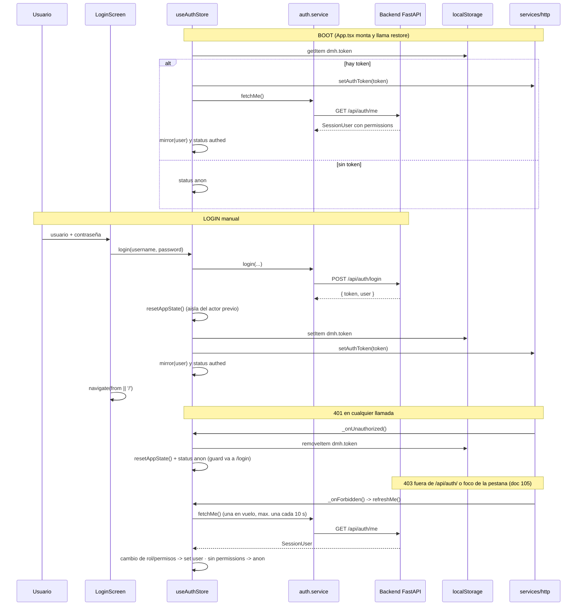
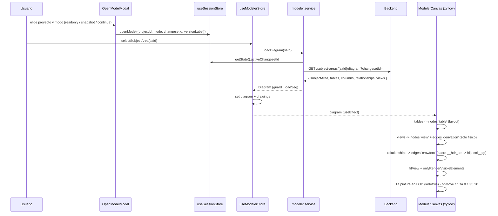
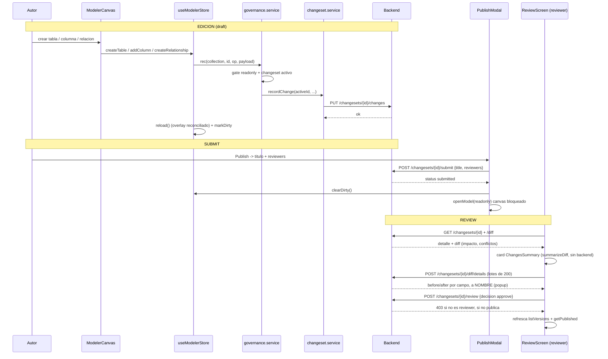
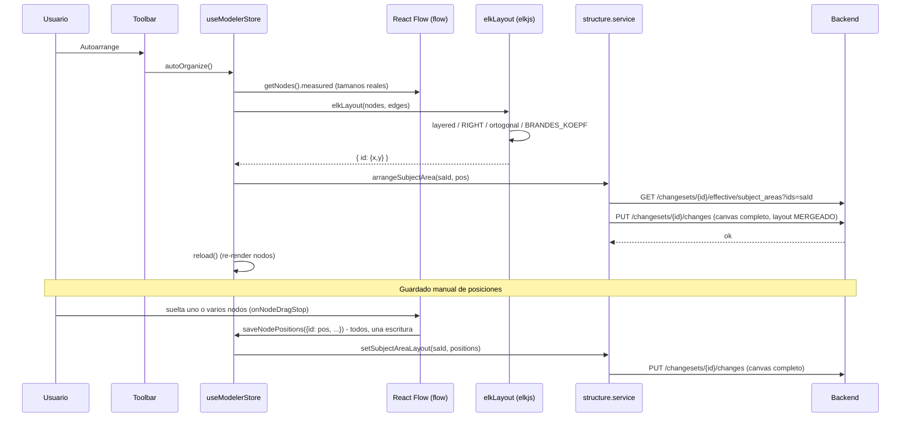
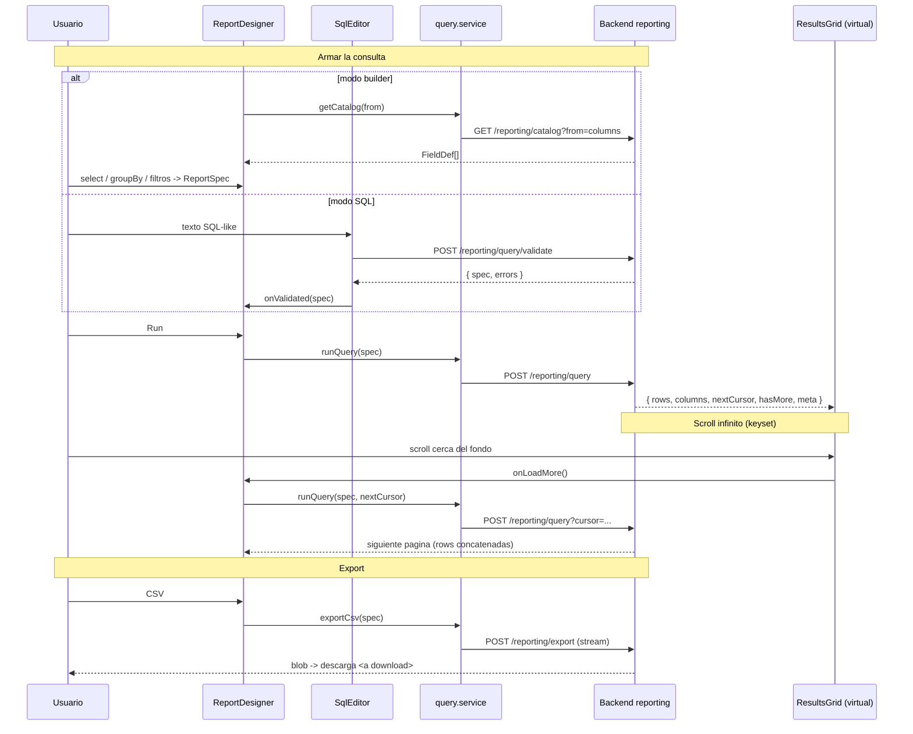
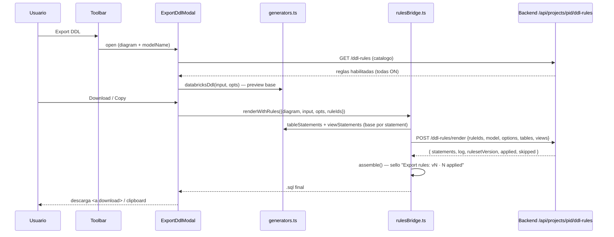
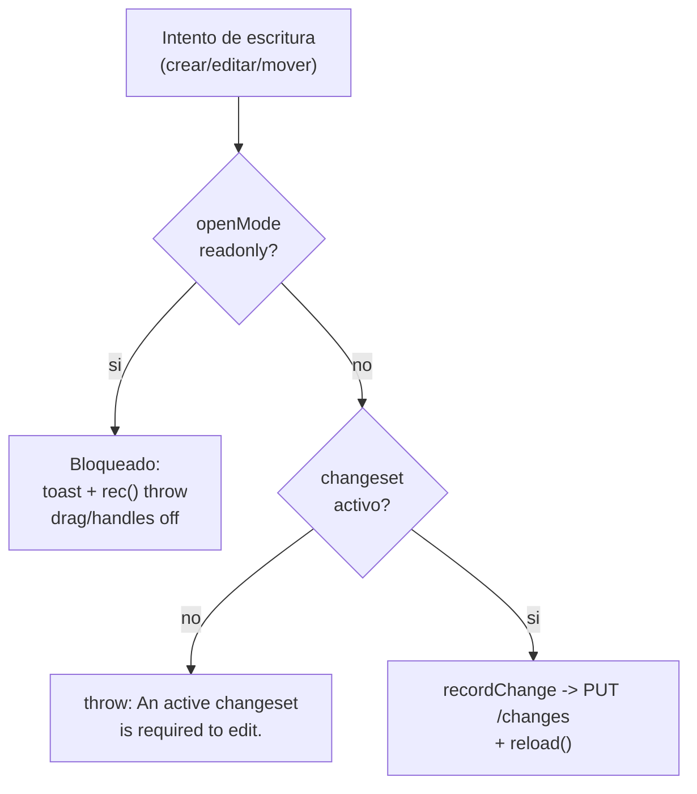

# Flujos de datos del frontend — Data Model Hub

Última actualización: 2026-09-08 (doc 75: proyectos independientes; original 2026-07-06).

Este documento describe, con base en el **código real** del frontend (Vite + React + Zustand + React Flow/xyflow), cómo circulan los datos en los seis flujos centrales de la aplicación: autenticación y arranque, apertura de un canvas, edición gobernada (changeset → review → publish), auto-organización del layout (ELK), el motor de reporting y el Export DDL con reglas. Se explican además dos patrones transversales: el **estado optimista** y el **viewer-lock (solo lectura)**.

La audiencia es de desarrolladores y stakeholders técnicos. Las rutas de archivo son absolutas para que puedan ubicarse en el repositorio.

---

## 1. Mapa de estado y capa HTTP

### 1.1 Stores de Zustand

Todo el estado del cliente vive en stores de Zustand. Cada uno tiene una responsabilidad acotada y algunos se "espejan" entre sí mediante puentes explícitos.

| Store | Archivo | Responsabilidad | Persistencia |
|---|---|---|---|
| `useAuthStore` | `src/store/useAuthStore.ts` | Identidad **autoritativa** (usuario + permisos), login/logout/restore y `refreshMe` (permisos al día sin recargar, doc 105) | Token en `localStorage['dmh.token']` |
| `useSessionStore` | `src/store/useSessionStore.ts` | Actor (`X-Dev-User` en dev) + **proyecto y versión activos** (`activeProjectId`, `openMode`, `activeChangesetId`, `activeVersionLabel`; `openModel`/`closeModel`; helper `sessionProjectId()`) — la ÚNICA fuente del changeset activo (doc 75) | En memoria (+ `dmh:lastProject` en `localStorage`) |
| `useModelerStore` | `src/store/useModelerStore.ts` | Árbol del explorer del proyecto, `diagram` cargado, drawings, `dirty`, `viewMode` lógico/físico, **`lod` (default `true`) + `lodLock`** (zoom semántico del canvas), focus cross-canvas (`openCanvasAndFocus`/`pendingFocusTableId`), `projectDeletionPending`, acciones de edición | En memoria |
| `useUndoStore` | `src/store/useUndoStore.ts` | Pila de inversas (Ctrl+Z) de la sesión de canvas: se vacía al cambiar de proyecto, modo o versión (doc 105, F3) y queda vacía y cerrada mientras se aplica una carga Excel en esa versión (doc 105, `clear({ until })`) | En memoria |
| `useBusyStore` | `src/store/useBusyStore.ts` | `runBlocking(label, fn)`: overlay bloqueante por sesión durante acciones largas (doc 75 D18) | En memoria |

Todos los lectores/escritores del modelo (`governance.service`, `structure.service`, `schemas.service`, el canvas, los paneles) leen `useSessionStore.getState().activeChangesetId` y arman las rutas de proyecto con `sessionProjectId()`; sin sesión, `rec()` lanza "An active changeset is required to edit.". (El `useChangesetStore` + puente `sessionChangesetBridge` y la identidad legacy `useIdentityStore` se retiraron en el doc 75 D14.)

El reset transversal `resetAppState()` (`src/store/resetAppState.ts`) borra en un solo punto todo el estado de trabajo ligado al usuario: la intención de apertura del canvas (`activeProjectId`/`openMode`/`activeChangesetId`), el workspace completo del modeler (selección, diagrama, árboles, drawings, instancia de React Flow), la pila de Undo, el header `X-Dev-User` y las preferencias "don't ask again" de `sessionStorage`. Se invoca en **tres** puntos: logout, 401 global y justo antes de un login nuevo (defensa contra sesiones que murieron sin logout). Sin él, el logout — que es navegación SPA, sin reload — dejaba al siguiente usuario heredando el canvas del anterior y saltándose el modal "Open model".



### 1.2 Cliente HTTP

`src/services/http.ts` centraliza `fetch`. Puntos importantes:

- Todas las respuestas usan el envelope `{ success, data?, error? }`. `apiFetch<T>()` devuelve `data` desempaquetado o arroja `ApiError`.
- El token de sesión (auth propia) viaja como **`X-Session-Token`** en toda llamada — **NO** como `Authorization: Bearer`: en Databricks Apps ese header le pertenece al proxy SSO de la plataforma (lo consume para su propia auth y el backend nunca lo recibiría). El backend acepta ambos headers; `Authorization` queda para curl/dev.
- `X-Dev-User: <id>` (actor simulado, seam local) viaja **solo en desarrollo** (`import.meta.env.DEV`): en producción la identidad es el token y el backend lo ignora — mandarlo solo servía para que el preflight CORS lo rechazara.
- `credentials: 'include'` para que la cookie de sesión viaje cross-origin (front en un puerto, FastAPI en otro, en dev).
- Timeout de 30 s vía `AbortSignal.timeout` (120 s en las acciones largas, `LONG_TIMEOUT_MS`), combinable con el `signal` del caller. Doc 105: sin respuesta del servidor el error es `NETWORK_ERROR_TEXT` («Couldn't reach the server — check your connection or reload the page.»), no el «Failed to fetch» del navegador; una llamada cancelada por su llamador conserva su error.
- Un 401 dispara el callback global `_onUnauthorized` que registra `useAuthStore` (limpia el token, ejecuta `resetAppState()` y cierra sesión → el guard redirige a `/login`).
- Un 403 de una ruta fuera de `/api/auth/` avisa al observador `_onForbidden` (doc 105, F5), que el store de auth usa para re-leer `/me` (`refreshMe`, §2.3); el error sigue su curso hacia el llamador.
- Si la respuesta no trae envelope pero sí `{detail}` (HTTPException de FastAPI), propaga ese `detail` como mensaje real del `ApiError`.

Ejemplo del shape de request/response:

```bash
curl -sS http://localhost:8000/api/projects \
  -H "X-Session-Token: <jwt>" \
  -H "X-Dev-User: mr"
# → { "success": true, "data": [ { "id": "p1", "name": "Core" } ] }
```

---

## 2. Flujo 1 — Login, token de sesión y restore al boot

### 2.1 Piezas

- `src/features/auth/LoginScreen.tsx` — dos caminos (doc 38): botón **"Continue with Databricks"** (POST `/api/auth/sso/login`, hereda la identidad del SSO; el correo debe estar asignado a un rol en Admin) y botón **"Administrator"** (solo contraseña; cuenta local `admin`). Al montar dispara `ensureBackendSession()` (warm-up, ver 2.4 — no-op con un solo origen).
- `src/features/auth/auth.service.ts` — `login`, `logout`, `fetchMe`.
- `src/store/useAuthStore.ts` — orquesta token + estado (`loading | anon | authed`).
- `src/store/resetAppState.ts` — aislamiento por sesión: se ejecuta en login/logout/401.
- `src/services/warmup.ts` — `ensureBackendSession()`: probe `GET /api/health`; **inerte con `API_BASE` vacío** (producción actual).
- `src/features/auth/guards.tsx` — `RequireAuth` (splash mientras `loading`, redirige a `/login` si `anon`) y `RequirePermission`.
- `src/App.tsx` — dispara `restore()` una sola vez al montar y registra los listeners de `focus` / `visibilitychange` que llaman a `refreshMe()` (doc 105, F5).

### 2.2 Endpoints

| Acción | Método | Ruta | Body / Respuesta |
|---|---|---|---|
| Login | POST | `/api/auth/login` | `{username, password}` → `{token, user}` |
| Restore | GET | `/api/auth/me` | → `SessionUser` (con `permissions`) |
| Refresh de permisos (doc 105) | GET | `/api/auth/me` | foco de la pestaña o un 403 → `SessionUser` |
| Logout | POST | `/api/auth/logout` | → `{ok}` |

`SessionUser` incluye `permissions: Record<string, boolean>` con la matriz (`model.view`, `model.edit`, `review.decide`, `publish`, `rollback`, `export`, `standards.edit`, `admin.manage`). `useAuthStore.has(perm)` lee de ahí.

### 2.3 Restore al arranque (boot)

`App.tsx` corre `useEffect(() => { void restore(); }, [restore])`. `restore()`:

1. Lee `localStorage['dmh.token']`. Si no hay → `status: 'anon'`.
2. Si hay, lo empuja al cliente HTTP (`setAuthToken`) y llama `fetchMe()`.
3. Si `/me` no devuelve `permissions` (degradó a Principal básico), lo considera sesión inválida: limpia token y queda `anon`, con el aviso de acceso quitado (`notice`, doc 105 ronda 3).
4. Si es válida, `mirror(user)` espeja el actor a `useSessionStore` (id = username → header `X-Dev-User`) y deja `status: 'authed'`.
5. Si `fetchMe()` falla (doc 105, ronda 3): SÓLO un 401 dice que la sesión terminó —limpia el token y el aviso es «Your session ended. Please sign in again.»—. Sin respuesta del servidor (red caída o tiempo agotado: `ApiError` con status 0) o con una falla del servidor o del proxy (5xx, respuesta inválida) el token puede seguir siendo bueno: queda `anon`, pero el token SIGUE en `localStorage` —recargar restaura la sesión— y el aviso es `NETWORK_ERROR_TEXT` (sin respuesta) o `SERVER_CHECK_TEXT`: «The server couldn't check your session right now — reload the page to try again.» (antes cualquier fallo que no fuera de red descartaba el token).
6. Doc 105 (ronda 5): si mientras `/me` demoraba el usuario entró de nuevo (SSO en el login), la respuesta del token viejo ya no decide nada —`status` ya no es `'loading'`; antes cerraba la sesión nueva y, con un 401, borraba su token—; si fue OTRA pestaña la que cambió el token (`localStorage` es compartido), `restore()` verifica el vigente.

Mientras `status === 'loading'`, `RequireAuth` muestra el `<Splash/>` para evitar el parpadeo login→app. `LoginScreen` hace lo mismo (doc 105, ronda 5): mientras se verifica muestra ese `Splash` (lo exporta `guards.tsx`) y, con la sesión ya restaurada —se recargó `/login` después del aviso de red o de servidor, que pide recargar—, sigue al destino que motivó el login (`state.from`, o Home) en vez de mostrar el formulario.

En el login manual, `login()` ejecuta `resetAppState()` **antes** de sentar el token nuevo: si la sesión anterior murió sin logout (token expirado, tab reusada), el actor entrante arranca sin estado heredado. El logout y el 401 global hacen el mismo reset.

**Permisos al día sin recargar (doc 105, F5).** Antes, un rol cambiado en Admin sólo se veía al recargar la página. `refreshMe()` re-lee `/api/auth/me` cuando la pestaña vuelve al foco (`focus`, `visibilitychange` a visible) y ante un 403 fuera de `/api/auth/`, con tope: una lectura en vuelo y como mucho una cada 10 s (`ME_GAP_MS`); nunca rechaza (un 401 lo cierra el handler global; un error de red o del proxy lo reintenta el próximo foco). Si cambió el rol o algún permiso, reemplaza el usuario y la UI se re-gatea (nav, botones); si no, no lo toca. Si `/me` ya no trae `permissions` (el usuario fue deshabilitado en Admin), cierra la sesión como `restore()`. Una sesión de edición no se degrada por permisos: cada escritura la sigue decidiendo el backend. Para re-gatearse, un componente se suscribe a `s.user?.permissions` o a `s.has('x')` dentro del selector — nunca a `s.has` a secas, que es siempre la misma función. Cuando la sesión termina sola, el login dice por qué (`useAuthStore.notice`, O4): «Your access to Data Model Hub was removed or disabled. Ask an administrator if you think this is a mistake.» (deshabilitado) o «Your session ended. Please sign in again.» (un 401); salir a propósito o entrar lo borra. En el login el aviso es un `role="status"` y el botón de SSO (con `autoFocus`) lo referencia con `aria-describedby`: el lector de pantalla lo lee al enfocarlo (ronda 3).

### 2.4 Producción: un solo origen vía `server.mjs` (doc 36)

En Databricks Apps cada app (`frnt-…` y `bknd-…`) vive detrás de su **propio** muro SSO por subdominio (`databricksapps.com` está en la Public Suffix List → la cookie de sesión es por app). Un `fetch()` del front al backend no puede completar ese SSO cruzado (el redirect a Microsoft es imposible dentro de XHR): el proxy del backend respondía su propio 401 vacío y el login fallaba con "Failed to fetch". La solución definitiva (2026-07-31) es que **el navegador hable SOLO con el origen del front**:

- `server.mjs` (raíz del repo, cero dependencias — solo módulos `node:*`) reemplaza a `vite preview` en producción: sirve el build `dist/` con fallback SPA y **proxya `/api/*` al backend** (`BACKEND_API_URL`, variable de runtime del bundle).
- El proxy adjunta un token **OAuth M2M del service principal del front** (`POST {DATABRICKS_HOST}/oidc/v1/token`, grant `client_credentials`, scope `all-apis`), cacheado hasta expiry menos 5 minutos con un solo mint concurrente (`TokenCache`), y reintenta UNA vez con token fresco ante 401/403 solo en GET/HEAD.
- El header `Authorization` entrante del cliente **se descarta** (el Bearer lo pone siempre el server); el JWT propio de la plataforma viaja intacto en `X-Session-Token`. Streaming puro (pipe) en ambos sentidos.
- `VITE_API_URL` ya NO se define en Apps → `API_BASE` queda vacío → todas las llamadas usan rutas **relativas** `/api/...` (mismo origen). En dev local, `vite dev` proxya `/api` → `:8000` con el mismo efecto.

El **warm-up** (`src/services/warmup.ts`, opción A del doc 36) queda **inerte** en producción: con `API_BASE` vacío el probe es no-op. Solo actúa en local apuntando a un backend remoto (probe a `/api/health`; si el fetch ni siquiera obtiene respuesta legible, navega top-level a `GET /api/auth/warmup/{next-b64url}` una sola vez, con guard en `sessionStorage`). El enfoque por redirect fracasó como solución de producción: el proxy de Databricks no inicia el SSO en navegaciones lanzadas por script desde otro sitio.

### 2.5 Diagrama



---

## 3. Flujo 2 — Abrir un canvas: getDiagram, nodos xyflow y edges crowfoot

### 3.1 Elección de versión (Open model)

El canvas nunca se abre "en producción" implícitamente. Al entrar a `/model` sin `openMode`, `WorkspaceScreen` fuerza el `OpenModelModal` (`src/components/OpenModelModal.tsx`), que ofrece tres modos:

| Opción | Acción | Efecto en sesión |
|---|---|---|
| View production (read-only) | — | `openModel({projectId, mode:'readonly', versionLabel})` |
| Create new version from production | `POST /api/changesets/snapshot` (`{ projectId }`, bajo `runBlocking('Creating working copy…')`) | `openModel({projectId, mode:'editing', changesetId, versionLabel})` |
| Continue a working version | elige un draft propio del proyecto | `openModel({projectId, mode:'editing', changesetId})` |

El Open model es de **dos pasos** (doc 75 D8): primero el proyecto (`ProjectPicker`, con «New project…»), después la versión/modo de ESE proyecto. `openModel()` en `useSessionStore` fija `activeProjectId`, `openMode`, `activeChangesetId` y `activeVersionLabel`; los servicios leen de ahí. `WorkspaceScreen` re-sincroniza el workspace (`refreshExplorer()`: proyecto activo del modeler, árbol, esquemas, canvas) cada vez que cambia la **clave de sesión** `canvasSessionKey` (`src/features/modeler/lib/canvasSession.ts` = modo|proyecto|changeset); así abrir OTRO proyecto en el mismo modo (readonly → readonly) también refresca explorer, toolbar y canvas sin recargar la página (bugfix 2026-09-08).

### 3.2 Carga del diagrama

Al seleccionar un canvas en el `ModelExplorer`, `useModelerStore.selectSubjectArea(saId, projectId?)` llama a `modeler.service.loadDiagram(saId)`:

```ts
// src/features/modeler/services/modeler.service.ts
export async function loadDiagram(saId: string): Promise<Diagram> {
  const cs = useSessionStore.getState().activeChangesetId;
  const qs = cs ? `?changesetId=${encodeURIComponent(cs)}` : '';
  return apiGet<Diagram>(`${API_BASE}/api/subject-areas/${encodeURIComponent(saId)}/diagram${qs}`);
}
```

Es **una sola request**: el diagrama COMPLETO llega en una única respuesta de `GET /api/subject-areas/{sa_id}/diagram` — el backend lo arma con queries batched (`$in`) y aplica el overlay del changeset server-side. El `Diagram` (`modeler.service.ts`) trae `{ subjectArea, tables, columns, relationships, views }`: `views` son las vistas MIEMBRO del canvas (`viewIds`, doc 70; un canvas legacy sin lista usa `showOnCanvas` + ≥1 fuente), ya resueltas por el backend — el front sólo las dibuja.

`selectSubjectArea` protege contra respuestas fuera de orden con un contador de secuencia `_loadSeq` (dos clicks rápidos en el explorer descartan la respuesta vieja), y hace flush inmediato de los drawings pendientes del canvas anterior antes de cambiar. Si la apertura falla, `ModelExplorer` lo avisa con el motivo —«Couldn't open the canvas: <motivo>.»— por `reportWriteError` (doc 105, ronda 6: un error de la versión espera la revalidación y, si la sesión cambió, calla).

```bash
curl -sS "http://localhost:8000/api/subject-areas/sa-42/diagram?changesetId=cs-7" \
  -H "Authorization: Bearer <jwt>" -H "X-Dev-User: mr"
# → { "success": true, "data": {
#     "subjectArea": { "id":"sa-42","tableIds":["t1","t2"],"viewIds":["v1"],
#                      "layout":{"t1":{"x":60,"y":60}}, "drawings":[], "routes":{} },
#     "tables":[ {"id":"t1","physicalName":"dim_cliente","logicalName":"Cliente"} ],
#     "columns":[ {"id":"c1","tableId":"t1","physicalName":"id_cliente","isPrimaryKey":true,"ordinal":0} ],
#     "relationships":[ {"id":"r1","parentTableId":"t1","childTableId":"t2",
#                        "pairs":[{"parentColumnId":"c1","childColumnId":"c9","roleName":null}],
#                        "parentCardinality":"one","childCardinality":"zero-many","identifying":false} ],
#     "views":[ {"id":"v1","name":"VW_CLIENTE","schema":"ventas_vu","sourceTableIds":["t1"],"showOnCanvas":true} ]
# } }
```

### 3.3 Del Diagram a nodos y edges

`ModelerCanvas.tsx` sincroniza `store.diagram` → estado interno de React Flow con un `useEffect`:

- **Nodos tabla** (`type: 'table'`): posición desde `subjectArea.layout[t.id]` (en solo lectura, el efímero del visor encima — `viewerLayout`, doc 84 E), con fallback a una grilla (`60 + (i%4)*260`). `data = { table, columns, lod, refCols }`.
- **Nodos vista** (`type: 'view'`) + edges `derivation` tabla → vista (`lib/viewGraph.ts`): desde `diagram.views`, SÓLO en modelo físico (doc 63).
- **Nodos shape** (`type: 'shape'`, `zIndex: -1`): la capa DRAWING, se pinta detrás de las tablas.
- **Edges** (`type: 'crowfoot'`, relaciones v2 — doc 19/47): cada relación va SIEMPRE padre → hijo: `source = parentTableId` con `sourceHandle = '__hdr_src'` (sale de la cabecera del padre, repartida en su zona de llave — fan-out) y `target = childTableId` con `targetHandle = ${pairs[0].childColumnId}__tgt` (entra por la columna del PRIMER par; los demás pares viven en el popup). `data` lleva `parentCardinality`/`childCardinality`, `identifying`, `pairCount`, el slot del fan-out, el `drifted` (llave incongruente, en rojo) y la frase de relación (doc 98).
- **Subcategorías** (doc 53): en modelo lógico van por su propio subgrafo (`lib/subtypeGraph.ts`: nodo símbolo `type: 'subcat'` + edges `subcat`), no como crow's-foot.

Los handles viven en `TableNode.tsx`: `__hdr_src` en la cabecera y, por columna, `${c.id}__src` a la derecha y `${c.id}__tgt` a la izquierda (conectables sólo con la herramienta de relación armada).

### 3.4 Render crowfoot

`CrowFootEdge.tsx` calcula el path con `getSmoothStepPath` (ruteo ortogonal, esquinas redondeadas — sin matemática manual). Decide de qué lado sale/entra el wire comparando los centros absolutos de ambos nodos (`sourceFacesRight`), de modo que la relación se "voltea" sola al mover las tablas. Los marcadores crow's-foot se resuelven por cardinalidad (`markerStart={url(#cf-${parentCardinality})}`, `markerEnd={url(#cf-${childCardinality})}`, definidos en `CrowFootMarkers.tsx`). Doc 99: si el canvas tiene un trazo manual para ese wire (`subjectArea.routes`), el camino pasa por sus puntos (`routedGeometry`) y el lado de cada extremo lo decide el trazo.

Optimizaciones de escala: `onlyRenderVisibleElements` (solo montan DOM los nodos visibles), `TableNode` y `CrowFootEdge` memoizados, y selectores **booleanos derivados** por nodo/edge para el hover (evita re-renderizar los 100 nodos al cambiar un id).

### 3.5 Primera pintura en LOD y zoom semántico (doc 33)

`onlyRenderVisibleElements` no ayuda en el fit view: a zoom bajo TODOS los nodos son "visibles" y la virtualización no poda nada. En un canvas gigante (Analytics: 392 nodos, ~99 mil filas de columna/source) eso significaba 400–500 mil elementos DOM y un canvas trabado — con cada fila midiendo menos de 1 píxel. La respuesta es el **LOD (level of detail)**, solo frontend:

- **La primera pintura sale en modo LOD**: `lod` en `useModelerStore` tiene default `true`, así que un canvas grande ya abre compacto (~2 mil elementos DOM). `onInit` evalúa el LOD de inmediato y otra vez tras el fitView inicial (doble `requestAnimationFrame`), lo que corrige los canvases chicos a detalle completo.
- **Umbral con histéresis en `onMove`**: `LOD_ENTER = 0.10` / `LOD_EXIT = 0.20` (constantes en `src/features/modeler/lib/lodSize.ts`, calibradas por el owner el 2026-07-25 sobre el canvas Analytics). `nextLod(current, zoom)` entra a compacto recién bajo 0.10 y vuelve a detalle recién sobre 0.20 — la banda muerta evita el parpadeo en el borde. `setLod` solo escribe al **cruzar** el umbral (cero renders en el pan normal) y el cruce parchea únicamente `data.lod` de los nodos.
- **Misma caja, sin filas**: el nodo compacto replica las métricas del detallado (`lodSize.ts`: ancho = clamp(chars·8 + 72, 240, 880), alto = 32 + filas·28 — las MISMAS fórmulas que `scripts/arrange_all.py` del backend, el layout no salta), con header `schema.nombre`, franja PK proporcional en tablas y hatch en vistas.
- **Edges intactos**: el nodo compacto deja **handles fantasma** con los mismos ids que las filas del modo detallado (`<colId>__src`/`<colId>__tgt` del par de referencia + `__hdr_src`/`__hdr_tgt`), así los edges nunca se re-arman ni pierden ancla — cruce de umbral atómico, sin frames sin wires.
- **`lodLock`**: congela el detalle completo durante el export SVG (ver flujo 6 — la imagen exportada nunca sale compacta).

### 3.6 Diagrama



---

## 4. Flujo 3 — Editar en el canvas: changeset, submit, review, approve, publish

### 4.1 El choke-point de escritura

Toda mutación de tablas, columnas y relaciones pasa por el guard `writableCs()` de `governance.service` (`src/services/governance.service.ts`), que usan `rec()` (un cambio) y `recordChangesBulk` (un lote, doc 39). Carpetas, canvases, vistas y esquemas tienen su guard equivalente en `structure.service`, `views.service` y `schemas.service`: sin versión en edición fallan sin llamar al backend (doc 104), que además responde 409 a toda escritura directa del modelo (doc 105, D1).

```ts
const writableCs = (): string => {
  if (useSessionStore.getState().openMode === 'readonly')
    throw new Error('The model is open read-only: it does not accept changes.');
  const a = active();                        // useSessionStore: única fuente del changeset activo
  if (!a) throw new Error('An active changeset is required to edit.');
  return a;
};
const rec = (collection, id, op, payload?) => csvc.recordChange(writableCs(), collection, id, op, payload);
export const recordChangesBulk = (changes) => csvc.recordChangesBulk(writableCs(), changes);
```

El `projectId` de cada payload NO lo pone el front: el backend lo estampa con el del changeset (doc 75 I1) y rechaza con 409 cualquier referencia a una entidad de otro proyecto (I2).

`recordChange` (`changeset.service.ts`) hace `PUT /api/changesets/{id}/changes` con `{collection, entityId, op, payload}`. Cada cambio se persiste como un documento en la colección `changeset_changes` del backend (un doc por cambio). Las **lecturas** con changeset activo van por `effective` → `GET /api/changesets/{id}/effective/{collection}?tableId=&ids=&q=&limit=` (slices server-side, nunca baja la colección completa).

Ejemplos de operaciones (todas terminan en un `reload()` que reconcilia con el overlay):

- `createTable` → `gov.createTable` (upsert en `canonical_tables`) + `struct.addToCanvas(saId, { tableIds: [id] })` para referenciarla (doc 100: la lista completa la arma el servicio dentro de la cola del canvas).
- `addColumn` → `physicalize` (lógico→físico) + `createColumn`; una PK nueva entra tras la última PK y las no-PK se corren en el MISMO lote (`recordChangesBulk`, doc 94).
- Relaciones: popup-gated (doc 47) — `mappingToBulk` graba columnas + relación en UN lote; en una identificante las columnas que entran a la llave quedan tras la última PK del hijo (doc 94).
- `updateColumn` / `reorderColumns` / `deleteColumn` → upsert/delete por id. Doc 94: marcar/desmarcar PK re-ubica la columna en la frontera del bloque de PK (`keyLayoutBulk`, un lote y un Undo) y `reorderColumns` rechaza dejar una PK debajo de una no-PK — hay UN solo orden (`ordinal`, PK primero), sin orden de llave aparte.

Cada acción llama `markDirty()` en `useModelerStore`, que alimenta el guard de salida (aviso "cambios sin guardar").

```bash
curl -sS -X PUT http://localhost:8000/api/changesets/cs-7/changes \
  -H "Authorization: Bearer <jwt>" -H "X-Dev-User: mr" \
  -H "Content-Type: application/json" \
  -d '{"collection":"canonical_tables","entityId":"t99","op":"upsert",
       "payload":{"id":"t99","logicalName":"Transaccion","physicalName":"fct_transaccion"}}'
```

### 4.2 Submit (Publish request)

El botón **Publish** del `Toolbar` abre `PublishModal.tsx`. El usuario pone título, descripción y elige al menos un reviewer, y envía con `versioning.service.submit(changesetId, {title, description, reviewers})` → `POST /api/changesets/{id}/submit`. El changeset pasa de `draft` a `submitted`. El selector ofrece sólo usuarios activos con `review.decide` (`listUsers('review.decide')`); si alguno se deshabilitó en el medio, el backend responde 400 «Disabled user(s) can't review: …» (doc 105, A5-o3) y un toast muestra el motivo.

Tras el submit, la modal hace dos cosas importantes: limpia `dirty` (checkpoint) y, como la working copy ya salió de `draft` (el backend rechazaría más ediciones con 409), transiciona la sesión a **solo lectura** sobre producción con `openModel({mode:'readonly', versionLabel: pub?.versionLabel})`.

### 4.3 Review y decisión

`ReviewScreen.tsx` (`src/screens/ReviewScreen.tsx`) es una bandeja global con chip y filtro de proyecto (doc 75 D20). Lista requests (`listVersions` filtrados por `submitted/approved/rejected`), y al seleccionar uno carga detalle + diff (`getChangeset`, `getDiff`). El diff trae impacto (tablas/columnas tocadas), entidades added/edited/deleted por colección y marca **conflictos** (`entity.conflict`: modificado en producción después de que esta versión lo editó).

La presentación de los cambios es la del doc 31 (2026-07-24):

- **Card `ChangesSummary`** (`src/screens/review/ChangesSummary.tsx`): chips de proyectos y modelos afectados + matriz de conteos Created/Modified/Deleted (verde/ámbar/rojo) por tipo de entidad — Tables, Columns, Views, Relationships, Schemas, Canvases, Folders, Projects; solo filas con conteo > 0. Todo **derivado del `GET /diff` ya cargado** vía `summarizeDiff()` (`versioning.service.ts`, puro): cero backend nuevo para el resumen. El CTA "Open change details" abre el popup.
- **Popup `ChangesDetailModal`** (`src/screens/review/ChangesDetailModal.tsx`): master-detail con árbol jerárquico tintado por verbo (incluida la sección **Relationships**, que en el árbol inline anterior no se pintaba) + secciones Structure / Not on any canvas. Al seleccionar entidades pide `getDiffDetails()` → **`POST /api/changesets/{cs_id}/diff/details`** con `{items: [{collection, entityId}]}` en **lotes de ≤200 ítems** (`BATCH = 200`; el modal trocea y cachea por entidad — una tabla trae en un request la tabla + sus columnas cambiadas). La respuesta es el diff de campos **ANTES→DESPUÉS** con los ids resueltos a **nombre**: `udpValues` → una fila por UDP con su nombre, `parentDomainId` → nombre del Parent Domain, `pairs` de relaciones → `PADRE.col → HIJO.col`, `tableIds` de canvases → "+N added · −N removed tables". `before` = doc publicado (o el estampado si el changeset ya fue aplicado); campos de ruido (`id`, timestamps, `layout`…) excluidos.

La decisión va por `review(id, {decision})` → `POST /api/changesets/{id}/review`. Ante un **403** se propaga el `detail` del backend, que distingue "sin permiso `review.decide`" de "no asignado como reviewer". Botones deshabilitados si:

- `canAct = status === 'submitted' && isReviewer && !alreadyVoted`.
- `canWithdraw` (owner, submitted) → `withdraw` vuelve a `draft`.
- `canReopen` (owner, rejected) → `reopen` vuelve a `draft` (el reject nunca elimina la versión).

**Approve = publish**: aprobar publica y sobrescribe producción ("last to publish wins", como advierte el snapshot). Un `getChangeset`/`getPublished` refrescan las listas tras la decisión. Si el publish se bloquea, el backend responde un 409/422 estructurado (`{ code, message, items, next }`, `PublishBlockedDetail`) y Review lo muestra en el panel «Publish blocked» con la lista completa (doc 84); el doc 105 suma dos bloqueos que llegan igual: `table_in_use` («Publish blocked: the request deletes tables that are still referenced — …»: el draft borra una tabla que todavía tiene columnas, relaciones o vistas vivas) y `cross_project` («Publish blocked: the request writes entities of another project — …»).

Doc 105 en Review:

- **«Open/View in canvas» sólo para quien puede abrirlo (U2)**: `canvasAction(detail, me, has)` (`src/screens/review/requestState.ts`) decide rótulo, modo y motivo — el dueño de un DRAFT edita («Open in canvas»); un request en revisión se abre en solo lectura sólo si el actor puede verlo (`canOpenVersion`: dueño, revisor asignado, `versions.view_all` o `admin.manage`, espejo del backend); si no, el botón queda deshabilitado con «Only its owner, its assigned reviewers and administrators can open this request in the canvas.»; uno cerrado no se abre desde acá. El motivo viaja también como `aria-label` (A5-o5).
- **Nombres y revisores deshabilitados (U1, A5-o3)**: los nombres salen de `listUserNames()` (incluye a los deshabilitados; si la lista falla, se ven los ids en vez de una pantalla en blanco). Un revisor deshabilitado que no votó se lista «(disabled)» y, al dueño, la nota dice «… can no longer review (disabled): withdraw the request and send it again with active reviewers.»; los filtros de la bandeja también marcan «(disabled)».
- **Cabecera a 1024 px (U3)**: las acciones bajan a su propia fila en vez de aplastar el título (41 px, 0 px con Withdraw) y recortar Approve; desde ≈1440 px no cambia nada (`review.css`).

### 4.4 Rollback de versiones

El rollback vive en el Home (`src/screens/HomeScreen.tsx`), gated por el permiso propio **`rollback`** (`useAuthStore.has('rollback')`). Apunta a **cualquier versión publicada pasada**: `rollbackVersion(id)` → `POST /api/changesets/{id}/rollback` y el backend crea un **draft con los cambios inversos** (restaura las imágenes previas capturadas en el publish, deshaciendo las versiones posteriores a la elegida). Producción **no cambia** en ese momento: el draft entra al mismo circuito submit → review → approve de cualquier otra versión — el rollback es gobernado, no un botón destructivo.

### 4.4b Transferir y eliminar drafts (doc 104)

En Home › Version tools › Version details, el owner de un draft (si su rol tiene `model.edit`) o un administrador (`admin.manage`) ve **Transfer** y **Delete** (`lib/versionAdmin.ts`). Transfer abre `TransferVersionDialog` (usuarios de `listUsers('model.edit')` sin el dueño actual + nota opcional) → `transferVersion`; el nuevo dueño edita, envía y figura como autor al publicarse, y la versión guarda `transfers[]` («Started by»). Delete confirma en rojo con el foco en Cancel (dice cuántos cambios se pierden — `changeCount` del detalle — y avisa si el draft es de otro) → `deleteVersion`. Ambas acciones mandan `expectedOwner` (el dueño que se mostró): si otra sesión lo cambió en el medio, 409 y no se actúa sobre el draft de otra persona. El diálogo queda ligado a la versión con la que se abrió (un 403/404/409 muestra el motivo sin cerrarlo) y el popup de abajo queda `inert`; el foco entra al diálogo y Tab no sale de él. Al cerrarse, el foco vuelve a Transfer — o, si el detalle se recargó y ese botón ya no está, al nuevo Transfer o al popup (que además recupera el foco si el elemento enfocado desaparece). Una versión que este popup vio eliminarse (Delete propio, o un 404 al cargarla o al transferirla) sale de su lista al instante, sin esperar la recarga del Home. En revisión los botones quedan deshabilitados con el motivo; en una publicada no aparecen. El motivo de un botón deshabilitado viaja también como `aria-label` —«Transfer: …», «Delete: …» y «Open in canvas: …»— para quien no usa el mouse (doc 105, A5-o5), y el popup se re-gatea sin recargar cuando `refreshMe` cambia los permisos (se suscribe a `s.user?.permissions`, F5). Tras cualquiera de los dos, el Home recarga la lista (`onChanged`). Doc 105 (F6): la trampa de Tab es la compartida `components/ui/focusTrap.ts` (`trapTab`) — la usan también el propio Version tools, `ConfirmDialog`, el prompt de `dialogs.tsx` y `Dialog` —; con el confirm de Delete encima, Version tools queda `inert` como con el de transferencia y, al cerrarse ese confirm (también con Cancel), el foco vuelve a quien lo abrió —el botón Delete— si sigue en pantalla y habilitado (`focusInto` del `ConfirmDialog`) y, si no, al popup (desde la ronda R6 lo hace el mismo `focusInto`: `returnTarget` va a la caja del diálogo abierto que contiene al botón —el popup— si el botón sigue ahí pero deshabilitado, o al último diálogo modal en pantalla si ya no está; ver design-system §7.3): el efecto propio de Version tools sólo actúa con el foco en `<body>`, así que no hay doble devolución (antes quedaba en `<body>` y Tab saltaba a la página de atrás). Los nombres de dueños, autores y revisores salen de `listUserNames()` (doc 105, U1): quien dejó la empresa se ve con su nombre.

### 4.5 Defensa en profundidad

`WorkspaceScreen` re-valida la sesión de canvas con `lib/sessionGuard.ts` (`sessionFate`): al entrar/cambiar de sesión y — doc 104 — cuando una respuesta 403/404/409 de ESA versión lo avisa (`http.setOnApiError` + `touchesChangeset`). Eliminada (404) → vuelve al chooser con aviso; transferida → solo lectura de la misma versión si todavía puede verla (revisor/administrador) o de producción si no; propia pero ya no en `draft` (enviada o decidida en otra pestaña) → solo lectura. Así un canvas nunca queda respondiendo 403/404 en cada edición ni mostrando producción como si fuera el draft. Los errores de ESA versión (`isVersionError`/`touchesVersion`, con la versión tomada al pedir) no se anuncian como «This project was deleted…»: quien los recibe (carga de Model, árbol y refresco del Explorer, guardado de dibujos) espera la revalidación en curso (`trackRevalidation`/`afterRevalidation`) y sólo calla si la sesión cambió — entonces el aviso correcto ya lo dio ella; si la sesión sigue igual (rol perdido, 403 del proxy sólo en lecturas, nombre duplicado) el error se muestra. La revalidación repite una revisión pedida mientras otra estaba en curso, y quien espera, espera también esa repetición. Las escrituras del canvas y del Explorer (posiciones, auto-arrange, dibujos, carpetas, canvases, esquemas y vistas) van SIEMPRE por la working copy: sin sesión de edición fallan en vez de escribir directo a producción, y un guardado agendado (dibujos, «Save and leave») se descarta si la sesión ya no edita esa versión. La lectura de la cabecera que hace la propia revalidación no la redispara (un 403 del proxy de la plataforma daba un bucle de peticiones): si falla con 403, un solo aviso por versión y sólo si la sesión sigue siendo esa.

Doc 105 (F1, F2, A4-o3): lo que antes fallaba callado (o dejaba un rechazo sin manejar) ahora avisa, con el mismo criterio de sesión. El guardado de posiciones al soltar bloques (`saveNodePositions`) y el flush de dibujos al cambiar de canvas muestran el motivo real (o «Couldn't save the position» / «Couldn't save the drawings»), salvo que la revalidación haya cambiado la sesión. El confirm de «Delete project…» deja el diálogo abierto con «Couldn't record the project deletion: …» (o lo cierra si la sesión cambió). El refresco del Explorer al abrir una versión avisa «Couldn't load the explorer: … Use Refresh to try again.» en vez de quedar en «Open a project…», con `stillAskedSession` (`lib/sessionGuard.ts`): un error de la versión espera la revalidación y se calla si la sesión ya no es la pedida (la cambió la revalidación, que avisó, o el usuario abrió otra); un aviso por sesión (id del toast), no se apilan. Además, si la vista recién creada con «Show on this canvas» no entra al canvas, un toast dice por qué.

Doc 105 (H1–H7, ver [architecture.md](architecture.md) §4.4 y §4.5): una acción de varias escrituras —y la inversa de un Undo— queda atada a la sesión donde empezó (`pinSession()`, `lib/pinnedWrites.ts`): si en el medio se abre otra versión, lo que falta no se escribe en ella y nadie lo avisa (la sesión en pantalla no es la suya). Los avisos de las escrituras de los componentes pasan por `reportWriteError`, con el criterio de revalidación de arriba. Una caída de red da UN aviso (H6): `WorkspaceScreen` ya no carga los proyectos al montar (los trae el refresco de la sesión) y el aviso de esquemas sólo sale si el resto del refresco anduvo. Y las respuestas tardías de la sesión anterior —la recarga del canvas de un refresco viejo, el árbol que relee una mutación del Explorer— ya no pisan la actual (H4: `_loadSeq`/`openingSaId` y `explorerRequest().isCurrent`).

Doc 105 (ronda 3, R7): al cambiar la sesión, el canvas de la anterior se limpia EN EL ACTO (diagrama, dibujos, selección y popups; `activeSaId` queda para que el refresco lo reabra) y el Toolbar, el canvas y `WorkspaceScreen` cierran sus diálogos: nada de la versión anterior queda editable. Además el store no arma escrituras con un diagrama de otra sesión (`liveDiagram()`), `reload()` no invalida un canvas que se está abriendo (ronda 4: si es el mismo canvas, recarga al terminar la apertura; ronda 5: si es otro, el Explorer se entera cuando éste se instala y, si su apertura falla, se recarga el editado), las lecturas del árbol (expandir un proyecto, `selectProject`, `loadFolders`) descartan respuestas de otra sesión, la carga Excel y su auto-arrange son de la versión de la carga (desde la ronda 4 cerrar el popup ya no los corta; desde la ronda 7 el arrange sigue la VERSIÓN, `inVersion`: con otra abierta corta antes de escribir y, de vuelta en la misma, no salta canvases), borrar una columna o una tabla hace todas sus lecturas antes de la primera escritura, y una inversa del Undo que falla por timeout o red vuelve a la pila («… Press Undo to try again.»). Detalle en [architecture.md](architecture.md) §4.4 y §4.5.

Doc 105 (ronda 4, R10): los borrados que leen el impacto antes de confirmar (la tabla en Properties; la columna en su panel y en el Object Inspector) toman el pin AL PEDIRLOS —si mientras leen se abre otra versión, el confirm no se abre en ella— y lo mismo «Reorder view columns» antes de su confirm; con un diagrama de otra sesión en pantalla las ediciones avisan «This canvas is from a version that is no longer open — open it again from the explorer.» (`StaleCanvasError`) y Save falla con ese motivo en vez de resolver como éxito; el auto-arrange en solo lectura aplica sólo en su sesión y su canvas; pegar una tabla y el CTAS no avisan su éxito sobre otra versión; lo tipeado en los UDP sin blur se descarta si el panel se cierra porque cambió la sesión; y los canvases que la carga Excel no arregló se avisan con un toast cuando el popup ya no los muestra (`notArrangedNotice`). Detalle en [architecture.md](architecture.md) §4.5 y §8.

Doc 105 (rondas 5 a 7): un `reload()` que falla (red, tiempo agotado, 5xx) CIERRA el canvas con «Couldn't reload the canvas: <motivo>. Open it again from the explorer.», sin reintento automático —lo que quedaba en pantalla era de antes de la escritura que acababa de terminar, y editar desde ahí pisaba lo grabado—; antes de cerrar guarda los dibujos pendientes, un 404 tiene su propio aviso y, si también falló la apertura de otro canvas, la recarga no suma el suyo (queda el de la apertura; un 404, en cambio, avisa igual). El drop de una fila en el bloque (`applyCanvasDrop`) y el reorden graban el documento VIGENTE de cada columna (una borrada mientras tanto no revive) y `saveNodePositions` graba sólo los bloques del canvas en pantalla. La carga Excel deja el Undo vacío y cerrado desde antes del apply, en su versión; si el polling del job se rinde ante fallos transitorios (o recibe un 403), el resultado queda «unconfirmed» —«Couldn't confirm the result of the upload: …»— y no «failed», y un POST del apply sin respuesta lo decide el polling. «Save and leave» dice por qué no pudo guardar. Detalle en [architecture.md](architecture.md) §4.4, §4.5, §5.2 y §8.

### 4.6 Diagrama



---

## 5. Flujo 4 — Auto-arrange (ELK) y guardado de layout

### 5.1 Auto-organizar

El botón **Autoarrange** del `Toolbar` llama `useModelerStore.autoOrganize()`:

1. Importa perezosamente `elkLayout` (`src/features/modeler/lib/elkLayout.ts`).
2. Toma los tamaños **medidos** de los nodos vivos (`flow.getNodes().measured`) — clave porque las tablas altas (30 columnas ≈ 700px) se superponían con tamaño fijo. Fallback si no hay medida: 240×160.
3. Construye nodos `{id, measured}` desde `diagram.tables` y edges `{source, target}` desde `diagram.relationships`.
4. `elkLayout(nodes, edges)` corre el algoritmo **`layered`** (Sugiyama) de ELK y devuelve un `Record<id, {x, y}>`. Opciones exactas del código:

   ```ts
   // src/features/modeler/lib/elkLayout.ts — new ELK() de 'elkjs/lib/elk.bundled.js'
   'elk.algorithm': 'layered',
   'elk.direction': 'RIGHT',
   'elk.edgeRouting': 'ORTHOGONAL',
   'elk.separateConnectedComponents': 'true',
   'elk.spacing.componentComponent': '64',
   'elk.layered.spacing.nodeNodeBetweenLayers': '140',
   'elk.spacing.nodeNode': '72',
   'elk.spacing.edgeNode': '28',
   'elk.spacing.edgeEdge': '16',
   'elk.layered.spacing.edgeNodeBetweenLayers': '28',
   'elk.layered.nodePlacement.strategy': 'BRANDES_KOEPF',
   'elk.layered.nodePlacement.favorStraightEdges': 'true',
   'elk.layered.crossingMinimization.strategy': 'LAYER_SWEEP',
   'elk.layered.thoroughness': '10',
   ```

5. Persiste con `arrangeSubjectArea(saId, pos)` — posiciones **mergeadas** sobre el layout efectivo y trazos manuales reiniciados, en UNA escritura del canvas completo a la versión en edición (`PUT /api/changesets/{id}/changes`, docs 99 y 104) —, apila su Undo y hace `reload()`. La pre-imagen del Undo (posiciones de los nodos vivos y trazos) se toma ANTES de calcular —si mientras ELK trabaja se abre otro canvas, los nodos vivos ya serían de ése— y, si en el medio cambió la sesión, no se graba nada (`pin.check()`; doc 105, ronda 3). En solo lectura (doc 84 E) las posiciones quedan sólo en la sesión (`viewerLayout`).

ELK no rutea los wires: solo asigna posiciones de nodos. El ruteo visual sigue siendo de React Flow (`getSmoothStepPath`).

**Paridad con el backend**: `scripts/arrange_all.py` (repo backend) re-organiza TODOS los canvases — o los de un proyecto con `--project` — con el **mismo motor**: invoca elkjs por subprocess de node (`arrange_all.cjs`) con la misma config que el botón "Autoarrange", e incluye tablas y nodos de vista. Como no hay DOM que medir, calcula los tamaños con las mismas fórmulas de `.wk-node`/`.wk-vnode` que replica `lodSize.ts` (ver 3.5): un canvas ordenado por el script y uno ordenado por el botón quedan iguales.

### 5.2 Guardar layout

Hay tres caminos de persistencia de posición. Todos graban el documento COMPLETO del canvas en la versión en edición (`PUT /api/changesets/{id}/changes`, upsert de `subject_areas`), con las posiciones nuevas mergeadas sobre el layout efectivo (`structure.service`, doc 104). El `PUT /api/subject-areas/{saId}/layout` directo ya no se usa y el backend lo rechaza con 409 (doc 105, D1).

| Disparador | Método del store | Alcance |
|---|---|---|
| Soltar uno o varios nodos (selección múltiple) | `saveNodePositions(positions)` (`saveLayout(tableId, pos)` es el caso de uno) | Todos los bloques movidos — tablas, vistas y símbolos — en UNA escritura (doc 105, A4-o1: antes sólo el tomado con el mouse); sólo los del canvas en pantalla (ronda 5) |
| Botón Save / "Guardar y salir" | `saveAllLayout()` → dentro de `saveAll()` | Todos los nodos `table`, `view` y `subcat` |
| Auto-arrange | `arrangeSubjectArea(saId, pos)` | El mapa que devolvió ELK + trazos reiniciados |

`onNodeDragStop` recibe todos los nodos arrastrados y `draggedPositions` (`lib/viewerLayout.ts`) los separa: tablas, vistas y símbolos van a `saveNodePositions`; los shapes, a `drawings` (persistidos aparte, debounced 500 ms, §8.3). `saveNodePositions` corre en segundo plano: si falla, avisa con el motivo (doc 105, F1; criterio de §4.5). `saveAll` captura `saId` y `drawings` **antes** del await para no escribir dibujos del canvas nuevo bajo el `saId` viejo si el usuario cambia de canvas a mitad del guardado; sin sesión de edición no escribe nada (doc 104).

En `readonly` los bloques se pueden mover para leer mejor el diagrama, pero `onNodeDragStop` manda sus posiciones a `viewerLayout` (sólo esta sesión, doc 84 E) y nada viaja al backend; un aviso lo dice una vez por sesión (ver viewer-lock).

### 5.3 Diagrama



---

## 6. Flujo 5 — Reporting: ReportSpec, /query, grilla virtualizada y export CSV

### 6.1 El IR compartido: ReportSpec

`src/features/reporting/query.service.ts` define `ReportSpec`, el mismo IR que el backend. Lo producen **dos** entradas y lo consumen la grilla, las queries guardadas y el export:

```ts
interface ReportSpec {
  from: 'columns' | 'tables' | 'relationships' | 'views';
  select: string[];
  where?: WhereGroup | null;      // and/or/not anidables con Condition[]
  groupBy: string[];
  aggregations: Aggregation[];    // count/sum/avg/min/max...
  orderBy: OrderBy[];
  limit: number;
}
```

`ReportDesigner.tsx` maneja dos modos:

- **Builder**: `getCatalog(from)` (`GET /api/reporting/catalog?from=`) trae los `FieldDef[]` (label, tipo, ops, `sortable`, `groupable`, `indexed`, `udp`). El usuario marca columnas (`select`), agrupa (`groupBy` → agrega `count`; doc 105: `regroup` quita el orden por fila que el agrupado ignoraría) y arma filtros con `FilterBuilder` (doc 105: una condición booleana nace con el `true` que muestra su combo y `between` tiene dos entradas, «From» y «To»). Las piezas puras del Builder viven en `lib/reportBuilder.ts`.
- **SQL**: `SqlEditor` manda el texto a `validateSql(text)` (`POST /api/reporting/query/validate`). El **servidor es la autoridad de la gramática**: valida con sqlglot y devuelve `{spec, errors}`. Si es válido, el spec se vuelca al builder y se cambia de modo, con su vista y por `toBuilderSpec` (doc 105): sin `maxRows` —el tope total del `LIMIT n`, que el Builder no muestra— ni `resultColumns` —el orden del SELECT de un agrupado SQL—, con la página de 100; abrir un reporte guardado hace lo mismo. Una respuesta que llega con el texto ya cambiado o con el editor cerrado no decide nada (desde la ronda 7, una falla que llega así tampoco se avisa), una falla sin respuesta se avisa y «✓ Valid SQL» sale sólo para el texto que validó sin errores. Soporta UDP dinámico con la sintaxis `udp."Nombre"`; sin JOIN ni subqueries.

### 6.2 Ejecución y paginación keyset

`runQuery(spec, cursor?)` → `POST /api/reporting/query?cursor=`. La respuesta es `QueryResult`:

```ts
interface QueryResult {
  rows: Record<string, unknown>[];
  columns: ResultColumn[];        // dinámicas, incluyen UDP
  nextCursor: string | null;      // keyset
  hasMore: boolean;
  meta: { grouped: boolean; warnings: string[]; scan?: 'index' | ... };
}
```

La paginación es **keyset** (cursor opaco), no offset: a 400k filas nunca se traen todas al browser. `loadMore()` repite, con `result.nextCursor`, la consulta que produjo el resultado en pantalla (`shown`; doc 105: antes reusaba el `spec`/`sqlText` del formulario y, editado desde el Run, pegaba la página de otra consulta) y **concatena** las filas nuevas a las existentes (`rows: [...prev.rows, ...res.rows]`). Doc 105: cada consulta nueva —Run, ordenar, otra vista, abrir un spec— sube `seq` y deja viejas las que siguen en vuelo (su respuesta o su página ya no se muestran); `paging` evita que dos pedidos del mismo render (el scroll) traigan la página dos veces; y si la página falla, un toast da el motivo («Couldn't load more rows» si no hay otro).

```bash
curl -sS -X POST "http://localhost:8000/api/reporting/query" \
  -H "X-Session-Token: <jwt>" -H "Content-Type: application/json" \
  -d '{"from":"columns","select":["physicalName","dataType"],
       "where":{"op":"and","conditions":[{"field":"schema","op":"eq","value":"core"}]},
       "groupBy":[],"aggregations":[],"orderBy":[{"field":"physicalName","dir":"asc"}],"limit":100}'
# → { "success": true, "data": {
#     "rows":[...], "columns":[{"key":"physicalName","label":"Physical","type":"string"}],
#     "nextCursor":"eyJwaHlzaWNhbE5hbWUiOiJhX2NvbCJ9", "hasMore":true,
#     "meta":{"grouped":false,"warnings":[],"scan":"index"} } }
```

### 6.3 Grilla virtualizada + scroll infinito

`ResultsGrid.tsx` usa `@tanstack/react-virtual` (`useVirtualizer`) para montar solo las filas visibles (altura estimada 34px, `overscan: 12`). El `onScroll` dispara `onLoadMore()` cuando `hasMore`, no está `loading` y falta menos de 400px para el fondo:

```ts
if (result?.hasMore && !loading &&
    el.scrollHeight - el.scrollTop - el.clientHeight < 400) onLoadMore();
```

El header permite ordenar **server-side** sólo por los campos que el catálogo marca `sortable` (doc 105: `canSort`; al resto el backend responde 422 «Can't sort by '…': it has no index. …»), no-UDP y no-agrupados (`sortable = !!onSort && (canSort?.(c.key) ?? true) && !c.udp && !result.meta?.grouped`); un resultado del editor SQL no se ordena (la grilla no recibe `onSort`). Al hacer click, `onSort` vuelve a correr la consulta EN PANTALLA con el `orderBy` nuevo, y el formulario lo toma para el próximo Run (doc 105: antes corría el formulario, editado o no desde el Run, y con un resultado SQL fallaba). Con un Run en vuelo no se ordena (`running`; el encabezado sigue siendo el mismo `<button>`, con `aria-disabled`: `sortDisabled`); los encabezados ordenables son `<button>` con `aria-label` «Sort by <campo>» —más « (sorted ascending)» o « (sorted descending)» en el del orden vigente—, y un orden por un campo sin índice (p. ej. de un reporte guardado antes) se quita con aviso al correr, exportar y guardar (`withoutUnsortableOrder`; doc 105, rondas 6 y 7). Cada consulta nueva vuelve la grilla arriba sin remontarla (`resetKey` → `scrollTop = 0`: conserva el scroll horizontal y el foco); la página siguiente no la mueve. La barra muestra «N rows · M columns» (singular con 1, «+» si hay más), `meta.scan` (index vs collscan) como señal de rendimiento y « · loading…» mientras corre; las celdas booleanas salen «✓» / «·» y un «false» guardado como texto (UDP) ya no sale «✓» (`cellText`).

### 6.4 Export CSV por streaming

`exportCsv(spec)` hace `POST /api/reporting/export` con `fetch` directo (no `apiFetch`, porque el stream no bufferea el envelope JSON). Lee el token de `localStorage['dmh.token']` y lo manda como `X-Session-Token` (mismo contrato que `http.ts` — nunca `Authorization`), recibe el `blob` y fuerza la descarga con un `<a download>` sintético. Doc 105: sin respuesta del servidor el error es el mismo `NETWORK_ERROR_TEXT` del resto de la app, y un rechazo muestra el motivo del backend (`detail`, su `message` si es estructurado, o el `error` del envelope) en vez de sólo «Export failed (…)», y un corte a mitad de la descarga (falla `res.blob()`) también da `NETWORK_ERROR_TEXT` (ronda 3). Así se exportan datasets grandes sin materializarlos en memoria de JS como filas.

### 6.5 Diagrama



---

## 7. Flujo 6 — Export DDL con reglas: generators, /render y el sello de versión

El Export DDL genera el `.sql` en el **cliente** y, si hay DDL Export Rules seleccionadas (doc 30), lo pasa por el motor de reglas del backend antes de entregarlo. Es una exportación de **texto**, independiente del export de **imagen** SVG del canvas (ver 7.4).

### 7.1 Secuencia

1. El botón **Export DDL** del `Toolbar` abre `ExportDdlModal` (`src/features/ddl/components/ExportDdlModal.tsx`), que toma las vistas MIEMBRO del canvas del diagrama ya cargado (`canvasDdlViews(diagram)`, doc 102 — las mismas que el canvas dibuja, sin otro pedido; nunca «todas las vistas de sus tablas»: `src/architecture.test.ts` impide volver a `listViewsForTables` en `features/ddl`, doc 105 C3) y carga el catálogo de reglas con `fetchExportRules()` → `GET /api/projects/{pid}/ddl-rules`. `selectableRules()` deja las habilitadas y no-inválidas (las `stale` corren igual — solo avisan); por default quedan **todas marcadas**.
2. El DDL **base** se genera client-side en `src/features/ddl/generators.ts`: `databricksDdl(input, opts)` para el preview y `tableStatements`/`viewStatements` (statement por statement) para el puente de reglas. Opciones del modal con defaults Views/Comments/Partitions ON, PK&FK/Indexes OFF, `tableFormat: 'delta'`, y (doc 76 D9, la macro BCP) `identifierCase: 'lower'`, `external: true` con `location` = `abfss://<container_name>@<storage_account_name>.dfs.core.windows.net/<path>` y `locationFolderCase: 'upper'` (carpeta del LOCATION en MAYÚSCULA). Doc 93: identificadores sin comillas salvo que el nombre las necesite (palabra reservada o carácter fuera de `[a-z0-9_]`), tipos en minúscula, `CREATE OR REPLACE TABLE` (el `LOCATION` la hace externa) y `NOT NULL` solo con PK&FK. Las proyecciones de las vistas salen `col AS alias` con el casing del export; con la regla de layout, las particiones salen del UDP que declara (`withUdpPartitions`: `PART_nn` = columna de partición y su orden; el flag de la plataforma se ignora) y el `PARTITIONED BY` las lista en ese orden. Dónde van lo dice la regla (`withLayout`, nunca las Output settings): con `partitionColumns: partitioned-by` (doc 107, la semilla) NO se declaran en la lista del CREATE — van con su tipo dentro del `PARTITIONED BY (codmes int, …)` (y su `NOT NULL`/`COMMENT` si el export los emite); con `last`, al final de la lista y el `PARTITIONED BY` solo con nombres. Sin `PARTITIONED BY` (Output setting «Partitions» apagada) vuelven al final de la lista. La `_rej` del motor sale con el mismo formato.
3. Con reglas seleccionadas, Download/Copy llaman `buildFinalSql()` → `renderWithRules()` (`src/features/ddl/rulesBridge.ts`): arma el payload con el estado **efectivo** que el canvas exporta (drafts incluidos) — cada tabla con sus columnas y `udpValues` más su CREATE base (`baseSql`), cada vista con su SQL y el flag `businessView` (= `showOnCanvas`: solo esas se decoran como vista de negocio; no decide QUÉ vistas se exportan — eso ya lo decidió la membresía del canvas, doc 105 C2) — y hace `POST /api/projects/{pid}/ddl-rules/render` (permiso `export`). El motor del backend es **puro**: no lee BD en el render, todo el contexto viaja en el body.
4. `assemble()` ensambla el `.sql` final: header con el **sello** `-- Export rules: vN · N applied · M skipped` (la evidencia de por qué el DDL de marzo salió distinto al de junio) + los statements en el orden del motor (por tabla: [sentencias `before`] física → tags de tabla → tags de columna → sentencias `after` → generados, cada uno con sus propios anexos; luego vistas de negocio con sus `ALTER TABLE … SET TAGS` — como la macro; `viewTagsAs: view` los escribe `ALTER VIEW`), con los anexos `.tags`/`.extra` pegados a su objeto: sin línea en blanco entre un CREATE y sus ALTER, una línea en blanco solo entre objetos (doc 93 D12).
5. **Download** arma un `.zip` con un `.sql` por objeto (`ddlExportBundle.ts`): una carpeta por tabla (`{TABLA}/`) con `TABLE-{TABLA}.sql` (física y tablas generadas como la `_rej`), `VIEW_NEG-{VISTA}.sql` (vistas modeladas en Erwin/canvas) y `VIEW_TEC-{VISTA}.sql` (vistas que generan las reglas), el nombre en MAYÚSCULA y sin corchetes. El esquema entra al nombre (`VIEW_TEC-BCP_V.H_X.sql`) solo si dos archivos de la carpeta chocan sin distinguir mayúsculas; nunca `_2`. Prefijos, separador, casing y esquema salen de `fileNames` de las Output settings (doc 93 D11).
6. **Sin reglas seleccionadas el export no pasa por el puente**: sale byte-idéntico al flujo previo a las reglas (cero regresión). El botón "Apply N rules" del preview usa el mismo motor bajo demanda — nunca en vivo — y produce el mismo texto que el download; cualquier cambio de opciones o selección lo invalida.

Payload real del puente (condensado del código de `rulesBridge.ts`):

```jsonc
// POST /api/projects/{pid}/ddl-rules/render
{
  "ruleIds": ["<uuid-regla-1>", "<uuid-regla-2>"],
  "model": { "name": "Analytics", "udpValues": {} },
  "options": { "identifierCase": "lower", "quoteIdentifiers": "when-needed", "typeCase": "lower",
               "createTable": "or-replace", "viewTagsAs": "table", "includeKeys": false,
               "tableFormat": "delta", "external": true,
               "location": "abfss://<container_name>@<storage_account_name>.dfs.core.windows.net/<path>",
               "locationFolderCase": "upper", "includePartitions": true, "partitionsLast": false },
  "tables": [{
    "table": { "id": "t1", "physicalName": "MD_CLIENTE", "schema": "bcp_ddv",
               "description": null, "udpValues": { "<udpId>": "CUSTOM_30 days" } },
    "columns": [{ "physicalName": "CODCLAVECLI", "dataType": "STRING", "ddlType": "string", "ordinal": 0,
                  "isNullable": false, "isPrimaryKey": true, "isPartition": false,
                  "parentDomainId": null, "description": null,
                  "udpValues": { "<udpId>": "DAC-013" } }],
    "baseSql": "CREATE OR REPLACE TABLE bcp_ddv.md_cliente (...)"
  }],
  "views": [{ "name": "MD_CLIENTE_VU", "schema": "bcp_ddv", "sql": "CREATE VIEW ...",
              "sourceTableIds": ["t1"], "businessView": true }]
}
// → { "statements": [{ "artifact": "ddl.tabla_fisica", "schema": "bcp_ddv",
//                      "name": "MD_CLIENTE", "sql": "CREATE TABLE ..." }, ...],
//     "log": [{ "rule": "tblproperties_vacuum", "status": "applied" }, ...],
//     "rulesetVersion": "v2", "applied": 5, "skipped": 1 }
```

`isPartition` viaja a propósito: sin él, los artefactos generados (p. ej. la tabla `_rej`) no heredarían el `PARTITIONED BY` de la física — salen **espejo** del CREATE físico (mismo casing, `USING`, particiones y `LOCATION` con el sufijo del artefacto). `ddlType` es el tipo tal como el front lo escribió en el CREATE (`ddlType()` de `generators.ts`, con el `typeCase` del export): la `_rej` conserva el tipo de sus particiones con ese mismo texto.

**Output settings (doc 93).** Cómo se escribe el DDL y cómo se nombran los archivos es dato del PROYECTO (`ddl_ruleset_config.output`, versionado en Data Standards). Al abrir, el modal pide `GET /api/projects/{pid}/ddl-rules/config`; `mergeOutputSettings()` (`src/features/ddl/outputSettings.ts`) completa lo guardado con los defaults de la macro y descarta claves o valores inválidos sin romper. La pestaña Output es el formulario compartido `DdlOutputForm`, el mismo del editor «Output settings» de Data Standards: lo que se cambie en el modal vale solo para ese export. `splitOutputSettings()` separa las opciones del generador (que viajan al `/render` junto con el `ddlType` de cada columna) de los `fileNames` del zip.

**Oracle (doc 101).** Las Output settings traen `dialect` (con qué dialecto abre el modal; default Databricks) y `oracle` (la configuración propia de Oracle). Las tarjetas de dialecto se habilitan cuando llegan las settings (antes, el default del proyecto pisaría la elección). Con **Oracle** el DDL sale de `src/features/ddl/oracle.ts` (`oracleDdl` para el preview y la copia; `oracleTableStatements`/`oracleViewStatements` para el `.zip`, mismos nombres de archivo), **sin pasar por `/render`**: las Export rules son de Databricks, así que la pestaña no aparece y ninguna regla corre (si el proyecto tiene reglas, un aviso lo dice). Forma: `CREATE TABLE` simple con la PK adentro y `NOT NULL` (con PK&FK); las FK (`ALTER TABLE … ADD CONSTRAINT`, nombres únicos de hasta 128 bytes) van **todas después de todas las tablas** en el script único y en un archivo propio `FOREIGN_KEYS.sql` en el `.zip` (se corre al final); comentarios con `COMMENT ON TABLE / COLUMN` (a lo sumo 4 000 bytes y sin nada que corte la sentencia en SQL*Plus: líneas en blanco, líneas que terminan en `;`, líneas de solo `/` o `.`, líneas de más de 2 000 caracteres; si algo trae `&`, el script arranca con `SET DEFINE OFF`); identificadores con comillas dobles solo si las necesitan; vistas `CREATE OR REPLACE VIEW` con la misma estructura que en Databricks, el nombre real de cada columna y el `CAST` con el tipo tal cual. Los tipos salen **tal cual** están en el modelo, solo con el casing elegido — un complejo (`ARRAY<…>`) sale tal cual, sin casing — (doc 106: sin mapeo de tipos ni tamaño máximo de strings — un tipo que Oracle no acepta es del modelo, no del export; si una versión anterior los guardó en las settings, se ignoran). La configuración es editable en Data Standards.

### 7.2 Autoría de las reglas

Las reglas se autoran y versionan en **Data Standards → DDL Export rules** (`src/features/standards/`, servicio `ddlRules.service.ts`): lectura por `GET /api/projects/{pid}/ddl-rules(/config|/templates|/artifacts)`, checks por `POST /api/projects/{pid}/ddl-rules/validate|/test|/impact`, y toda mutación vía `POST /api/projects/{pid}/standards/apply` (`applyStandards`; stream único `standards_versions` del proyecto — el router de reglas es read-only). El editor hace round-trip YAML con la dependencia `yaml 2.9.0`.

### 7.3 Diagrama



### 7.4 Export de imagen (SVG) — otra exportación

El botón **Export image** del `Toolbar` es un flujo distinto que no toca el backend: `setLodLock(true)` + `setLod(false)` fuerzan el **detalle completo** (el fitView del export baja el zoom y sin el candado re-activaría el modo compacto), luego `fitView` + doble `requestAnimationFrame`, captura con `toSvg` (`html-to-image`, import dinámico), inyección de los markers crow's-foot (`injectCrowFootDefs`) y descarga del `.svg`; en el `finally` se libera el lock y se re-evalúa el LOD con el zoom vigente. El SVG exportado siempre sale detallado, aunque el canvas estuviera en LOD.

---

## 8. Patrón de estado optimista

El objetivo es que la UI responda al instante y que la persistencia (más el `reload()` que reconcilia con el overlay del changeset) corra por detrás. Se aplica en tres lugares concretos del código:

### 8.1 Edge fantasma al crear una relación

En `ModelerCanvas.onConnect`, al soltar la conexión se inserta de inmediato un **edge "pending"** con `id = pending-<uuid>` y `data.pending = true`. `CrowFootEdge` lo pinta semitransparente (`opacity: 0.5`, dash `6 5`, color `--primary`). Cuando `createRelationship` persiste y `reload()` trae la relación real, el fantasma se reemplaza. Si la escritura falla, se elimina el fantasma y se muestra el motivo real del error:

```ts
void createRelationship(rel).catch((err) => {
  setEdges((eds) => eds.filter((e) => e.id !== ghostId));
  pushToast(err instanceof Error ? err.message : 'No se pudo crear la relación', 'err');
});
```

### 8.2 Reordenar columnas

`useModelerStore.reorderColumns` primero reordena en el store (recomputa `ordinal = índice nuevo` localmente, render inmediato) y luego persiste **solo** las columnas cuyo `ordinal` cambió, en **tandas de 5** (mover una columna al tope de una tabla de 30 disparaba 30 PUT simultáneos). El backend graba cada cambio con `$set` atómico por entidad, así que no se pisan. Un `reload()` final reconcilia. Doc 105 (rondas 5 a 7): cada escritura lleva el documento VIGENTE de la columna (`currentColumn`: una edición que terminó entre tandas no se pisa y una columna borrada no revive) y su Undo sólo devuelve el orden.

### 8.3 Drawings con debounce

`addDrawing/updateDrawing/deleteDrawing` mutan el array local y agendan `persistDrawings()` con debounce de 500ms (`setSubjectAreaDrawings`: el canvas completo con el array de dibujos, como cambio de la versión en edición — doc 104; el `PUT …/drawings` directo responde 409 desde el doc 105). El flush captura el `saId` y la versión al **agendar**: si el usuario cambia de canvas dentro de la ventana, el disparo se cancela para no escribir dibujos ajenos, y si la sesión ya no edita esa versión, se descarta. Al cambiar de canvas o hacer `saveAll`, se hace flush inmediato; si ese flush falla, avisa igual que el guardado con debounce (doc 105, F1 — antes callaba).

### 8.4 Reconciliación de respuestas fuera de orden

Complementario al optimismo: `_loadSeq` en `selectSubjectArea`/`reload` descarta respuestas viejas de `loadDiagram` (dos clicks rápidos, reload en vuelo), evitando que el canvas muestre un subject area ajeno.

---

## 9. Viewer-lock (solo lectura)

El modo `readonly` de `useSessionStore.openMode` bloquea toda escritura, con defensa en varias capas:

| Capa | Archivo | Comportamiento en readonly |
|---|---|---|
| Choke-point de escritura | `governance.service` (`writableCs()`, de `rec()` y `recordChangesBulk`) | Lanza «The model is open read-only: it does not accept changes.» antes de tocar el backend (carpetas/canvases, vistas y esquemas tienen su guard equivalente en `structure.service`, `views.service` y `schemas.service`) |
| Canvas | `ModelerCanvas.tsx` | Los bloques se pueden mover (doc 84 E), pero `onNodeDragStop` manda las posiciones de TODOS los movidos a `viewerLayout` (sólo la sesión) y nada se persiste; los dibujos quedan fijos; `onConnect` corta con toast; `deleteKeyCode={null}` (nada de borrar por teclado) |
| Nodo | `TableNode.tsx` | `canEdit = activeChangesetId != null && !readonly`; handles no conectables; sin botón "+" de columna |
| Toolbar | `Toolbar.tsx` | `canEdit = hasCanvas && !readonly`; deshabilita New table, CTAS, Create view, Schemas, Upload from Excel, las herramientas de relación, subcategoría y dibujo, Undo, Model properties, Save y Publish; tooltip «Read-only — published version», que desde el doc 105 (ronda 5) también va en el nombre accesible de cada botón de ícono (`aria-label`: «<acción> — Read-only — published version»). Autoarrange sigue habilitado: en solo lectura ordena sólo la vista de la sesión («Auto-arrange — view only, not saved», doc 84 E) |
| Store | `useModelerStore.focusTable` | En readonly centra la tabla pero no abre el PropertiesPanel |

Un detalle importante: en `readonly` **puede** haber un `activeChangesetId` (por ejemplo, ver un request desde Review lee su overlay `/effective`), pero eso **nunca** habilita mutaciones — el gate de `openMode` corta antes, y el backend igual respondería 409. Por eso el gate de sesión precede al de changeset.

`WorkspaceScreen` refuerza esto con la revalidación de la sesión (`lib/sessionGuard.ts`, `sessionFate`; ver §4.5): al entrar y cuando una respuesta 403/404/409 de ESA versión lo avisa, una versión eliminada vuelve al Open model con aviso; una transferida pasa a solo lectura de la misma versión si todavía puede verla (o de producción si no); una propia que dejó de estar en `draft` (enviada o decidida en otra pestaña) pasa a solo lectura — así el canvas no queda respondiendo 409/403 en cada edición. El `PublishModal`, tras un submit exitoso, reabre el modelo en solo lectura sobre PRODUCCIÓN («Request sent — the canvas is now read-only (production)»).



---

## 10. Despliegue: dónde corre y consideraciones de datos

El frontend es una SPA de Vite (React) que consume la API FastAPI. No se cubren aquí pipelines de CI/CD (detalle en el repo: `databricks.yml` + workflow de GitHub Actions); solo dónde corre y su configuración.

### 10.1 Dónde corre

- **Databricks Apps (producción actual, workspace corporativo)**: dos apps — `frnt-data-model-hub` (este repo, servido por `server.mjs`) y `bknd-data-model-hub` (FastAPI). El navegador habla **solo** con el origen del front; `server.mjs` proxya `/api` al backend con el token M2M del service principal (ver 2.4). La identidad del usuario es el token propio de la plataforma en `X-Session-Token`; `X-Dev-User` no viaja en producción.
- **Dev local**: `vite dev` (puerto 3000) con proxy `/api` → FastAPI en `:8000`; ahí sí aplican `credentials: 'include'` cross-origin y el header `X-Dev-User`. La simulación de producción es `BACKEND_API_URL=http://localhost:8000 node server.mjs` (sin credenciales de SP el proxy va sin Bearer).

### 10.2 Variables de entorno

| Variable | Ámbito | Uso |
|---|---|---|
| `VITE_API_URL` | Frontend (build) | Base de todas las llamadas (`API_BASE`). **No se define en Databricks Apps**: vacía = mismo origen (rutas relativas `/api/...`). Definirla ahí reactivaría el cruce navegador→backend y el doble SSO. Solo sirve en local para apuntar a otro backend |
| `BACKEND_API_URL` | Frontend (runtime, `server.mjs`) | Destino del proxy `/api`; llega vía la variable `backend_api_url` del bundle. Sin ella el proxy responde 502 |
| `AUTH_MODE` | Backend | `local` resuelve el actor por `X-Dev-User`; en producción la identidad es el token de sesión propio |

El token de sesión se guarda en `localStorage['dmh.token']` (constante `TOKEN_KEY` en `useAuthStore`, y leído directo en `query.service.exportCsv`).

### 10.3 Base de datos: Databricks Lakebase Postgres

La BD productiva es **Databricks Lakebase Postgres**, consumida a través de un adaptador JSONB estilo pymongo en el backend — la semántica de "colecciones" y "documentos" de abajo se mantiene tal cual. Consideraciones que moldean los flujos del front:

- El backend arma el diagrama con queries batched (`$in`) y aplica el overlay del changeset **server-side**: una sola request por apertura, en vez de mover el catálogo completo (a escala real: 2,108 tablas / 96,184 columnas publicadas al 2026-07-26).
- Los cambios de un changeset viven en la colección `changeset_changes` (un documento por cambio) — diseño del versionado por changesets, con updates chicos y diffs por slice. Nunca viajan crudos al cliente: se consumen vía `/effective` (lectura), `/diff` (review) y `/diff/details` (popup de detalle).
- Las lecturas grandes se acotan con slices server-side (`?tableId=`, `?ids=`, `?q=&limit=`) para no bajar colecciones enteras.
- El reporting depende de **índices**: `meta.scan` (index vs collscan) es la señal que la grilla expone; el ordenamiento server-side se habilita solo sobre campos indexados. La paginación es keyset (cursor), apta para 400k filas sin offset.
- Las escrituras se hacen con `$set` atómico por entidad (por ejemplo, en el reorder de columnas en tandas de 5), de modo que operaciones concurrentes sobre entidades distintas no se pisan.

---

## 11. Resumen de endpoints por flujo

| Flujo | Endpoints (método · ruta) |
|---|---|
| Login / restore | POST `/api/auth/login` · GET `/api/auth/me` · POST `/api/auth/logout` |
| Warm-up (solo local, inerte en producción) | GET `/api/health` (probe) · GET `/api/auth/warmup/{next-b64url}` |
| Abrir canvas | GET `/api/subject-areas/{saId}/diagram?changesetId=` |
| Editar (changeset) | PUT `/api/changesets/{id}/changes` · GET `/api/changesets/{id}/effective/{collection}` |
| Snapshot / submit | POST `/api/changesets/snapshot` · POST `/api/changesets/{id}/submit` |
| Review / decisión | GET `/api/changesets/{id}` · GET `/api/changesets/{id}/diff` · POST `/api/changesets/{id}/diff/details` · POST `/api/changesets/{id}/review` · POST `.../withdraw` · POST `.../reopen` · POST `.../comments` |
| Proyectos | GET/POST `/api/projects` · GET `/api/projects/{pid}/counts` (borrar/renombrar: cambio `projects/{pid}` en el draft) |
| Versiones / rollback | GET `/api/versions[?projectId=]` · GET `/api/projects/{pid}/versions/published` · GET `/api/versions/compare` · GET `/api/requests` · GET `/api/users?can=` · GET `/api/users?includeDisabled=true` (nombres, doc 105) · POST `/api/changesets/{id}/rollback` |
| Layout / drawings / miembros del canvas | PUT `/api/changesets/{id}/changes` (upsert del canvas completo, sobre GET `/api/changesets/{id}/effective/subject_areas?ids=`) — los PUT directos `/api/subject-areas/{saId}/layout` · `/drawings` · `/tables` responden 409 desde el doc 105 |
| Reporting | GET `/api/reporting/catalog` · POST `/api/reporting/query` · POST `/api/reporting/query/sql` · POST `/api/reporting/query/validate` · GET `/api/reporting/facets` · POST `/api/reporting/export` · GET/POST/PUT/DELETE `/api/reporting/reports` · GET `/api/reporting/insights/*` |
| Export DDL con reglas | GET `/api/projects/{pid}/ddl-rules` · POST `/api/projects/{pid}/ddl-rules/render` (autoría: GET `…/ddl-rules/config` · `/templates` · `/artifacts` · POST `…/ddl-rules/validate` · `/test` · `/impact` · POST `/api/projects/{pid}/standards/apply`) |
| Reporting (todo con `projectId`) | GET `/api/reporting/tables` · `/filters` · `/columns` · POST `/api/reporting/columns/query` · `/views/query` (lotes, doc 102) · POST `/api/reporting/insights/relationships/query` (hoja Relationships por lotes, doc 105) |

En producción (Databricks Apps) TODAS estas rutas son relativas al origen del front: el navegador nunca habla con el backend directo — `server.mjs` proxya `/api/*` con el token M2M del service principal (ver 2.4).
