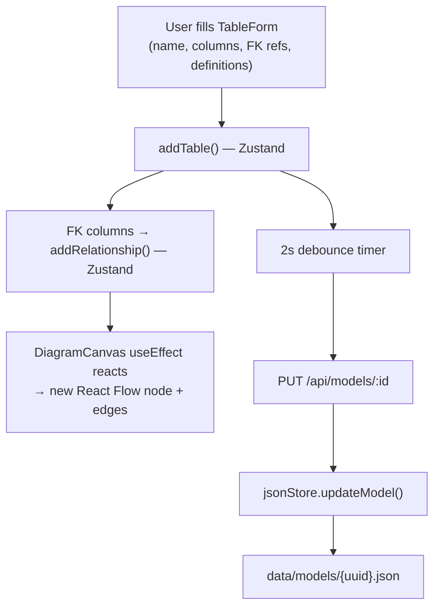
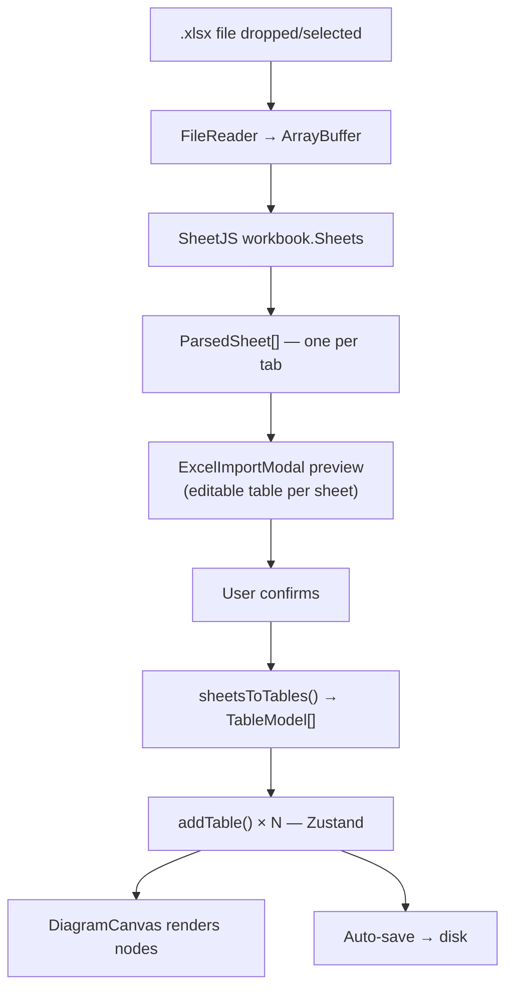
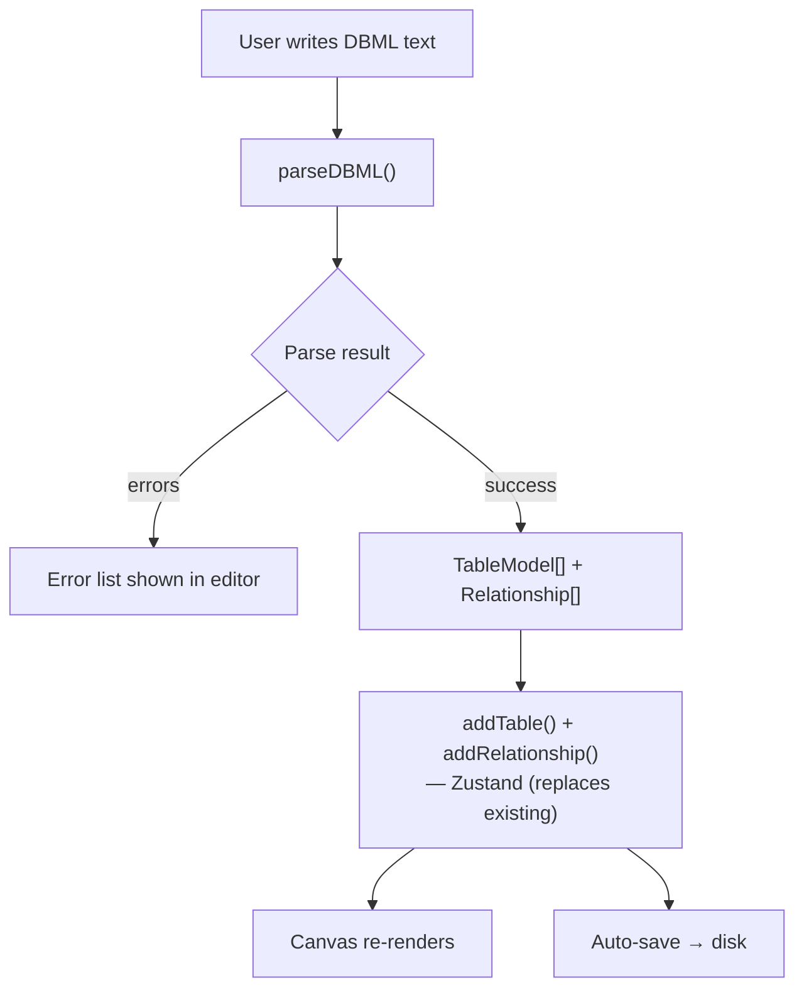
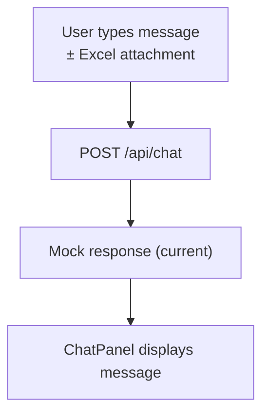
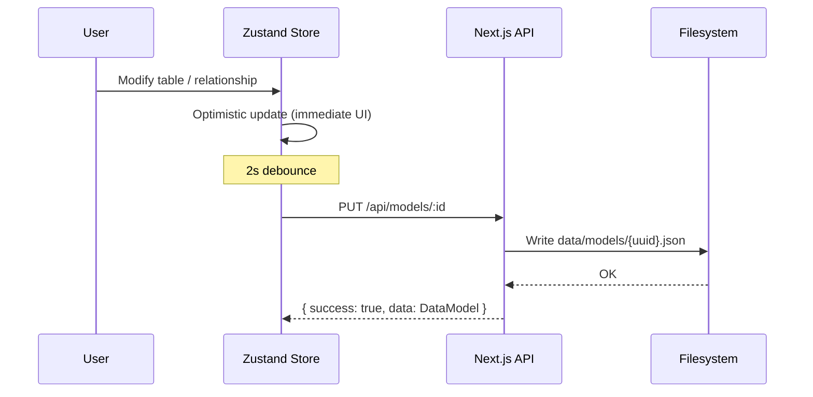
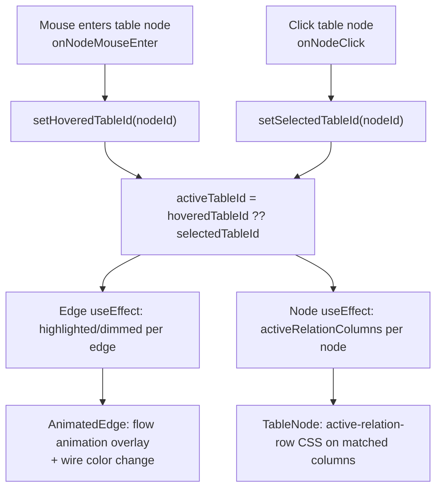
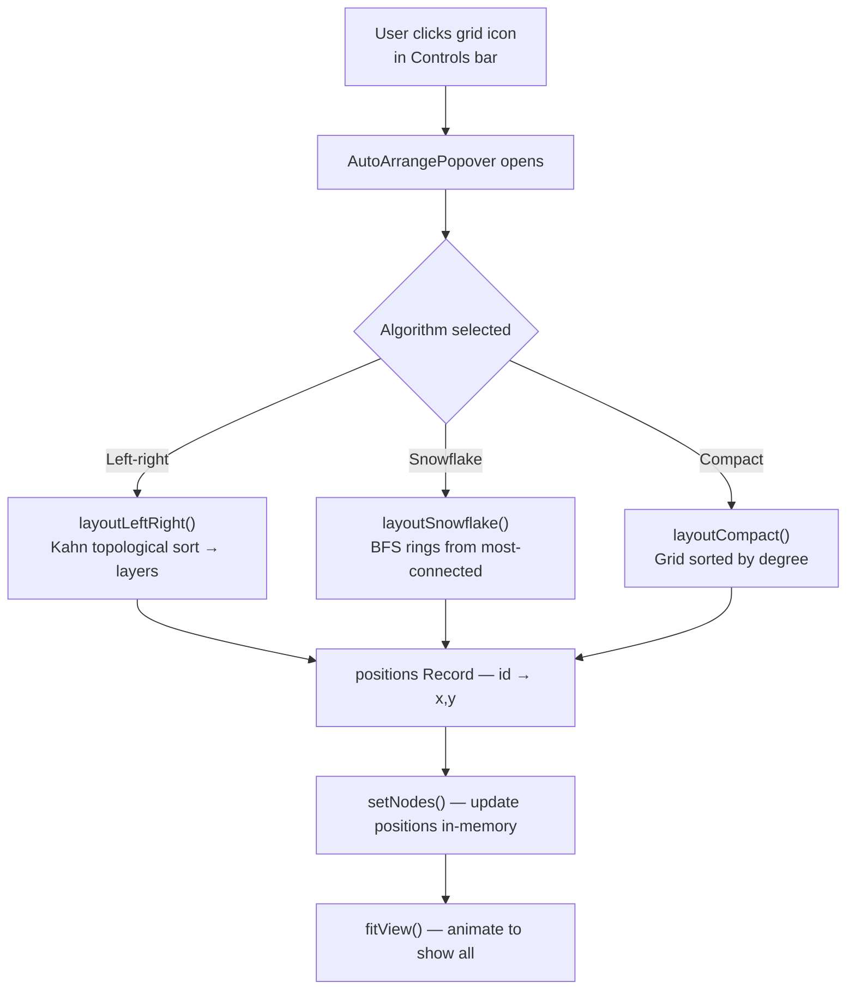

# Data Flow

## Overview

This document describes how data moves through the application for each ingestion method, the persistence cycle, canvas synchronization, and the diagram interaction flows.

## Ingestion Flows

### 1. Manual Form



**Steps:**
1. User opens Table Form, fills name, columns with types/keys, per-column functional definitions, and FK references
2. `addTable()` adds `TableModel` to Zustand; FK columns trigger `addRelationship()`
3. `DiagramCanvasInner` `useEffect` detects store change → adds React Flow node + edges
4. 2-second debounce fires `saveModel()` → `PUT /api/models/:id` → disk

### 2. Excel Import



**Sheet format:**

| Column A | Column B | Column C |
|----------|----------|----------|
| column_name | data_type | functional_definition |

Header row detection: if the first row contains keywords like `column`, `name`, `columna`, or `nombre`, it is skipped automatically.

### 3. DBML Editor



**Parser capabilities:**
- `Table` declarations with columns and inline settings
- Column settings: `pk`, `sk`, `partition`, `not null`, `unique`, `increment`, `default`, `note`, `ref`
- Standalone `Ref:` declarations
- `Note:` table descriptions
- `//` comment lines
- Error reporting with line numbers

**Reverse (`generateDBML()`):** takes `TableModel[]` + `Relationship[]` and emits valid DBML text.

### 4. Chat Agent (Shell)



> Future: `/api/chat` forwards to AI agent → agent returns `TableModel[]` → tables auto-added to canvas.

## Persistence Cycle



### Data Directory

```
data/
├── projects.json            # Project[] registry
└── models/
    └── {uuid}.json          # Full DataModel (tables + relationships + positions)
```

## Canvas Synchronization

`DiagramCanvasInner` uses two `useEffect` hooks:

### Node sync (tables)

Runs when `tables`, `selectedTableId`, `hoveredTableId`, or `activeColsByTable` changes.

- Computes a **structural fingerprint** of the tables array
- If only display state changed (hover/selection), updates `data` in-place without re-positioning
- If structure changed (column added/removed), runs `layoutLeftRight()` to compute fresh positions for new tables (existing dragged positions are preserved in-memory)
- **Positions are never persisted** — they are computed from the layout algorithm each time the model is loaded
- Passes `activeRelationColumns` array to each node so `TableNode` can highlight connected columns

### Edge sync (relationships)

Runs when `relationships`, `tables`, or `activeTableId` changes.

- Rebuilds all edges from scratch
- Assigns `highlighted` / `dimmed` based on `activeTableId`
- Assigns `edgeIndex` per node-pair to offset parallel wires

## Hover & Selection Interaction Flow



## Auto-Arrange Flow


