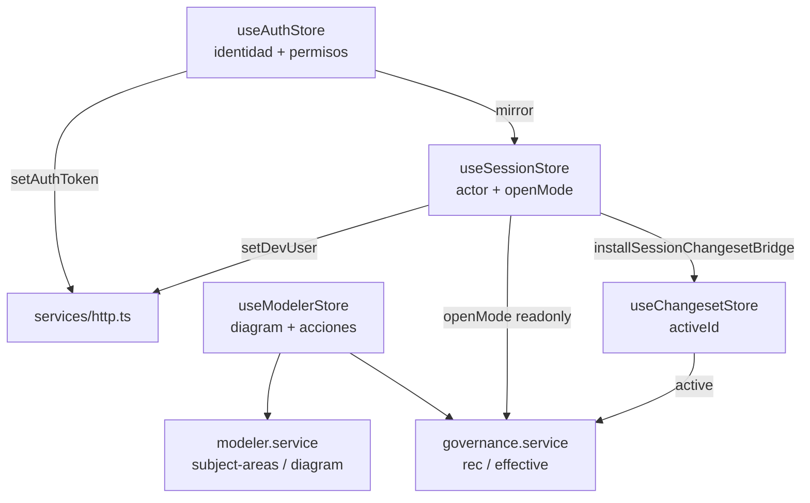
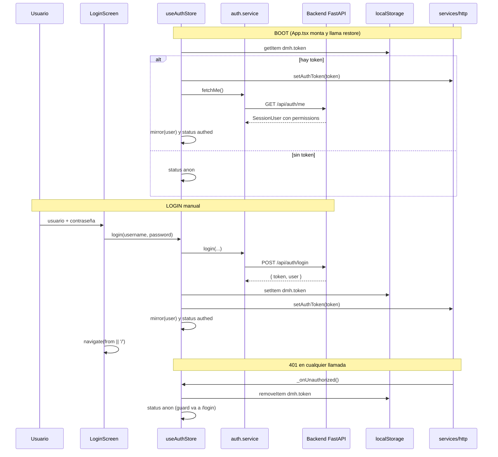
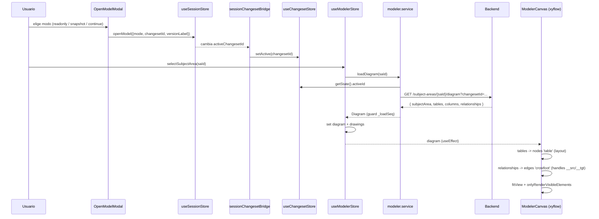
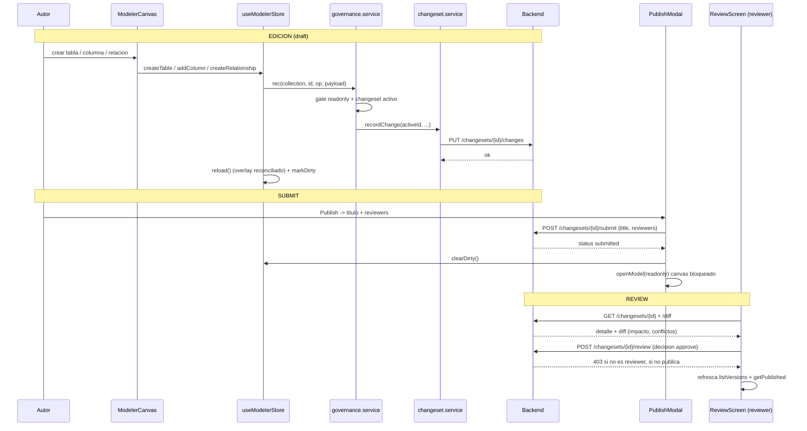
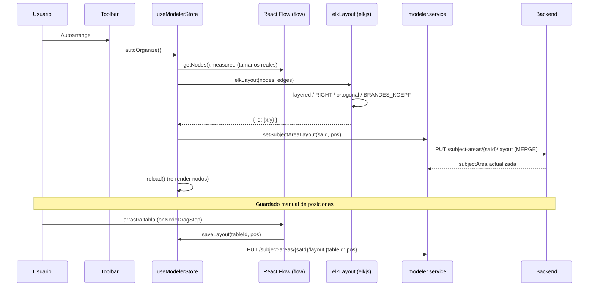
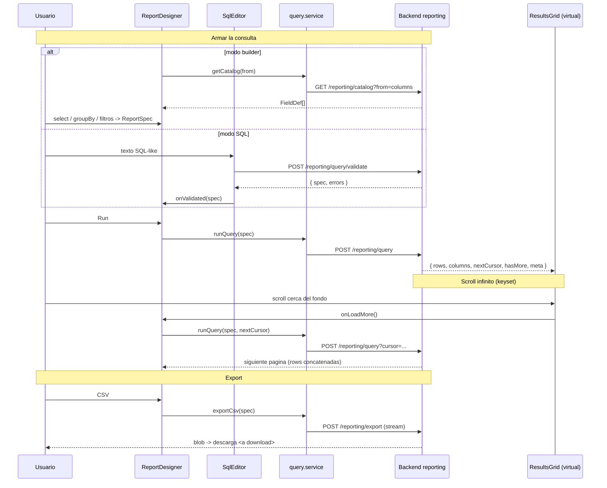
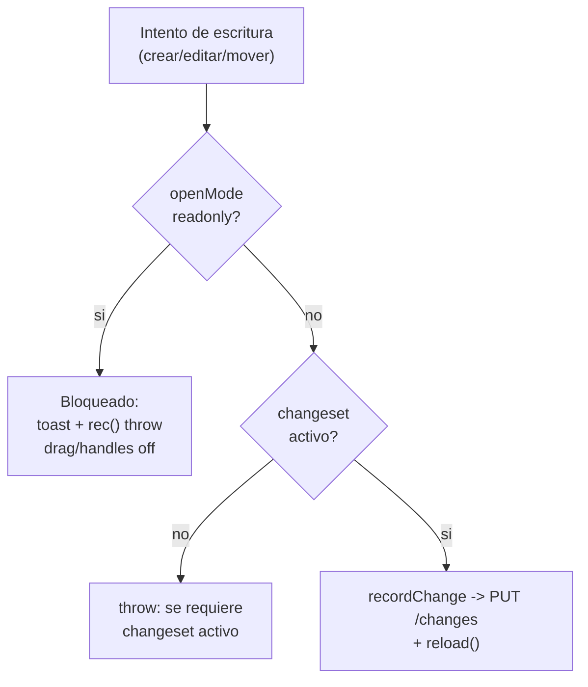

# Flujos de datos del frontend — Data Model Hub

Este documento describe, con base en el **código real** del frontend (Vite + React + Zustand + React Flow/xyflow), cómo circulan los datos en los cinco flujos centrales de la aplicación: autenticación y arranque, apertura de un canvas, edición gobernada (changeset → review → publish), auto-organización del layout (ELK) y el motor de reporting. Se explican además dos patrones transversales: el **estado optimista** y el **viewer-lock (solo lectura)**.

La audiencia es de desarrolladores y stakeholders técnicos. Las rutas de archivo son absolutas para que puedan ubicarse en el repositorio.

---

## 1. Mapa de estado y capa HTTP

### 1.1 Stores de Zustand

Todo el estado del cliente vive en stores de Zustand. Cada uno tiene una responsabilidad acotada y algunos se "espejan" entre sí mediante puentes explícitos.

| Store | Archivo | Responsabilidad | Persistencia |
|---|---|---|---|
| `useAuthStore` | `src/store/useAuthStore.ts` | Identidad **autoritativa** (usuario + permisos), login/logout/restore | Token en `localStorage['dmh.token']` |
| `useSessionStore` | `src/store/useSessionStore.ts` | Actor simulado (`X-Dev-User`) + intención de apertura del canvas (`openMode`, `activeChangesetId`, `activeVersionLabel`) | En memoria |
| `useChangesetStore` | `src/store/useChangesetStore.ts` | Changeset activo (working copy) que consumen todos los lectores/escritores del modelo | En memoria |
| `useModelerStore` | `src/store/useModelerStore.ts` | Árbol del explorer, `diagram` cargado, drawings, `dirty`, acciones de edición | En memoria |
| `useIdentityStore` | `src/store/useIdentityStore.ts` | Identidad legacy vía `/api/me` (MVP, tolerante a fallos) | En memoria |

El **puente** `installSessionChangesetBridge()` (`src/store/sessionChangesetBridge.ts`) es clave: propaga de forma **unidireccional** `useSessionStore.activeChangesetId` → `useChangesetStore.setActive(id)`. Se monta una sola vez desde `App.tsx`. Sin él, editar en el canvas no encontraría changeset activo y lanzaría "Se requiere un changeset activo para editar".



### 1.2 Cliente HTTP

`src/services/http.ts` centraliza `fetch`. Puntos importantes:

- Todas las respuestas usan el envelope `{ success, data?, error? }`. `apiFetch<T>()` devuelve `data` desempaquetado o arroja `ApiError`.
- Inyecta dos headers en **cada** llamada: `Authorization: Bearer <token>` (auth propia) y `X-Dev-User: <id>` (actor simulado, seam local).
- `credentials: 'include'` para que la cookie de sesión viaje cross-origin (front en un puerto, FastAPI en otro).
- Timeout global de 30s vía `AbortSignal.timeout`, combinable con el `signal` del caller.
- Un 401 dispara el callback global `_onUnauthorized` que registra `useAuthStore` (cierra sesión → el guard redirige a `/login`).
- Si la respuesta no trae envelope pero sí `{detail}` (HTTPException de FastAPI), propaga ese `detail` como mensaje real del `ApiError`.

Ejemplo del shape de request/response:

```bash
curl -sS http://localhost:8000/api/projects \
  -H "Authorization: Bearer <jwt>" \
  -H "X-Dev-User: mr"
# → { "success": true, "data": [ { "id": "p1", "name": "Core" } ] }
```

---

## 2. Flujo 1 — Login, token de sesión y restore al boot

### 2.1 Piezas

- `src/features/auth/LoginScreen.tsx` — formulario usuario/contraseña.
- `src/features/auth/auth.service.ts` — `login`, `logout`, `fetchMe`.
- `src/store/useAuthStore.ts` — orquesta token + estado (`loading | anon | authed`).
- `src/features/auth/guards.tsx` — `RequireAuth` (splash mientras `loading`, redirige a `/login` si `anon`) y `RequirePermission`.
- `src/App.tsx` — dispara `restore()` una sola vez al montar.

### 2.2 Endpoints

| Acción | Método | Ruta | Body / Respuesta |
|---|---|---|---|
| Login | POST | `/api/auth/login` | `{username, password}` → `{token, user}` |
| Restore | GET | `/api/auth/me` | → `SessionUser` (con `permissions`) |
| Logout | POST | `/api/auth/logout` | → `{ok}` |

`SessionUser` incluye `permissions: Record<string, boolean>` con la matriz (`model.view`, `model.edit`, `review.decide`, `publish`, `export`, `standards.edit`, `admin.manage`). `useAuthStore.has(perm)` lee de ahí.

### 2.3 Restore al arranque (boot)

`App.tsx` corre `useEffect(() => { void restore(); }, [restore])`. `restore()`:

1. Lee `localStorage['dmh.token']`. Si no hay → `status: 'anon'`.
2. Si hay, lo empuja al cliente HTTP (`setAuthToken`) y llama `fetchMe()`.
3. Si `/me` no devuelve `permissions` (degradó a Principal básico), lo considera sesión inválida: limpia token y queda `anon`.
4. Si es válida, `mirror(user)` espeja el actor a `useSessionStore` (id = username → header `X-Dev-User`) y deja `status: 'authed'`.

Mientras `status === 'loading'`, `RequireAuth` muestra el `<Splash/>` para evitar el parpadeo login→app.

### 2.4 Diagrama



---

## 3. Flujo 2 — Abrir un canvas: getDiagram, nodos xyflow y edges crowfoot

### 3.1 Elección de versión (Open model)

El canvas nunca se abre "en producción" implícitamente. Al entrar a `/model` sin `openMode`, `WorkspaceScreen` fuerza el `OpenModelModal` (`src/components/OpenModelModal.tsx`), que ofrece tres modos:

| Opción | Acción | Efecto en sesión |
|---|---|---|
| View production (read-only) | — | `openModel({mode:'readonly', versionLabel})` |
| Create new version from production | `POST /api/changesets/snapshot` | `openModel({mode:'editing', changesetId, versionLabel})` |
| Continue a working version | elige un draft propio | `openModel({mode:'editing', changesetId})` |

`openModel()` en `useSessionStore` fija `openMode`, `activeChangesetId` y `activeVersionLabel`; el bridge propaga el `changesetId` a `useChangesetStore.activeId`.

### 3.2 Carga del diagrama

Al seleccionar un canvas en el `ModelExplorer`, `useModelerStore.selectSubjectArea(saId, projectId?)` llama a `modeler.service.loadDiagram(saId)`:

```ts
// src/features/modeler/services/modeler.service.ts
export async function loadDiagram(saId: string): Promise<Diagram> {
  const cs = useChangesetStore.getState().activeId;
  const qs = cs ? `?changesetId=${encodeURIComponent(cs)}` : '';
  return apiGet<Diagram>(`${API_BASE}/api/subject-areas/${encodeURIComponent(saId)}/diagram${qs}`);
}
```

Es **una sola request**: el backend arma el diagrama con queries batched (`$in`) y aplica el overlay del changeset server-side. El `Diagram` trae `{ subjectArea, tables, columns, relationships }`.

`selectSubjectArea` protege contra respuestas fuera de orden con un contador de secuencia `_loadSeq` (dos clicks rápidos en el explorer descartan la respuesta vieja), y hace flush inmediato de los drawings pendientes del canvas anterior antes de cambiar.

```bash
curl -sS "http://localhost:8000/api/subject-areas/sa-42/diagram?changesetId=cs-7" \
  -H "Authorization: Bearer <jwt>" -H "X-Dev-User: mr"
# → { "success": true, "data": {
#     "subjectArea": { "id":"sa-42","tableIds":["t1","t2"],
#                      "layout":{"t1":{"x":60,"y":60}}, "drawings":[] },
#     "tables":[ {"id":"t1","physicalName":"dim_cliente","logicalName":"Cliente"} ],
#     "columns":[ {"id":"c1","tableId":"t1","physicalName":"id_cliente","isPrimaryKey":true,"ordinal":0} ],
#     "relationships":[ {"id":"r1","sourceTableId":"t1","targetTableId":"t2","sourceColumnId":"c1","targetColumnId":"c9","sourceCardinality":"one","targetCardinality":"many","identifying":false} ]
# } }
```

### 3.3 Del Diagram a nodos y edges

`ModelerCanvas.tsx` sincroniza `store.diagram` → estado interno de React Flow con un `useEffect`:

- **Nodos tabla** (`type: 'table'`): posición desde `subjectArea.layout[t.id]`, con fallback a una grilla (`60 + (i%4)*260`). `data = { table, columns }`.
- **Nodos shape** (`type: 'shape'`, `zIndex: -1`): la capa DRAWING, se pinta detrás de las tablas.
- **Edges** (`type: 'crowfoot'`): cada relación mapea a un edge con `sourceHandle = ${sourceColumnId}__src` y `targetHandle = ${targetColumnId}__tgt`. `data` lleva las cardinalidades e `identifying`.

Los handles conectables viven por columna en `TableNode.tsx` (`Handle type="source" id="${c.id}__src"` a la derecha, `target ... __tgt` a la izquierda).

### 3.4 Render crowfoot

`CrowFootEdge.tsx` calcula el path con `getSmoothStepPath` (ruteo ortogonal, esquinas redondeadas — sin matemática manual). Decide de qué lado sale/entra el wire comparando los centros absolutos de ambos nodos (`sourceFacesRight`), de modo que la relación se "voltea" sola al mover las tablas. Los marcadores crow's-foot se resuelven por cardinalidad (`markerStart={url(#cf-${sourceCardinality})}`, `markerEnd={url(#cf-${targetCardinality})}`, definidos en `CrowFootMarkers.tsx`).

Optimizaciones de escala: `onlyRenderVisibleElements` (solo montan DOM los nodos visibles), `TableNode` y `CrowFootEdge` memoizados, y selectores **booleanos derivados** por nodo/edge para el hover (evita re-renderizar los 100 nodos al cambiar un id).

### 3.5 Diagrama



---

## 4. Flujo 3 — Editar en el canvas: changeset, submit, review, approve, publish

### 4.1 El choke-point de escritura

Toda mutación del modelo pasa por `governance.service.rec()` (`src/features/governance/services/governance.service.ts`):

```ts
const rec = (collection, id, op, payload?) => {
  if (useSessionStore.getState().openMode === 'readonly')
    throw new Error('El modelo está abierto en solo lectura: no admite cambios.');
  const a = active();                       // useChangesetStore.activeId
  if (!a) throw new Error('Se requiere un changeset activo para editar.');
  return csvc.recordChange(a, collection, id, op, payload);
};
```

`recordChange` (`changeset.service.ts`) hace `PUT /api/changesets/{id}/changes` con `{collection, entityId, op, payload}`. Cada cambio se persiste como un documento en la colección `changeset_changes` del backend (un doc por cambio, sin el límite de 2MB por doc). Las **lecturas** con changeset activo van por `effective` → `GET /api/changesets/{id}/effective/{collection}?tableId=&ids=&q=&limit=` (slices server-side, nunca baja la colección completa).

Ejemplos de operaciones (todas terminan en un `reload()` que reconcilia con el overlay):

- `createTable` → `gov.createTable` (upsert en `canonical_tables`) + `setSubjectAreaTables` para referenciarla.
- `addColumn` → `physicalize` (lógico→físico) + `createColumn`.
- `createRelationship` → `gov.createRelationship` + `markForeignKey` sobre la columna hija.
- `updateColumn` / `reorderColumns` / `deleteColumn` → upsert/delete por id.

Cada acción llama `markDirty()` en `useModelerStore`, que alimenta el guard de salida (aviso "cambios sin guardar").

```bash
curl -sS -X PUT http://localhost:8000/api/changesets/cs-7/changes \
  -H "Authorization: Bearer <jwt>" -H "X-Dev-User: mr" \
  -H "Content-Type: application/json" \
  -d '{"collection":"canonical_tables","entityId":"t99","op":"upsert",
       "payload":{"id":"t99","logicalName":"Transaccion","physicalName":"fct_transaccion"}}'
```

### 4.2 Submit (Publish request)

El botón **Publish** del `Toolbar` abre `PublishModal.tsx`. El usuario pone título, descripción y elige al menos un reviewer, y envía con `versioning.service.submit(changesetId, {title, description, reviewers})` → `POST /api/changesets/{id}/submit`. El changeset pasa de `draft` a `submitted`.

Tras el submit, la modal hace dos cosas importantes: limpia `dirty` (checkpoint) y, como la working copy ya salió de `draft` (el backend rechazaría más ediciones con 409), transiciona la sesión a **solo lectura** sobre producción con `openModel({mode:'readonly', versionLabel: pub?.versionLabel})`.

### 4.3 Review y decisión

`ReviewScreen.tsx` (`src/screens/ReviewScreen.tsx`) es cross-project. Lista requests (`listVersions` filtrados por `submitted/approved/rejected`), y al seleccionar uno carga detalle + diff (`getChangeset`, `getDiff`). El diff muestra impacto (tablas/columnas tocadas), entidades added/edited/deleted por colección y marca **conflictos** (`entity.conflict`: modificado en producción después de que esta versión lo editó).

La decisión va por `review(id, {decision})` → `POST /api/changesets/{id}/review`. El backend devuelve **403 si el actor no es reviewer** (se reescribe a un mensaje legible). Botones deshabilitados si:

- `canAct = status === 'submitted' && isReviewer && !alreadyVoted`.
- `canWithdraw` (owner, submitted) → `withdraw` vuelve a `draft`.
- `canReopen` (owner, rejected) → `reopen` vuelve a `draft` (el reject nunca elimina la versión).

**Approve = publish**: aprobar publica y sobrescribe producción ("last to publish wins", como advierte el snapshot). Un `getChangeset`/`getPublished` refrescan las listas tras la decisión.

### 4.4 Defensa en profundidad

`WorkspaceScreen` re-valida una sesión `editing`: si el changeset dejó de estar en `draft` (enviado desde otra pestaña, decidido por un reviewer) o el actor ya no es el owner, degrada a `readonly` en vez de dejar un canvas que responde 409/403 en cada edición.

### 4.5 Diagrama



---

## 5. Flujo 4 — Auto-arrange (ELK) y guardado de layout

### 5.1 Auto-organizar

El botón **Autoarrange** del `Toolbar` llama `useModelerStore.autoOrganize()`:

1. Importa perezosamente `elkLayout` (`src/features/modeler/lib/elkLayout.ts`).
2. Toma los tamaños **medidos** de los nodos vivos (`flow.getNodes().measured`) — clave porque las tablas altas (30 columnas ≈ 700px) se superponían con tamaño fijo.
3. Construye nodos `{id, measured}` desde `diagram.tables` y edges `{source, target}` desde `diagram.relationships`.
4. `elkLayout(nodes, edges)` corre el algoritmo `layered` (Sugiyama) de ELK con dirección `RIGHT`, ruteo ortogonal, separación de componentes desconectados y `BRANDES_KOEPF`. Devuelve un `Record<id, {x, y}>`.
5. Persiste con `setSubjectAreaLayout(saId, pos)` (que **mergea** en backend) y hace `reload()`.

ELK no rutea los wires: solo asigna posiciones de nodos. El ruteo visual sigue siendo de React Flow (`getSmoothStepPath`).

### 5.2 Guardar layout

Hay tres caminos de persistencia de posición, todos hacia `PUT /api/subject-areas/{saId}/layout` (merge server-side):

| Disparador | Método del store | Alcance |
|---|---|---|
| Soltar un nodo tabla | `saveLayout(tableId, pos)` | Un solo nodo |
| Botón Save / "Guardar y salir" | `saveAllLayout()` → dentro de `saveAll()` | Todos los nodos `type==='table'` |
| Auto-arrange | `setSubjectAreaLayout(saId, pos)` | El mapa que devolvió ELK |

`saveAllLayout` filtra explícitamente **solo** nodos tabla: las posiciones de los shapes viven en `drawings` (persistidos aparte, debounced 500ms, vía `PUT .../drawings`). `saveAll` captura `saId` y `drawings` **antes** del await para no escribir dibujos del canvas nuevo bajo el `saId` viejo si el usuario cambia de canvas a mitad del guardado.

En `readonly`, `onNodeDragStop` retorna temprano: no se persiste ningún movimiento (ver viewer-lock).

### 5.3 Diagrama



---

## 6. Flujo 5 — Reporting: QuerySpec, /query, grilla virtualizada y export CSV

### 6.1 El IR compartido: ReportSpec

`src/features/reporting/query.service.ts` define `ReportSpec`, el mismo IR que el backend. Lo producen **dos** entradas y lo consumen la grilla, las queries guardadas y el export:

```ts
interface ReportSpec {
  from: 'columns' | 'tables' | 'relationships' | 'views';
  select: string[];
  where?: WhereGroup | null;      // and/or/not anidables con Condition[]
  groupBy: string[];
  aggregations: Aggregation[];    // count/sum/avg/min/max...
  orderBy: OrderBy[];
  limit: number;
}
```

`ReportDesigner.tsx` maneja dos modos:

- **Builder**: `getCatalog(from)` (`GET /api/reporting/catalog?from=`) trae los `FieldDef[]` (label, tipo, ops, `groupable`, `indexed`, `udp`). El usuario marca columnas (`select`), agrupa (`groupBy` → agrega `count`) y arma filtros con `FilterBuilder`.
- **SQL**: `SqlEditor` manda el texto a `validateSql(text)` (`POST /api/reporting/query/validate`). El **servidor es la autoridad de la gramática**: valida con sqlglot y devuelve `{spec, errors}`. Si es válido, el spec se vuelca al builder y se cambia de modo. Soporta UDP dinámico con la sintaxis `udp."Nombre"`; sin JOIN ni subqueries.

### 6.2 Ejecución y paginación keyset

`runQuery(spec, cursor?)` → `POST /api/reporting/query?cursor=`. La respuesta es `QueryResult`:

```ts
interface QueryResult {
  rows: Record<string, unknown>[];
  columns: ResultColumn[];        // dinámicas, incluyen UDP
  nextCursor: string | null;      // keyset
  hasMore: boolean;
  meta: { grouped: boolean; warnings: string[]; scan?: 'index' | ... };
}
```

La paginación es **keyset** (cursor opaco), no offset: a 400k filas nunca se traen todas al browser. `loadMore()` reusa `spec`/`sqlText` con `result.nextCursor` y **concatena** las filas nuevas a las existentes (`rows: [...prev.rows, ...res.rows]`).

```bash
curl -sS -X POST "http://localhost:8000/api/reporting/query" \
  -H "Authorization: Bearer <jwt>" -H "Content-Type: application/json" \
  -d '{"from":"columns","select":["physicalName","dataType"],
       "where":{"op":"and","conditions":[{"field":"schema","op":"eq","value":"core"}]},
       "groupBy":[],"aggregations":[],"orderBy":[{"field":"physicalName","dir":"asc"}],"limit":100}'
# → { "success": true, "data": {
#     "rows":[...], "columns":[{"key":"physicalName","label":"Physical","type":"string"}],
#     "nextCursor":"eyJwaHlzaWNhbE5hbWUiOiJhX2NvbCJ9", "hasMore":true,
#     "meta":{"grouped":false,"warnings":[],"scan":"index"} } }
```

### 6.3 Grilla virtualizada + scroll infinito

`ResultsGrid.tsx` usa `@tanstack/react-virtual` (`useVirtualizer`) para montar solo las filas visibles (altura estimada 34px, `overscan: 12`). El `onScroll` dispara `onLoadMore()` cuando `hasMore`, no está `loading` y falta menos de 400px para el fondo:

```ts
if (result?.hasMore && !loading &&
    el.scrollHeight - el.scrollTop - el.clientHeight < 400) onLoadMore();
```

El header permite ordenar **server-side** solo por campos indexados y no-UDP y no-agrupados (`sortable = !c.udp && !result.meta?.grouped`); al hacer click, se re-arma `orderBy` en el spec y un `useEffect` re-ejecuta la query. La celda muestra `meta.scan` (index vs collscan) como señal de rendimiento.

### 6.4 Export CSV por streaming

`exportCsv(spec)` hace `POST /api/reporting/export` con `fetch` directo (no `apiFetch`, porque el stream no bufferea el envelope JSON). Lee el token de `localStorage['dmh.token']`, recibe el `blob` y fuerza la descarga con un `<a download>` sintético. Así se exportan datasets grandes sin materializarlos en memoria de JS como filas.

### 6.5 Diagrama



---

## 7. Patrón de estado optimista

El objetivo es que la UI responda al instante y que la persistencia (más el `reload()` que reconcilia con el overlay del changeset) corra por detrás. Se aplica en tres lugares concretos del código:

### 7.1 Edge fantasma al crear una relación

En `ModelerCanvas.onConnect`, al soltar la conexión se inserta de inmediato un **edge "pending"** con `id = pending-<uuid>` y `data.pending = true`. `CrowFootEdge` lo pinta semitransparente (`opacity: 0.5`, dash `6 5`, color `--primary`). Cuando `createRelationship` persiste y `reload()` trae la relación real, el fantasma se reemplaza. Si la escritura falla, se elimina el fantasma y se muestra el motivo real del error:

```ts
void createRelationship(rel).catch((err) => {
  setEdges((eds) => eds.filter((e) => e.id !== ghostId));
  pushToast(err instanceof Error ? err.message : 'No se pudo crear la relación', 'err');
});
```

### 7.2 Reordenar columnas

`useModelerStore.reorderColumns` primero reordena en el store (recomputa `ordinal = índice nuevo` localmente, render inmediato) y luego persiste **solo** las columnas cuyo `ordinal` cambió, en **tandas de 5** (mover una columna al tope de una tabla de 30 disparaba 30 PUT simultáneos). El backend graba cada cambio con `$set` atómico por entidad, así que no se pisan. Un `reload()` final reconcilia.

### 7.3 Drawings con debounce

`addDrawing/updateDrawing/deleteDrawing` mutan el array local y agendan `persistDrawings()` con debounce de 500ms (`PUT .../drawings` del array completo). El flush captura el `saId` al **agendar**: si el usuario cambia de canvas dentro de la ventana, el disparo se cancela para no escribir dibujos ajenos. Al cambiar de canvas o hacer `saveAll`, se hace flush inmediato.

### 7.4 Reconciliación de respuestas fuera de orden

Complementario al optimismo: `_loadSeq` en `selectSubjectArea`/`reload` descarta respuestas viejas de `loadDiagram` (dos clicks rápidos, reload en vuelo), evitando que el canvas muestre un subject area ajeno.

---

## 8. Viewer-lock (solo lectura)

El modo `readonly` de `useSessionStore.openMode` bloquea toda escritura, con defensa en varias capas:

| Capa | Archivo | Comportamiento en readonly |
|---|---|---|
| Choke-point de escritura | `governance.service.rec()` | Lanza "El modelo está abierto en solo lectura" antes de tocar el backend |
| Canvas | `ModelerCanvas.tsx` | `nodesDraggable={!readonly}`; `onConnect` corta con toast; `onNodeDragStop` no persiste; `deleteKeyCode={null}` (nada de borrar por teclado) |
| Nodo | `TableNode.tsx` | `canEdit = activeId != null && !readonly`; handles no conectables; sin botón "+" de columna |
| Toolbar | `Toolbar.tsx` | `canEdit = hasCanvas && !readonly`; deshabilita New table/CTAS/Draw/Autoarrange/Save/Publish; tooltip "Solo lectura — versión publicada" |
| Store | `useModelerStore.focusTable` | En readonly centra la tabla pero no abre el PropertiesPanel |

Un detalle importante: en `readonly` **puede** haber un `activeChangesetId` (por ejemplo, ver un request desde Review lee su overlay `/effective`), pero eso **nunca** habilita mutaciones — el gate de `openMode` corta antes, y el backend igual respondería 409. Por eso el gate de sesión precede al de changeset.

`WorkspaceScreen` refuerza esto degradando `editing → readonly` cuando detecta que el changeset dejó de ser un draft propio (submit desde otra pestaña, decisión de un reviewer, o cambio de actor), evitando 409/403 silenciosos. El `PublishModal` hace la misma degradación tras un submit exitoso.



---

## 9. Despliegue: dónde corre y consideraciones de datos

El frontend es una SPA de Vite (React) que consume la API FastAPI. No se cubren aquí pipelines de CI/CD; solo dónde corre y su configuración.

### 9.1 Dónde corre

- **Azure App Service**: la SPA se sirve como estático y FastAPI como app web; conviven en orígenes distintos, por eso `http.ts` usa `credentials: 'include'` y headers explícitos.
- **Databricks Apps**: destino de migración (dos apps — Next/Vite standalone + FastAPI). En Databricks real, el header de actor lo pone el proxy (OBO); el switch de usuario simulado se oculta y `X-Dev-User` deja de ser la fuente del actor (el backend prefiere el token).

### 9.2 Variables de entorno

| Variable | Ámbito | Uso |
|---|---|---|
| `VITE_API_URL` | Frontend (build) | Base de todas las llamadas (`API_BASE`). Vacío = mismo origen (rutas relativas `/api/...`) |
| `AUTH_MODE` | Backend | `local` resuelve el actor por `X-Dev-User`; en Databricks se resuelve por token/OBO |

El token de sesión se guarda en `localStorage['dmh.token']` (constante `TOKEN_KEY` en `useAuthStore`, y leído directo en `query.service.exportCsv`).

### 9.3 Base de datos: Azure Cosmos DB (API de Mongo)

- El backend arma el diagrama con queries batched (`$in`) y aplica el overlay del changeset **server-side**: una sola request por apertura, en vez de mover el catálogo completo (a escala, 15k tablas / 300k columnas).
- Los cambios de un changeset viven en la colección `changeset_changes` (un documento por cambio), lo que evita el límite de **2MB por documento** de Cosmos. Nunca viajan crudos al cliente: se consumen vía `/effective` (lectura) y `/diff` (review).
- Las lecturas grandes se acotan con slices server-side (`?tableId=`, `?ids=`, `?q=&limit=`) para no bajar colecciones enteras.
- El reporting depende de **índices**: `meta.scan` (index vs collscan) es la señal que la grilla expone; el ordenamiento server-side se habilita solo sobre campos indexados. La paginación es keyset (cursor), apta para 400k filas sin offset.
- Las escrituras se hacen con `$set` atómico por entidad (por ejemplo, en el reorder de columnas en tandas de 5), de modo que operaciones concurrentes sobre entidades distintas no se pisan.

---

## 10. Resumen de endpoints por flujo

| Flujo | Endpoints (método · ruta) |
|---|---|
| Login / restore | POST `/api/auth/login` · GET `/api/auth/me` · POST `/api/auth/logout` |
| Abrir canvas | GET `/api/subject-areas/{saId}/diagram?changesetId=` |
| Editar (changeset) | PUT `/api/changesets/{id}/changes` · GET `/api/changesets/{id}/effective/{collection}` |
| Snapshot / submit | POST `/api/changesets/snapshot` · POST `/api/changesets/{id}/submit` |
| Review / decisión | GET `/api/changesets/{id}` · GET `/api/changesets/{id}/diff` · POST `/api/changesets/{id}/review` · POST `.../withdraw` · POST `.../reopen` · POST `.../comments` |
| Versiones | GET `/api/versions` · GET `/api/versions/published` · GET `/api/requests` · GET `/api/users` |
| Layout / drawings | PUT `/api/subject-areas/{saId}/layout` · PUT `/api/subject-areas/{saId}/drawings` · PUT `/api/subject-areas/{saId}/tables` |
| Reporting | GET `/api/reporting/catalog` · POST `/api/reporting/query` · POST `/api/reporting/query/sql` · POST `/api/reporting/query/validate` · GET `/api/reporting/facets` · POST `/api/reporting/export` · GET/POST/PUT/DELETE `/api/reporting/reports` · GET `/api/reporting/insights/*` |
