# Flujos de Datos

> Cómo se mueven los datos del browser al backend FastAPI (y viceversa)
> para cada acción del usuario. Todos los diagramas reflejan el estado
> post-migración: **no hay rutas API en Next.js**, la persistencia
> vive en Cosmos DB y se accede mediante `apiFetch` cross-origin con
> cookie JWT.

## 0. Login y bootstrap del estado

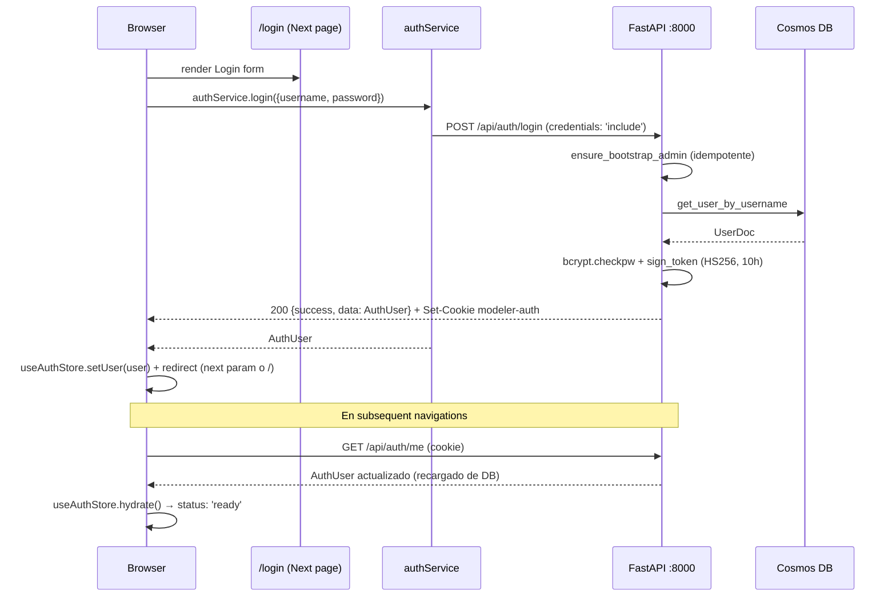

Si el cookie expira o se invalida, cualquier `apiFetch` posterior cae
en 401, `agentService` arroja `AgentClientError` y el resto arroja
`ApiError`. La UI desencadena un logout + redirect a `/login`.

---

## 1. Flujos de ingesta de tablas

### 1.1 Formulario manual

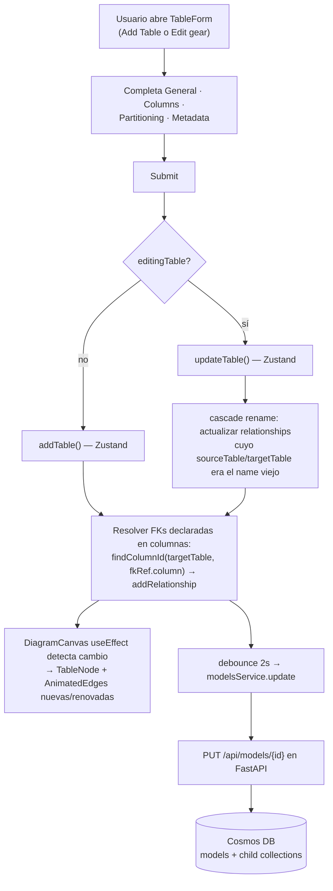

**Detalles importantes**:

- `TableForm.emptyColumn()` siempre genera un `id: uuidv4()` para
  cada columna nueva. **Renombrar** una columna no cambia su `id`,
  por lo que las relaciones que la referenciaban siguen apuntando al
  mismo handle de React Flow.
- `handleAddTable` resuelve los `foreignKeyRef` declarados en el form
  (que contienen **nombre** de tabla.columna) a `column.id` mediante
  `findColumnId(allTables, fkRef.table, fkRef.column)`. Si el destino
  no existe, la FK se ignora silenciosamente.
- Al editar, las relaciones existentes se preservan; solo se cascadea
  el cambio de `name` cuando aplica.

### 1.2 Importación desde Excel

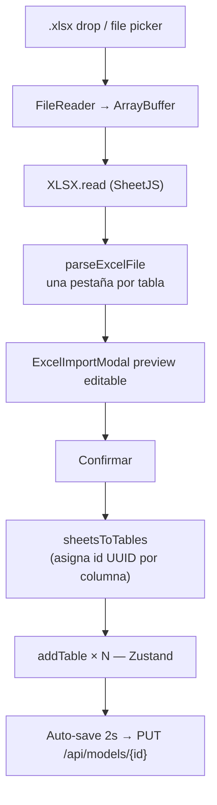

`sheetsToTables` siempre stamp `id: uuidv4()` en cada `TableColumn`
generada desde Excel — los datos de Excel no traen ids estables, así
que se inventan acá.

### 1.3 Editor DBML

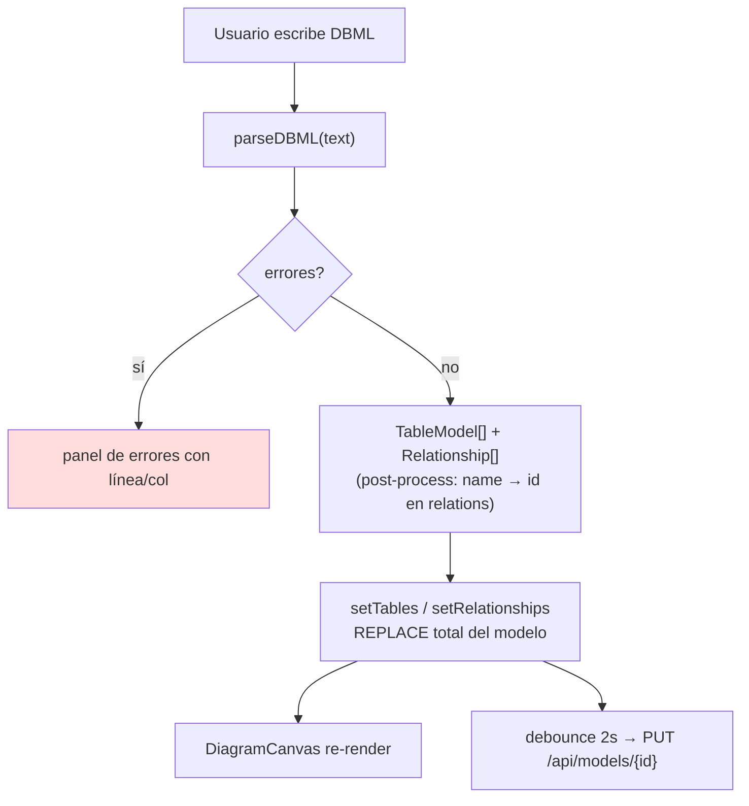

**Capacidades del parser** (`@/features/table-editor/utils/dbmlParser.ts`):

- `Table name { … }` y `Table schema.name { … }` (asigna `TableModel.schema`).
- Settings de columna: `pk`, `sk`, `partition`, `not null`, `unique`,
  `increment`, `default: 'x'`, `note: '…'`, `ref: > t.col`.
- Refs FK con schema: `[ref: > schema.table.column]`.
- Declaraciones `Ref:` independientes.
- `length`/`scale` embebidos en el tipo: `varchar(50)`, `decimal(10,2)`.
- Descripciones de tabla con `Note:` (line o multi-line con `'''…'''`).
- Comentarios `//`.
- **Post-process** crítico al final del parse: cada `Relationship.sourceColumn`
  / `targetColumn` se resuelve de **nombre** a `id` vía `findColumnId`,
  porque DBML solo conoce nombres pero el modelo interno opera con
  ids estables. Si un nombre no resuelve (cross-model ref), se deja
  el nombre tal cual y la canvas lo flagea como huérfano.

**Inverso (`generateDBML()`)**: emite el DBML reproducible. Las
referencias `Ref:` se reescriben de id → nombre con `resolveColumnName`
para que el output sea legible.

> Aplicar DBML **reemplaza** todas las tablas del modelo. Si hay
> trabajo no guardado en otro flujo, el frontend pide confirmación
> con `ConfirmDialog`.

### 1.4 Crear tabla desde SQL (`CreateFromSqlModal`)

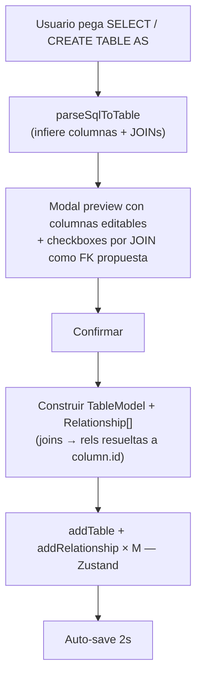

Las relaciones inferidas desde JOINs apuntan a las **tablas existentes**
del modelo (las que el SQL hace JOIN). El resolver
(`findColumnId(existingTables, leftTable, leftColumn)`) descarta joins
contra columnas que no existen.

### 1.5 Agente de IA de modelado

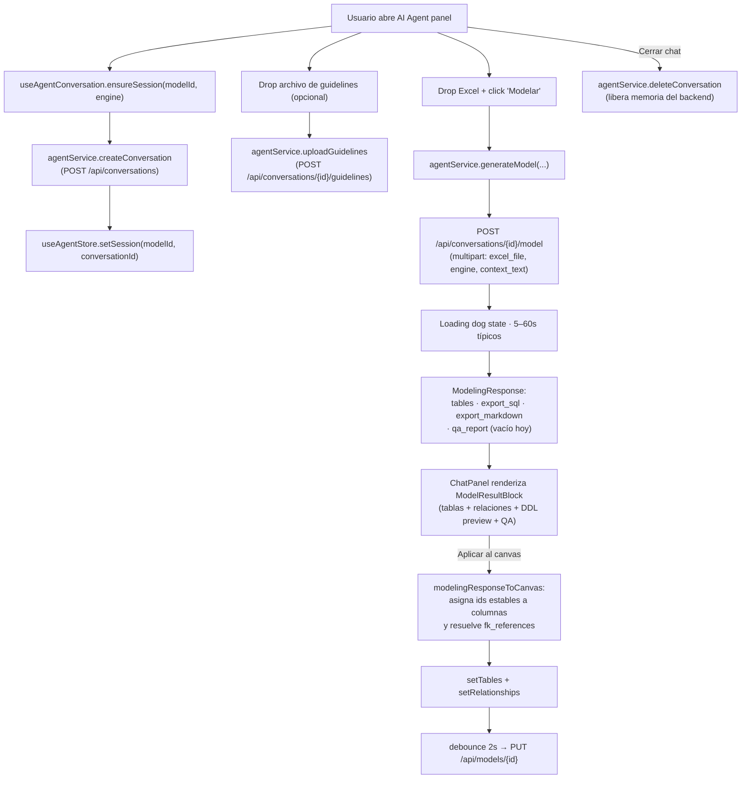

**Características**:

- **Sesión scoped por `modelId`**: cada modelo abierto mantiene un
  `conversation_id` UUID v4 estable mientras dura la pestaña del
  browser. Recargar la página crea una sesión nueva (los mensajes
  del chat son volátiles por diseño).
- **Guidelines por sesión**: el archivo subido aplica solo a esta
  conversación. El backend lo cachea en memoria por `session_id`
  (ver backend doc).
- **Engine pass-through**: el engine del modelo
  (`postgresql` / `databricks_sql` / `sqlserver` / `mysql` / `cosmosdb`)
  se envía en cada turno; el agente genera DDL para ese motor.
- **Volátil en cliente**: los mensajes del chat NO se persisten en
  Cosmos DB. Solo el modelo "aplicado al canvas" llega a la DB.

---

## 2. Ciclo de persistencia (auto-save)

```mermaid
sequenceDiagram
    participant U as User
    participant S as Zustand (useModelStore)
    participant DBC as 2s debouncer
    participant SVC as modelsService
    participant FA as FastAPI
    participant DB as Cosmos DB

    U->>S: Modifica tabla / relación / view
    S->>S: Update optimista (UI re-render inmediato)
    S->>S: saving = true; trigger debouncer
    Note over DBC: 2 segundos de inactividad
    DBC->>SVC: modelsService.update(modelId, patch)
    SVC->>FA: PUT /api/models/{id} (cookie)
    FA->>FA: get_current_user + can_edit_model
    FA->>FA: _ensure_column_ids (safety net)
    FA->>DB: replace_entities (soft-delete + bulkWrite)
    DB-->>FA: ok
    FA-->>SVC: 200 {success, data: DataModel}
    SVC-->>S: payload
    S->>S: saving = false; lastSavedAt = now
```

**Garantías**:

- **Optimismo total**: la UI nunca espera al servidor para reflejar
  cambios. Si el `PUT` falla, se muestra el error pero la UI no
  rollbackea (criterio actual: el usuario corrige y reintenta).
- **Idempotencia**: el body del PUT incluye el modelo completo. El
  backend hace soft-delete de las child entities ausentes y upsert
  de las presentes — repetir el mismo PUT no genera divergencias.
- **Permisos en cada PUT**: el backend revalida `can_edit_model`. Si
  el admin revocó el permiso mid-sesión, el siguiente PUT cae en 403
  y la UI dispara logout/refresh.

---

## 3. Sincronización del canvas (DiagramCanvasInner)

`DiagramCanvasInner` usa dos `useEffect` independientes:

### 3.1 Sync de nodos

Se ejecuta cuando cambia `tables`, `selectedTableId`, `hoveredTableId`
o `activeColsByTable`.

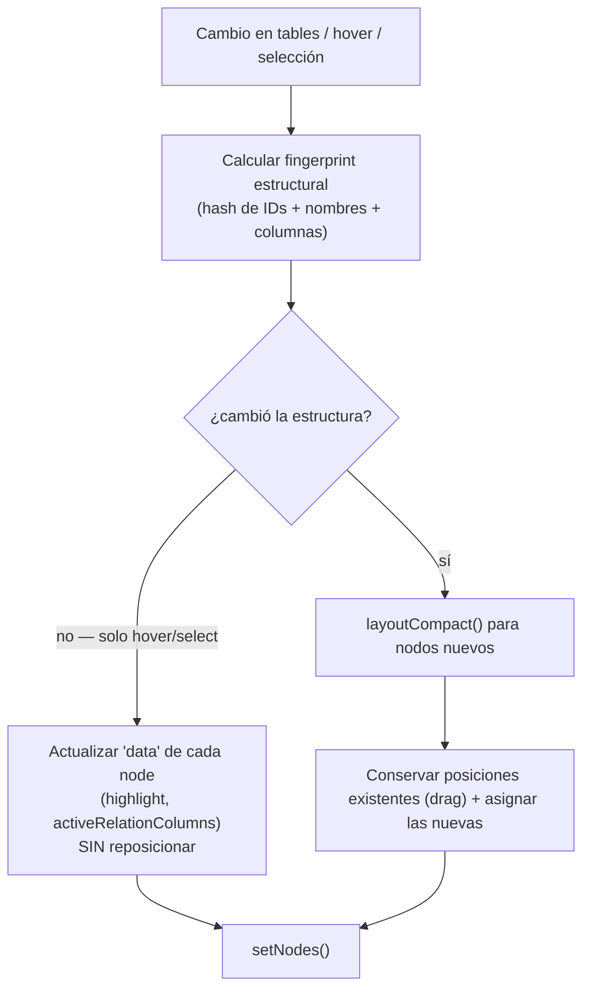

`activeColsByTable` es un `Map<tableId, Set<columnId>>` que rellena
la información de qué columnas están conectadas a `activeTableId`.
Como las relaciones almacenan `column.id`, el set también guarda ids.
`TableNode` matchea cada fila con `activeRelCols.includes(col.id)
|| activeRelCols.includes(col.name)` (el segundo término es fallback
para datos legacy pre-migration).

### 3.2 Sync de aristas

Se ejecuta cuando cambia `relationships`, `tables` o `activeTableId`.

- Reconstruye **todas** las edges desde cero (más simple que diff).
- `sourceHandle: ${rel.sourceColumn}-source`,
  `targetHandle: ${rel.targetColumn}-target`. Como `sourceColumn` /
  `targetColumn` son `column.id`, los handles del `TableNode` (ids
  también) matchean directamente.
- Asigna `highlighted` / `dimmed` según la relación con `activeTableId`.
- Asigna `edgeIndex` por par de nodos (offset escalonado para edges
  paralelos).

---

## 4. Hover & selección en el lienzo

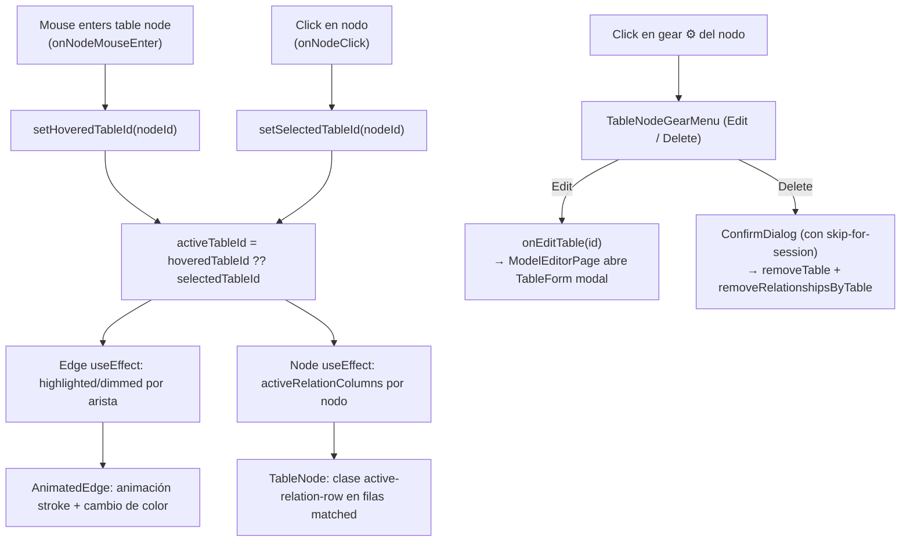

> Hacer click en el cuerpo del nodo (no en el gear) **solo selecciona**.
> El TableForm se abre exclusivamente vía gear → Edit, para evitar
> aperturas accidentales mid-arrastre.

---

## 5. Toggle de vista List ↔ Canvas

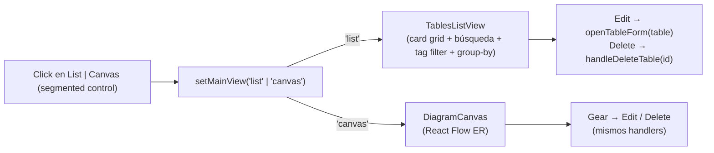

Ambos componentes leen del mismo store. Cambiar de vista nunca
refetcha datos.

---

## 6. Exportación DDL

Tres scopes — cada uno invoca el mismo modal con un dataset distinto:

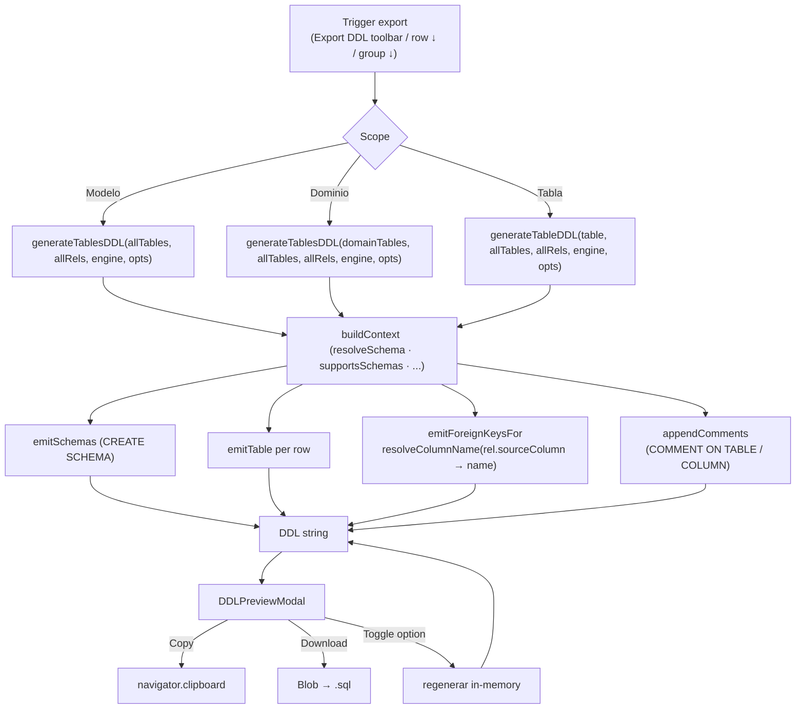

**Características clave**:

- El generador es **puro**: misma entrada → misma salida. Los toggles
  del modal disparan regeneración en memoria.
- `allTables` siempre se pasa al contexto para que las refs FK puedan
  calificarse con su schema destino, incluso si el scope expone solo
  un subset.
- Las FKs se emiten como `ALTER TABLE` al final → el script aplica
  aunque las tablas referenciadas se creen en cualquier orden.
- **Compat con datos legacy**: si una `Relationship.sourceColumn`
  todavía guarda un nombre (pre-migration), `resolveColumnName` lo
  detecta como fallback y no rompe.

---

## 7. Auto-distribución (Auto-Arrange)

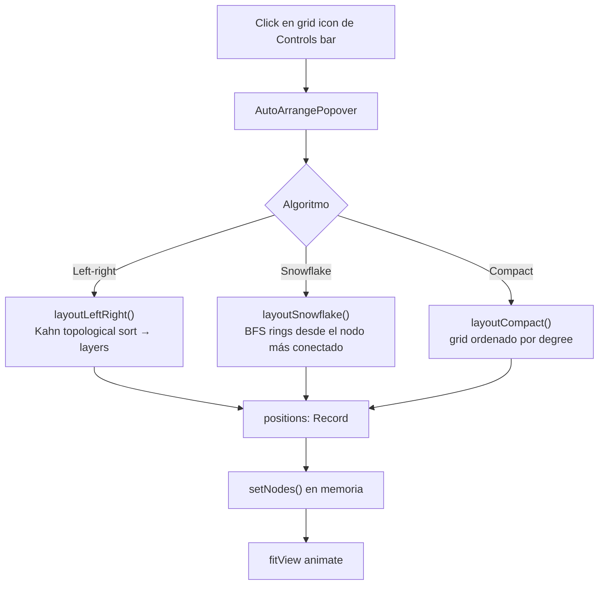

Las posiciones **no se persisten** al backend — son volátiles
mientras dura la sesión.

---

## 8. Manejo centralizado de errores

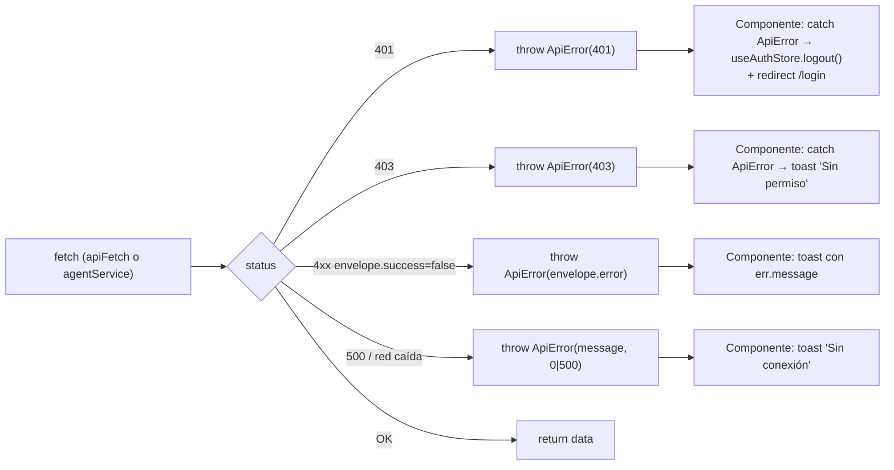

`ApiError` (en `services/http.ts`) y `AgentClientError` (en
`services/agent.service.ts`) son las dos únicas formas de error que
llegan a la UI desde la capa HTTP. Cualquier componente que haga una
llamada usa `try/catch` y decide si muestra toast / redirige / dispara
un retry. Nunca se inspecciona `json.success` a mano fuera de la capa
service.
