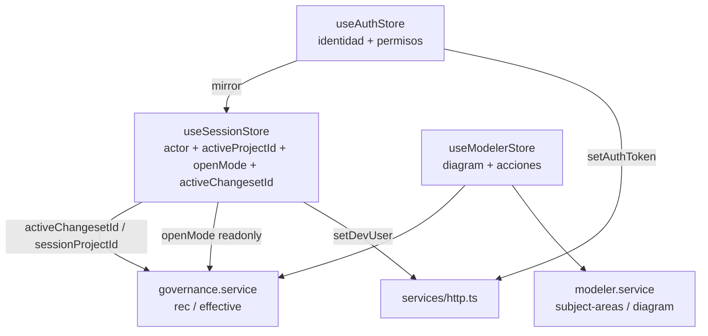
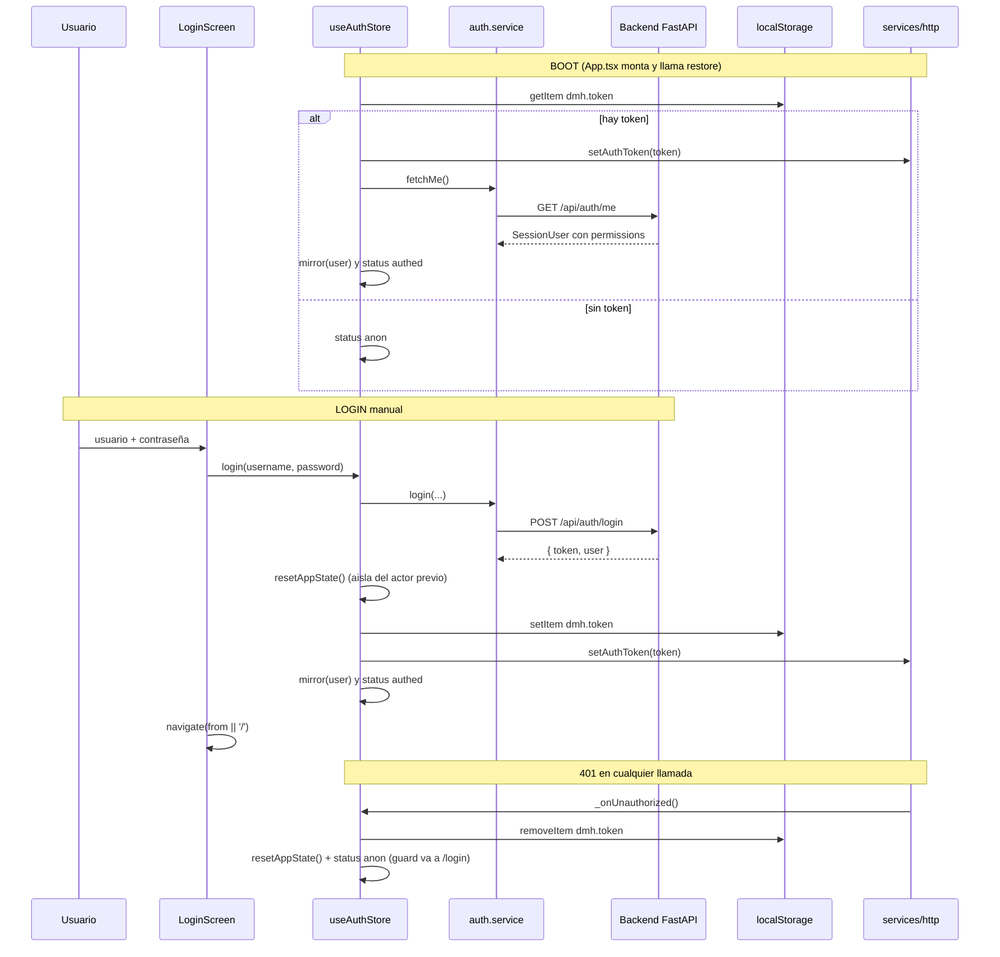
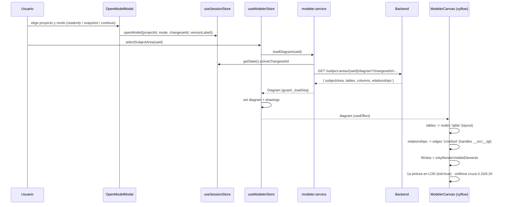
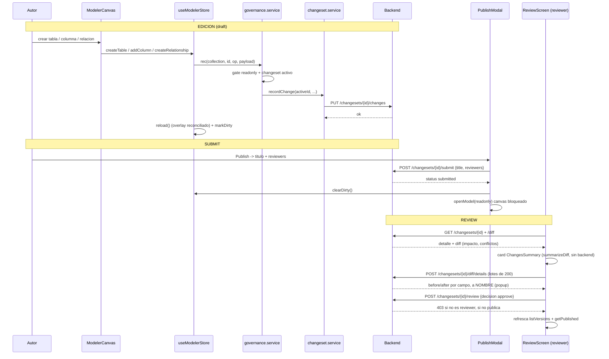
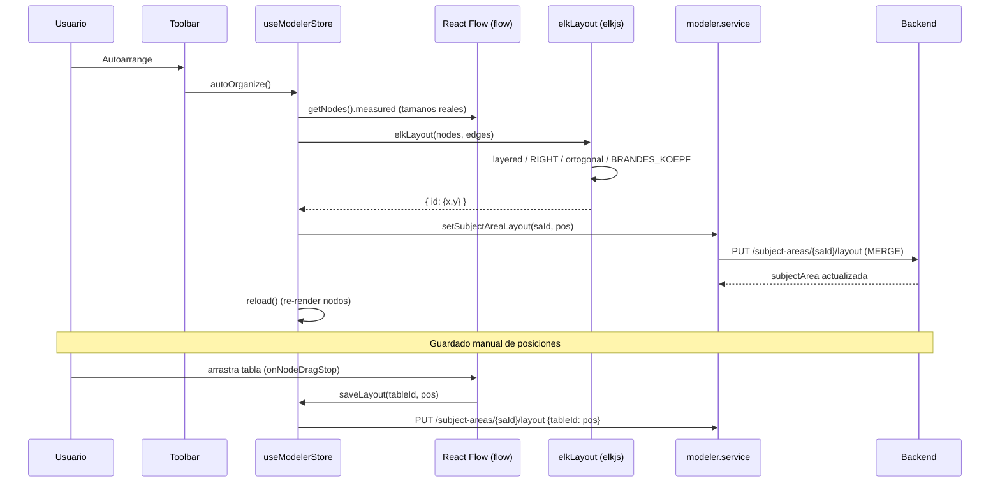
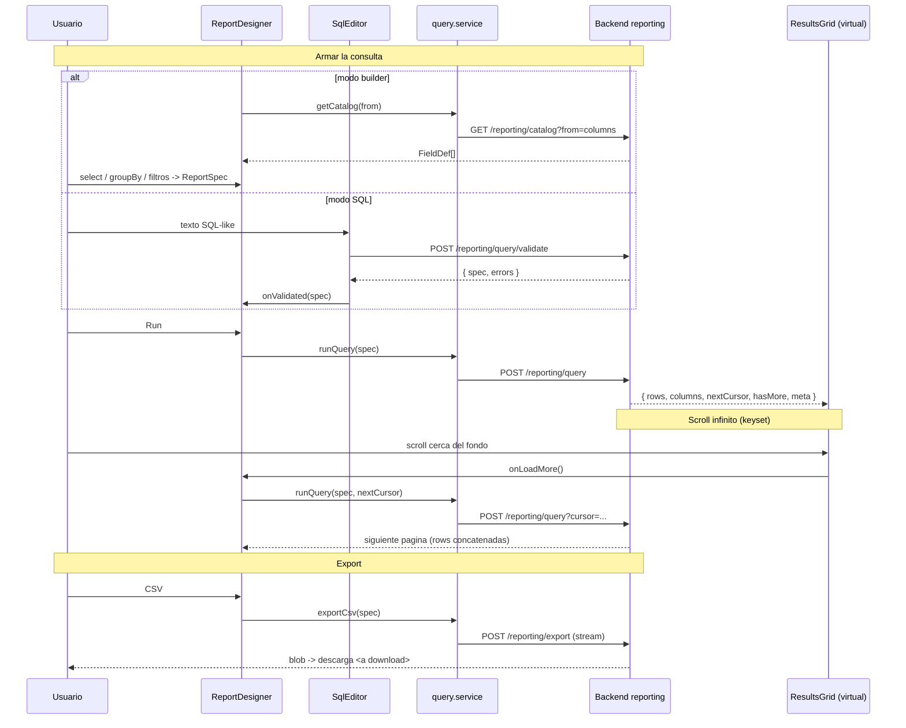
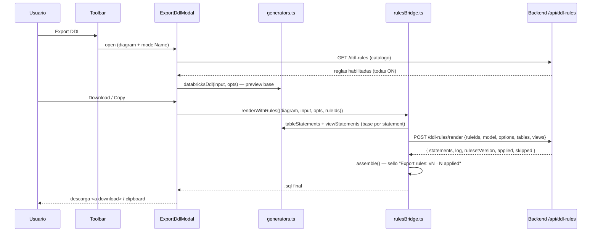
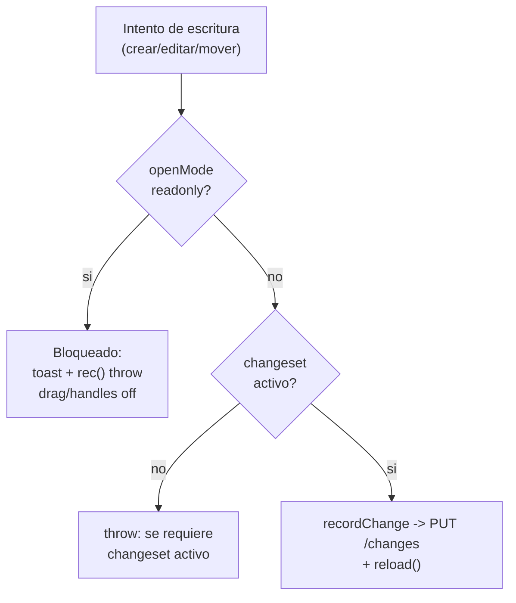

# Flujos de datos del frontend — Data Model Hub

Última actualización: 2026-09-08 (doc 75: proyectos independientes; original 2026-07-06).

Este documento describe, con base en el **código real** del frontend (Vite + React + Zustand + React Flow/xyflow), cómo circulan los datos en los seis flujos centrales de la aplicación: autenticación y arranque, apertura de un canvas, edición gobernada (changeset → review → publish), auto-organización del layout (ELK), el motor de reporting y el Export DDL con reglas. Se explican además dos patrones transversales: el **estado optimista** y el **viewer-lock (solo lectura)**.

La audiencia es de desarrolladores y stakeholders técnicos. Las rutas de archivo son absolutas para que puedan ubicarse en el repositorio.

---

## 1. Mapa de estado y capa HTTP

### 1.1 Stores de Zustand

Todo el estado del cliente vive en stores de Zustand. Cada uno tiene una responsabilidad acotada y algunos se "espejan" entre sí mediante puentes explícitos.

| Store | Archivo | Responsabilidad | Persistencia |
|---|---|---|---|
| `useAuthStore` | `src/store/useAuthStore.ts` | Identidad **autoritativa** (usuario + permisos), login/logout/restore | Token en `localStorage['dmh.token']` |
| `useSessionStore` | `src/store/useSessionStore.ts` | Actor (`X-Dev-User` en dev) + **proyecto y versión activos** (`activeProjectId`, `openMode`, `activeChangesetId`, `activeVersionLabel`; `openModel`/`closeModel`; helper `sessionProjectId()`) — la ÚNICA fuente del changeset activo (doc 75) | En memoria (+ `dmh:lastProject` en `localStorage`) |
| `useModelerStore` | `src/store/useModelerStore.ts` | Árbol del explorer del proyecto, `diagram` cargado, drawings, `dirty`, `viewMode` lógico/físico, **`lod` (default `true`) + `lodLock`** (zoom semántico del canvas), focus cross-canvas (`openCanvasAndFocus`/`pendingFocusTableId`), `projectDeletionPending`, acciones de edición | En memoria |
| `useUndoStore` | `src/store/useUndoStore.ts` | Pila de inversas (Ctrl+Z) | En memoria |
| `useBusyStore` | `src/store/useBusyStore.ts` | `runBlocking(label, fn)`: overlay bloqueante por sesión durante acciones largas (doc 75 D18) | En memoria |

Todos los lectores/escritores del modelo (`governance.service`, `structure.service`, `schemas.service`, el canvas, los paneles) leen `useSessionStore.getState().activeChangesetId` y arman las rutas de proyecto con `sessionProjectId()`; sin sesión, `rec()` lanza "An active changeset is required to edit.". (El `useChangesetStore` + puente `sessionChangesetBridge` y la identidad legacy `useIdentityStore` se retiraron en el doc 75 D14.)

El reset transversal `resetAppState()` (`src/store/resetAppState.ts`) borra en un solo punto todo el estado de trabajo ligado al usuario: la intención de apertura del canvas (`activeProjectId`/`openMode`/`activeChangesetId`), el workspace completo del modeler (selección, diagrama, árboles, drawings, instancia de React Flow), la pila de Undo, el header `X-Dev-User` y las preferencias "don't ask again" de `sessionStorage`. Se invoca en **tres** puntos: logout, 401 global y justo antes de un login nuevo (defensa contra sesiones que murieron sin logout). Sin él, el logout — que es navegación SPA, sin reload — dejaba al siguiente usuario heredando el canvas del anterior y saltándose el modal "Open model".



### 1.2 Cliente HTTP

`src/services/http.ts` centraliza `fetch`. Puntos importantes:

- Todas las respuestas usan el envelope `{ success, data?, error? }`. `apiFetch<T>()` devuelve `data` desempaquetado o arroja `ApiError`.
- El token de sesión (auth propia) viaja como **`X-Session-Token`** en toda llamada — **NO** como `Authorization: Bearer`: en Databricks Apps ese header le pertenece al proxy SSO de la plataforma (lo consume para su propia auth y el backend nunca lo recibiría). El backend acepta ambos headers; `Authorization` queda para curl/dev.
- `X-Dev-User: <id>` (actor simulado, seam local) viaja **solo en desarrollo** (`import.meta.env.DEV`): en producción la identidad es el token y el backend lo ignora — mandarlo solo servía para que el preflight CORS lo rechazara.
- `credentials: 'include'` para que la cookie de sesión viaje cross-origin (front en un puerto, FastAPI en otro, en dev).
- Timeout global de 30s vía `AbortSignal.timeout`, combinable con el `signal` del caller.
- Un 401 dispara el callback global `_onUnauthorized` que registra `useAuthStore` (limpia el token, ejecuta `resetAppState()` y cierra sesión → el guard redirige a `/login`).
- Si la respuesta no trae envelope pero sí `{detail}` (HTTPException de FastAPI), propaga ese `detail` como mensaje real del `ApiError`.

Ejemplo del shape de request/response:

```bash
curl -sS http://localhost:8000/api/projects \
  -H "X-Session-Token: <jwt>" \
  -H "X-Dev-User: mr"
# → { "success": true, "data": [ { "id": "p1", "name": "Core" } ] }
```

---

## 2. Flujo 1 — Login, token de sesión y restore al boot

### 2.1 Piezas

- `src/features/auth/LoginScreen.tsx` — dos caminos (doc 38): botón **"Continue with Databricks"** (POST `/api/auth/sso/login`, hereda la identidad del SSO; el correo debe estar asignado a un rol en Admin) y botón **"Administrator"** (solo contraseña; cuenta local `admin`). Al montar dispara `ensureBackendSession()` (warm-up, ver 2.4 — no-op con un solo origen).
- `src/features/auth/auth.service.ts` — `login`, `logout`, `fetchMe`.
- `src/store/useAuthStore.ts` — orquesta token + estado (`loading | anon | authed`).
- `src/store/resetAppState.ts` — aislamiento por sesión: se ejecuta en login/logout/401.
- `src/services/warmup.ts` — `ensureBackendSession()`: probe `GET /api/health`; **inerte con `API_BASE` vacío** (producción actual).
- `src/features/auth/guards.tsx` — `RequireAuth` (splash mientras `loading`, redirige a `/login` si `anon`) y `RequirePermission`.
- `src/App.tsx` — dispara `restore()` una sola vez al montar.

### 2.2 Endpoints

| Acción | Método | Ruta | Body / Respuesta |
|---|---|---|---|
| Login | POST | `/api/auth/login` | `{username, password}` → `{token, user}` |
| Restore | GET | `/api/auth/me` | → `SessionUser` (con `permissions`) |
| Logout | POST | `/api/auth/logout` | → `{ok}` |

`SessionUser` incluye `permissions: Record<string, boolean>` con la matriz (`model.view`, `model.edit`, `review.decide`, `publish`, `rollback`, `export`, `standards.edit`, `admin.manage`). `useAuthStore.has(perm)` lee de ahí.

### 2.3 Restore al arranque (boot)

`App.tsx` corre `useEffect(() => { void restore(); }, [restore])`. `restore()`:

1. Lee `localStorage['dmh.token']`. Si no hay → `status: 'anon'`.
2. Si hay, lo empuja al cliente HTTP (`setAuthToken`) y llama `fetchMe()`.
3. Si `/me` no devuelve `permissions` (degradó a Principal básico), lo considera sesión inválida: limpia token y queda `anon`.
4. Si es válida, `mirror(user)` espeja el actor a `useSessionStore` (id = username → header `X-Dev-User`) y deja `status: 'authed'`.

Mientras `status === 'loading'`, `RequireAuth` muestra el `<Splash/>` para evitar el parpadeo login→app.

En el login manual, `login()` ejecuta `resetAppState()` **antes** de sentar el token nuevo: si la sesión anterior murió sin logout (token expirado, tab reusada), el actor entrante arranca sin estado heredado. El logout y el 401 global hacen el mismo reset.

### 2.4 Producción: un solo origen vía `server.mjs` (doc 36)

En Databricks Apps cada app (`frnt-…` y `bknd-…`) vive detrás de su **propio** muro SSO por subdominio (`databricksapps.com` está en la Public Suffix List → la cookie de sesión es por app). Un `fetch()` del front al backend no puede completar ese SSO cruzado (el redirect a Microsoft es imposible dentro de XHR): el proxy del backend respondía su propio 401 vacío y el login fallaba con "Failed to fetch". La solución definitiva (2026-07-31) es que **el navegador hable SOLO con el origen del front**:

- `server.mjs` (raíz del repo, cero dependencias — solo módulos `node:*`) reemplaza a `vite preview` en producción: sirve el build `dist/` con fallback SPA y **proxya `/api/*` al backend** (`BACKEND_API_URL`, variable de runtime del bundle).
- El proxy adjunta un token **OAuth M2M del service principal del front** (`POST {DATABRICKS_HOST}/oidc/v1/token`, grant `client_credentials`, scope `all-apis`), cacheado hasta expiry menos 5 minutos con un solo mint concurrente (`TokenCache`), y reintenta UNA vez con token fresco ante 401/403 solo en GET/HEAD.
- El header `Authorization` entrante del cliente **se descarta** (el Bearer lo pone siempre el server); el JWT propio de la plataforma viaja intacto en `X-Session-Token`. Streaming puro (pipe) en ambos sentidos.
- `VITE_API_URL` ya NO se define en Apps → `API_BASE` queda vacío → todas las llamadas usan rutas **relativas** `/api/...` (mismo origen). En dev local, `vite dev` proxya `/api` → `:8000` con el mismo efecto.

El **warm-up** (`src/services/warmup.ts`, opción A del doc 36) queda **inerte** en producción: con `API_BASE` vacío el probe es no-op. Solo actúa en local apuntando a un backend remoto (probe a `/api/health`; si el fetch ni siquiera obtiene respuesta legible, navega top-level a `GET /api/auth/warmup/{next-b64url}` una sola vez, con guard en `sessionStorage`). El enfoque por redirect fracasó como solución de producción: el proxy de Databricks no inicia el SSO en navegaciones lanzadas por script desde otro sitio.

### 2.5 Diagrama



---

## 3. Flujo 2 — Abrir un canvas: getDiagram, nodos xyflow y edges crowfoot

### 3.1 Elección de versión (Open model)

El canvas nunca se abre "en producción" implícitamente. Al entrar a `/model` sin `openMode`, `WorkspaceScreen` fuerza el `OpenModelModal` (`src/components/OpenModelModal.tsx`), que ofrece tres modos:

| Opción | Acción | Efecto en sesión |
|---|---|---|
| View production (read-only) | — | `openModel({projectId, mode:'readonly', versionLabel})` |
| Create new version from production | `POST /api/changesets/snapshot` (`{ projectId }`, bajo `runBlocking('Creating working copy…')`) | `openModel({projectId, mode:'editing', changesetId, versionLabel})` |
| Continue a working version | elige un draft propio del proyecto | `openModel({projectId, mode:'editing', changesetId})` |

El Open model es de **dos pasos** (doc 75 D8): primero el proyecto (`ProjectPicker`, con «New project…»), después la versión/modo de ESE proyecto. `openModel()` en `useSessionStore` fija `activeProjectId`, `openMode`, `activeChangesetId` y `activeVersionLabel`; los servicios leen de ahí.

### 3.2 Carga del diagrama

Al seleccionar un canvas en el `ModelExplorer`, `useModelerStore.selectSubjectArea(saId, projectId?)` llama a `modeler.service.loadDiagram(saId)`:

```ts
// src/features/modeler/services/modeler.service.ts
export async function loadDiagram(saId: string): Promise<Diagram> {
  const cs = useSessionStore.getState().activeChangesetId;
  const qs = cs ? `?changesetId=${encodeURIComponent(cs)}` : '';
  return apiGet<Diagram>(`${API_BASE}/api/subject-areas/${encodeURIComponent(saId)}/diagram${qs}`);
}
```

Es **una sola request**: el diagrama COMPLETO llega en una única respuesta de `GET /api/subject-areas/{sa_id}/diagram` — el backend lo arma con queries batched (`$in`) y aplica el overlay del changeset server-side. El `Diagram` trae `{ subjectArea, tables, columns, relationships }`.

`selectSubjectArea` protege contra respuestas fuera de orden con un contador de secuencia `_loadSeq` (dos clicks rápidos en el explorer descartan la respuesta vieja), y hace flush inmediato de los drawings pendientes del canvas anterior antes de cambiar.

```bash
curl -sS "http://localhost:8000/api/subject-areas/sa-42/diagram?changesetId=cs-7" \
  -H "Authorization: Bearer <jwt>" -H "X-Dev-User: mr"
# → { "success": true, "data": {
#     "subjectArea": { "id":"sa-42","tableIds":["t1","t2"],
#                      "layout":{"t1":{"x":60,"y":60}}, "drawings":[] },
#     "tables":[ {"id":"t1","physicalName":"dim_cliente","logicalName":"Cliente"} ],
#     "columns":[ {"id":"c1","tableId":"t1","physicalName":"id_cliente","isPrimaryKey":true,"ordinal":0} ],
#     "relationships":[ {"id":"r1","sourceTableId":"t1","targetTableId":"t2","sourceColumnId":"c1","targetColumnId":"c9","sourceCardinality":"one","targetCardinality":"many","identifying":false} ]
# } }
```

### 3.3 Del Diagram a nodos y edges

`ModelerCanvas.tsx` sincroniza `store.diagram` → estado interno de React Flow con un `useEffect`:

- **Nodos tabla** (`type: 'table'`): posición desde `subjectArea.layout[t.id]`, con fallback a una grilla (`60 + (i%4)*260`). `data = { table, columns }`.
- **Nodos shape** (`type: 'shape'`, `zIndex: -1`): la capa DRAWING, se pinta detrás de las tablas.
- **Edges** (`type: 'crowfoot'`): cada relación mapea a un edge con `sourceHandle = ${sourceColumnId}__src` y `targetHandle = ${targetColumnId}__tgt`. `data` lleva las cardinalidades e `identifying`.

Los handles conectables viven por columna en `TableNode.tsx` (`Handle type="source" id="${c.id}__src"` a la derecha, `target ... __tgt` a la izquierda).

### 3.4 Render crowfoot

`CrowFootEdge.tsx` calcula el path con `getSmoothStepPath` (ruteo ortogonal, esquinas redondeadas — sin matemática manual). Decide de qué lado sale/entra el wire comparando los centros absolutos de ambos nodos (`sourceFacesRight`), de modo que la relación se "voltea" sola al mover las tablas. Los marcadores crow's-foot se resuelven por cardinalidad (`markerStart={url(#cf-${sourceCardinality})}`, `markerEnd={url(#cf-${targetCardinality})}`, definidos en `CrowFootMarkers.tsx`).

Optimizaciones de escala: `onlyRenderVisibleElements` (solo montan DOM los nodos visibles), `TableNode` y `CrowFootEdge` memoizados, y selectores **booleanos derivados** por nodo/edge para el hover (evita re-renderizar los 100 nodos al cambiar un id).

### 3.5 Primera pintura en LOD y zoom semántico (doc 33)

`onlyRenderVisibleElements` no ayuda en el fit view: a zoom bajo TODOS los nodos son "visibles" y la virtualización no poda nada. En un canvas gigante (Analytics: 392 nodos, ~99 mil filas de columna/source) eso significaba 400–500 mil elementos DOM y un canvas trabado — con cada fila midiendo menos de 1 píxel. La respuesta es el **LOD (level of detail)**, solo frontend:

- **La primera pintura sale en modo LOD**: `lod` en `useModelerStore` tiene default `true`, así que un canvas grande ya abre compacto (~2 mil elementos DOM). `onInit` evalúa el LOD de inmediato y otra vez tras el fitView inicial (doble `requestAnimationFrame`), lo que corrige los canvases chicos a detalle completo.
- **Umbral con histéresis en `onMove`**: `LOD_ENTER = 0.10` / `LOD_EXIT = 0.20` (constantes en `src/features/modeler/lib/lodSize.ts`, calibradas por el owner el 2026-07-25 sobre el canvas Analytics). `nextLod(current, zoom)` entra a compacto recién bajo 0.10 y vuelve a detalle recién sobre 0.20 — la banda muerta evita el parpadeo en el borde. `setLod` solo escribe al **cruzar** el umbral (cero renders en el pan normal) y el cruce parchea únicamente `data.lod` de los nodos.
- **Misma caja, sin filas**: el nodo compacto replica las métricas del detallado (`lodSize.ts`: ancho = clamp(chars·8 + 72, 240, 880), alto = 32 + filas·28 — las MISMAS fórmulas que `scripts/arrange_all.py` del backend, el layout no salta), con header `schema.nombre`, franja PK proporcional en tablas y hatch en vistas.
- **Edges intactos**: el nodo compacto deja **handles fantasma** con los mismos ids que las filas del modo detallado (`<colId>__src`/`<colId>__tgt` del par de referencia + `__hdr_src`/`__hdr_tgt`), así los edges nunca se re-arman ni pierden ancla — cruce de umbral atómico, sin frames sin wires.
- **`lodLock`**: congela el detalle completo durante el export SVG (ver flujo 6 — la imagen exportada nunca sale compacta).

### 3.6 Diagrama



---

## 4. Flujo 3 — Editar en el canvas: changeset, submit, review, approve, publish

### 4.1 El choke-point de escritura

Toda mutación del modelo pasa por `governance.service.rec()` (`src/services/governance.service.ts`):

```ts
const rec = (collection, id, op, payload?) => {
  if (useSessionStore.getState().openMode === 'readonly')
    throw new Error('The model is open read-only: it does not accept changes.');
  const a = useSessionStore.getState().activeChangesetId;   // única fuente del changeset activo
  if (!a) throw new Error('An active changeset is required to edit.');
  return csvc.recordChange(a, collection, id, op, payload);
};
```

El `projectId` de cada payload NO lo pone el front: el backend lo estampa con el del changeset (doc 75 I1) y rechaza con 409 cualquier referencia a una entidad de otro proyecto (I2).

`recordChange` (`changeset.service.ts`) hace `PUT /api/changesets/{id}/changes` con `{collection, entityId, op, payload}`. Cada cambio se persiste como un documento en la colección `changeset_changes` del backend (un doc por cambio). Las **lecturas** con changeset activo van por `effective` → `GET /api/changesets/{id}/effective/{collection}?tableId=&ids=&q=&limit=` (slices server-side, nunca baja la colección completa).

Ejemplos de operaciones (todas terminan en un `reload()` que reconcilia con el overlay):

- `createTable` → `gov.createTable` (upsert en `canonical_tables`) + `setSubjectAreaTables` para referenciarla.
- `addColumn` → `physicalize` (lógico→físico) + `createColumn`.
- `createRelationship` → `gov.createRelationship` + `markForeignKey` sobre la columna hija.
- `updateColumn` / `reorderColumns` / `deleteColumn` → upsert/delete por id.

Cada acción llama `markDirty()` en `useModelerStore`, que alimenta el guard de salida (aviso "cambios sin guardar").

```bash
curl -sS -X PUT http://localhost:8000/api/changesets/cs-7/changes \
  -H "Authorization: Bearer <jwt>" -H "X-Dev-User: mr" \
  -H "Content-Type: application/json" \
  -d '{"collection":"canonical_tables","entityId":"t99","op":"upsert",
       "payload":{"id":"t99","logicalName":"Transaccion","physicalName":"fct_transaccion"}}'
```

### 4.2 Submit (Publish request)

El botón **Publish** del `Toolbar` abre `PublishModal.tsx`. El usuario pone título, descripción y elige al menos un reviewer, y envía con `versioning.service.submit(changesetId, {title, description, reviewers})` → `POST /api/changesets/{id}/submit`. El changeset pasa de `draft` a `submitted`.

Tras el submit, la modal hace dos cosas importantes: limpia `dirty` (checkpoint) y, como la working copy ya salió de `draft` (el backend rechazaría más ediciones con 409), transiciona la sesión a **solo lectura** sobre producción con `openModel({mode:'readonly', versionLabel: pub?.versionLabel})`.

### 4.3 Review y decisión

`ReviewScreen.tsx` (`src/screens/ReviewScreen.tsx`) es una bandeja global con chip y filtro de proyecto (doc 75 D20). Lista requests (`listVersions` filtrados por `submitted/approved/rejected`), y al seleccionar uno carga detalle + diff (`getChangeset`, `getDiff`). El diff trae impacto (tablas/columnas tocadas), entidades added/edited/deleted por colección y marca **conflictos** (`entity.conflict`: modificado en producción después de que esta versión lo editó).

La presentación de los cambios es la del doc 31 (2026-07-24):

- **Card `ChangesSummary`** (`src/screens/review/ChangesSummary.tsx`): chips de proyectos y modelos afectados + matriz de conteos Created/Modified/Deleted (verde/ámbar/rojo) por tipo de entidad — Tables, Columns, Views, Relationships, Schemas, Canvases, Folders, Projects; solo filas con conteo > 0. Todo **derivado del `GET /diff` ya cargado** vía `summarizeDiff()` (`versioning.service.ts`, puro): cero backend nuevo para el resumen. El CTA "Open change details" abre el popup.
- **Popup `ChangesDetailModal`** (`src/screens/review/ChangesDetailModal.tsx`): master-detail con árbol jerárquico tintado por verbo (incluida la sección **Relationships**, que en el árbol inline anterior no se pintaba) + secciones Structure / Not on any canvas. Al seleccionar entidades pide `getDiffDetails()` → **`POST /api/changesets/{cs_id}/diff/details`** con `{items: [{collection, entityId}]}` en **lotes de ≤200 ítems** (`BATCH = 200`; el modal trocea y cachea por entidad — una tabla trae en un request la tabla + sus columnas cambiadas). La respuesta es el diff de campos **ANTES→DESPUÉS** con los ids resueltos a **nombre**: `udpValues` → una fila por UDP con su nombre, `parentDomainId` → nombre del Parent Domain, `pairs` de relaciones → `PADRE.col → HIJO.col`, `tableIds` de canvases → "+N added · −N removed tables". `before` = doc publicado (o el estampado si el changeset ya fue aplicado); campos de ruido (`id`, timestamps, `layout`…) excluidos.

La decisión va por `review(id, {decision})` → `POST /api/changesets/{id}/review`. Ante un **403** se propaga el `detail` del backend, que distingue "sin permiso `review.decide`" de "no asignado como reviewer". Botones deshabilitados si:

- `canAct = status === 'submitted' && isReviewer && !alreadyVoted`.
- `canWithdraw` (owner, submitted) → `withdraw` vuelve a `draft`.
- `canReopen` (owner, rejected) → `reopen` vuelve a `draft` (el reject nunca elimina la versión).

**Approve = publish**: aprobar publica y sobrescribe producción ("last to publish wins", como advierte el snapshot). Un `getChangeset`/`getPublished` refrescan las listas tras la decisión.

### 4.4 Rollback de versiones

El rollback vive en el Home (`src/screens/HomeScreen.tsx`), gated por el permiso propio **`rollback`** (`useAuthStore.has('rollback')`). Apunta a **cualquier versión publicada pasada**: `rollbackVersion(id)` → `POST /api/changesets/{id}/rollback` y el backend crea un **draft con los cambios inversos** (restaura las imágenes previas capturadas en el publish, deshaciendo las versiones posteriores a la elegida). Producción **no cambia** en ese momento: el draft entra al mismo circuito submit → review → approve de cualquier otra versión — el rollback es gobernado, no un botón destructivo.

### 4.5 Defensa en profundidad

`WorkspaceScreen` re-valida una sesión `editing`: si el changeset dejó de estar en `draft` (enviado desde otra pestaña, decidido por un reviewer) o el actor ya no es el owner, degrada a `readonly` en vez de dejar un canvas que responde 409/403 en cada edición.

### 4.6 Diagrama



---

## 5. Flujo 4 — Auto-arrange (ELK) y guardado de layout

### 5.1 Auto-organizar

El botón **Autoarrange** del `Toolbar` llama `useModelerStore.autoOrganize()`:

1. Importa perezosamente `elkLayout` (`src/features/modeler/lib/elkLayout.ts`).
2. Toma los tamaños **medidos** de los nodos vivos (`flow.getNodes().measured`) — clave porque las tablas altas (30 columnas ≈ 700px) se superponían con tamaño fijo. Fallback si no hay medida: 240×160.
3. Construye nodos `{id, measured}` desde `diagram.tables` y edges `{source, target}` desde `diagram.relationships`.
4. `elkLayout(nodes, edges)` corre el algoritmo **`layered`** (Sugiyama) de ELK y devuelve un `Record<id, {x, y}>`. Opciones exactas del código:

   ```ts
   // src/features/modeler/lib/elkLayout.ts — new ELK() de 'elkjs/lib/elk.bundled.js'
   'elk.algorithm': 'layered',
   'elk.direction': 'RIGHT',
   'elk.edgeRouting': 'ORTHOGONAL',
   'elk.separateConnectedComponents': 'true',
   'elk.spacing.componentComponent': '64',
   'elk.layered.spacing.nodeNodeBetweenLayers': '140',
   'elk.spacing.nodeNode': '72',
   'elk.spacing.edgeNode': '28',
   'elk.spacing.edgeEdge': '16',
   'elk.layered.spacing.edgeNodeBetweenLayers': '28',
   'elk.layered.nodePlacement.strategy': 'BRANDES_KOEPF',
   'elk.layered.nodePlacement.favorStraightEdges': 'true',
   'elk.layered.crossingMinimization.strategy': 'LAYER_SWEEP',
   'elk.layered.thoroughness': '10',
   ```

5. Persiste con `setSubjectAreaLayout(saId, pos)` (que **mergea** en backend) y hace `reload()`.

ELK no rutea los wires: solo asigna posiciones de nodos. El ruteo visual sigue siendo de React Flow (`getSmoothStepPath`).

**Paridad con el backend**: `scripts/arrange_all.py` (repo backend) re-organiza TODOS los canvases — o los de un proyecto con `--project` — con el **mismo motor**: invoca elkjs por subprocess de node (`arrange_all.cjs`) con la misma config que el botón "Autoarrange", e incluye tablas y nodos de vista. Como no hay DOM que medir, calcula los tamaños con las mismas fórmulas de `.wk-node`/`.wk-vnode` que replica `lodSize.ts` (ver 3.5): un canvas ordenado por el script y uno ordenado por el botón quedan iguales.

### 5.2 Guardar layout

Hay tres caminos de persistencia de posición, todos hacia `PUT /api/subject-areas/{saId}/layout` (merge server-side):

| Disparador | Método del store | Alcance |
|---|---|---|
| Soltar un nodo tabla | `saveLayout(tableId, pos)` | Un solo nodo |
| Botón Save / "Guardar y salir" | `saveAllLayout()` → dentro de `saveAll()` | Todos los nodos `type==='table'` |
| Auto-arrange | `setSubjectAreaLayout(saId, pos)` | El mapa que devolvió ELK |

`saveAllLayout` filtra explícitamente **solo** nodos tabla: las posiciones de los shapes viven en `drawings` (persistidos aparte, debounced 500ms, vía `PUT .../drawings`). `saveAll` captura `saId` y `drawings` **antes** del await para no escribir dibujos del canvas nuevo bajo el `saId` viejo si el usuario cambia de canvas a mitad del guardado.

En `readonly`, `onNodeDragStop` retorna temprano: no se persiste ningún movimiento (ver viewer-lock).

### 5.3 Diagrama



---

## 6. Flujo 5 — Reporting: ReportSpec, /query, grilla virtualizada y export CSV

### 6.1 El IR compartido: ReportSpec

`src/features/reporting/query.service.ts` define `ReportSpec`, el mismo IR que el backend. Lo producen **dos** entradas y lo consumen la grilla, las queries guardadas y el export:

```ts
interface ReportSpec {
  from: 'columns' | 'tables' | 'relationships' | 'views';
  select: string[];
  where?: WhereGroup | null;      // and/or/not anidables con Condition[]
  groupBy: string[];
  aggregations: Aggregation[];    // count/sum/avg/min/max...
  orderBy: OrderBy[];
  limit: number;
}
```

`ReportDesigner.tsx` maneja dos modos:

- **Builder**: `getCatalog(from)` (`GET /api/reporting/catalog?from=`) trae los `FieldDef[]` (label, tipo, ops, `groupable`, `indexed`, `udp`). El usuario marca columnas (`select`), agrupa (`groupBy` → agrega `count`) y arma filtros con `FilterBuilder`.
- **SQL**: `SqlEditor` manda el texto a `validateSql(text)` (`POST /api/reporting/query/validate`). El **servidor es la autoridad de la gramática**: valida con sqlglot y devuelve `{spec, errors}`. Si es válido, el spec se vuelca al builder y se cambia de modo. Soporta UDP dinámico con la sintaxis `udp."Nombre"`; sin JOIN ni subqueries.

### 6.2 Ejecución y paginación keyset

`runQuery(spec, cursor?)` → `POST /api/reporting/query?cursor=`. La respuesta es `QueryResult`:

```ts
interface QueryResult {
  rows: Record<string, unknown>[];
  columns: ResultColumn[];        // dinámicas, incluyen UDP
  nextCursor: string | null;      // keyset
  hasMore: boolean;
  meta: { grouped: boolean; warnings: string[]; scan?: 'index' | ... };
}
```

La paginación es **keyset** (cursor opaco), no offset: a 400k filas nunca se traen todas al browser. `loadMore()` reusa `spec`/`sqlText` con `result.nextCursor` y **concatena** las filas nuevas a las existentes (`rows: [...prev.rows, ...res.rows]`).

```bash
curl -sS -X POST "http://localhost:8000/api/reporting/query" \
  -H "X-Session-Token: <jwt>" -H "Content-Type: application/json" \
  -d '{"from":"columns","select":["physicalName","dataType"],
       "where":{"op":"and","conditions":[{"field":"schema","op":"eq","value":"core"}]},
       "groupBy":[],"aggregations":[],"orderBy":[{"field":"physicalName","dir":"asc"}],"limit":100}'
# → { "success": true, "data": {
#     "rows":[...], "columns":[{"key":"physicalName","label":"Physical","type":"string"}],
#     "nextCursor":"eyJwaHlzaWNhbE5hbWUiOiJhX2NvbCJ9", "hasMore":true,
#     "meta":{"grouped":false,"warnings":[],"scan":"index"} } }
```

### 6.3 Grilla virtualizada + scroll infinito

`ResultsGrid.tsx` usa `@tanstack/react-virtual` (`useVirtualizer`) para montar solo las filas visibles (altura estimada 34px, `overscan: 12`). El `onScroll` dispara `onLoadMore()` cuando `hasMore`, no está `loading` y falta menos de 400px para el fondo:

```ts
if (result?.hasMore && !loading &&
    el.scrollHeight - el.scrollTop - el.clientHeight < 400) onLoadMore();
```

El header permite ordenar **server-side** solo por campos indexados y no-UDP y no-agrupados (`sortable = !c.udp && !result.meta?.grouped`); al hacer click, se re-arma `orderBy` en el spec y un `useEffect` re-ejecuta la query. La celda muestra `meta.scan` (index vs collscan) como señal de rendimiento.

### 6.4 Export CSV por streaming

`exportCsv(spec)` hace `POST /api/reporting/export` con `fetch` directo (no `apiFetch`, porque el stream no bufferea el envelope JSON). Lee el token de `localStorage['dmh.token']` y lo manda como `X-Session-Token` (mismo contrato que `http.ts` — nunca `Authorization`), recibe el `blob` y fuerza la descarga con un `<a download>` sintético. Así se exportan datasets grandes sin materializarlos en memoria de JS como filas.

### 6.5 Diagrama



---

## 7. Flujo 6 — Export DDL con reglas: generators, /render y el sello de versión

El Export DDL genera el `.sql` en el **cliente** y, si hay DDL Export Rules seleccionadas (doc 30), lo pasa por el motor de reglas del backend antes de entregarlo. Es una exportación de **texto**, independiente del export de **imagen** SVG del canvas (ver 7.4).

### 7.1 Secuencia

1. El botón **Export DDL** del `Toolbar` abre `ExportDdlModal` (`src/features/ddl/components/ExportDdlModal.tsx`), que carga las vistas de las tablas del canvas y el catálogo de reglas con `fetchExportRules()` → `GET /api/ddl-rules`. `selectableRules()` deja las habilitadas y no-inválidas (las `stale` corren igual — solo avisan); por default quedan **todas marcadas**.
2. El DDL **base** se genera client-side en `src/features/ddl/generators.ts`: `databricksDdl(input, opts)` para el preview y `tableStatements`/`viewStatements` (statement por statement) para el puente de reglas. Opciones del modal con defaults Views/Comments/Partitions ON, PK&FK/Indexes OFF, `tableFormat: 'delta'`, y (doc 76 D9, la macro BCP) `identifierCase: 'lower'`, `external: true` con `location` = `abfss://<container_name>@<storage_account_name>.dfs.core.windows.net/<path>` y `locationFolderCase: 'upper'` (carpeta del LOCATION en MAYÚSCULA). Las proyecciones de las vistas salen `col AS alias` con el casing del export; con la regla de layout, las particiones se ordenan por el correlativo PART_nn del UDP que declara (`withPartitionOrder`).
3. Con reglas seleccionadas, Download/Copy llaman `buildFinalSql()` → `renderWithRules()` (`src/features/ddl/rulesBridge.ts`): arma el payload con el estado **efectivo** que el canvas exporta (drafts incluidos) — cada tabla con sus columnas y `udpValues` más su CREATE base (`baseSql`), cada vista con su SQL y el flag `businessView` (= `showOnCanvas`: solo esas se decoran como vista de negocio) — y hace `POST /api/ddl-rules/render` (permiso `export`). El motor del backend es **puro**: no lee BD en el render, todo el contexto viaja en el body.
4. `assemble()` ensambla el `.sql` final: header con el **sello** `-- Export rules: vN · N applied · M skipped` (la evidencia de por qué el DDL de marzo salió distinto al de junio) + los statements en el orden del motor (por tabla: [sentencias `before`] física → tags de tabla → tags de columna → sentencias `after` → generados, cada uno con sus propios anexos; luego vistas de negocio con sus `ALTER VIEW … SET TAGS`), con los anexos `.tags`/`.extra` consecutivos compactos.
5. **Sin reglas seleccionadas el export no pasa por el puente**: sale byte-idéntico al flujo previo a las reglas (cero regresión). El botón "Apply N rules" del preview usa el mismo motor bajo demanda — nunca en vivo — y produce el mismo texto que el download; cualquier cambio de opciones o selección lo invalida.

Payload real del puente (condensado del código de `rulesBridge.ts`):

```jsonc
// POST /api/ddl-rules/render
{
  "ruleIds": ["<uuid-regla-1>", "<uuid-regla-2>"],
  "model": { "name": "Analytics", "udpValues": {} },
  "options": { "identifierCase": "lower", "tableFormat": "delta", "external": true,
               "location": "abfss://<container_name>@<storage_account_name>.dfs.core.windows.net/<path>",
               "locationFolderCase": "upper", "includePartitions": true, "partitionsLast": true },
  "tables": [{
    "table": { "id": "t1", "physicalName": "MD_CLIENTE", "schema": "bcp_ddv",
               "description": null, "udpValues": { "<udpId>": "CUSTOM_30 days" } },
    "columns": [{ "physicalName": "CODCLAVECLI", "dataType": "STRING", "ordinal": 0,
                  "isNullable": false, "isPrimaryKey": true, "isPartition": false,
                  "parentDomainId": null, "description": null,
                  "udpValues": { "<udpId>": "DAC-013" } }],
    "baseSql": "CREATE TABLE bcp_ddv.MD_CLIENTE (...)"
  }],
  "views": [{ "name": "MD_CLIENTE_VU", "schema": "bcp_ddv", "sql": "CREATE VIEW ...",
              "sourceTableIds": ["t1"], "businessView": true }]
}
// → { "statements": [{ "artifact": "ddl.tabla_fisica", "schema": "bcp_ddv",
//                      "name": "MD_CLIENTE", "sql": "CREATE TABLE ..." }, ...],
//     "log": [{ "rule": "tblproperties_vacuum", "status": "applied" }, ...],
//     "rulesetVersion": "v2", "applied": 5, "skipped": 1 }
```

`isPartition` viaja a propósito: sin él, los artefactos generados (p. ej. la tabla `_rej`) no heredarían el `PARTITIONED BY` de la física — salen **espejo** del CREATE físico (mismo casing, `USING`, particiones y `LOCATION` con el sufijo del artefacto).

### 7.2 Autoría de las reglas

Las reglas se autoran y versionan en **Data Standards → DDL Export rules** (`src/features/standards/`, servicio `ddlRules.service.ts`): lectura por `GET /api/ddl-rules(/config|/templates|/artifacts)`, checks por `POST /api/ddl-rules/validate|/test|/impact`, y toda mutación vía `POST /api/standards/apply` (stream único `standards_versions` — el router de reglas es read-only). El editor hace round-trip YAML con la dependencia `yaml 2.9.0`.

### 7.3 Diagrama



### 7.4 Export de imagen (SVG) — otra exportación

El botón **Export image** del `Toolbar` es un flujo distinto que no toca el backend: `setLodLock(true)` + `setLod(false)` fuerzan el **detalle completo** (el fitView del export baja el zoom y sin el candado re-activaría el modo compacto), luego `fitView` + doble `requestAnimationFrame`, captura con `toSvg` (`html-to-image`, import dinámico), inyección de los markers crow's-foot (`injectCrowFootDefs`) y descarga del `.svg`; en el `finally` se libera el lock y se re-evalúa el LOD con el zoom vigente. El SVG exportado siempre sale detallado, aunque el canvas estuviera en LOD.

---

## 8. Patrón de estado optimista

El objetivo es que la UI responda al instante y que la persistencia (más el `reload()` que reconcilia con el overlay del changeset) corra por detrás. Se aplica en tres lugares concretos del código:

### 8.1 Edge fantasma al crear una relación

En `ModelerCanvas.onConnect`, al soltar la conexión se inserta de inmediato un **edge "pending"** con `id = pending-<uuid>` y `data.pending = true`. `CrowFootEdge` lo pinta semitransparente (`opacity: 0.5`, dash `6 5`, color `--primary`). Cuando `createRelationship` persiste y `reload()` trae la relación real, el fantasma se reemplaza. Si la escritura falla, se elimina el fantasma y se muestra el motivo real del error:

```ts
void createRelationship(rel).catch((err) => {
  setEdges((eds) => eds.filter((e) => e.id !== ghostId));
  pushToast(err instanceof Error ? err.message : 'No se pudo crear la relación', 'err');
});
```

### 8.2 Reordenar columnas

`useModelerStore.reorderColumns` primero reordena en el store (recomputa `ordinal = índice nuevo` localmente, render inmediato) y luego persiste **solo** las columnas cuyo `ordinal` cambió, en **tandas de 5** (mover una columna al tope de una tabla de 30 disparaba 30 PUT simultáneos). El backend graba cada cambio con `$set` atómico por entidad, así que no se pisan. Un `reload()` final reconcilia.

### 8.3 Drawings con debounce

`addDrawing/updateDrawing/deleteDrawing` mutan el array local y agendan `persistDrawings()` con debounce de 500ms (`PUT .../drawings` del array completo). El flush captura el `saId` al **agendar**: si el usuario cambia de canvas dentro de la ventana, el disparo se cancela para no escribir dibujos ajenos. Al cambiar de canvas o hacer `saveAll`, se hace flush inmediato.

### 8.4 Reconciliación de respuestas fuera de orden

Complementario al optimismo: `_loadSeq` en `selectSubjectArea`/`reload` descarta respuestas viejas de `loadDiagram` (dos clicks rápidos, reload en vuelo), evitando que el canvas muestre un subject area ajeno.

---

## 9. Viewer-lock (solo lectura)

El modo `readonly` de `useSessionStore.openMode` bloquea toda escritura, con defensa en varias capas:

| Capa | Archivo | Comportamiento en readonly |
|---|---|---|
| Choke-point de escritura | `governance.service.rec()` | Lanza "El modelo está abierto en solo lectura" antes de tocar el backend |
| Canvas | `ModelerCanvas.tsx` | `nodesDraggable={!readonly}`; `onConnect` corta con toast; `onNodeDragStop` no persiste; `deleteKeyCode={null}` (nada de borrar por teclado) |
| Nodo | `TableNode.tsx` | `canEdit = activeId != null && !readonly`; handles no conectables; sin botón "+" de columna |
| Toolbar | `Toolbar.tsx` | `canEdit = hasCanvas && !readonly`; deshabilita New table/CTAS/Draw/Autoarrange/Save/Publish; tooltip "Solo lectura — versión publicada" |
| Store | `useModelerStore.focusTable` | En readonly centra la tabla pero no abre el PropertiesPanel |

Un detalle importante: en `readonly` **puede** haber un `activeChangesetId` (por ejemplo, ver un request desde Review lee su overlay `/effective`), pero eso **nunca** habilita mutaciones — el gate de `openMode` corta antes, y el backend igual respondería 409. Por eso el gate de sesión precede al de changeset.

`WorkspaceScreen` refuerza esto degradando `editing → readonly` cuando detecta que el changeset dejó de ser un draft propio (submit desde otra pestaña, decisión de un reviewer, o cambio de actor), evitando 409/403 silenciosos. El `PublishModal` hace la misma degradación tras un submit exitoso.



---

## 10. Despliegue: dónde corre y consideraciones de datos

El frontend es una SPA de Vite (React) que consume la API FastAPI. No se cubren aquí pipelines de CI/CD (detalle en el repo: `databricks.yml` + workflow de GitHub Actions); solo dónde corre y su configuración.

### 10.1 Dónde corre

- **Databricks Apps (producción actual, workspace corporativo)**: dos apps — `frnt-data-model-hub` (este repo, servido por `server.mjs`) y `bknd-data-model-hub` (FastAPI). El navegador habla **solo** con el origen del front; `server.mjs` proxya `/api` al backend con el token M2M del service principal (ver 2.4). La identidad del usuario es el token propio de la plataforma en `X-Session-Token`; `X-Dev-User` no viaja en producción.
- **Dev local**: `vite dev` (puerto 3000) con proxy `/api` → FastAPI en `:8000`; ahí sí aplican `credentials: 'include'` cross-origin y el header `X-Dev-User`. La simulación de producción es `BACKEND_API_URL=http://localhost:8000 node server.mjs` (sin credenciales de SP el proxy va sin Bearer).

### 10.2 Variables de entorno

| Variable | Ámbito | Uso |
|---|---|---|
| `VITE_API_URL` | Frontend (build) | Base de todas las llamadas (`API_BASE`). **No se define en Databricks Apps**: vacía = mismo origen (rutas relativas `/api/...`). Definirla ahí reactivaría el cruce navegador→backend y el doble SSO. Solo sirve en local para apuntar a otro backend |
| `BACKEND_API_URL` | Frontend (runtime, `server.mjs`) | Destino del proxy `/api`; llega vía la variable `backend_api_url` del bundle. Sin ella el proxy responde 502 |
| `AUTH_MODE` | Backend | `local` resuelve el actor por `X-Dev-User`; en producción la identidad es el token de sesión propio |

El token de sesión se guarda en `localStorage['dmh.token']` (constante `TOKEN_KEY` en `useAuthStore`, y leído directo en `query.service.exportCsv`).

### 10.3 Base de datos: Databricks Lakebase Postgres

La BD productiva es **Databricks Lakebase Postgres**, consumida a través de un adaptador JSONB estilo pymongo en el backend — la semántica de "colecciones" y "documentos" de abajo se mantiene tal cual. Consideraciones que moldean los flujos del front:

- El backend arma el diagrama con queries batched (`$in`) y aplica el overlay del changeset **server-side**: una sola request por apertura, en vez de mover el catálogo completo (a escala real: 2,108 tablas / 96,184 columnas publicadas al 2026-07-26).
- Los cambios de un changeset viven en la colección `changeset_changes` (un documento por cambio) — diseño del versionado por changesets, con updates chicos y diffs por slice. Nunca viajan crudos al cliente: se consumen vía `/effective` (lectura), `/diff` (review) y `/diff/details` (popup de detalle).
- Las lecturas grandes se acotan con slices server-side (`?tableId=`, `?ids=`, `?q=&limit=`) para no bajar colecciones enteras.
- El reporting depende de **índices**: `meta.scan` (index vs collscan) es la señal que la grilla expone; el ordenamiento server-side se habilita solo sobre campos indexados. La paginación es keyset (cursor), apta para 400k filas sin offset.
- Las escrituras se hacen con `$set` atómico por entidad (por ejemplo, en el reorder de columnas en tandas de 5), de modo que operaciones concurrentes sobre entidades distintas no se pisan.

---

## 11. Resumen de endpoints por flujo

| Flujo | Endpoints (método · ruta) |
|---|---|
| Login / restore | POST `/api/auth/login` · GET `/api/auth/me` · POST `/api/auth/logout` |
| Warm-up (solo local, inerte en producción) | GET `/api/health` (probe) · GET `/api/auth/warmup/{next-b64url}` |
| Abrir canvas | GET `/api/subject-areas/{saId}/diagram?changesetId=` |
| Editar (changeset) | PUT `/api/changesets/{id}/changes` · GET `/api/changesets/{id}/effective/{collection}` |
| Snapshot / submit | POST `/api/changesets/snapshot` · POST `/api/changesets/{id}/submit` |
| Review / decisión | GET `/api/changesets/{id}` · GET `/api/changesets/{id}/diff` · POST `/api/changesets/{id}/diff/details` · POST `/api/changesets/{id}/review` · POST `.../withdraw` · POST `.../reopen` · POST `.../comments` |
| Proyectos | GET/POST `/api/projects` · GET `/api/projects/{pid}/counts` (borrar/renombrar: cambio `projects/{pid}` en el draft) |
| Versiones / rollback | GET `/api/versions[?projectId=]` · GET `/api/projects/{pid}/versions/published` · GET `/api/versions/compare` · GET `/api/requests` · GET `/api/users?can=` · POST `/api/changesets/{id}/rollback` |
| Layout / drawings | PUT `/api/subject-areas/{saId}/layout` · PUT `/api/subject-areas/{saId}/drawings` · PUT `/api/subject-areas/{saId}/tables` |
| Reporting | GET `/api/reporting/catalog` · POST `/api/reporting/query` · POST `/api/reporting/query/sql` · POST `/api/reporting/query/validate` · GET `/api/reporting/facets` · POST `/api/reporting/export` · GET/POST/PUT/DELETE `/api/reporting/reports` · GET `/api/reporting/insights/*` |
| Export DDL con reglas | GET `/api/projects/{pid}/ddl-rules` · POST `/api/projects/{pid}/ddl-rules/render` (autoría: GET `…/ddl-rules/config` · `/templates` · `/artifacts` · POST `…/ddl-rules/validate` · `/test` · `/impact` · POST `/api/projects/{pid}/standards/apply`) |
| Reporting (todo con `projectId`) | GET `/api/reporting/tables` · `/filters` · `/columns` · `/views` |

En producción (Databricks Apps) TODAS estas rutas son relativas al origen del front: el navegador nunca habla con el backend directo — `server.mjs` proxya `/api/*` con el token M2M del service principal (ver 2.4).
