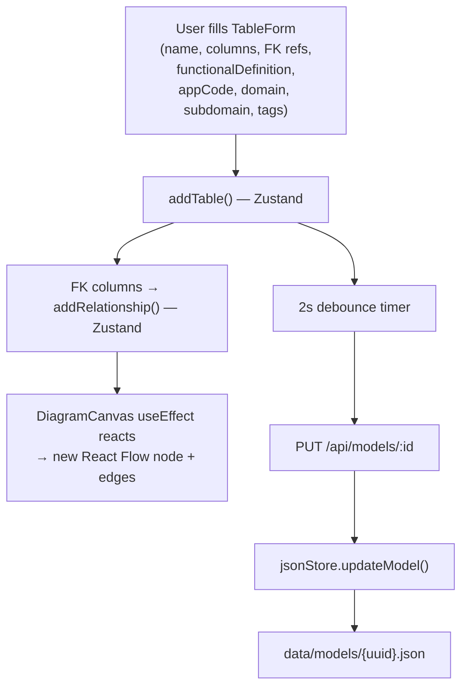
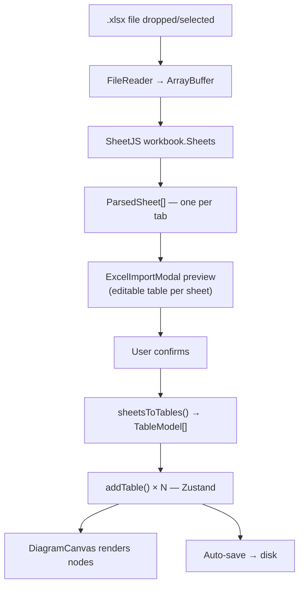
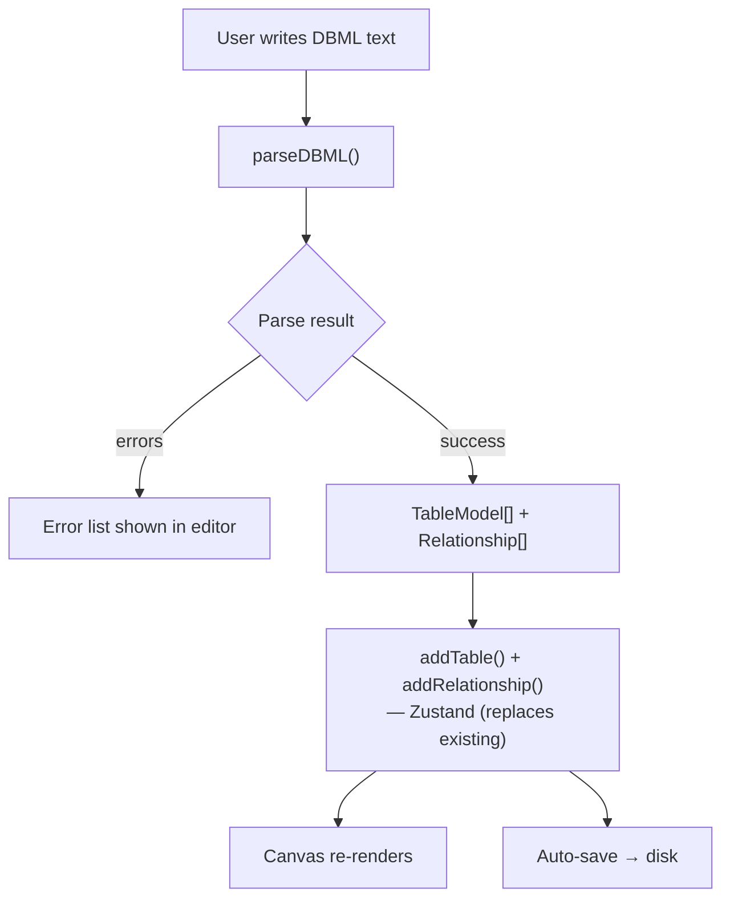
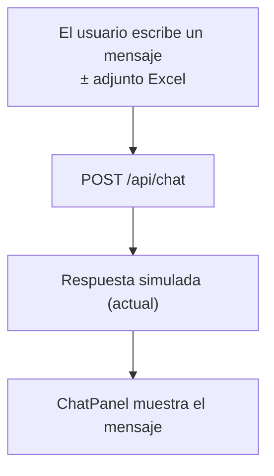
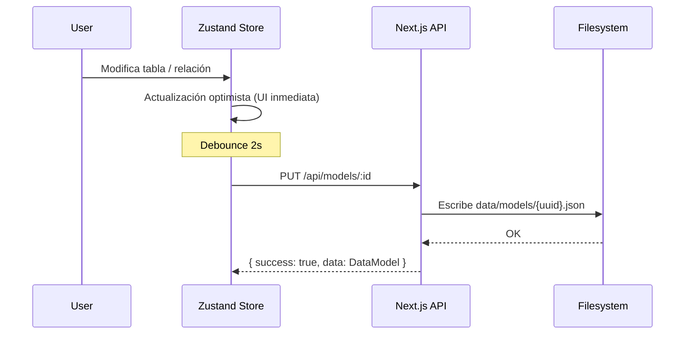
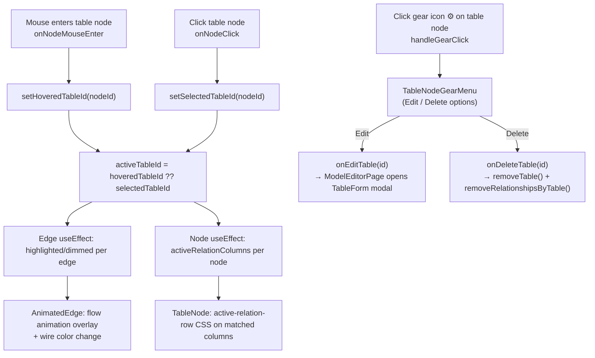
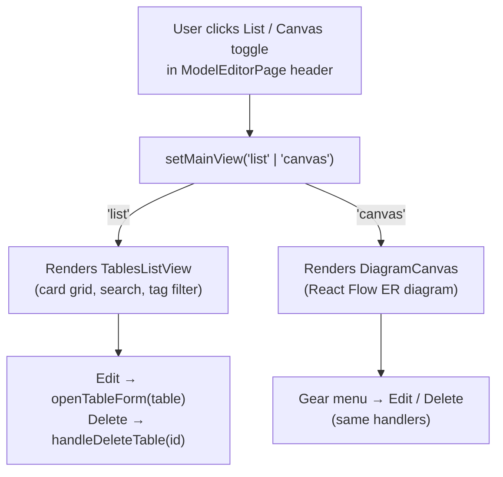
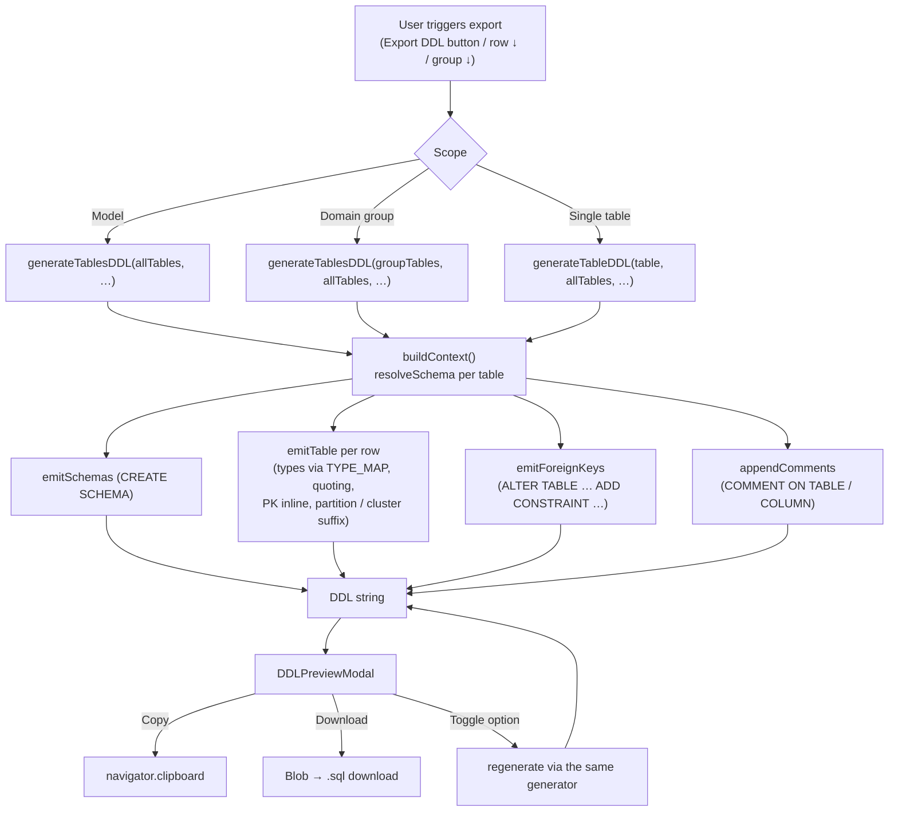
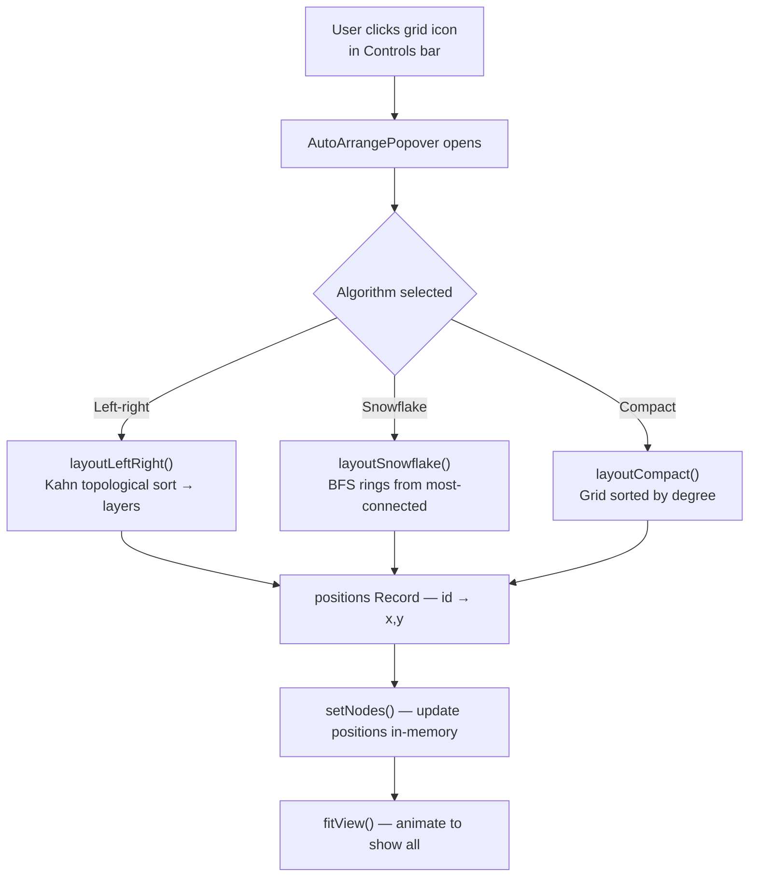

# Flujo de Datos

## Visión General

Este documento describe cómo se mueven los datos a través de la aplicación para cada método de ingesta, el ciclo de persistencia, la sincronización del lienzo y los flujos de interacción con el diagrama.

## Flujos de Ingesta

### 1. Formulario Manual



**Pasos:**
1. El usuario abre el formulario de tabla, completa el nombre, columnas con tipos/llaves, definiciones funcionales por columna, referencias FK, y metadatos de clasificación opcionales (código de app, dominio, subdominio) y etiquetas libres
2. `addTable()` agrega el `TableModel` a Zustand; las columnas FK disparan `addRelationship()`
3. El `useEffect` de `DiagramCanvasInner` detecta el cambio en el store → agrega nodo + aristas en React Flow
4. El debounce de 2 segundos dispara `saveModel()` → `PUT /api/models/:id` → disco

Los metadatos de clasificación (`applicationCode`, `domain`, `subdomain`, `tags`) se almacenan en el objeto `TableModel` y se persisten en el JSON del modelo. No se usan en el renderizado del lienzo, pero impulsan el filtrado y la visualización de insignias en la **Vista de Lista**.

### 2. Importación desde Excel



**Formato de hoja:**

| Columna A | Columna B | Columna C |
|-----------|-----------|-----------|
| column_name | data_type | functional_definition |

Detección de encabezado: si la primera fila contiene palabras clave como `column`, `name`, `columna` o `nombre`, se omite automáticamente.

### 3. Editor DBML



**Capacidades del parser** (`src/utils/dbmlParser.ts`):
- Declaraciones `Table name { … }` y `Table schema.name { … }` (asigna `TableModel.schema`)
- Configuraciones de columna: `pk`, `sk`, `partition`, `not null`, `unique`, `increment`, `default`, `note`, `ref`
- Refs FK calificables con schema: `[ref: > schema.table.column]`
- Declaraciones `Ref:` independientes
- Length / scale embebidos en el tipo: `varchar(50)`, `decimal(10,2)` → `length` + `scale` en `TableColumn`
- Descripciones de tabla con `Note:`
- Líneas de comentario `//`
- Reporte de errores con números de línea

**Inverso (`generateDBML()`):** toma `TableModel[]` + `Relationship[]` y genera texto DBML válido. Emite `Table schema.name { … }` cuando el schema está definido y respeta `length` / `scale` en la firma del tipo.

### 4. Agente de Chat (Shell)



> Futuro: `/api/chat` redirige al agente IA → el agente retorna `TableModel[]` → las tablas se agregan automáticamente al lienzo.

## Ciclo de Persistencia



### Directorio de Datos

```
data/
├── projects.json            # Registro de Project[]
└── models/
    └── {uuid}.json          # DataModel completo (tablas + relaciones + posiciones)
```

## Sincronización del Lienzo

`DiagramCanvasInner` utiliza dos hooks `useEffect`:

### Sincronización de nodos (tablas)

Se ejecuta cuando cambia `tables`, `selectedTableId`, `hoveredTableId` o `activeColsByTable`.

- Calcula una **huella estructural** del arreglo de tablas
- Si solo cambió el estado de visualización (hover/selección), actualiza `data` en el lugar sin reposicionar
- Si cambió la estructura (columna agregada/eliminada), ejecuta `layoutLeftRight()` para calcular posiciones nuevas (las posiciones arrastradas existentes se conservan en memoria)
- **Las posiciones nunca se persisten** — se calculan desde el algoritmo de distribución cada vez que se carga el modelo
- Pasa el arreglo `activeRelationColumns` a cada nodo para que `TableNode` resalte las columnas conectadas

### Sincronización de aristas (relaciones)

Se ejecuta cuando cambia `relationships`, `tables` o `activeTableId`.

- Reconstruye todas las aristas desde cero
- Asigna `highlighted` / `dimmed` según `activeTableId`
- Asigna `edgeIndex` por par de nodos para separar conexiones paralelas

## Flujo de Interacción por Hover y Selección



> **Nota:** Hacer clic en el cuerpo de la tabla (no en el engranaje) solo dispara `setSelectedTableId` para resaltado visual. El formulario de edición se abre exclusivamente a través de la ruta engranaje → Edit.

## Flujo de Alternancia de Vista



Ambas vistas comparten las mismas `tables` y `relationships` del store de Zustand — cambiar de vista nunca provoca una recarga de datos.

## Flujo de Exportación DDL



**Características clave:**
- El generador es **puro** — misma entrada produce misma salida; los toggles del modal disparan una regeneración en memoria.
- `allTables` siempre se pasa al contexto para que las refs FK puedan calificarse con su schema destino, incluso si el scope solo expone un subset.
- Los `ALTER TABLE` de FKs se emiten al final para que el script aplique aunque las tablas referenciadas se creen en cualquier orden.

## Flujo de Distribución Automática


