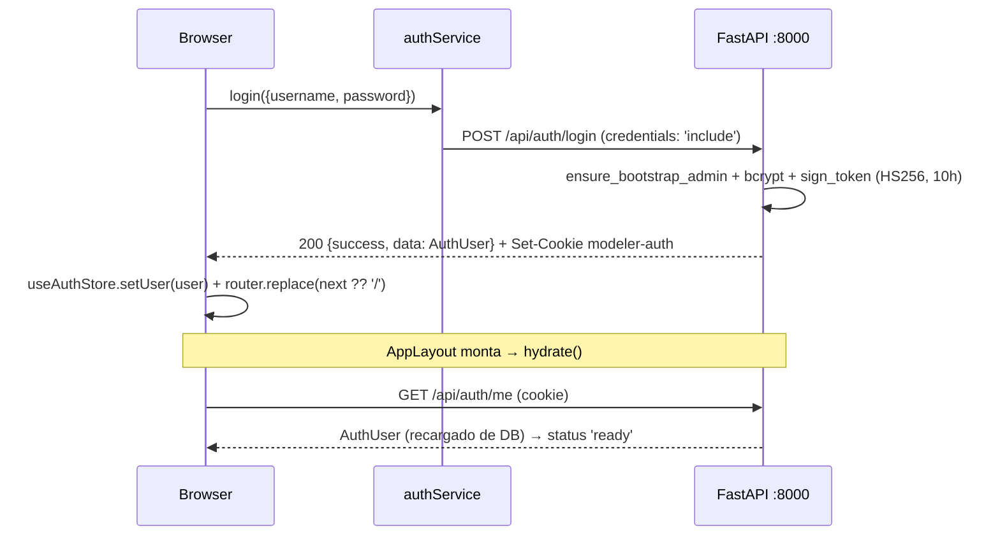
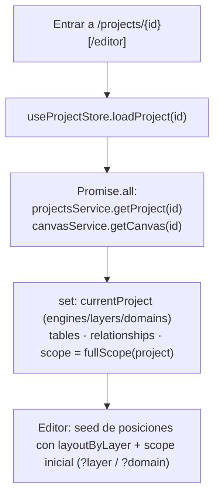
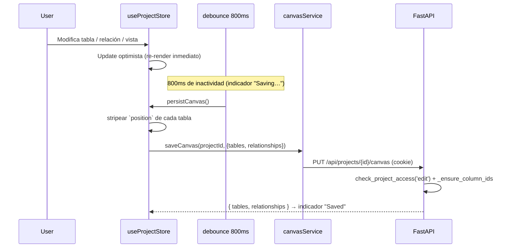
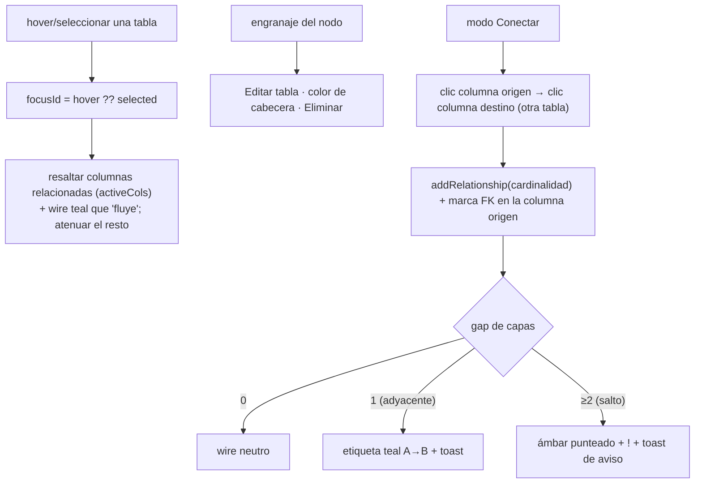
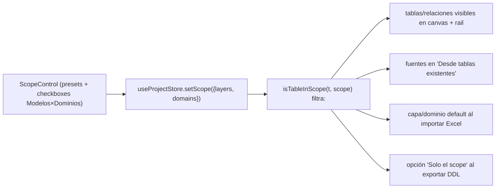
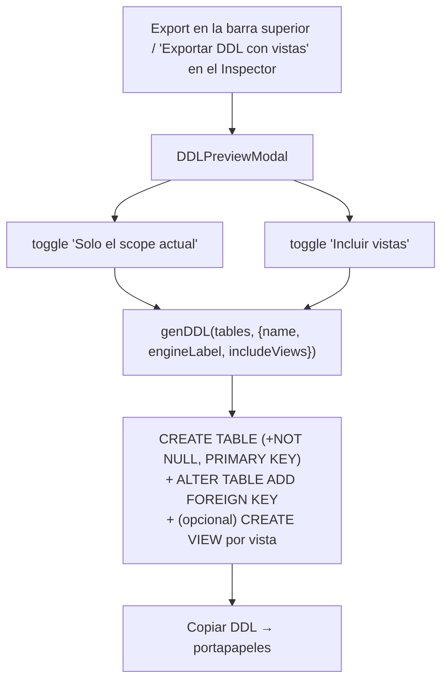
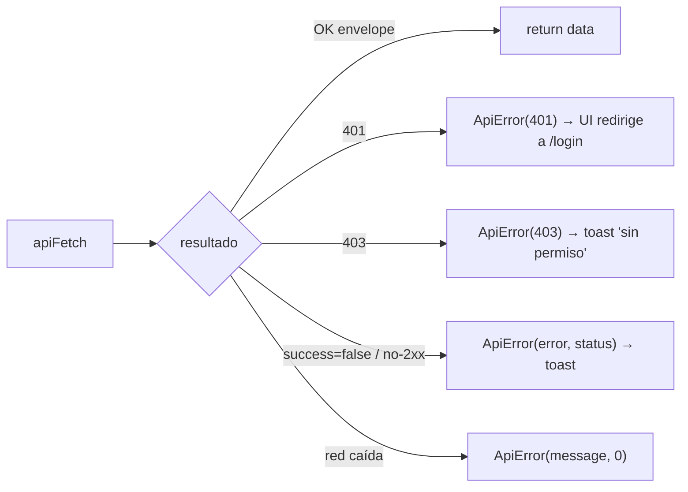

# Flujos de Datos

> Cómo se mueven los datos del browser al backend FastAPI (y viceversa) para cada
> acción. Arquitectura project-centric: **no hay rutas API en Next.js**, la
> persistencia vive en Cosmos DB y se accede con `apiFetch` cross-origin + cookie
> JWT. El estado de canvas vive en `useProjectStore`.

## 0. Login y bootstrap del estado

Si la cookie expira, cualquier `apiFetch` cae en 401 → la UI redirige a `/login`.

---

## 1. Cargar un proyecto (hub / editor)

`currentProject` trae la jerarquía embebida; `tables`/`relationships` vienen del
canvas. El **scope** inicial es todo el modelo, o la capa/dominio indicado por el
query param de entrada.

---

## 2. Ingesta de tablas — 4 caminos

Todos terminan mutando `useProjectStore` (update optimista) y disparando el
autosave del canvas (§3).

### 2.1 Formulario manual (`TableForm`)
Nombre · Schema · Modelo(capa) · Dominio (fija el color) · Subdominio · Definición
+ filas de columna (PK/FK/SK + Nullable + tipo). `addTable` / `updateTable`.

### 2.2 Desde tablas existentes (`CreateFromSqlModal` + `builders.tableFromSources`)
Elegir ≤2 fuentes (filtro En scope / Todas) → marcar columnas a heredar (dedup
por nombre) → meta (Nombre/Schema/Modelo/Dominio) → opción "Mantener relación a
los padres" (FK 1:N hacia la PK de cada padre). `addTable` + `addRelationship×M`.

### 2.3 Escribir DBML (`DBMLModal` + `builders.parseDBML`)
El editor abre con `genDBML(tables)`. "Aplicar DBML" **reemplaza** todo el canvas
(`setTables` + `setRelationships`); las refs `ref: >` se vuelven relaciones 1:N.

### 2.4 Importar Excel (`ExcelImportModal`)
Subir `.xlsx` → `POST /api/excel-import/preview` → revisar hojas (cada hoja = una
tabla) → "Importar". **Añade** tablas a las existentes; heredan capa/dominio del
scope cuando es único.

---

## 3. Persistencia del canvas (autosave)

- **Optimista**: la UI nunca espera al servidor. Si el PUT falla, se loguea el
  error pero no hay rollback.
- **Idempotente**: el PUT reemplaza el canvas en bloque; repetirlo no diverge.
- **Posiciones aparte**: `persistCanvas` quita `position`. (El editor actual no
  persiste posiciones — las recalcula con los layouts al abrir.)
- **Jerarquía del proyecto** (engines/layers/domains): se guarda por separado con
  `persistProjectMeta()` → `PUT /api/projects/{id}` (desde el hub).

---

## 4. Interacciones del canvas (hand-rolled, `ERCanvas`)

El pan/zoom/fit/minimap son estado local del componente (no tocan el store). Las
posiciones (`positions`) son estado local del editor.

---

## 5. Scope (alcance de edición)

`scopeLabel(project, scope)` produce el texto del breadcrumb
(`Todo el modelo` / `UDV` / `Finanzas (vertical)` / `N modelos · M dom.`).

---

## 6. Exportación DDL (`features/ddl/`)

El generador es **puro**: misma entrada → misma salida; los toggles regeneran en
memoria.

---

## 7. Manejo centralizado de errores

`ApiError` (en `services/http.ts`) es la única forma de error que llega a la UI
desde la capa HTTP. Los componentes hacen `try/catch` y deciden toast / redirect.
Nunca se inspecciona `json.success` a mano fuera de `services/`.
