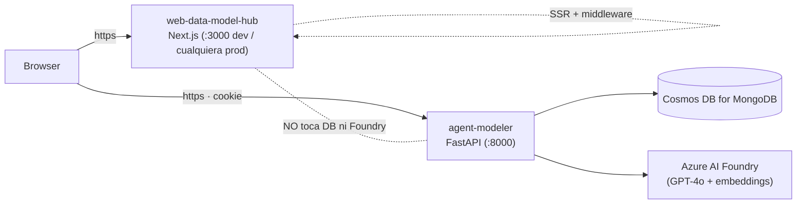

# Deployment

> Cómo configurar y desplegar `web-data-model-hub` (Next.js 16) y su
> contraparte `agent-modeler` (FastAPI) post-migración a Cosmos DB.
> El frontend ya **no expone rutas API propias** — solo SSR + middleware.

---

## 1. Topología



Tres componentes desplegables:

| Componente | Tipo | Notas |
|------------|------|-------|
| `web-data-model-hub` | Next.js (Node 20+ o serverless) | Solo HTML/JS/SSR — sin filesystem state |
| `agent-modeler` | FastAPI (Uvicorn / Gunicorn) | Single-process por instancia (ver concurrencia) |
| Cosmos DB for MongoDB + AI Foundry | servicios Azure gestionados | provisionados aparte |

---

## 2. Variables de entorno

### 2.1 Frontend (`web-data-model-hub/.env`)

| Variable | Descripción | Ejemplo |
|----------|-------------|---------|
| `NEXT_PUBLIC_API_URL` | URL pública del backend FastAPI | `https://api.modeler.midominio.com` |
| `AUTH_SECRET` | Secret HS256 — **debe coincidir** con el del backend | `<random 32+ chars>` |

> Los `NEXT_PUBLIC_*` se exponen al browser; cualquier cosa secreta
> NO va con ese prefijo. `AUTH_SECRET` no lleva prefijo público y
> solo se usa server-side (middleware).

### 2.2 Backend (`agent-modeler/.env`)

Ver `agent-modeler/doc/configuration.md` para la lista completa.
Variables imprescindibles para producción:

```env
FOUNDRY_PROJECT_ENDPOINT=...
APP_AZURE_TENANT_ID=...
APP_AZURE_CLIENT_ID=...
APP_AZURE_CLIENT_SECRET=...

AZURE_OPENAI_ENDPOINT=...
AZURE_OPENAI_EMBEDDING_DEPLOYMENT=text-embedding-3-small

COSMOS_CONNECTION_STRING=mongodb+srv://...
COSMOS_DATABASE=db_modeler

AUTH_SECRET=<el mismo del frontend>

CORS_ORIGINS=https://modeler.midominio.com

LOG_FORMAT=json
LOG_LEVEL=INFO
```

> **Crítico**: `AUTH_SECRET` debe ser idéntico en frontend y backend
> (mayúsculas, espacios, todo). Si divergen, el cookie firmado por
> uno no se valida con el otro y todas las requests autenticadas
> caen en 401.

---

## 3. Desarrollo local

### 3.1 Estructura

```
MODELER/
├── web-data-model-hub/      # Next.js
└── agent-modeler/           # FastAPI
```

### 3.2 Levantar todo

```bash
# Terminal 1 — backend
cd agent-modeler
python3.12 -m venv .venv && source .venv/bin/activate
pip install -r requirements.txt
cp .env.example .env  # editar
python -m api.main    # uvicorn 0.0.0.0:8000

# Terminal 2 — frontend
cd web-data-model-hub
npm install
cp .env.example .env  # editar
npm run dev           # next 0.0.0.0:3000
```

Visitar `http://localhost:3000` → redirige a `/login` → admin/dogadmin2019
en el primer arranque.

### 3.3 Hot reload

- **Backend**: `python -m api.main` lanza Uvicorn con `reload=True`.
- **Frontend**: `npm run dev` con Turbopack.

### 3.4 Limpiar estado

- DB: drop `db_modeler` o las colecciones específicas en Cosmos DB.
- Sesiones del agente: `DELETE /api/conversations/{id}` o reiniciar
  el backend (el store es in-memory).

---

## 4. Producción — frontend

### 4.1 Build

```bash
cd web-data-model-hub
npm install --production=false
npm run build       # produce .next/
npm run start       # next start (Node)
```

### 4.2 Opciones de hosting

| Plataforma | Notas |
|------------|-------|
| **Self-hosted Node** | `npm run start` detrás de Nginx/Caddy. Funciona como cualquier app Next.js standalone. |
| **Vercel** | Compatible. Solo SSR + middleware (no API routes), edge runtime para el middleware. Setear `NEXT_PUBLIC_API_URL` y `AUTH_SECRET` en project settings. |
| **Azure App Service** | Stack Node 20. Variables como app settings. |
| **Docker** | Imagen `node:20-alpine` + `npm run build` + `npm run start`. Exponer 3000. |

#### Dockerfile mínimo

```dockerfile
FROM node:20-alpine AS deps
WORKDIR /app
COPY package*.json ./
RUN npm ci

FROM node:20-alpine AS build
WORKDIR /app
COPY --from=deps /app/node_modules ./node_modules
COPY . .
RUN npm run build

FROM node:20-alpine AS runner
WORKDIR /app
ENV NODE_ENV=production
COPY --from=build /app/.next ./.next
COPY --from=build /app/public ./public
COPY --from=build /app/package.json ./package.json
COPY --from=build /app/node_modules ./node_modules
EXPOSE 3000
CMD ["npm", "run", "start"]
```

### 4.3 Cookies cross-origin en prod

En desarrollo el browser acepta el cookie `modeler-auth` cross-origin
(`localhost:3000` ↔ `localhost:8000`) gracias a `SameSite=Lax`. En
producción, **si frontend y backend están en dominios distintos**:

- El cookie debe llevar `SameSite=None; Secure` para que el browser
  lo envíe.
- Ambos sitios deben servirse por HTTPS.
- El backend debe configurar `CORS_ORIGINS` con el dominio exacto
  del frontend.

> Recomendación: servir ambos bajo el mismo dominio raíz si es
> posible (ej. `app.midominio.com` y `api.midominio.com`). Eso evita
> problemas de SameSite y permite mantener `SameSite=Lax`.

> El comportamiento de `SameSite` lo configura el backend en
> `authCookieOptions()` (frontend) y `_cookie_options()` (backend).
> Si vas a cross-domain, ajustá ambos.

---

## 5. Producción — backend

### 5.1 Build & run

```bash
cd agent-modeler
pip install -r requirements.txt
python -m gunicorn api.main:app \
  --workers 1 \
  --worker-class uvicorn.workers.UvicornWorker \
  --bind 0.0.0.0:8000 \
  --timeout 120
```

> **Importante**: usar **1 worker** por instancia. Los singletons
> (rate limiter, ConversationStore) son por proceso. Multi-worker
> rompería el rate limit y duplicaría sesiones. Para escalar,
> levantar varias instancias detrás de un load balancer con sticky
> sessions, **no más workers**.

### 5.2 Dockerfile

```dockerfile
FROM python:3.12-slim
WORKDIR /app
RUN apt-get update && apt-get install -y --no-install-recommends \
    build-essential libffi-dev && rm -rf /var/lib/apt/lists/*
COPY requirements.txt .
RUN pip install --no-cache-dir -r requirements.txt
COPY . .
ENV PYTHONUNBUFFERED=1
EXPOSE 8000
CMD ["python", "-m", "gunicorn", "api.main:app", \
     "--workers", "1", \
     "--worker-class", "uvicorn.workers.UvicornWorker", \
     "--bind", "0.0.0.0:8000", \
     "--timeout", "120"]
```

### 5.3 Health checks

| Endpoint | Uso |
|----------|-----|
| `GET /api/health` | Liveness + readiness. Devuelve `foundry_connected` y `active_conversations`. |
| `GET /api/engines` | Smoke test de configuración de motores soportados. |

Ambos son públicos (sin auth) — apuntá tu balanceador a `/api/health`
con `expected status 200`.

---

## 6. Cosmos DB

### 6.1 Provisión

- Cuenta Azure Cosmos DB con API **MongoDB vCore** (no Core SQL).
  Solo vCore expone `cosmosSearch` para vector indexes.
- Tier mínimo recomendado: M40 si vas a usar vector search activo;
  M10/M20 funcionan con catálogos pequeños.
- Crear DB `db_modeler` (la app no la crea automáticamente).

### 6.2 Índices

El backend crea idempotentemente al arranque:

| Colección | Índice |
|-----------|--------|
| `users` | único en `username` |
| `models` | `(projectId, updatedAt desc)` |
| `model_tables` | `(modelId)`, `(modelId, schema)`, `(modelId, domain)` |
| `model_relationships` | `(modelId)` |
| `model_views` | `(modelId)`, `(modelId, sourceTableId)` |
| `column_catalog` | text en `functional_definition` + `cosmosSearch` 1536-dim |

### 6.3 Backup y rollback

- **Backup automático** de Cosmos DB: Azure mantiene snapshots
  cada 4 h (configurable hasta 30 días). Restaurar desde el portal.
- **Soft-delete** garantiza que las eliminaciones desde la app son
  reversibles flippeando `flgactive`. Útil mientras la operación es
  reciente — pasada cierta cantidad de tiempo, los docs `flgactive=false`
  pueden purgarse manualmente.

### 6.4 Migración de IDs estables de columna (one-shot)

Si tenés datos pre-migration (columnas sin `id` y relaciones por
nombre), correr el script:

```bash
cd agent-modeler
source .venv/bin/activate
python scripts/backfill_column_ids.py
```

Pasos que hace el script:

1. Lee todos los `model_tables` y stamp `id: uuidv4()` en columnas
   sin id.
2. Recorre `model_relationships` y reescribe `sourceColumn` /
   `targetColumn` de **nombre → id** usando match exacto en la tabla
   correspondiente.
3. Marca como `flgactive=false` cualquier relación que no se pudo
   resolver (típicamente apunta a columnas borradas).

Es **idempotente**: correrlo dos veces no hace daño.

---

## 7. Azure AI Foundry

### 7.1 Recursos necesarios

- Un proyecto en Azure AI Foundry con un deployment de **GPT-4o**
  (o variante compatible — definido por `FOUNDRY_MODEL`).
- Un recurso de Azure OpenAI con un deployment de
  **`text-embedding-3-small`** (o equivalente — definido por
  `AZURE_OPENAI_EMBEDDING_DEPLOYMENT`).
- Un Service Principal (Azure AD App Registration) con rol
  **Cognitive Services User** sobre el recurso de Foundry.

### 7.2 Quotas y rate limits

El rate limit típico de Foundry GPT-4o es del orden de 30 RPM por
deployment estándar. La app por defecto:

- `LLM_RPM_CAP = 30` (token bucket por minuto).
- `MAX_CONCURRENT_PIPELINES = 5` (turnos paralelos).
- `PER_TABLE_PARALLELISM = 4` (tablas paralelas por turno).

Si tu deployment tiene más capacidad, subí `LLM_RPM_CAP`. Si tenés
capacidad inferior (PTU compartido), bajalo a `15` o `10`.

---

## 8. Observabilidad

### 8.1 Logs

`LOG_FORMAT=json` produce una línea por evento. Pipear a Loki /
Datadog / cualquier collector. Eventos clave:

| Evento | Logger | Severidad |
|--------|--------|-----------|
| `request started` / `request finished` | `api.main` | INFO |
| `excel parsed` | `src.api.modeling` | INFO |
| `table modelled` (con `ms`) | `src.api.modeling` | INFO |
| `pipeline finished` | `src.api.modeling` | INFO |
| `rate limit reached, waiting` | `src.api.rate_limit` | INFO |
| `rate limit hit, retrying` | `src.api.rate_limit` | WARN |
| `rate limit retries exhausted` | `src.api.rate_limit` | ERROR |
| `motor db connection failed` | `src.db.motor_client` | ERROR |
| `foundry connection failed` | `api.main` | ERROR |

### 8.2 Métricas mínimas

Sin instrumentación formal — agregar OpenTelemetry o Prometheus si
hace falta. Mientras tanto, los logs JSON permiten:

- p50/p95 de `pipeline finished.ms`.
- ratio `failed > 0` / total → tasa de fallos parciales.
- frecuencia de `rate limit reached, waiting` → saturación.

---

## 9. Checklist de release

```
[ ] AUTH_SECRET coincide entre web-data-model-hub/.env y agent-modeler/.env
[ ] NEXT_PUBLIC_API_URL apunta al hostname público del backend
[ ] CORS_ORIGINS del backend incluye exactamente el origen del frontend
[ ] Cosmos DB y AI Foundry accesibles desde la red del backend (firewall / VNet)
[ ] Service Principal del backend tiene rol sobre Foundry y Azure OpenAI
[ ] /api/health responde 200 con foundry_connected: true
[ ] Login con admin/dogadmin2019 funciona (cambiar password ASAP)
[ ] Subir un Excel de prueba → ModelingResponse vuelve con tablas
[ ] Aplicar al canvas + auto-save → modelo persiste en Cosmos DB
[ ] Recargar la página → modelo aparece igual
[ ] Logs en formato JSON visibles en el collector
```

---

## 10. Rollback

- **Frontend**: redeploy de la versión anterior (Vercel / Azure App
  Service mantienen builds previos). El frontend es stateless, no
  hay migración de datos al rollback.
- **Backend**: idem — la imagen previa funciona contra la misma DB
  porque el schema es backward-compatible (los campos nuevos se
  ignoran con `extra="ignore"`).
- **DB schema**: las migraciones que hicimos (`id` estables de
  columna) son **aditivas** — el backend viejo simplemente ignora
  los `id` nuevos y todo sigue funcionando. La única migración
  destructiva fue la limpieza de relaciones huérfanas, que está
  en `flgactive=false` y se puede revertir flippeando el flag si
  hace falta.
