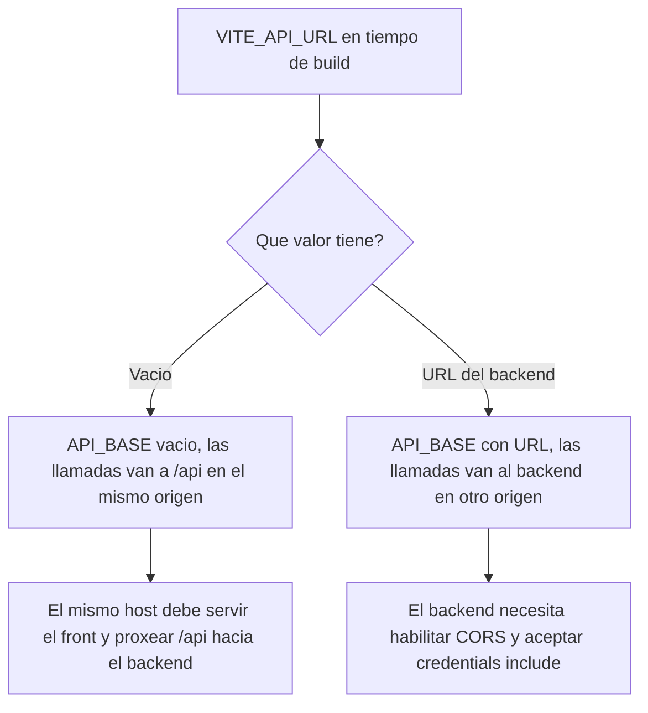
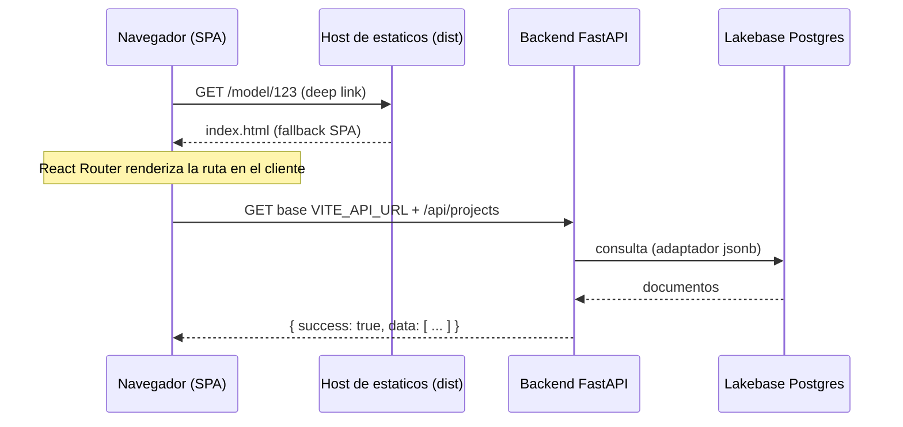
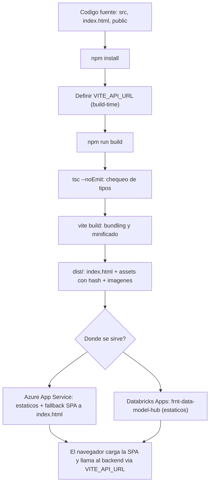

# Despliegue del Frontend — Data Model Hub

Guía de despliegue del **frontend** de Data Model Hub: qué es, cómo se compila, dónde corre, qué variables de entorno necesita y cómo levantarlo en local. Este documento describe únicamente el *dónde y cómo se ejecuta*; no cubre integración continua ni pipelines de despliegue.

---

## 1. Qué es el frontend

El frontend es una **SPA (Single Page Application)** construida con **Vite + React 19 + TypeScript**. No tiene servidor propio en producción: se **compila a archivos estáticos** (HTML, JS, CSS e imágenes) que cualquier host de estáticos puede servir. Toda la lógica corre en el navegador, y los datos se obtienen llamando por HTTP al **backend FastAPI** (que a su vez habla con Azure Cosmos DB usando la API de Mongo).

> Nota sobre el stack (actualizada 2026-07-19, homologación): el deploy vive TODO en `databricks.yml` — sección `variables:` (parámetros por entorno, p. ej. `backend_api_url`) + bloque `config:` que invoca `npm run start` (`vite build` + `vite preview` en `$DATABRICKS_APP_PORT`) con `VITE_API_URL` como env del app. Los viejos `app.yaml` y `.env.production` fueron ELIMINADOS; la herencia `NEXT_PUBLIC_API_URL` de Next.js también. Ver la sección 8.

### Stack real (extraído de `package.json`)

| Pieza | Versión / detalle |
|---|---|
| Bundler / dev server | Vite `^6.0.7` |
| UI | React `19.2.4` + React DOM `19.2.4` |
| Ruteo | `react-router-dom` `^7.1.0` (usa `BrowserRouter`) |
| Lenguaje | TypeScript `^5` (chequeo de tipos con `tsc --noEmit`) |
| Estado | Zustand `^5.0.12` |
| Diagramas ER | `@xyflow/react` `^12.3.5` + `elkjs` `^0.11.1` (layout) |
| Grillas virtualizadas | `@tanstack/react-virtual` `^3.14.5` |
| Export | `xlsx` `^0.18.5`, `html-to-image` `^1.11.13` |
| Notificaciones / iconos / fuentes | `sonner`, `lucide-react`, `@fontsource-variable/geist` |
| Tests | Vitest `^2.1.8` |

---

## 2. Scripts disponibles

Definidos en `package.json`:

| Comando | Qué hace |
|---|---|
| `npm run dev` | Levanta el dev server de Vite en el puerto **3000** con hot reload. |
| `npm run build` | Ejecuta `tsc --noEmit && vite build`. Primero valida tipos, luego compila a `dist/`. |
| `npm run preview` | Sirve localmente el contenido ya compilado de `dist/` (para verificar el build de producción). |
| `npm test` | Corre los tests con Vitest (`vitest run`). |
| `npm run lint` | Corre ESLint sobre todo el proyecto. |

Observación clave: **no existe un script `start`** ni un runtime de servidor Node en producción. El artefacto final es una carpeta de estáticos.

---

## 3. Cómo correr en local

### Requisitos

- Node.js 20 o superior (los tipos usan `@types/node ^20`).
- npm (viene con Node).
- El **backend FastAPI** corriendo en `http://localhost:8000` (si querés que la app traiga datos reales).

### Pasos

```bash
# 1. Instalar dependencias
npm install

# 2. Levantar el frontend en modo desarrollo
npm run dev
```

La app queda disponible en **http://localhost:3000**.

### El proxy de desarrollo

En dev **no necesitás configurar `VITE_API_URL`**. El `vite.config.ts` incluye un proxy que reenvía todo lo que empiece con `/api` al backend local:

```ts
// vite.config.ts
server: {
  port: 3000,
  proxy: {
    // En dev, el frontend (:3000) reenvía /api al backend FastAPI (:8000).
    '/api': { target: 'http://localhost:8000', changeOrigin: true },
  },
},
```

Así, cuando el código llama a `/api/projects`, Vite lo redirige a `http://localhost:8000/api/projects`. Esto evita problemas de CORS en desarrollo y hace que front y back se comporten como si estuvieran en el mismo origen.

### Verificar el build de producción en local

```bash
npm run build     # genera dist/
npm run preview   # sirve dist/ (por defecto en http://localhost:4173)
```

`preview` es solo para inspección local; **no** es un servidor de producción.

---

## 4. El artefacto de build (`dist/`)

`npm run build` produce la carpeta `dist/` con esta estructura:

```
dist/
├── index.html              # punto de entrada; referencia /assets/*
├── assets/
│   ├── index-xcMPIGEr.js   # bundle principal (con hash de contenido)
│   ├── index-CrHmHkrc.css  # estilos
│   ├── elkLayout-*.js      # chunk de layout ELK (lazy)
│   └── geist-*.woff2       # fuentes
├── icon.png, apple-icon.png, logo-dog.png, ...  # estáticos de public/
```

El `dist/index.html` generado inyecta las rutas con hash de los assets:

```html
<script type="module" crossorigin src="/assets/index-xcMPIGEr.js"></script>
<link rel="stylesheet" crossorigin href="/assets/index-CrHmHkrc.css">
```

Los nombres llevan **hash de contenido**, lo que permite cachear los assets de forma agresiva (cambian de nombre cuando cambia el contenido), mientras que `index.html` debe servirse **sin caché** para que siempre apunte a los assets más recientes.

Todo lo que pongas en `public/` se copia tal cual a la raíz de `dist/` (por eso `icon.png` termina en `/icon.png`).

---

## 5. La variable de entorno `VITE_API_URL`

Es la **única** variable de entorno del frontend. Le dice a la SPA dónde vive el backend.

### Cómo la lee el código

Cada servicio del frontend hace lo mismo:

```ts
// p.ej. src/services/projects.service.ts
const API_BASE = import.meta.env.VITE_API_URL ?? '';

export function listProjects() {
  return apiGet<Project[]>(`${API_BASE}/api/projects`);
}
```

Comportamiento:

- Si `VITE_API_URL` está **vacía**, `API_BASE` queda vacío y las llamadas van a rutas **relativas** como `/api/projects` → mismo origen que sirve la SPA.
- Si `VITE_API_URL` tiene un valor (p.ej. `https://bknd-data-model-hub-...azuredatabricks...`), las llamadas van a ese host: `https://bknd.../api/projects`.

### Es una variable *build-time* (crítico)

Vite **inlinea** las variables `VITE_*` en el bundle **al momento de compilar** (`vite build`). No se leen en tiempo de ejecución. Consecuencias:

1. Debés definir `VITE_API_URL` **antes** de correr `npm run build`, no en el host donde servís los estáticos.
2. Si cambia la URL del backend, hay que **recompilar**.
3. Solo se exponen al navegador las variables con prefijo `VITE_`. Cualquier otra (como la vieja `NEXT_PUBLIC_API_URL`) es **ignorada** por Vite.

El tipo está declarado en `src/vite-env.d.ts`:

```ts
interface ImportMetaEnv {
  readonly VITE_API_URL: string;
}
```

### Dónde se define

Vite carga archivos `.env` según el modo. El archivo `.env` del repo trae el valor por defecto para desarrollo:

```bash
# .env
# Base del backend. Vacío = mismo origen (en dev el proxy de Vite reenvía /api → :8000).
VITE_API_URL=
```

Para un build de producción podés:

- Exportar `VITE_API_URL=https://<tu-backend>` en el entorno del build (Vite la toma automáticamente en `vite build`; así lo hace Databricks Apps vía el bundle), **o** crear un `.env.production` local temporal, **o**
- Pasarla en línea al compilar:

```bash
VITE_API_URL=https://bknd-data-model-hub-3871428306507680.0.azure.databricksapps.com npm run build
```

### Las dos topologías de despliegue



| Escenario | `VITE_API_URL` | Requiere |
|---|---|---|
| Front y back en el **mismo origen** (un reverse proxy sirve estáticos y enruta `/api` al FastAPI) | vacía | Regla de proxy `/api → backend` en el host |
| Front y back en **orígenes distintos** (apps separadas, típico en Databricks Apps: `frnt-*` y `bknd-*`) | URL absoluta del backend | **CORS** habilitado en el backend |

Sobre CORS y credenciales: el cliente HTTP (`src/services/http.ts`) envía todas las llamadas con `credentials: 'include'` y agrega `Authorization: Bearer <token>` cuando hay sesión. Por eso, en la topología de orígenes distintos, el backend debe responder con los headers CORS adecuados (incluyendo permitir credenciales), o el navegador bloqueará las respuestas.

---

## 6. Dónde se sirve (despliegue)

El frontend se sirve como **conjunto de estáticos**. Dos destinos soportados:

### Opción A — Azure App Service (sitio estático detrás de un servidor)

Se publica el contenido de `dist/` y el App Service lo sirve. Como es una SPA con `BrowserRouter`, hace falta una **regla de reescritura (fallback SPA)**: cualquier ruta que no sea un archivo real debe devolver `index.html`, para que React Router resuelva la navegación del lado del cliente. Sin esto, recargar una URL profunda como `/model/123` da 404.

En App Service de Windows (IIS) se logra con un `web.config` en la raíz de `dist/`:

```xml
<?xml version="1.0" encoding="utf-8"?>
<configuration>
  <system.webServer>
    <rewrite>
      <rules>
        <rule name="SPA fallback" stopProcessing="true">
          <match url=".*" />
          <conditions logicalGrouping="MatchAll">
            <!-- No reescribir archivos ni carpetas reales -->
            <add input="{REQUEST_FILENAME}" matchType="IsFile" negate="true" />
            <add input="{REQUEST_FILENAME}" matchType="IsDirectory" negate="true" />
            <!-- No reescribir las llamadas al backend -->
            <add input="{REQUEST_URI}" pattern="^/api/" negate="true" />
          </conditions>
          <action type="Rewrite" url="/index.html" />
        </rule>
      </rules>
    </rewrite>
  </system.webServer>
</configuration>
```

En un App Service de Linux con un servidor de estáticos genérico, el equivalente es configurar `try_files $uri /index.html` (nginx) o el `--single`/fallback del servidor que uses. La idea es siempre la misma: **archivo real si existe, si no `index.html`**.

Recomendaciones de caché al servir `dist/`:

- `index.html`: `Cache-Control: no-cache` (siempre revalidar).
- `/assets/*` (llevan hash): `Cache-Control: public, max-age=31536000, immutable`.

### Opción B — Databricks Apps

El repositorio incluye `databricks.yml` (Databricks Asset Bundle) que declara la app `frnt-data-model-hub`, y el backend corre como una app hermana `bknd-data-model-hub`. En este esquema, front y back son **apps separadas con orígenes distintos**, por lo que el build del frontend debe llevar `VITE_API_URL` apuntando a la URL pública del backend — viaja como env del app definida en la variable `backend_api_url` del bundle — y el backend debe tener CORS habilitado (usa `CORS_ORIGIN_REGEX`, que matchea el front en cualquier workspace).

> Actualizado 2026-07-19 (homologación): el `config:` del bundle invoca `command: ['npm', 'run', 'start']` — `prestart` corre `npm run build` (tsc + `vite build` → `dist/`) y `start` sirve `dist/` con `vite preview --host 0.0.0.0 --port ${DATABRICKS_APP_PORT:-3000} --strictPort` (fallback SPA incluido). `VITE_API_URL` llega como env del app (variable `backend_api_url` del bundle) y `vite build` la inlinea; ya no existen `app.yaml` ni `.env.production`.

---

## 7. Consideraciones de base de datos (Databricks Lakebase Postgres)

El frontend **no se conecta nunca a la base de datos directamente** y no maneja credenciales. Desde 2026-07-19 la persistencia (proyectos, modelos, dominios, changesets, reporting, etc.) vive en **Databricks Lakebase Postgres** (con Azure Cosmos DB como fallback conmutable — ver `plan-implementacion/28-MIGRACION-LAKEBASE.md` del backend), y solo el **backend FastAPI** habla con ella.

El único punto de acoplamiento del frontend con los datos es `VITE_API_URL`: debe apuntar al backend, que es dueño de la conexión a la base. Credenciales, nombres de base y colecciones son responsabilidad del backend.



El contrato de respuesta que espera el frontend es un *envelope* uniforme que devuelve el backend, manejado en `src/services/http.ts`:

```json
{ "success": true, "data": [ /* ... */ ] }
```

```json
{ "success": false, "error": "mensaje legible del backend" }
```

Cuando `success` es `false`, o ante un `4xx/5xx`, o una respuesta sin envelope, el cliente lanza un `ApiError` tipado que los componentes capturan para mostrar toasts o redirigir. Un `401` dispara además el cierre de sesión global.

Puedes validar de punta a punta que el backend responde el envelope esperado con curl:

```bash
# Contra el backend directamente
curl -s https://bknd-data-model-hub-3871428306507680.0.azure.databricksapps.com/api/projects | jq

# Salida esperada
# { "success": true, "data": [ { "id": "...", "name": "..." }, ... ] }
```

---

## 8. Archivos heredados de Next.js — RESUELTO (2026-07-19)

Los artefactos que quedaron de la migración Next.js → Vite ya fueron alineados:

| Archivo | Estado actual |
|---|---|
| `.env.example` | `VITE_API_URL=` (vacío en dev; el proxy de Vite cubre `/api`). |
| `.env.production` | **ELIMINADO** — `VITE_API_URL` llega del bundle (variable `backend_api_url`) como env del app y se inlinea en el build. |
| `app.yaml` | **ELIMINADO** — el comando y el env viven en el bloque `config:` de `databricks.yml` (CLI ≥ 0.283). |
| `databricks.yml` | Describe la app como SPA Vite/React. |
| `.gitignore` | Ignora `/dist` (build de Vite) y permite commitear `.env.example`. OJO: `dist/` quedó trackeado de un build viejo → `git rm -r --cached dist` en el próximo commit. |

---

## 9. Flujo de build y despliegue (resumen visual)



---

## 10. Checklist de despliegue

- [ ] `npm install` corre sin errores y `npm run build` termina limpio (tipos + bundle).
- [ ] `VITE_API_URL` definida **antes** del build (vacía si es mismo origen; URL absoluta si el backend está en otro origen).
- [ ] El host de estáticos tiene **fallback SPA** a `index.html` para las rutas del cliente (BrowserRouter).
- [ ] Las llamadas a `/api/*` llegan al backend (por proxy en mismo origen, o por URL absoluta + CORS en orígenes distintos).
- [ ] Si es cross-origin: el backend habilita **CORS con credenciales** (el cliente usa `credentials: 'include'` y `Authorization: Bearer`).
- [ ] Caché: `index.html` sin caché; `/assets/*` cacheables e inmutables.
- [ ] El backend apunta correctamente a Azure Cosmos DB (API de Mongo); el frontend no toca la base directamente.
- [ ] `curl` al endpoint del backend devuelve el envelope `{ "success": true, "data": ... }`.
