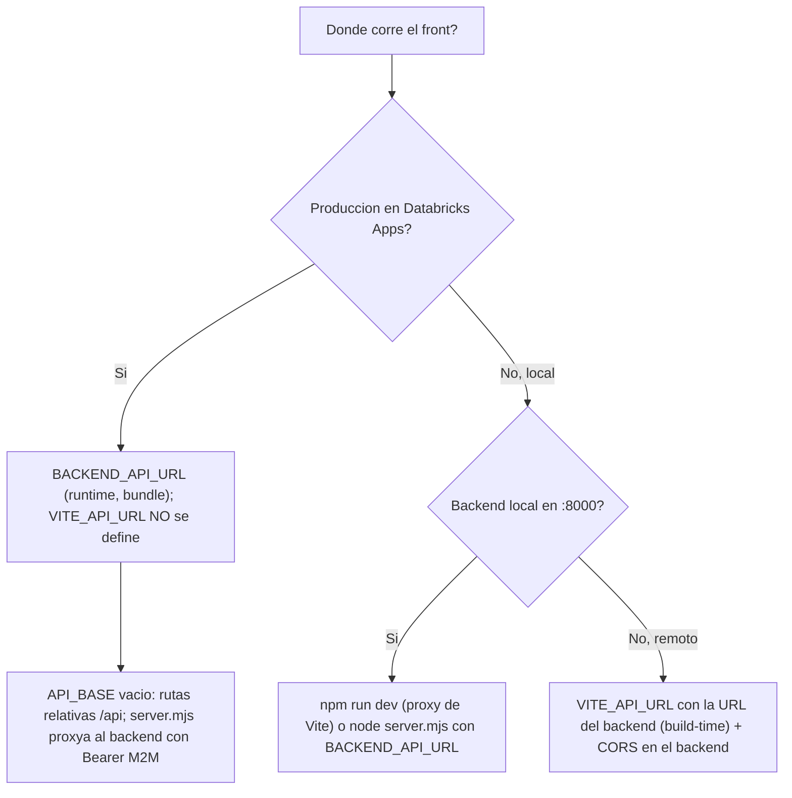
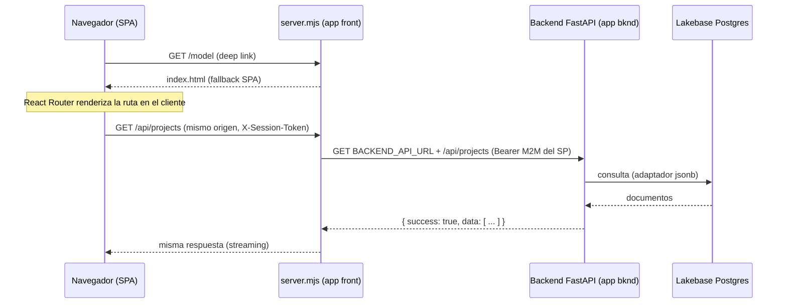
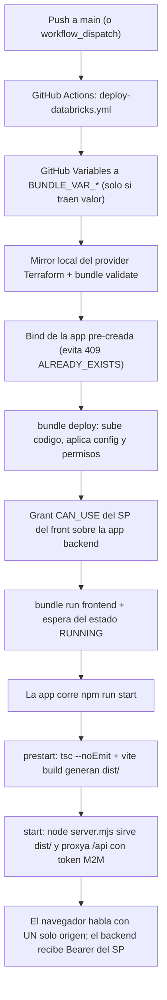

# Despliegue del Frontend — Data Model Hub

Guía de despliegue del **frontend** de Data Model Hub: qué es, cómo se compila, dónde corre, qué variables de entorno necesita, cómo levantarlo en local y cómo se despliega (GitHub Actions → Databricks Asset Bundle → Databricks Apps).

---

## 1. Qué es el frontend

El frontend es una **SPA (Single Page Application)** construida con **Vite + React 19 + TypeScript**. Se **compila a archivos estáticos** (HTML, JS, CSS e imágenes) que en producción sirve un servidor Node propio, **`server.mjs`** (sección 5). Toda la lógica de UI corre en el navegador, y los datos se obtienen llamando por HTTP al **backend FastAPI** (que a su vez habla con **Databricks Lakebase Postgres**).

> Nota sobre el stack (actualizada 2026-07-31): en producción el front ya **NO se sirve con `vite preview`**. `npm run start` ejecuta **`server.mjs`** — servidor Node puro, **cero dependencias** — que sirve `dist/` **y** proxya `/api` al backend con un token OAuth M2M del service principal del front. El navegador habla con **un solo origen**, lo que resuelve el doble muro SSO de Databricks Apps (cada app tiene su propio muro SSO por subdominio; detalle en la sección 5). El `command` (`npm run start`) y las `env` de runtime (incluida `BACKEND_API_URL`) viven en el **`app.yaml`** de la raíz del repo, que Databricks lee en cada arranque; el bundle `databricks.yml` aporta las `variables:` por entorno y los permisos. El bloque `config:` del bundle **no** se usa: el CLI lo ignora (bug `databricks/cli` #4901). El `.env.production` y la herencia `NEXT_PUBLIC_API_URL` de Next.js fueron eliminados (sección 9). El deploy está parametrizado por GitHub Variables (sección 7).

### Stack real (extraído de `package.json`)

Desde 2026-07-31 **todas** las dependencias están pineadas exactas (sin `^` ni `~`), en dependencies y devDependencies — política aplicada a los dos repos.

| Pieza | Versión / detalle |
|---|---|
| Bundler / dev server | Vite `6.4.3` |
| Servidor de producción | `server.mjs` — Node puro, solo módulos `node:*`, sin dependencias (sección 5) |
| UI | React `19.2.4` + React DOM `19.2.4` |
| Ruteo | `react-router-dom` `7.18.0` (usa `BrowserRouter`) |
| Lenguaje | TypeScript `5.9.3` (chequeo de tipos con `tsc --noEmit`) |
| Estado | Zustand `5.0.12` |
| Diagramas ER | `@xyflow/react` `12.11.0` + `elkjs` `0.11.1` (layout) |
| Grillas virtualizadas | `@tanstack/react-virtual` `3.14.5` |
| Export | `xlsx` `0.18.5`, `html-to-image` `1.11.13` |
| Notificaciones / iconos / fuentes | `sonner`, `lucide-react`, `@fontsource-variable/geist` |
| Tests | Vitest `2.1.9` |

---

## 2. Scripts disponibles

Definidos en `package.json`:

| Comando | Qué hace |
|---|---|
| `npm run dev` | Levanta el dev server de Vite en el puerto **3000** con hot reload. |
| `npm run build` | Ejecuta `tsc --noEmit && vite build`. Primero valida tipos, luego compila a `dist/`. |
| `npm run prestart` | Hook automático de `start`: corre `npm run build` (tsc + `vite build` → `dist/`). |
| `npm run start` | **Runtime de producción**: `node server.mjs` (npm dispara `prestart` antes). |
| `npm run preview` | Sirve `dist/` con el preview de Vite. **Solo inspección local**; ya no se usa en producción. |
| `npm test` | Corre los tests con Vitest (`vitest run`) — incluye `server.test.mjs`. |
| `npm run lint` | Corre ESLint sobre todo el proyecto. |

En producción (Databricks Apps) el comando de la app es `npm run start`: `prestart` compila y `start` levanta `server.mjs`, que sirve `dist/` y proxya `/api` al backend (sección 5). El artefacto sigue siendo la carpeta de estáticos `dist/`, pero ahora la sirve un servidor propio en vez de un host genérico.

---

## 3. Cómo correr en local

### Requisitos

- Node.js 20 o superior (los tipos usan `@types/node ^20`).
- npm (viene con Node).
- El **backend FastAPI** corriendo en `http://localhost:8000` (si quieres que la app traiga datos reales).

### Pasos

```bash
# 1. Instalar dependencias
npm install

# 2. Levantar el frontend en modo desarrollo
npm run dev
```

La app queda disponible en **http://localhost:3000**.

### El proxy de desarrollo

En dev **no necesitas configurar `VITE_API_URL`**. El `vite.config.ts` incluye un proxy que reenvía todo lo que empiece con `/api` al backend local:

```ts
// vite.config.ts
server: {
  port: 3000,
  proxy: {
    // En dev, el frontend (:3000) reenvía /api al backend FastAPI (:8000).
    '/api': { target: 'http://localhost:8000', changeOrigin: true },
  },
},
```

Así, cuando el código llama a `/api/projects`, Vite lo redirige a `http://localhost:8000/api/projects`. Esto evita problemas de CORS en desarrollo y hace que front y back se comporten como si estuvieran en el mismo origen.

### Verificar el build de producción en local

```bash
npm run build     # genera dist/
npm run preview   # sirve dist/ (por defecto en http://localhost:4173)
```

`preview` es solo para inspección rápida del bundle. Para simular el servidor **real** de producción contra el backend local:

```bash
BACKEND_API_URL=http://localhost:8000 node server.mjs
```

Sin `DATABRICKS_CLIENT_ID`/`DATABRICKS_CLIENT_SECRET` en el entorno, el proxy no adjunta `Authorization: Bearer` (passthrough local); todo lo demás — estáticos, fallback SPA, caché, streaming — se comporta igual que en producción (sección 5).

---

## 4. El artefacto de build (`dist/`)

`npm run build` produce la carpeta `dist/` con esta estructura:

```
dist/
├── index.html              # punto de entrada; referencia /assets/*
├── assets/
│   ├── index-xcMPIGEr.js   # bundle principal (con hash de contenido)
│   ├── index-CrHmHkrc.css  # estilos
│   ├── elkLayout-*.js      # chunk de layout ELK (lazy)
│   └── geist-*.woff2       # fuentes
├── icon.png, apple-icon.png, logo-dog.png, ...  # estáticos de public/
```

El `dist/index.html` generado inyecta las rutas con hash de los assets:

```html
<script type="module" crossorigin src="/assets/index-xcMPIGEr.js"></script>
<link rel="stylesheet" crossorigin href="/assets/index-CrHmHkrc.css">
```

Los nombres llevan **hash de contenido**, lo que permite cachear los assets de forma agresiva (cambian de nombre cuando cambia el contenido), mientras que `index.html` debe servirse **sin caché** para que siempre apunte a los assets más recientes.

Todo lo que pongas en `public/` se copia tal cual a la raíz de `dist/` (por eso `icon.png` termina en `/icon.png`).

---

## 5. El servidor de producción (`server.mjs`)

Desde 2026-07-31 el runtime de producción del front es **`server.mjs`** (raíz del repo): un servidor **Node puro, cero dependencias** — solo `node:fs`, `node:http`, `node:https`, `node:path`, `node:url` — que reemplaza a `vite preview`. Existe por una razón concreta: cada Databricks App vive detrás de su **propio muro SSO por subdominio** (`databricksapps.com` está en la Public Suffix List, así que la cookie de sesión es por app), y un `fetch()` del navegador no puede ejecutar el baile de SSO contra el subdominio del backend (el redirect cross-origin a Microsoft es imposible dentro de un XHR: el proxy respondía `{}` / "Failed to fetch"). Con `server.mjs` el navegador habla con **un solo origen** y el cruce al backend es **servidor-a-servidor** con Bearer — el patrón estándar de las parejas front/back en Databricks Apps. Historia completa del diagnóstico y del warm-up descartado: doc 36 de `plan-implementacion/` del backend.

Dos responsabilidades:

### 5.1 Estáticos con fallback SPA

- Sirve `dist/` solo con `GET`/`HEAD`; cualquier otro método fuera de `/api` responde 405 JSON.
- `safeJoin()` bloquea **path traversal**: decodifica el URI (`%2e%2e` incluido) y responde 400 ante cualquier ruta que se salga del root; encoding inválido también es 400.
- Directorio → su `index.html`; ruta inexistente → **fallback SPA** a `dist/index.html` (así `/login`, `/model`, `/review`… recargan bien con `BrowserRouter`). Si no hay build, 404 JSON `dist/ not built.`.
- Caché: `/assets/*` (nombres con hash de contenido) → `Cache-Control: public, max-age=31536000, immutable`; todo lo demás, **incluido `index.html`** → `no-cache`.
- Content-Type por extensión (18 tipos mapeados; fallback `application/octet-stream`).

### 5.2 Proxy `/api` → backend

- Aplica a `/api` y `/api/*`. El destino es **`BACKEND_API_URL`**; sin ella el proxy responde 502 `{"detail":"BACKEND_API_URL is not configured."}`.
- **Relay de identidad SSO (doc 38):** en cada request proxeada, el server BORRA cualquier header entrante `x-dmh-*` (un `fetch()` del navegador no puede suplantar el relay), copia la identidad que el proxy de Databricks atestó en este dominio (`X-Forwarded-Email` / `-Preferred-Username` / `-User`) a los headers propios `x-dmh-sso-email` / `x-dmh-sso-username` / `x-dmh-sso-user-id`, y adjunta `x-dmh-proxy-secret` (env `PROXY_SHARED_SECRET`) para autenticarlos ante el backend (`POST /api/auth/sso/login`).
- **Token M2M (clase `TokenCache`)**: acuña `POST {DATABRICKS_HOST}/oidc/v1/token` con `Authorization: Basic base64(clientId:clientSecret)` y body `grant_type=client_credentials&scope=all-apis`. Cachea el `access_token` hasta `expires_in` (default 3600 s) **menos 5 minutos**; los mints concurrentes se deduplican — N usuarios en paralelo producen **un solo mint**. Si el mint falla → 502 `Backend authorization unavailable.`.
- **Headers hacia el backend** (`buildUpstreamHeaders`): descarta los hop-by-hop, `host` y el **`Authorization` entrante del cliente** — el Bearer hacia el backend lo pone SIEMPRE este server, nunca el navegador. El resto pasa intacto; en particular **`X-Session-Token`**, donde viaja el JWT propio de la plataforma (ver `src/services/http.ts`). `x-forwarded-for`: se conserva el que trae el proxy de Databricks (cliente real) o, en corrida local, se usa la IP del socket — el rate limiter del backend toma la **primera IP** de esa cadena.
- **Streaming en ambos sentidos** (`req.pipe(upstream)` y `upRes.pipe(res)`): los payloads grandes de reporting y del diagrama no se bufferizan en memoria.
- **Retry ante 401/403 del upstream**: UNA sola vez, invalidando el cache y con token fresco, y **solo para `GET`/`HEAD`** — el body de un POST ya se consumió del stream y no puede reenviarse.
- Timeout upstream: **120 000 ms**; error de red → 502 `Backend unreachable.`.

### 5.3 Variables de entorno del server

| Variable | Quién la provee | Uso |
|---|---|---|
| `DATABRICKS_APP_PORT` | Databricks Apps | Puerto a escuchar (fallback `PORT`, fallback `3000`; escucha en `0.0.0.0`). |
| `DATABRICKS_HOST` | Databricks Apps | Workspace contra el que se acuña el token OAuth. |
| `DATABRICKS_CLIENT_ID` / `DATABRICKS_CLIENT_SECRET` | Databricks Apps | Credenciales del service principal de la app front (inyección automática). |
| `BACKEND_API_URL` | `env` de `app.yaml` (override por GitHub Variable homónima) | URL pública de la app backend — destino del proxy `/api`. |
| `PROXY_SHARED_SECRET` | `env` de `app.yaml` (`valueFrom proxy_secret` — secreto del scope, compartido con el backend) | Autentica el relay de identidad SSO (`x-dmh-proxy-secret`, doc 38). El workflow asegura que el secreto exista antes del deploy. |

Sin `DATABRICKS_CLIENT_ID`/`SECRET` el proxy no adjunta Bearer; ese es el modo de simulación local:

```bash
BACKEND_API_URL=http://localhost:8000 node server.mjs
```

Requisito one-time por workspace: el service principal del front necesita **`CAN_USE` sobre la app backend** para que el proxy atraviese el muro SSO de esta; el grant está automatizado en los workflows de CI (sección 7).

`server.mjs` exporta `contentTypeFor`, `safeJoin`, `TokenCache`, `buildUpstreamHeaders` y `createServer` para poder testearse; `server.test.mjs` (15 tests: unit + integración contra un backend fake, incluido el relay SSO anti-suplantación) corre bajo Vitest junto con la suite del front (187 tests en total).

---

## 6. Variables de entorno: `BACKEND_API_URL` y `VITE_API_URL`

En producción la variable operativa es **`BACKEND_API_URL`** — la lee `server.mjs` en **runtime** (no se inlinea en ningún build) y define el destino del proxy `/api`. Vive como `env` en el `app.yaml` del repo (con un default por workspace); el paso "Env del app.yaml desde GitHub Variables" del workflow reemplaza ese `value` con la GitHub Variable homónima `BACKEND_API_URL` cuando está definida (sección 7). Si cambia la URL del backend basta re-desplegar con la variable nueva; el bundle JS no cambia.

`VITE_API_URL` sigue existiendo pero con un rol **solo local**: apuntar el front a otro backend durante el desarrollo (p. ej. probar contra el desplegado). **NO debe definirse en Databricks Apps.**

### Cómo la lee el código

La base del backend es única y central (`src/services/apiBase.ts`); todos los servicios la importan:

```ts
// src/services/apiBase.ts
export const API_BASE: string = import.meta.env.VITE_API_URL ?? '';
```

Comportamiento:

- Si `VITE_API_URL` está **vacía**, `API_BASE` queda vacío y las llamadas van a rutas **relativas** como `/api/projects` → mismo origen que sirve la SPA. Este es el caso normal en dev (el proxy de Vite reenvía `/api` → :8000) **y en producción** (`server.mjs` proxya `/api` al backend).
- Si `VITE_API_URL` tiene un valor, las llamadas cruzan a ese host desde el navegador. Útil solo en local; en producción **reactivaría el cruce navegador→backend y el doble muro SSO** que `server.mjs` vino a resolver.

Vite **inlinea** las variables `VITE_*` en el bundle al compilar (`vite build`); no se leen en runtime. Por eso el esquema productivo dejó de depender de ella: la única variable que importa en producción (`BACKEND_API_URL`) es de runtime y la consume el server, no el bundle. El tipo sigue declarado en `src/vite-env.d.ts`.

### Dónde se define cada una

- **`BACKEND_API_URL` (producción)**: `env` en el `app.yaml` del repo (con un default commiteado por workspace). El workflow la sobrescribe con la GitHub Variable homónima `BACKEND_API_URL` mediante un paso `yq` ("Env del app.yaml desde GitHub Variables"); sin definirla rige el default commiteado. La lee `server.mjs` en runtime.
- **`VITE_API_URL` (solo local)**: el `.env` del repo la trae vacía (mismo origen). Para apuntar a otro backend en local: `VITE_API_URL=https://<backend> npm run dev` (o `npm run build`). Ese cruce de origen exige CORS en el backend y, si el backend es una Databricks App, choca con su muro SSO — de ahí que sea un modo de trabajo solo para desarrollo.

Dos advertencias (comentadas en el propio `app.yaml`):

1. **NO definir `VITE_API_URL` en Apps** — `API_BASE` debe quedar vacío para que el front use rutas relativas `/api` (mismo origen).
2. **NO setear `NODE_ENV=production`** — rompería el `npm install` de devDependencies, y `vite`/`tsc` se necesitan para el build que corre en el arranque de la app (`prestart`).

### Topologías



| Escenario | `BACKEND_API_URL` | `VITE_API_URL` | Resultado |
|---|---|---|---|
| **Producción (Databricks Apps)** | URL de la app backend (variable del bundle) | NO definida | Un solo origen: `server.mjs` sirve `dist/` y proxya `/api` con Bearer M2M. Sin CORS, sin doble SSO. |
| Dev local (`npm run dev`) | — | vacía | El proxy de Vite reenvía `/api` → `http://localhost:8000`. |
| Simulación local de producción | `http://localhost:8000` | NO definida | `node server.mjs` sin Bearer (passthrough). |
| Local contra backend remoto | — | URL absoluta | Cruce de origen desde el navegador: exige CORS en el backend (`CORS_ORIGIN_REGEX`). |

Sobre sesión y credenciales: el cliente HTTP (`src/services/http.ts`) envía el JWT propio de la plataforma en el header **`X-Session-Token`** — NO en `Authorization: Bearer`, porque en Databricks Apps ese header lo consume el proxy SSO (y en producción `server.mjs` además lo descarta y pone el suyo). El backend acepta ambos headers (`Authorization` sigue sirviendo para curl/dev directo).

---

## 7. Dónde se sirve (Databricks Apps, workspace corporativo)

El destino productivo es **Databricks Apps**: la app **`frnt-data-model-hub`** desplegada vía Databricks Asset Bundle (`databricks.yml`), con el backend como app hermana **`bknd-data-model-hub`**. Aunque son apps separadas en subdominios distintos, el navegador **solo habla con el front**: `server.mjs` proxya `/api` servidor-a-servidor (sección 5), así que no hay CORS ni doble SSO del lado del cliente.

### 7.1 El bundle (`databricks.yml`)

- **`variables:`** — parámetros por entorno, ninguno se edita en el repo:
  - `app_admin_user` ← GitHub Variable `APP_ADMIN_USER` (opcional; default `${workspace.current_user.userName}`). Cuando el deploy lo hace un service principal de CI, `mode: production` le da `CAN_MANAGE` solo a ese SP; esta variable devuelve el control (stop/start/logs) al humano en cada deploy.
- **`resources.apps.frontend`** — `name: frnt-data-model-hub`, `source_code_path: .` y el bloque `permissions:`. El `command` (`npm run start`, que dispara `prestart` = tsc + `vite build` → `dist/`, y luego `node server.mjs`) y las `env` (incluida `BACKEND_API_URL`) **no** van en el bundle: viven en `app.yaml` (el bloque `config:` lo ignora el CLI, bug #4901).
- **`permissions:`** — declarativo y **autoritativo** (se re-aplica en cada deploy; los grants manuales hechos en la UI se pierden): `CAN_MANAGE` → `${var.app_admin_user}`, `CAN_USE` → grupo `users`. Para apps los únicos niveles válidos son exactamente esos dos.
- **`targets:`** — solo `prod` (`mode: production`, `default: true`). El bundle **NO declara `workspace.host`**: el workspace destino sale de la variable `DATABRICKS_HOST` que usa el CLI (un `host:` hardcodeado ganaría sobre la variable y podía desplegar callado al workspace equivocado).

### 7.2 El workflow de deploy (`.github/workflows/deploy-databricks.yml`)

Corre en cada push a `main` (o a mano por `workflow_dispatch`). Configuración por repositorio (Settings → Secrets and variables → Actions):

| Tipo | Nombre en GitHub | Variable del bundle | Si no se define |
|---|---|---|---|
| Variable | `DATABRICKS_HOST` | (la usa el CLI) | falla |
| Secret | `DATABRICKS_TOKEN` | (la usa el CLI) | falla |
| Variable | `BUNDLE_TARGET` | (target) | `prod` |
| Variable | `BACKEND_API_URL` | `env` de `app.yaml` (paso `yq`) | default commiteado en `app.yaml` |
| Variable | `APP_ADMIN_USER` | `app_admin_user` | solo el SP que despliega queda con CAN_MANAGE |
| Variable | `BACKEND_APP_NAME` | (paso del grant) | `bknd-data-model-hub` |

Pasos del workflow, en orden:

1. **Exportar parámetros**: cada GitHub Variable se exporta como `BUNDLE_VAR_<variable del bundle>` **solo si trae valor** — una variable vacía PISARÍA el default del `databricks.yml` (verificado); "no definida en GitHub" = "usa el default del repo".
2. **Mirror local del provider Terraform** (`scripts/ci/tf-provider-mirror.sh`): OpenTofu falla verificando la firma del provider de Databricks en el runner; el mirror local la omite. Es solo tooling del deploy.
3. **`bundle validate`**.
4. **Bind de la app pre-creada** (evita el `409 ALREADY_EXISTS`): en workspaces corporativos con **cupo de apps**, la app se crea a mano en la UI para reservar el slot antes del primer deploy; Terraform no la tiene en su estado, así que `bundle deploy` intentaría CREARLA y la API respondería 409. El paso `databricks bundle deployment bind frontend <app-name> --target prod --auto-approve` la importa al estado y desde ahí el deploy la actualiza en su sitio. Idempotente (si la app no existe, no hace nada). Condiciones: el nombre creado a mano debe ser **idéntico** al del bundle, y la identidad del `DATABRICKS_TOKEN` necesita `CAN_MANAGE` sobre esa app.
5. **`bundle deploy`**: sube el código y aplica config y permisos.
6. **Grant del SP del front sobre la app backend** (requisito del proxy `/api`, doc 36 §6.3): el workflow resuelve el SP de la app front (`databricks apps get` → `service_principal_client_id`) y aplica `databricks api patch /api/2.0/permissions/apps/<backend>` con `CAN_USE`. PATCH **agrega sin pisar** el resto de la ACL; idempotente. El workflow del backend re-aplica el mismo grant tras cada deploy suyo (su bloque `permissions:` resetea la ACL del backend), y este paso del front cubre el arranque inicial — el resultado no depende del orden de los deploys. Un grant manual NO sirve: el siguiente deploy del backend lo borraría.
7. **`bundle run frontend`** (re)arranca la app y el workflow espera el estado `RUNNING` (hasta ~5 min).

Orden entre repos en un workspace nuevo: **backend primero** → copiar su URL pública → GitHub Variable `BACKEND_API_URL` del repo del front → deploy del front.

### 7.3 Alternativa histórica — host de estáticos genérico (Azure App Service)

Antes del modelo con `server.mjs`, `dist/` se podía publicar en cualquier host de estáticos. Se conserva como referencia: si algún día se sirve `dist/` sin `server.mjs`, hace falta una **regla de reescritura (fallback SPA)** — cualquier ruta que no sea un archivo real debe devolver `index.html` para que React Router resuelva la navegación (sin esto, recargar `/model` da 404) — más una regla de proxy `/api → backend` o CORS.

En App Service de Windows (IIS) se logra con un `web.config` en la raíz de `dist/`:

```xml
<?xml version="1.0" encoding="utf-8"?>
<configuration>
  <system.webServer>
    <rewrite>
      <rules>
        <rule name="SPA fallback" stopProcessing="true">
          <match url=".*" />
          <conditions logicalGrouping="MatchAll">
            <!-- No reescribir archivos ni carpetas reales -->
            <add input="{REQUEST_FILENAME}" matchType="IsFile" negate="true" />
            <add input="{REQUEST_FILENAME}" matchType="IsDirectory" negate="true" />
            <!-- No reescribir las llamadas al backend -->
            <add input="{REQUEST_URI}" pattern="^/api/" negate="true" />
          </conditions>
          <action type="Rewrite" url="/index.html" />
        </rule>
      </rules>
    </rewrite>
  </system.webServer>
</configuration>
```

En un App Service de Linux con un servidor de estáticos genérico, el equivalente es configurar `try_files $uri /index.html` (nginx) o el `--single`/fallback del servidor que se use. La idea es siempre la misma: **archivo real si existe, si no `index.html`**.

Recomendaciones de caché al servir `dist/` (las mismas que `server.mjs` ya aplica solo):

- `index.html`: `Cache-Control: no-cache` (siempre revalidar).
- `/assets/*` (llevan hash): `Cache-Control: public, max-age=31536000, immutable`.

> Nota histórica: hasta 2026-07-30 la app en Databricks Apps servía `dist/` con `vite preview` y el navegador cruzaba al backend con `VITE_API_URL` inlineada + CORS (`CORS_ORIGIN_REGEX`). Ese esquema fue el que chocó con el doble muro SSO del workspace corporativo y quedó reemplazado por `server.mjs` (doc 36).

---

## 8. Consideraciones de base de datos (Databricks Lakebase Postgres)

El frontend **no se conecta nunca a la base de datos directamente** y no maneja credenciales. Desde 2026-07-19 la persistencia (proyectos, modelos, dominios, changesets, reporting, etc.) vive en **Databricks Lakebase Postgres** (ver `plan-implementacion/28-MIGRACION-LAKEBASE.md` del backend), y solo el **backend FastAPI** habla con ella. El service principal del front tampoco necesita rol alguno en Postgres: nunca la toca.

El único punto de acoplamiento del frontend con los datos es **`BACKEND_API_URL`**: el proxy de `server.mjs` debe apuntar al backend, que es dueño de la conexión a la base. Credenciales, nombres de base y colecciones son responsabilidad del backend.



El contrato de respuesta que espera el frontend es un *envelope* uniforme que devuelve el backend, manejado en `src/services/http.ts`:

```json
{ "success": true, "data": [ /* ... */ ] }
```

```json
{ "success": false, "error": "mensaje legible del backend" }
```

Cuando `success` es `false`, o ante un `4xx/5xx`, o una respuesta sin envelope, el cliente lanza un `ApiError` tipado que los componentes capturan para mostrar toasts o redirigir. Un `401` dispara además el cierre de sesión global.

La validación de punta a punta se hace **a través del origen del front**: con la sesión SSO iniciada en el navegador, abrir `https://frnt-data-model-hub-<workspace>.azuredatabricksapps.com/api/health` — la petición atraviesa el proxy de `server.mjs`, que la reenvía al backend con el Bearer del SP, y debe responder con `db_connected: true`. Un `curl` directo a la app backend ya NO sirve como prueba: sin cookie SSO responde el muro del proxy de Databricks, nunca FastAPI. En local sí se puede validar contra el uvicorn directo:

```bash
# Backend local (sin muro SSO)
curl -s http://localhost:8000/api/health | jq
```

---

## 9. Archivos heredados de Next.js — RESUELTO (histórico, 2026-07-19)

Los artefactos que quedaron de la migración Next.js → Vite ya fueron alineados en la homologación de 2026-07-19; se conserva el registro como histórico (estados al día a 2026-07-31):

| Archivo | Estado actual |
|---|---|
| `.env.example` | `VITE_API_URL=` (vacío en dev; el proxy de Vite cubre `/api`). |
| `.env.production` | **ELIMINADO** — desde 2026-07-31 la variable operativa de producción es `BACKEND_API_URL` (runtime, `env` de `app.yaml`); `VITE_API_URL` ya no se define en Apps. |
| `app.yaml` | **VIGENTE** — contiene `command` (`npm run start`) + `env` (`BACKEND_API_URL`); es la fuente de runtime que Databricks lee en cada arranque. |
| `databricks.yml` | Bundle: `variables:` (`app_admin_user`) y `permissions:` declarativos; el `command`/`env` NO van acá (bloque `config:` ignorado por el CLI, bug #4901). Sección 7. |
| `.gitignore` | Ignora `/dist` (build de Vite) y permite commitear `.env.example`. OJO: `dist/` quedó trackeado de un build viejo → `git rm -r --cached dist` en el próximo commit. |

---

## 10. Flujo de build y despliegue (resumen visual)



---

## 11. Checklist de despliegue

- [ ] GitHub Variables/Secrets del repo configuradas: variable `DATABRICKS_HOST`, secret `DATABRICKS_TOKEN`, variable `BACKEND_API_URL` (obligatoria en un workspace nuevo); opcionales `BUNDLE_TARGET`, `APP_ADMIN_USER`, `BACKEND_APP_NAME`.
- [ ] El **backend está desplegado PRIMERO** y su URL pública quedó en la GitHub Variable `BACKEND_API_URL` del repo del front.
- [ ] En un workspace con cupo de apps: la app `frnt-data-model-hub` fue pre-creada a mano con el nombre EXACTO del bundle (el paso de bind del workflow la adopta).
- [ ] `npm install` y `npm run build` terminan limpios en local (tipos + bundle) antes de pushear.
- [ ] `VITE_API_URL` **NO** está definida en el entorno de la app; `NODE_ENV=production` tampoco (rompería el install de devDeps que el build necesita).
- [ ] El workflow llegó a "App RUNNING" (parámetros → validate → bind → deploy → grant → run).
- [ ] Con la sesión SSO iniciada en el navegador, `GET /api/health` **a través del origen del front** responde con `db_connected: true` — prueba conjunta del proxy de `server.mjs` y del grant `CAN_USE` del SP del front sobre la app backend.
- [ ] Fallback SPA y caché correctos: recargar una ruta profunda (p. ej. `/model`) devuelve la app; `/assets/*` sale con `immutable` e `index.html` con `no-cache` (todo lo hace `server.mjs`; verificar solo si se tocó el server).
- [ ] El backend habla con **Databricks Lakebase Postgres**; el frontend no toca la base directamente.
