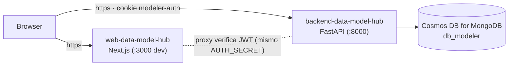

# Deployment

> Cómo configurar y desplegar `web-data-model-hub` (Next.js 16) y su backend de
> plataforma `backend-data-model-hub` (FastAPI). El frontend **no expone rutas
> API propias** — solo SSR + el proxy de auth. El agente de IA
> (`app-agents-modeler`) se despliega por separado y tiene su propia guía.

---

## 1. Topología



| Componente | Tipo | Notas |
|---|---|---|
| `web-data-model-hub` | Next.js (Node 20+ o serverless) | Solo HTML/JS/SSR + proxy — sin filesystem state |
| `backend-data-model-hub` | FastAPI (Uvicorn/Gunicorn) | Auth, proyectos, canvas, admin, excel-import. Stateless (solo el flag de bootstrap admin, idempotente) |
| Cosmos DB for MongoDB | servicio Azure gestionado | provisionado aparte |
| `app-agents-modeler` | servicio aparte | modelado conversacional (opcional; se integra luego) |

---

## 2. Variables de entorno

### 2.1 Frontend (`web-data-model-hub/.env`)

| Variable | Descripción | Ejemplo |
|---|---|---|
| `NEXT_PUBLIC_API_URL` | URL pública del backend FastAPI | `https://api.modeler.midominio.com` |
| `AUTH_SECRET` | Secret HS256 — **debe coincidir** con el del backend | `<random 32+ hex>` |

`NEXT_PUBLIC_*` se expone al browser; `AUTH_SECRET` no lleva ese prefijo y solo se
usa server-side (en el proxy).

### 2.2 Backend (`backend-data-model-hub/.env`)

Ver `backend-data-model-hub/doc/configuration.md`. Mínimo:

```env
COSMOS_CONNECTION_STRING=mongodb+srv://...
COSMOS_DATABASE=db_modeler
AUTH_SECRET=<el mismo del frontend>
CORS_ORIGINS=https://modeler.midominio.com
LOG_FORMAT=json
LOG_LEVEL=INFO
```

> **Crítico**: `AUTH_SECRET` idéntico (carácter por carácter) en ambos `.env`. Si
> divergen, la cookie firmada por uno no valida en el otro → 401 en todas las
> requests autenticadas.

---

## 3. Desarrollo local

```bash
MODELER/
├── web-data-model-hub/      # Next.js
└── backend-data-model-hub/  # FastAPI
```

```bash
# Terminal 1 — backend
cd backend-data-model-hub
/opt/homebrew/bin/python3.12 -m venv .venv && source .venv/bin/activate
pip install -r requirements.txt
cp .env.example .env   # editar COSMOS_CONNECTION_STRING + AUTH_SECRET
uvicorn api.main:app --host 0.0.0.0 --port 8000 --reload

# Terminal 2 — frontend
cd web-data-model-hub
npm install
cp .env.example .env   # NEXT_PUBLIC_API_URL=http://localhost:8000 + AUTH_SECRET
npm run dev            # Next.js + Turbopack en :3000
```

Visitar `http://localhost:3000` → `/login` → `admin / dogadmin2019` en el primer
arranque.

> Tras un refactor grande, si una pestaña abierta queda con bundle viejo, hacé
> `Cmd+Shift+R` (hard reload) para que el navegador tome los chunks nuevos.

---

## 4. Producción — frontend

```bash
cd web-data-model-hub
npm ci
npm run build       # produce .next/
npm run start       # next start (Node)
```

| Plataforma | Notas |
|---|---|
| **Self-hosted Node** | `npm run start` detrás de Nginx/Caddy. |
| **Vercel** | Compatible (solo SSR + proxy en Edge runtime). Setear `NEXT_PUBLIC_API_URL` y `AUTH_SECRET`. |
| **Azure App Service** | Stack Node 20. Variables como app settings. |
| **Docker** | `node:20-alpine` + `npm run build` + `npm run start`, exponer 3000. |

### Cookies cross-origin en prod
En dev el browser acepta `modeler-auth` entre `localhost:3000` ↔ `localhost:8000`
(mismo site, distinto puerto) con `SameSite=Lax`. En prod, **si frontend y backend
están en dominios distintos**:

- El cookie necesita `SameSite=None; Secure` y ambos sitios por HTTPS.
- El backend debe incluir el origen exacto del frontend en `CORS_ORIGINS`.

> Recomendación: servirlos bajo el mismo dominio raíz (`app.midominio.com` +
> `api.midominio.com`) para mantener `SameSite=Lax`.

---

## 5. Producción — backend

```bash
cd backend-data-model-hub
pip install -r requirements.txt
python -m gunicorn api.main:app \
  --worker-class uvicorn.workers.UvicornWorker \
  --bind 0.0.0.0:8000 --timeout 120
```

El backend de plataforma es stateless (salvo el flag idempotente de bootstrap
admin), así que se puede escalar horizontalmente detrás de un load balancer.

### Health check
`GET /api/health` (público) → `{ "status": "ok", "version": "1.0.0",
"db_connected": true }`. Apuntá el balanceador ahí con `expected 200`.

---

## 6. Cosmos DB

- Cuenta Azure Cosmos DB con API **MongoDB vCore**. Crear DB `db_modeler` (la app
  no la crea sola).
- **Índices** (creados idempotentemente al arranque del backend):

| Colección | Índice |
|---|---|
| `users` | único en `username` |
| `project_tables` | `(projectId)`, `(projectId, layer)`, `(projectId, domain)` |
| `project_relationships` | `(projectId)` |
| `column_catalog` | gestionado por `app-agents-modeler` (no por este backend) |

- **Soft-delete** (`flgactive`) hace reversibles las eliminaciones de la app.
- **Backup**: Azure mantiene snapshots automáticos de Cosmos DB.

### Migración a project-centric (one-shot)
Si venís del esquema legacy model-centric (`models` / `model_tables` / …):

```bash
cd backend-data-model-hub && source .venv/bin/activate
python -m scripts.migrate_to_project_centric --dry-run   # preview
python -m scripts.migrate_to_project_centric             # aplicar (hace backup)
```

Migra modelos→layers, tablas→`project_tables`, relaciones→`project_relationships`,
embebe vistas, siembra el demo Lakehouse y purga lo legacy. Es idempotente y hace
backup previo. Ver `backend-data-model-hub/doc/tools.md`.

---

## 7. Observabilidad

`LOG_FORMAT=json` produce una línea por evento (pipeable a Loki / Datadog). Cada
request loguea inicio/fin con `request_id` (devuelto en `X-Request-ID`).

| Evento | Logger | Severidad |
|---|---|---|
| `request started` / `request completed` | `api.main` | INFO |
| `motor db connection failed` | `src.db.motor_client` | ERROR |
| `request crashed` | `api.main` | ERROR |

---

## 8. Checklist de release

```
[ ] AUTH_SECRET idéntico en web-data-model-hub/.env y backend-data-model-hub/.env
[ ] NEXT_PUBLIC_API_URL apunta al hostname público del backend
[ ] CORS_ORIGINS del backend incluye exactamente el origen del frontend
[ ] Cosmos DB accesible desde la red del backend (firewall / VNet)
[ ] /api/health responde 200 con db_connected: true
[ ] Login con admin/dogadmin2019 funciona (cambiar password ASAP)
[ ] Crear proyecto → modelos/dominios → abrir canvas → editar → autosave persiste
[ ] Recargar la página → el proyecto aparece igual
[ ] (cross-domain) cookie con SameSite=None; Secure y ambos por HTTPS
```

---

## 9. Rollback

- **Frontend**: redeploy de la versión anterior (es stateless).
- **Backend**: idem — el schema usa `extra="ignore"`, así que campos nuevos se
  ignoran y una imagen previa funciona contra la misma DB.
- **DB**: las eliminaciones de la app son soft-delete (`flgactive`), reversibles
  flippeando el flag mientras la operación sea reciente. La migración
  project-centric hace backup a `scripts/_backup_<ts>.json` antes de tocar nada.
