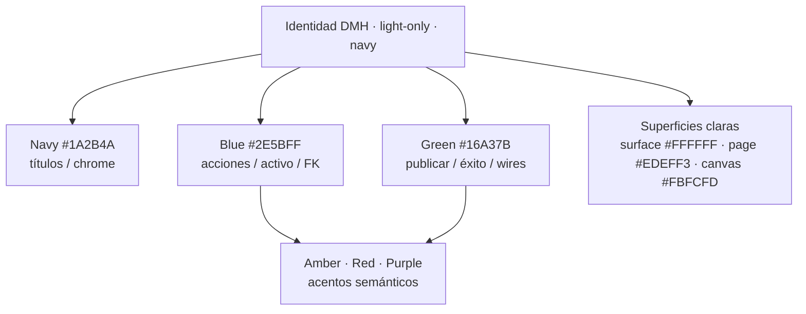
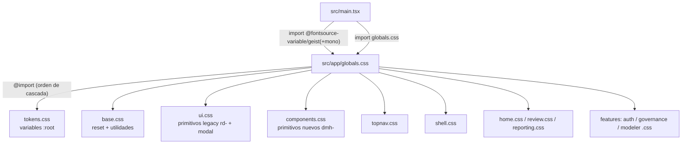
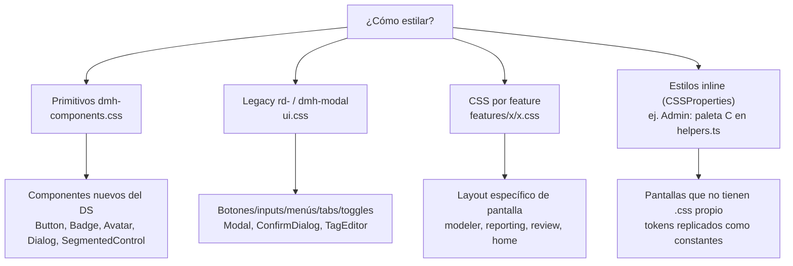
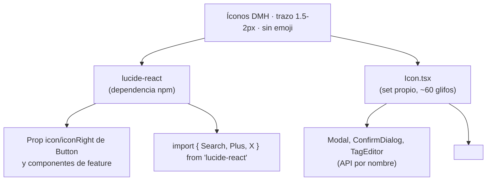
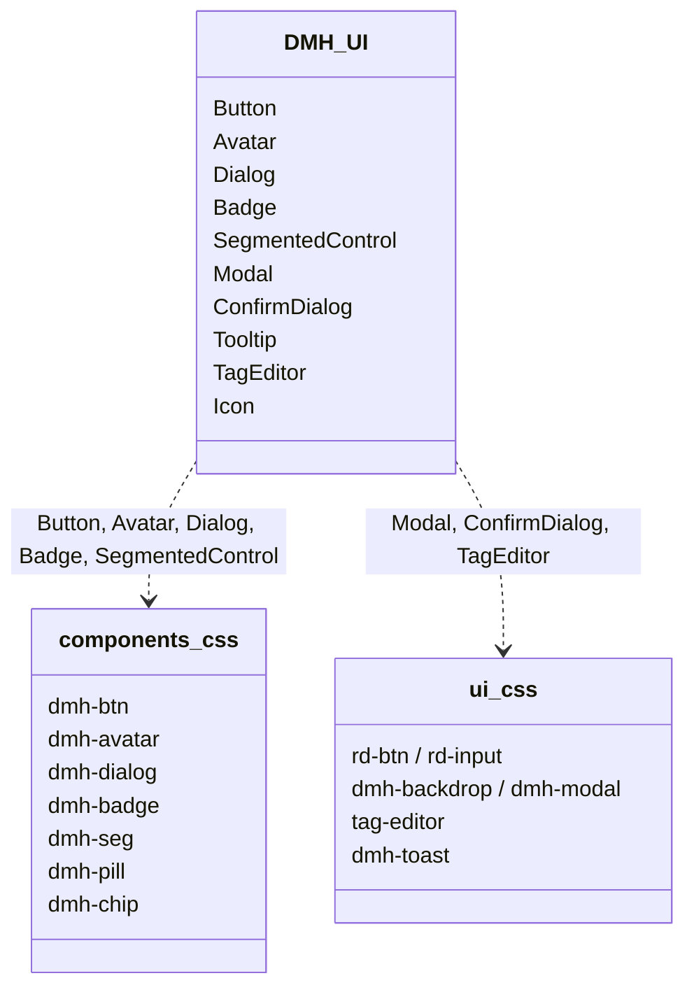
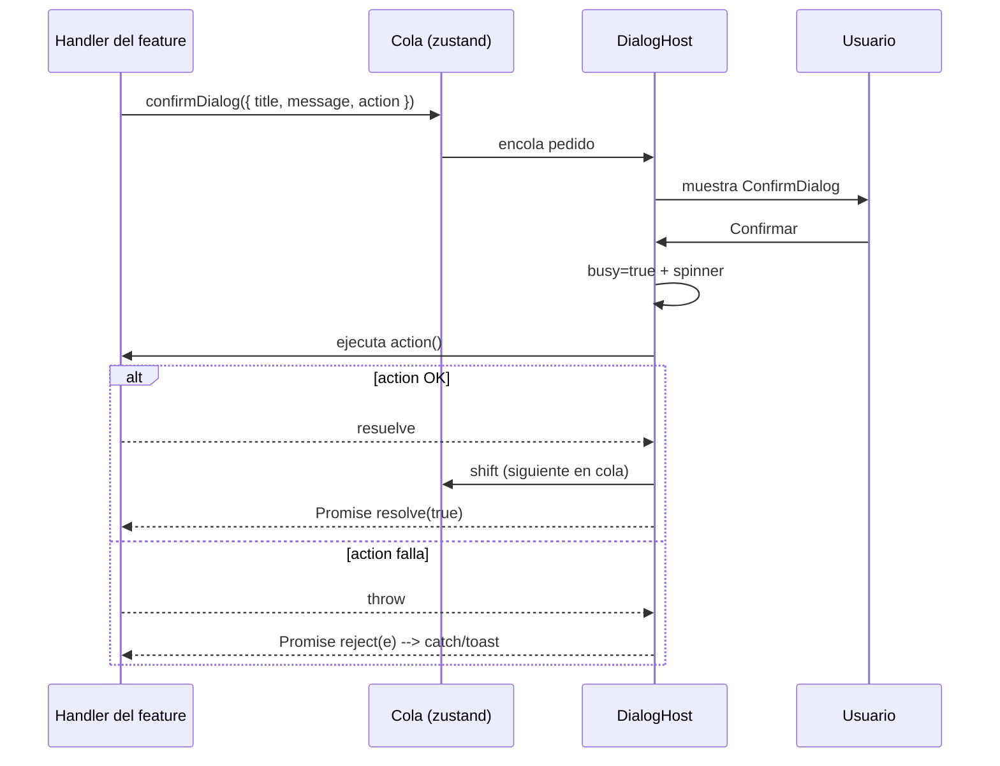
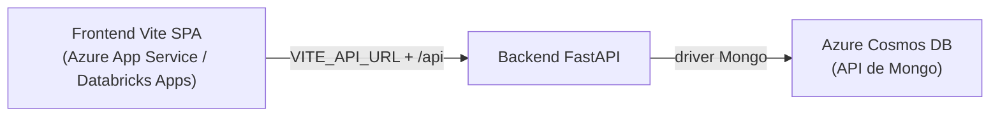

# Design System — Data Model Hub (frontend)

> Sistema de diseño del frontend de **Data Model Hub (DMH)**, la aplicación web de modelado y gobierno de datos estilo Erwin. Documento de referencia para desarrolladores y stakeholders técnicos.
>
> Fuente de verdad del código: `src/styles/` (tokens y hojas por feature), `src/components/ui/` (primitivos reutilizables) y `src/features/admin/components/helpers.ts` (paleta `C` para estilos inline). Versión de tokens: **DMH-Erwin v20260625-2**.

El frontend está construido con **React 19 + Vite + TypeScript**. Todo el diseño es **light-only sobre una identidad navy/blue/green**: no existe modo oscuro y no está previsto. Los estilos son **globales** (no hay CSS Modules): se cargan por cascada desde `src/app/globals.css`.

---

## 1. Identidad visual

La marca se apoya en tres colores base y una superficie clara:

| Rol | Color | Hex | Uso |
|---|---|---|---|
| **Navy** | Azul marino | `#1A2B4A` | Títulos, encabezados de tabla, logo, cards oscuras, texto de máxima jerarquía (`--ink`, `--navy`). |
| **Blue** | Azul primario | `#2E5BFF` | Acciones primarias, estados activos, foco, foreign keys (`--primary`, `--blue`). |
| **Green** | Verde | `#16A37B` / `#0E8C6A` | Publicar, éxito, filas agregadas, wires de relación (`--success`, `--flow`, `--green`). |

Colores de apoyo semántico: **Amber** `#E0A024` (PK, en revisión, overrides), **Red** `#C0392B` (rechazo/peligro), **Purple** `#8B5CF6` (parent-domain, surrogate keys, algunos avatares).

Principios:

- **Light-only, navy.** Un único tema. Las superficies son blancas (`#FFFFFF`) sobre un fondo de página gris muy claro (`--page-bg #EDEFF3`); el lienzo de modelado usa `--canvas-bg #FBFCFD` con grilla punteada `--canvas-dot #D6DBE6`.
- **Sin emojis.** Todos los glifos son íconos de trazo (1.5–2px), nunca emojis (regla explícita en `Icon.tsx`).
- **Tipografía Geist.** Geist para UI, Geist Mono para datos/SQL/identificadores.
- **Estética sobria y densa.** Radios suaves (9–14px), sombras muy tenues de tinte navy, bordes gris-azulados finos.



---

## 2. Arquitectura de estilos

Todos los `.css` viven en `src/styles/` o dentro de cada feature (`src/features/<name>/<name>.css`) y se importan **en orden de cascada** desde `src/app/globals.css`. Las fuentes `.woff2` (self-hosted vía `@fontsource-variable`) las importa `src/main.tsx`.



Orden real declarado en `globals.css`:

```
tokens → base → ui → components → topnav → shell → home → review → reporting → auth → governance → modeler
```

Regla de oro: **`tokens.css` primero** (define todas las variables en `:root`, sin wrapper), luego reset, luego primitivos compartidos, y al final los estilos por feature. Al agregar un feature se crea `features/<name>/<name>.css` y se le añade un `@import`.

### Alias de import

`vite.config.ts` mapea `@` → `src`. Por eso los primitivos se importan como `import { Button } from '@/components/ui'`.

---

## 3. Tokens de color

Definidos en `src/styles/tokens.css`. Hay dos capas: la **paleta cruda** (hex exactos del handoff) y los **alias legacy** (nombres estables como `--primary`, `--ink`, `--muted`) que se remapean a la paleta nueva para que ninguna clase antigua se rompa.

### 3.1 Paleta cruda

**Blue — acciones primarias, activo, FK**

| Token | Hex | Uso |
|---|---|---|
| `--blue` | `#2E5BFF` | Azul primario |
| `--blue-tint` | `#EAF0FF` | Nav/tab activo, rellenos seleccionados |
| `--blue-border` | `#D4E0FF` | Pills / bordes suaves |
| `--blue-border-2` | `#D9E3FB` | Borde alterno |
| `--blue-soft` | `#F2F6FF` | Wash azul muy suave |

**Green — publicar / éxito**

| Token | Hex | Uso |
|---|---|---|
| `--green` | `#16A37B` | Botón Publish, pasos completados |
| `--green-deep` | `#0E8C6A` | Texto agregado, ícono de partición |
| `--green-tint` | `#E4F6EF` | Pills de éxito |
| `--green-tint-2` | `#EFFAF4` | Filas agregadas |
| `--green-tint-3` | `#F4F9F6` | Fila de producción actual |

**Amber — PK, warnings, en revisión, overrides**

| Token | Hex | Uso |
|---|---|---|
| `--amber` | `#E0A024` | Ícono PK |
| `--amber-deep` | `#9A6B00` | Texto de warning |
| `--amber-tint` | `#FFF6E6` | Pills "en revisión" |
| `--amber-tint-2` | `#FFF1D6` | Overrides |

**Red — rechazo / peligro**

| Token | Hex |
|---|---|
| `--red` | `#C0392B` |
| `--red-border` | `#F0C9C4` |
| `--red-tint` | `#FBEAEA` |

**Purple — parent-domain, modifier, surrogate keys**

| Token | Hex |
|---|---|
| `--purple` | `#8B5CF6` |
| `--purple-tint` | `#F2EEFE` |

**Ink / texto**

| Token | Hex | Uso |
|---|---|---|
| `--navy` | `#1A2B4A` | Encabezados, cards oscuras, headers de tabla |
| `--text-body` | `#3A4658` | Texto por defecto |
| `--text-muted` | `#56607A` | Secundario |
| `--text-muted-2` | `#8A93A5` | Labels / tipos mono |
| `--text-muted-3` | `#9AA3B2` | Labels más tenues |
| `--text-placeholder` | `#A9B1BE` | Placeholders de input |

**Bordes / rellenos / superficies**

| Token | Hex | Uso |
|---|---|---|
| `--border-1` | `#E2E6EE` | Cards |
| `--border-2` | `#EAEDF2` | Divisores / borde de top-nav |
| `--border-3` | `#DDE2EC` | Inputs / botón secundario |
| `--border-4` | `#E6EAF0` | Borde alterno |
| `--fill-1` | `#F4F6F9` | Relleno sutil |
| `--fill-2` | `#F7F9FC` | Header de tabla |
| `--fill-3` | `#FAFBFC` | Relleno claro |
| `--fill-4` | `#F0F2F6` | Relleno alterno |
| `--page-bg` | `#EDEFF3` | Fondo de la app |
| `--canvas-bg` | `#FBFCFD` | Superficie de modelado |
| `--canvas-dot` | `#D6DBE6` | Grilla punteada |
| `--blur-overlay` | `rgba(16,27,48,0.42)` | Scrim de popup |
| `--blur-amount` | `2px` | Blur del scrim |

### 3.2 Alias legacy (nombres estables)

Se mantienen para no romper clases existentes; apuntan a la paleta cruda:

| Alias | Apunta a | Notas |
|---|---|---|
| `--bg` | `--page-bg` | Fondo app |
| `--surface` | `#ffffff` | Superficie |
| `--surface-2` | `--fill-2` | Superficie secundaria |
| `--border` / `--border-soft` / `--border-strong` | `--border-1` / `--border-2` / `--border-3` | Bordes |
| `--ink` / `--ink-2` | `--navy` / `--text-body` | Texto |
| `--muted` / `--subtle` | `--text-muted` / `--text-muted-2` | Texto secundario |
| `--primary` | `--blue` | Acción primaria |
| `--primary-700` | `#1F46E0` | Hover del primario |
| `--primary-soft` | `--blue-tint` | Fondo suave |
| `--primary-muted` | `rgba(46,91,255,.10)` | Anillo de foco / hover ghost |
| `--success` / `--warning` / `--error` | `--green-deep` / `--amber-deep` / `--red` | Semánticos |
| `--flow` / `--flow-700` | `--green` / `--green-deep` | Wires de relación |

**Chips de llaves ER** (usados por `.rd-key`):

| Token | Color | Llave |
|---|---|---|
| `--k-pk` / `--k-pk-soft` | amber | Primary Key |
| `--k-fk` / `--k-fk-soft` | blue | Foreign Key |
| `--k-sk` / `--k-sk-soft` | purple | Surrogate Key |
| `--k-pt` / `--k-pt-soft` | green-deep | Partition |

### 3.3 Radios y elevación

| Radio | Valor | Uso |
|---|---|---|
| `--r-sm` | `9px` | Inputs, botones, icon-buttons |
| `--r` | `11px` | Cards pequeñas |
| `--r-lg` | `13px` | Cards |
| `--r-xl` | `14px` | Cards grandes / diálogos |
| `--r-full` | `999px` | Pills |
| `--r-chip` | `7px` | Chips chicos |

| Sombra | Definición |
|---|---|
| `--shadow-xs` | `0 1px 2px rgba(16,27,48,.05)` |
| `--shadow-sm` | `0 1px 3px rgba(16,27,48,.06)` |
| `--shadow-md` | `0 6px 18px -4px rgba(16,27,48,.12), 0 2px 6px -2px rgba(16,27,48,.08)` |
| `--shadow-lg` | `0 16px 40px -8px rgba(16,27,48,.20)` |
| `--shadow-card` | `0 1px 3px …, 0 18px 50px rgba(16,27,48,.07)` |
| `--shadow-table` | `0 2px 6px …, 0 10px 28px rgba(16,27,48,.07)` |
| `--shadow-popup` | `0 30px 90px rgba(16,27,48,.34)` |

Todas las sombras usan tinte navy (`rgba(16,27,48,…)`), nunca negro puro.

---

## 4. Tipografía

Dos familias, **self-hosted** vía `@fontsource-variable` (importadas en `main.tsx`, sin CDN):

| Familia | Token | Uso |
|---|---|---|
| **Geist Variable** | `--ui` | Toda la UI (texto, botones, nav, labels) |
| **Geist Mono Variable** | `--mono` | Datos, SQL/DDL, identificadores, tipos de columna |

Definición (`tokens.css` + `globals.css`):

```css
--font-geist:      'Geist Variable', system-ui, sans-serif;
--font-geist-mono: 'Geist Mono Variable', ui-monospace, monospace;

--ui:   var(--font-geist), 'Geist Variable', -apple-system, BlinkMacSystemFont, 'Segoe UI', sans-serif;
--mono: var(--font-geist-mono), 'Geist Mono Variable', ui-monospace, 'JetBrains Mono', monospace;
```

`base.css` fija `font-family: var(--ui)` en `body` con `antialiased` y `optimizeLegibility`.

### Escala tipográfica (clases `rd-` en `ui.css`)

| Clase | Tamaño | Peso | Notas |
|---|---|---|---|
| `.rd-eyebrow` | 11px | 700 | Mayúsculas, `letter-spacing .12em` |
| `.rd-h1` | 26px | 800 | `letter-spacing -.02em` |
| `.rd-h2` | 19px | 700 | — |
| `.rd-h3` | 15px | 700 | — |
| `.rd-body` | 13.5px | — | `line-height 1.6` |
| `.rd-small` | 12px | — | Texto tenue |
| `.rd-mono` | — | — | Aplica `var(--mono)` |

Ejemplo:

```html
<div class="rd-eyebrow">Governance</div>
<h1 class="rd-h1">Model requests</h1>
<p class="rd-body">Revisá los cambios propuestos antes de publicarlos.</p>
<code class="rd-mono">customer_id BIGINT</code>
```

---

## 5. Convenciones de estilos

Conviven **tres mecanismos**. Elegí según el contexto:



1. **Primitivos `dmh-` (`components.css`)** — la capa "nueva" del DS: `.dmh-btn`, `.dmh-pill`, `.dmh-chip`, `.dmh-badge`, `.dmh-avatar`, `.dmh-seg`, `.dmh-dialog`. Los consumen los componentes de `src/components/ui/`.

2. **Legacy `rd-` / `dmh-modal` (`ui.css`)** — primitivos previos que siguen vigentes: `.rd-btn`, `.rd-input`, `.rd-badge`, `.rd-key`, `.rd-menu`, `.rd-tabs`, `.rd-toggle`, `.dmh-backdrop`, `.dmh-modal`, `.tag-editor`, `.dmh-toast`. Los usan `Modal`, `ConfirmDialog`, `dialogs.tsx` y `TagEditor`.

3. **CSS por feature** — `modeler.css`, `reporting.css`, `review.css`, `home.css`, `topnav.css`, `shell.css`. Layout y componentes propios de cada pantalla. Todo global (sin CSS Modules), namespaced por prefijo (`.wk-`, `.dmh-topnav`, etc.).

4. **Estilos inline con la paleta `C`** — cuando una pantalla no tiene `.css` propio (caso **Admin**, pantalla 14), se usan objetos `CSSProperties` y un objeto de tokens `C` en `src/features/admin/components/helpers.ts`. `C` **replica** los mismos hex de `tokens.css` como constantes JS para compartirlos entre `AdminScreen` y sus modales.

### La paleta `C` (helpers.ts)

```ts
export const C = {
  navy: '#1A2B4A', text: '#3A4658', text2: '#56607A', text3: '#8A93A5',
  blue: '#2E5BFF', blueSoft: '#EAF0FF', blueBorder: '#D4E0FF',
  border: '#EAEDF2', border2: '#E2E6EE',
  green: '#0E8C6A', greenBg: '#E4F6EF',
  amber: '#9A6B00', amberBg: '#FFF6E6',
  red: '#C0392B', redBg: '#FBEDEC', redDeep: '#9A2B2B',
  panel: '#FAFBFC', muted: '#AEB6C4', grey: '#F0F2F6', white: '#FFFFFF',
} as const;

export const MONO = 'ui-monospace, SFMono-Regular, Menlo, Consolas, monospace';
```

Junto a `C`, `helpers.ts` exporta estilos base reutilizables (`inputStyle`, `labelStyle`, `primaryBtn`, `ghostBtn`, `dangerBtn`, `iconBtnStyle`, `chipStyle`) y utilidades: `slug()`, `avatarColor(seed)` (hash → color de avatar), `initialsOf(user)`, `accessLevelOf(perms)`, `statusMeta(status)`. Ejemplo de un chip de estado derivado:

```ts
// Chip { label, color, bg } listo para chipStyle(...)
statusMeta('active')  // { label: 'Activo',   color: C.green,  bg: C.greenBg }
statusMeta('disabled')// { label: 'Inactivo', color: C.red,    bg: C.redBg   }
```

> **Criterio:** para pantallas nuevas preferí un `.css` por feature con tokens de `tokens.css`. El inline con `C` es el patrón del módulo Admin y solo se replica ahí.

---

## 6. Íconos

Existen **dos sistemas de íconos**, ambos de trazo simple (1.5–2px), **sin emojis**:



### 6.1 lucide-react

Librería principal (`lucide-react ^1.21.0`). Se importa cada ícono por nombre y se pasa como componente. El `Button` y `Dialog` reciben el **componente** (tipo `LucideIcon`), no un string:

```tsx
import { Search, Plus, ArrowUpToLine } from 'lucide-react';

<Button variant="success" icon={ArrowUpToLine}>Publicar</Button>
```

Convención de render en los primitivos: `size` 14–16 y `strokeWidth={1.6}`.

### 6.2 Icon.tsx (set propio)

`src/components/ui/Icon.tsx` define ~60 glifos de un solo trazo en un objeto `PATHS` (portados de la maqueta original). La API es **por nombre** (string tipado `IconName`), útil donde se guarda el nombre del ícono como dato:

```tsx
import Icon from '@/components/ui/Icon';

<Icon name="database" size={16} sw={2} />
<Icon name="trash" size={18} />
```

Props: `name` (obligatorio), `size` (default 16), `sw` (stroke width, default 2), `fill` (default `none`), `className`, `style`. Todos los SVG usan `stroke="currentColor"` con `strokeLinecap/Linejoin="round"` y `aria-hidden`.

Nombres disponibles (extracto): `plus, search, gear, link, cursor, table, grid, layers, database, sparkles, code, upload, trash, edit, chevR, chevD, chevL, x, key, eye, filter, arrange, fit, zoomIn, zoomOut, merge, check, dots, download, hand, folder, columns, list, logout, book, users, activity, save, undo, redo, share, info, panelRight, move, magnet, bolt, send, paperclip, refresh, warning, file, shield, tag`.

> **Regla:** ambos sets comparten estética (trazo redondeado, `currentColor`). Usá **lucide-react** por defecto; usá **Icon.tsx** cuando la API por nombre te convenga (Modal/ConfirmDialog/TagEditor) o necesites un glifo del set propio.

---

## 7. Componentes UI reutilizables

Viven en `src/components/ui/` y se reexportan desde el barrel `@/components/ui`. Todos son light-only, navy, y consumen `components.css` / `ui.css`.



Import canónico:

```tsx
import { Button, Dialog, Avatar, Badge, SegmentedControl, Modal, ConfirmDialog, Tooltip } from '@/components/ui';
```

### 7.1 Button

`variant` × `size`, con ícono lucide opcional a izquierda y/o derecha. Renderiza `.dmh-btn` + modificadores.

| Prop | Tipo | Default | Notas |
|---|---|---|---|
| `variant` | `'primary' \| 'success' \| 'secondary' \| 'ghost' \| 'danger'` | `'primary'` | primary=blue, success=green, secondary=blanco+borde |
| `size` | `'md' \| 'sm'` | `'md'` | md=36px, sm=30px |
| `icon` | `LucideIcon` | — | Ícono líder |
| `iconRight` | `LucideIcon` | — | Ícono al final |

Estilo por variante (`components.css`):

| Variante | Fondo | Texto | Hover |
|---|---|---|---|
| `primary` | `--blue` | `#fff` | `--primary-700 #1F46E0` |
| `success` | `--green` | `#fff` | `--green-deep` |
| `secondary` | `--surface` + borde `--border-3` | `--text-body` | borde/texto → `--blue` |
| `ghost` | transparente | `--text-muted` | fondo `--blue-tint`, texto `--blue` |
| `danger` | `--red-tint` + borde `--red-border` | `--red` | fondo `#f6dcd8` |

```tsx
import { Button } from '@/components/ui';
import { ArrowUpToLine } from 'lucide-react';

// Ejemplo real (PublishModal.tsx):
<Button variant="secondary" onClick={onClose}>Cancelar</Button>
<Button variant="success" icon={ArrowUpToLine} onClick={handleSend} disabled={!canSend}>
  Enviar a revisión
</Button>

// Compacto + ghost:
<Button variant="ghost" size="sm" icon={Search}>Buscar</Button>
```

### 7.2 Avatar

Chip circular con iniciales. Renderiza `.dmh-avatar`.

| Prop | Tipo | Default | Notas |
|---|---|---|---|
| `initials` | `string` | — | Se trunca a 2 chars, uppercase |
| `size` | `number` | `30` | Diámetro en px; el `font-size` sale de `size * 0.4` |
| `tone` | `'blue' \| 'purple' \| 'green' \| 'navy'` | `'blue'` | Color de fondo |

```tsx
import { Avatar } from '@/components/ui';

// Ejemplo real (PublishModal.tsx):
<Avatar initials={u.initials} size={24} tone={toneFor(u.id)} />
```

En pantallas con inline (Admin) el color se deriva por hash con `avatarColor(seed)` de `helpers.ts` en vez del `tone`.

### 7.3 Dialog

Modal del DS con un patrón distintivo: **blur solo del lienzo**. Renderiza vía `createPortal` a `document.body`. Cierra con ESC, click en el backdrop o el botón de cerrar.

| Prop | Tipo | Default | Notas |
|---|---|---|---|
| `open` | `boolean` | — | Controlado |
| `title` | `string` | — | Título del header |
| `subtitle` | `string` | — | Subtítulo opcional |
| `icon` | `LucideIcon` | — | Chip de ícono en el header |
| `onClose` | `() => void` | — | ESC / backdrop / cerrar |
| `footer` | `ReactNode` | — | Acciones alineadas a la derecha |
| `width` | `number` | `560` | Ancho en px |
| `backdrop` | `'screen' \| 'canvas'` | `'screen'` | screen=oscurece todo; canvas=oscurece+difumina solo el lienzo |
| `canvasTop` | `number` | `52` | Px desde arriba donde arranca el blur (52 = solo TopNav; 116/136 si hay toolbar de canvas) |

El modo `canvas` aplica `rgba(16,27,48,.42)` + `blur(2px)` **solo** en la región del lienzo, dejando el TopNav y la toolbar nítidos y las table-cards visibles a través del blur.

```tsx
import { Dialog, Button } from '@/components/ui';
import { FileCode2 } from 'lucide-react';

// Ejemplo real (ExportDdlModal.tsx):
<Dialog
  open={open}
  title="Export DDL"
  subtitle={`Genera DDL desde el modelo · ${allTables.length} tablas`}
  icon={FileCode2}
  onClose={onClose}
  footer={<Button variant="primary" onClick={handleCopy}>Copiar DDL</Button>}
  width={920}
  backdrop="canvas"
  canvasTop={136}
>
  {/* cuerpo del diálogo */}
</Dialog>
```

### 7.4 Badge

Etiqueta chica de esquinas cuadradas (conteos, PK/FK/partition, tipos de palabra UDP). Más chica y menos redondeada que un Pill. Texto en **mayúsculas 10px**, `letter-spacing .03em`.

| Prop | Tipo | Default |
|---|---|---|
| `tone` | `'blue' \| 'green' \| 'amber' \| 'red' \| 'purple' \| 'neutral'` | `'neutral'` |

```tsx
import { Badge } from '@/components/ui';

<Badge tone="amber">PK</Badge>
<Badge tone="blue">FK</Badge>
<Badge tone="green">42</Badge>
```

> Además de `Badge`, `components.css` define `.dmh-pill` (más redondo, con ícono opcional) y `.dmh-chip` (con estado `.is-active`) para pills y chips filtrables. Se aplican por clase directamente.

### 7.5 SegmentedControl

Toggle tipo grupo de pills (ej. UDP "Por columna / Por tabla", selector de separador o de caso). Segmento activo = relleno blanco + texto azul sobre una bandeja sutil. Controlado.

| Prop | Tipo | Notas |
|---|---|---|
| `options` | `SegmentOption<T>[]` | `{ value, label, icon? }` |
| `value` | `T` | Seleccionado |
| `onChange` | `(value: T) => void` | — |
| `aria-label` | `string` | Etiqueta accesible del grupo |

```tsx
import { SegmentedControl } from '@/components/ui';
import { Table2, Columns } from 'lucide-react';

const [mode, setMode] = useState<'table' | 'column'>('table');

<SegmentedControl
  aria-label="Alcance del UDP"
  value={mode}
  onChange={setMode}
  options={[
    { value: 'table',  label: 'Por tabla',   icon: Table2 },
    { value: 'column', label: 'Por columna', icon: Columns },
  ]}
/>
```

### 7.6 Modal (legacy)

Shell de modal previo: scrim difuminado (`.dmh-backdrop`) + header (ícono · título · subtítulo · cerrar) + cuerpo scrolleable + footer a la derecha. Usa el set **Icon.tsx** por nombre. ESC cierra.

| Prop | Tipo | Notas |
|---|---|---|
| `title` / `subtitle` | `string` | Header |
| `icon` | `IconName` | Nombre del set propio |
| `onClose` | `() => void` | ESC / backdrop |
| `footer` | `ReactNode` | Acciones a la derecha (`.left` para contenido a la izquierda) |
| `size` | `'md' \| 'lg'` | md=560px, lg=760px |

```tsx
import { Modal } from '@/components/ui';

<Modal title="Nuevo changeset" icon="edit" onClose={close}
  footer={<button className="rd-btn rd-btn-primary">Crear</button>}>
  <label className="rd-label">Título</label>
  <input className="rd-input" />
</Modal>
```

> **Cuándo usar cuál:** para pantallas nuevas del DS preferí **`Dialog`** (icono lucide, patrón canvas-blur, tokens nuevos). **`Modal`** sigue vigente para pantallas que ya lo usan y para el set de íconos por nombre.

### 7.7 ConfirmDialog y diálogos imperativos

`ConfirmDialog` reemplaza `window.confirm`: accesible por teclado (ESC cancela, el botón de confirmar se auto-enfoca), con opción "No volver a preguntar en esta sesión" persistida en `sessionStorage`. Variante `danger` (ícono `trash`, botón rojo) o `primary` (ícono `info`). Soporta `busy` para bloquear con spinner mientras corre una acción asíncrona.

Sobre él, `dialogs.tsx` expone **helpers basados en promesas** (`confirmDialog`, `promptDialog`) con una cola global renderizada por `<DialogHost/>` (se monta una vez al final de `App.tsx`). Con `action`, el diálogo no cierra al confirmar: queda con spinner hasta que la promesa resuelve.



```tsx
import { confirmDialog, promptDialog } from '@/components/ui/dialogs';

// Confirmación destructiva con trabajo asíncrono:
await confirmDialog({
  title: 'Eliminar columna',
  message: 'Esta acción no se puede deshacer.',
  variant: 'danger',
  confirmLabel: 'Eliminar',
  action: () => deleteColumn(id),   // el diálogo muestra spinner hasta terminar
});

// Prompt (null = cancelado):
const name = await promptDialog({ title: 'Nuevo changeset', label: 'Título' });
if (name) createChangeset(name);
```

### 7.8 TagEditor

Editor de etiquetas clave/valor: chips + fila "clave = valor" para agregar. Usado en tres niveles (dominio, tabla, columna) del gobierno. `compact` para contextos densos (panel de columna). Renderiza `.tag-editor` (ui.css) con íconos del set propio.

```tsx
import TagEditor from '@/components/ui/TagEditor';

<TagEditor value={tags} onChange={setTags} keyPlaceholder="clave" valuePlaceholder="valor" />
```

### 7.9 Tooltip

Tooltip minimal por hover, posicionado con `getBoundingClientRect` y renderizado por portal a `document.body`. Fondo `--ink`, texto blanco 11px, `--shadow-md`.

```tsx
import { Tooltip } from '@/components/ui';

<Tooltip label="Ajustar al lienzo">
  <button className="rd-btn rd-btn-icon"><Icon name="fit" /></button>
</Tooltip>
```

---

## 8. Referencia rápida de clases

Para estilar por clase sin componente React:

| Clase | Qué es | Hoja |
|---|---|---|
| `.dmh-btn` + `--primary/--success/--secondary/--ghost/--danger` + `--sm` | Botón DS | components.css |
| `.dmh-pill --blue/green/amber/red/purple/neutral` | Pill redondeado | components.css |
| `.dmh-chip` + `.is-active` | Chip filtrable | components.css |
| `.dmh-badge --<tone>` | Badge cuadrado uppercase | components.css |
| `.dmh-avatar --blue/purple/green/navy` | Avatar circular | components.css |
| `.dmh-seg` / `.dmh-seg-btn.is-active` | Segmented control | components.css |
| `.dmh-dialog*` | Diálogo DS | components.css |
| `.rd-btn --primary/secondary/ghost/danger` + `--sm/lg/icon` | Botón legacy | ui.css |
| `.rd-input`, `.rd-label`, `.rd-search`, `.rd-field` | Inputs / labels | ui.css |
| `.rd-badge`, `.rd-key.pk/fk/sk/pt`, `.rd-engine` | Badges / llaves ER | ui.css |
| `.rd-toggle.on`, `.rd-tabs`, `.rd-menu` | Toggle / tabs / menú | ui.css |
| `.rd-card`, `.rd-tip`, `.dmh-toast`, `.dmh-empty` | Card / tooltip / toast / vacío | ui.css |
| `.dmh-backdrop`, `.dmh-modal.lg`, `.m-head/.m-body/.m-foot` | Modal legacy | ui.css |
| `.dmh-topnav`, `.dmh-nav-link.is-active`, `.dmh-usermenu` | Barra superior | topnav.css |
| `.dmh-rail`, `.dmh-pcard`, `.dmh-page` | Shell / cards de proyecto | shell.css |

---

## 9. Despliegue

El frontend es una SPA de **Vite** (build estático en `dist/`). Corre en **uno de dos entornos**:

| Entorno | Cómo corre | Notas |
|---|---|---|
| **Azure App Service** | Servido como sitio estático (o detrás del backend FastAPI). | Objetivo cloud principal. |
| **Databricks Apps** | Empaquetado junto al backend (dos apps: Next/Vite standalone + FastAPI). Config vía `databricks.yml` y `app.yaml`. | MVP abierto/anónimo; despliegue por bundle. |

### Variables de entorno

Vite expone al bundle solo variables con prefijo `VITE_`. La única del frontend:

| Variable | Uso | Default |
|---|---|---|
| `VITE_API_URL` | Base URL del backend FastAPI. Todos los `*.service.ts` hacen `import.meta.env.VITE_API_URL ?? ''`. | `''` (mismo origen → `/api`) |

En **desarrollo**, `vite.config.ts` levanta el front en `:3000` y proxya `/api` al FastAPI en `http://localhost:8000`, así que `VITE_API_URL` puede quedar vacío. En **producción**, si el frontend y el backend comparten origen se deja vacío (rutas relativas `/api/...`); si están en hosts distintos se setea `VITE_API_URL` al host del backend en build time.

```bash
# Desarrollo
npm run dev            # front :3000, proxy /api -> :8000

# Build de producción (con backend en otro host)
VITE_API_URL="https://dmh-api.example.com" npm run build
# genera dist/ para servir en Azure App Service o empaquetar en Databricks Apps
```

### Base de datos (Azure Cosmos DB · API de Mongo)

La persistencia la maneja el backend contra **Azure Cosmos DB con API de Mongo** — el frontend nunca habla con la base directamente, siempre pasa por FastAPI. Consideraciones que impactan al DS/UI:

- **Cosmos con Mongo API** implica límites de tamaño de documento (~2 MB). Los cambios de un changeset se guardan **solo** vía un `changes_map` (colección `changeset_changes`), no como un blob gigante, lo que evita romper ese límite. La UI de gobierno/review consume esos cambios paginados desde el server.
- Reporting y catálogo trabajan **server-side** (slices, conteos con `$group`, búsqueda paginada) para escalar a cientos de miles de columnas; el frontend virtualiza grillas y memoiza el canvas. El DS provee para esto la grilla virtualizada del Report Designer y los primitivos de tabla/badge.
- El invariante de persistencia relevante para cualquier campo nuevo: debe existir en **el tipo TS y en el modelo Pydantic** del backend, o se pierde al recargar (el read-path revalida con `extra="ignore"`).



---

## 10. Checklist para colaborar

- Usá **tokens** (`var(--…)`), nunca hex sueltos en CSS. En pantallas con inline, importá la paleta `C` de `helpers.ts`.
- Preferí los **primitivos `dmh-`** (`Button`, `Badge`, `Avatar`, `Dialog`, `SegmentedControl`) sobre reescribir estilos.
- Íconos: **lucide-react** por defecto; **Icon.tsx** cuando necesites la API por nombre o un glifo del set propio. Nunca emojis.
- Diálogos nuevos: `Dialog` (con `backdrop="canvas"` cuando el modal vive sobre el lienzo). Confirmaciones: `confirmDialog` / `promptDialog`.
- Tipografía: `--ui` (Geist) para UI, `--mono` (Geist Mono) para datos/SQL/identificadores.
- Estilos por feature en `features/<name>/<name>.css` con su `@import` en `globals.css`, respetando el orden de cascada.
- Light-only, navy: no agregues variantes dark ni colores fuera de la paleta.
