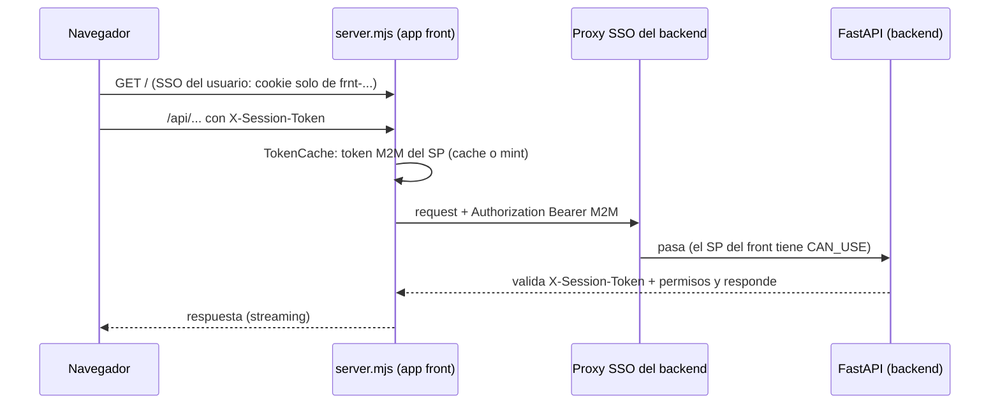
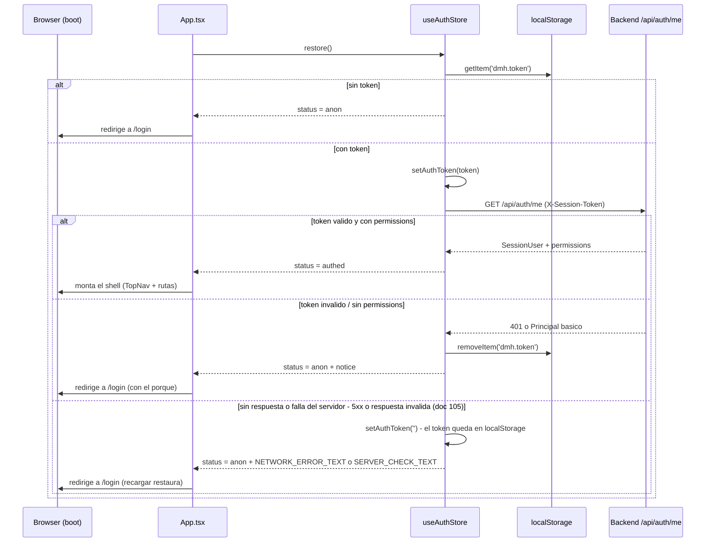
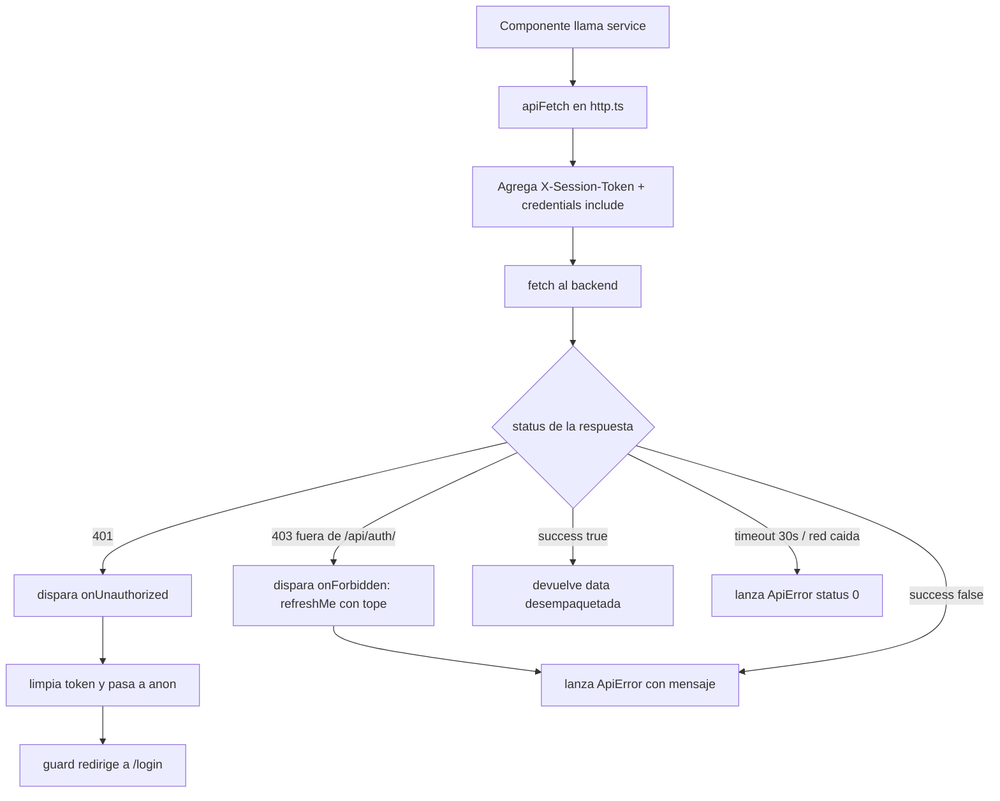
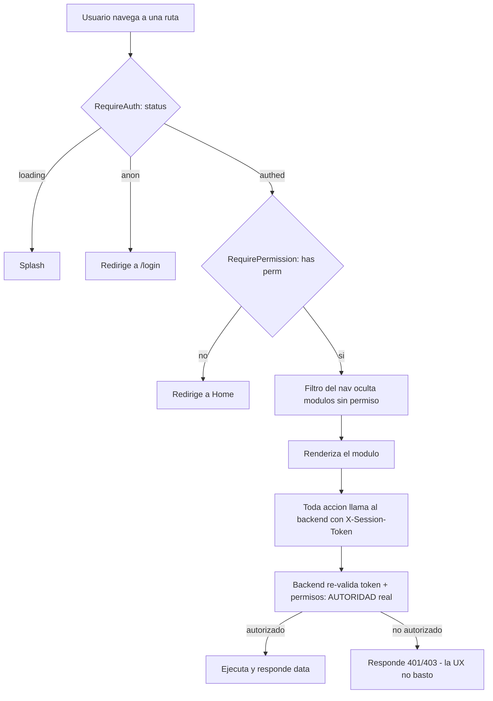
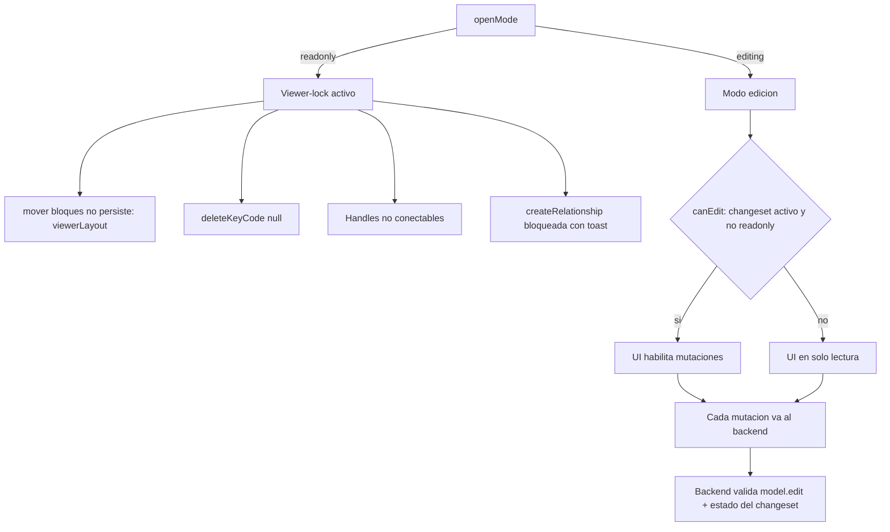

# Seguridad del Frontend — Data Model Hub

> **Actualizado 2026-07-31** — autenticación de producción frente al SSO de Databricks Apps con un solo origen (`server.mjs`, doc 36), token de sesión por `X-Session-Token`, permisos `export` y `rollback`, producción sin `VITE_API_URL` (bundle sin URLs ni secretos) y buenas prácticas del server de producción.

Este documento describe el modelo de seguridad del cliente web (SPA en React + Vite) de Data Model Hub: cómo funciona la autenticación en producción frente al SSO de Databricks Apps (un solo origen), cómo se maneja el token de sesión, cómo el frontend gatea la experiencia según el rol/permisos del usuario (RBAC), cómo funciona el viewer-lock del canvas, por qué no viajan secretos en el bundle y qué buenas prácticas se aplican.

La premisa central y no negociable: **el frontend gatea la experiencia de usuario (UX), pero la AUTORIDAD es siempre el backend.** Todo lo que se describe acá mejora la usabilidad y evita mostrar acciones que el usuario no puede ejecutar, pero ninguna de estas defensas reemplaza la autorización del servidor. Un atacante que edite el JavaScript en su navegador, use la consola o llame la API con `curl` no obtiene ningún privilegio adicional: el backend valida cada request contra el token y la matriz de permisos.

---

## Autenticación en producción: SSO de Databricks Apps + un solo origen

En producción la plataforma corre como **dos Databricks Apps** (`frnt-data-model-hub` y `bknd-data-model-hub`) y cada app vive detrás de su **propio proxy OAuth (muro SSO) en su propio subdominio**. Como `databricksapps.com` está en la **Public Suffix List**, la cookie de sesión del SSO es **por app**: la sesión que el usuario gana al abrir el front no vale para el subdominio del backend. Y un `fetch()` desde el front hacia la app backend **no puede completar el baile SSO** (el redirect cross-origin a Microsoft es imposible dentro de una llamada XHR/fetch): el proxy del backend responde su propio `401` de 2 bytes (`{}`), sin headers CORS, y el navegador lo reporta como "Failed to fetch". Así se manifestó el problema en el workspace corporativo (2026-07-30): cualquier usuario distinto al que desplegó no podía loguearse — el request moría **antes** de llegar a FastAPI. Historia completa en el doc 36 de `plan-implementacion/`.

**El warm-up por redirect (opción A) fracasó y queda inerte.** El primer intento fue `src/services/warmup.ts` (`ensureBackendSession`, invocado por `LoginScreen`): un probe a `GET /api/health` y, si el backend resultaba inalcanzable, UNA navegación top-level a `GET /api/auth/warmup/{next}` (el `next` en el path como base64url) para que el SSO ocurriera solo y rebotara de vuelta. Motivo del fracaso: el proxy de Databricks **no inicia el SSO en navegaciones lanzadas por script desde otro sitio** — el usuario quedaba varado en un `{}`. El código sigue en el repo pero es un no-op con `API_BASE` vacía (la producción actual); solo actúa en local apuntando a un backend remoto.

**Solución definitiva (2026-07-31): el navegador habla con UN SOLO origen.** `server.mjs` — servidor de producción propio del front, cero dependencias (solo módulos `node:*`) — sirve el build (`dist/`) y **proxya `/api/*` al backend servidor-a-servidor**, adjuntando un token OAuth **M2M** del service principal del front (`POST {DATABRICKS_HOST}/oidc/v1/token`, `grant_type=client_credentials`, `scope=all-apis`; el token se cachea hasta su expiración menos 5 minutos, con un solo mint concurrente — clase `TokenCache`). El front deja de definir `VITE_API_URL`: `API_BASE` queda vacío y todas las rutas son relativas (`/api/...`), mismo origen. Para el navegador no hay CORS en juego y el muro SSO del backend lo cruza el server, no el usuario.

Consecuencias de seguridad de este diseño:

- **Las credenciales del service principal (`DATABRICKS_CLIENT_ID` / `DATABRICKS_CLIENT_SECRET`) viven SOLO en el proceso del server** (las inyecta Databricks Apps en runtime): jamás llegan al navegador ni al bundle de JavaScript.
- **El server DESCARTA el header `Authorization` entrante del cliente** (`DROP_HEADERS` en `buildUpstreamHeaders` de `server.mjs`) y pone el suyo: un cliente no puede inyectar su propio Bearer hacia el backend a través del proxy.
- **El JWT propio de la plataforma viaja en `X-Session-Token`**, no en `Authorization`: en Databricks Apps ese header le pertenece al proxy SSO (lo consume para su propia autenticación y el backend nunca lo recibiría). Ver §1.2.
- El prerequisito de permisos del proxy (el SP del front necesita `CAN_USE` sobre la app backend) lo re-aplica CI en cada deploy — ver §6.



---

## 1. Manejo del token de sesión

### 1.1 Modelo de autenticación

La app usa autenticación propia por **token (Bearer)**. El backend expone tres rutas (todas con el envelope `{ success, data }`):

| Método | Ruta | Cuerpo | Respuesta |
|--------|------|--------|-----------|
| `POST` | `/api/auth/login` | `{ username, password }` | `{ token, user }` |
| `POST` | `/api/auth/logout` | — | `{ ok }` |
| `GET` | `/api/auth/me` | — | `SessionUser` (o Principal básico) |

Definidas en `src/features/auth/auth.service.ts`:

```ts
import { API_BASE } from '@/services/apiBase'; // base única (homologación 2026-07-19)

export const login  = (username, password) =>
  apiPost<LoginResult>(`${API_BASE}/api/auth/login`, { username, password });
export const logout = () => apiPost<{ ok: boolean }>(`${API_BASE}/api/auth/logout`);
export const fetchMe = () => apiGet<SessionUser>(`${API_BASE}/api/auth/me`);
```

### 1.2 Dónde vive el token y cómo se envía

El token se persiste en `localStorage` bajo la clave `dmh.token` (constante `TOKEN_KEY` en `src/store/useAuthStore.ts`). El store de auth es la fuente de verdad de la identidad y empuja el token al cliente HTTP mediante `setAuthToken`.

En `src/services/http.ts`, `apiFetch` inyecta el token como header **`X-Session-Token`** en **toda** llamada a la API:

```ts
const init: RequestInit = {
  method,
  signal: combined,
  credentials: 'include',
  headers: {
    ...(_token ? { 'X-Session-Token': _token } : {}),
    ...(import.meta.env.DEV && _devUser ? { 'X-Dev-User': _devUser } : {}),
    ...headers,
  },
};
```

Notas importantes de este bloque:

- **`X-Session-Token: <token>`**: es el mecanismo de autenticación de la sesión propia. NO se usa `Authorization: Bearer` porque en Databricks Apps ese header le pertenece al proxy SSO de la plataforma: lo consume para su propia autenticación y el backend nunca lo recibe (verificado 2026-07-20: 401 con el Bearer en vuelo). El backend acepta ambos headers (`Authorization` sigue sirviendo para `curl` y desarrollo). El token vive en memoria de módulo (`let _token`) y se setea vía `setAuthToken(t)`.
- **`credentials: 'include'`**: el caso normal (dev y producción) es MISMO origen — en dev el proxy de Vite reenvía `/api` → `:8000`; en producción `server.mjs` proxya `/api` al backend. `include` se conserva para el escenario local en que `VITE_API_URL` apunta a otro backend (orígenes distintos): sin él, el navegador no enviaría ni aceptaría la cookie de sesión `modeler-auth` en requests cross-origin. Ese escenario exige que el backend tenga CORS con el origen exacto y `allow_credentials=true` (no se puede usar `*` con credenciales).
- **`X-Dev-User`**: seam solo de desarrollo, gateado por `import.meta.env.DEV` — en producción nunca viaja. No aporta autoridad (el backend con auth requerida lo ignora) y mandarlo en producción hacía además que el preflight CORS lo rechazara ("Disallowed CORS headers" → "Failed to fetch" en el login).

### 1.3 Ciclo de vida del token

El store `useAuthStore` define `status`: `'loading'` (restaurando al boot), `'anon'` (sin sesión) o `'authed'`.

**Login** (`login`): llama a `auth.login`, limpia el estado de trabajo del actor anterior (`resetAppState`), guarda el token en `localStorage`, lo empuja al cliente HTTP y espeja el usuario:

```ts
const { token, user } = await auth.login(username.trim(), password);
// Defensa en profundidad: si la sesión anterior murió sin logout (token
// expirado, tab reusada), el nuevo actor arranca SIN estado heredado.
resetAppState();
localStorage.setItem(TOKEN_KEY, token);
setAuthToken(token);
mirror(user);
set({ user, status: 'authed', error: null });
```

**Restore al boot** (`restore`): se ejecuta una sola vez en `App.tsx` (`useEffect(() => { void restore(); }, [restore])`). Lee el token de `localStorage`, lo empuja al cliente y valida la sesión contra `/api/auth/me`. Si `/me` no devuelve `permissions`, la sesión se considera inválida y se limpia; desde el doc 105 (ronda 3) además dice por qué (`notice`) y sólo descarta el token ante un 401: sin respuesta del servidor o con una falla suya (5xx, respuesta inválida) lo conserva:

```ts
restore: async () => {
  const token = localStorage.getItem(TOKEN_KEY);
  if (!token) { set({ status: 'anon', user: null }); return; }
  setAuthToken(token);
  const drop = (notice: string) => {
    localStorage.removeItem(TOKEN_KEY);
    setAuthToken('');
    set({ status: 'anon', user: null, notice });
  };
  // Doc 105 (ronda 5): si mientras /me demoraba el usuario entró de nuevo, la
  // respuesta del token viejo ya no decide nada; si fue OTRA pestaña la que
  // cambió el token (localStorage es compartido), se verifica el vigente.
  const superseded = () => get().status !== 'loading';
  const moved = () => localStorage.getItem(TOKEN_KEY) !== token;
  try {
    const user = await auth.fetchMe();
    if (superseded()) return;
    if (moved()) return get().restore();
    if (!user || !('permissions' in user)) { drop(SESSION_REVOKED_TEXT); return; }
    mirror(user);
    set({ user, status: 'authed', notice: null });
  } catch (e) {
    if (superseded()) return;
    if (moved()) return get().restore();
    // Sólo un 401 dice que la sesión terminó. Sin respuesta (0), una falla del
    // servidor (5xx, respuesta inválida) o del proxy: el token puede seguir
    // siendo bueno — se conserva (recargar restaura la sesión) y se avisa.
    const status = e instanceof ApiError ? e.status : -1;
    if (status === 401) { drop(SESSION_ENDED_TEXT); return; }
    setAuthToken('');
    set({ status: 'anon', user: null, notice: status === 0 ? NETWORK_ERROR_TEXT : SERVER_CHECK_TEXT });
  }
},
```

Sin respuesta del servidor (red caída o tiempo agotado: `NETWORK_ERROR_TEXT`) o con una falla del servidor o del proxy (5xx, respuesta inválida: `SERVER_CHECK_TEXT` = «The server couldn't check your session right now — reload the page to try again.») el token queda en `localStorage` —recargar restaura la sesión— pero sale del cliente HTTP y la app queda `anon`: nada lo usa hasta que un `restore()` lo valide contra `/me`. Sólo un 401 lo descarta: antes, cualquier error que no fuera de red cerraba la sesión. Desde la ronda 5 un `restore()` tardío tampoco toca una sesión que empezó después: antes, si el usuario entraba de nuevo (SSO) mientras `/me` del token viejo demoraba, un fallo de red lo dejaba en `anon` y un 401 además borraba el token NUEVO.

**Logout** (`logout`): hace el POST de logout en modo best-effort (si falla, igual sigue), borra el token de `localStorage`, lo limpia del cliente, ejecuta `resetAppState()` y pasa a `anon`. El reset es imprescindible: el logout es navegación SPA (sin reload de página) y los stores de Zustand son singletons de módulo — sin él, el siguiente usuario heredaría la sesión de canvas del anterior.

**Manejo global de 401**: `http.ts` expone un callback `setOnUnauthorized`. Cuando cualquier request responde `401`, `apiFetch` lo dispara:

```ts
if (response.status === 401 && _onUnauthorized) _onUnauthorized();
```

El store lo registra al cargar el módulo: ante un 401 con sesión `authed`, borra el token, resetea el estado de trabajo y pasa a `anon`; el guard de ruta se encarga de redirigir a `/login`. Así una sesión expirada o revocada en el backend expulsa al usuario sin acoplar `http.ts` al router.

```ts
setOnUnauthorized(() => {
  if (useAuthStore.getState().status === 'authed') {
    localStorage.removeItem(TOKEN_KEY);
    setAuthToken('');
    resetAppState();
    useAuthStore.setState({ status: 'anon', user: null });
  }
});
```

**Permisos al día — `refreshMe()` (doc 105, F5)**: los permisos del `SessionUser` quedaban en caché hasta recargar la página (un rol cambiado en Admin no se veía; un usuario deshabilitado seguía viendo la app con sus permisos de antes — el backend ya le respondía 403 a cada escritura, pero la sesión del navegador no se cerraba). Ahora el store re-lee `/api/auth/me` cuando la pestaña vuelve al foco (`focus` y `visibilitychange`, que registra `App.tsx`) y ante un 403 de cualquier ruta fuera de `/api/auth/` (`http.ts` expone `setOnForbidden`, un observador que no cambia el error del llamador):

```ts
// Doc 105 (F5): un 403 (permiso perdido, o el proxy) → rol y permisos al día
// (con el tope de refreshMe).
setOnForbidden(() => { void useAuthStore.getState().refreshMe(); });
```

`refreshMe` tiene tope — una lectura en vuelo y como mucho una cada 10 s (`ME_GAP_MS`), también si falla: un proxy que responde 403 a todo no genera una tormenta — y nunca rechaza. Descarta la respuesta si en el medio cambió la sesión; sólo reemplaza el usuario si cambió su rol o algún permiso; si `/me` ya no trae `permissions` (el backend no resuelve a un usuario deshabilitado y degrada al Principal básico), cierra la sesión por el mismo camino que el 401 (token fuera, `resetAppState()`, `anon`). No degrada una sesión de edición: la autoridad sobre cada escritura sigue siendo el backend. Los componentes que gatean por permiso se suscriben a `s.user?.permissions` o a `s.has('x')` dentro del selector (suscribirse a `s.has` a secas no re-renderiza: es siempre la misma función). Doc 105 (O4): el login dice por qué terminó la sesión (`useAuthStore.notice`, mostrado con `role="status"`): «Your access to Data Model Hub was removed or disabled. Ask an administrator if you think this is a mistake.» si el usuario fue deshabilitado o «Your session ended. Please sign in again.» ante un 401; un logout propio o un login nuevo lo borran. Al abrir la app, `restore()` usa los mismos textos (y `NETWORK_ERROR_TEXT` o `SERVER_CHECK_TEXT` cuando no pudo validar el token: sin respuesta o con una falla del servidor), y el botón de SSO referencia el aviso con `aria-describedby` (ronda 3).

**Aislamiento de estado por usuario — `resetAppState()`** (`src/store/resetAppState.ts`): un único punto que borra TODO el estado de trabajo ligado al usuario, invocado en los tres momentos del ciclo (login — antes de sentar al nuevo actor —, logout y 401 global). Limpia la intención de apertura del canvas (`useSessionStore`: `activeProjectId`, `openMode`, `activeChangesetId`), el workspace completo del modeler (`useModelerStore`: proyectos/árboles cacheados, diagrama, selección, instancia de React Flow, drawings), la pila de Undo (`useUndoStore`), el header dev (`setDevUser('')`) y las preferencias "no volver a preguntar" de `ConfirmDialog` (`confirm-skip:*` en `sessionStorage`). Sin este reset, el siguiente usuario de la misma pestaña heredaba el canvas abierto del anterior y se saltaba el modal "Open model". Una carga Excel que sigue corriendo cuando la sesión termina compara el usuario de cuando se pidió con el de ahora y, si cambió, no sigue arreglando canvases ni avisa una falla o un resultado sin confirmar, y un 401 de su polling no se avisa (doc 105, ronda 6, R17a-3).

### 1.4 Diagrama — restauración de sesión al boot



### 1.5 Diagrama — camino de una request autenticada



---

## 2. Gating RBAC en el frontend

El frontend aplica el control de acceso basado en roles (RBAC) en **tres capas de UX**, todas alimentadas por el objeto `permissions` que `/api/auth/me` devuelve dentro del `SessionUser`.

### 2.1 Los permisos

Definidos en `auth.service.ts`, 1:1 con la matriz del backend (`PERMISSIONS`):

```ts
export type Permission =
  | 'model.view' | 'model.edit' | 'review.decide' | 'publish'
  | 'rollback' | 'versions.view_all' | 'export' | 'standards.edit' | 'admin.manage';
```

El `SessionUser` trae `permissions: Record<string, boolean>` (permisos efectivos ya resueltos por el backend según el rol). El helper del store resuelve un permiso puntual:

```ts
has: (perm) => Boolean(get().user?.permissions?.[perm]),
```

Tres permisos con presencia propia en la UI, además de los gates de ruta:

- **`rollback`** — Restore de versiones: en Home, el botón "Restore" de una versión publicada solo se muestra si `useAuthStore((s) => s.has('rollback'))` (`src/screens/HomeScreen.tsx`). El rollback crea un draft inverso que deshace las versiones posteriores; producción no cambia hasta el approve.
- **`versions.view_all`** (doc 70 §12; `admin.manage` lo implica) — abrir en el canvas un draft o un request de OTRO usuario. `canOpenVersion` (`src/services/versioning.service.ts`, espejo de `changesets/access.py`) lo consulta en Home › Version tools, en el «View in canvas» de Review (`canvasAction`, doc 105 U2: deshabilitado con el motivo) y al revalidar la sesión del canvas (`lib/sessionGuard.ts`: una versión transferida se sigue viendo en solo lectura sólo si todavía se puede abrir). El backend lo exige igual (`ensure_changeset_visible`, 403).
- **`export`** — exportar DDL/metadata: lo exige el backend en `POST /api/projects/{pid}/ddl-rules/render` (aplicar las Export rules del Export DDL); figura en la matriz de permisos de Admin con la etiqueta "Export DDL / metadata" (`src/features/admin/admin.service.ts`). El modal Export DDL no lo gatea client-side: si el usuario no lo tiene, el render de reglas falla con el 403 del backend — la autoridad, como siempre, es el servidor.

### 2.2 Capa 1 — `RequireAuth` (autenticación)

En `src/features/auth/guards.tsx`. Envuelve todo lo que no sea `/login`. Mientras la sesión se restaura muestra un splash (evita el parpadeo login→app); si no hay sesión, redirige a `/login` recordando el destino en `state.from` para volver ahí después del login:

```ts
export function RequireAuth() {
  const status = useAuthStore((s) => s.status);
  const location = useLocation();
  if (status === 'loading') return <Splash />;
  if (status === 'anon') return <Navigate to="/login" replace state={{ from: location.pathname }} />;
  return <Outlet />;
}
```

`LoginScreen` usa ese `from` para redirigir de vuelta al destino original: `navigate(location.state?.from ?? '/', { replace: true })`. Doc 105 (ronda 5): si la sesión ya está restaurada al mostrarse (se recargó `/login` con un token válido, p. ej. tras el aviso de red o de servidor que pide recargar), redirige en el acto con `<Navigate to={location.state?.from ?? '/'} replace />` en vez de mostrar el formulario, y mientras se verifica muestra el mismo `Splash` (exportado de `guards.tsx`).

### 2.3 Capa 2 — `RequirePermission` (autorización por permiso)

Gate por permiso puntual: si el usuario no lo tiene, lo manda a Home (`/`). El módulo restringido ni siquiera se renderiza:

```ts
export function RequirePermission({ perm, children }: { perm: Permission; children: ReactNode }) {
  const has = useAuthStore((s) => s.has(perm));
  if (!has) return <Navigate to="/" replace />;
  return <>{children}</>;
}
```

En `App.tsx` protege las rutas sensibles:

```tsx
<Route path="/standards" element={<RequirePermission perm="model.view"><StandardsScreen /></RequirePermission>} />
<Route path="/admin"     element={<RequirePermission perm="admin.manage"><AdminScreen /></RequirePermission>} />
```

Data Standards se ve con `model.view` (los estándares se ven en solo lectura; editarlos exige `standards.edit` a nivel de acciones). Admin exige `admin.manage`.

### 2.4 Capa 3 — filtrado del nav por permisos

En `src/components/layout/TopNav.tsx`, el menú de navegación se filtra reactivamente por los permisos del usuario en sesión, de modo que el usuario ni ve las entradas que no puede usar:

```ts
const NAV: NavItem[] = [
  { label: 'Home',           to: '/',          match: (p) => p === '/' },
  { label: 'Reporting',      to: '/reporting', match: (p) => p.startsWith('/reporting') },
  { label: 'Model',          to: '/model',     match: (p) => p.startsWith('/model') },
  { label: 'Data Standards', to: '/standards', match: (p) => p.startsWith('/standards'), perm: 'model.view' },
  { label: 'Admin',          to: '/admin',     match: (p) => p.startsWith('/admin'),     perm: 'admin.manage' },
];

// ...
const perms = useAuthStore((s) => s.user?.permissions);
// ...
{NAV.filter((item) => !item.perm || perms?.[item.perm]).map((item) => ( /* <Link/> */ ))}
```

El `UserMenu` muestra la identidad real de la sesión (nombre, email, `roleName`) y la acción de cerrar sesión, tomando todo del `SessionUser` del store.

### 2.5 Diagrama — capas de gating (UX) sobre la autoridad (backend)



### 2.6 Aclaración crítica: el gating de UI NO reemplaza la autorización del backend

Las tres capas anteriores son **exclusivamente de experiencia de usuario**. Sirven para:

- No mostrar botones/rutas/menús que el usuario no puede usar.
- Evitar errores confusos (mandarlo a una pantalla que fallaría con 403).
- Redirigir sesiones expiradas de forma limpia.

No sirven para **impedir** que alguien llame la API. El `permissions` que gatea el nav es un dato entregado por `/me` y vive en el navegador: es manipulable por el usuario final (editando el store en la consola, parcheando el bundle, etc.). Por eso, la regla es que **cada endpoint del backend re-valida el token y verifica el permiso correspondiente** antes de ejecutar cualquier acción. Si el frontend "se equivoca" y deja pasar una acción no permitida, el backend responde `401`/`403` y no ocurre nada.

Ejemplo de por qué el gating de UI no es suficiente — un atacante puede saltarse todo el frontend:

```bash
# Aunque el nav oculte "Admin", esto solo lo frena el BACKEND:
curl -X POST https://<backend>/api/admin/users \
  -H "Authorization: Bearer <token-de-un-usuario-sin-admin.manage>" \
  -H "Content-Type: application/json" \
  -d '{"username":"intruso","role":"Administrator"}'

# Respuesta esperada del backend (la autoridad real):
# { "success": false, "error": "No autorizado" }   (HTTP 403)
```

---

## 3. Viewer-lock (canvas en solo lectura)

El canvas del modeler tiene un modo de solo lectura llamado **viewer-lock**. Se activa cuando la sesión abre un modelo en modo `readonly` (por ejemplo, al ver la versión publicada o al revisar un request sin editarlo). La señal viene de `useSessionStore.openMode`.

### 3.1 Bloqueo a nivel de canvas (`ModelerCanvas.tsx`)

```ts
const readonly = useSessionStore((s) => s.openMode === 'readonly');
```

Efectos concretos en el componente `<ReactFlow>` (esencia del código; desde el doc 84 E los bloques se pueden mover también en solo lectura, para leer mejor el diagrama, pero ese movimiento NO se persiste; los dibujos quedan fijos):

```tsx
<ReactFlow
  nodesDraggable                      // doc 84 E: también en modo visor — sin persistir nunca
  deleteKeyCode={null}                // sin borrar por teclado (Backspace/Delete)
  onNodeDragStop={(_e, node, moved) => {
    // Doc 105 (A4-o1): `moved` = TODOS los nodos arrastrados (varios con
    // selección múltiple); antes sólo se guardaba el tomado con el mouse.
    const { layout, shapes } = draggedPositions(moved.length ? moved : [node]);
    if (readonly) {
      // Doc 84 E: modo visor — el movimiento vive sólo en esta sesión
      // (viewerLayout); nada viaja al backend. Aviso una vez por sesión.
      if (!diagram || !Object.keys(layout).length) return;
      for (const [id, pos] of Object.entries(layout)) setViewerPos(diagram.subjectArea.id, id, pos);
      /* ...toast «Moves in view mode are not saved…» la primera vez... */
      return;
    }
    for (const d of shapes) updateDrawing(d.id, { x: d.x, y: d.y });
    if (Object.keys(layout).length) void saveNodePositions(layout);   // UNA escritura a la versión en edición
  }}
/>
```

Y la creación de relaciones queda bloqueada con feedback explícito:

```ts
if (readonly) { pushToast('El modelo está en solo lectura: no se pueden crear relaciones', 'err'); return; }
```

El `deleteKeyCode={null}` es deliberado: el default de React Flow (borrar con Backspace) eliminaba tablas/wires solo en pantalla, sin persistir — engañoso en edición y una violación del viewer-lock en readonly. Los borrados reales solo pasan por la UI explícita (panel de propiedades / popup de relación), que a su vez está gateada.

### 3.2 Bloqueo a nivel de nodo (`TableNode.tsx`)

Los handles de conexión (los puntos desde donde se arrastran las relaciones) no son conectables salvo que haya un changeset activo, no estemos en readonly, y además la herramienta "Dibujar relación" esté armada:

```ts
const readonly = useSessionStore((s) => s.openMode === 'readonly');
const canEdit  = useSessionStore((s) => s.activeChangesetId) != null && !readonly;
const relArmed = useModelerStore((s) => s.relPreset != null);
const connectable = canEdit && relArmed;
// ...
<Handle type="source" position={Position.Right} id={`${c.id}__src`} isConnectable={connectable} className="wk-handle" />
<Handle type="target" position={Position.Left}  id={`${c.id}__tgt`} isConnectable={connectable} className="wk-handle" />
```

En modo visor (readonly) los nodos no muestran handles conectables ni affordances de edición. El `PropertiesPanel` puede abrirse en modo lector (para ver detalles), pero sus escrituras están gateadas por el mismo `canEdit` (changeset activo y no-readonly).

### 3.3 Relación entre viewer-lock y la autoridad del backend

Igual que el RBAC, el viewer-lock es una defensa de UX. Impide que el usuario haga cambios accidentales o confusos en un modelo que está mirando en solo lectura, pero **la persistencia real la controla el backend**: cualquier mutación (mover una tabla, crear una relación, editar una columna) es un request autenticado que el servidor valida contra el permiso `model.edit` y el estado del changeset. Aunque alguien forzara `readonly = false` en el navegador, el backend rechazaría escribir sobre una versión que no está en borrador o para la que el usuario no tiene permiso. Y sin versión no hay atajo: el backend escribe el modelo sólo dentro de una versión en borrador (`PUT /api/changesets/{id}/changes`, `…/changes/bulk` y el rename/delete de esquemas del changeset) y los estándares sólo por `POST /api/projects/{pid}/standards/apply` (con su rollback); para carpetas, canvases, esquemas, vistas, relaciones y el catálogo sólo expone lecturas fuera de una versión. Lo único que se escribe fuera de una versión es el alta de un proyecto (`POST /api/projects`), y cada escritura exige su permiso y queda auditada (`write_guard`).



---

## 4. Ausencia de secretos en el bundle

### 4.1 Cómo Vite expone variables al navegador

Vite solo inyecta al bundle del cliente las variables de entorno con prefijo `VITE_` (accesibles vía `import.meta.env.VITE_*`). Cualquier variable sin ese prefijo **no se incluye** en el JavaScript entregado al navegador. Por diseño, el frontend usa una única variable pública:

```ts
const API_BASE = import.meta.env.VITE_API_URL ?? '';
```

**En producción `VITE_API_URL` NO se define**: `API_BASE` queda vacío y el front usa rutas relativas (`/api/...`) contra su propio origen, donde `server.mjs` proxya al backend. Definirla en Databricks Apps reactivaría el cruce navegador→backend y el bug del doble SSO (el `databricks.yml` lo advierte explícitamente). La variable queda para desarrollo local: apuntar el front a otro backend (p. ej. probar contra el desplegado). En cualquier caso **no es un secreto** — sería solo la URL pública del servicio de API. Todos los `*.service.ts` (auth, admin, modeler, governance, standards, reporting, naming, versioning) consumen `API_BASE` de la misma forma.

### 4.2 Archivos de entorno

| Archivo | Contenido | Rol |
|---------|-----------|-----|
| `.env` | `VITE_API_URL=` (vacío) | Dev: base vacía = mismo origen; el proxy de Vite reenvía `/api` → `:8000` |
| variable `backend_api_url` (`databricks.yml`) | URL pública del backend | Producción: llega como env **`BACKEND_API_URL`**, runtime de `server.mjs` (destino del proxy `/api`). **No llega al bundle JS** — no tiene prefijo `VITE_` y el navegador nunca la ve |
| `.env.example` | Plantilla de referencia | Documenta la variable esperada |

El `.gitignore` ignora todos los `.env*` salvo `.env.example` (plantilla); la URL de producción ya no vive en un `.env` ni en el bundle JS, sino que llega en runtime como env de la app (variable `backend_api_url` del Asset Bundle):

```gitignore
# env files (can opt-in for committing if needed)
.env*
# (VITE_API_URL de producción ya NO vive en un .env: llega como env del app
# desde databricks.yml → variable `backend_api_url`.)
!.env.example
```

### 4.3 Principio y observación

**Principio**: nada sensible (contraseñas, credenciales de la base de datos, claves de firma de JWT, credenciales de servicio) vive en el bundle JavaScript. Los secretos de datos residen únicamente en el backend, que es quien habla con la base y firma/valida los tokens; las credenciales del service principal del front (`DATABRICKS_CLIENT_ID/SECRET`) viven solo en el proceso de `server.mjs` (runtime, inyectadas por Databricks Apps). El navegador solo conoce su propio origen y el token de su propia sesión.

**Observación de higiene (actualizada 2026-07-31)**: con el server de producción propio (doc 36), en Databricks Apps ya no se define NINGUNA variable `VITE_*`: el build de Vite no inlinea ninguna URL y `API_BASE` queda vacío. La única env de la app front es `BACKEND_API_URL` (runtime de `server.mjs`, no del bundle JS). El estado previo (RESUELTO 2026-07-19) — `VITE_API_URL` inlineada en el build desde la variable `backend_api_url` — quedó superado; nunca hubo secretos en juego en ninguna de las dos etapas.

---

## 5. Buenas prácticas aplicadas y consideraciones

### 5.1 Lo que ya está bien resuelto

| Práctica | Implementación |
|----------|----------------|
| Token en un único lugar | `dmh.token` en `localStorage`, empujado a un único cliente HTTP; nunca duplicado en el código |
| Envío consistente del token | `X-Session-Token` centralizado en `apiFetch`; ningún service arma su propio fetch |
| Expulsión automática ante 401 | Handler global `onUnauthorized` limpia sesión, resetea el estado de trabajo y redirige a `/login` |
| Aislamiento de estado por usuario | `resetAppState()` en login/logout/401 borra la sesión de canvas, los stores y las prefs por-usuario (§1.3) |
| Validación de la sesión al boot | `restore()` re-consulta `/me` y exige `permissions`; no confía ciegamente en el token guardado (sin respuesta o con una falla del servidor lo conserva, pero no lo usa hasta validarlo; sólo un 401 lo descarta — doc 105) |
| Permisos al día sin recargar (doc 105) | `refreshMe()` re-lee `/me` al volver el foco y ante un 403 (tope: una en vuelo, como mucho una cada 10 s); un usuario deshabilitado pasa a `anon` (§1.3) |
| Timeout de red | `DEFAULT_TIMEOUT_MS = 30_000` vía `AbortSignal.timeout`, evita spinners eternos si el backend cuelga |
| Manejo de errores tipado | `ApiError` con `status`; los consumidores hacen `try/catch` en vez de inspeccionar `success` a mano |
| Sin secretos en el bundle | En producción el bundle no lleva ni siquiera la URL del backend (`API_BASE` vacío, rutas relativas); las credenciales del SP viven solo en el proceso de `server.mjs` (§4) |
| Defensa en profundidad de UX | RBAC en 3 capas (auth → permiso → nav) + viewer-lock, todo respaldado por autoridad del backend |
| Escape de contenido | React escapa el contenido renderizado por defecto; no se detectó uso de `dangerouslySetInnerHTML` para datos de usuario en las rutas revisadas |

### 5.2 Consideraciones y riesgos a tener presentes

- **Token en `localStorage` y XSS**: guardar el token en `localStorage` lo hace accesible desde JavaScript, por lo que una vulnerabilidad de XSS podría filtrarlo. La mitigación principal es evitar el XSS de raíz: React escapa por defecto, no inyectar HTML crudo de fuentes no confiables, y (a nivel de despliegue) servir una **Content-Security-Policy** estricta. Como el backend además acepta la cookie `modeler-auth` (`credentials: 'include'`), una alternativa más robusta a futuro sería mover la sesión a una cookie `HttpOnly` + `Secure` + `SameSite`, que el JavaScript no puede leer; conviven ambos mecanismos (token en `localStorage` enviado como `X-Session-Token` y cookie).
- **CORS con credenciales**: en producción el navegador solo habla con su propio origen, así que CORS deja de estar en juego para el usuario final. Aplica en los escenarios cross-origin de desarrollo (front local contra un backend remoto): ahí el backend debe listar el origen exacto del frontend (no `*`) y habilitar `allow_credentials`. Un CORS mal configurado rompe la autenticación o, peor, la abre de más.
- **CSRF**: la autenticación primaria por header custom `X-Session-Token` no es vulnerable a CSRF (el navegador no adjunta headers custom automáticamente en requests cross-site). El vector CSRF aplicaría solo a la cookie `modeler-auth`; conviene que esa cookie use `SameSite` y que el backend no acepte mutaciones basándose únicamente en la cookie.
- **El gating de UI es cosmético**: repetido a propósito — permisos, rutas protegidas y viewer-lock son manipulables desde el navegador. La seguridad efectiva la impone el backend en cada endpoint.
- **Rotación/expiración del token**: el frontend reacciona a `401` cerrando sesión, pero no renueva tokens proactivamente. La expiración y revocación las define el backend; el cliente simplemente re-loguea cuando la sesión deja de ser válida. (El token OAuth M2M del proxy es otra historia: ese sí se renueva solo, en el server — ver §5.3.)
- **HTTPS obligatorio en producción**: dado que el token viaja en cada request, el transporte debe ser siempre TLS. Databricks Apps sirve sobre HTTPS por defecto.

### 5.3 Buenas prácticas del server de producción (`server.mjs`)

El server propio del front (doc 36) aplica sus propias defensas, verificadas por los 15 tests de `server.test.mjs` (corren bajo vitest junto con la suite del front):

| Práctica | Implementación |
|----------|----------------|
| Anti path-traversal | `safeJoin(root, urlPath)` decodifica el URI, normaliza y rechaza con `400` cualquier ruta que escape de `dist/` (incluye variantes codificadas como `%2e%2e`); encoding inválido también es `400` |
| Métodos restringidos en estáticos | Solo `GET`/`HEAD` sobre archivos estáticos; cualquier otro método → `405` JSON |
| Cache inmutable solo en `/assets/` | `public, max-age=31536000, immutable` únicamente para los assets con hash en el nombre; `index.html` y el resto → `no-cache` (siempre revalidar: un deploy nuevo no deja clientes pegados a HTML viejo) |
| Timeout upstream | 120 000 ms por request proxeada; timeout o error de red → `502 {"detail":"Backend unreachable."}` en vez de colgar al navegador |
| Retry limitado | UN reintento con token M2M fresco ante `401/403` del proxy del backend, SOLO para `GET`/`HEAD` — el body de un `POST` ya se consumió del stream y no puede re-enviarse |
| `Authorization` del cliente descartado | `buildUpstreamHeaders` elimina los headers hop-by-hop, `host` y el `authorization` entrante; el Bearer hacia el backend lo pone siempre el server (§ de autenticación en producción) |
| Cadena de proxies y rate limit | El server conserva el `X-Forwarded-For` que trae el proxy de Databricks (la IP del cliente real) o, si no vino, pone la IP del socket; el rate limiter del backend keyea por la **primera IP** de esa cadena — sin ese fix, detrás de los proxies el límite de login (5/min) contaba por IP del proxy y era efectivamente global para todos los usuarios |

El token M2M se cachea hasta su expiración menos 5 minutos y `TokenCache` deduplica mints concurrentes (N usuarios simultáneos = 1 solo mint contra `/oidc/v1/token`); `invalidate()` fuerza el re-mint en el retry.

---

## 6. Despliegue (dónde corre y configuración)

El frontend corre como la Databricks App **`frnt-data-model-hub`** (workspace corporativo): Databricks compila en cada deploy o arranque (script `build`: `tsc --noEmit && vite build` → `dist/`) y `npm run start` levanta **`server.mjs`**, que sirve la SPA y proxya `/api` a la app backend **`bknd-data-model-hub`**. El navegador habla con **un solo origen** — nunca con el backend directamente (ver la sección "Autenticación en producción" al inicio). El esquema anterior — SPA de archivos estáticos (hospedable p. ej. en Azure App Service) con `VITE_API_URL` apuntando al backend — quedó descartado en Databricks Apps: reintroduciría el cruce navegador→backend y el doble SSO.

### 6.1 Variables de entorno

| Variable | Ejemplo | Naturaleza |
|----------|---------|-----------|
| `BACKEND_API_URL` | `https://bknd-data-model-hub-<id>.<n>.azure.databricksapps.com` | **Runtime de `server.mjs`** (destino del proxy `/api`). Llega vía la variable `backend_api_url` del Asset Bundle (GitHub Variable `BACKEND_API_URL`). No llega al bundle JS. |
| `DATABRICKS_HOST` · `DATABRICKS_CLIENT_ID` · `DATABRICKS_CLIENT_SECRET` · `DATABRICKS_APP_PORT` | — | Las inyecta Databricks Apps al proceso del server (mint del token M2M y puerto). Jamás en el navegador. |
| `VITE_API_URL` | vacío | Solo desarrollo local (apuntar el front a otro backend; build-time, se inlinea). **En producción NO se define** — definirla reactivaría el cruce navegador→backend (§4.1). |

### 6.2 Permisos de las apps (ACL re-aplicada por el deploy)

El bloque `permissions:` del `databricks.yml` es **autoritativo**: se re-aplica en cada `bundle deploy` y pisa los grants hechos a mano en la UI. Para el front declara `CAN_MANAGE` al humano dueño (variable `app_admin_user`) y `CAN_USE` al grupo `users`. De ahí se derivan dos reglas operativas:

- Los usuarios finales necesitan `CAN_USE` sobre **ambas** apps (el muro SSO de cada una lo exige).
- El **SP del front necesita `CAN_USE` sobre la app backend** para que su token M2M cruce el proxy. Como un grant manual se perdería en el siguiente deploy del backend, ese grant lo re-aplica **CI** tras cada `bundle deploy` de cualquiera de los dos repos: el workflow resuelve el SP de la app front (`databricks apps get` → `service_principal_client_id`) y lo agrega con `databricks api patch /api/2.0/permissions/apps/<backend>` (PATCH agrega sin pisar; idempotente). No queda ningún paso manual por workspace para el proxy.

### 6.3 Consideraciones de base de datos

El frontend **nunca** toca la base de datos directamente. La persistencia productiva vive en **Databricks Lakebase Postgres** (workspace corporativo), accedida exclusivamente por el backend. Las implicancias de seguridad para el cliente son:

- Las credenciales de la base residen solo en el backend: su service principal acuña un token OAuth rotativo (~1 h) como password de Postgres. El SP del **front** no tiene ningún rol en Postgres — ni la SPA ni `server.mjs` hablan jamás con la base.
- Toda lectura/escritura de datos pasa por endpoints autenticados y autorizados del backend, que aplican la validación de permisos antes de consultar la base.
- El aislamiento por proyecto/permiso (qué datos ve cada usuario) lo resuelve el backend según el `SessionUser`; el frontend solo consume lo que la API le devuelve.

En resumen: el navegador conoce su propio origen y el token de su propia sesión; los secretos (credenciales del SP, acceso a Lakebase, firma de JWT) y la autoridad (validación de permisos y del estado de los datos) viven íntegramente del lado del servidor.
