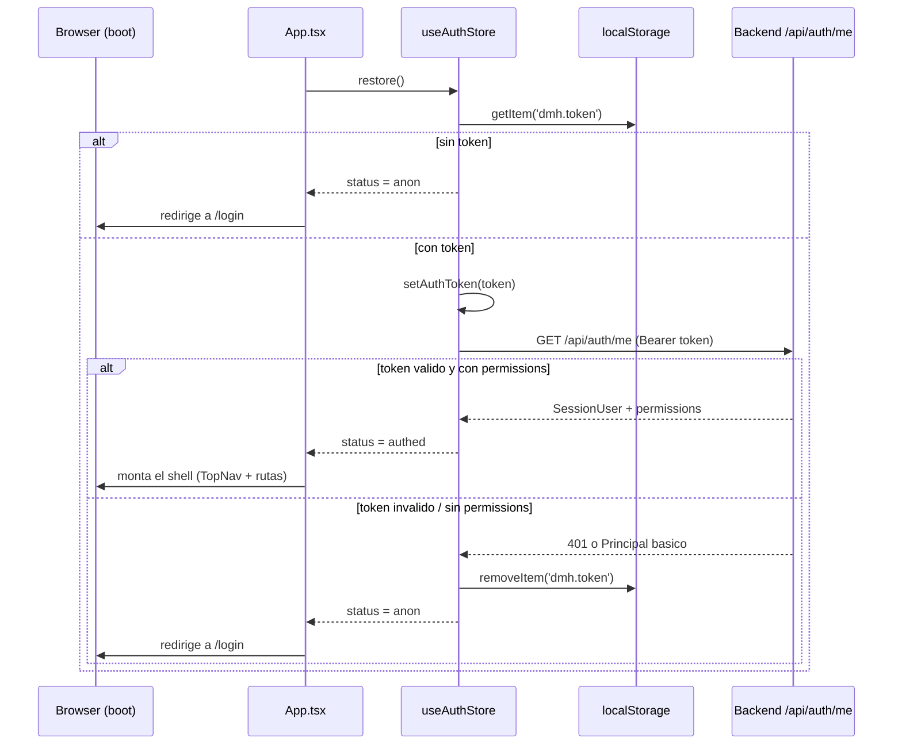
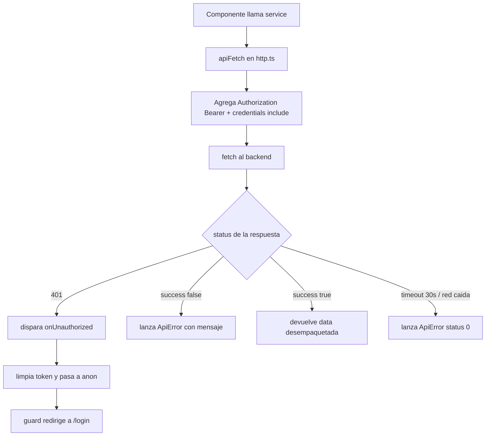
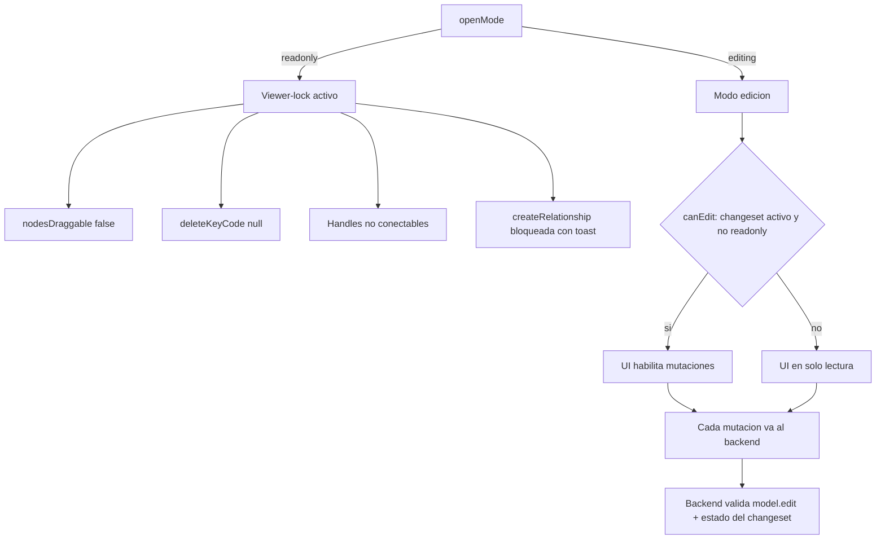

# Seguridad del Frontend — Data Model Hub

Este documento describe el modelo de seguridad del cliente web (SPA en React + Vite) de Data Model Hub: cómo se maneja el token de sesión, cómo el frontend gatea la experiencia según el rol/permisos del usuario (RBAC), cómo funciona el viewer-lock del canvas, por qué no viajan secretos en el bundle y qué buenas prácticas se aplican.

La premisa central y no negociable: **el frontend gatea la experiencia de usuario (UX), pero la AUTORIDAD es siempre el backend.** Todo lo que se describe acá mejora la usabilidad y evita mostrar acciones que el usuario no puede ejecutar, pero ninguna de estas defensas reemplaza la autorización del servidor. Un atacante que edite el JavaScript en su navegador, use la consola o llame la API con `curl` no obtiene ningún privilegio adicional: el backend valida cada request contra el token y la matriz de permisos.

---

## 1. Manejo del token de sesión

### 1.1 Modelo de autenticación

La app usa autenticación propia por **token (Bearer)**. El backend expone tres rutas (todas con el envelope `{ success, data }`):

| Método | Ruta | Cuerpo | Respuesta |
|--------|------|--------|-----------|
| `POST` | `/api/auth/login` | `{ username, password }` | `{ token, user }` |
| `POST` | `/api/auth/logout` | — | `{ ok }` |
| `GET` | `/api/auth/me` | — | `SessionUser` (o Principal básico) |

Definidas en `src/features/auth/auth.service.ts`:

```ts
const API_BASE = import.meta.env.VITE_API_URL ?? '';

export const login  = (username, password) =>
  apiPost<LoginResult>(`${API_BASE}/api/auth/login`, { username, password });
export const logout = () => apiPost<{ ok: boolean }>(`${API_BASE}/api/auth/logout`);
export const fetchMe = () => apiGet<SessionUser>(`${API_BASE}/api/auth/me`);
```

### 1.2 Dónde vive el token y cómo se envía

El token se persiste en `localStorage` bajo la clave `dmh.token` (constante `TOKEN_KEY` en `src/store/useAuthStore.ts`). El store de auth es la fuente de verdad de la identidad y empuja el token al cliente HTTP mediante `setAuthToken`.

En `src/services/http.ts`, `apiFetch` inyecta el token como header `Authorization: Bearer` en **toda** llamada a la API:

```ts
const init: RequestInit = {
  method,
  signal: combined,
  credentials: 'include',
  headers: {
    ...(_token ? { Authorization: `Bearer ${_token}` } : {}),
    ...(_devUser ? { 'X-Dev-User': _devUser } : {}),
    ...headers,
  },
};
```

Notas importantes de este bloque:

- **`Authorization: Bearer <token>`**: es el mecanismo principal de autenticación. El token vive en memoria de módulo (`let _token`) y se setea vía `setAuthToken(t)`.
- **`credentials: 'include'`**: el frontend (por ejemplo `:3000`/`:5173`) y el backend FastAPI (`:8000`) corren en orígenes distintos. Sin `include`, el navegador no envía ni acepta la cookie de sesión `modeler-auth` en requests cross-origin, lo que rompería silenciosamente toda llamada autenticada. Esto implica que el backend debe tener CORS configurado con el origen exacto del frontend y `allow_credentials=true` (no se puede usar `*` con credenciales).
- **`X-Dev-User`**: es un "seam" solo para desarrollo local (usuario dev de fallback). El backend prefiere el token; en un despliegue real este header no aporta autoridad.

### 1.3 Ciclo de vida del token

El store `useAuthStore` define `status`: `'loading'` (restaurando al boot), `'anon'` (sin sesión) o `'authed'`.

**Login** (`login`): llama a `auth.login`, guarda el token en `localStorage`, lo empuja al cliente HTTP y espeja el usuario:

```ts
const { token, user } = await auth.login(username.trim(), password);
localStorage.setItem(TOKEN_KEY, token);
setAuthToken(token);
mirror(user);
set({ user, status: 'authed', error: null });
```

**Restore al boot** (`restore`): se ejecuta una sola vez en `App.tsx` (`useEffect(() => { void restore(); }, [restore])`). Lee el token de `localStorage`, lo empuja al cliente y valida la sesión contra `/api/auth/me`. Si `/me` no devuelve `permissions`, la sesión se considera inválida y se limpia:

```ts
restore: async () => {
  const token = localStorage.getItem(TOKEN_KEY);
  if (!token) { set({ status: 'anon', user: null }); return; }
  setAuthToken(token);
  try {
    const user = await auth.fetchMe();
    if (!user || !('permissions' in user)) throw new Error('sesión inválida');
    mirror(user);
    set({ user, status: 'authed' });
  } catch {
    localStorage.removeItem(TOKEN_KEY);
    setAuthToken('');
    set({ status: 'anon', user: null });
  }
},
```

**Logout** (`logout`): hace el POST de logout en modo best-effort (si falla, igual sigue), borra el token de `localStorage`, lo limpia del cliente y pasa a `anon`.

**Manejo global de 401**: `http.ts` expone un callback `setOnUnauthorized`. Cuando cualquier request responde `401`, `apiFetch` lo dispara:

```ts
if (response.status === 401 && _onUnauthorized) _onUnauthorized();
```

El store lo registra al cargar el módulo: ante un 401 con sesión `authed`, borra el token y pasa a `anon`; el guard de ruta se encarga de redirigir a `/login`. Así una sesión expirada o revocada en el backend expulsa al usuario sin acoplar `http.ts` al router.

```ts
setOnUnauthorized(() => {
  if (useAuthStore.getState().status === 'authed') {
    localStorage.removeItem(TOKEN_KEY);
    setAuthToken('');
    useAuthStore.setState({ status: 'anon', user: null });
  }
});
```

### 1.4 Diagrama — restauración de sesión al boot



### 1.5 Diagrama — camino de una request autenticada



---

## 2. Gating RBAC en el frontend

El frontend aplica el control de acceso basado en roles (RBAC) en **tres capas de UX**, todas alimentadas por el objeto `permissions` que `/api/auth/me` devuelve dentro del `SessionUser`.

### 2.1 Los permisos

Definidos en `auth.service.ts`, 1:1 con la matriz del backend (`PERMISSIONS`):

```ts
export type Permission =
  | 'model.view' | 'model.edit' | 'review.decide' | 'publish'
  | 'export' | 'standards.edit' | 'admin.manage';
```

El `SessionUser` trae `permissions: Record<string, boolean>` (permisos efectivos ya resueltos por el backend según el rol). El helper del store resuelve un permiso puntual:

```ts
has: (perm) => Boolean(get().user?.permissions?.[perm]),
```

### 2.2 Capa 1 — `RequireAuth` (autenticación)

En `src/features/auth/guards.tsx`. Envuelve todo lo que no sea `/login`. Mientras la sesión se restaura muestra un splash (evita el parpadeo login→app); si no hay sesión, redirige a `/login` recordando el destino en `state.from` para volver ahí después del login:

```ts
export function RequireAuth() {
  const status = useAuthStore((s) => s.status);
  const location = useLocation();
  if (status === 'loading') return <Splash />;
  if (status === 'anon') return <Navigate to="/login" replace state={{ from: location.pathname }} />;
  return <Outlet />;
}
```

`LoginScreen` usa ese `from` para redirigir de vuelta al destino original: `navigate(location.state?.from ?? '/', { replace: true })`.

### 2.3 Capa 2 — `RequirePermission` (autorización por permiso)

Gate por permiso puntual: si el usuario no lo tiene, lo manda a Home (`/`). El módulo restringido ni siquiera se renderiza:

```ts
export function RequirePermission({ perm, children }: { perm: Permission; children: ReactNode }) {
  const has = useAuthStore((s) => s.has(perm));
  if (!has) return <Navigate to="/" replace />;
  return <>{children}</>;
}
```

En `App.tsx` protege las rutas sensibles:

```tsx
<Route path="/standards" element={<RequirePermission perm="model.view"><StandardsScreen /></RequirePermission>} />
<Route path="/admin"     element={<RequirePermission perm="admin.manage"><AdminScreen /></RequirePermission>} />
```

Data Standards se ve con `model.view` (los estándares se ven en solo lectura; editarlos exige `standards.edit` a nivel de acciones). Admin exige `admin.manage`.

### 2.4 Capa 3 — filtrado del nav por permisos

En `src/components/layout/TopNav.tsx`, el menú de navegación se filtra reactivamente por los permisos del usuario en sesión, de modo que el usuario ni ve las entradas que no puede usar:

```ts
const NAV: NavItem[] = [
  { label: 'Home',           to: '/',          match: (p) => p === '/' },
  { label: 'Reporting',      to: '/reporting', match: (p) => p.startsWith('/reporting') },
  { label: 'Model',          to: '/model',     match: (p) => p.startsWith('/model') },
  { label: 'Data Standards', to: '/standards', match: (p) => p.startsWith('/standards'), perm: 'model.view' },
  { label: 'Admin',          to: '/admin',     match: (p) => p.startsWith('/admin'),     perm: 'admin.manage' },
];

// ...
const perms = useAuthStore((s) => s.user?.permissions);
// ...
{NAV.filter((item) => !item.perm || perms?.[item.perm]).map((item) => ( /* <Link/> */ ))}
```

El `UserMenu` muestra la identidad real de la sesión (nombre, email, `roleName`) y la acción de cerrar sesión, tomando todo del `SessionUser` del store.

### 2.5 Diagrama — capas de gating (UX) sobre la autoridad (backend)


### 2.6 Aclaración crítica: el gating de UI NO reemplaza la autorización del backend

Las tres capas anteriores son **exclusivamente de experiencia de usuario**. Sirven para:

- No mostrar botones/rutas/menús que el usuario no puede usar.
- Evitar errores confusos (mandarlo a una pantalla que fallaría con 403).
- Redirigir sesiones expiradas de forma limpia.

No sirven para **impedir** que alguien llame la API. El `permissions` que gatea el nav es un dato entregado por `/me` y vive en el navegador: es manipulable por el usuario final (editando el store en la consola, parcheando el bundle, etc.). Por eso, la regla es que **cada endpoint del backend re-valida el token y verifica el permiso correspondiente** antes de ejecutar cualquier acción. Si el frontend "se equivoca" y deja pasar una acción no permitida, el backend responde `401`/`403` y no ocurre nada.

Ejemplo de por qué el gating de UI no es suficiente — un atacante puede saltarse todo el frontend:

```bash
# Aunque el nav oculte "Admin", esto solo lo frena el BACKEND:
curl -X POST https://<backend>/api/admin/users \
  -H "Authorization: Bearer <token-de-un-usuario-sin-admin.manage>" \
  -H "Content-Type: application/json" \
  -d '{"username":"intruso","role":"Administrator"}'

# Respuesta esperada del backend (la autoridad real):
# { "success": false, "error": "No autorizado" }   (HTTP 403)
```

---

## 3. Viewer-lock (canvas en solo lectura)

El canvas del modeler tiene un modo de solo lectura llamado **viewer-lock**. Se activa cuando la sesión abre un modelo en modo `readonly` (por ejemplo, al ver la versión publicada o al revisar un request sin editarlo). La señal viene de `useSessionStore.openMode`.

### 3.1 Bloqueo a nivel de canvas (`ModelerCanvas.tsx`)

```ts
// Viewer-lock: en read-only se puede VER (click abre PropertiesPanel en modo
// reader) pero no mutar: sin drag de nodos y sin conexiones.
const readonly = useSessionStore((s) => s.openMode === 'readonly');
```

Efectos concretos en el componente `<ReactFlow>`:

```tsx
<ReactFlow
  nodesDraggable={!readonly}          // en readonly no se arrastran nodos
  deleteKeyCode={null}                // sin borrar por teclado (Backspace/Delete)
  onNodeDragStop={(_e, node) => {
    if (readonly) return;             // viewer-lock: no persistir movimientos
    /* ...persiste layout o posición de shape... */
  }}
/>
```

Y la creación de relaciones queda bloqueada con feedback explícito:

```ts
if (readonly) { pushToast('El modelo está en solo lectura: no se pueden crear relaciones', 'err'); return; }
```

El `deleteKeyCode={null}` es deliberado: el default de React Flow (borrar con Backspace) eliminaba tablas/wires solo en pantalla, sin persistir — engañoso en edición y una violación del viewer-lock en readonly. Los borrados reales solo pasan por la UI explícita (panel de propiedades / popup de relación), que a su vez está gateada.

### 3.2 Bloqueo a nivel de nodo (`TableNode.tsx`)

Los handles de conexión (los puntos desde donde se arrastran las relaciones) no son conectables salvo que haya un changeset activo, no estemos en readonly, y además la herramienta "Dibujar relación" esté armada:

```ts
const readonly = useSessionStore((s) => s.openMode === 'readonly');
const canEdit  = useChangesetStore((s) => s.activeId) != null && !readonly;
const relArmed = useModelerStore((s) => s.relPreset != null);
const connectable = canEdit && relArmed;
// ...
<Handle type="source" position={Position.Right} id={`${c.id}__src`} isConnectable={connectable} className="wk-handle" />
<Handle type="target" position={Position.Left}  id={`${c.id}__tgt`} isConnectable={connectable} className="wk-handle" />
```

En modo visor (readonly) los nodos no muestran handles conectables ni affordances de edición. El `PropertiesPanel` puede abrirse en modo lector (para ver detalles), pero sus escrituras están gateadas por el mismo `canEdit` (changeset activo y no-readonly).

### 3.3 Relación entre viewer-lock y la autoridad del backend

Igual que el RBAC, el viewer-lock es una defensa de UX. Impide que el usuario haga cambios accidentales o confusos en un modelo que está mirando en solo lectura, pero **la persistencia real la controla el backend**: cualquier mutación (mover una tabla, crear una relación, editar una columna) es un request autenticado que el servidor valida contra el permiso `model.edit` y el estado del changeset. Aunque alguien forzara `readonly = false` en el navegador, el backend rechazaría escribir sobre una versión que no está en borrador o para la que el usuario no tiene permiso.



---

## 4. Ausencia de secretos en el bundle

### 4.1 Cómo Vite expone variables al navegador

Vite solo inyecta al bundle del cliente las variables de entorno con prefijo `VITE_` (accesibles vía `import.meta.env.VITE_*`). Cualquier variable sin ese prefijo **no se incluye** en el JavaScript entregado al navegador. Por diseño, el frontend usa una única variable pública:

```ts
const API_BASE = import.meta.env.VITE_API_URL ?? '';
```

`VITE_API_URL` es la base del backend. **No es un secreto**: es simplemente la URL pública del servicio de API. Todos los `*.service.ts` (auth, admin, modeler, governance, standards, reporting, naming, versioning) la usan de la misma forma.

### 4.2 Archivos de entorno

| Archivo | Contenido | Rol |
|---------|-----------|-----|
| `.env` | `VITE_API_URL=` (vacío) | Dev: base vacía = mismo origen; el proxy de Vite reenvía `/api` → `:8000` |
| `.env.production` | URL pública del backend | Build de producción (commiteado a propósito, ver `.gitignore`) |
| `.env.example` | Plantilla de referencia | Documenta la variable esperada |

El `.gitignore` ignora todos los `.env*` salvo `.env.production`, que se commitea porque solo contiene una URL pública, no un secreto:

```gitignore
# env files (can opt-in for committing if needed)
.env*
# VITE_API_URL es público (URL del backend) y debe viajar al build → se commitea.
!.env.production
!.env.example
```

### 4.3 Principio y observación

**Principio**: nada sensible (contraseñas, connection strings de Cosmos, claves de firma de JWT, credenciales de servicio) vive en el frontend. Esos secretos residen únicamente en el backend, que es quien habla con la base de datos y firma/valida los tokens. El navegador solo conoce la URL pública de la API y el token de su propia sesión.

**Observación de higiene (RESUELTA 2026-07-19)**: `.env.production` y `.env.example` ya declaran `VITE_API_URL` (se renombraron desde el nombre antiguo `NEXT_PUBLIC_API_URL` de la etapa Next.js), con lo que la configuración de producción toma efecto real en el build de Vite. Nunca expuso secretos — ambas son solo la URL pública.

---

## 5. Buenas prácticas aplicadas y consideraciones

### 5.1 Lo que ya está bien resuelto

| Práctica | Implementación |
|----------|----------------|
| Token en un único lugar | `dmh.token` en `localStorage`, empujado a un único cliente HTTP; nunca duplicado en el código |
| Envío consistente del token | `Authorization: Bearer` centralizado en `apiFetch`; ningún service arma su propio fetch |
| Expulsión automática ante 401 | Handler global `onUnauthorized` limpia sesión y redirige a `/login` |
| Validación de la sesión al boot | `restore()` re-consulta `/me` y exige `permissions`; no confía ciegamente en el token guardado |
| Timeout de red | `DEFAULT_TIMEOUT_MS = 30_000` vía `AbortSignal.timeout`, evita spinners eternos si el backend cuelga |
| Manejo de errores tipado | `ApiError` con `status`; los consumidores hacen `try/catch` en vez de inspeccionar `success` a mano |
| Sin secretos en el bundle | Solo `VITE_API_URL` (URL pública) llega al navegador |
| Defensa en profundidad de UX | RBAC en 3 capas (auth → permiso → nav) + viewer-lock, todo respaldado por autoridad del backend |
| Escape de contenido | React escapa el contenido renderizado por defecto; no se detectó uso de `dangerouslySetInnerHTML` para datos de usuario en las rutas revisadas |

### 5.2 Consideraciones y riesgos a tener presentes

- **Token en `localStorage` y XSS**: guardar el token en `localStorage` lo hace accesible desde JavaScript, por lo que una vulnerabilidad de XSS podría filtrarlo. La mitigación principal es evitar el XSS de raíz: React escapa por defecto, no inyectar HTML crudo de fuentes no confiables, y (a nivel de despliegue) servir una **Content-Security-Policy** estricta. Como el backend además acepta la cookie `modeler-auth` (`credentials: 'include'`), una alternativa más robusta a futuro sería mover la sesión a una cookie `HttpOnly` + `Secure` + `SameSite`, que el JavaScript no puede leer; hoy conviven ambos mecanismos (Bearer en `localStorage` y cookie cross-origin).
- **CORS con credenciales**: al usar `credentials: 'include'`, el backend debe listar el origen exacto del frontend (no `*`) y habilitar `allow_credentials`. Un CORS mal configurado rompe la autenticación o, peor, la abre de más.
- **CSRF**: la autenticación primaria por header `Authorization: Bearer` no es vulnerable a CSRF (el navegador no adjunta headers custom automáticamente en requests cross-site). El vector CSRF aplicaría solo a la cookie `modeler-auth`; conviene que esa cookie use `SameSite` y que el backend no acepte mutaciones basándose únicamente en la cookie.
- **El gating de UI es cosmético**: repetido a propósito — permisos, rutas protegidas y viewer-lock son manipulables desde el navegador. La seguridad efectiva la impone el backend en cada endpoint.
- **Rotación/expiración del token**: el frontend reacciona a `401` cerrando sesión, pero no renueva tokens proactivamente. La expiración y revocación las define el backend; el cliente simplemente re-loguea cuando la sesión deja de ser válida.
- **HTTPS obligatorio en producción**: dado que el token viaja en cada request, el transporte debe ser siempre TLS. Tanto Azure App Service como Databricks Apps sirven sobre HTTPS por defecto.

---

## 6. Despliegue (dónde corre y configuración)

El frontend es una SPA estática (build de Vite) que se sirve como archivos y habla con el backend por HTTP. Puede alojarse en dos entornos:

- **Azure App Service**: hospeda los archivos estáticos del build de Vite. El origen del frontend debe estar permitido por el CORS del backend.
- **Databricks Apps**: el backend FastAPI corre como una Databricks App (por ejemplo, `https://bknd-data-model-hub-...azure.databricksapps.com`, según `.env.production`). El frontend consume esa URL como `VITE_API_URL`.

### 6.1 Variables de entorno (build-time)

| Variable | Ejemplo | Naturaleza |
|----------|---------|-----------|
| `VITE_API_URL` | vacío (dev, mismo origen vía proxy Vite) o `https://<backend-host>` (prod) | Pública, se inlinea en el bundle al construir. No es secreto. |

Al ser build-time e inlineada, `VITE_API_URL` debe definirse **antes** de construir el bundle; cambiarla en runtime no tiene efecto (hay que reconstruir). El renombre de los `.env` de `NEXT_PUBLIC_API_URL` a `VITE_API_URL` (sección 4.3) ya está aplicado.

### 6.2 Consideraciones de base de datos

El frontend **nunca** toca la base de datos directamente. La persistencia vive en **Azure Cosmos DB con API de Mongo**, accedida exclusivamente por el backend. Las implicancias de seguridad para el cliente son:

- Las credenciales y el connection string de Cosmos residen solo en el backend; jamás en el bundle ni en variables `VITE_*`.
- Toda lectura/escritura de datos pasa por endpoints autenticados y autorizados del backend, que aplican la validación de permisos antes de consultar Cosmos.
- El aislamiento por proyecto/permiso (qué datos ve cada usuario) lo resuelve el backend según el `SessionUser`; el frontend solo consume lo que la API le devuelve.

En resumen: el navegador conoce una URL pública y su propio token de sesión; los secretos (Cosmos, firma de JWT) y la autoridad (validación de permisos y del estado de los datos) viven íntegramente del lado del servidor.
