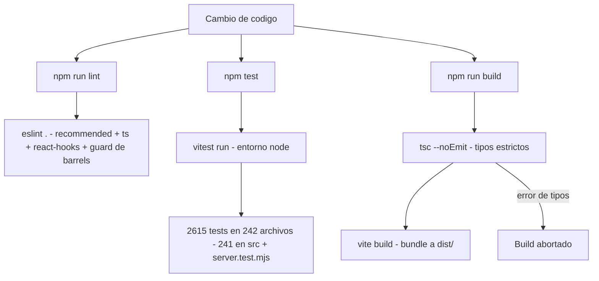
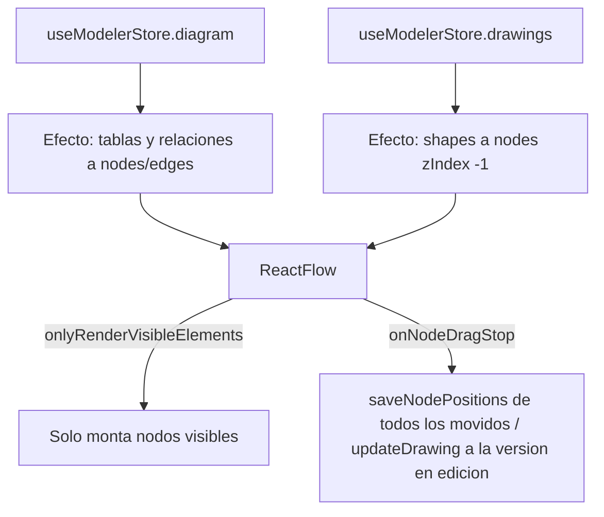
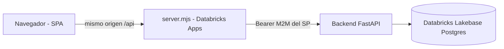

# Testing y consideraciones/límites del frontend — Data Model Hub

Actualizado al 2026-10-18 (2 615 tests en 242 archivos, todos verdes con `npx vitest run`, también en orden aleatorio con `--sequence.shuffle`; `npx tsc --noEmit` sin errores; `npx eslint .` con 0 errores y 155 warnings, todos de `no-restricted-imports`).

Este documento describe cómo se verifica el frontend (SPA en Vite + React 19) y qué consideraciones de rendimiento y límites conocidos aplican al canvas del modelador y a la grilla del reporting. Está basado en el código real del repositorio `web-data-model-hub`.

El frontend no toca la base de datos: es una SPA que consume el backend FastAPI vía HTTP (capa `src/services/*` y `src/features/*/*.service.ts`). La persistencia (Databricks Lakebase Postgres) vive del lado del backend.

---

## 1. Testing y verificación

### 1.1 Scripts disponibles (`package.json`)

El proyecto expone siete scripts de npm. No hay más automatización local que estos comandos.

| Script | Comando | Para qué sirve |
|---|---|---|
| `npm run dev` | `vite` | Servidor de desarrollo en `:3000` con HMR y proxy `/api` → backend `:8000`. |
| `npm run build` | `tsc --noEmit && vite build` | Verificación de tipos (sin emitir) y luego bundle de producción a `dist/`. |
| `npm run preview` | `vite preview` | Sirve el `dist/` ya construido para revisarlo localmente. |
| `npm run start` | `node server.mjs` | Runtime en Databricks Apps (lo invoca el `command` de `app.yaml`): el servidor de producción propio sirve `dist/` y proxya `/api` al backend. En Apps el build lo corre Databricks antes del `command`; en local, `npm run build` primero. |
| `npm test` | `vitest run` | Corre la suite de tests una sola vez (no watch). |
| `npm run lint` | `eslint .` | Linting de todo el árbol con la config flat de ESLint. |

Puntos importantes:

- El comando de build encadena `tsc --noEmit` antes de `vite build`. Es decir, la verificación de tipos es una compuerta obligatoria del build: si TypeScript encuentra un error de tipos, el bundle no se genera. Vite por su cuenta transpila sin chequear tipos (usa esbuild), por eso el `tsc --noEmit` explícito es el que da la garantía de tipos.
- `npm test` usa `vitest run` (una corrida y termina). Para modo interactivo/watch se invoca `vitest` a mano.

### 1.2 Vitest (`npm test`)

La configuración de Vitest está embebida en `vite.config.ts` (se usa `defineConfig` de `vitest/config`):

```ts
// vite.config.ts (bloque test)
test: {
  environment: 'node',
  include: ['src/**/*.test.{ts,tsx}', 'server.test.mjs'],
},
```

- Entorno `node` (no `jsdom`): la mayoría de los tests son de lógica pura (stores de Zustand, servicios, lib del modeler), sin DOM. Doc 105 sumó dos formas de probar COMPONENTES sin cambiar de entorno: (a) markup estático con `renderToStaticMarkup` de `react-dom/server` (`src/screens/ReportingScreen.test.tsx`: atributos de los combos, estados de la grilla; desde la ronda 5 también los nombres accesibles de la Toolbar del canvas, `ViewNode` y `TagEditor`); y (b) hooks de React de mentira, `src/features/reporting/components/fakeReact.testutil.ts` — el componente se llama como FUNCIÓN, cada `useState` devuelve su valor y un setter que sólo anota lo que recibe (ESTABLE entre re-renders, como en React: anota en el render vigente), los efectos se corren a mano, `useId` es estable por posición del hook, y se disparan los handlers REALES del árbol de elementos que devuelve; con ciclo de vida (`nextStates()`, `resetFake(…, { keepRefs: true })` para re-renderizar el mismo componente, `runEffects()` sólo con los efectos cuyas deps cambiaron, `unmount()`). Un setter de un montaje ANTERIOR —p. ej. un intervalo que no se soltó al desmontar— se anota aparte, en `fake.stale`, nunca en el render vigente (doc 105, ronda 3; `fakeReact.testutil.test.ts`). Cada archivo lo activa con `vi.mock('react', …)`. Lo usan los tests de `SheetTemplateCard`, `SheetTemplateEditor`, el scroll infinito y el combo Version de `ReportingScreen`, los componentes de `features/standards` (Domains, UDP, regla DDL, Lookups & Functions, Output settings), `ReviewScreen`, `VersionToolsModal`, `LoginScreen`, `DeleteProjectDialog`, `SearchSelect`, los diálogos de `components/ui` y, desde las rondas 4 y 5, `NewTableModal`, `ColumnEditor`, `SearchModelPopup` y `UdpAssign`; desde las rondas 5 a 7, también `UploadModal`, el `TopNav` y los paneles de propiedades (`panelsReloadClosed.test.ts`). Para render real con DOM (eventos del navegador, foco) seguiría haciendo falta `jsdom` o `happy-dom`.
- Patrón de descubrimiento: cualquier archivo `*.test.ts` o `*.test.tsx` bajo `src/`, más `server.test.mjs` en la raíz — los tests del servidor de producción (`server.mjs`) corren bajo Vitest porque están listados explícitamente en el `include`.
- El alias `@` → `src/` se resuelve tanto en runtime como en los tests (`resolve.alias`), por eso los tests importan con `@/services/...`.

### 1.3 Qué se testea hoy

La suite al 2026-10-18: **2 615 tests en 242 archivos** (241 `*.test.ts`/`.tsx` bajo `src/` más `server.test.mjs` en la raíz del repo), contados y **verdes** con `npx vitest run` (242 archivos · 2 615 passed, ~10 s) y también con el orden aleatorio de `npx vitest run --sequence.shuffle` (ver al final del inventario). Inventario por área:

| Área | Archivos de test |
|---|---|
| Stores (`src/store/`) | `useSessionStore.test.ts` (proyecto + versión activos, `closeModel`, `dmh:lastProject`), `useBusyStore.test.ts` (`runBlocking` anidable), `useUndoStore.test.ts` (doc 105, H1: la inversa recibe el pin de su sesión y corta si se abrió otra versión, calla si la sesión cambió, un 403/404/409 de su versión espera la revalidación, sin overlay bloqueante, y una acción que termina tras el cambio no apila su inversa; H3: la inversa que falla sin escribir vuelve a la pila y el aviso pide pulsar Undo otra vez; ronda 3: la que falla por transporte —timeout, red— también vuelve y un 409/500 la sigue descartando (R7-F), y mientras corre una inversa se ignora lo que ella apila, no lo de una sesión nueva; ronda 5: con `clear({ until })` la pila queda cerrada —no apila ni deshace— mientras dura, también de vuelta en la misma versión; rondas 6 y 7: por versión —dos cargas en versiones distintas cierran cada una la suya y dos en la misma, hasta que terminen las dos— y no en solo lectura), `useModelerStore.test.ts` (+ `.views`, `.addColumn`, `.bulk`, `.canvasViews`, `.columnPanel`, `.copyTable`, `.reorder`, `.subcat`, `.viewPanel`: incluye `deleteProject`/`undoProjectDeletion`). Doc 105: `useAuthStore.test.ts` (`refreshMe`: una lectura en vuelo y tope `ME_GAP_MS`, sin cambios no toca el usuario, un fallo no rechaza, deshabilitado → `anon`, un 403 de otra ruta la pide y uno de `/api/auth/` no; `notice` (O4): el porqué del deshabilitado y del 401, y un logout propio o un login nuevo lo borran; ronda 3: `restore()` — 401 (el único que descarta el token), deshabilitado, sin respuesta del servidor y falla del servidor —500 o respuesta inválida: el token queda y el aviso es `SERVER_CHECK_TEXT`— y sesión válida sin aviso; ronda 5: un `restore()` tardío —401, red caída o el `/me` del token viejo— no toca la sesión que empezó después ni su token, y si otra pestaña cambió el token se verifica el vigente), `useModelerStore.backgroundSaves` (F1, A4-o1: guardados en segundo plano que avisan; varios bloques en una escritura), `.deleteUndo` (F4, A3/A5, A4-o4: borrar tabla o vista y su Undo contra un backend EN MEMORIA que cascadea la membresía como el real — lecturas que fallan no borran nada, vistas y posiciones vuelven a cada canvas), `.refreshExplorer` (A4-o2/o3: sólo el refresco más reciente escribe; avisos de esquemas y recarga del canvas) y `.sessionSwitch` (doc 104: guardados agendados tras un cambio de sesión; doc 105 F3: la pila de Undo se vacía al cambiar de proyecto, modo o versión; doc 118: el clipboard sobrevive); y, del cierre H1–H6, `.undoSession` (H1: inversas y acciones de varias escrituras que no siguen en la versión que se abrió en el medio — Delete table, view y column, Reorder, Create table, Save, deshacer el borrado del proyecto), `.undoRetry` (H3; O3: sustantivos del modelo abierto), `.deleteTransferred` (H5: con la versión recién transferida, borrar no dice «Try again»), `.deleteMultiSource` (H2: la vista multi-fuente vuelve, en su posición, al canvas que la listaba sin la tabla borrada; sin poder leer esos canvases no se borra nada), `.staleExplorer` (H4a/H4b: respuestas tardías de la sesión anterior no pisan la actual; R7-C: tampoco las de `loadProjectTree`, `selectProject` y `loadFolders`), `.explorerToasts` (H6: una caída = un aviso; ronda 3: el motivo sin un segundo «try again») y, de la ronda 3, `.sessionClear` (R7-A: al cambiar de sesión, diagrama, dibujos, selección y popups se van en el acto; ninguna escritura con el diagrama de otra sesión —ronda 4: y se avisa—), `.reloadOpening` (R7-D/E: `reload()` no pisa una apertura de canvas en vuelo; `createTable` no selecciona en la sesión nueva; ronda 4: la recarga pedida durante la reapertura del MISMO canvas se hace al terminarla, el Explorer se entera una vez de un cambio estructural y una pendiente de la sesión anterior no se hereda), `.deleteReads` (borrar columna o tabla: todas las lecturas antes de escribir; el FK huérfano de las hijas; «this attribute» en el lógico), `.syncTail` (la cola del alta y de la baja de columna es de su sesión) y `.wireRoutes` (doc 99: trazos manuales, su Undo y fallas de red; ronda 3: la pre-imagen del auto-arrange se toma antes de calcular); y, de la ronda 4, `.staleDiagram` (R10-D: el `set` optimista tardío de `applyCanvasDrop` no reinstala el diagrama de otra sesión; con uno así en pantalla las ediciones fallan con el motivo sin escribir, Save no resuelve como éxito y los guardados de fondo avisan), `.viewerArrange` (R10-C: el auto-arrange del visor aplica sólo en su sesión y su canvas), `.pastePrepared` (doc 118: `pasteTable(prepared)` graba lo revisado con el esquema nuevo primero en el mismo lote, conserva el nombre libre, ante «Table X already exists» usa el siguiente y cualquier otro 409 sube tal cual; la procedencia nombra la fuente; el Undo borra la tabla y su esquema sólo si nadie más lo usa; los combos de esquema y el Explorer se refrescan; cambiar de canvas cierra el popup), `.crossProject` (doc 118: el clipboard anota el proyecto de la sesión —su nombre, también mientras el Explorer recarga la lista—, los dos clipboards sobreviven a otra versión, a otro proyecto y al Explorer que abre otro, el logout los limpia con el popup, la procedencia nombra el proyecto de origen sólo si es otro, sin revisión no se pega desde otro proyecto y lo revisado llega al lote con los ids del destino) y `.pasteSession` (6c: pegar una tabla no devuelve el nombre si la sesión cambió mientras recargaba; ronda 5: el nombre según la faceta, también en el Undo —«Paste entity <lógico>»—); y, de las rondas 5 a 7, `.reloadPending` (R15-H3: la recarga pedida mientras se abre OTRO canvas se hace si esa apertura falla y, si se instala, sube `explorerTick`; un refresco que ya no reabre nada la descarta; R15-H6 → R18a-1: la recarga que falla —red, timeout, 5xx o 404— cierra el canvas y lo dice, y un error de la versión que la revalidación cambió calla), `.staleReload` (R18a-1: tras un reload fallido lo grabado queda y el canvas se cierra con el aviso; una columna recién borrada no revive; el reorden, Save y los guardados de fondo no escriben nada; reabrirlo desde el Explorer vuelve a editar; si falla la apertura de otro canvas y también la recarga pendiente, UN aviso; los dibujos del debounce se guardan antes de cerrar, salvo con el 404) y `.dropCurrent` (R15-H1: el drop y el reorden graban el documento VIGENTE —una edición que termina en el medio no se pisa, y otro canvas ni se pinta bajo el abierto ni recibe sus bloques—, el Undo del reorden sólo devuelve el orden; ronda 6: una columna borrada entre tandas no revive y un reorden que leía no marca `dirty` en la sesión nueva; ronda 7, R18a-2: fuera de pantalla, a lo sumo una lectura por tanda de 5) |
| Servicios base (`src/services/`) | `http.test.ts` (doc 105: `setOnForbidden`; red caída → `NETWORK_ERROR_TEXT`, y la cancelación del llamador conserva su error; ronda 3: un corte a medio leer el cuerpo —timeout o red— da el aviso del timeout o el de red, y «Invalid JSON response» queda para un cuerpo que no es JSON; `errorReason`: sin el «— try again…» del texto de transporte ni punto final; ronda 5: `isTransientError` —red o timeout y 5xx sí; un 4xx o lo que no es de la API, no—), `warmup.test.ts`, `versioning.summarize.test.ts`, `versioning.access.test.ts`, `views.service.types.test.ts`, `views.service.lots.test.ts` (doc 105, P2: con draft, `listViewsForTables` en lotes de 100 por `tableIds` y filtro por fuentes), `views.service.writes.test.ts` (doc 104), `governance.service.test.ts`, `changeset.service.test.ts`, `reporting.service.test.ts` (doc 102: `changesetId` sólo con versión propia; columnas de UNA tabla por GET; lotes por POST con los ids en el cuerpo —también `queryRelationshipsReport` contra `/api/reporting/insights/relationships/query`, con la versión sólo si hay—; lote vacío = cero pedidos) |
| Lib (`src/lib/`) | `projects.test.ts` (`sortProjects`, `projectMeta`), `facets.test.ts`, `zip.test.ts`, `pool.test.ts` (doc 105, B8: `mapPool` — tope de lotes en vuelo, orden conservado, corta al primer error), `udpChoices.test.ts` (doc 105, ronda 5: booleano `true`/`false`, lista con sus valores, y un valor guardado fuera de las opciones sigue visible), `udpNumber.test.ts` (doc 105, ronda 6: `canonicalNumberText` — «10.50» → «10.5», «1e3» → «1000», un entero largo exacto; lo que Python y JS escriben distinto, o no es un número, queda tal cual), `udpValue.test.ts` (doc 118: el valor de un UDP según la definición del destino, con la regla de la carga Excel del backend — la lista con la grafía del destino, el número canónico, la fecha ISO que existe —también los años 0001-0099; el año 0, no—, el booleano, el texto tal cual y un valor que no es texto) |
| Arquitectura (`src/architecture.test.ts`) | guard doc 75 D14: no existen `features/governance`, `components/layout/AppLayout.tsx`, `store/useChangesetStore.ts`, `store/useIdentityStore.ts`; fondos de popup sin `backdrop-filter` (doc 103); doc 105 (C3): ningún archivo de `features/ddl` lee las vistas por tablas (`listViewsForTables`) — el Export DDL exporta las vistas miembro del canvas; doc 107: ningún botón con texto se ve como texto (`rd-btn-ghost` solo para íconos sueltos y los «← All columns», sin `<Button variant="ghost">` con texto ni `rd-btn` sin variante —una etiqueta que sale de una expresión cuenta como texto—, uno por cada `.tsx`) y las clases de enlace retiradas no vuelven |
| UI (`src/components/ui/`) | `focusTrap.test.ts` (doc 105, F6: `tabTarget`, Tab y Shift+Tab no salen del diálogo; `focusInto`: la caja toma el foco si nadie de adentro lo tiene, al cerrarse vuelve a quien abrió —también con el doble montaje de StrictMode— y nunca roba el foco si el usuario lo llevó a otro lado; `activeElementNow`; ronda 3 (R6): si quien abrió ya no sirve, el foco va al diálogo que sigue abierto, con confirmaciones encadenadas vuelve a quien abrió el primero, `recoverTab`, `keepFocusIn` y `trapTab` sólo con controles habilitados y visibles; y si quien abrió quedó deshabilitado DENTRO de un diálogo que sigue abierto, el foco va a esa caja —no detrás de ella—; `isFocusReturn`, verdadero sólo durante la devolución y sólo para ese elemento; R11/R14: con un Enter en curso el foco vuelve recién en su keyup —sin quitárselo a otro diálogo que lo tomó—, con el Enter sostenido el respaldo de 1 s espera mientras sigan llegando keydown, ⌘Enter no deja la marca pegada, el keyup de Meta la suelta y sin keyup la devolución igual ocurre; R17b: un diálogo que se abre con una devolución pendiente recuerda a su destino, no a `<body>` (F2), y un Tab durante la espera, con el foco en `<body>`, hace ya la devolución y se queda en quien abrió (F4); `modalOpen` ve cualquier `aria-modal`, el `.dmh-backdrop` y las esperas bloqueantes, y `ModelerCanvas` protege sus atajos con él), `dialogStack.test.ts`, `affectedRows.test.ts`, y los de diálogos: `Modal.test.ts` (ESC sólo cierra el del tope —«Inherit from domain» sobre «New column»—, re-renderizar el de abajo no le da el tope, trampa de Tab, `aria-label` con el título, foco a la caja y de vuelta, captura de quien abrió en el primer render, StrictMode; R6: Tab con el foco en `<body>` lo retoma la caja sólo si es el del tope, y tras un render con su botón en busy el foco vuelve a la caja), `Dialog.test.ts` (foco a la caja y de vuelta, sin robárselo a un `autoFocus`, captura en el render en que `open` pasa a true; R6: lo mismo que `Modal`), `ConfirmDialog.test.ts` (la caja toma el foco ANTES de busy, foco inicial en su botón —cancel en lo irreversible—, devolución montado abierto o abierto después; R6: abierto es el tope de la pila y recupera el Tab; R11: ids propios y el mensaje como descripción accesible) y `dialogs.test.ts` (el prompt: foco a la caja antes de busy, foco inicial en el input y devolución al cerrar; R6: tope de la pila, recupera el Tab, la caja se nombra con su título y el `<label>` apunta al input; R11: el Enter que acepta hace `preventDefault`), y `TagEditor.test.tsx` (ronda 5: placeholders «key» y «value»). Fuera de `ui/`, `components/layout/TopNav.test.ts` (ronda 7, R18a-5: si «Save and leave» falla, el aviso dice por qué y no sale; sin motivo legible, el aviso de siempre; si guarda, sale) |
| Auth (`src/features/auth/`) | `LoginScreen.test.ts` (doc 105, O4: el porqué de la sesión que terminó sola se muestra como estado, no como error; ronda 3: el botón de SSO lo referencia con `aria-describedby`; ronda 5: con la sesión ya restaurada va al destino sin el formulario y, mientras se verifica, muestra el splash) |
| Screens (`src/screens/`) | `review/requestState.test.ts` (doc 105, U2: `canvasAction`), `ReportingScreen.test.tsx` (doc 105, B3/B9: nombres accesibles y combos deshabilitados durante un export, estados de la grilla — markup estático), `ReportingScreen.pages.test.ts` (doc 105: la página siguiente que falla no da la lista por terminada y Retry pide la MISMA; hooks de mentira), `ReportingScreen.versions.test.ts` (R2-B5: sólo cuenta el listado de versiones más reciente; A5-o4: por qué desapareció la versión elegida; un 403 del proxy no cambia de versión; R6: si falla el listado más reciente vale la última lista buena —también la que llega después del fallo, que retira el aviso—, sin ninguna UN aviso, que no se re-emite mientras sigan fallando y se rearma al cambiar de proyecto), `ReviewScreen.test.ts` y `home/VersionToolsModal.test.ts` (F5: permisos al día sin recargar; A5-o5: el motivo de Transfer, Delete y Open in canvas deshabilitados, accesible) |
| Modeler — lógica pura (`features/modeler/lib/`) | `complexTypes`, `keyOrder`, `lodSize`, `nameSync`, `relationshipPairs`, `schemaStaging`, `viewEditorLogic`, `viewGraph`, `viewSync` (doc 105, ronda 3: el corte por cambio de sesión se propaga y no sigue con las demás columnas; otro error de una columna sigue siendo best-effort), `columnOrder`, `canvasDrop`, `arrangeGraph`, `projectDeletion` (`deletionSummary`, `nameMatches`, `criticalDeletionText`; doc 105 ronda 3: singular y plural), `pinnedWrites` (doc 105, H1: `undoColumnsBatch`, `pinned`, `pinnedViewDeps`, `bestEffort` y `pinnedDebouncer` —descarta lo agendado si la sesión cambió; `flush` escribe sólo lo de la vigente—), `pasteReview` (doc 118: qué viaja de cada faceta según los checks, lo borrado que se quita y se avisa, los overrides sin dominio, la marca FK, el esquema existente / nuevo / de vistas / con un nombre que no se crea, el case del destino, los topes de largo en caracteres con la salida sugerida, los duplicados tras el case, las columnas omitidas y los conteos de UDPs y dominios distintos; entre proyectos: los nombres sin tildes, como la carga Excel; el UDP por nombre + nivel + faceta con el valor validado contra el destino aunque su check esté apagado —el ambiguo y el de otro nivel no viajan; dos del origen sobre el mismo del destino viajan una vez con el mismo valor y, si no, ninguno—, el dominio por nombre con los overrides recalculados y el aviso de otro tipo entre los dos dominios —el ambiguo no viaja—, el theme por nombre o su color fijo —también si existe dos veces—, un valor legado que no es texto viaja como texto —también 0 y false—, y sin los estándares del origen sólo viaja lo que no los necesita), `copyTable` y `pasteColumns` (doc 118: las dos facetas viajan; `pasteNames` conserva el nombre libre y si no usa el primer `_copy_n`; la marca FK no viaja; la procedencia nombra la columna de origen y, si viene de otro proyecto, el proyecto), `history` (doc 118: «Copied from … (project X)»), entre otros (todos `.test.ts`) |
| Modeler — componentes (sin DOM, §1.2) | `components/SearchSelect.test.ts` (doc 105: patrón ARIA 1.2 de combobox; R6: dentro de un diálogo, elegir o ESC no sacan el foco del input y la acción del pie corre sin blur; el foco que devuelve un diálogo al cerrarse —«Inherit from domain», la acción del pie— no reabre el menú; R11/R14: con el menú cerrado lo abren tipear, Backspace y Delete, pegar, una composición IME, el dictado y AltGr —un atajo con ⌘/Ctrl, no—), `components/DeleteProjectDialog.test.ts` (doc 105: el conteo caído no traba el borrado; ronda 3: región `role="status"` y Retry pasa el foco al nombre; ronda 5: el motivo va sin el «— try again…» del transporte), `components/deleteConfirm.test.ts` (O2: lo que no se pudo contar se dice, no «0»; ronda 3: los diálogos de borrado con los sustantivos del modelo), `components/NewTableModal.test.ts` y `components/ColumnEditor.test.ts` (R11/R14: el Enter que crea hace `preventDefault`, dos Enter seguidos o uno sostenido crean UNO y, si el alta falla, el siguiente reintenta), `components/SearchModelPopup.test.ts` (R11: el Enter que ubica el primer hit hace `preventDefault`, cierra y centra), `components/UdpAssign.test.ts` (ronda 4: lo tipeado sin blur no se escribe si el panel se cerró porque cambió la sesión —solo lectura u otra versión—; ronda 5: el booleano es un select `true`/`false` y un valor legado se sigue viendo; ronda 6: un número se graba en su forma canónica, al salir del campo o al cerrar el panel sin salir), `components/Toolbar.a11y.test.tsx` (ronda 5: cada botón tiene nombre accesible y, en solo lectura, dice qué es y por qué está deshabilitado; ronda 6: «Add an ellipse», el atajo del buscador según el sistema y `aria-pressed` en Logical/Physical), `components/Toolbar.shortcut.test.ts` (ronda 6, R17b: ⌘K / Ctrl+K abre el buscador con una sesión de canvas, pero no con un modal o una espera en pantalla, ni sin sesión) y `components/ViewNode.test.tsx` (ronda 5: «No columns»). Doc 118: `components/PasteDetails.test.ts` (10 columnas por página y «cargar más», buscador «contiene» que vuelve a la primera página y cuyo Enter no pega, selector de faceta, checks por grupo, filas que muestran sólo lo que viaja y «No columns.») `components/PasteTablePopup.test.ts` (`existingCopies`; el aviso del duplicado con las copias que ya existen, confirmar graba lo revisado —nombre, esquema con la grafía del destino, case de las columnas— y un nombre sobre el tope deshabilita el pegado; lo copiado en otro proyecto nombra el origen, lee sus estándares, graba los UDP con los ids del destino y, sin esos estándares, lo avisa; otra falla al leerlos muestra el error con Retry, la respuesta que llega tras cerrar no escribe y un clipboard sin proyecto de origen es del mismo proyecto) y `components/PasteColumnsPopup.test.ts` (lo copiado en otro proyecto nombra el origen, se revisa con sus estándares y deja la procedencia con el proyecto —su id si no hay nombre—; otra falla al leerlos muestra el error con Retry; la respuesta que llega tras cerrar no escribe; uno del mismo proyecto o sin proyecto de origen no lee otros estándares; si la sesión cambia durante el pegado o la recarga, en la nueva no marca cambios, no recarga ni avisa). Revisión ESTÁTICA del fuente (doc 105, H1–H7): `components/pinnedFlows.test.ts` con el analizador de TypeScript (`pinnedFlows.testutil.ts`: ninguna escritura después de un `await` sin su `.check()`, en todos los componentes, `features/upload` y el store; el panel de columna difiere por `pinnedDebouncer`; ronda 3 (R7): los falsos negativos que encontró la revisión —callbacks de `.then/.catch/.finally`, callbacks que corren en el acto, acciones del store por alias, helpers y callbacks de props que escriben, checks que no son del pin o no protegen la escritura—; ronda 4 (R10-A): un `catch` que espera y termina no precede a lo de después del `try`, un `action:` creado tras un `await` pide el pin de afuera, igual un `reportWriteError(…)`, y `for await`), `components/undoPins.test.ts` (cada `pushUndo` con el pin de su acción; inversas de varias escrituras de los componentes), `components/workspaceWriteErrors.test.ts` (avisos de escrituras por `reportWriteError` —desde la ronda 3 también en `TableNode`, `ModelerCanvas`, `ColumnContextMenu`, `ModelExplorer`, `CtasModal`, `ModelPropertiesModal` y `NewTableModal`—, `WorkspaceScreen` sin `loadProjects` al montar, el conteo de «Delete table» con `readTableDeleteCounts`; ronda 6: la apertura fallida de un canvas desde `ModelExplorer`, con `reportWriteError` y el motivo), `components/columnDeleteImpact.test.ts` (ronda 3: sin el impacto de la columna no se ofrece el borrado; ronda 4: el panel de columna avisa el motivo del borrado fallido), `components/sessionModals.test.ts` (R7-A: `Toolbar`, `ModelerCanvas` y `WorkspaceScreen` cierran sus diálogos al cambiar de sesión), `components/facetTexts.test.ts` (ronda 4, 6b: pegar una tabla desde el menú de la columna y «Import existing» avisan con el sustantivo del modelo; rondas 5 y 6: el menú, Ctrl+C / Ctrl+V y `PasteColumnsPopup` —nombres, textos y la etiqueta del Undo— con la faceta), `components/successToasts.test.ts` (ronda 4, 6c: el «Table created from sources» del CTAS, sólo en la sesión donde se pidió; doc 118: también el de pegar columnas) y `components/panelsReloadClosed.test.ts` (ronda 7, R18a-1: tras un reload fallido no queda panel que edite lo viejo —Properties y View properties—: lo grabado queda, el canvas se cierra con un aviso y el panel ya no se pinta) |
| Modeler — servicios | `explorer.service.test.ts`, `schemaPartition.test.ts`, `schemas.service.test.ts`, `pasteSource.service.test.ts` (doc 118: los estándares del proyecto de origen desde su snapshot; null si ese proyecto ya no existe o no se ve —404/403—; otra falla sube), `structure.service.test.ts` (doc 105, F4: `removeFromCanvas` devuelve lo que salió con su posición; `listedViews`), `modeler.service.readonly.test.ts` (doc 105: `modeler.service` sólo lee — no exporta funciones de escritura de carpetas ni canvases). En `lib/`, doc 105 suma casos a `viewerLayout.test.ts` (A4-o1: `draggedPositions`) y `sessionGuard.test.ts` (F2: `stillAskedSession`; H1: `pinSession`; H7: `reportWriteError`) |
| DDL (`features/ddl/`) | `generators.test.ts` (doc 107: con PARTITIONED BY las particiones salen de la lista y van ahí con su definición completa, con o sin la regla; sin PARTITIONED BY vuelven a la lista; golden del Anexo A en ese formato), `rulesBridge.test.ts`, `oracle.test.ts` (doc 108: como Erwin — sin esquema por default, NOT NULL aparte, `PRIMARY KEY (…) DISABLE NOVALIDATE` sin nombre y FK con `DISABLE NOVALIDATE`), `tableSelection.test.ts` (doc 108: «Tables to export» sin ninguna tabla por default) |
| Reporting (`features/reporting/`) | `lib/reportRows.test.ts`, `lib/reportFetch.test.ts` (doc 105, B8/A3-o1: columnas en tandas de 300 y vistas de 2 000 con la versión, nunca más de 4 lotes en vuelo y un lote que falla corta la lectura; relaciones en lotes de 300 ids por el servicio real —`queryRelationshipsReport` contra `fetch`—, sin pedido si no hay ids y una relación con extremos en dos lotes sale UNA vez), `lib/reportVersions.test.ts` (doc 105, A5-o4: textos del 403/404 de una versión, `vanishedVersionText`, y un 403/404 sin `detail` del backend no es de la versión), `lib/sheetTemplates.test.ts` (doc 105, B7: largo del archivo en code points; filtros de la plantilla: sin filtros salen todas las filas; sale la que cumple TODOS y la posición es la real en la tabla, sin renumerar; cada operador, sin distinguir mayúsculas ni espacios al borde; un dato con varios valores —canvases, carpetas— cumple si alguno cumple; un dato que el proyecto no tiene —p. ej. un UDP borrado— se ve vacío; sin filtros siempre deja pasar y los filtros se preparan UNA vez para todas las filas; las banderas sólo ofrecen «is marked» / «is not marked»; «is one of» se escribe separado por comas —`splitValues`, `toFilterBody`, `toFilterDraft`—; la coma dentro de () o <> no corta un valor y un ( o < sin cerrar corta en todas las comas; y la validación espejo del backend: valor obligatorio, al menos un valor y como mucho 50 en «is one of», 200 caracteres en code points y 20 filtros), `components/SheetTemplateCard.test.ts` (B3, R2-B3, A5-o4; con filtros: la card dice cuántos tiene la plantilla elegida, baja sólo las filas que cumplen y el aviso dice cuántas, si ninguna cumple avisa y no baja nada, y sin columnas en las tablas elegidas no culpa a los filtros) y `components/SheetTemplateEditor.test.ts` (P3, B6; filtros: «Add filter» suma un filtro vacío sobre el ÚLTIMO borrador, elegir una bandera como dato deja «is marked» y volver a un dato de texto conserva «is not empty», una bandera no muestra caja de valor y «is one of» pide valores separados por comas, un operador que no es de la lista del dato se muestra tal cual y con su etiqueta legible, guardar manda los filtros con la forma del backend, y una plantilla guardada con filtros los abre como texto) — estos dos, con los hooks de mentira de `fakeReact.testutil.ts` (§1.2), que tiene su propio `fakeReact.testutil.test.ts` (ronda 3: `fake.stale`) |
| Standards (`features/standards/`) | `ddlRules.service.test.ts` (doc 107: `ruleActionSummary`), `domainImpact.test.ts`, `glossaryValidation.test.ts` (doc 105, P1-bis: ediciones recortadas), `standardsDiff.test.ts` (doc 105: ¿el guardado cambia algo?, por pantalla — incluida la regla guardada no `valid` y el `null` de un lookup con default) y, con `fakeReact.testutil.ts`, `components/DomainsPage.test.ts`, `UdpDefsPage.test.ts` (también, ronda 5: el Default de un Boolean es un select `true`/`false` y el de una lista muestra un valor que quedó fuera de las opciones), `DdlRuleEditor.test.ts` (también: respuestas tardías de un borrador anterior y cambio de proyecto con el editor abierto; doc 107: «Partition columns» solo decide qué pasa sin PARTITIONED BY y la ayuda lo dice, el default de una acción de layout nueva y una regla sin `partitionColumns` mostrada como el motor la aplica), `DdlLookupsEditor.test.ts` (además: la fila sin mapear dice que emite el default y la mapeada a «nada», que no se emite; «Emit nothing» la pasa a `null` y «Unmap» la vuelve a sin mapear; sin default no se ofrece «Emit nothing»; R6: tipear y borrar una celda la vuelve a «sin mapear», no a «nothing»; R11/R14: un valor stale vaciado sigue en la tabla hasta guardar y un lookup nuevo con el nombre de uno borrado no hereda sus filas) y `DdlOutputSettingsEditor.test.ts` (doc 105: el botón de guardar sin cambios reales queda deshabilitado; el 422 «There are no changes to apply.» es un aviso neutro) |
| Upload (`features/upload/`) | `parseWorkbook.test.ts` (lectura cruda con origen forzado a A1, helpers del editor; doc 105 ronda 3: quita el NUL de `_x0000_` y un surrogate suelto pasa a U+FFFD; ronda 5: lo mismo en el nombre de la hoja y en el del archivo, y las celdas de fecha salen `YYYY-MM-DD` —con el formato por defecto, uno propio o con el nombre del mes; con hora, `HH:MM`—; ronda 6: la hora sólo viaja si el formato la muestra, un libro con el sistema de fechas 1904 no corre las fechas, y sólo hora, duración y «general» viajan como los muestra Excel; ronda 7: los formatos de sólo mes viajan como fecha y los de hora siguen siendo texto), `profileDraft.test.ts` (merge de sugerencias, reglas, `localProblems`, `toBody`), `upload.service.test.ts` (rutas de uploads y de perfiles, `profileProblemsOf`; doc 105, ronda 5: `pollUploadJob` reintenta red, timeout y 5xx hasta el estado terminal, un 404 no, se rinde tras varios transitorios seguidos y una respuesta buena reinicia la cuenta), `arrangeCanvases.test.ts` (doc 105, R7-B: con el pin de la carga no escribe en la versión que se abrió en el medio; ronda 4: los que no llegó a arreglar vuelven en `skipped`, no como fallidos), `lib/arrangeNotice.test.ts` (ronda 4: el aviso de los canvases sin arreglar, con el popup cerrado o con otra versión abierta a mitad: cuántos y, si son pocos y se conocen, cuáles) y `components/uploadSession.test.ts` (R7-B, revisión del fuente de `upload()`: toma el pin al empezar y —ronda 7— el arrange corre con el de la VERSIÓN de la carga (`inVersion`); vaciar el Undo, refrescar y avisar «Uploaded…» sólo con la versión de la carga abierta (`ours()`, ronda 6); ronda 4: cerrar el popup no corta el apply ni el arrange, el job queda `applying` antes del POST y, con el popup cerrado, los que fallaron se avisan con un toast) y `components/UploadModal.test.ts` (con hooks de mentira, rondas 5 a 7: si el POST del apply responde con error, el job sigue validado y cerrar lo descarta; la pila de Undo queda cerrada desde antes del POST hasta que la carga termina y, con una inversa en vuelo, la carga no empieza; el polling rendido —o un 403— es «unconfirmed» y refresca el Explorer, avisando si ese refresco falla; un 401, u otro usuario ya adentro, no avisa nada; la falla real sigue siendo «failed» y refresca; un POST sin respuesta lo decide el polling, con relecturas por si llegó tarde; con otra versión abierta la falla, el resultado sin confirmar y el éxito se avisan nombrando la versión; y de vuelta en la misma versión —A → B → A— se refresca, se vacía su Undo y el arrange no salta canvases) |
| Servidor de producción (raíz) | `server.test.mjs` (doc 105: el test del proxy no fija CUÁL Bearer del service principal llega —otro test del bloque renueva el token—, así no depende del orden) |

Todos los mocks de `@/services/http` exponen también `LONG_TIMEOUT_MS: 120_000` (los servicios de proyecto lo usan para las acciones largas).

La suite no depende del orden de los tests: pasa también con `npx vitest run --sequence.shuffle`. En `useModelerStore.backgroundSaves.test.ts`, «updateDrawing sin cambio real (doc 109)» mide una ventana de 800 ms sin guardados; el guardado de dibujos es un temporizador de módulo (debounce de 500 ms), así que antes de medir deja pasar el que otro test del archivo haya dejado agendado. Doc 105 corrigió los dos que dependían del orden: `server.test.mjs` (el test del proxy fijaba el Bearer de un token que otro test del bloque renueva) y `useModelerStore.wireRoutes.test.ts`, que ahora repone el `reload` real del store en cada test (ronda 6: el describe del auto-arrange lo reemplazaba por un mock, el reemplazo quedaba para los tests siguientes y, en orden aleatorio, «un reload que llega antes que el guardado» nunca recargaba).

`server.test.mjs` cubre el servidor de producción `server.mjs` en dos planos. Unit: `safeJoin` (bloqueo de path traversal, `%2e%2e`, encoding inválido), `contentTypeFor`, `buildUpstreamHeaders` (descarta `host` y el `Authorization` entrante del cliente, pone el Bearer del service principal, conserva `X-Session-Token`, precedencia de `x-forwarded-for`) y `TokenCache` (un solo mint compartido entre llamadas concurrentes, cache, re-mint tras `invalidate()`, propagación de fallo). Integración contra un backend fake: asset con cache immutable, fallback SPA con `no-cache`, proxy con Bearer y query string, streaming de un POST de 50 KB, y retry ante 401 solo para GET (un POST no se reintenta porque su body ya se consumió del stream).

El patrón de los tests de servicio queda ilustrado por `src/features/modeler/services/schemaPartition.test.ts`, que cubre el cache de esquemas-con-tablas por versión mockeando el servicio de catálogo y el store de sesión:

```ts
// src/features/modeler/services/schemaPartition.test.ts (esencia)
const csState = vi.hoisted(() => ({ activeId: null as string | null }));
vi.mock('@/services/governance.service', () => ({ listTables: vi.fn() }));
vi.mock('@/store/useSessionStore', () => ({
  useSessionStore: { getState: () => ({ activeChangesetId: csState.activeId, activeProjectId: 'p1' }) },
}));

it('deriva los esquemas del pool y cachea: la segunda llamada no re-consulta', async () => {
  csState.activeId = 'v1';
  listTables.mockResolvedValue([T('DDV'), T('core'), T('DDV'), T(undefined)]);
  expect(await tableSchemasCached()).toEqual(['core', 'DDV']);
  expect(await tableSchemasCached()).toEqual(['core', 'DDV']);
  expect(listTables).toHaveBeenCalledTimes(1);
});
```

Lo que valida:

1. `tableSchemasCached()` deriva los esquemas del pool del proyecto (vía `listTables()`) y los ordena.
2. La memoización por versión activa: una segunda llamada con el mismo changeset no vuelve a pegarle al backend.

El patrón que siguen los tests de store/servicio:

- Aislar el efecto de red con `vi.mock` sobre el módulo de servicio.
- Resetear el estado del store en `beforeEach` con `store.setState({...})` y limpiar mocks con `vi.clearAllMocks()`.
- Ejercitar el store por su API imperativa (`store.getState().accion()`).

### 1.4 Verificación de tipos y build

`tsconfig.json` está en modo estricto. Detalles relevantes para el testing/verificación:

| Opción | Valor | Implicancia |
|---|---|---|
| `strict` | `true` | Chequeos estrictos completos (null checks, `any` implícito prohibido, etc.). |
| `noEmit` | `true` | `tsc` solo verifica; el bundling lo hace Vite. |
| `isolatedModules` | `true` | Cada archivo debe transpilarse por separado (obliga a `import type` donde toca). |
| `moduleResolution` | `bundler` | Resolución al estilo Vite/esbuild. |
| `jsx` | `react-jsx` | Sin necesidad de importar React en cada archivo. |
| `paths` | `@/*` → `./src/*` | Alias de imports; debe coincidir con el alias de `vite.config.ts`. |
| `types` | `["vite/client"]` | Tipos de `import.meta.env` (p. ej. `VITE_API_URL`). |

La verificación de tipos se corre implícitamente con `npm run build` (es la compuerta previa a `vite build`), o de forma directa con:

```bash
npx tsc --noEmit
```

El gate de tipos cubre solo `src/` (`include: ["src"]` en `tsconfig.json`): `server.mjs` y `server.test.mjs` no pasan por `tsc` — su red de seguridad son los 15 tests de `server.test.mjs`. Al 2026-10-18, `npx tsc --noEmit` termina sin errores.

### 1.5 ESLint

Config flat en `eslint.config.mjs`, compuesta por:

- `@eslint/js` → `js.configs.recommended`.
- `typescript-eslint` → `...tseslint.configs.recommended`.
- `eslint-plugin-react-hooks` con la regla `react-hooks/exhaustive-deps` en nivel `warn`.
- Un guard de arquitectura de features: `no-restricted-imports` (nivel `warn`) que prohíbe importar el interior de una feature y obliga a pasar por su barrel `@/features/<name>`:

```js
// eslint.config.mjs (regla de límites de feature)
'no-restricted-imports': ['warn', {
  patterns: [{
    group: ['@/features/*/**'],
    message: "Importá una feature por su barrel '@/features/<name>', no su ruta interna.",
  }],
}],
```

- `ignores`: `dist`, `node_modules`, `.next`, `scripts`.

Se corre con `npm run lint` (`eslint .`). Al 2026-10-18: 0 errores y 155 warnings, todos de este guard (`no-restricted-imports`, nivel `warn`).

### 1.6 Resumen visual de compuertas de verificación



### 1.7 Cobertura actual y brechas conocidas

| Área | Estado de test |
|---|---|
| Stores (`useSessionStore`, `useBusyStore`, `useUndoStore`, `useModelerStore` incl. vistas y borrado de proyecto) | Cubiertos (unit). |
| `useAuthStore` | Cubierto desde el doc 105 (`useAuthStore.test.ts`: `refreshMe`, `notice` —que logout y login lo borran— y, desde la ronda 3, `restore()`: 401 —el único que descarta el token—, deshabilitado, sin respuesta o con una falla del servidor —el token queda— y sesión válida). |
| Servicios base (`http`, `warmup`, resumen y acceso de `versioning`, tipos de `views.service`, `governance.service`, `changeset.service`, `reporting.service`) | Cubiertos (unit, red mockeada). |
| Servicios de features (`explorer.service`, `schemaPartition`, `structure.service`, `ddlRules.service`, `rulesBridge`, `upload.service`) y lógica del Reporting (`reportRows`, `reportFetch`, `reportVersions`, `sheetTemplates` con sus filtros) | Cubiertos (unit, red mockeada). |
| Invariantes de arquitectura (`src/architecture.test.ts`: el legado del doc 75 no vuelve) | Cubierto. |
| Lógica pura del modeler (`lib/`: complexTypes, keyOrder, lodSize, nameSync, relationshipPairs, schemaStaging, viewEditorLogic, viewGraph, viewSync) | Cubierta (unit). |
| Generadores DDL (`generators.ts`) y validaciones de Standards (`domainImpact`, `glossaryValidation`) | Cubiertos (unit). |
| Servidor de producción (`server.mjs`) | Cubierto (`server.test.mjs`: unit + integración con backend fake). |
| Componentes React (canvas, grillas, modales) | Sin tests de render con DOM (entorno `node`, no `jsdom`). Doc 105: varios componentes se prueban sin DOM — markup estático (`renderToStaticMarkup`) o hooks de mentira (`fakeReact.testutil.ts`, §1.2): Reporting (la grilla, el combo Version y las dos cards de plantillas), Data Standards, Review, Version tools, Login, `SearchSelect`, `DeleteProjectDialog`, los diálogos de `components/ui`, la Toolbar del canvas, «New table», «New column», «Search the model», `UdpAssign`, `ViewNode`, `TagEditor`, `UploadModal`, el `TopNav` y los paneles de propiedades tras un reload fallido; y el fuente de los flujos de escritura se revisa estáticamente (`pinnedFlows`, `undoPins`, `workspaceWriteErrors`, §1.3). |
| Lógica de layout ELK (`elkLayout.ts`) | Sin tests. |

En la práctica, la red de seguridad son las compuertas estáticas (`tsc --noEmit` estricto + ESLint) más los 2 615 tests de Vitest (lógica pura, stores, servicios con red mockeada y el servidor de producción). Lo que sigue sin cobertura de frontend es el render de componentes con DOM (canvas, grillas; salvo los componentes que se prueban sin DOM desde el doc 105, §1.2): esa capa se valida del lado del backend (su propia suite pytest) y por pruebas de estrés a nivel de datos.

---

## 2. Consideraciones y límites

### 2.1 Rendimiento del canvas (xyflow / `@xyflow/react` 12)

El canvas del modelador (`src/features/modeler/components/ModelerCanvas.tsx`) está pensado para escalar a diagramas grandes (referencia repetida en el código: 100 tablas x ~30 columnas ≈ 3.000 filas y ~6.000 handles). Las técnicas aplicadas:

#### a) Virtualización del viewport (`onlyRenderVisibleElements`)

React Flow solo monta en el DOM los nodos dentro del viewport visible. Es la defensa principal contra diagramas enormes:

```tsx
// ModelerCanvas.tsx
<ReactFlow
  ...
  onlyRenderVisibleElements
  ...
/>
```

Con esto, un canvas de 3.000 filas no pinta 3.000 filas: pinta solo lo que se ve en pantalla.

#### b) Memoización de nodos y aristas

- `TableNode` está envuelto en `memo` porque React Flow re-renderiza los custom nodes en cada update del grafo (pan/zoom/drag). Sin `memo`, cada frame repintaría todas las filas y handles.
- `CrowFootEdge` (la arista con notación crow's-foot) también es `memo(CrowFootEdge)`.

#### c) Selector booleano en vez del id crudo (evita repintar 100 nodos)

Un detalle fino y load-bearing: la selección de tabla se lee con un selector booleano por-nodo, no con el id crudo. Con el id, cambiar la selección re-renderizaba los 100 nodos; con el booleano solo se re-renderizan los 2 afectados (el que entra y el que sale de selección):

```tsx
// TableNode.tsx
// Selector BOOLEANO (no el id crudo): con el id, cambiar la seleccion
// re-renderizaba los 100 nodos del canvas; con el booleano solo los 2 afectados.
const selected = useModelerStore((s) => s.selectedTableId === table.id);
```

#### d) Ancho dinámico de nodos

Los nodos no tienen ancho fijo: crecen con su contenido (`width: max-content`), acotado por un mínimo y un máximo, para que `schema.tabla` y `nombre_columna  TIPO` entren sin cortarse, pero sin dejar que un caso patológico explote:

```css
/* src/features/modeler/modeler.css */
.wk-node { min-width: 220px; max-width: 520px; width: max-content; ... }
.wk-node-name { flex: 1 1 auto; min-width: 0; overflow: hidden;
  text-overflow: ellipsis; white-space: nowrap; }
```

Recién al tocar el `max-width` del nodo, el nombre de la columna hace shrink + ellipsis (el tipo de dato nunca se recorta).

#### e) `minZoom` bajo para canvases enormes

El auto-arrange de 100 tablas produce diagramas de aproximadamente 14.000 x 19.000 px. Para poder verlos completos hay que bajar del `minZoom` por defecto de React Flow (0.5) hasta 0.02, y hacer que el auto-fit inicial respete ese piso:

```tsx
// ModelerCanvas.tsx
minZoom={0.02}
fitView
fitViewOptions={{ padding: 0.12, minZoom: 0.02 }}
```

#### f) Borrado por teclado deshabilitado (`deleteKeyCode={null}`)

El default de React Flow (Backspace) borraba tablas/wires solo en pantalla, sin persistir; el reload los restauraba, lo que confundía en edición y violaba el viewer-lock en solo lectura. Los borrados reales van por UI explícita (panel de propiedades / popup de relación).

#### g) Edge fantasma optimista

Al dibujar una relación, aparece de inmediato un edge semitransparente (`pending: true`) mientras el backend persiste; si falla, se remueve y se muestra el motivo real (por ejemplo un `409` si la versión ya no está en borrador). Esto da feedback inmediato sin esperar el round-trip.

#### h) Sincronización store → React Flow

El diagrama vive en el store (`useModelerStore`) y se proyecta a nodos/aristas de React Flow por efectos. Las shapes de la capa DRAWING se mantienen detrás de las tablas (`zIndex: -1`) y preservan su posición durante un drag en curso.



#### i) Auto-arrange con ELK (Sugiyama)

El botón Autoarrange delega en ELK (Eclipse Layout Kernel), algoritmo `layered` (Sugiyama), en `src/features/modeler/lib/elkLayout.ts`. No hay matemática de posicionamiento a mano: ELK resuelve capas, orden dentro de capa (minimización de cruces) y coordenadas; React Flow solo rutea los wires (ortogonal).

Config afinada para diagramas ER (validada contra el canvas de estrés):

- `elk.algorithm: layered`, `elk.direction: RIGHT` (coincide con handles src=Right / tgt=Left).
- `separateConnectedComponents` + `spacing.componentComponent` → las tablas sueltas se empaquetan en bloques compactos en vez de una tira larga.
- `nodePlacement.strategy: BRANDES_KOEPF` + `favorStraightEdges` → columnas balanceadas, wires más rectos.
- `crossingMinimization.strategy: LAYER_SWEEP` + `thoroughness: 10` → menos cruces.

Detalle crítico de correctitud: ELK usa el ancho/alto MEDIDO de cada nodo (`n.measured`), no un tamaño fijo. Con tamaño fijo, las tablas altas (30 columnas ≈ 700 px) se superponían.

```ts
// elkLayout.ts
children: nodes.map((n) => ({
  id: n.id,
  width:  n.measured?.width  ?? (typeof n.width  === 'number' ? n.width  : NODE_W),
  height: n.measured?.height ?? (typeof n.height === 'number' ? n.height : NODE_H),
})),
```

El auto-arrange corre en el store (`autoOrganize`): toma los tamaños medidos de los nodos vivos, calcula posiciones con ELK, las mergea sobre el layout efectivo y las graba en la versión en edición en UNA escritura con los trazos reiniciados (`arrangeSubjectArea`), y recarga.

#### j) LOD / zoom semántico para canvases gigantes (2026-07-25)

La virtualización del viewport (a) tiene un punto ciego: en fit view TODOS los nodos son "visibles" y no se poda nada. Caso real tras la carga del segundo XML de Erwin: el canvas "Analytics" (392 nodos = 196 tablas + 196 vistas espejo, ~99 mil filas de columna/source) ≈ 400–500 mil elementos DOM — el fit view se trababa por rendering del navegador, no por el backend ni por la base. La mitigación es el LOD (zoom semántico), implementado solo en el front (`src/features/modeler/lib/lodSize.ts` + `TableNode`/`ViewNode`/`ModelerCanvas`/`Toolbar`):

- Umbrales con histéresis `LOD_ENTER = 0.10` / `LOD_EXIT = 0.20` (banda muerta anti-parpadeo), constantes en `lodSize.ts`, calibrados en vivo el 2026-07-25 sobre el canvas Analytics: a zoom 0.10 una fila de 12 px mide 1.2 px, nada legible se pierde.
- En modo compacto el nodo pinta solo la caja `schema.nombre` (con franja PK proporcional en tablas y hatch en vistas), del MISMO tamaño que el nodo detallado: `lodSize.ts` replica las fórmulas de medida del layout batch del backend, así el arreglo no salta al cruzar el umbral.
- Edges intactos: la caja compacta expone handles fantasma con los mismos ids que las filas del modo detallado, por lo que los wires nunca se re-arman ni pierden ancla; el cruce de umbral es un patch atómico (cero frames sin wires).
- `lod: true` por default en `useModelerStore`: la primera pintura de un canvas grande ya sale compacta; `onInit` + doble `requestAnimationFrame` lo corrigen en canvases chicos.
- Candado `lodLock` para el export SVG: la captura fuerza siempre el detalle completo y restaura al terminar.

Resultado medido: el fit view de Analytics pasa de ~450 mil a ~2 mil elementos DOM (392 cajas + wires simples). Detalle completo en el doc 33 de plan-implementacion/ (referencia histórica).

#### Límites del canvas

- La virtualización cubre el DOM solo fuera del viewport; el caso extremo (fit view de un canvas gigante, donde todo es "visible") quedó mitigado por el LOD (j). Las aristas (edges) no se virtualizan con la misma agresividad que los nodos; diagramas con muchísimas relaciones densas pueden pesar más que la cuenta de tablas sugeriría.
- El auto-arrange (ELK) es una operación asíncrona y sincrónicamente costosa en diagramas muy grandes; corre en el hilo principal (elkjs bundled) y puede tardar en canvases de estrés.
- El export a imagen (SVG vía `html-to-image`, `toSvg`) captura el canvas con detalle completo: en canvases enormes hace `fitView` + doble `requestAnimationFrame` antes de capturar para evitar cortes.

### 2.2 Grilla del Reporting: páginas, lotes y selección

La grilla de la pantalla Reporting (`src/screens/ReportingScreen.tsx`, Screen 11) no trae de una vez todas las tablas del proyecto:

- **Sin filtros**, carga páginas de 50 tablas (`listReportTables(projectId, { limit: 50, offset })`) y pide la siguiente cuando la fila centinela del final entra en vista (`IntersectionObserver`, `rootMargin: '200px'`); la barra muestra el total real (`countReportTables`, `GET /api/reporting/tables/count`). Si la página siguiente falla, el pie lo dice y ofrece **Retry** de la MISMA página.
- **Con el primer filtro** (búsqueda o combos Schema · Project · Subject area, con *debounce*) baja el set completo y filtra en el cliente, para que el *faceting* sea exacto sobre todo el proyecto. Los combos listan el catálogo completo (`GET /api/reporting/filters`).
- **«Select all»** con páginas pendientes selecciona TODAS las tablas del proyecto que pasan los filtros: los exports las resuelven completas (`resolveExportRows`) sin tocar la grilla.
- **Columnas, vistas y relaciones** de la selección se leen en lotes de ids por POST —`fetchColumnsFor` y `fetchRelationshipsFor` de a 300 tablas, `fetchViewsFor` de a 2 000—, con a lo sumo 4 lotes en vuelo (`mapPool`): el timeout de 30 s de cada pedido corre desde que sale. El primer lote que falla corta la lectura.

```ts
// src/features/reporting/lib/reportFetch.ts
export async function fetchColumnsFor(projectId: string, ids: string[], changesetId: string | null): Promise<ReportColumnRow[]> {
  if (ids.length === 0) return [];
  const parts = await mapPool(chunk(ids, COLUMN_BATCH), LOTS_IN_FLIGHT,
    (part) => queryReportColumns(projectId, part, changesetId));
  return parts.flat();
}
```

Los indicadores del rail («Tables by subject area» y «Most related / in most projects») se calculan en el cliente sobre las filas filtradas en pantalla, sin pedidos propios.

### 2.3 Export: XLSX en el navegador (por niveles y con plantilla)

Los dos exports del Reporting arman el archivo en el navegador con la librería `xlsx` (SheetJS), sobre la selección de la grilla y con las lecturas por lotes de §2.2:

- **«Export to Excel»** (`handleExport` en `ReportingScreen.tsx`): una hoja por nivel marcado — Tables, Columns, Tables + Columns, Relationships, Views (+ View columns) y Definitions —, con las funciones puras de `lib/reportRows.ts`.
- **«Export with a template»** (`SheetTemplateCard`): una sola hoja con las columnas de la plantilla y sólo las filas que cumplen sus filtros (`templateRows` + `compileFilters`, `lib/sheetTemplates.ts`). Si ninguna fila cumple, avisa «No rows match the template filters — nothing was exported.» y no descarga.

```ts
// ReportingScreen.tsx (esencia)
const wb = XLSX.utils.book_new();
if (levels.has('tables'))
  XLSX.utils.book_append_sheet(wb, XLSX.utils.json_to_sheet(rows.map((t) => tableSheetRow(t, tableUdpKeys))), 'Tables');
// ... Columns, Tables + Columns, Relationships, Views, View columns, Definitions
XLSX.writeFile(wb, levelsFileName(projectName, draftMode ? (versionLabel ?? 'draft') : null, new Date()));
```

Como es client-side, tiene límites deliberados:

- Solo exporta las filas seleccionadas (o, con «Select all», las del proyecto que pasan los filtros). Sin filas seleccionadas o sin ningún nivel marcado, avisa y no exporta.
- El workbook entero vive en la memoria del navegador antes de descargarse: está pensado para la selección de trabajo, no para volcar proyectos enormes con todos los niveles.

### 2.4 Límites conocidos

| Límite | Detalle |
|---|---|
| `minZoom` 0.02 | Fijado para canvases de auto-arrange enormes (~14.000 x 19.000 px). Por debajo, la legibilidad es nula; es un piso de emergencia, no una vista de trabajo. |
| Canvas gigante en fit view | Mitigado por el LOD (umbrales 0.10/0.20 con histéresis, ver §2.1.j): en el canvas Analytics (392 nodos, ~99k filas) el DOM baja de ~450 mil a ~2 mil elementos. Palanca pendiente (no implementada): dieta del payload del diagrama (~99k filas traen `description` que el canvas no pinta), solo si la APERTURA del canvas sigue lenta tras el LOD. |
| Ancho de nodo 220–520 px | Nombres de columna muy largos se truncan con ellipsis al tocar el `max-width`; el tipo de dato nunca se recorta. |
| Export XLSX solo filas seleccionadas | Es client-side: no está pensado para exportar el modelo entero, sino la selección. |
| Lotes del Reporting | Columnas y relaciones de a 300 tablas, vistas de a 2 000, con a lo sumo 4 lotes en vuelo: una selección enorme se lee en muchos pedidos, y el primero que falla corta el export. |
| Grilla del Reporting: páginas de 50 sin filtros | El primer filtro baja el proyecto completo para filtrar en cliente; en proyectos muy grandes esa carga es la más pesada de la pantalla. |
| Sin tests de render de componentes | El entorno de Vitest es `node`; no hay cobertura de UI con DOM (canvas, grillas): los componentes se prueban sin DOM (§1.2). |
| Borrado por teclado deshabilitado | `deleteKeyCode={null}`: los borrados van solo por UI explícita para no romper persistencia ni el viewer-lock. |

---

## 3. Despliegue: dónde corre, variables de entorno y base de datos

El frontend corre en Databricks Apps con un servidor de producción propio (desde 2026-07-31): `npm run build` (tsc + Vite) deja los estáticos en `dist/` y `npm run start` levanta `server.mjs` (Node puro, cero dependencias), que sirve `dist/` con fallback SPA y proxya `/api/*` al backend FastAPI con un token OAuth M2M del service principal del front. Con esto el navegador habla con UN solo origen y desaparece el doble muro SSO de Databricks Apps (una app cross-origin no podía completar el SSO del backend desde `fetch`).

| Variable | Momento | Uso |
|---|---|---|
| `VITE_API_URL` | build-time (solo dev/local) | Base del backend para la SPA (`API_BASE` en `src/services/apiBase.ts`). En producción NO se define: `API_BASE` queda vacía y las rutas son relativas `/api` (mismo origen). Definirla en Apps reactivaría el cruce navegador→backend y el doble SSO. |
| `BACKEND_API_URL` | runtime (variable del bundle) | Destino del proxy `/api` de `server.mjs`. Al ser runtime, cambiar de backend ya no exige reconstruir el bundle. |

En desarrollo nada cambió: `npm run dev` usa el proxy de Vite (`/api` → `http://localhost:8000`); la simulación local de producción es `BACKEND_API_URL=http://localhost:8000 node server.mjs` (sin credenciales del service principal, el proxy no adjunta Bearer).

La persistencia es Databricks Lakebase Postgres y la maneja exclusivamente el backend; el frontend no tiene credenciales ni driver de base: toda lectura/escritura pasa por HTTP (`src/services/*` y `src/features/*/*.service.ts`). Las páginas de la grilla y los lotes de ids del reporting existen precisamente para que grandes volúmenes no viajen de una vez al navegador.



El detalle completo del deploy (bundle `databricks.yml`, workflow de GitHub Actions, `TokenCache`, grants del service principal) está en [deployment.md](deployment.md).
