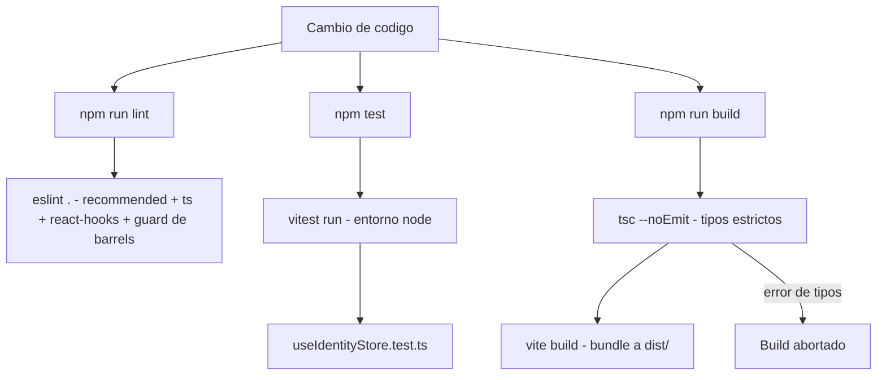
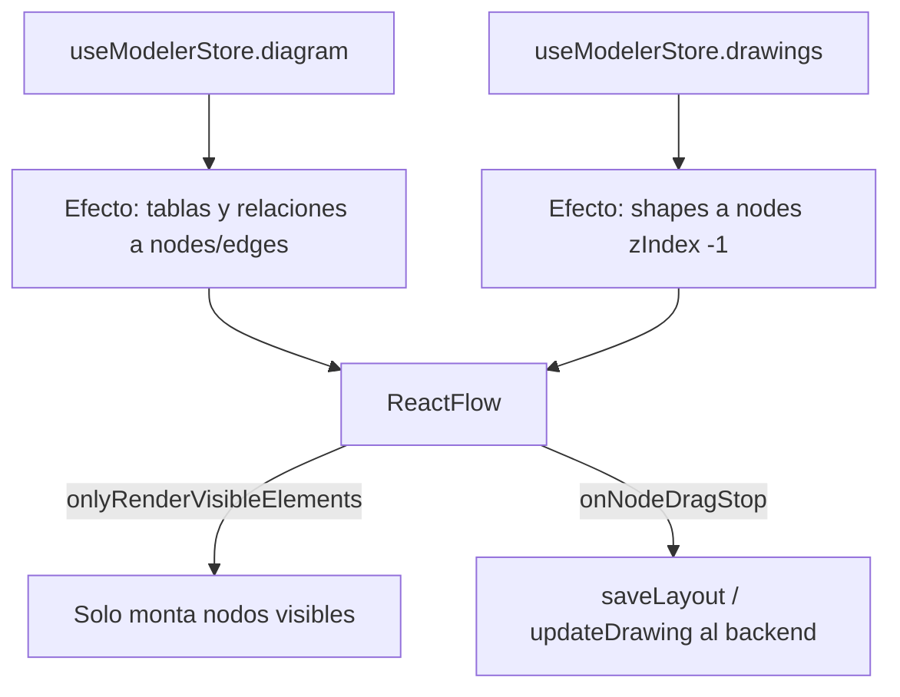
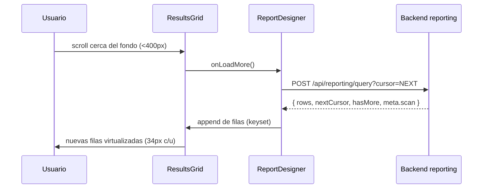
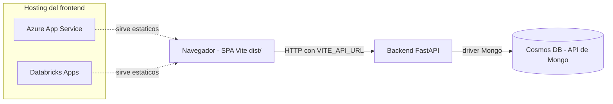

# Testing y consideraciones/límites del frontend — Data Model Hub

Este documento describe cómo se verifica hoy el frontend (SPA en Vite + React 19) y qué consideraciones de rendimiento y límites conocidos aplican al canvas del modelador y a la grilla del reporting. Está basado en el código real del repositorio `web-data-model-hub`.

El frontend no toca la base de datos: es una SPA que consume el backend FastAPI vía HTTP (capa `src/services/*` y `src/features/*/*.service.ts`). La persistencia (Cosmos DB con API de Mongo) vive del lado del backend.

---

## 1. Testing y verificación

### 1.1 Scripts disponibles (`package.json`)

El proyecto expone cinco scripts de npm. No hay más automatización local que estos comandos.

| Script | Comando | Para qué sirve |
|---|---|---|
| `npm run dev` | `vite` | Servidor de desarrollo en `:3000` con HMR y proxy `/api` → backend `:8000`. |
| `npm run build` | `tsc --noEmit && vite build` | Verificación de tipos (sin emitir) y luego bundle de producción a `dist/`. |
| `npm run preview` | `vite preview` | Sirve el `dist/` ya construido para revisarlo localmente. |
| `npm test` | `vitest run` | Corre la suite de tests una sola vez (no watch). |
| `npm run lint` | `eslint .` | Linting de todo el árbol con la config flat de ESLint. |

Puntos importantes:

- El comando de build encadena `tsc --noEmit` antes de `vite build`. Es decir, la verificación de tipos es una compuerta obligatoria del build: si TypeScript encuentra un error de tipos, el bundle no se genera. Vite por su cuenta transpila sin chequear tipos (usa esbuild), por eso el `tsc --noEmit` explícito es el que da la garantía de tipos.
- `npm test` usa `vitest run` (una corrida y termina). Para modo interactivo/watch se invoca `vitest` a mano.

### 1.2 Vitest (`npm test`)

La configuración de Vitest está embebida en `vite.config.ts` (se usa `defineConfig` de `vitest/config`):

```ts
// vite.config.ts (bloque test)
test: {
  environment: 'node',
  include: ['src/**/*.test.{ts,tsx}'],
},
```

- Entorno `node` (no `jsdom`): los tests actuales son de lógica pura (stores de Zustand, servicios), no de renderizado del DOM. Si a futuro se testean componentes con render, habría que cambiar a `jsdom` o `happy-dom`.
- Patrón de descubrimiento: cualquier archivo `*.test.ts` o `*.test.tsx` bajo `src/`.
- El alias `@` → `src/` se resuelve tanto en runtime como en los tests (`resolve.alias`), por eso los tests importan con `@/services/...`.

### 1.3 Qué se testea hoy

Hoy existe un único archivo de test: `src/store/useIdentityStore.test.ts`. Cubre el store de identidad (Zustand) mockeando el servicio HTTP:

```ts
// src/store/useIdentityStore.test.ts (esencia)
vi.mock('@/services/identity.service', () => ({ getMe: vi.fn() }));

describe('useIdentityStore', () => {
  it('carga el principal desde /api/me', async () => {
    vi.mocked(getMe).mockResolvedValue(fake);
    await useIdentityStore.getState().loadIdentity();
    expect(useIdentityStore.getState().principal?.email).toBe('dev@local');
    expect(getMe).toHaveBeenCalledTimes(1);
  });

  it('no re-fetchea una vez cargado', async () => {
    vi.mocked(getMe).mockResolvedValue(fake);
    await useIdentityStore.getState().loadIdentity();
    await useIdentityStore.getState().loadIdentity();
    expect(getMe).toHaveBeenCalledTimes(1);
  });
});
```

Lo que valida:

1. `loadIdentity()` llama a `getMe()` (el `GET /api/me`) y guarda el `principal` en el store.
2. La memoización del cargado: una segunda llamada a `loadIdentity()` no vuelve a pegarle al backend (se apoya en el flag `loaded`).

El patrón que establece este test para futuros tests de store/servicio:

- Aislar el efecto de red con `vi.mock` sobre el módulo de servicio.
- Resetear el estado del store en `beforeEach` con `store.setState({...})` y limpiar mocks con `vi.clearAllMocks()`.
- Ejercitar el store por su API imperativa (`store.getState().accion()`).

### 1.4 Verificación de tipos y build

`tsconfig.json` está en modo estricto. Detalles relevantes para el testing/verificación:

| Opción | Valor | Implicancia |
|---|---|---|
| `strict` | `true` | Chequeos estrictos completos (null checks, `any` implícito prohibido, etc.). |
| `noEmit` | `true` | `tsc` solo verifica; el bundling lo hace Vite. |
| `isolatedModules` | `true` | Cada archivo debe transpilarse por separado (obliga a `import type` donde toca). |
| `moduleResolution` | `bundler` | Resolución al estilo Vite/esbuild. |
| `jsx` | `react-jsx` | Sin necesidad de importar React en cada archivo. |
| `paths` | `@/*` → `./src/*` | Alias de imports; debe coincidir con el alias de `vite.config.ts`. |
| `types` | `["vite/client"]` | Tipos de `import.meta.env` (p. ej. `VITE_API_URL`). |

La verificación de tipos se corre implícitamente con `npm run build`, o de forma directa con:

```bash
npx tsc --noEmit
```

### 1.5 ESLint

Config flat en `eslint.config.mjs`, compuesta por:

- `@eslint/js` → `js.configs.recommended`.
- `typescript-eslint` → `...tseslint.configs.recommended`.
- `eslint-plugin-react-hooks` con la regla `react-hooks/exhaustive-deps` en nivel `warn`.
- Un guard de arquitectura de features: `no-restricted-imports` (nivel `warn`) que prohíbe importar el interior de una feature y obliga a pasar por su barrel `@/features/<name>`:

```js
// eslint.config.mjs (regla de límites de feature)
'no-restricted-imports': ['warn', {
  patterns: [{
    group: ['@/features/*/**'],
    message: "Importá una feature por su barrel '@/features/<name>', no su ruta interna.",
  }],
}],
```

- `ignores`: `dist`, `node_modules`, `.next`, `scripts`.

Se corre con `npm run lint` (`eslint .`).

### 1.6 Resumen visual de compuertas de verificación



### 1.7 Cobertura actual y brechas conocidas

| Área | Estado de test |
|---|---|
| Store de identidad (`useIdentityStore`) | Cubierto (unit). |
| Otros stores (`useModelerStore`, `useSessionStore`, `useChangesetStore`, `useAuthStore`) | Sin tests. |
| Servicios HTTP (`reporting.service`, `governance.service`, etc.) | Sin tests. |
| Componentes React (canvas, grillas, modales) | Sin tests de render (entorno `node`, no `jsdom`). |
| Lógica de layout ELK (`elkLayout.ts`) | Sin tests. |
| Motor de query del reporting (cliente `query.service`) | Sin tests. |

En la práctica, la red de seguridad principal hoy son las compuertas estáticas (`tsc --noEmit` estricto + ESLint), más el único test unitario. El grueso de la lógica pesada (canvas, motor de reporting, keyset, SQL) vive validada del lado del backend y por pruebas de estrés a nivel de datos, no por tests de frontend.

---

## 2. Consideraciones y límites

### 2.1 Rendimiento del canvas (xyflow / `@xyflow/react` 12)

El canvas del modelador (`src/features/modeler/components/ModelerCanvas.tsx`) está pensado para escalar a diagramas grandes (referencia repetida en el código: 100 tablas x ~30 columnas ≈ 3.000 filas y ~6.000 handles). Las técnicas aplicadas:

#### a) Virtualización del viewport (`onlyRenderVisibleElements`)

React Flow solo monta en el DOM los nodos dentro del viewport visible. Es la defensa principal contra diagramas enormes:

```tsx
// ModelerCanvas.tsx
<ReactFlow
  ...
  onlyRenderVisibleElements
  ...
/>
```

Con esto, un canvas de 3.000 filas no pinta 3.000 filas: pinta solo lo que se ve en pantalla.

#### b) Memoización de nodos y aristas

- `TableNode` está envuelto en `memo` porque React Flow re-renderiza los custom nodes en cada update del grafo (pan/zoom/drag). Sin `memo`, cada frame repintaría todas las filas y handles.
- `CrowFootEdge` (la arista con notación crow's-foot) también es `memo(CrowFootEdge)`.

#### c) Selector booleano en vez del id crudo (evita repintar 100 nodos)

Un detalle fino y load-bearing: la selección de tabla se lee con un selector booleano por-nodo, no con el id crudo. Con el id, cambiar la selección re-renderizaba los 100 nodos; con el booleano solo se re-renderizan los 2 afectados (el que entra y el que sale de selección):

```tsx
// TableNode.tsx
// Selector BOOLEANO (no el id crudo): con el id, cambiar la seleccion
// re-renderizaba los 100 nodos del canvas; con el booleano solo los 2 afectados.
const selected = useModelerStore((s) => s.selectedTableId === table.id);
```

#### d) Ancho dinámico de nodos

Los nodos no tienen ancho fijo: crecen con su contenido (`width: max-content`), acotado por un mínimo y un máximo, para que `schema.tabla` y `nombre_columna  TIPO` entren sin cortarse, pero sin dejar que un caso patológico explote:

```css
/* src/features/modeler/modeler.css */
.wk-node { min-width: 220px; max-width: 520px; width: max-content; ... }
.wk-node-name { flex: 1 1 auto; min-width: 0; overflow: hidden;
  text-overflow: ellipsis; white-space: nowrap; }
```

Recién al tocar el `max-width` del nodo, el nombre de la columna hace shrink + ellipsis (el tipo de dato nunca se recorta).

#### e) `minZoom` bajo para canvases enormes

El auto-arrange de 100 tablas produce diagramas de aproximadamente 14.000 x 19.000 px. Para poder verlos completos hay que bajar del `minZoom` por defecto de React Flow (0.5) hasta 0.02, y hacer que el auto-fit inicial respete ese piso:

```tsx
// ModelerCanvas.tsx
minZoom={0.02}
fitView
fitViewOptions={{ padding: 0.12, minZoom: 0.02 }}
```

#### f) Borrado por teclado deshabilitado (`deleteKeyCode={null}`)

El default de React Flow (Backspace) borraba tablas/wires solo en pantalla, sin persistir; el reload los restauraba, lo que confundía en edición y violaba el viewer-lock en solo lectura. Los borrados reales van por UI explícita (panel de propiedades / popup de relación).

#### g) Edge fantasma optimista

Al dibujar una relación, aparece de inmediato un edge semitransparente (`pending: true`) mientras el backend persiste; si falla, se remueve y se muestra el motivo real (por ejemplo un `409` si la versión ya no está en borrador). Esto da feedback inmediato sin esperar el round-trip.

#### h) Sincronización store → React Flow

El diagrama vive en el store (`useModelerStore`) y se proyecta a nodos/aristas de React Flow por efectos. Las shapes de la capa DRAWING se mantienen detrás de las tablas (`zIndex: -1`) y preservan su posición durante un drag en curso.



#### i) Auto-arrange con ELK (Sugiyama)

El botón Autoarrange delega en ELK (Eclipse Layout Kernel), algoritmo `layered` (Sugiyama), en `src/features/modeler/lib/elkLayout.ts`. No hay matemática de posicionamiento a mano: ELK resuelve capas, orden dentro de capa (minimización de cruces) y coordenadas; React Flow solo rutea los wires (ortogonal).

Config afinada para diagramas ER (validada contra el canvas de estrés):

- `elk.algorithm: layered`, `elk.direction: RIGHT` (coincide con handles src=Right / tgt=Left).
- `separateConnectedComponents` + `spacing.componentComponent` → las tablas sueltas se empaquetan en bloques compactos en vez de una tira larga.
- `nodePlacement.strategy: BRANDES_KOEPF` + `favorStraightEdges` → columnas balanceadas, wires más rectos.
- `crossingMinimization.strategy: LAYER_SWEEP` + `thoroughness: 10` → menos cruces.

Detalle crítico de correctitud: ELK usa el ancho/alto MEDIDO de cada nodo (`n.measured`), no un tamaño fijo. Con tamaño fijo, las tablas altas (30 columnas ≈ 700 px) se superponían.

```ts
// elkLayout.ts
children: nodes.map((n) => ({
  id: n.id,
  width:  n.measured?.width  ?? (typeof n.width  === 'number' ? n.width  : NODE_W),
  height: n.measured?.height ?? (typeof n.height === 'number' ? n.height : NODE_H),
})),
```

El auto-arrange corre en el store (`autoOrganize`): toma los tamaños medidos de los nodos vivos, calcula posiciones con ELK, hace merge en el backend (`setSubjectAreaLayout`) y recarga.

#### Límites del canvas

- La virtualización cubre el DOM, pero las aristas (edges) no se virtualizan con la misma agresividad que los nodos; diagramas con muchísimas relaciones densas pueden pesar más que la cuenta de tablas sugeriría.
- El auto-arrange (ELK) es una operación asíncrona y sincrónicamente costosa en diagramas muy grandes; corre en el hilo principal (elkjs bundled) y puede tardar en canvases de estrés.
- El export a imagen (PNG vía `html-to-image`) captura el viewport DOM: en canvases enormes hace `fitView` + doble `requestAnimationFrame` antes de capturar para evitar cortes; con `pixelRatio: 2` el archivo puede ser grande.

### 2.2 Grilla de reporting virtualizada (keyset + scroll infinito)

La grilla de resultados del Report Designer (`src/features/reporting/components/ResultsGrid.tsx`) está virtualizada con `@tanstack/react-virtual` y nunca trae el dataset completo al browser (referencia en el código: hasta 400k filas del lado del servidor).

```tsx
// ResultsGrid.tsx
const virt = useVirtualizer({
  count: rows.length,
  getScrollElement: () => parentRef.current,
  estimateSize: () => 34,   // alto de fila
  overscan: 12,
});
```

#### Scroll infinito por cursor (keyset)

La paginación es por cursor (keyset), no por offset. Cuando el usuario se acerca al fondo (a menos de 400 px), se pide la siguiente página y se concatenan las filas:

```tsx
// ResultsGrid.tsx — dispara loadMore cerca del fondo
const onScroll = (e) => {
  const el = e.currentTarget;
  if (result?.hasMore && !loading && el.scrollHeight - el.scrollTop - el.clientHeight < 400)
    onLoadMore();
};
```

```tsx
// ReportDesigner.tsx — la siguiente página usa nextCursor y hace append
const loadMore = async () => {
  if (!result?.nextCursor || loading) return;
  const res = mode === 'sql'
    ? await runSql(sqlText, result.nextCursor)
    : await runQuery(spec, result.nextCursor);
  setResult((prev) => (prev ? { ...res, rows: [...prev.rows, ...res.rows] } : res));
};
```

#### Sort server-side y columnas dinámicas

- El sort se hace en el servidor (click en el header re-corre la query con `orderBy`). Solo se permite ordenar por campos indexados: no se ordena por UDP ni cuando el resultado está agrupado.
- Las columnas son dinámicas, incluidas las UDP (marcadas con un rombo y ancho propio de 190 px).
- El meta de la respuesta expone el tipo de scan (`index` vs `collscan`), que se muestra al usuario como señal de si la query usó índice.

```tsx
// ResultsGrid.tsx
const sortable = !c.udp && !result.meta?.grouped;   // solo por campos indexados
const colW = (c) => (c.type === 'number' ? 110 : c.udp ? 190 : 200);
```

Ejemplo de flujo:



#### El ReportSpec y las llamadas

El mismo `ReportSpec` (IR) lo producen el builder visual y la caja SQL, y lo consumen la grilla, las queries guardadas y el export. Ejemplo de spec:

```json
{
  "from": "columns",
  "select": ["table", "column", "dataType"],
  "where": { "op": "and", "conditions": [
    { "field": "isPrimaryKey", "op": "eq", "value": true }
  ]},
  "groupBy": [],
  "aggregations": [],
  "orderBy": [{ "field": "table", "dir": "asc" }],
  "limit": 100
}
```

Llamadas (base configurable con `VITE_API_URL`, por defecto mismo origen):

```bash
# Catalogo de campos de una vista
curl 'http://localhost:8000/api/reporting/catalog?from=columns'

# Correr una query (primera pagina)
curl -X POST 'http://localhost:8000/api/reporting/query' \
  -H 'Content-Type: application/json' \
  -d '{"from":"columns","select":["table","column"],"groupBy":[],
       "aggregations":[],"orderBy":[{"field":"table","dir":"asc"}],
       "limit":100,"where":{"op":"and","conditions":[]}}'

# Siguiente pagina (keyset)
curl -X POST 'http://localhost:8000/api/reporting/query?cursor=<NEXT_CURSOR>' \
  -H 'Content-Type: application/json' -d '{ ... mismo spec ... }'
```

#### Nota sobre la grilla principal de Reporting (Screen 11)

Conviene distinguir dos grillas distintas:

- La grilla de resultados del Report Designer (`ResultsGrid`) es la virtualizada con keyset descrita arriba.
- La grilla principal de la pantalla Reporting (`src/screens/ReportingScreen.tsx`, tablas de metadata) carga filas y filtra en cliente (search + chips), con narrowing server-side para Schema/Project (re-query autoritativa). No es scroll infinito: soporta un `limit` opcional para una carga inicial más liviana (`listReportTables({ limit })`).

### 2.3 Export: CSV por streaming vs XLSX client-side

Hay dos caminos de export, con características muy distintas.

#### CSV por streaming (Report Designer)

`exportCsv(spec)` en `query.service.ts` hace un `fetch` directo al endpoint de export. El backend genera el CSV como stream, por lo que no bufferea el dataset completo en JS antes de descargar: sirve para volúmenes grandes.

```ts
// query.service.ts
export async function exportCsv(spec: ReportSpec): Promise<void> {
  const token = localStorage.getItem('dmh.token');
  const res = await fetch(`${R}/export`, {
    method: 'POST',
    headers: { 'Content-Type': 'application/json',
               ...(token ? { Authorization: `Bearer ${token}` } : {}) },
    body: JSON.stringify(spec),
  });
  if (!res.ok) throw new Error(`Export falló (${res.status})`);
  const blob = await res.blob();
  const url = URL.createObjectURL(blob);
  const a = document.createElement('a');
  a.href = url; a.download = `report-${spec.from}.csv`;
  document.body.appendChild(a); a.click(); a.remove();
  URL.revokeObjectURL(url);
}
```

```bash
# Export CSV por streaming
curl -X POST 'http://localhost:8000/api/reporting/export' \
  -H 'Content-Type: application/json' \
  -H 'Authorization: Bearer <TOKEN>' \
  -d '{"from":"columns","select":["table","column","dataType"], ... }' \
  -o report-columns.csv
```

Detalle: hoy el cliente hace `await res.blob()` (materializa el cuerpo como Blob antes de disparar la descarga). El streaming real es del lado del backend; el ahorro de memoria completo es en el servidor, y el navegador recibe el archivo ya armado como Blob.

#### XLSX client-side (pantalla Reporting)

La tarjeta "Export to Excel" de `ReportingScreen.tsx` arma el workbook en el navegador con la librería `xlsx` (SheetJS). Cada nivel de detalle marcado (Tables / Columns / Relationships / Definitions) se vuelve una hoja:

```ts
// ReportingScreen.tsx (esencia)
const wb = XLSX.utils.book_new();
if (levels.has('tables'))
  XLSX.utils.book_append_sheet(wb, XLSX.utils.json_to_sheet(data), 'Tables');
// ...
XLSX.writeFile(wb, `data-model-hub-report-${stamp}.xlsx`);
```

Como es client-side, tiene límites deliberados:

- Solo exporta las filas seleccionadas (no todo el dataset). Si no hay filas seleccionadas o ningún nivel marcado, muestra error y no exporta.
- El nivel Columns está acotado server-side a las tablas seleccionadas cuando hay hasta 300 ids (`listReportColumns(undefined, ids)` con `$in`); por encima de 300 hace la descarga completa de columnas y filtra en cliente.

#### Comparación

| Aspecto | CSV por streaming | XLSX client-side |
|---|---|---|
| Dónde se arma | Backend (stream) | Navegador (SheetJS) |
| Volumen soportado | Alto (dataset grande) | Acotado (solo filas seleccionadas) |
| Formato | Texto plano CSV | Workbook `.xlsx`, una hoja por nivel |
| Entrada | `ReportSpec` completo | Filas ya seleccionadas en la grilla |
| Riesgo de memoria | Bajo (servidor) | Alto si se fuerza mucho volumen en cliente |
| Ubicación | Report Designer | Pantalla Reporting (Screen 11) |

### 2.4 Límites conocidos

| Límite | Detalle |
|---|---|
| `minZoom` 0.02 | Fijado para canvases de auto-arrange enormes (~14.000 x 19.000 px). Por debajo, la legibilidad es nula; es un piso de emergencia, no una vista de trabajo. |
| Ancho de nodo 220–520 px | Nombres de columna muy largos se truncan con ellipsis al tocar el `max-width`; el tipo de dato nunca se recorta. |
| Export XLSX solo filas seleccionadas | Es client-side: no está pensado para exportar el modelo entero, sino la selección. |
| Nivel Columns del XLSX: umbral de 300 ids | Hasta 300 tablas se acota server-side (`$in`); por encima descarga todas las columnas y filtra en cliente (más pesado). |
| Sort del reporting solo por campos indexados | No se ordena por UDP ni sobre resultados agrupados (la grilla desactiva esos headers). |
| Grilla principal de Reporting no es scroll infinito | Filtra en cliente sobre lo cargado; usa `limit` para aliviar la carga inicial. La virtualizada con keyset es la del Report Designer. |
| CSV: el cliente hace `res.blob()` | El streaming es del backend; el navegador materializa el Blob antes de descargar. |
| Sin tests de render de componentes | El entorno de Vitest es `node`; no hay cobertura de UI (canvas, grillas) por tests. |
| Borrado por teclado deshabilitado | `deleteKeyCode={null}`: los borrados van solo por UI explícita para no romper persistencia ni el viewer-lock. |

---

## 3. Despliegue: dónde corre, variables de entorno y base de datos

El frontend es una SPA de Vite: `npm run build` produce archivos estáticos en `dist/` (HTML + JS + CSS + assets). No hay servidor propio de la app más allá de servir esos estáticos.

### 3.1 Dónde corre

Dos destinos posibles para hospedar el `dist/`:

- Azure App Service (sirviendo los estáticos del build).
- Databricks Apps (mismo build estático servido como app del workspace).

En ambos casos el patrón es idéntico: el navegador descarga la SPA y llama por HTTP al backend FastAPI (que es quien habla con la base de datos). El frontend nunca abre conexión a la base.

### 3.2 Variables de entorno

La única variable que consume el frontend es la base del backend, y es de tiempo de build (Vite inlina `import.meta.env.VITE_API_URL` al compilar):

| Variable | Uso | Ejemplo |
|---|---|---|
| `VITE_API_URL` | Base del backend. Vacío = mismo origen. | `` (vacío en dev, el proxy resuelve) / `https://bknd-...azuredatabricksapps.com` en prod |

En desarrollo (`.env`), `VITE_API_URL` va vacío y el proxy de Vite reenvía `/api` al backend local:

```ts
// vite.config.ts
server: {
  port: 3000,
  proxy: { '/api': { target: 'http://localhost:8000', changeOrigin: true } },
},
```

En producción se fija `VITE_API_URL` a la URL pública del backend en el momento del build (no en runtime, porque Vite lo inlina). Todos los servicios la leen con el mismo patrón:

```ts
const API_BASE = import.meta.env.VITE_API_URL ?? '';
```

Consideración importante: como `VITE_API_URL` es build-time, cambiar el backend de destino exige reconstruir el bundle; no basta con reiniciar el proceso ni con variables de runtime.

Nota sobre archivos heredados: en el repo conviven artefactos de la migración anterior a Next.js (`app.yaml`, `.env.production` con `NEXT_PUBLIC_API_URL`, `databricks.yml` que menciona "Next.js", partes del README). El runtime vigente es Vite y la variable efectiva es `VITE_API_URL`; esos archivos con `NEXT_PUBLIC_*` son residuales y no los lee la SPA actual.

### 3.3 Base de datos (Cosmos DB con API de Mongo)

- La persistencia vive en Azure Cosmos DB con API de Mongo, y la maneja exclusivamente el backend FastAPI.
- El frontend no tiene credenciales ni driver de base: toda lectura/escritura pasa por HTTP contra el backend (`src/services/*` y `src/features/*/*.service.ts`), que a su vez consulta Cosmos.
- Implicancia de rendimiento ligada a la BD: las señales de scan (`meta.scan: index | collscan`) que muestra la grilla del reporting reflejan si la consulta usó un índice de Cosmos; el keyset y el streaming del CSV existen precisamente para que grandes volúmenes de la colección no se materialicen en el navegador.


