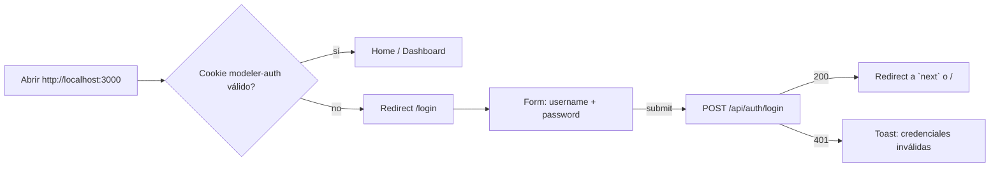
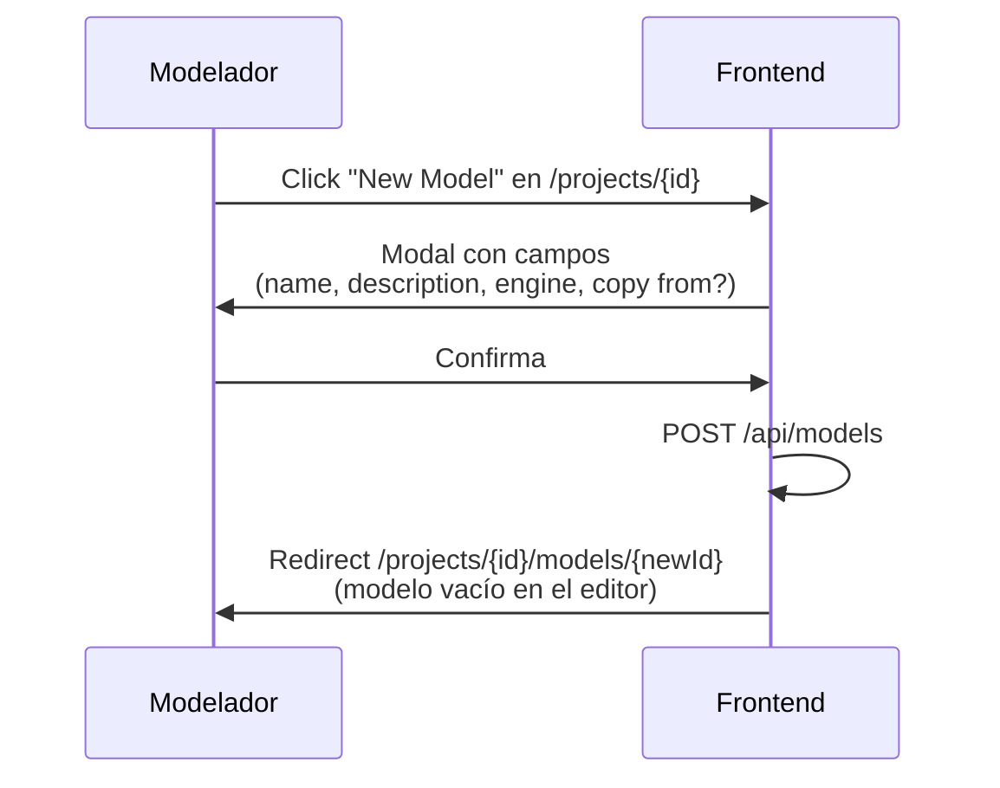
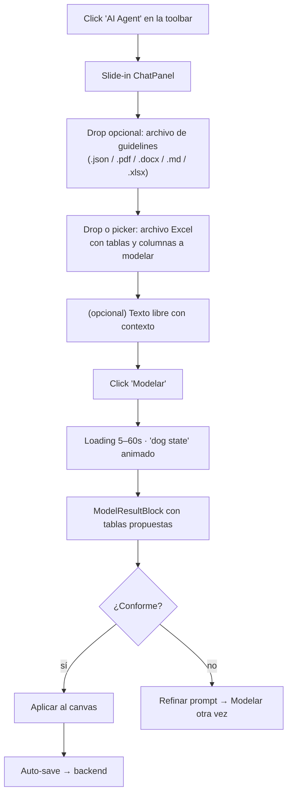

# Guía de Usuario

> Cómo usar `web-data-model-hub` desde la perspectiva de un modelador
> o un administrador. Asume que el backend `agent-modeler` está corriendo
> y conectado a Cosmos DB + Azure AI Foundry.

## 1. Acceso



**Bootstrap inicial**: la primera vez que el sistema arranca con la
DB vacía, el usuario `admin / dogadmin2019` se crea automáticamente
en el primer login. Cambiá la contraseña inmediatamente desde
**Admin → Users**.

---

## 2. Navegación principal

```
┌──────────────────────────────────────────────────────────┐
│  ⚡ Modeler          Projects | Dashboard | Docs | 👤   │   ← AppLayout header
├──────────────────────────────────────────────────────────┤
│                                                          │
│   ⌂ Projects                                             │
│     ├─ Project A (3 modelos)                             │
│     ├─ Project B (1 modelo)                              │
│     └─ + New Project (admin)                             │
│                                                          │
└──────────────────────────────────────────────────────────┘
```

Rutas principales:

| Ruta | Descripción | Acceso |
|------|-------------|--------|
| `/` | Listado de proyectos visibles | sesión |
| `/projects/{id}` | Listado de modelos del proyecto | view sobre el proyecto |
| `/projects/{id}/models/{modelId}` | Editor del modelo (canvas + lista + chat) | view (lectura) o edit (escritura) |
| `/projects/{id}/global` | Lienzo global con todos los modelos del proyecto | view |
| `/dashboard` | KPIs agregados (proyectos, modelos, tablas, columnas) | sesión |
| `/admin/users` | CRUD usuarios + edición de permisos | rol `admin` |
| `/docs` | Documentación in-app | sesión |
| `/login` | Form de login | público |

---

## 3. Crear un modelo



> **Engine**: elegirlo bien al inicio importa porque define
> particionamiento disponible, mapeo de tipos y schema default. Se
> puede cambiar después en **Settings → Engine**, pero los DDL ya
> generados pueden requerir ajuste.

---

## 4. Agregar tablas — 5 caminos

### 4.1 Formulario manual

1. Click en **+ Add Table** en la toolbar del editor.
2. Pestañas:
   - **General** — nombre, schema, dominio, color, descripción.
   - **Columns** — agregar/quitar/reordenar columnas. Cada columna
     puede ser PK, SK (surrogate key), Nullable, Unique, FK con ref
     `tabla.columna`.
   - **Partitioning** — solo si el engine soporta (ej. Databricks).
   - **Metadata** — tags y campos extra.
3. **Save**.

> Cuando renombres una columna, las relaciones que la referencian
> **NO se rompen** — el sistema usa `id` estables por columna. La UI
> tampoco actualiza el nombre de la columna en otras pestañas hasta
> guardar; revisa el preview antes de confirmar.

### 4.2 Importar desde Excel

1. Click en **Import → From Excel** en la toolbar.
2. Drop o seleccionar el `.xlsx`. Cada pestaña → una tabla.
3. Modal de preview: editá nombres, tipos, PKs antes de aceptar.
4. **Aplicar**.

Headers reconocidos (matching flexible, case-insensitive):

| Concepto | Aliases |
|----------|---------|
| `column_name` | `column`, `columna`, `nombre`, `nombre_columna`, `field`, `campo` |
| `data_type` | `tipo`, `tipo_dato`, `type`, `datatype` |
| `functional_definition` | `definicion`, `descripcion`, `description`, `desc` |
| `is_nullable` | `nullable`, `nulo`, `null`, `nulable` |

### 4.3 Editor DBML

1. Toggle a la pestaña **Code (DBML)** en el panel izquierdo.
2. Escribí o pegá DBML.
3. Click **Apply** — reemplaza todas las tablas del modelo (con
   confirmación si hay datos previos).

Soporte: `Table`, `Note`, refs cortos (`[ref: > schema.table.column]`),
declaraciones `Ref:`, settings (`pk`, `sk`, `partition`, `not null`,
`unique`, `increment`, `default: 'x'`, `note: '…'`), tipos con
`length(N)` y `decimal(N, M)`.

### 4.4 Crear tabla desde SQL

1. **+ Add Table → Create from SQL**.
2. Pegá un `CREATE TABLE …` o `SELECT … FROM … JOIN …`.
3. El parser infiere columnas y, en el caso del SELECT, sugiere FKs
   por cada JOIN encontrado.
4. Modal de preview con checkboxes para confirmar cuáles JOINs
   convertir en relaciones del modelo.

### 4.5 Agente IA de modelado



**Recomendaciones**:

- **Subir guidelines** la primera vez: el agente respeta
  convenciones (snake_case, prefijos `id_`, audit columns, mappings
  de tipo por engine, longitudes máximas).
- **El Excel debe ser limpio**: una pestaña por tabla, headers en la
  primera fila. El parser es flexible pero no adivina si la primera
  fila es data.
- **Definiciones funcionales** son la pieza clave — el agente las usa
  para reusar nombres del **diccionario semántico** del backend
  (matching vectorial). Una columna definida como "identificador
  único del cliente" en dos tablas distintas terminará usando el
  mismo nombre físico (`id_customer` o el canónico que tenga el
  catálogo).
- El agente devuelve **solo nombres físicos + tipos + DDL**. Las
  relaciones FK las modela el revisor humano en el canvas.

---

## 5. Editor del modelo

### 5.1 Layout

```
┌──────────────────────────────────────────────────────────────────┐
│  Toolbar: [Visual | Code]  [List | Canvas]  [+ Add Table]       │
│             [Import ▾]  [Export DDL ▾]  [Domains]  [AI Agent]   │
├──────────────────┬───────────────────────────────────────────────┤
│                  │                                                │
│  Visual:         │   List | Canvas                               │
│   - TableForm    │                                                │
│     embebido     │   Cards o React Flow ER                        │
│   - DomainMgr    │                                                │
│                  │                                                │
└──────────────────┴───────────────────────────────────────────────┘
```

### 5.2 Vista List

- Cards con resumen: nombre, columnas, tags, dominio.
- Búsqueda full-text + filtros por engine, dominio, schema, tags.
- Group-by: `none / domain / schema / tag`.
- Edit / Delete por gear ⚙ en cada card.

### 5.3 Vista Canvas

- React Flow con `TableNode` por cada tabla y `AnimatedEREdge` por
  relación.
- **Hover** sobre una tabla resalta sus relaciones y las columnas
  conectadas en sus vecinos.
- **Click** selecciona persistente (sobrevive al unhover).
- **Gear ⚙** del nodo abre menú: Edit / Delete.
- **Auto-Arrange** (icono grid en Controls): 3 algoritmos
  - **Compact**: grid ordenado por número de relaciones.
  - **Left-right**: capas topológicas (Kahn).
  - **Snowflake**: BFS rings desde el nodo más conectado.
- Las posiciones de drag se conservan en memoria, **no se persisten
  al backend**. Recargar reaplica el algoritmo.

### 5.4 Toggle Visual / Code

- **Visual**: paneles lado a lado (form a la izquierda, canvas/list a
  la derecha).
- **Code (DBML)**: editor monoespaciado a la izquierda con resaltado
  + botón **Apply**. La canvas/list a la derecha actualiza en vivo
  cuando se aplica.

---

## 6. Generar DDL

Tres scopes disponibles:

| Scope | Cómo se invoca | Genera |
|-------|----------------|--------|
| **Modelo completo** | Toolbar → Export DDL | todas las tablas + FKs + comments |
| **Dominio** | Group-by domain → header del grupo → ↓ icon | tablas del dominio + FKs internas |
| **Tabla individual** | Lista → row → ↓ icon, o canvas → gear → Export DDL | una sola tabla + sus FKs |

`DDLPreviewModal` muestra el SQL generado con toggles para:

- **Emit schemas** (`CREATE SCHEMA IF NOT EXISTS …`).
- **Emit foreign keys** (`ALTER TABLE … ADD CONSTRAINT …`).
- **Emit comments** (`COMMENT ON TABLE/COLUMN …`).

Acciones:

- **Copy**: al portapapeles.
- **Download**: como `.sql` con nombre `<model>__<scope>.sql`.

> El DDL generado respeta el engine activo: tipos, quoting, y el
> schema default vienen de `engines/engines.ts`. Cambiar el engine
> regenera el DDL al instante.

---

## 7. Lienzo Global

`/projects/{id}/global` carga **todas las tablas de todos los modelos
del proyecto** en un único canvas. Cada tabla mantiene su modelo de
origen como `namespace` (background coloreado).

Útil para:

- Ver el linaje completo de un proyecto multi-modelo.
- Detectar duplicaciones cross-modelo.
- Revisar relaciones que cruzan modelos (si las hay).

> Es **solo lectura**: para editar tablas, abrir el modelo
> correspondiente.

---

## 8. Dominios

`Domain Manager` (toolbar → Domains) permite definir un catálogo de
dominios y subdominios para el modelo, cada uno con `code`, `color`,
descripción y defaults (`schema`, `tags`).

Asignar una tabla a un dominio:

1. Editar la tabla → pestaña **General**.
2. Dropdown **Domain** y **Subdomain**.
3. Save.

Las tablas con dominio asignado heredan automáticamente los defaults
si los suyos están vacíos. La vista List puede agruparse por dominio,
y el canvas las pinta con `color` del dominio.

---

## 9. Permisos y administración

### 9.1 Niveles

| Nivel | Puede |
|-------|-------|
| **admin** (rol global) | TODO: crear proyectos, gestionar usuarios, edit en cualquier modelo |
| **edit** (permission) | crear/editar/eliminar tablas, modelos, dominios dentro del scope |
| **view** (permission) | navegar y exportar DDL, sin escritura |

Los `permissions` por usuario son **scoped**: pueden ser por proyecto
(aplica a todos sus modelos) o por modelo individual.

### 9.2 Editar permisos (admin)

1. **Admin → Users**.
2. Click en un usuario → **Edit permissions**.
3. Modal con árbol jerárquico:
   - Project A
     - ☐ View   ☐ Edit
     - └── Model A.1
       - ☐ View   ☐ Edit
     - └── Model A.2
       - ☐ View   ☐ Edit
4. Marcar lo necesario y **Save**. La toma de efecto es inmediata —
   el backend recarga `UserDoc` en cada request.

> Activar/desactivar usuarios: `Active` toggle en la lista. Un
> usuario inactivo no puede loguear ni mantener sesión existente
> (el siguiente request cae en 401).

---

## 10. Ciclo de auto-guardado

- Cualquier cambio en el modelo dispara un debouncer de **2 segundos**.
- Mientras espera: indicador "Saving…" sutil junto al título.
- Al confirmar el `PUT /api/models/{id}`: indicador "Saved hace
  Xs" con el timestamp del último save exitoso.
- Si falla: toast destructivo con el mensaje de error. El usuario
  puede reintentar haciendo cualquier otro cambio (re-dispara el
  debouncer).

> No hay botón "Save" explícito. Para forzar un save inmediato,
> cambiar y revertir cualquier campo dispara el debouncer.

---

## 11. Atajos visuales

| Acción | Cómo |
|--------|------|
| Buscar tabla en list view | input de búsqueda en la barra superior |
| Filtrar por engine / dominio / tag | chips en la barra de filtros |
| Resaltar relaciones de una tabla | hover sobre el nodo en canvas |
| Seleccionar persistente | click en el nodo |
| Auto-distribuir el canvas | botón grid en Controls |
| Centrar el canvas | botón fit-view en Controls |
| Ver DDL de una tabla | gear ⚙ → Export DDL |
| Abrir formulario de tabla | gear ⚙ → Edit |
| Eliminar tabla | gear ⚙ → Delete (con confirmación, opcional "no preguntar más esta sesión") |
| Cerrar chat del agente | × en el header del panel (libera la conversación en el backend) |

---

## 12. Troubleshooting rápido

| Síntoma | Causa probable | Acción |
|---------|----------------|--------|
| "Sesión expirada" al recargar | `AUTH_SECRET` divergente entre frontend y backend | Reiniciar ambos con la misma `.env` |
| Tabla no responde a hover en canvas | id legacy de columna sin estampar | Volver a guardar la tabla (la safety net del backend stamp el id) |
| Edge huérfano (no llega a destino) | Relación apunta a columna eliminada | Editar la relación (o la columna FK) en el TableForm |
| "El agente no aplica mis guidelines" | El archivo no se subió a la sesión actual | Volver a soltar el archivo en el ChatPanel; cerrar/reabrir el chat crea sesión nueva |
| Auto-save siempre muestra error | Permiso revocado mid-sesión | Refrescar la página; el middleware redirigirá a login si aplica |
| Excel no detecta tablas al importar | Header en fila distinta a la primera | Limpiar el Excel y reintentar |
| DDL exportado sin schemas | Toggle "Emit schemas" desactivado | Reactivarlo en el modal de DDL |
| El canvas se desorganiza al abrir | Auto-layout corre cada vez (no se persiste) | Aplicar Auto-Arrange manual y trabajar; el modelo no recuerda posiciones |
