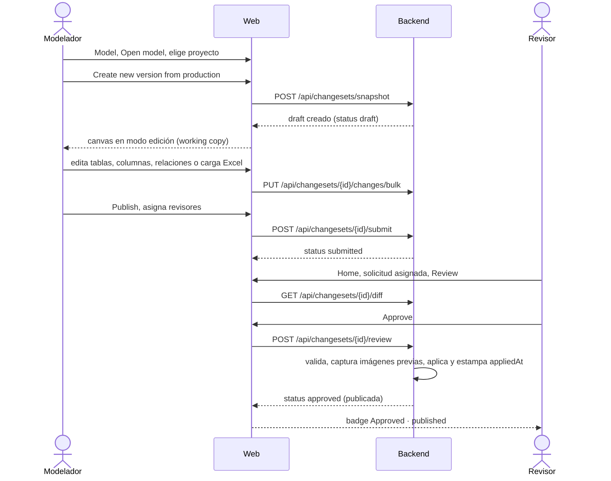

# Visión general

Este documento explica qué hace la web de Data Model Hub, qué pantallas tiene, el vocabulario del dominio
visto desde la interfaz, qué ve cada rol y el recorrido típico de un modelador. Está pensado para quien
llega al proyecto y necesita el mapa funcional antes de leer la arquitectura o el código del frontend.

## Contenido

- [Qué es la web](#qué-es-la-web)
- [Pantallas](#pantallas)
- [Conceptos desde la UI](#conceptos-desde-la-ui)
- [Qué ve cada rol](#qué-ve-cada-rol)
- [Recorrido típico de un modelador](#recorrido-típico-de-un-modelador)
- [Mapa de funcionalidades](#mapa-de-funcionalidades)
- [Documentos relacionados](#documentos-relacionados)

## Qué es la web

Data Model Hub es una plataforma web de modelado de datos colaborativo con gobierno: los modeladores
dibujan diagramas entidad-relación por proyecto, mantienen un catálogo de tablas, columnas, vistas y
relaciones bajo estándares comunes (dominios, glosario, convención de nombres, UDP, themes, reglas DDL), y
cada cambio llega a producción solo después de que los revisores asignados aprueban la solicitud de
publicación. Cada publicación es una versión que se puede abrir, comparar o restaurar.

`web-data-model-hub` es la interfaz de ese sistema: una aplicación React + Vite + TypeScript. Toda la
lógica de negocio y la persistencia viven en `backend-data-model-hub`, una API REST bajo `/api`. En
producción, `server.mjs` sirve el bundle y reenvía las llamadas `/api` al backend, de modo que el navegador
habla con un solo origen. El canvas (React Flow con auto-layout ELK), la generación del texto DDL y los
exports a Excel, SVG, HTML y PDF se resuelven en el navegador con los datos que entrega la API.

La UI está en inglés; los textos de botones y pantallas se citan aquí tal como aparecen.

## Pantallas

Las rutas están en `src/App.tsx`. Todas, salvo el login, exigen sesión (`RequireAuth`) y se dibujan bajo la
barra superior `TopNav` (`src/components/layout/TopNav.tsx`), que muestra **Home**, **Reporting**,
**Model**, **Data Standards** y **Admin** según los permisos del usuario.

| Pantalla | Ruta | Componente | Propósito |
|---|---|---|---|
| Login | `/login` | `src/features/auth/LoginScreen.tsx` | Inicio de sesión con el SSO de la plataforma (**Continue with Databricks**). |
| Home | `/` | `src/screens/HomeScreen.tsx` | Resumen informativo: contadores por proyecto (Tables, Views, Relationships, Subject Areas, Projects), solicitudes asignadas al usuario y versiones. Desde el panel de versiones se abren **Version tools** (comparar versiones, ver el detalle, transferir o eliminar un draft) y el rollback. |
| Model | `/model` | `src/features/modeler/components/WorkspaceScreen.tsx` | El modelador: **Open model**, Model Explorer, canvas, paneles de propiedades, selector lógico/físico, **Upload from Excel**, **Export DDL**, **Export diagram** y **Publish**. |
| Review | `/review` | `src/screens/ReviewScreen.tsx` | Bandeja de solicitudes de publicación de todos los proyectos: detalle, diff de cambios, comentarios, **Approve**, **Reject** y **Withdraw request**. Se abre desde las solicitudes del Home. |
| Reporting | `/reporting` | `src/screens/ReportingScreen.tsx` | Grilla de metadata de un proyecto (producción o una versión propia sin publicar), con búsqueda por tablas, columnas, definiciones o vistas, filtros por esquema y subject area, una pestaña por hoja del Excel y plantillas de hoja. |
| Data Standards | `/standards` | `src/features/standards/components/StandardsScreen.tsx` | Estándares por proyecto en pestañas **Overview**, **Glossary**, **Parent Domains**, **UDP**, **DDL Export rules** y **Color themes**, con historial de versiones y rollback. |
| Admin | `/admin` | `src/features/admin/components/AdminScreen.tsx` | Usuarios, roles y la matriz de permisos por rol. |

## Conceptos desde la UI

El glosario es el mismo de la documentación del backend; aquí la última columna indica dónde se ve cada
concepto en la interfaz.

| Término | Definición | Dónde se ve |
|---|---|---|
| Proyecto | Contenedor independiente: tiene su catálogo, sus esquemas, sus Data Standards y sus versiones. Todo documento lleva `projectId`. Renombrarlo o borrarlo es un cambio de un draft del propio proyecto. | Paso 1 de **Open model**, chips PROJECTS del Home, selector Project de Reporting y de Data Standards. |
| Carpeta | Agrupa canvases y subcarpetas dentro de un proyecto en el Model Explorer. Una carpeta raíz funciona como sub-proyecto. | Árbol **Models** del Model Explorer, en Model. |
| Canvas (subject area) | Un diagrama ER: referencia un subconjunto de las tablas del proyecto (`tableIds`), las vistas que muestra (`viewIds`), la posición de cada caja, los dibujos, los trazos manuales de las líneas y los UDP del modelo. | El área de dibujo de Model; sus UDP y colores en **Model properties**. |
| Tabla | Entidad canónica del proyecto, con nombre lógico, nombre físico y esquema. Existe una sola vez aunque aparezca en varios canvases. | Cajas del canvas, Model Explorer, panel de propiedades y grilla de Reporting. |
| Columna | Atributo de una tabla: nombres lógico y físico, tipos lógico y físico, dominio, llave primaria, nulabilidad, orden y valores UDP. | Filas de cada caja; panel de propiedades de columna. |
| Vista | Vista SQL con una o más tablas fuente; vive solo en la faceta física. Su SQL es informativo. | Cajas de vista en el canvas (modo físico) y su editor de propiedades. |
| Relación | Vínculo PK/FK entre una tabla padre y una hija, con pares de columnas (llave compuesta), cardinalidad en cada extremo y frases de relación. | Líneas crow's foot del canvas y su popup de relación. |
| Subcategoría | Variante de relación supertipo → subtipo (ES-UN, 1:1 estricto). Las ramas de un mismo grupo comparten `subtypeSymbolId`. | Símbolo de subtipo (círculo) y sus ramas en el canvas. |
| Esquema y su `kind` | Esquema físico de base de datos como entidad versionada. Las tablas y vistas guardan el nombre del esquema; `kind` indica si contiene `tables`, `views` o `both` (puede no estar clasificado). | Combos de esquema de tablas y vistas; gestor **Schemas — create & manage**. |
| Dominio | Parent Domain: tipo de dato por defecto (físico y lógico) que heredan las columnas que lo usan; cambiarlo se propaga en cascada. | Pestaña **Parent Domains** de Data Standards; combo de dominio de cada columna. |
| Glosario de términos | Diccionario de términos y abreviaturas, por ámbito (`column` o `table`), con el que se derivan los nombres físicos desde los lógicos. Una entrada puede bloquearse. | Pestaña **Glossary** de Data Standards; aviso de impacto al aplicar. |
| UDP | User Defined Property: definición key-value (tipo, default, valores permitidos) asignada a un nivel (`table`, `column`, `canvas`, `view`) y a una faceta. Los valores viven en cada objeto (`udpValues`). | Pestaña **UDP** de Data Standards; sección UDP de los paneles de propiedades. |
| Data Standards | Conjunto de estándares del proyecto (dominios, glosario, naming, UDP, reglas DDL, themes). Se aplica directo, sin revisión, y cada aplicación genera una versión con el snapshot completo. | Pantalla **Data Standards** y su pestaña **Overview**. |
| Convención de nombres (naming) | Separador, mayúsculas/minúsculas y largo máximo del nombre físico, por ámbito (`column`, `table`). | Data Standards; los nombres físicos derivados en el canvas. |
| Lógico vs físico (facetas) | Un mismo objeto tiene una faceta lógica (entidad/atributo) y una física (tabla/columna/vista). Cada campo pertenece a una faceta; un objeto puede existir en una sola (`logicalOnly`, `physicalOnly`). | Selector **Model view** de la barra de Model: **Logical model — entities & attributes** o **Physical model — tables, columns & views**. |
| Changeset | Unidad de cambio del modelo de un proyecto. Cada cambio es un documento por entidad (`upsert` o `delete`) en `changeset_changes`. | Lista **Changes** de Review y diffs de versiones. |
| Draft | Changeset en estado `draft`: la versión en edición de su dueño. | **Continue a working version** de **Open model**; panel de versiones del Home. |
| Request (solicitud de publicación) | Changeset en estado `submitted`, con revisores asignados. Cada envío abre un ciclo en `requests[]`. | Bandeja de Review (badge **In review**); solicitudes asignadas del Home. |
| Versión aprobada | Changeset en estado `approved`: todos los revisores aprobaron y se reclamó la aplicación. | Badge **Approved · publishing** en Review. |
| Versión publicada | Versión aprobada cuya aplicación a las colecciones publicadas terminó; la marca es `appliedAt`. La última publicada es la producción del proyecto. | Badge **Approved · published**; **View production (read-only)** de **Open model**. |
| Working copy | Estado efectivo que ve el dueño de un draft: lo publicado con los cambios del draft superpuestos (overlay). | El canvas abierto en modo edición. |
| Revisión y aprobación | Cada revisor asignado aprueba o rechaza (el rechazo exige motivo). Con todas las aprobaciones se publica; con un rechazo la versión vuelve a `draft`. | **Publish** en Model (asignar revisores); **Approve** y **Reject** en Review. |
| Rollback | Crea un draft con los cambios inversos que devuelve el modelo al estado de una versión publicada; pasa por revisión como cualquier otro. En Data Standards restaura el snapshot de una versión. | Botón **Restore** del panel de versiones del Home; **Roll back** del historial de Data Standards. |
| Lápida | Registro de una eliminación. Un objeto publicado borrado no desaparece: queda con `flgactive = false` y `deletedAt`. La eliminación de un draft deja además una lápida temporal que guía la purga de sus cambios huérfanos. | No se muestra como tal; el historial de auditoría registra las eliminaciones. |
| Theme / colores | Color con nombre del proyecto que las tablas y vistas usan por referencia (`theme:<id>`); cambiar el theme recolorea todas las cajas que lo usan. | Pestaña **Color themes** de Data Standards; selector de color de cada caja. |
| Perfil de carga | Configuración de la carga Excel: qué hojas y columnas del archivo corresponden a tablas, columnas y valores UDP. | Popup **Upload from Excel** y su gestor de perfiles. |
| Plantilla de hoja | Formato fijo de hoja Excel del Reporting: nombre de hoja, columnas (encabezado → dato del modelo) y filtros de filas, por proyecto. | Tarjeta de plantillas del panel de export de Reporting. |
| Reglas DDL | Reglas que transforman el texto SQL del Export DDL según los valores UDP; se administran en Data Standards y nunca modifican el modelo. | Pestaña **DDL Export rules** de Data Standards; se aplican en **Export DDL**. |
| Reporting | Consultas tabulares de solo lectura sobre la metadata de un proyecto (tablas, columnas, vistas, relaciones) para grillas y exports. | Pantalla **Reporting**. |

## Qué ve cada rol

Los permisos llegan con el usuario de la sesión (`/api/auth/me`) y el store de autenticación los expone
con `has(permiso)` (`src/store/useAuthStore.ts`). La sesión se vuelve a leer al recuperar el foco de la
pestaña y tras un 403, de modo que un cambio de rol se refleja sin recargar. Los roles y su matriz se
editan en Admin; los cuatro roles por defecto que crea el backend son Administrador, Modelador, Revisor y
Lector.

| Elemento de la UI | Condición | Dónde se comprueba |
|---|---|---|
| Rutas de Home, Reporting, Model y Review; menú de Home, Reporting y Model | Sesión iniciada | `RequireAuth` en `src/App.tsx`, `TopNav` |
| Ruta y menú **Data Standards** | `model.view` | `RequirePermission` en `src/App.tsx`, `TopNav` |
| Editar estándares (aplicar cambios) | `standards.edit`; sin él la pantalla indica que el rol solo puede ver | `StandardsScreen.tsx` |
| Bloquear o desbloquear entradas del glosario | `admin.manage` | `GlossaryPage.tsx` |
| Ruta y menú **Admin** | `admin.manage` | `RequirePermission` en `src/App.tsx`, `TopNav` |
| Abrir en el canvas drafts y solicitudes de otros usuarios | `versions.view_all` o `admin.manage` | `WorkspaceScreen.tsx`, `src/services/versioning.service.ts` |
| Transferir o eliminar un draft (**Version tools**) | Dueño del draft con `model.edit`, o `admin.manage` | `src/lib/versionAdmin.ts` |
| Rollback de una versión publicada del modelo | `rollback` | `HomeScreen.tsx` |
| **Roll back** del historial de Data Standards | El botón se muestra con `standards.edit`; el backend exige `rollback` | `StandardsScreen.tsx` |
| Revisores elegibles en **Publish** | Usuarios cuyo rol tiene `review.decide` y que acceden al proyecto | `PublishModal.tsx` |
| Botones de descarga (Export DDL, Export diagram, Export HTML y Export PDF del Explorer, **Download .xlsx** del Reporting) | `export`; sin él se muestran deshabilitados con el motivo | `Toolbar.tsx`, `ModelExplorer.tsx`, `ExportDdlModal.tsx`, `ReportingScreen.tsx`, `SheetTemplateCard.tsx` |
| **New project** | `model.edit` y sin proyectos asignados (o `admin.manage`) | `HomeScreen.tsx`, `OpenModelModal.tsx` |
| Detalle de un request ajeno en Review | Dueño, revisor asignado, `versions.view_all` o `admin.manage` | `ReviewScreen.tsx` |
| **Approve** y **Reject** | Ser revisor asignado de la solicitud | `ReviewScreen.tsx` |
| Plantillas de hoja compartidas | `admin.manage` (cada usuario gestiona las suyas) | `SheetTemplateCard.tsx` |

En términos de rol: el Lector consulta el modelo publicado, el Reporting y los estándares; el Modelador
además crea y edita drafts, carga Excel, envía a revisión y pide rollbacks; el Revisor decide las
solicitudes que se le asignan (aprobar publica la versión); el Administrador tiene todo, incluida la
gestión de usuarios y la edición de estándares.

Además del rol, cada usuario puede tener proyectos asignados desde Admin: sin asignación accede a todos;
con asignación, las listas y selectores (Home, Open model, Review, Reporting, revisores y destinos de
transferencia) muestran solo esos proyectos. Un administrador accede siempre a todos.

Estos controles ordenan la interfaz, pero no son la barrera de seguridad: varias acciones de escritura
(por ejemplo, abrir un draft con **Create new version from production** o editar en el canvas) no se
ocultan por permiso y es el backend el que las rechaza con un 403. El detalle está en
[Seguridad](08-seguridad.md).

## Recorrido típico de un modelador

El diagrama sigue un cambio desde que el modelador abre un proyecto en modo edición hasta que el revisor
lo publica, con las acciones de la UI y las llamadas principales al backend.

Si el revisor rechaza (con motivo obligatorio), la versión vuelve a `draft` y el modelador la retoma con
**Continue a working version**; si el modelador necesita cambiar algo mientras está en revisión, usa
**Withdraw request** en Review. Con varios revisores, la publicación ocurre con la última aprobación.

## Mapa de funcionalidades

Cada pantalla y feature se describe en detalle en [Funcionalidades](05-funcionalidades.md).

| Funcionalidad | Dónde vive | Qué hace |
|---|---|---|
| Autenticación | `src/features/auth` | Login, restauración de sesión y guardas de ruta. |
| Home | `src/screens/HomeScreen.tsx`, `src/screens/home` | Resumen, solicitudes asignadas, versiones, **Version tools** y rollback. |
| Modelador | `src/features/modeler` | Canvas, Model Explorer, paneles de propiedades, relaciones, subcategorías, vistas, esquemas, copiar y pegar, Undo y **Publish**. |
| Carga Excel | `src/features/upload` | **Upload from Excel** con perfiles de carga y reporte del resultado. |
| Export DDL | `src/features/ddl` | Generación del DDL con reglas y selección de tablas. |
| Review | `src/screens/ReviewScreen.tsx`, `src/screens/review` | Bandeja de solicitudes, diff, comentarios y decisión. |
| Reporting | `src/screens/ReportingScreen.tsx`, `src/features/reporting` | Grilla de metadata, filtros, export a Excel y plantillas de hoja. |
| Data Standards | `src/features/standards` | Glosario, Parent Domains, UDP, reglas DDL, themes, historial y rollback. |
| Admin | `src/features/admin` | Usuarios, roles y matriz de permisos. |

## Documentos relacionados

- [Arquitectura](02-arquitectura.md)
- [Estructura del proyecto](03-estructura-del-proyecto.md)
- [Funcionalidades](05-funcionalidades.md)
- [Flujo de datos](06-flujo-de-datos.md)
- [Integración con la API](07-integracion-con-la-api.md)
- [Seguridad](08-seguridad.md)
- [Sistema de diseño](11-sistema-de-diseno.md)
