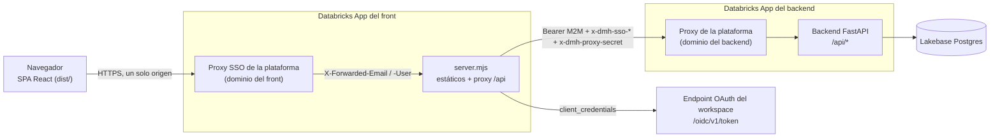
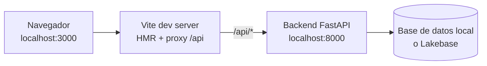
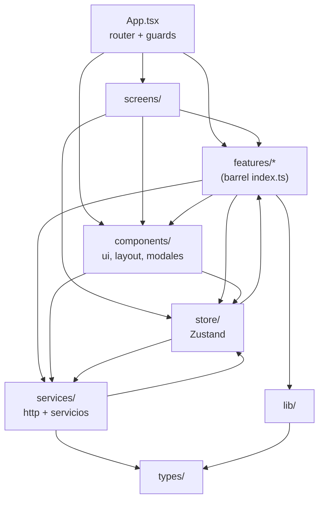
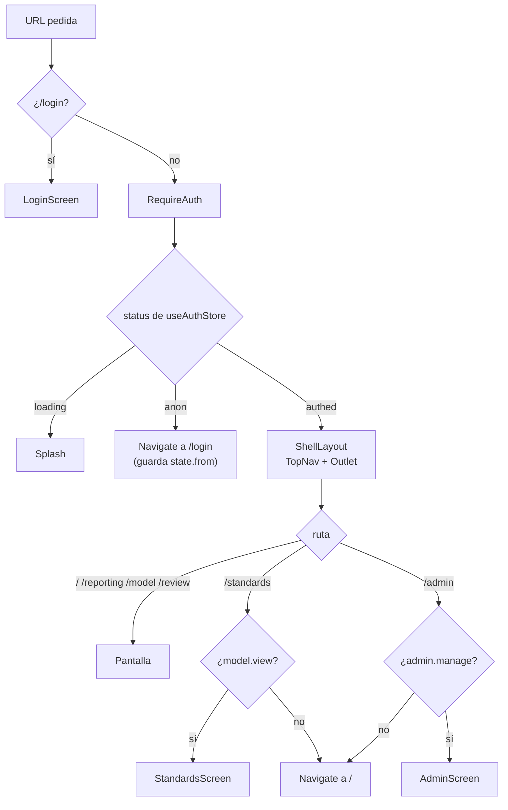
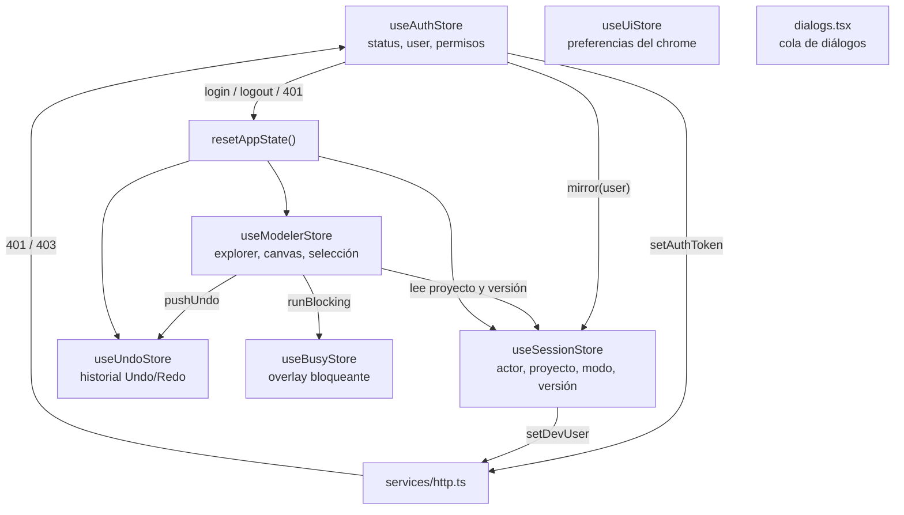

# Arquitectura del frontend

Este documento describe cómo está construida la web de Data Model Hub: dónde corre, cómo llega cada
request al backend, en qué capas se organiza el código de `src/`, cómo se protegen las rutas, qué guarda
cada store global y cómo se manejan los errores. Está dirigido a desarrolladores que necesitan entender
el conjunto antes de modificar una pantalla o una feature. El detalle de cada pantalla está en
[Funcionalidades](05-funcionalidades.md); los flujos paso a paso, en [Flujo de datos](06-flujo-de-datos.md).

## Contenido

- [Arquitectura del sistema](#arquitectura-del-sistema)
- [El servidor de producción (`server.mjs`)](#el-servidor-de-producción-servermjs)
- [Capas del frontend](#capas-del-frontend)
- [Punto de entrada](#punto-de-entrada)
- [Routing y protección de rutas](#routing-y-protección-de-rutas)
- [Estado global](#estado-global)
- [Escrituras y sesión de canvas](#escrituras-y-sesión-de-canvas)
- [Cliente HTTP](#cliente-http)
- [Canvas de modelado](#canvas-de-modelado)
- [Manejo de errores y notificaciones](#manejo-de-errores-y-notificaciones)
- [Estilos](#estilos)
- [Decisiones de diseño](#decisiones-de-diseño)
- [Documentos relacionados](#documentos-relacionados)

## Arquitectura del sistema

La web es una aplicación de una sola página (SPA) escrita en React y TypeScript. No accede nunca a la base
de datos: toda lectura y escritura pasa por la API REST `/api/*` del backend FastAPI, que es quien habla
con Lakebase Postgres. En producción la SPA se publica como una Databricks App y el backend como otra; el
navegador solo conversa con el dominio del front.

El diagrama muestra el recorrido de una llamada en producción, desde el navegador hasta la base de datos.



Piezas y responsabilidades:

| Pieza | Responsabilidad |
|---|---|
| Navegador (SPA) | Pinta la UI, guarda el estado de trabajo en stores Zustand y llama a `/api/*` en su mismo origen. La sesión de la aplicación viaja en una cookie HttpOnly que el JavaScript no lee. |
| Proxy SSO del front | Lo provee Databricks Apps: autentica al usuario con el SSO del workspace e inyecta su identidad en cabeceras `X-Forwarded-*`. |
| `server.mjs` | Sirve el build de la SPA y reenvía `/api` al backend servidor a servidor, con un token OAuth M2M del service principal del front y la identidad SSO copiada a cabeceras propias. Guarda el token de sesión en la cookie HttpOnly y lo pasa al backend en `X-Session-Token`. |
| Proxy del backend | Exige que quien llama tenga `CAN_USE` sobre la app backend; el service principal del front lo tiene. |
| Backend FastAPI | Valida la sesión de la aplicación (JWT), aplica permisos, versiona los cambios y persiste en Lakebase. Su arquitectura se documenta en el repositorio del backend. |
| Lakebase Postgres | Base transaccional. El front no la conoce. |

En desarrollo local el esquema se reduce: Vite sirve la SPA en `http://localhost:3000` y reenvía `/api` al
backend en `http://localhost:8000` con el mismo manejador de `server.mjs` (`createApiHandler`, montado en
`vite.config.ts`), de modo que la sesión usa la misma cookie. No hay proxy de plataforma ni token M2M.



| Entorno | Quién sirve la SPA | Quién reenvía `/api` | Autenticación hacia el backend |
|---|---|---|---|
| Desarrollo (`npm run dev`) | Vite | Manejador de `server.mjs` montado en `vite.config.ts` | Token de sesión de la aplicación (cookie → `X-Session-Token`); en desarrollo viaja además `X-Dev-User`. |
| Producción simulada (`npm run build` + `node server.mjs`) | `server.mjs` | `server.mjs` sin Bearer | Token de sesión de la aplicación. |
| Databricks Apps | `server.mjs` | `server.mjs` con Bearer M2M | Bearer M2M (plataforma) + token de sesión (aplicación) + relay SSO. |

La variable `VITE_API_URL` (leída en `src/services/apiBase.ts`) permite apuntar el front a otro backend
desde una corrida local. En producción no se define: con ella el navegador cruzaría al dominio del
backend y chocaría con su muro SSO.

## El servidor de producción (`server.mjs`)

`server.mjs`, en la raíz del repositorio, es un servidor HTTP de Node sin dependencias (solo módulos
`node:fs`, `node:http`, `node:https`, `node:path` y `node:url`). Databricks Apps lo arranca con
`npm run start` después de instalar dependencias y ejecutar `npm run build` (ver `app.yaml`). Tiene dos
responsabilidades: servir los estáticos con fallback SPA y hacer de proxy de `/api`.

### Estáticos con fallback SPA

- Solo acepta `GET` y `HEAD` fuera de `/api`; cualquier otro método recibe `405`.
- Resuelve la ruta pedida dentro de `dist/` con `safeJoin`, que decodifica la URL y rechaza cualquier
  ruta que salga de la carpeta (`400 Bad path.`), lo que impide el path traversal.
- Una ruta que no corresponde a un archivo (`/login`, `/model`, `/review?id=…`) recibe `dist/index.html`:
  es el requisito de `BrowserRouter`, que resuelve las rutas en el cliente. Sin build responde
  `404 dist/ not built.`.
- Los archivos de `/assets/*` llevan nombre con hash y se sirven con
  `cache-control: public, max-age=31536000, immutable`; el resto, incluido `index.html`, con `no-cache`,
  para que cada despliegue llegue al navegador en la siguiente carga.
- El tipo de contenido sale de una tabla de extensiones (`contentTypeFor`), que incluye `.xlsx` para la
  plantilla de carga masiva de `public/templates/`.
- Cada respuesta propia (estáticos y fallback SPA) lleva las cabeceras de seguridad de `securityHeaders`:
  `Content-Security-Policy` (todo del propio origen, sin scripts en línea), `X-Content-Type-Options`,
  `X-Frame-Options`, `Referrer-Policy`, `Permissions-Policy`, `Cross-Origin-Opener-Policy` y, si el request
  llegó por HTTPS, `Strict-Transport-Security`. Las respuestas de `/api` conservan las del backend. El
  detalle de cada directiva está en [Seguridad](08-seguridad.md).

### Proxy `/api` con token M2M

Toda petición a `/api` o `/api/*` se reenvía al backend definido en `BACKEND_API_URL`. Si la variable está
vacía, el proxy responde `502 BACKEND_API_URL is not configured.`.

- **Token del service principal.** Con `DATABRICKS_CLIENT_ID` y `DATABRICKS_CLIENT_SECRET` (que Databricks
  Apps inyecta) el servidor obtiene un token con `POST {DATABRICKS_HOST}/oidc/v1/token`, grant
  `client_credentials` y scope `all-apis`. La clase `TokenCache` lo guarda hasta cinco minutos antes de su
  vencimiento y comparte un solo pedido en vuelo entre todas las peticiones concurrentes. Si no se puede
  obtener, el proxy responde `502 Backend authorization unavailable.`.
- **Cabeceras.** `buildUpstreamHeaders` descarta las cabeceras hop-by-hop, `host`, la `authorization`
  entrante y las cookies del navegador: la autorización hacia el backend la pone siempre el servidor. El
  token de sesión de la aplicación sale de la cookie HttpOnly y viaja aparte, en `X-Session-Token`.
- **Sesión en cookie.** En las respuestas del login SSO y de la renovación, el servidor saca el token del
  cuerpo y lo entrega en la cookie `__Host-dmh_session` (HttpOnly, `SameSite=Strict`, `Secure`); exige
  `X-Requested-With` en las escrituras que usan la cookie y borra la cookie en el logout. El detalle está
  en [Seguridad](08-seguridad.md#sesión-en-cookie-httponly).
- **Streaming.** El cuerpo de la petición y el de la respuesta se transmiten con `pipe`, sin acumularlos en
  memoria; las respuestas grandes (diagramas, reporting) no pasan por un buffer.
- **Reintento ante token vencido.** Si el backend responde `401` o `403` al primer intento, el servidor
  invalida el token, obtiene uno nuevo y reintenta una sola vez, solo para `GET` y `HEAD` (el cuerpo de un
  `POST` ya se consumió del stream).
- **Tiempo de espera.** Cada petición al backend tiene un límite de 120 s; si vence o falla la conexión,
  responde `502 Backend unreachable.` (o corta la respuesta si ya había empezado a enviarla).
- **IP del cliente.** Conserva el `X-Forwarded-For` que pone la plataforma; si no viene (corrida local),
  usa la IP del socket. El rate limit del backend toma la primera IP de esa cadena.

### Relay de identidad SSO

El proxy de la plataforma autentica al usuario en el dominio del front e inyecta `X-Forwarded-Email`,
`X-Forwarded-Preferred-Username` y `X-Forwarded-User`. En el salto hacia el backend esas cabeceras
pueden ser reescritas por el proxy del backend (que ve como usuario al service principal), así que
`server.mjs` copia la identidad a cabeceras propias que llegan intactas:

| Cabecera de la plataforma | Cabecera relevada |
|---|---|
| `X-Forwarded-Email` | `x-dmh-sso-email` |
| `X-Forwarded-Preferred-Username` | `x-dmh-sso-username` |
| `X-Forwarded-User` | `x-dmh-sso-user-id` |
| (secreto `PROXY_SHARED_SECRET`) | `x-dmh-proxy-secret` |

Dos reglas protegen el relay:

1. Cualquier cabecera `x-dmh-*` que venga del navegador se descarta antes de construir las del backend:
   un `fetch()` no puede forjar una identidad relevada.
2. El secreto compartido viaja en `x-dmh-proxy-secret` y el backend solo confía en las `x-dmh-sso-*` si
   coincide con el suyo. El secreto sale de un recurso `secret` del bundle (`databricks.yml`) y llega a la
   app por `valueFrom: proxy_secret` en `app.yaml`.

El backend usa esa identidad en `POST /api/auth/sso/login` (botón **Continue with Databricks** del
login) para emitir el JWT de la aplicación. El detalle de seguridad del relay está en
[Seguridad](08-seguridad.md).

### Variables de entorno

| Variable | Origen | Uso |
|---|---|---|
| `DATABRICKS_APP_PORT` | Databricks Apps | Puerto de escucha. En local, `PORT`, y si no existe, `3000`. |
| `DATABRICKS_HOST` | Databricks Apps | Workspace donde se obtiene el token OAuth (se normaliza a `https://`). |
| `DATABRICKS_CLIENT_ID` / `DATABRICKS_CLIENT_SECRET` | Databricks Apps | Credenciales del service principal del front. Sin ellas no se adjunta Bearer. |
| `BACKEND_API_URL` | `app.yaml`, llenada por el workflow desde una GitHub Variable | URL pública de la app backend. |
| `PROXY_SHARED_SECRET` | `app.yaml` (`valueFrom: proxy_secret`) | Secreto del relay SSO. |

Al arrancar, el servidor imprime el puerto, el backend configurado, si adjunta token del service principal
y si el relay lleva secreto. El despliegue completo se describe en [Despliegue](09-despliegue.md).

### Modo local

Sin credenciales del service principal el proxy funciona como passthrough: reenvía sin Bearer. Así se
simula producción completa contra un backend local:

```bash
npm run build
BACKEND_API_URL=http://localhost:8000 node server.mjs
```

El archivo exporta `contentTypeFor`, `safeJoin`, `TokenCache`, `buildUpstreamHeaders` y `createServer`
para sus pruebas (`server.test.mjs`); el arranque real solo ocurre cuando se ejecuta como programa
principal.

## Capas del frontend

El código de `src/` se organiza en capas con responsabilidades separadas. Las pantallas y features
componen la UI; los stores guardan el estado compartido; los services hablan con la API; `lib/` y
`types/` son la base que todos usan.

| Capa | Carpeta | Contenido |
|---|---|---|
| Aplicación | `src/App.tsx`, `src/main.tsx` | Montaje, router, guards, hosts globales (diálogos, overlay, toasts). |
| Pantallas | `src/screens` | Pantallas montadas por el router que no pertenecen a una feature: Home, Reporting, Review, con sus subcomponentes en `screens/home` y `screens/review`. |
| Features | `src/features/*` | Módulos verticales autocontenidos: `modeler`, `standards`, `reporting`, `ddl`, `upload`, `admin`, `auth`. Cada uno expone su API pública en un barrel `index.ts` (salvo `auth`). |
| Componentes compartidos | `src/components` | Primitivas de UI (`components/ui`), el chrome (`components/layout`: `TopNav`, `UserMenu`) y modales transversales (`OpenModelModal`, `NewProjectModal`, `ProjectPicker`, `BusyOverlay`). |
| Stores | `src/store` | Estado global con Zustand y `resetAppState`. |
| Services | `src/services` | Cliente HTTP (`http.ts`, `apiBase.ts`, `warmup.ts`) y servicios transversales por recurso de la API. |
| Utilidades | `src/lib` | Funciones puras compartidas (facetas lógico/físico, colores, UDP, zip, pool de concurrencia). |
| Tipos | `src/types` | Contratos de la API (`api.ts`, `model.ts`, `versioning.ts`). |
| Estilos | `src/app/globals.css`, `src/styles`, `features/*/*.css` | CSS global por prefijos. |

El diagrama muestra el sentido de las dependencias entre capas: cada flecha va de quien importa a lo
importado.



Reglas de dependencia:

- **Una feature se consume por su barrel.** Desde fuera de la feature se importa `@/features/<nombre>`;
  la regla `no-restricted-imports` de `eslint.config.mjs` marca como advertencia cualquier import de
  `@/features/<nombre>/...`. Dentro de una feature se usan, por lo general, rutas relativas. La regla es una advertencia
  y no un error: hay dependencias internas deliberadas (por ejemplo, `useModelerStore` usa los services y
  `lib/` de `features/modeler`, y `features/upload` usa piezas internas de `modeler` porque el barrel de
  `modeler` exporta `WorkspaceScreen`, cuya barra importa `@/features/upload`, y pasar por el barrel
  formaría un ciclo). El detalle está en [Estructura del proyecto](03-estructura-del-proyecto.md).
- **Los services no conocen componentes.** Leen el proyecto y la versión activos de `useSessionStore`
  con `getState()` y devuelven datos; no muestran toasts ni navegan.
- **`http.ts` no conoce el router ni los stores.** Expone observadores (`setOnUnauthorized`,
  `setOnForbidden`, `setOnApiError`) que registran el store de auth y el canvas.
- **Data Standards es explícito por proyecto.** Los archivos de `features/standards` no importan
  `services/governance.service` ni `sessionProjectId`: reciben el `projectId` de su propio selector.
  `src/architecture.test.ts` lo verifica.
- **`lib/` es puro.** Sus módulos no hacen requests ni leen stores; solo importan otras utilidades y tipos.

## Punto de entrada

`src/main.tsx` carga una sola vez las fuentes Geist y Geist Mono (`@fontsource-variable/*`), la hoja de
estilos de React Flow (`@xyflow/react/dist/style.css`) y `src/app/globals.css`, y monta `<App />` dentro
de `StrictMode` en el `#root` de `index.html`.

`App.tsx` hace tres cosas al montarse:

1. Llama a `useAuthStore.restore()` para recuperar la sesión de la cookie (`POST /api/auth/refresh`).
2. Registra listeners de `focus` y `visibilitychange` que llaman a `refreshMe()`: rol y permisos se
   actualizan al volver a la pestaña sin recargar la página.
3. Monta, después del router, los hosts globales: `DialogHost` (diálogos de confirmación y de ingreso de texto),
   `BusyOverlay` (overlay de acciones largas) y el `Toaster` de sonner
   (`richColors`, `closeButton`, `position="bottom-center"`).

## Routing y protección de rutas

El árbol de rutas completo vive en `src/App.tsx` y usa `BrowserRouter` (react-router-dom). Los guards se
anidan como rutas de layout sin `path`.

| Ruta | Elemento | Protección |
|---|---|---|
| `/login` | `LoginScreen` (`features/auth`) | Pública. |
| `/` | `HomeScreen` | Sesión. |
| `/reporting` | `ReportingScreen` | Sesión. |
| `/model` | `WorkspaceScreen` (`features/modeler`) | Sesión. |
| `/review` | `ReviewScreen` (admite `?id=<versión>`) | Sesión. |
| `/standards` | `StandardsScreen` (`features/standards`) | Sesión + permiso `model.view`. |
| `/admin` | `AdminScreen` (`features/admin`) | Sesión + permiso `admin.manage`. |

Las rutas protegidas se envuelven en `ShellLayout`, que pinta el `TopNav` persistente sobre el `<Outlet/>`
de la página.

El diagrama resume la decisión que toma el router ante una URL.



### Guards

Los guards están en `src/features/auth/guards.tsx`:

- **`RequireAuth`**: con `status === 'loading'` muestra `Splash` (evita el parpadeo login → app al
  restaurar la sesión); con `'anon'` redirige a `/login` guardando el destino en `state.from`; con
  `'authed'` renderiza el `<Outlet/>`. `LoginScreen` usa ese destino al entrar.
- **`RequirePermission`**: evalúa `s.has(perm)` dentro del selector del store, de modo que el guard se
  vuelve a evaluar cuando `refreshMe()` cambia los permisos. Sin el permiso redirige a `/`.

El tipo `Permission` (`features/auth/auth.service.ts`) replica el catálogo del backend: `model.view`,
`model.edit`, `review.decide`, `rollback`, `versions.view_all`, `export`, `standards.edit` y
`admin.manage`. No existe un permiso propio para publicar: aprobar un request publica y lo exige
`review.decide`. Los permisos efectivos llegan resueltos por rol en `GET /api/auth/me`
(`permissions: Record<string, boolean>`), junto con los proyectos asignados (`projectIds`; lista vacía
= todos).

### TopNav y guard de navegación

`src/components/layout/TopNav.tsx` muestra **Home**, **Reporting**, **Model**, **Data Standards**
(requiere `model.view`) y **Admin** (requiere `admin.manage`). Los ítems sin permiso no se pintan. La
pantalla de revisión (`/review`) no tiene ítem propio: se llega desde las solicitudes del Home.

Si se intenta salir de `/model` con una versión en edición y cambios sin guardar (`dirty` de
`useModelerStore`), el `TopNav` intercepta la navegación y ofrece **Save and leave**, **Leave without
saving** o cancelar. Si el guardado falla, no se sale y el aviso indica el motivo.

El control de acceso de la UI es de conveniencia: decide qué se muestra, pero cada request lo vuelve a
validar el backend. Ver [Seguridad](08-seguridad.md).

## Estado global

El estado compartido vive en stores de Zustand (`src/store`). No se usa Context API ni Redux. Los
componentes leen con selectores (`useStore((s) => s.campo)`) para re-renderizar solo cuando cambia lo que
usan; los services y las acciones leen y escriben fuera de React con `getState()` y `setState()`.

El diagrama muestra cómo se relacionan los stores entre sí y con el cliente HTTP.



### `useAuthStore`

Identidad autoritativa de la sesión (`src/store/useAuthStore.ts`). La autenticación es propia de la
aplicación: el backend emite un JWT que `server.mjs` guarda en una cookie HttpOnly, fuera del alcance del
JavaScript. Solo si la respuesta trae el token en el cuerpo (front apuntado a otro origen con
`VITE_API_URL`, o `SESSION_COOKIE=false`), el store lo entrega al cliente HTTP con `setAuthToken`, en
memoria. `sessionKeeper` (`src/features/auth/sessionKeeper.ts`) renueva la sesión con actividad y la cierra
sin uso.

| Campo o acción | Descripción |
|---|---|
| `status` | `'loading'` (restaurando al arrancar), `'anon'` (sin sesión) o `'authed'`. |
| `user` | `SessionUser` de la sesión (login, renovación o `/api/auth/me`): usuario, rol, permisos efectivos y proyectos. |
| `error`, `notice` | Error del último intento de login; `notice` explica por qué terminó una sesión sin que el usuario saliera (acceso deshabilitado, sesión vencida sin uso, sesión terminada u otra cuenta en otra pestaña) y el login lo muestra como estado. |
| `loginSso()` | `POST /api/auth/sso/login` con la identidad relevada por `server.mjs`. |
| `logout()` | Cancela la renovación en vuelo, llama a `POST /api/auth/logout` (best-effort; `server.mjs` borra la cookie), borra la marca de pestañas y llama a `resetAppState()`. |
| `restore()` | Al arrancar, renueva la sesión con `POST /api/auth/refresh`. Un `401` deja la sesión en `anon` con el aviso que corresponde (acceso quitado, vencida sin uso o terminada); ante falta de red o una falla del servidor o del proxy, la cookie se conserva y el login pide recargar. Si mientras tanto el usuario entra de nuevo, esa respuesta no decide nada. |
| `refreshMe()` | Vuelve a leer `/me` al volver el foco a la pestaña y ante un `403` fuera de `/api/auth/`. Una lectura en vuelo y como mucho una cada 10 s (`ME_GAP_MS`). Actualiza el usuario solo si cambiaron rol o permisos; si `/me` no trae permisos (usuario deshabilitado), cierra la sesión. |
| `has(perm)` | Consulta un permiso. Para que un componente reaccione a cambios de permisos, la llamada va dentro del selector (`useAuthStore((s) => s.has('x'))`) o el componente se suscribe a `s.user?.permissions`. |

El login SSO pasa por `enterSession`: primero `resetAppState()`, luego se espeja el
actor en `useSessionStore`, se marca `authed` y arranca `sessionKeeper`. Al crearse, el store registra el
handler global de `401` (cierra la sesión y el guard lleva a `/login`) y el observador de `403`
(`refreshMe`).

### `useSessionStore`

Sesión de la pestaña (`src/store/useSessionStore.ts`): el actor y la sesión de canvas. Es la única
fuente del proyecto y de la versión activos; services, canvas y paneles los leen de aquí.

| Campo o acción | Descripción |
|---|---|
| `user`, `setSessionUser` | Actor de la sesión (`id` = username), espejado por `useAuthStore`. En desarrollo alimenta la cabecera `X-Dev-User`. |
| `openMode` | `'editing'` (working copy), `'readonly'` (producción o un changeset visto en solo lectura) o `null` (sin canvas abierto). |
| `activeProjectId` | Proyecto de la sesión de canvas: toda sesión de canvas es de un proyecto. |
| `activeChangesetId` | En `editing`, la working copy a mutar; en `readonly`, el changeset cuyo overlay se visualiza (por ejemplo, un request abierto desde Review). Sin él, `readonly` muestra producción. |
| `activeVersionLabel` | Etiqueta de la versión en pantalla. |
| `openModel(args)` | Fija proyecto, modo, changeset y etiqueta, y guarda el proyecto en `localStorage` (`dmh:lastProject`). No navega: el componente que la invoca decide el `navigate('/model')`. |
| `closeModel()` | Vuelve al estado sin canvas (por ejemplo, si el proyecto fue borrado). |

El helper `sessionProjectId()` devuelve el proyecto activo o lanza `Open a project first.`; los services
del canvas lo usan para construir rutas `/api/projects/{pid}/…` y nunca leen datos «globales».

### `useModelerStore`

El store más grande (`src/store/useModelerStore.ts`) concentra el estado del Model y sus acciones de
edición:

| Área | Estado principal |
|---|---|
| Explorer | `projects`, `folders`, `subjectAreas`, `trees`, `schemas`, `explorerTick`; `refreshExplorer` resincroniza árbol, esquemas y canvas cuando cambia la sesión. |
| Canvas | `activeProjectId` (espejo de la sesión), `activeFolderId`, `activeSaId`, `diagram`, `openingSaId`, `viewMode` (`logical` o `physical`), `naming`, `drawings`, `canvasRoutes` (wires trazados), `canvasColors`, `themes`. |
| Selección e interacción | `selectedTableId`, `selectedEdgeId`, `selectedColumnId`, `selectedViewId`, `hoverEdgeId`, `hoverNodeId`, `flow` (instancia de React Flow), foco entre canvases (`openCanvasAndFocus`, `pendingFocusTableId`). |
| Popups del store | `inspect` (Object Inspector), `searchOpen`, `modelProps`, `colMenu`, `pasteTarget`, `tablePasteOpen`, `relPreset`, `subcatArmed`. |
| Copiar y pegar | `colSel`, `colClipboard`, `tblClipboard` (copias por valor que recuerdan el proyecto de origen). |
| Nivel de detalle | `lod` y `lodLock` (congela el valor actual; los exports no lo necesitan porque dibujan su propia escena). |
| Guardado | `dirty`, `saveAll()`, `saveNodePositions()`, `persistDrawings()`. |
| Edición de modelo | `createTable`, `addColumn`, `updateColumn`, `reorderColumns`, `deleteColumn`, `deleteColumns`, `deleteTable`, `deleteView`, `pasteTable`, entre otras. |

Las acciones de edición escriben por los services conscientes del changeset y luego recargan el diagrama.
Varias protecciones de concurrencia viven aquí: contadores de secuencia descartan respuestas de diagrama
o de refresco del Explorer que llegan fuera de orden, cada diagrama queda sellado con la sesión que lo
cargó, y una suscripción de módulo a `useSessionStore` limpia canvas, selección, popups y el historial de
Undo y Redo cuando cambia la sesión de canvas. Los selectores derivados (`buildProjectTree`, `selectActiveTree`)
arman el árbol anidado del Explorer a partir del estado plano. El funcionamiento detallado está en
[Flujo de datos](06-flujo-de-datos.md).

### `useUndoStore`

Historial de la sesión de edición (`src/store/useUndoStore.ts`): Undo y Redo, con un tope de 50 entradas
en cada pila (`stack` y `redoStack`). Cada acción instrumentada apila un paso (`HistoryStep`) que vuelve a
llamar a los mismos services y devuelve el paso contrario, armado con lo que acaba de escribir: deshacer y
rehacer son cambios más del draft, sin mecánica especial en el backend.

- `push(entry)` apila el paso de una acción nueva con el pin de la sesión de su acción (si esa sesión no
  es la vigente, lo descarta) y vacía lo pendiente de rehacer.
- `undoLast()` corre el último paso con un pin de la sesión actual y deja su contrario en `redoStack`;
  `redoLast()` hace lo mismo al revés. Antes de tomar la entrada esperan lo que esta pestaña ya mandó a
  escribir (`draftWorkSettled()` de `src/services/draftWork.ts`: escrituras en vuelo y las filas por canvas
  y por objeto), así eso no cuenta como parte del paso. Los dos cortan si la sesión cambia mientras
  corren; `busy` impide dos a la vez y `running` dice cuál corre. Si un paso falla sin escribir nada
  (`NothingDoneError`) o por transporte (red o tiempo agotado), vuelve a su pila para reintentarse; un
  Redo no vuelve si la versión cambió mientras corría, si una escritura quedó sin respuesta o si es un
  paso fresco que alcanzó a escribir.
- Pasos frescos (`freshStep`: borrados en cascada, entrar o salir del canvas): arman su contrario con lo
  que leen o escriben al correr. Re-correr uno que falló a mitad parte de un estado a medias y su
  contrario saldría incompleto: un Redo fresco no se reintenta y un Undo fresco reintentado no deja qué
  rehacer.
- Candado por canvas: cada entrada guarda el canvas de su acción (`canvasId`, tomado por su pin al
  empezar; null sin canvas, p. ej. el Object Inspector). `undoLast()` y `redoLast()` no corren la entrada
  de otro canvas: rechazan con `OtherCanvasError`, y `runHistory` (`lib/historyKeys.ts`) avisa en cuál
  fue con el botón **Open canvas** (si ese canvas ya no existe, vacía el historial).
- Candado del Undo: cada entrada guarda también lo visto de la versión al empezar su acción (`mark`, de
  `src/services/draftSeqs.ts`: los números de las escrituras de esta pestaña, el contador que trajo la
  última carga del diagrama —«visto»: sus datos están en pantalla— y las escrituras sin respuesta).
  `undoLast()` lee el contador (`writeSeqOf`) después de esperar lo que estaba en vuelo (otra vez si
  mientras tanto terminó otra acción) y, si hay números posteriores a la marca que no son de esta
  pestaña, vacía Undo y Redo y lanza `StaleUndoError` (`runHistory` avisa y recarga el diagrama). El
  reintento de un paso que falló por red admite, esa sola vez, tantos números sin dueño como escrituras
  sin respuesta tuvo ese paso; un `clear` mientras corría impide que vuelva a la pila. Al volver a la
  pestaña, `syncOtherTabs` (useModelerStore) recarga el diagrama si otra pestaña escribió.
- Rehacer solo sobre la versión tal como la dejó el Undo: las escrituras del Undo (números consecutivos
  de `writeSeq`, avisados por `onDraftWrite`) fijan la base, y `redoLast()` lee el contador de la versión
  (`writeSeqOf`) antes de escribir; si no coincide, vacía lo pendiente y no rehace. Una escritura de esta
  pestaña fuera del historial o una recarga que ve escrituras ajenas también lo vacían (`dropRedo`).
  Renombrar, cambiar el tipo o borrar un esquema vacía todo el historial (`clear`).
- `clear({ until })` vacía las dos pilas y las deja cerradas hasta que termine una promesa, en la versión
  donde se pidió. La usa la carga desde Excel: un paso previo pisaría lo cargado.

El historial muere con la sesión de canvas (cambio de proyecto, modo o versión) y con `resetAppState()`.

### `useUiStore`

Preferencias del chrome del Model (`src/store/useUiStore.ts`), recordadas por navegador en
`localStorage`: `toolbarCollapsed` (`dmh:ui:toolbarCollapsed`), `explorerCollapsed`
(`dmh:ui:explorerCollapsed`) y `relLabelsHidden` (`dmh:ui:relLabelsHidden`, frases de relación ocultas en
el canvas y en el export). No forman parte del modelo ni se envían al backend.

### `useBusyStore`

Overlay bloqueante por pestaña (`src/store/useBusyStore.ts`). `runBlocking(title, fn, detail?)` enciende
`BusyOverlay` mientras corre la promesa y lo apaga siempre, también si falla. Es anidable: una llamada
interna no apaga el overlay de la externa. Se usa en acciones largas (crear la working copy, publicar,
aprobar, restaurar, aplicar estándares, borrar una tabla, pegar, crear un proyecto), que además usan
`LONG_TIMEOUT_MS` (120 s) en el cliente HTTP. El bloqueo es solo de la pestaña: el backend no toma locks
globales y otras sesiones siguen trabajando.

### Diálogos (`components/ui/dialogs.tsx`)

Un store interno de Zustand guarda la cola de diálogos de `confirmDialog()` y `promptDialog()`, que
reemplazan a `window.confirm` y `window.prompt` con promesas. `DialogHost`, montado una vez al final de
`App.tsx`, los pinta de a uno por encima de cualquier modal. Con `action`, el diálogo queda ocupado con
spinner hasta que la promesa termina; si `action` lanza, la promesa del diálogo se rechaza y quien lo
llamó muestra el error.

### `resetAppState`

`src/store/resetAppState.ts` borra en un solo punto todo el estado de trabajo ligado al usuario: la
sesión de canvas de `useSessionStore`, el workspace de `useModelerStore` (diagrama, árboles, selección,
dibujos, clipboards), el historial de Undo y Redo, la cabecera `X-Dev-User` y las preferencias «no volver a
preguntar» de `ConfirmDialog` en `sessionStorage`. Se ejecuta en el logout, ante un `401` y antes de cada
login. Como el logout es navegación SPA sin recarga y los stores son singletons de módulo, sin este reset
el siguiente usuario de la pestaña heredaría el canvas y lo copiado por el anterior.

## Escrituras y sesión de canvas

### Escrituras conscientes del changeset

Toda escritura de modelo pasa por `src/services/governance.service.ts` y `changeset.service.ts`: con una
versión activa, las lecturas devuelven el overlay del changeset (`/effective`) y las escrituras se
registran como cambios del changeset (`PUT /api/changesets/{id}/changes` o el lote `/changes/bulk`).
Un guard común rechaza cualquier escritura si el modelo está abierto en `readonly`
(`The model is open read-only: it does not accept changes.`). El front nunca escribe directamente a
producción: carpetas, canvases y esquemas también se escriben solo por la versión en edición, y el
backend rechaza las escrituras directas.

### Pins de sesión

Los services toman la versión activa en el momento en que se los llama. Una acción de varias escrituras
(borrar una tabla con su cascada, pegar columnas, una inversa de Undo) podría seguir corriendo cuando el
usuario abre otra versión y escribir el resto en ella. Para impedirlo,
`features/modeler/lib/sessionGuard.ts` define:

- `pinSession()`: toma la época de la sesión de canvas al empezar la acción. La época sube en cada cambio
  de sesión, incluso si se vuelve a la misma versión.
- `pin.check()`: va antes de cada escritura que sigue a un `await`; si la sesión es otra, lanza
  `SessionChangedError`, que no se avisa porque la sesión en pantalla no es la de la acción.
- `reportWriteError(report)`: crea el `catch` de una escritura. Si el error es un `403`, `404` o `409` de
  la versión, espera la revalidación y calla si la sesión es otra; si no, reporta el motivo real.

`features/modeler/lib/pinnedWrites.ts` agrupa ayudantes sobre los pins (escrituras verificadas, sync de
vistas, debouncers que descartan lo editado en otra sesión). Pruebas que leen el código fuente
(`pinnedFlows.test.ts`, `undoPins.test.ts`, `workspaceWriteErrors.test.ts`) verifican que los flujos
respeten estas reglas.

### Revalidación de la versión

La versión abierta puede cambiar por fuera: otra pestaña la envía a revisión, un revisor la decide, se
transfiere a otro usuario o se elimina. `WorkspaceScreen` revalida la versión al entrar al Model o al
cambiar de sesión, y cada vez que una respuesta `403`, `404` o `409` de esa versión lo sugiere (observador
`setOnApiError` de `http.ts`). La función pura `sessionFate` decide entre seguir, pasar a solo lectura
(de la misma versión o de producción) o volver al selector de modelo, y el aviso lo explica. Mientras
corre la revalidación, store y Explorer esperan su veredicto (`afterRevalidation`) antes de mostrar un
error propio.

## Cliente HTTP

Todos los services se construyen sobre `apiFetch<T>` de `src/services/http.ts` y sus atajos `apiGet`,
`apiPost`, `apiPut` y `apiDelete`. A alto nivel:

- La base de las rutas es `API_BASE` (`src/services/apiBase.ts`): vacía significa mismo origen.
- La sesión viaja en la cookie HttpOnly (mismo origen). Cada llamada a `/api/` del mismo origen envía
  `X-Requested-With: XMLHttpRequest`, que `server.mjs` exige en las escrituras con la cookie; con un token
  en memoria (otro origen) envía `X-Session-Token` y, solo en desarrollo, `X-Dev-User`; usa
  `credentials: 'include'`. El token no viaja como `Authorization: Bearer` porque en Databricks Apps esa
  cabecera la consume el proxy de la plataforma.
- El tiempo de espera por defecto es de 30 s (`LONG_TIMEOUT_MS` = 120 s para acciones largas) y se
  combina con el `AbortSignal` de quien llama.
- Desempaqueta el envelope `{ success, data, error }` y devuelve `data`; cualquier otra cosa (red caída,
  4xx/5xx, JSON inválido, respuesta `{ detail }` de FastAPI) lanza `ApiError` con `status`, `detail` y
  `url`. Sin respuesta del servidor el `status` es `0`.
- Observadores sin acoplamiento: `401` dispara el handler de sesión inválida; `403` fuera de `/api/auth/`
  dispara `refreshMe`; cualquier otra respuesta de error (distinta de `401`) notifica a `setOnApiError`. Los observadores solo
  miran: el error llega igual a quien llamó.

`src/services/warmup.ts` (`ensureBackendSession`, llamado desde `LoginScreen`) solo actúa cuando
`API_BASE` apunta a otro origen: prueba el backend y, si no hay sesión con su dominio, hace una navegación
de nivel superior a `/api/auth/warmup` para completar el SSO. Con mismo origen no hace nada.

Las cabeceras, el envelope, los errores de infraestructura del proxy y la tabla service → endpoint están
en [Integración con la API](07-integracion-con-la-api.md).

## Canvas de modelado

El canvas del Model vive en `features/modeler` y se construye sobre React Flow (`@xyflow/react`):

- `ModelerCanvas` monta `ReactFlow` con cuatro tipos de nodo (`table`, `view`, `shape` para dibujos libres
  y `subcat` para el símbolo de subcategoría) y tres tipos de arista (`crowfoot` para relaciones con
  notación pata de gallo, `derivation` para la derivación de vistas y `subcat` para subtipos), además de
  `Background`, `Controls` y `MiniMap`. Usa `onlyRenderVisibleElements` y un `minZoom` de `0.02` para
  modelos muy grandes.
- El auto-layout usa elkjs con el algoritmo `layered` (`features/modeler/lib/elkLayout.ts`, único punto de
  import de la librería).
- El nivel de detalle por zoom (LOD) compacta los nodos de tablas y vistas al alejarse: entra por debajo de
  zoom `0.10` y sale por encima de `0.20` (`lib/lodSize.ts`), con histéresis para no parpadear en el
  umbral. Al cruzarlo solo se actualiza `data.lod` de los nodos afectados.
- Los exports del diagrama (SVG, PDF, HTML empaquetado) dibujan una escena propia (`lib/exportScene.ts`,
  `lib/sceneSvg.ts`, `lib/scenePdf.ts`) y cargan sus módulos pesados bajo demanda.

Las opciones de ELK, el LOD, la virtualización y los límites conocidos se documentan en
[Consideraciones técnicas](12-consideraciones-tecnicas.md).

## Manejo de errores y notificaciones

- **Toasts.** Las notificaciones usan sonner. Hay un único `Toaster` en `App.tsx`; los componentes llaman
  a `toast.success` o `toast.error` (en el Model, a través de `pushToast`). Los avisos que podrían
  repetirse llevan un `id` estable (por ejemplo, por versión o por sesión), de modo que sonner muestra
  uno solo en vez de apilarlos.
- **Textos de error.** Los mensajes al usuario están en inglés y siguen el formato
  «<contexto>: <motivo>.». `failureText(context, e)` (`useModelerStore`) los arma, y `errorReason` y
  `apiErrorMessage` (`http.ts`) extraen el motivo de un `ApiError`. Los errores de transporte tienen
  textos propios (`NETWORK_ERROR_TEXT` y el de tiempo agotado).
- **Errores de sesión.** Un `401` cierra la sesión y el login explica por qué (`notice`). Un `403`
  actualiza permisos. Un `403/404/409` de la versión abierta dispara la revalidación y los avisos de las
  escrituras esperan su veredicto (`reportWriteError`).
- **Errores de carga.** Si una recarga del canvas falla tras una escritura, el canvas se cierra con un
  aviso en vez de quedar editable con datos anteriores a esa escritura.
- **Confirmaciones.** Las acciones destructivas usan `confirmDialog` con `variant: 'danger'`; las acciones
  largas, `runBlocking` y su overlay.

## Estilos

El CSS es global y se compone en cascada desde `src/app/globals.css`, que importa los tokens, la base,
las primitivas de UI y las hojas de cada pantalla o feature. No hay CSS Modules ni CSS-in-JS; las clases
se separan por prefijo (`rd-` para primitivas, `dmh-` para chrome y pantallas, `wk-` para el canvas,
`up-` para la carga Excel, entre otros). Los tokens, los prefijos y los componentes se documentan en
[Sistema de diseño](11-sistema-de-diseno.md).

## Decisiones de diseño

- **Un solo origen con proxy servidor a servidor.** En Databricks Apps cada app tiene su propio muro SSO
  por subdominio y la cookie de sesión es por app; un `fetch()` del navegador hacia el dominio del backend
  no puede completar ese SSO. `server.mjs` hace que el navegador hable con un solo origen y que el cruce al
  backend sea servidor a servidor con un token M2M. Como efecto, no hace falta CORS en producción.
- **Servidor de producción sin dependencias.** `server.mjs` usa solo módulos de Node, lo que reduce la
  superficie de ataque y el tiempo de arranque, y permite probarlo con Vitest sin red.
- **Identidad relevada con secreto compartido.** Copiar la identidad SSO a cabeceras `x-dmh-sso-*`,
  borrar las que vienen del cliente y firmarlas con un secreto compartido permite que el backend confíe en
  la identidad del usuario aunque el salto entre apps lo haga el service principal.
- **El backend es la autoridad.** La UI oculta lo que el usuario no puede hacer, pero cada permiso,
  cada validación de versión y cada regla de negocio se vuelven a evaluar en el backend.
- **Estado en stores Zustand con una sola fuente de la sesión.** `useSessionStore` es la única fuente del
  proyecto y la versión activos; no hay espejos que sincronizar. Zustand permite leer el estado fuera de
  React (`getState()`), lo que necesitan los services y las acciones largas.
- **Escrituras siempre a una versión.** Toda escritura de modelo va a un changeset en edición; producción
  solo cambia al publicar una versión aprobada. Eso hace posible la revisión, el diff y el rollback.
- **Acciones atadas a su sesión.** Los pins de sesión y la revalidación de la versión evitan que una
  acción lenta escriba en otra versión o que un canvas desactualizado siga aceptando ediciones.
- **Features verticales con barrel.** Cada feature agrupa componentes, lógica y services, y expone una API
  pública mínima; eso acota el impacto de un cambio y hace explícitas las dependencias entre features.
- **CSS global por prefijos.** Un sistema de diseño único con tokens compartidos y prefijos por área
  mantiene el estilo consistente sin herramientas adicionales de build.

## Documentos relacionados

- [Visión general](01-vision-general.md)
- [Estructura del proyecto](03-estructura-del-proyecto.md)
- [Stack tecnológico](04-stack-tecnologico.md)
- [Funcionalidades](05-funcionalidades.md)
- [Flujo de datos](06-flujo-de-datos.md)
- [Integración con la API](07-integracion-con-la-api.md)
- [Seguridad](08-seguridad.md)
- [Despliegue](09-despliegue.md)
- [Sistema de diseño](11-sistema-de-diseno.md)
- [Consideraciones técnicas](12-consideraciones-tecnicas.md)
