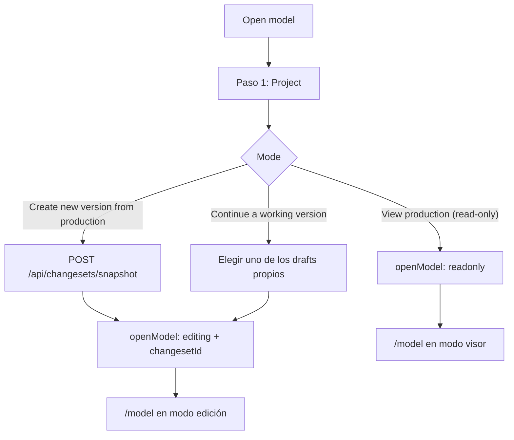
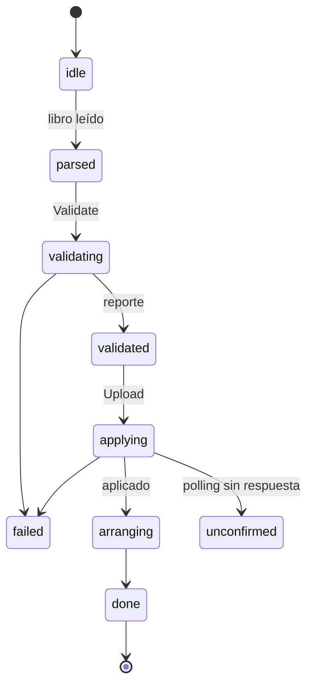

# Funcionalidades de la web

Este documento describe, pantalla por pantalla y en el orden en que las usa un modelador, qué permite
cada parte de la web de Data Model Hub: los componentes que la forman, los stores y servicios que
consume, los permisos que la habilitan y los comportamientos que conviene conocer (validaciones,
confirmaciones y atajos de teclado). Está pensado para desarrolladores que van a mantener o extender
el frontend. Los textos de botones y pantallas se citan tal como aparecen en la UI, en inglés.

## Contenido

- [Permisos y su efecto en la UI](#permisos-y-su-efecto-en-la-ui)
- [Home](#home)
- [Model: abrir un modelo](#model-abrir-un-modelo)
- [Model: Explorer](#model-explorer)
- [Model: canvas](#model-canvas)
- [Model: tablas, columnas y esquemas](#model-tablas-columnas-y-esquemas)
- [Model: vistas](#model-vistas)
- [Model: relaciones, wires manuales y subcategorías](#model-relaciones-wires-manuales-y-subcategorías)
- [Model: dibujos](#model-dibujos)
- [Model: paneles de propiedades](#model-paneles-de-propiedades)
- [Model: Object Inspector y búsqueda](#model-object-inspector-y-búsqueda)
- [Model: toolbar](#model-toolbar)
- [Model: copiar y pegar](#model-copiar-y-pegar)
- [Model: Undo](#model-undo)
- [Model: colores por canvas y themes](#model-colores-por-canvas-y-themes)
- [Model: auto-arrange, posiciones fijas y LOD](#model-auto-arrange-posiciones-fijas-y-lod)
- [Model: publicar y borrar el proyecto](#model-publicar-y-borrar-el-proyecto)
- [Exports del diagrama](#exports-del-diagrama)
- [Carga desde Excel](#carga-desde-excel)
- [Export DDL](#export-ddl)
- [Review](#review)
- [Reporting](#reporting)
- [Data Standards](#data-standards)
- [Admin](#admin)
- [Documentos relacionados](#documentos-relacionados)

## Permisos y su efecto en la UI

La sesión (`useAuthStore`, alimentado por el login, la renovación y `GET /api/auth/me`) trae los permisos ya resueltos por rol
(`SessionUser.permissions`), y `useAuthStore.has(perm)` los consulta. El catálogo es el del backend
(`features/auth/auth.service.ts`) y sus etiquetas visibles están en `PERMISSION_LABELS`
(`features/admin/admin.service.ts`):

| Permiso | Etiqueta en Admin | Dónde lo mira la UI |
|---|---|---|
| `model.view` | View model / canvas | Ítem **Data Standards** del `TopNav` y guard de la ruta `/standards`. |
| `model.edit` | Create / edit tables | Candidatos de **Transfer** (solo usuarios con este permiso que acceden al proyecto), quién administra su propio draft y **New project** (deshabilitado sin este permiso). |
| `review.decide` | Approve / reject requests (approving publishes to production) | Candidatos a revisor en **Publish — request approval** (solo usuarios con este permiso que acceden al proyecto). Aprobar un request publica la versión: no existe un permiso aparte para publicar. |
| `rollback` | Roll back to a published version | Botón **Restore** de la caja Versions del Home (el **Roll back** de Data Standards lo muestra `standards.edit`, pero el backend también exige `rollback`). |
| `versions.view_all` | Open other users' drafts and requests in the canvas | Revalidación de la sesión de canvas (puede seguir viendo una versión ajena). |
| `export` | Export DDL / metadata | Botones de descarga: **Export DDL** y **Export diagram** del toolbar, **Export HTML** y **Export PDF** del Explorer, descarga o copia en el modal de Export DDL y los dos **Download .xlsx** del Reporting. Sin el permiso se muestran deshabilitados con el motivo al pasar el mouse (`NO_EXPORT_HINT`, `src/lib/permissionHints.ts`). El backend lo exige al aplicar reglas en el Export DDL. |
| `standards.edit` | Edit Data Standards | Modo edición de todas las pestañas de Data Standards. |
| `admin.manage` | Manage users and permissions | Ítem **Admin** y ruta `/admin`; administrar drafts ajenos; plantillas de hoja compartidas; candado de términos del glosario. |

El control de acceso de la UI es de conveniencia: oculta o deshabilita lo que el rol no puede hacer,
pero la autorización real la aplica el backend en cada endpoint (por ejemplo, crear una working copy
exige `model.edit`, decidir un request exige `review.decide` y la carga Excel exige `model.edit`). Un
403 se muestra como aviso.

Además del rol, cada usuario tiene proyectos asignados (`projectIds`): lista vacía da acceso a todos y,
con ids, solo a esos (`admin.manage` ve todos). El backend filtra por ese alcance las listas de
proyectos, versiones y requests, por lo que Home, Open model, Review y Reporting muestran solo los
proyectos asignados. Los permisos se refrescan al volver el foco a la pestaña y ante un 403
(`refreshMe`), sin degradar la sesión de edición. El detalle está en
[Seguridad](08-seguridad.md).

## Home

Ruta `/`, componente `screens/HomeScreen.tsx`. Es una pantalla informativa: no edita el modelo.

Qué muestra:

- Fila de título **Workspace overview** con el saludo al usuario y una nota que remite a Model para
  abrir o crear una versión.
- Franja **Projects** con un chip por proyecto (con «+N more» si hay muchos); marcar chips refiltra
  los contadores.
- Cinco tarjetas de resumen: Tables, Views, Relationships, Subject Areas y Projects
  (`dashboard.service.getSummary`).
- Columna **Requests**: los requests asignados al usuario como revisor, con enlace a **Review**.
- Caja **Versions**: las versiones agrupadas por proyecto (cada grupo, plegable, muestra bajo el nombre
  su producción o «No production»). El código de una versión es `v` + la fecha y hora de su creación en
  Lima (`v20261026143005`). Cada fila tiene dos líneas: arriba el código, **Deletes project** si la
  versión borra su proyecto y el estado; abajo el dueño, `⇄` si fue transferida («Started by … ·
  transferred N times»), `↩` si nació de una restauración («Restored from …») y los botones.

Acciones:

- **New project** (título «Create an independent project») se habilita con `model.edit` y sin proyectos
  asignados (o con `admin.manage`); si no, queda deshabilitado con el motivo (`newProjectBlock`,
  `src/lib/permissionHints.ts`), porque el proyecto creado quedaría fuera del alcance del usuario. Abre
  `components/NewProjectModal.tsx`:
  nombre, descripción opcional y Data Standards de partida. **Start empty** crea el proyecto sin
  glosario, dominios, UDP ni reglas DDL (el naming usa los valores por defecto). **Copy from another
  project** copia una vez, desde un proyecto fuente, los bloques elegidos de `STANDARDS_BLOCKS`
  (Glossary, Parent domains, UDP definitions, Naming rules, DDL export rules, Color themes), con el
  conteo de cada bloque (`GET …/standards/summary`). La copia es única: los cambios posteriores en
  cualquiera de los dos proyectos no se propagan. Copiar reglas DDL sin las definiciones UDP muestra
  un aviso, porque las reglas leen UDPs.
- **Restore** en una versión publicada pasada (no en la producción vigente), solo con `rollback`:
  pide confirmación (**Create rollback draft**) y crea un draft que restaura el modelo a ese estado;
  el draft pasa por la revisión normal.
- **Version tools** y el ícono de información de cada fila abren `screens/home/VersionToolsModal.tsx`
  con dos pestañas:
  - Los combos de versión de ambas pestañas muestran `código (correo del dueño) — título`, más la fecha
    de publicación (Compare) o el estado (Details). El título se omite si repite el código (un draft se
    titula como su código).
  - **Compare**: elige dos versiones publicadas (**From (older)** y **To (newer)**, con **Swap
    versions**) y muestra las diferencias netas por verbo (added, modified, deleted) y por tipo de
    entidad (`GET /api/versions/compare`); al elegir una fila se pide el detalle de campos antes →
    después (`POST /api/versions/compare/details`). Si el rango incluye entidades que no se pueden
    reconstruir, se avisa en ámbar.
  - **Details**: la cabecera completa de una versión (dueño, quién la inició, revisores y sus
    decisiones con fecha y nota, fechas de creación, envío y publicación, procedencia de la
    restauración y comentarios), vía `GET /api/changesets/{id}`. **Open in canvas** abre Model en
    modo visor: la producción vigente abre el visor normal; una versión publicada anterior abre un
    snapshot exacto reconstruido del ledger (changeset virtual `asof:<versionId>`); un draft o
    request abre su overlay sobre producción.
- **Transfer** y **Delete version**, dentro de Details, administran un draft:
  - Los ve el dueño (si su rol tiene `model.edit`) o un administrador (`canManageVersion` en
    `lib/versionAdmin.ts`).
  - Solo aplican a drafts; un `rejected` también se puede eliminar. Una versión en revisión pide
    retirarla primero y una publicada nunca se transfiere ni se elimina (`versionActionBlock`
    devuelve el motivo que se muestra).
  - **Transfer** (`screens/home/TransferVersionDialog.tsx`) ofrece como **New owner** solo usuarios
    con `model.edit` que acceden al proyecto de la versión (`listUsers('model.edit', projectId)`),
    sin el dueño actual, con **Note (optional)**; avisa que el dueño anterior deja
    de poder editarla y que lo no guardado en el canvas se pierde. El receptor la edita, la envía y
    figura como su autor.
  - **Delete version** elimina el draft con todos sus cambios; producción no cambia.

## Model: abrir un modelo

Ruta `/model`, componente `features/modeler/components/WorkspaceScreen.tsx`. Al entrar sin una versión
elegida, la pantalla abre el popup **Open model** (`components/OpenModelModal.tsx`): no se interactúa
con el canvas hasta escoger proyecto y modo.

El popup tiene dos pasos:

1. **Project**: `ProjectPicker` lista los proyectos A–Z, con su producción y los drafts propios;
   preselecciona el último abierto o el de la sesión. El enlace **New project…** abre
   `NewProjectModal`, con la misma regla de habilitación que en Home.
2. **Mode**, con tres opciones para ese proyecto:
   - **View production (read-only)**: explora el modelo publicado; varias personas pueden verlo a la
     vez sin bloquearlo.
   - **Create new version from production**: crea una working copy (`POST /api/changesets/snapshot`,
     bajo el overlay bloqueante «Creating working copy…») y la abre en edición. Si el proyecto no
     tiene producción publicada, la opción lo indica.
   - **Continue a working version**: retoma uno de los drafts del usuario en ese proyecto.



La sesión abierta vive en `useSessionStore` (proyecto, modo `readonly` o `editing`, versión y
changeset). El selector **Logical | Physical** del toolbar (`viewMode`) cambia la faceta de todo el
modelo: en lógico se ven entidades y atributos; en físico, tablas, columnas y vistas.

Comportamientos de la sesión:

- **Modo visor**: nada se persiste. Los bloques se pueden mover para leer mejor el diagrama, pero ese
  movimiento solo vive en la sesión (`viewerLayout`); los dibujos quedan fijos y los botones de
  edición muestran «Read-only — published version».
- **Modo edición**: toda escritura va a la working copy. Sin versión en edición, los servicios fallan
  en el cliente sin llamar al backend.
- **Revalidación**: al entrar o cambiar de sesión, y cuando una respuesta 403/404/409 de esa versión
  lo indica, `lib/sessionGuard.ts` decide qué pasó con ella. Si se eliminó, vuelve a Open model con
  un aviso; si se transfirió, queda en solo lectura de la misma versión (si el usuario conserva acceso
  a ella: revisor, `versions.view_all` o `admin.manage`) o de producción; si es propia pero dejó de
  estar en `draft` (se envió o se decidió en otra pestaña), queda en solo lectura.
- **Salir con cambios sin guardar**: el `TopNav` intercepta la navegación fuera de `/model` y ofrece
  **Save and leave**, **Leave without saving** y **Cancel**; si el guardado falla, no sale y el aviso
  dice el motivo. Cerrar la pestaña con cambios dispara el aviso nativo del navegador
  (`beforeunload`).
- Cambiar de proyecto, modo o versión cierra los popups abiertos y vacía la pila de Undo.

## Model: Explorer

Componentes `ExplorerPanel.tsx`, `ModelExplorer.tsx`, `ProjectCatalog.tsx` y `explorerRows.tsx`;
servicio `services/explorer.service.ts`. Es un árbol único en el sidebar, del proyecto de la sesión:

```text
▾ Proyecto
   ▸ Models   sub-proyectos › dominios › canvases (carpetas y canvases)
   ▸ Tables   tablas del proyecto por esquema → columnas
   ▸ Views    vistas por esquema → columnas de salida
   ▸ Schemas  esquemas en uso, con conteos
```

- La cabecera tiene un filtro «contiene» sobre lo cargado (Esc lo limpia) y un acceso a la búsqueda
  profunda del modelo (⌘K o Ctrl+K). **Switch…** reabre Open model para cambiar de proyecto o versión.
- En **Models**, el menú de un proyecto, una carpeta o un canvas ofrece **Export HTML** y **Export
  PDF** (ver [Exports del diagrama](#exports-del-diagrama)). En edición suma **Rename** y **Delete**
  (**Delete project…** en el proyecto) y, en proyectos y carpetas, **New folder** y **New canvas**. El
  nombre se edita en línea: Enter confirma y Esc cancela.
- En **Tables** y **Views**, el menú `⋮` de una fila ofrece inspeccionar el objeto (abre el
  [Object Inspector](#model-object-inspector-y-búsqueda)) y localizarlo en un canvas.

## Model: canvas

Componente `ModelerCanvas.tsx`, construido sobre React Flow (`@xyflow/react`). El diagrama del canvas
llega en una sola request (`GET /api/subject-areas/{saId}/diagram?changesetId=…`) con el overlay de
la versión ya aplicado por el servidor, y se guarda en `useModelerStore`.

Tipos de nodo y arista:

| Elemento | Componente | Qué dibuja |
|---|---|---|
| Tabla o entidad | `TableNode.tsx` | Cabecera (esquema y nombre), franja de PK y filas de columnas; el ancho se adapta al contenido. |
| Vista | `ViewNode.tsx` | Bloque con trama y borde punteado; solo en físico. |
| Dibujo | `ShapeNode.tsx` | Rectángulo, cuadrado, círculo, elipse, línea, estrella, rombo o texto. |
| Símbolo de subcategoría | `SubtypeSymbolNode.tsx` | Símbolo del grupo supertipo/subtipo. |
| Relación | `CrowFootEdge.tsx` | Wire con notación pata de gallo según la cardinalidad. |
| Derivación de vista | `DerivationEdge.tsx` | Línea de la tabla fuente a la vista. |
| Rama de subcategoría | `SubtypeEdge.tsx` | Tronco y ramas del grupo. |

Comportamientos:

- **Selección**: un clic en una tabla la selecciona, encuadra el canvas sobre ella y abre su panel
  de propiedades. Un clic en una fila de columna abre el panel en la pestaña **Columns** con esa
  columna expandida. Ctrl/Cmd+clic alterna filas y Shift+clic selecciona un rango (de una sola tabla
  a la vez). El segundo clic de un doble clic se ataja (`lib/dblClickShield.ts`) para que no caiga
  sobre otro objeto mientras el canvas se mueve.
- **Resaltado al pasar el mouse**: se resaltan las relaciones del bloque o del wire solo si el mouse
  se queda un instante sobre él (`lib/hoverIntent.ts`); pasar de largo no hace nada. Un wire cuya
  llave difiere de la llave vigente del padre se pinta en rojo.
- **Mover bloques**: al soltar, todas las posiciones arrastradas (incluida la selección múltiple) se
  graban en una sola escritura (`saveNodePositions`); los dibujos van aparte. En visor solo se
  mueven en la sesión.
- **Sin borrado por teclado**: Supr no borra bloques del canvas; los borrados van por acciones
  explícitas del panel o los menús.
- **Menú contextual** (`ColumnContextMenu.tsx`, ítems en `lib/canvasMenu.ts`): clic derecho sobre
  una fila ofrece **Copy**, **Paste** y **Delete…** para las columnas seleccionadas (una fila que no
  estaba seleccionada pasa a ser la selección); sobre el bloque, **Copy table**, **Paste**,
  **Remove from this canvas** y **Delete table…**, con los mismos flujos del panel Properties. Los
  textos van en los sustantivos de la faceta («Copy 3 attributes», «Paste entity …») y lo que no
  aplica se ve deshabilitado con su motivo: **Paste** sin nada copiado y, en el visor, todo salvo
  **Copy**. Mientras un borrado lee su impacto, el menú queda abierto con un spinner; si se cierra
  antes, no se abre el diálogo.

Atajos del canvas (`ModelerCanvas.tsx` y `Toolbar.tsx`; ⌘ en macOS, Ctrl en Windows y Linux):

| Atajo | Acción |
|---|---|
| Ctrl/Cmd+C | Copia las filas seleccionadas o, sin filas, la tabla seleccionada. |
| Ctrl/Cmd+V | Pega: con tabla copiada, abre la revisión de pegado de tabla; con columnas, la de columnas sobre la tabla seleccionada. |
| Ctrl/Cmd+Z | Deshace la última acción (no hay rehacer). |
| Ctrl/Cmd+K | Abre la búsqueda del modelo. |
| Esc | Cierra el menú contextual o limpia la selección de filas. |

Los atajos no actúan con un modal o un overlay de espera abierto. Copiar, pegar y deshacer tampoco
actúan con el foco en un campo editable, y copiar no actúa con texto seleccionado en la página (ahí
manda el copiado nativo del navegador).

## Model: tablas, columnas y esquemas

### Crear tablas

Desde el grupo **Structure** del toolbar, en edición:

- **New table** (o **New entity** en lógico), `NewTableModal.tsx`, con dos modos:
  - **Blank**: nombre según la faceta (en lógico, el físico derivado del glosario se muestra como
    vista previa; en físico, con su esquema), definición funcional y UDPs en el mismo popup. Enter
    crea.
  - **Import existing**: busca en el pool de tablas del proyecto (paginado en el servidor, con filtro
    por esquema) y agrega las elegidas al canvas.
- **CTAS** (`CtasModal.tsx`, solo en físico): crea una tabla a partir de tablas fuente de todo el
  modelo. Se eligen las fuentes (búsqueda paginada y filtro por esquema, con chips que sobreviven al
  cambio de página), las columnas a heredar (con buscador) y el esquema destino; un preview SQL se
  actualiza en vivo. Todo se crea en un solo lote.

Las tablas nuevas aparecen en el centro de lo que el usuario está viendo del canvas
(`lib/canvasFocus.ts`), no al final de una grilla.

### Columnas

- **Add column** (o **Add attribute**), en la pestaña Columns del panel de la tabla, abre `ColumnEditor.tsx`: nombre según la faceta, dominio (`SearchSelect` con filtro
  «contiene»), tipo (`TypePicker`, con constructor de tipos complejos `ComplexTypeBuilder.tsx` para
  `ARRAY`, `MAP` y `STRUCT`), PK, nullable, partición y UDPs. Elegir un dominio aplica su tipo y, si
  el dominio es de tipo «atributo estándar», ofrece heredar nombre y definición
  (`DomainInheritPopup.tsx`).
- El orden de columnas es único para las dos facetas: la PK va primero (`lib/columnOrder.ts`) y el
  orden se cambia arrastrando filas en el panel de propiedades (el arrastre se apaga mientras hay un
  filtro de columnas activo).
- El nombre físico de una columna se deriva del lógico con el glosario y el naming del proyecto; un
  físico escrito a mano queda marcado como override. Un nombre físico más largo que el tope del
  naming (`maxLength`) se rechaza.
- Renombrar una columna actualiza las vistas que la usan y agregar una se propaga a las vistas espejo
  de su tabla. Borrar una columna la saca de toda vista que la lista, en la misma escritura que el
  borrado (con las relaciones elegidas en el diálogo de impacto): si alguna de esas vistas no se puede
  grabar, la columna no se borra. La confirmación avisa qué vistas quedan sin columnas (el Export DDL
  las escribiría como `SELECT *`): el borrado sigue y la vista se corrige o se borra después.
- Varias columnas seleccionadas de una tabla se borran juntas desde el menú de clic derecho: una sola
  confirmación (las columnas, las relaciones que pierden pares y las vistas que quedan sin columnas),
  un solo lote y un solo Undo, con el mismo costo que borrar una.

### Esquemas

**Schemas** (`SchemaManagerModal.tsx`, solo en físico) gestiona los esquemas del proyecto con cambios
en espera: crear, renombrar, cambiar qué contiene y eliminar se acumulan en el modal y se registran
juntos en la versión con **Save**. Antes de guardar, cada cambio sobre un esquema existente muestra su
impacto (tablas, vistas y canvases).

- Un esquema contiene tablas, vistas o ambas (`kind`: `tables`, `views` o `both`, con el badge
  «tables + views»); se elige al crearlo y se cambia desde la fila. Es lo que filtran los combos de
  esquema (`SchemaSelect.tsx`, `lib/schemaPick.ts`).
- El campo **New schema** filtra la lista mientras se escribe y, si nada coincide, ese texto es el
  nombre del esquema a crear.
- Renombrar propaga a todas las tablas y vistas del esquema dentro de la versión; eliminar un esquema
  con tablas o vistas se rechaza con un mensaje legible.
- Desde un combo de esquema se puede crear uno al vuelo (`SchemaCreateDialog.tsx`).

## Model: vistas

Las vistas existen solo en el modelo físico: con **Logical** activo, **Create view** se deshabilita
con «Views belong to the physical model — switch to Physical» y la pestaña Views del panel de tabla
no aparece.

**Create view** abre `ViewEditor.tsx`, el editor de vistas de varias fuentes:

- Combobox de fuentes con filtro «contiene» y lista de las tablas elegidas (abierto desde la pestaña
  Views de una tabla, esa tabla queda fija como fuente).
- Grilla de columnas agrupada por tabla origen: incluir, alias de salida, expresión SQL y tipo de
  conversión (combobox de tipos o texto libre).
- Switch **Show on this canvas** al crear: decide si la vista entra al canvas actual. Esa membresía
  decide qué vistas exporta el Export DDL del canvas.
- Con dos o más fuentes, el DDL las lista `FROM t1, t2` sin JOIN. Un join o un WHERE se documentan en
  la pestaña **User-Defined SQL**, texto informativo que se guarda con la vista sin validarse: el DDL
  sale siempre de las columnas.
- El preview usa el mismo generador que el Export DDL (`lib/viewDdl.ts`).
- Al crear una vista en un esquema, se propone el esquema de vistas con la convención `_VU` cuando
  existe.

Las escrituras de vistas van por `services/views.service.ts`, con el mismo requisito de versión en
edición que el resto del modelo.

## Model: relaciones, wires manuales y subcategorías

### Dibujar una relación

El grupo **Relationships** del toolbar tiene dos herramientas: **Draw an identifying relationship
(solid line)** y **Draw a non-identifying relationship (dashed line)**, más los selectores de
cardinalidad de cada extremo (Exactly one, Zero or one, One or more, Zero or many). Con la herramienta
armada, una franja explica el gesto y ofrece **Exit**:

- El gesto nace solo en la cabecera de la tabla padre (anillo azul) y se suelta sobre una columna de
  la hija o sobre su cabecera. La llave primaria completa del padre migra a la hija.
- El padre debe tener PK; una relación recursiva solo puede ser non-identifying.
- Soltar no graba nada: dibuja un wire fantasma y abre `RelationshipCreatePopup.tsx` con una fila por
  columna de la PK del padre. Por fila se elige la columna de la hija (sugiere homónimas o **Create**),
  el role name y **Inherit: Yes/No**. En una fila existente, el role name renombra la columna.
- **Confirm** graba columnas y relación en un solo `PUT /changes/bulk`; **Cancel** no deja rastro.

### Editar una relación

Doble clic sobre el wire abre `RelationshipPopup.tsx`: tipo Identifying o Non-identifying (con
propagación de las marcas de PK), cardinalidades, el mapa de pares de columnas (de solo lectura, con
role name por par), y las frases de relación del padre al hijo y del hijo al padre, que forman la
etiqueta del wire (`RelationshipPhraseFields.tsx`; Enter aplica). Si la llave del padre no
coincide con la migrada, un banner ofrece **Sync with parent key**.

El botón de etiquetas del grupo Relationships muestra u oculta las frases en el canvas (el estado está
en `useUiStore.relLabelsHidden`), y los exports respetan esa elección.

### Wires manuales

Un wire seleccionado en edición, con zoom de detalle, muestra tiradores (`WireRouteHandles.tsx`,
`useWireRoute.ts`, `lib/wireRoute.ts`):

- Arrastrar un tirador agrega o mueve puntos de quiebre; el camino es siempre ortogonal (sale y entra
  horizontal, y entre dos puntos desalineados dobla una sola vez).
- Las flechas del teclado mueven el punto; varias flechas seguidas cuentan como un solo movimiento.
  Supr o Retroceso quitan el punto y Esc cancela el arrastre.
- El trazo se guarda por canvas (`SubjectArea.routes`) en una escritura con su entrada de Undo. Un
  wire sin trazo usa el camino automático.
- Los trazos también aplican a las ramas de subcategoría. **Auto-arrange** reinicia los trazos del
  canvas y su confirmación avisa cuántos se pierden. En visor, un auto-arrange de la sesión oculta los
  trazos publicados de ese canvas.

### Subcategorías

**Draw a subcategory (supertype/subtype)** está disponible solo en el modelo lógico. El gesto va de la
cabecera del supertipo (o de un símbolo de subcategoría existente) al subtipo: la llave del supertipo
pasa a ser la llave del subtipo (relación «es un», identifying 1:1).

- `SubcategoryCreatePopup.tsx` confirma la operación y la graba en un solo lote, con las frases de la
  rama si se escriben. Una tabla puede ser subtipo de un solo grupo; la validación se hace contra todo
  el modelo de la versión, no solo el canvas.
- Doble clic en el símbolo o en una rama abre `SubcategoryPopup.tsx`: supertipo, subtipos con su
  estado de llave, quitar un subtipo, borrar el grupo y editar las frases de cada rama. Al quitar la
  última rama, el símbolo desaparece. Limitación: una llave desalineada se repara quitando el subtipo
  y volviéndolo a agregar.

## Model: dibujos

El grupo **Drawing** agrega formas al canvas: Rectangle, Square, Circle, Ellipse, Line, Star, Diamond
y Text. El dibujo aparece en el centro de lo visible y queda seleccionado.

- Con un dibujo seleccionado aparece `DrawingToolbar.tsx` encima de él: relleno, borde, fuente,
  tamaño, negrita, cursiva, subrayado, color del texto, alineación y borrar. Una línea solo tiene
  color y borrar. Los colores se eligen con el mismo `ColorPicker.tsx` del resto del canvas.
- El texto de un dibujo se edita en el propio bloque: Esc descarta y Ctrl/Cmd+Enter confirma.
- Los dibujos se guardan con el canvas en la versión en edición y no participan del resaltado de
  relaciones.

## Model: paneles de propiedades

El área derecha muestra un panel a la vez, según la selección (`useModelerStore.selectedTableId`,
`selectedColumnId`, `selectedViewId`). El ancho del panel se puede ajustar arrastrando su borde.

### Properties de tabla (`PropertiesPanel.tsx`)

| Pestaña | Contenido |
|---|---|
| Definition | Nombres lógico y físico, esquema, definición funcional, color de la caja (**Color**) y las acciones **Remove from this canvas** y **Delete table…** (o entity). |
| Columns | Lista de columnas con buscador, reorden por arrastre y edición en línea; **Add column**. |
| Views | Vistas que usan la tabla y alta de una vista con la tabla como fuente fija (solo en físico). |
| Links | Relaciones de la tabla con su cardinalidad compacta (por ejemplo, «1 : N · identifying»). |
| UDPs | Valores de las propiedades definidas por el usuario de la faceta activa (`UdpAssign.tsx`; el valor se graba al salir del campo). |
| Metadata | Datos de auditoría y la sección **History** (`AuditHistory.tsx`): cada evento en dos líneas (la acción con el código de la versión y, debajo, quién y cuándo), con el detalle de campos bajo demanda. |

Borrar una tabla pide confirmación (`deleteConfirm.tsx`) y la quita de todos los canvases donde está;
**Remove from this canvas** solo la saca del canvas abierto.

### Properties de columna (`ColumnPropertiesPanel.tsx`)

Ocupa el lugar del panel de tabla mientras hay una columna seleccionada. Pestañas **Definition**,
**Data Type** (dominio, tipos lógico y físico, overrides de tipo), **UDPs** y **Metadata** (con
History).

### Properties de vista (`ViewPropertiesPanel.tsx`)

Se abre con un clic en el bloque de la vista. Pestañas **Definition**, **Columns** (reorden por
arrastre y detalle por columna), **Sources** (fuentes y acceso al editor completo), **Query SQL** (DDL
generado y la User-Defined SQL informativa), **UDP** y **Metadata** (con History).

### Model properties (`ModelPropertiesModal.tsx`)

El botón **Model properties** del toolbar abre la ficha del canvas: los UDPs de nivel canvas y la
sección **Colors on this canvas** (ver [Colores por canvas y themes](#model-colores-por-canvas-y-themes)).
Los cambios se graban con **Save** y se descartan con Cancel, la X o Esc; se graba solo la diferencia
contra lo que había al abrir la ficha. En visor se abre en solo lectura.

## Model: Object Inspector y búsqueda

### Object Inspector (`ObjectInspector.tsx`)

Popup con la metadata completa de una tabla o entidad (con sus columnas) o de una vista, sin necesidad
de tenerla en un canvas. El estado efectivo de la versión abierta llega en una sola request
(`services/inspector.service.ts`, `/api/catalog/inspect/…`). Tiene su propio switch **Logical |
Physical** que no cambia el modo del canvas, y pestañas de definición, columnas, tipos, links y
metadata (con History). Muestra dónde se usa el objeto («Where used»), con **Open** para abrir el
canvas y centrarse en él. Desde el inspector también se editan la definición y el orden de columnas,
y se borra el objeto, sin abrir un canvas.

### Find a table: búsqueda del modelo (`SearchModelPopup.tsx`)

Se abre con el botón de búsqueda del grupo **Search & inspect** o con Ctrl/Cmd+K. Busca en toda la
versión por tabla, columna, definición de columna y, en el modelo físico, vista (`lib/searchModel.ts`,
coincidencia «contiene» sin distinguir mayúsculas).

- Alcances **All**, **Tables / entities**, **Columns / attributes**, **Definitions** y, solo en físico
  (las vistas no existen en el modelo lógico), **Views**; y filtros en cascada con la jerarquía del Model
  Explorer: Project › Sub-project › Domain › Model. Cada nivel queda bloqueado hasta elegir el anterior.
  Con un filtro, una vista entra si es miembro de un canvas del alcance.
- Cada vista muestra `esquema.NOMBRE`, sus tablas fuente y su número de columnas.
- Abierto desde un canvas, arranca acotado a él; **Search everywhere** amplía a toda la versión.
- En el alcance All cada grupo muestra su primera página y **Show all…** pasa al alcance del grupo,
  que carga por bloques de 50 al llegar al final (o con **Load more**).
- Cada resultado muestra los canvases donde está y dos acciones: **Locate on canvas** (cambia al
  canvas si hace falta, centra la tabla o la vista y, para columnas, selecciona la fila y abre su panel;
  también con clic o Enter) e **Inspect metadata** (abre el Object Inspector).

## Model: toolbar

`Toolbar.tsx` agrupa las acciones del canvas. La barra se puede ocultar (**Hide the tools bar**) y se
adapta al ancho disponible (`useToolbarFit.ts`, `lib/toolbarFit.ts`).

| Grupo | Controles |
|---|---|
| Model | Selector **Logical / Physical** y **Model properties**. |
| Structure | **New table** (o New entity), **CTAS**, **Create view**, **Schemas** y **Upload from Excel** (estos cuatro últimos solo en físico). |
| Search & inspect | Búsqueda del modelo (Ctrl/Cmd+K). |
| Relationships | Identifying, non-identifying, cardinalidad de cada extremo, subcategoría (solo en lógico), mostrar u ocultar etiquetas. |
| Drawing | Las ocho formas. |
| Actions | **Undo**, **Auto-arrange**, **Export DDL**, **Export diagram** (SVG, HTML interactivo, PDF). |
| Derecha | Indicador de proyecto y versión, **Open model**, **Save** («Save working copy») y **Publish**. |

Las herramientas de edición se deshabilitan en visor. Las que pertenecen al modelo físico, con Logical
activo, muestran el motivo (por ejemplo, «CTAS belongs to the physical model — switch to Physical»).
Cambiar de faceta cierra el popup de creación abierto. **Save** graba la working copy bajo el overlay
«Saving working copy…» y confirma con «Saved».

## Model: copiar y pegar

Copiar y pegar usan un portapapeles propio del store (`colClipboard` y su par de tabla), no el del
sistema operativo: lo copiado sobrevive al cambio de canvas, de versión y de proyecto, y se descarta
al cerrar la sesión. La copia es por valor.

- **Columnas**: Ctrl/Cmd+C sobre filas seleccionadas y Ctrl/Cmd+V sobre la tabla destino abren
  `PasteColumnsPopup.tsx`. Cada columna se marca como `New`, `Logical name exists` (se pega igual) o
  `Name exists — skipped` (el nombre físico ya existe en el destino y se excluye). Las PK pegadas
  entran detrás de las PK del destino; no viajan relaciones ni la marca FK. Pegar una PK en una tabla
  padre desalinea sus wires (en rojo, con **Sync with parent key**), y el popup lo advierte.
- **Tablas**: Ctrl/Cmd+V con una tabla copiada, o **Paste table …** del menú, abre
  `PasteTablePopup.tsx`. El nombre se conserva si está libre en el proyecto; si no, se usa `_copy_n`
  (el primero libre). El esquema es el del proyecto con esa grafía o, si no existe, se crea en el mismo
  lote; el Undo lo borra con la tabla si nadie más lo usa.
- **Revisión** (`PasteDetails.tsx`, `lib/pasteReview.ts`): ambos popups muestran casillas por grupo
  (**Logical UDPs**, **Physical UDPs**, **Parent domains**) con cuántos se reutilizan, el selector
  Logical | Physical con la metadata de cada faceta (columnas de a 10 con **Load more** y buscador),
  lo que no se puede copiar («Can't be copied») y lo que impide el pegado («Fix before pasting»). El físico
  sale con el case del proyecto destino y un nombre sobre el tope de largo bloquea el pegado. El
  historial de lo pegado registra «Copied from …» con la tabla y las columnas de origen.
- **Entre proyectos**: lo copiado en otro proyecto se revisa contra los estándares de los dos (los del
  origen vienen de su `standards/snapshot`, `services/pasteSource.service.ts`). Como cada proyecto tiene
  sus propios UDP, dominios y themes, se emparejan por nombre normalizado (sin tildes, sin mayúsculas
  y con espacios colapsados): el UDP por nombre, nivel y faceta, con el valor validado contra la
  definición del destino; el dominio por nombre, recalculando los overrides; el theme por nombre (si
  no existe o está duplicado, se pega su color fijo). Lo que no existe en el destino no viaja y se
  avisa: el pegado nunca crea UDP ni dominios. Si el proyecto de origen no existe o no se puede ver,
  se pega sin su metadata con un aviso; otros fallos de lectura se muestran con **Retry**.

## Model: Undo

`store/useUndoStore.ts` mantiene una pila de inversas de las acciones del canvas (crear, borrar,
renombrar, mover, pegar, pintar, trazos, entre otras), con su etiqueta. El botón **Undo** del toolbar
dice qué se deshará («Undo — <acción> (Ctrl+Z)», con ⌘Z en macOS) y se apaga sin pila; Ctrl/Cmd+Z hace lo mismo y avisa
«Undid: <acción>». No existe rehacer.

- La pila se vacía en todo cambio de sesión (proyecto, modo o versión).
- Cada acción de varias escrituras, y cada inversa, pertenece a la sesión donde empezó
  (`pinSession`, `lib/pinnedWrites.ts`): si la sesión cambia a mitad de camino, lo que falta no se
  escribe en ninguna versión.
- Durante una carga Excel la pila queda vacía y cerrada hasta que la carga termina.

## Model: colores por canvas y themes

El color de una caja (tabla o vista) tiene tres niveles (`lib/colors.ts`, `lib/canvasColors.ts`,
`lib/boxColor.ts`):

1. **Themes** del proyecto (Data Standards → Color themes): colores con nombre que las cajas usan por
   referencia; cambiar un theme repinta todas las cajas que lo usan en todos los canvases.
2. **Color de la tabla o vista**: se elige en Properties → **Color** o con clic derecho, y se ve en
   todos sus canvases.
3. **Excepción del canvas**: un color distinto para esa caja solo en ese canvas.

Lo que se ve es la excepción del canvas, si existe; si no, el color de la tabla; si no, ninguno.

`ColorPicker.tsx` es el único selector: **Themes**, **Other colors** (10 colores estándar y **More
colors…**, que abre el selector del sistema), **No color** y, en el canvas, **Use the table's color**
(quita la excepción).

**Colors on this canvas** (`CanvasColorsSection.tsx`, dentro de Model properties) lista las cajas que
el canvas pinta distinto, cada una con **Reset**, y **Paint on this canvas** para las cajas elegidas
(las seleccionadas en el canvas al abrir la ficha, o la del panel Properties si se abrió desde ahí).
Los cambios se ven en el canvas como vista previa y se graban con Save en una sola request con una
sola entrada de Undo.

## Model: auto-arrange, posiciones fijas y LOD

**Auto-arrange** reorganiza el canvas con ELK (algoritmo `layered`, `lib/elkLayout.ts` y
`lib/arrangeGraph.ts`) usando el tamaño medido de cada bloque. Pide confirmación («Auto-arrange this
canvas?»), que avisa que se moverán todos los bloques y, si los hay, que se reiniciarán los trazos
manuales. En edición, las posiciones y el reinicio de trazos se graban en una escritura; en visor el
resultado queda solo en la sesión («Auto-arrange — view only, not saved»).

**Posiciones fijas**: un bloque que nunca se movió no tiene posición guardada y el canvas lo ubica
por número de orden. Cuando entra un bloque (crear, importar, CTAS, pegar, carga Excel) o sale uno
(quitar del canvas o borrar, también en los otros canvases de la tabla), los bloques sin posición
quedan fijados donde se ven en la misma escritura (`pinsForEntering` y `pinsForLeaving` en
`lib/placeNewMembers.ts`). Así un alta o una baja no corre de casilla a los demás, y un Undo en cadena
no deja una tabla tapando a otra.

**LOD (zoom semántico)**: con zoom bajo, `TableNode` y `ViewNode` se dibujan como cajas compactas del
mismo tamaño (nombre y conteo, con la franja PK proporcional), lo que mantiene fluido un canvas de
cientos de tablas. El cambio tiene histéresis (`lib/lodSize.ts`): se entra al modo compacto con zoom
menor que 0.10 y se sale con zoom mayor que 0.20. Los wires conservan sus anclajes al cruzar el
umbral. Los tiradores de los wires manuales solo aparecen con zoom de detalle. El detalle técnico está
en [Consideraciones técnicas](12-consideraciones-tecnicas.md).

## Model: publicar y borrar el proyecto

**Publish** (`PublishModal.tsx`, «Publish — request approval») envía la working copy a revisión:

- **Title** y **Description**, ambos opcionales.
- **Reviewers**: lista de usuarios cuyo rol tiene `review.decide` y que acceden al proyecto
  (`listUsers('review.decide', projectId)`), ya que asignar a alguien sin ese permiso o sin acceso
  dejaría el request trabado; el backend rechaza con 400 a un revisor sin acceso al proyecto. Hace falta al menos uno, y todos
  los asignados deben aprobar antes de publicar.
- Al enviar, la versión pasa a `submitted` y el canvas queda en solo lectura de producción («Request
  sent — the canvas is now read-only (production)»).
- Si el draft borra su proyecto, el popup lo advierte y recuerda que quien revise deberá confirmar
  el borrado explícitamente.
- Si la versión cambia objetos que otra versión borró y publicó después de abrirse esta, el envío se
  bloquea y el popup lista cada objeto como `NOMBRE (id)`, con su tabla y la versión, el autor y la fecha
  del borrado. **Discard changes on deleted objects** quita esos cambios de la versión (también los que no
  se ven en el canvas, como las columnas de una tabla borrada), vacía la pila de Undo y recarga el
  Explorer y el canvas; después se envía de nuevo.

**Delete project…** (menú del proyecto en el Explorer, `DeleteProjectDialog.tsx`) registra el borrado
del proyecto en la working copy; solo ocurre al aprobarse. Exige escribir el nombre exacto del
proyecto y muestra los conteos de lo que desaparece (si el conteo falla, se ofrece Retry y la
confirmación tipeada basta). Mientras el draft borra el proyecto, el canvas cede su lugar a
`DeletionPendingPanel.tsx`, que ofrece deshacer el borrado o enviarlo a aprobación.

## Exports del diagrama

Todos los exports del diagrama se arman en el navegador a partir de una escena intermedia
(`lib/exportScene.ts`), sin capturas de pantalla, y respetan la faceta activa, los colores, los
trazos manuales y la opción de mostrar u ocultar etiquetas de relación. En edición toman las
posiciones vivas del canvas; en visor, las publicadas.

| Export | Dónde | Implementación | Resultado |
|---|---|---|---|
| SVG image (.svg) | **Export diagram** del toolbar | `lib/sceneSvg.ts` + fuentes embebidas (`lib/exportFonts.ts`) | `<canvas>.svg` |
| Interactive HTML — deep zoom (.html) | **Export diagram** | `lib/exportHtml.ts` envuelve el SVG en una página con zoom y desplazamiento | `<canvas>.html` |
| PDF document (.pdf) | **Export diagram** | `lib/scenePdf.ts` | `<canvas>.pdf` |
| Export HTML | Menú de proyecto, carpeta o canvas del Explorer | `exportPackage.ts` + `lib/exportPackagePages.ts`, empaquetado con `fflate` | `.zip` con una página por canvas del alcance, en espejo de la jerarquía de carpetas (un canvas suelto sale como un solo `.html`) |
| Export PDF | Menú de proyecto, carpeta o canvas del Explorer | `lib/reportPdf.ts` (páginas A4) | Reporte PDF con estilo de reporte de Erwin |

Todos estos exports exigen el permiso `export`: sin él, **Export diagram** y los ítems **Export HTML** y
**Export PDF** del Explorer se muestran deshabilitados con el motivo.

El paquete HTML descarga cada diagrama del alcance con la misma lectura del canvas (con el overlay de
la versión) y puede cancelarse entre canvases. Los módulos pesados se cargan bajo demanda.

## Carga desde Excel

Feature `features/upload`. El botón **Upload from Excel** del grupo Structure abre
`components/UploadModal.tsx`. Solo está habilitado en una sesión de edición con working copy y en el
modelo físico; el backend exige `model.edit`.

Flujo del popup:

1. **Upload profile**: perfil de carga del proyecto (`SearchSelect` con el perfil por defecto,
   recordado por proyecto en `localStorage`). **Manage profiles** abre `ProfileManagerModal.tsx`
   (editar, duplicar, marcar por defecto, borrar y **Create default profile**). **New profile** abre
   `ProfileEditor.tsx`.
2. **Workbook**: el archivo `.xlsx` se suelta o se elige (`UploadDropzone.tsx`, «Drop your workbook here
   or Choose file»). `lib/parseWorkbook.ts` lo lee con SheetJS como grillas crudas de todas las hojas;
   quita caracteres que no se pueden guardar y convierte las celdas con formato de fecha a
   `YYYY-MM-DD` según el sistema de fechas del libro. La plantilla de ejemplo se sirve desde
   `public/templates/Plantilla.xlsx`.
3. **Target project**: si el proyecto tiene una capa de proyectos internos (dos o más carpetas raíz con
   subcarpetas), se elige el destino antes de validar; con una sola, se muestra dónde caerá la carga.
4. **Validate**: envía las hojas y el perfil a `POST /api/changesets/{cs}/uploads` y consulta el job
   (`upload.service.ts`). El reporte (`UploadReport.tsx`) muestra el perfil y las hojas halladas,
   conteos de create, update y unchanged, errores y warnings con su referencia de celda
   (`Hoja · row N · CABECERA`) y el desglose por tabla.
5. **Upload**: solo con cero errores. El backend vuelve a validar y aplica; al terminar, el front ubica
   lo que entró a cada canvas (en el centro de lo visible si es el canvas abierto, sin mover lo
   existente, `placeUploaded.ts`) y refresca el Explorer.



Comportamientos:

- El editor de perfiles tiene pestañas **Tables sheet**, **Columns sheet** y **Policies**. Por hoja:
  nombre, fila de cabecera, si es requerida y la tabla de mapeos (`MappingRow.tsx`: cabecera → campo,
  uno o varios UDP con su faceta, o ignorar; valor por defecto) y reglas con severidad
  (`RulesEditor.tsx`). **Read headers from a workbook…** sugiere el mapeo por nombre. El estado del
  editor es puro (`lib/profileDraft.ts`) y valida en el cliente con las mismas reglas que el backend.
- Desde que empieza el apply, la pila de Undo queda vacía y cerrada hasta el final; con una inversa
  del Undo en curso, la carga no empieza («Undo is still running — upload when it finishes.»).
- La carga pertenece a la versión donde se pidió: si mientras tanto se abre otra versión, la ubicación
  de bloques corta antes de escribir en ella y el resultado se avisa nombrando la versión de la carga.
- Cerrar el popup descarta un job no aplicado; mientras aplica o ubica, el botón no lo cierra, y si
  algo lo desmonta, la carga sigue y avisa con un toast.
- El polling reintenta los fallos transitorios (red, tiempo agotado o 5xx) hasta 10 veces seguidas.
  Si se rinde, la carga no se da por fallida: el estado `unconfirmed` avisa que pudo quedar aplicada
  y pide revisar el modelo.
- Los canvases que no se pudieron ordenar se avisan con un toast que los nombra
  (`lib/arrangeNotice.ts`).

## Export DDL

Feature `features/ddl`. El botón **Export DDL** del toolbar abre `components/ExportDdlModal.tsx`, que
genera el DDL en vivo desde el diagrama activo; se puede usar también en visor. Su mapa de archivos
está en `src/features/ddl/README.md`.

- **Tables to export**: arranca sin tablas elegidas y conserva solo las que siguen en el canvas
  (`tableSelection.ts`). Las vistas exportadas son las del canvas (`diagram.views`).
- **Target dialect**: **Databricks** (Delta / Spark SQL, `generators.ts`) u **Oracle** (Oracle
  Database, `oracle.ts`). El modal abre con el dialecto por defecto del proyecto. En Oracle, la PK va
  dentro de la tabla como `PRIMARY KEY (…) DISABLE NOVALIDATE`, las FK van en `FOREIGN_KEYS.sql` y
  los tipos salen tal cual.
- Pestaña **Output** (`DdlOutputForm.tsx`, `outputSettings.ts`): comillas, casing de tipos, forma del
  `CREATE`, tags en vistas, location y nombres de archivo. Arranca desde las Output settings del
  proyecto y se puede ajustar para un export puntual sin guardarlo. Oracle tiene su configuración
  propia, sin particiones, ZORDER, `CREATE OR REPLACE`, tags, `USING`, Unity Catalog, `LOCATION` ni
  `TBLPROPERTIES`.
- Pestaña **Export rules** (`ExportRulesPanel.tsx`, solo Databricks): las reglas del proyecto que
  corren al exportar, en dos grupos: **Transformations** («Change the SQL of existing objects») y
  **Generators** («Add objects to the export»). Con reglas marcadas, el modal genera el DDL base y lo
  envía a `POST /api/projects/{pid}/ddl-rules/render` (`rulesBridge.ts`), que exige el permiso
  `export`; sin reglas, el DDL es el generado en el navegador.
- **Download .zip** (`ddlExportBundle.ts`) baja un `.sql` por objeto (`TABLE-X.sql`, `VIEW_NEG-Y.sql`,
  `VIEW_TEC-Z.sql`), cada tabla con sus vistas en una carpeta con su nombre. **Copy** copia todo el SQL
  concatenado al portapapeles («DDL copied to clipboard»).
- Sin el permiso `export`, el botón **Export DDL** del toolbar y las acciones de descarga y copia del
  modal se muestran deshabilitados con el motivo al pasar el mouse.
- Compuerta (`exportGate.ts`): el modal no exporta hasta tener las Output settings, las definiciones
  UDP (qué columnas son partición) y la lista de reglas del proyecto. Si fallan las definiciones UDP,
  el export sin reglas sigue disponible; si falla la lista de reglas, el export Databricks se bloquea
  con aviso.

## Review

Ruta `/review`, componente `screens/ReviewScreen.tsx` y la carpeta `screens/review/`; servicio
`services/versioning.service.ts`. Es una bandeja global, **Requests · review & approval**, con los
requests de los proyectos a los que el usuario accede.

### Lista de requests

- Filtros por proyecto, solicitante (**From**), revisor (**Reviewer**, con «Reviewer: Me») y
  resultado. Cada tarjeta muestra estado, «Assigned to you» si corresponde, versión base, solicitante
  → revisor, proyecto y la marca **Deletes project**.

### Detalle del request

- El detalle (cambios, diff y comentarios) de un request no publicado solo lo ven su dueño, sus
  revisores asignados y quien tiene `versions.view_all` o `admin.manage` (`canOpenVersion`). Para el
  resto, el panel muestra la fila de la lista con un aviso que indica quién lo pidió y quiénes pueden
  ver sus cambios y comentarios, y no pide el detalle. La decisión se toma con la fila de la lista, por
  lo que el detalle se pide cuando la lista terminó de cargar.
- Cabecera con título, estado y metadatos (`From <dueño> · snapshot of <código> · fecha · Reviewer
  <nombres>`), y las acciones **Open in canvas** (o **View in canvas**), **Comment**, **Reject** y
  **Approve**.
- **Open in canvas** se habilita solo para quien puede abrir el request: dueño, revisor asignado,
  `versions.view_all` o `admin.manage` (`requestState.ts`, `canvasAction`); si no, queda deshabilitado
  con el motivo.
- **ChangesSummary.tsx**: chips de proyectos y modelos afectados y matriz de conteos Created, Modified
  y Deleted por tipo de entidad (Tables, Columns, Views, Relationships, Schemas, Projects, Folders,
  Canvases), derivada del `GET /diff`.
- **ChangesDetailModal.tsx** (**Review changes in detail**): árbol jerárquico tintado por verbo
  (`DiffTree.tsx`), sección propia de relaciones y panel de diff de campos antes → después bajo
  demanda (`DiffExplorer.tsx`, `POST /api/changesets/{id}/diff/details`), con UDP, dominios y tablas
  resueltos a nombre. Marca los conflictos con producción: «Modified in production after this version
  edited it — approving overwrites that.» y «Deleted in production after this version was opened —
  approving restores it.» (`conflicts.ts`).
- Hilo **Reviewer comments** con su campo «Add a comment…».

### Decisiones

- **Approve** y **Reject** se habilitan solo para un revisor asignado que no votó, con el
  request en `submitted`; el backend exige además `review.decide`. Las decisiones corren bajo el
  overlay bloqueante («Applying decision…»).
- **Reject** (`RejectDialog.tsx`) pide el motivo, que queda en el historial y lo ve el dueño; la
  versión vuelve a draft para corregirla y reenviarla (un rechazo nunca la elimina).
- Cuando todos los revisores aprueban, la versión se publica. Si la publicación se bloquea
  (`PublishBlockedPanel.tsx`, `publishBlocked.ts`), nada se publica y el panel explica por qué.
- El dueño puede **Withdraw request** (vuelve a draft y descarta las decisiones) y, sobre un request
  rechazado, **Reopen as draft**.
- Un request que borra su proyecto muestra `CriticalDeletionBlock.tsx` con los conteos de lo que
  desaparece, y `ApproveDeletionDialog.tsx` («Approve and delete project?») exige escribir el nombre
  del proyecto para aprobar.
- Un revisor deshabilitado se marca «(disabled)», y al dueño se le indica retirar y reenviar con
  revisores activos.

Transferir y eliminar drafts se hace desde **Version tools** del Home (ver [Home](#home)).

## Reporting

Ruta `/reporting`, componente `screens/ReportingScreen.tsx` y la feature `features/reporting`;
servicios `services/reporting.service.ts` y `features/reporting/sheetTemplates.service.ts`.

### Proyecto y versión

El reporte es siempre de un proyecto: el de la sesión, si no el último abierto, si no el primero A–Z.
El combo **Version** ofrece producción (por defecto) o una versión propia sin publicar del proyecto
(draft o en revisión). Con una versión propia, la grilla, los filtros y los exports leen el estado de
esa versión (todas las lecturas envían `changesetId`). Si la versión deja de estar disponible
(publicada, cerrada, transferida o eliminada), la pantalla vuelve a producción y lo dice. Mientras
corre un export, los combos Project y Version quedan deshabilitados («Wait for the export to finish»).

### Grilla y filtros

- Búsqueda con alcance, como el buscador del Model (`lib/reportSearch.ts`): **Tables / entities**
  (nombre físico o lógico de la tabla, en el navegador), **Columns / attributes** (tablas con una columna
  cuyo nombre lo contiene), **Definitions** (definición de la tabla o de alguna de sus columnas) y
  **Views** (tablas fuente de una vista cuyo nombre lo contiene). Las tres últimas las resuelve
  `GET /api/reporting/search`; con ellas, las hojas de columnas y de vistas muestran solo lo que
  coincide, en pantalla y en el Excel. Elegir un alcance muestra su hoja (Columns, Views o Tables).
- Filtros de selección múltiple (Schema · Subject area, con búsqueda «contiene» en sus popovers) que se
  acotan entre sí; los combos listan el catálogo completo del proyecto (`GET /api/reporting/filters`).
- Una pestaña por hoja del Excel (`lib/reportSheets.ts`): **Tables · Columns · Tables + Columns ·
  Relationships · Views · View columns · Definitions**. El nombre muestra la hoja en la grilla, con las
  mismas filas que el Excel; la casilla la incluye en el libro (por defecto, Tables y Columns). La
  pestaña Tables es la grilla de selección: Table · Schema · Subject area · #Columns · #Relations ·
  Projects · Functional definition, con casillas por fila. Las otras muestran las tablas elegidas (o las
  filtradas): hasta 300 tablas y las primeras 5 000 filas, con los textos largos recortados.
- Sin filtros, la grilla carga páginas de 50 tablas al hacer scroll y la barra muestra el total real
  (`/tables/count`); **Select all** selecciona todas las tablas del proyecto, cargadas o no. El primer
  filtro carga el conjunto completo para que el filtrado sea exacto.
- Si falla la carga, se ve «Couldn't load the tables» con **Retry**; si falla una página siguiente,
  el pie dice «Couldn't load more tables.» con **Retry** de esa página.

### Export to Excel

La card **Export to Excel** lista las hojas incluidas en las pestañas y baja un libro `xlsx` con ellas,
en el orden del libro, con las filas seleccionadas (o todas las que pasan los filtros, con Select all) y
la búsqueda aplicada. Columnas, vistas y relaciones se leen por lotes de ids con `POST`
(`lib/reportFetch.ts`), a lo sumo cuatro en vuelo. El archivo se llama
`data-model-hub-report-<proyecto>[-<versión>]-<AAAA-MM-DD>.xlsx`. El botón **Download .xlsx** exige el
permiso `export`; sin él se muestra deshabilitado con el motivo.

El libro se escribe en flujo (`lib/xlsxWriter.ts`, con `fflate`): se comprime por bloques mientras se
escribe, así que la memoria no crece con el tamaño del modelo y un proyecto entero se exporta con todas
sus hojas. Los límites de Excel se cumplen sin perder datos: un texto de más de 32 767 caracteres (el
SQL de una vista grande) sigue en las columnas siguientes, «SQL (2)», «SQL (3)»…, y una hoja de más de
1 048 575 filas sigue en «<hoja> (2)».

### Plantillas de hoja

La card **Export with a template** (`SheetTemplateCard.tsx`) baja una sola hoja con el formato fijo de
una plantilla guardada del proyecto, sobre la misma selección, filtros y búsqueda, con el mismo escritor
en flujo. Las plantillas son dato del
proyecto (`lib/sheetTemplates.ts`): nombre, hoja, columnas (encabezado → dato del modelo o UDP),
filtros de filas y nombre de archivo. Cada usuario gestiona las suyas; un administrador, además, las
compartidas. Su **Download .xlsx** sigue la misma regla del permiso `export`. El nombre de hoja sigue las
reglas de Excel (1 a 31 caracteres, sin `: \ / ? * [ ]`, sin apóstrofo al inicio ni al final y distinto
de «History»), validadas en el editor y en el backend.

**Manage templates…** abre `SheetTemplateEditor.tsx`. Sus filtros («Filters · a row is exported only if
it meets every filter») combinan dato + operador + valor:

- Operadores: is, is not, is one of, contains, does not contain, starts with, is empty, is not empty.
  Las banderas PK, FK, Partition y Nullable solo admiten is marked e is not marked.
- «is one of» se escribe separado por comas; una coma dentro de `()` o `<>` es parte del valor
  (`DECIMAL(10,2)`, `MAP<STRING, INT>`).
- Una fila sale si cumple todos los filtros, sin distinguir mayúsculas ni espacios en los bordes. En
  datos con varios valores (Space, Subject, Diagram) basta con que cumpla uno.
- Guardar valida con las reglas del backend: hasta 20 filtros, valor obligatorio, hasta 50 valores en
  «is one of» y 200 caracteres por valor.

Si ninguna fila cumple los filtros, se avisa «No rows match the template filters — nothing was
exported.» y no se descarga nada.

### Indicadores

Debajo de los exports, **Tables by subject area** (las cinco carpetas con más tablas) y **Most related
/ in most projects** (las cinco tablas con más relaciones), calculados sobre las filas filtradas.

## Data Standards

Ruta `/standards`, componente `features/standards/components/StandardsScreen.tsx`. Ver exige
`model.view` y editar exige `standards.edit`. Los estándares son de cada proyecto: un selector arriba
elige cuál (el de la sesión, si no el último abierto, si no el primero A–Z).

Cada guardado es una versión del stream de estándares del proyecto, independiente de las versiones
del modelo: el front lee el snapshot (`getSnapshot`) y escribe solo por `POST
/api/projects/{pid}/standards/apply` (`applyStandards`, bajo el overlay bloqueante). Los botones de
guardar se deshabilitan con «No changes to apply» si no hay un cambio real (`standardsDiff.ts`).

| Pestaña | Componente | Qué permite |
|---|---|---|
| Overview | `StandardsScreen.tsx` | Resumen, últimos cambios, **Version history** y **Roll back** a una versión anterior, con una vista previa de lo que cambia (dominios y columnas que se re-tipan, `rollbackPreview.ts`); el botón se muestra con `standards.edit` y el backend exige además el permiso `rollback`. |
| Glossary | `GlossaryPage.tsx` | Términos y abreviaturas de tablas y de columnas (cada lista deriva solo su tipo de nombre), separador entre términos, mayúsculas o minúsculas y largo máximo del nombre físico, con vista previa del físico. **Edit standards** pasa a modo edición y **Save & apply** guarda; **Check conflicts (glossary and logical names)** valida los términos previamente. Un administrador puede bloquear términos (**Lock term**). |
| Parent Domains | `DomainsPage.tsx` | Dominios reutilizables con tipos lógico y físico. Cambiar el tipo de un dominio muestra su impacto en las columnas (`domainImpact.ts`) y pide decidir la cascada (`DomainCascadeDialog.tsx`); cada dominio tiene su historial (`DomainHistory.tsx`). |
| UDP | `UdpDefsPage.tsx` | Definiciones de UDP por objeto de Erwin y faceta: Entity / Table (Logical · Physical), Attribute / Column (Logical · Physical), View (física) y Model (UDP del canvas). |
| DDL Export rules | `DdlRulesTab.tsx` | Reglas que transforman el texto del Export DDL según los UDP del modelo, sin tocar el modelo ni la data (ver abajo). |
| Color themes | `ThemesPage.tsx` | Colores con nombre que las cajas usan por referencia (ver [colores](#model-colores-por-canvas-y-themes)). Lista y formulario; cada guardado es una versión. |

Las reglas de naming viven en la pestaña Glossary. Aplicar un glosario sobre el modelo existente abre
`GlossaryApplyDialog.tsx`, y los conflictos de validación, `GlossaryConflictDialog.tsx`.

**DDL Export rules** tiene navegación propia (overview → catálogo → editor):

- `DdlRuleCatalog.tsx`: reglas del proyecto, con las plantillas de `DdlRuleTemplates.tsx` como punto de
  partida. Con el catálogo vacío ofrece **Restore the base rule set** (`seedStarterRules`): reglas,
  lookups y Output settings de la semilla, más las funciones semilla que el proyecto no tiene
  (`withSeedFunctions`); las funciones que el proyecto ya define se conservan. La regla base de
  desencriptado llama a la función del proyecto `{decrypt_dac(col)}`, cuyo cuerpo es la función SQL de la
  instalación y se edita en Lookups & Functions.
- `DdlRuleEditor.tsx`: edición en formulario o YAML (dependencia `yaml`), con validación y un bloque de
  prueba e impacto contra el modelo (endpoints de solo lectura `…/ddl-rules/validate`, `/test` e
  `/impact`). Las reglas cubren expresiones y exclusión de columnas en vistas, tags (`ALTER TABLE …
  SET TAGS`), `TBLPROPERTIES`, sentencias libres previas y posteriores, el layout de particiones desde un UDP
  y la generación de tablas `_rej` y de vistas técnicas.
- `DdlLookupsEditor.tsx`: lookups y funciones que usan las reglas.
- `DdlOutputSettingsEditor.tsx`: las Output settings del proyecto, con el mismo `DdlOutputForm` del
  modal Export DDL, una pestaña por dialecto y el dialecto por defecto.

## Admin

Ruta `/admin`, componente `features/admin/components/AdminScreen.tsx`; servicio
`features/admin/admin.service.ts`. Todo exige `admin.manage`.

- **Usuarios** (la lista de acceso): la tabla de usuarios es la whitelist de la aplicación. **Add
  email** (`UserModal.tsx`) da acceso asignando un correo a un rol: el correo debe
  ser el de la cuenta con la que la persona inicia sesión en la plataforma, y el nombre se completa en
  el primer ingreso («Pending first sign-in» hasta entonces). Un correo que ya tiene acceso no se
  vuelve a agregar; el backend responde 400 con este mensaje:
  `That user already has access. Edit it instead.`
  La edición (**Edit access**) cambia rol, estado (Active, Disabled), nombre y proyectos. **Remove access**
  revoca el acceso (se puede volver a dar agregando el correo). La tabla tiene búsqueda por correo o nombre.
- **Proyectos asignados**: la columna **Projects** muestra **All projects** o la cantidad de proyectos
  asignados vigentes (`projectScopeLabel`); un usuario con rol administrador figura siempre con **All
  projects**. El modal de usuario ofrece **All projects** (lista vacía) u **Only these projects** con
  casillas por proyecto, y exige marcar al menos uno en la segunda opción. Al editar, los proyectos se
  guardan solo si se tocó esa sección: cambiar el rol o el nombre no obliga a revisar la lista.
- **Único administrador**: el único usuario activo con `admin.manage` no puede cambiar su rol ni su
  estado (los combos quedan deshabilitados con un aviso) ni perder el acceso (**Remove access**
  deshabilitado con el motivo) (`isOnlyAdmin`).
- **Roles**: sidebar **Defined roles** con alta y edición (`RoleModal.tsx`: nombre y descripción; la
  clave se deriva del nombre al crear) y **Delete role**. Un rol nuevo arranca sin permisos.
- **Matriz de permisos** (`PermissionMatrix.tsx`, «Permission matrix by role»): grilla permiso × rol
  de solo lectura por defecto. **Edit matrix** convierte las celdas en interruptores; los cambios van a
  un borrador, las celdas modificadas se resaltan y nada se aplica hasta **Save changes** («Changes are
  saved only when you press "Save changes".»). Quitar `admin.manage` de un rol se rechaza si con eso
  no queda ningún usuario activo con ese permiso (`matrixLeavesNoAdmin`), con el aviso
  `At least one active user must keep the administrator permission (admin.manage).` Al guardar
  (`matrixSaveOrder`), primero van los roles que quedan con `admin.manage`, después el resto y al final el
  rol de quien guarda: el backend evalúa cada rol contra la matriz ya guardada y relee los permisos de
  quien guarda en cada request. Si quien guarda le quita `admin.manage` a su propio rol (con otro rol
  administrador vigente), la sesión se actualiza y la pantalla vuelve al inicio. Si un guardado falla a
  mitad, la matriz se recarga y el borrador marca solo lo pendiente.
- **Nivel de acceso**: cada rol muestra una etiqueta derivada de sus permisos (por ejemplo, Edit si
  tiene `model.edit`, `standards.edit` o `review.decide`, y Full control con `admin.manage`;
  `accessLevelOf` en `components/helpers.ts`).

La pantalla Admin no incluye un visor de auditoría. La auditoría visible en la UI es la sección
**History** de los paneles de propiedades y del Object Inspector (`AuditHistory.tsx`), que muestra la
historia publicada de cada tabla, columna o vista; el backend expone además `GET /api/admin/audit`.

## Documentos relacionados

- [Visión general](01-vision-general.md)
- [Arquitectura](02-arquitectura.md)
- [Estructura del proyecto](03-estructura-del-proyecto.md)
- [Flujo de datos](06-flujo-de-datos.md)
- [Integración con la API](07-integracion-con-la-api.md)
- [Seguridad](08-seguridad.md)
- [Sistema de diseño](11-sistema-de-diseno.md)
- [Consideraciones técnicas](12-consideraciones-tecnicas.md)
