# Flujo de datos del frontend

Este documento describe, de punta a punta, cómo circulan los datos en la web de Data Model Hub: desde el
arranque y el login hasta la publicación de una versión, pasando por la apertura de un canvas, las
escrituras en segundo plano, el Undo y la revalidación de la sesión ante errores. Cierra con los flujos
de Reporting, Export DDL y carga desde Excel. Está pensado para desarrolladores que van a tocar los stores
(`src/store/`), los servicios (`src/services/`, `src/features/*/services/`) o las utilidades del canvas
(`src/features/modeler/lib/`). Cada flujo tiene un diagrama de secuencia y la explicación de las reglas que
lo gobiernan; los detalles de cada endpoint están en [Integración con la API](07-integracion-con-la-api.md).

## Contenido

- [Piezas que intervienen](#piezas-que-intervienen)
- [Arranque y login](#arranque-y-login)
- [Abrir un proyecto: visor de producción o sesión de edición](#abrir-un-proyecto-visor-de-producción-o-sesión-de-edición)
- [Apertura de un canvas](#apertura-de-un-canvas)
- [Edición: cambios, cola por canvas y escrituras en segundo plano](#edición-cambios-cola-por-canvas-y-escrituras-en-segundo-plano)
- [Undo y la working copy](#undo-y-la-working-copy)
- [Revalidación ante errores y cierre del canvas](#revalidación-ante-errores-y-cierre-del-canvas)
- [Enviar a revisión, revisar, aprobar y publicar](#enviar-a-revisión-revisar-aprobar-y-publicar)
- [Reporting](#reporting)
- [Export DDL](#export-ddl)
- [Carga desde Excel](#carga-desde-excel)
- [Documentos relacionados](#documentos-relacionados)

## Piezas que intervienen

Todo el estado del cliente vive en stores de Zustand, que son singletons de módulo. Los servicios no
guardan estado propio (salvo colas y relojes lógicos que se describen más abajo): leen la sesión del store
en el momento de cada llamada.

| Pieza | Archivo | Papel en los flujos |
|---|---|---|
| `useAuthStore` | `src/store/useAuthStore.ts` | Identidad autoritativa: usuario, rol y permisos. `login`, `loginSso`, `logout`, `restore`, `refreshMe`, `has(perm)`. El token no pasa por el store: vive en una cookie HttpOnly que fija `server.mjs`. Arranca y detiene `sessionKeeper`. |
| `sessionKeeper` | `src/features/auth/sessionKeeper.ts` | Renueva la sesión con actividad (como mucho una vez cada 5 minutos) y la cierra sin uso; coordina las pestañas con la marca `localStorage['dmh.session']` (usuario y vencimiento, sin el token). |
| `useSessionStore` | `src/store/useSessionStore.ts` | Actor espejado y sesión de canvas: `activeProjectId`, `openMode` (`readonly` o `editing`), `activeChangesetId`, `activeVersionLabel`. Es la única fuente del changeset activo. |
| `useModelerStore` | `src/store/useModelerStore.ts` | Workspace del modelador: árbol del Explorer, diagrama abierto, dibujos, selección, `dirty`, `viewMode`, LOD y todas las acciones de edición. |
| `useUndoStore` | `src/store/useUndoStore.ts` | Pila de inversas de la sesión de canvas (sin redo). |
| `useBusyStore` | `src/store/useBusyStore.ts` | `runBlocking(label, fn)`: overlay bloqueante durante acciones largas (snapshot, envío, decisión, carga). |
| `resetAppState` | `src/store/resetAppState.ts` | Borra en un punto todo el estado ligado al usuario (login, logout, 401). |
| Cliente HTTP | `src/services/http.ts` | `apiFetch` y atajos, envelope, timeouts, observadores de 401, 403 y errores. |
| Servicios de gobierno | `src/services/governance.service.ts`, `src/services/changeset.service.ts` | Escrituras de tablas, columnas y relaciones como cambios del changeset; lecturas efectivas. |
| Servicios de estructura | `src/features/modeler/services/structure.service.ts`, `modeler.service.ts` | Proyectos, carpetas, canvases (subject areas), layout, dibujos, trazos y colores; carga del diagrama. |
| Guardas de sesión | `src/features/modeler/lib/sessionGuard.ts`, `pinnedWrites.ts`, `canvasSession.ts`, `canvasWrites.ts` | Clave y época de sesión, pines, criterio de avisos, registro de lo grabado por canvas. |

El diagrama siguiente muestra quién lee de quién. La flecha de `useAuthStore` a `useSessionStore` es el
espejo del actor; los servicios leen la sesión, nunca al revés.

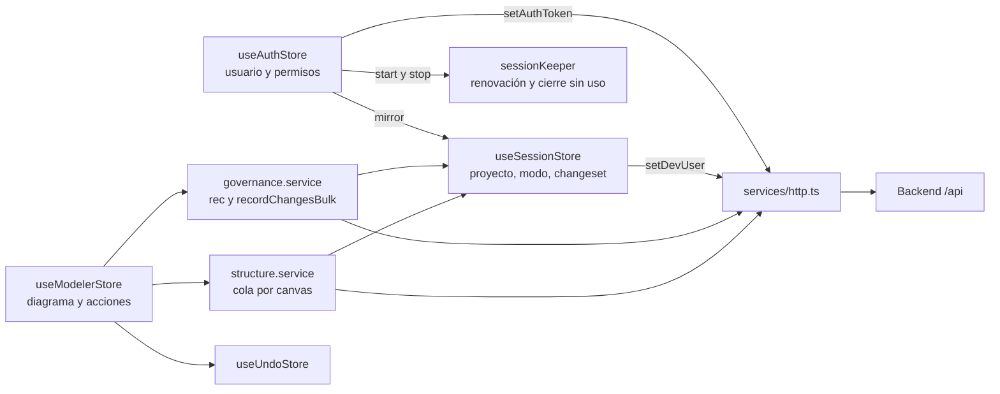

Dos ideas atraviesan todo el documento:

- **Clave de sesión de canvas.** `canvasSessionKey()` (`lib/canvasSession.ts`) arma
  `modo|proyecto|changeset`. Cualquier cambio de esa clave es "otra sesión": se limpia el canvas, se vacía
  el Undo y se refresca el Explorer.
- **Época de sesión y pines.** `sessionGuard.ts` lleva un contador (`sessionEpoch`) que sube con cada
  cambio de clave, incluso cuando después se vuelve a la misma. `pinSession()` toma la época al empezar una
  acción; `pin.holds()` dice si sigue la misma sesión y `pin.check()` lanza `SessionChangedError` si no.
  Así una acción de varias escrituras nunca termina en una versión distinta de la que empezó.

## Arranque y login

### Piezas

- `src/App.tsx` llama a `restore()` una vez al montar y registra los listeners de `focus` y
  `visibilitychange` que llaman a `refreshMe()`.
- `src/features/auth/LoginScreen.tsx` ofrece **Continue with Databricks** (SSO de la plataforma) y el acceso
  de **Administrator** con contraseña. Al montar ejecuta `ensureBackendSession()`.
- `src/features/auth/auth.service.ts` expone `login`, `ssoLogin`, `refreshSession`, `logout` y `fetchMe`.
- `src/features/auth/guards.tsx` contiene `RequireAuth` (muestra `Splash` mientras `status === 'loading'` y
  redirige a `/login` con `anon`) y `RequirePermission`.

| Acción | Método y ruta | Resultado |
|---|---|---|
| Login SSO | `POST /api/auth/sso/login` | `{ user, expiresIn }`: el backend toma la identidad que inyecta la plataforma; `server.mjs` pasa el token a la cookie. |
| Login local | `POST /api/auth/login` | `{ user, expiresIn }` con `{ username, password }`. |
| Restaurar y renovar | `POST /api/auth/refresh` | `{ user, expiresIn }` con un token nuevo en la cookie; 401 si la sesión ya no vale. |
| Refrescar permisos | `GET /api/auth/me` | `SessionUser` con `permissions`, o un principal básico sin permisos. |
| Logout | `POST /api/auth/logout` | `{ ok }`; `server.mjs` borra la cookie. |

### Warm-up

`ensureBackendSession()` (`src/services/warmup.ts`) solo actúa cuando `API_BASE` no está vacío, es decir,
cuando el front apunta a un backend en otro origen (`VITE_API_URL`). En producción el navegador habla con
un solo origen (`server.mjs` hace de proxy de `/api/*`) y la función retorna de inmediato. Con otro origen,
prueba `GET /api/health`; si el `fetch` ni siquiera obtiene respuesta, navega una sola vez a
`GET /api/auth/warmup/{next}` (con `next` en base64url dentro de la ruta) para que el proxy de la
plataforma complete su SSO y devuelva al usuario. Un guard en `sessionStorage` evita el bucle. El detalle
del proxy y del token de servicio está en [Seguridad](08-seguridad.md).

### Restauración al arrancar

`restore()` sigue estos pasos:

1. Lee la marca de pestañas `localStorage['dmh.session']` (si había una sesión y cuándo vencía) y pide
   `POST /api/auth/refresh`. La cookie de sesión, si existe, viaja sola.
2. Si responde, la sesión sigue viva: el token se renovó en la cookie, `mirror(user)` espeja el actor en
   `useSessionStore` (id = username, que en desarrollo viaja como `X-Dev-User`), `status` pasa a `authed`
   y arranca `sessionKeeper` con `expiresIn`.
3. Un 401 dice que no hay sesión, y el login explica por qué: con `code: access_revoked`, «Your access to
   Data Model Hub was removed or disabled. Ask an administrator if you think this is a mistake.»; con la
   marca vencida, «Your session expired due to inactivity. Please sign in again.»; con la marca vigente,
   «Your session ended. Please sign in again.»; sin marca (primera visita o tras un logout), ningún aviso.
   La marca se borra, para que el aviso no se repita al recargar.
4. Sin respuesta del servidor (status 0) o con un 5xx o una respuesta inválida del proxy, la cookie se
   conserva (recargar restaura la sesión), `status` queda en `anon` y el aviso es el de red o «The server
   couldn't check your session right now — reload the page to try again.».
5. Si mientras la renovación demoraba el usuario entró de nuevo, la respuesta de la sesión anterior se
   ignora (`status` ya no es `loading`).

### Login, logout y 401

Los dos logins comparten `enterSession()`: primero `resetAppState()` (el actor que entra no hereda canvas,
árbol, portapapeles ni Undo del anterior), luego espeja el actor y arranca `sessionKeeper`. El token queda
en la cookie HttpOnly; solo si la respuesta lo trae en el cuerpo (otro origen o `SESSION_COOKIE=false`) se
entrega al cliente HTTP (`setAuthToken`), en memoria. El logout cancela la renovación en vuelo (si su
respuesta ya llegó, la cookie quedó antes y el logout la borra), llama a `POST /api/auth/logout`
(`server.mjs` borra la cookie), borra la marca de pestañas (las otras pestañas también salen) y, como es
navegación SPA sin recarga, ejecuta `resetAppState()`.

El cliente HTTP registra un callback global de 401 (`setOnUnauthorized`): si el usuario estaba `authed`,
detiene `sessionKeeper`, ejecuta `resetAppState()` y deja `status` en `anon` con el aviso de sesión
terminada; el guard de ruta lleva a `/login`.

### Renovación y cierre sin uso

`sessionKeeper` escucha la actividad de la pestaña (`pointerdown`, `pointermove`, `keydown`, `wheel`,
`touchstart`) y renueva con `POST /api/auth/refresh` como mucho una vez cada 5 minutos (la sexta parte de
la vida del token si es menor). Sin actividad no renueva: una revisión cada 30 segundos, al volver a la
pestaña y al recuperar el foco cierra la sesión cuando el token vence, con el aviso «Your session expired
due to inactivity. Please sign in again.». Una sesión sin uso dura entre 55 y 60 minutos.

Las pestañas comparten la cookie. La marca `dmh.session` las coordina: cada renovación escribe el nuevo
vencimiento y las demás lo adoptan (una pestaña en uso mantiene viva a las quietas); un logout la borra y
las demás salen con «Your session ended…»; si otra pestaña entra con otra cuenta, esta sale con «You signed
in with another account in another tab. Sign in again to continue here.». Una renovación sin respuesta se
reintenta con la actividad tras 30 segundos; una rechazada (401) cierra la sesión por el callback global.
El backend renueva una sesión hasta 12 horas desde el login (el último token vive solo lo que falta);
después hay que volver a entrar.

Una renovación de esta pestaña que responde después de un logout o del ingreso con otra cuenta en otra
pestaña volvió a dejar la cookie de esta sesión: `onStale` la borra con un logout, salvo que la sesión
vigente sea de la misma cuenta (otra pestaña volvió a entrar). `stopSessionKeeper()` cancela la
renovación en vuelo de la pestaña y espera esa limpieza, de modo que un login o un logout de la pestaña
empieza después. Si la renovación o `/me` traen otra cuenta (la cookie cambió en otra pestaña), la
pestaña sale con el aviso de otra cuenta y esa cookie no se toca.

### Permisos al día sin recargar

`refreshMe()` vuelve a leer `/api/auth/me` cuando la pestaña recupera el foco y cuando una respuesta 403
llega desde una ruta fuera de `/api/auth/` (`setOnForbidden`). Tiene un tope: una lectura en vuelo y como
mucho una cada `ME_GAP_MS` (10 s). Nunca rechaza. Solo reemplaza el usuario si cambió el rol o algún
permiso (sin cambios, cero re-renders); si `/me` ya no trae permisos, cierra la sesión como `restore()`. La
sesión de edición no se degrada por permisos: cada escritura la decide el backend. Para re-evaluar su
visibilidad, un componente se suscribe a `s.user?.permissions` o llama a `s.has('perm')` dentro del
selector.

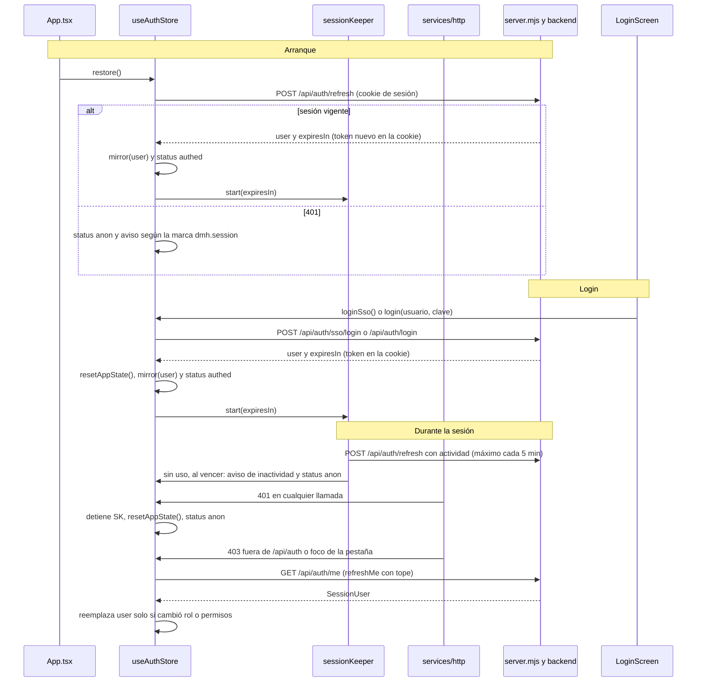

### Cliente HTTP en cada llamada

Todas las llamadas pasan por `apiFetch` (`src/services/http.ts`):

- La sesión viaja en la cookie HttpOnly y `server.mjs` la pasa al backend como `X-Session-Token`; un
  token en memoria (otro origen o `SESSION_COOKIE=false`) lo envía `apiFetch` en esa misma cabecera. La
  cabecera `Authorization` queda reservada al proxy de la plataforma, que la consume y la reemplaza por el
  token del servicio.
- `X-Requested-With: XMLHttpRequest` en toda llamada a `/api/` del mismo origen: `server.mjs` lo exige en
  las escrituras que usan la cookie (CSRF).
- `X-Dev-User` solo se envía en desarrollo (`import.meta.env.DEV`).
- `credentials: 'include'` para el caso de un backend en otro origen.
- Timeout de 30 s (`DEFAULT_TIMEOUT_MS`) combinado con el `signal` del llamador; las acciones largas
  (snapshot, envío a revisión, decisión, rollback) usan `LONG_TIMEOUT_MS` (120 s).
- Un error de transporte se traduce en `ApiError` con status 0 y un texto legible: tiempo agotado («The
  server didn't respond within Ns — try again in a moment.») o red (`NETWORK_ERROR_TEXT`).
- La respuesta se desempaqueta del envelope `{ success, data, error }`. Si llega `{ detail }` sin envelope
  (excepciones HTTP de FastAPI), el `detail` es el mensaje del error; un `detail` estructurado
  (`{ message, ... }`) queda además en `ApiError.detail` (por ejemplo, el bloqueo de publicación).
- Toda respuesta no exitosa distinta de 401 se notifica al observador `setOnApiError(status, url)`, que usa
  la revalidación de la sesión (ver [Revalidación ante errores](#revalidación-ante-errores-y-cierre-del-canvas)).

## Abrir un proyecto: visor de producción o sesión de edición

### Open model

El canvas nunca se abre en producción de forma implícita. Al entrar a `/model` sin `openMode`,
`WorkspaceScreen` muestra `OpenModelModal` (`src/components/OpenModelModal.tsx`), que trabaja en dos pasos:
primero el proyecto (`ProjectPicker`, con la opción de crear uno) y después el modo para ese proyecto.

| Opción en la UI | Llamada | Sesión resultante |
|---|---|---|
| **View production (read-only)** | Ninguna | `openModel({ projectId, mode: 'readonly', versionLabel })`, sin changeset: se lee producción. |
| **Create new version from production** | `POST /api/changesets/snapshot` con `{ projectId }`, bajo `runBlocking('Creating working copy…')` | `openModel({ projectId, mode: 'editing', changesetId, versionLabel })` con el draft recién creado. |
| **Continue a working version** | Ninguna (los drafts propios ya vienen en `listVersions`) | `openModel({ projectId, mode: 'editing', changesetId })` con el draft elegido. |

Existen otros puntos de entrada que también llaman a `openModel`:

- **Version tools** en Home abre cualquier versión en modo visor: la producción vigente sin changeset, una
  versión publicada pasada con el changeset virtual `asof:<versionId>` (el backend compone el modelo
  exacto de esa versión) y un draft o request con su propio id de changeset.
- **Review** abre un request con «Open in canvas»: en edición solo para el dueño de un draft; en solo
  lectura para quien puede verlo (dueño, revisor asignado, `versions.view_all` o `admin.manage`).
- `PublishModal`, tras enviar, reabre producción en solo lectura.

`openModel()` guarda además el proyecto en `localStorage['dmh:lastProject']` para preseleccionarlo la
próxima vez. No navega: lo hace el llamador.

### Estado efectivo (overlay)

Los cambios de un draft no se aplican sobre producción hasta la aprobación. Mientras tanto, toda lectura
con `activeChangesetId` (en cualquier modo, también el visor de un request) pide el **estado efectivo**:
producción con los cambios del changeset superpuestos, calculado en el backend.

- El diagrama se pide con `?changesetId=` (`modeler.service.loadDiagram`).
- Las colecciones se leen con `GET /api/changesets/{id}/effective/{collection}`
  (`changeset.service.effective`), siempre acotadas con `tableId`, `tableIds`, `ids`, `q` y `limit` o
  `schema`: nunca se baja una colección completa.
- La estructura (`structure.service`) distingue `readCs()` (cualquier modo con changeset) de `writeCs()`
  (solo `editing`). Sin changeset, las lecturas van a los endpoints directos de producción.

El overlay sustituye el documento publicado por el payload del cambio; no mezcla campos. Por eso el front
envía siempre el documento completo en cada upsert.

### Qué se refresca al cambiar de sesión

Dos mecanismos reaccionan a un cambio de la clave de sesión:

1. **Suscripción del store** (al final de `useModelerStore.ts`): si cambia el modo, el proyecto o el
   changeset, vacía la pila de Undo, sube `_loadSeq` (descarta toda carga de diagrama en vuelo), anula una
   recarga en espera y limpia en el acto el diagrama, los dibujos, la selección, los menús, los popups de
   pegado, el Inspector y la ficha del canvas. Conserva `activeSaId` para que el refresco reabra el mismo
   canvas si existe en la sesión nueva, y conserva el portapapeles (copiar en una versión y pegar en otra
   es un caso válido).
2. **Efecto de `WorkspaceScreen`** que depende de `canvasSessionKey`: llama a `refreshExplorer()`, limpia
   `dirty` y, al abrir en edición, pone la vista lógica (`setViewMode('logical')`); en solo lectura no
   cambia la faceta vigente (al arrancar, la física). Si el refresco falla, se avisa «Couldn't load the explorer: … Use Refresh to try
   again.» con un id de toast por sesión, siempre que la sesión siga siendo la pedida.

### Cachés y respuestas tardías

`refreshExplorer()` es la reconstrucción completa del Explorer para la sesión vigente:

- Sube `_explorerSeq` (solo el refresco más reciente escribe) y `_loadSeq` (toda carga del diagrama pedida
  antes queda descartada).
- Vacía `trees`, `projects` y `projectDeletionPending`, y recuerda el canvas que se estaba
  abriendo (`openingSaId`) para reabrirlo al final.
- Carga proyectos, comprueba que el proyecto de la sesión exista en ese contexto (si no, «This project was
  deleted in a published version.» y `closeModel()`), carga el árbol (`_refreshProject`) y reabre el canvas
  activo con `selectSubjectArea`.
- Carga los esquemas en paralelo (`loadSchemas`); su error se avisa solo si el resto del refresco terminó
  bien, para no sumar dos avisos por una misma caída.

Las lecturas del árbol fuera del refresco (expandir un proyecto, `selectProject`, `loadFolders`) usan
`explorerRequest()`: escriben en el store solo si la sesión sigue siendo la misma y no empezó un refresco
más reciente.

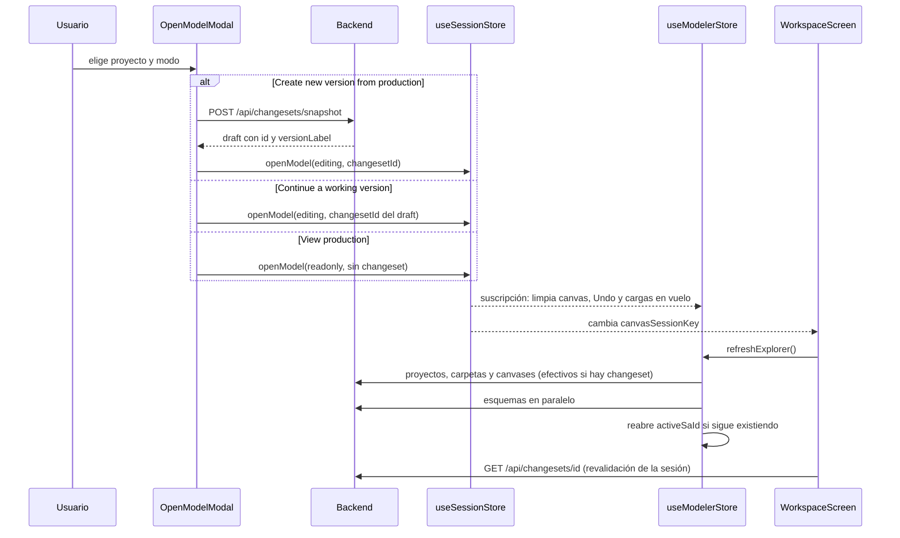

## Apertura de un canvas

### Una sola petición

Al elegir un canvas en el Explorer, `selectSubjectArea(saId, projectId?)` pide el diagrama completo en una
sola respuesta: `GET /api/subject-areas/{saId}/diagram[?changesetId=]`. El backend arma el canvas con
consultas por lotes y aplica el overlay de la versión. La respuesta (`Diagram`, en
`features/modeler/services/modeler.service.ts`) trae:

| Campo | Contenido |
|---|---|
| `subjectArea` | El documento del canvas: `tableIds`, `viewIds`, `layout` (posición por id), `drawings`, `routes` (trazos manuales de wires), `colors` (excepciones de color por caja), `udpValues`. |
| `tables`, `columns` | Las tablas miembro y sus columnas. |
| `relationships` | Las relaciones entre tablas del canvas (con sus pares de columnas). |
| `views` | Las vistas miembro del canvas, ya resueltas por el backend. |

### Pasos de `selectSubjectArea`

1. Guarda de inmediato los dibujos con guardado agendado del canvas anterior (`flushPendingDrawings`):
   el debounce no los escribiría al cambiar de canvas.
2. Sube `_loadSeq`, toma un pin de sesión y marca `openingSaId` (el spinner del Explorer).
3. Toma la marca del reloj lógico `canvasClock()` y pide el diagrama.
4. Al llegar, descarta la respuesta si otra carga empezó mientras tanto (`seq !== _loadSeq`).
5. Repone lo grabado después de la marca (`withWrittenCanvas`, ver más abajo) y sella el diagrama con el pin
   (`sealDiagram`).
6. Si el canvas es de otro proyecto, ese proyecto pasa a ser el activo del Explorer (con el árbol de la
   caché o leyéndolo).
7. Instala el diagrama y los dibujos, y limpia la selección, el menú de columnas y los popups de pegado.
8. En segundo plano carga las reglas de naming y los themes de color del proyecto.
9. Al terminar, solo la apertura que encendió el spinner lo apaga y resuelve una recarga que se haya pedido
   mientras abría (`_reloadAfterOpening`).

Si la apertura falla, `ModelExplorer` avisa «Couldn't open the canvas: <motivo>.» a través de
`reportWriteError`, que aplica el criterio de revalidación.

### Lo grabado gana a la foto

Un diagrama tarda en llegar. Si se pidió antes de que terminara un guardado del mismo canvas, puede traer
la posición, el trazo o el color previos y "deshacer" en pantalla lo recién grabado. `lib/canvasWrites.ts`
evita eso con un reloj lógico (cuenta escrituras, no mide tiempo):

- `saveCanvas()` (en `structure.service`) anota cada documento grabado con `noteCanvasWrite(cs, saId, doc)`.
- Antes de pedir un diagrama se toma `canvasClock()`.
- Al recibirlo, `writtenSince(cs, saId, marca)` devuelve lo grabado después; `withWrittenCanvas` mezcla las
  posiciones (lo grabado encima), y reemplaza los trazos y los colores.

El registro es por working copy: lo grabado en una no se repone en otra ni en producción.

### Del diagrama a nodos y wires

`ModelerCanvas.tsx` convierte `store.diagram` en el estado de React Flow:

- **Tablas** (`type: 'table'`): posición desde `subjectArea.layout`; en solo lectura, con el layout efímero
  del visor (`viewerLayout`) encima.
- **Vistas** (`type: 'view'`) y wires de derivación tabla → vista: solo en el modelo físico.
- **Dibujos** (`type: 'shape'`): capa detrás de las tablas.
- **Relaciones** (`type: 'crowfoot'`): siempre de padre a hijo, con la cardinalidad en los marcadores. Si el
  canvas tiene un trazo manual para el wire (`subjectArea.routes`), el camino pasa por sus puntos.
- **Subcategorías**: en el modelo lógico se dibujan con un nodo símbolo propio.
- **Colores**: las excepciones del canvas (`subjectArea.colors`) se aplican por caja sobre el theme del
  proyecto.

La primera pintura sale en modo compacto (`lod: true`) y el zoom decide después si pasar al detalle. El
algoritmo de auto-layout, el LOD y la virtualización están en
[Consideraciones técnicas](12-consideraciones-tecnicas.md).

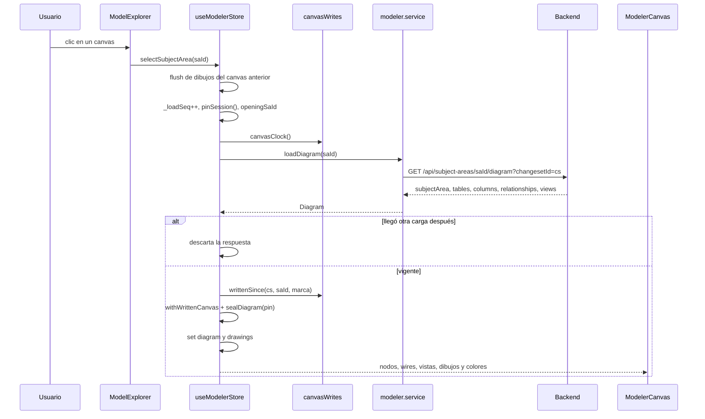

## Edición: cambios, cola por canvas y escrituras en segundo plano

### El punto único de escritura del modelo

Toda mutación de tablas, columnas y relaciones pasa por `writableCs()` en
`src/services/governance.service.ts`, que usan `rec()` (un cambio) y `recordChangesBulk` (un lote):

```ts
const writableCs = (): string => {
  if (useSessionStore.getState().openMode === 'readonly') {
    throw new Error('The model is open read-only: it does not accept changes.');
  }
  const a = active();
  if (!a) throw new Error('An active changeset is required to edit.');
  return a;
};
```

El orden importa: en solo lectura puede haber un changeset activo (el visor de un request), pero eso
nunca habilita escrituras. Carpetas, canvases, vistas y esquemas tienen su propia guarda equivalente en
`structure.service`, `views.service` y `schemas.service`: sin una versión en edición fallan sin llamar al
backend. No existe escritura directa a producción desde el front.

| Llamada | Endpoint | Uso |
|---|---|---|
| `recordChange(cs, collection, entityId, op, payload)` | `PUT /api/changesets/{id}/changes` | Un cambio (`upsert` o `delete`) con el documento completo. |
| `recordChangesBulk(cs, changes)` | `PUT /api/changesets/{id}/changes/bulk` | Lote en tandas secuenciales de 1000 cambios; el backend valida cada tanda completa antes de escribir. Lote vacío = cero peticiones. |

El `projectId` de cada payload lo estampa el backend con el del changeset, que además rechaza con 409
cualquier referencia a una entidad de otro proyecto. Los permisos (`model.edit`) los exige el backend en
cada escritura; ver [Seguridad](08-seguridad.md).

### Cambios individuales y en lote

Las acciones del store eligen entre un cambio o un lote según cuántas entidades tocan:

- `createTable`: deriva el nombre físico (`gov.physicalize` cuando hace falta), crea la tabla con
  `gov.createTable` y la agrega al canvas con `struct.addToCanvas` (miembro y posición en la misma
  escritura del canvas), recarga y apila su Undo.
- `addColumn`: una columna nueva de la llave entra después de la última PK; las columnas que se corren
  viajan en el mismo lote.
- `updateColumn`: marcar o desmarcar la PK reubica la columna en la frontera del bloque de llave
  (`keyLayoutBulk`) en un solo lote y un solo Undo; cualquier otro cambio es un upsert del documento
  completo.
- Relaciones: el popup de mapeo graba columnas y relación en un solo lote.
- `reorderColumns`: es optimista. Reordena en el store al soltar y persiste solo las columnas cuyo
  `ordinal` cambió, en tandas de 5 (`persistReorder`). Cada escritura lleva el documento vigente de la
  columna (`currentColumn`): una edición que terminó entre tandas no se pisa y una columna borrada no
  revive. Rechaza dejar una PK debajo de una columna que no es de la llave.
- Borrar una tabla o una columna hace todas sus lecturas (dependencias, vistas, canvases) antes de la
  primera escritura; si una lectura falla, no se borra nada (`NothingDoneError`).

Toda acción llama a `markDirty()`, que alimenta el aviso de cambios sin guardar (y el `beforeunload` del
navegador) y termina con `reload()`, que vuelve a pedir el diagrama y reconcilia con el overlay. Si el
diagrama recargado cambió en estructura (`diagramSignature`), el Explorer se invalida (`bumpExplorer`).

### Diagrama sellado

Cada diagrama se sella con el pin de la sesión en que se pidió. Las acciones que escriben leen el diagrama
por `liveDiagram()` o `editableDiagram()`:

- `liveDiagram()` devuelve `null` si el diagrama en pantalla es de otra sesión.
- `editableDiagram()` lanza `StaleCanvasError` («This canvas is from a version that is no longer open —
  open it again from the explorer.») en ese caso; así un Save no se da por exitoso con un diagrama ajeno.

### Cola de escrituras por canvas

Cada escritura de un canvas es "leer el documento efectivo y grabarlo completo". Dos escrituras casi
simultáneas del mismo canvas (mover una tabla y trazar un wire) leerían el mismo documento y la segunda
borraría el cambio de la primera. `structure.service` las encola por canvas con `inOrder(saId, job)`:

- La segunda escritura lee recién cuando la primera terminó de grabar.
- Una escritura que falla avisa a quien la pidió y no frena a la siguiente.
- Canvases distintos no se esperan entre sí.
- Toda petición lleva timeout, así que la cola no puede quedar colgada.

Pasan por la cola: `addToCanvas`, `removeFromCanvas`, `setSubjectAreaLayout`, `arrangeSubjectArea`,
`setSubjectAreaDrawings`, `setWireRoute`, `setCanvasColors`, los UDP del canvas y `updateSubjectArea`.
Dentro de cada una, `saveCanvas()` graba en píxeles enteros (`wholeLayout`) y anota lo grabado en
`canvasWrites`. La membresía del canvas (`tableIds`, `viewIds`) solo cambia por `addToCanvas` y
`removeFromCanvas`, que arman la lista completa dentro de la cola.

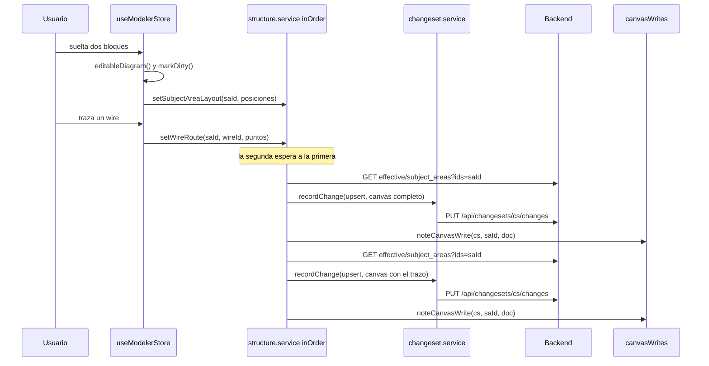

### Escrituras en segundo plano

Algunas escrituras no bloquean la interacción y corren detrás:

| Escritura | Disparador | Comportamiento |
|---|---|---|
| Posiciones | `onNodeDragStop` → `saveNodePositions(positions)` | Todos los bloques movidos (tablas, vistas, símbolos de subcategoría) en una escritura; solo los del canvas en pantalla. Actualiza en sitio el layout del diagrama del store para que un re-armado no devuelva el bloque a su sitio previo. |
| Dibujos | `addDrawing`, `updateDrawing`, `deleteDrawing` → `persistDrawings()` | Debounce de 500 ms. Al agendar se captura el canvas y la versión en edición; al dispararse, se descarta si la sesión ya no edita esa versión o si el canvas abierto es otro. Cambiar de canvas o `saveAll` hacen el guardado inmediato. |
| UDP de paneles | `pinnedDebouncer(write, ms)` | Debounce por clave con el pin tomado al editar; al cerrar el panel se hace `flush` solo de lo que es de la sesión vigente. |
| Auto-arrange | `autoOrganize()` | ELK calcula posiciones; `arrangeSubjectArea` las graba junto con los trazos reiniciados en una escritura, apila el Undo y recarga. En solo lectura las posiciones quedan en `viewerLayout` y no viajan al backend. |

Los fallos de estas escrituras se avisan con `reportCanvasSaveError`: si el error es 403, 404 o 409 de la
versión abierta (`touchesVersion`), se espera la revalidación y se calla si la sesión dejó de editar esa
versión (la revalidación ya dio el aviso correcto); si no, se muestra el motivo real («Couldn't save the
position: …», «Couldn't save the drawings: …»).

### Guardas de sesión en acciones de varias escrituras

Una acción que escribe varias veces (crear una tabla y agregarla al canvas, borrar una tabla con su
cascada, la inversa de un Undo) toma `pinSession()` al empezar y llama a `pin.check()` antes de cada
escritura que sigue a un `await`. Si en el medio se abre otra versión, otro modo u otro proyecto, lo que
falta no se escribe en ninguna parte y la acción termina con `SessionChangedError`, que nadie anuncia: la
sesión en pantalla ya no es la suya.

`lib/pinnedWrites.ts` reúne las variantes:

- `pinned(pin, fn)`: envuelve un servicio para que verifique el pin antes de escribir.
- `pinnedViewDeps(pin)`: las dependencias de la sincronización de vistas con `updateView` atado al pin.
- `bestEffort(run)`: un paso opcional cuyo error se ignora, salvo `SessionChangedError`, que corta la
  acción.
- `undoColumnsBatch(...)`: la inversa estándar de un lote que creó o renombró columnas.
- `pinnedDebouncer(write, ms)`: el debounce de escrituras diferidas descrito arriba.

Los componentes que escriben por su cuenta usan `reportWriteError(report)` (`sessionGuard.ts`) como
`.catch`: toma la sesión al pedir y avisa solo si sigue siendo la misma.

### Conflictos

- **Entre escrituras del mismo canvas**: los resuelve la cola por canvas.
- **Entre entidades distintas**: el backend graba cada cambio de forma atómica por entidad, así que dos
  escrituras concurrentes sobre columnas distintas no se pisan.
- **Reglas de negocio**: un nombre duplicado, una referencia a otro proyecto o una versión que ya no está en
  draft responden 409 con el motivo; `isConflictError` lo identifica y el aviso muestra el `detail` del
  backend.
- **Contra producción**: si una entidad del draft se modificó en producción después de editarla, el diff de
  revisión la marca como conflicto. La aprobación publica la versión completa sobre producción. Si la copia
  de un canvas en el draft lista una tabla o vista que otra versión borró y publicó, el backend la poda al
  grabar y al publicar.
- **Objeto borrado por otra versión**: si el draft cambió un objeto del modelo que otra versión borró y
  publicó, el envío y la aprobación responden 409 `deleted_in_production` con la lista de objetos;
  `PublishModal` la muestra y ofrece `discardDeleted`, y el panel «Publish blocked» de la revisión la
  muestra al revisor. El diff marca esas entidades con `deletedInProduction` (no se restauran).

## Undo y la working copy

La pila de Undo (`src/store/useUndoStore.ts`) guarda inversas como closures que llaman a los mismos
servicios con conocimiento del changeset. Deshacer es un cambio más del draft: el versionado y el diff ven
upserts y deletes normales, sin mecánica adicional. No hay redo.

| Regla | Detalle |
|---|---|
| Tope | 50 entradas (`CAP`); al pasarlo se descarta la más antigua. |
| Alcance | La pila es de la sesión de canvas: se vacía al cambiar de proyecto, modo o versión (incluido editar → solo lectura → editar la misma versión) y en `resetAppState`. |
| Apilado | Cada acción instrumentada llama a `pushUndo(label, run, pin)` con el pin con que empezó: si la sesión cambió mientras la acción corría, la inversa no entra en la pila de la sesión nueva. Mientras corre una inversa, lo que ella apila se ignora (una inversa no apila su propia inversa). |
| Disparo | Botón **Undo** de la Toolbar y Ctrl+Z en el canvas llaman a `undoLast()`; al terminar se muestra «Undid: <label>». |
| Concurrencia | `busy` impide dos Undo a la vez; no hay overlay bloqueante. |
| Pila cerrada | `clear({ until })` vacía la pila y la deja cerrada para la versión actual hasta que la promesa termine. Lo usa la carga desde Excel mientras aplica. |

`undoLast()` saca la entrada de la pila antes de correrla, con un pin nuevo. Según el resultado:

- **Éxito**: devuelve el label si la sesión sigue igual.
- **Error 403, 404 o 409 de la versión**: espera la revalidación; si la sesión cambió, calla.
- **`NothingDoneError`** (falló una lectura previa y no se escribió nada): la entrada vuelve a la pila y el
  aviso dice «…: nothing was undone. Press Undo to try again.».
- **Falla de transporte (status 0)**: no se sabe si la inversa escribió, pero las inversas reponen
  pre-imágenes (idempotentes), así que la entrada vuelve a la pila con «Couldn't undo <label>: <motivo>.
  Press Undo to try again.».
- **Cualquier otro error**: la entrada se descarta (no bloquea las anteriores) y el error se muestra.

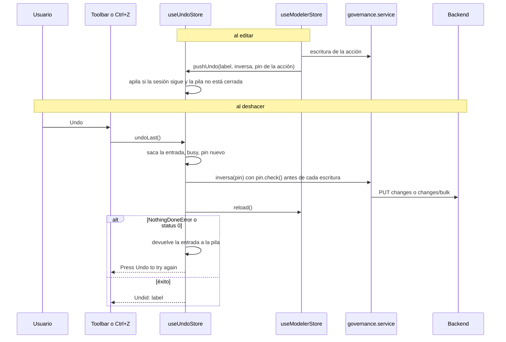

## Revalidación ante errores y cierre del canvas

### Qué se revalida y cuándo

La versión abierta puede cambiar por fuera: otra pestaña la envía a revisión, un administrador la
transfiere o la elimina, un revisor la decide. `WorkspaceScreen` revalida la sesión con
`revalidateSession()`:

- Al entrar a Model y cada vez que cambian `openMode`, `activeChangesetId` o el usuario.
- Cuando una respuesta 403, 404 o 409 menciona la versión abierta en la ruta o en el query string
  (`setOnApiError` + `touchesChangeset`). La lectura de la propia cabecera de la versión no la vuelve a
  disparar (`isVersionHeaderUrl`), y un snapshot `asof:` nunca se revalida (las publicadas no se
  transfieren ni se eliminan).

La revalidación lee `GET /api/changesets/{id}` y aplica la función pura `sessionFate()`
(`lib/sessionGuard.ts`):

| Situación | Destino | Aviso |
|---|---|---|
| Edición: draft propio | Sigue igual (`keep`). | Ninguno. |
| Edición: la versión pasó a otro dueño y todavía se puede ver | Solo lectura de la misma versión. | «Version … was transferred to <nombre>: the canvas is now read-only.» |
| Edición: pasó a otro dueño y ya no se puede ver | Solo lectura de producción. | «… you can no longer open it. Showing production (read-only).» |
| Edición: propia pero ya no en draft | Solo lectura de la misma versión. | «Version … is no longer in draft (<estado>): the canvas is now read-only.», donde el estado es «sent to review», «published» o «rejected» |
| Visor: la versión ya no es visible para el actor | Solo lectura de producción. | «… isn't available to you: only its owner, its assigned reviewers and administrators can open it. Showing production (read-only).» |
| Cualquier modo: 404 | `closeModel()`: vuelve al Open model. | «Version … was deleted — pick another version to keep working.» |

Si la cabecera no se puede leer (red, o un 403 que no viene del backend sino del proxy de la plataforma),
la sesión no se degrada: el backend sigue protegiendo cada escritura. Con un 403 se muestra un aviso por
versión («Couldn't check this version: …»), sin repetir la lectura.

Las corridas no se pisan: hay una sola por versión; un pedido que llega mientras corre marca `rerun` y la
corrida se repite al terminar. Cada corrida se registra con `trackRevalidation()`, y cualquier código que
reciba un error de la versión puede esperar el veredicto con `afterRevalidation()`.

### El criterio de los avisos

Un 403 o un 404 de la versión no significa que el proyecto se haya borrado ni que la acción esté mal: puede
ser que la versión cambió de manos. Por eso, quien recibe un error lo trata así:

1. Si el error es de la versión pedida (`isVersionError` para lecturas, `touchesVersion` para escrituras),
   espera la revalidación.
2. Si después la sesión es otra (la cambió la revalidación, que ya avisó, o el usuario abrió otra), calla.
3. Si la sesión sigue igual (rol perdido, nombre duplicado, 403 del proxy), muestra el motivo real.

`stillAskedSession()`, `reportWriteError()`, `reportCanvasSaveError()` y la lógica de `refreshExplorer()`
implementan ese mismo criterio. Los avisos llevan ids de toast por sesión, de modo que una caída de red
produce un aviso y no varios apilados.

### Errores del proxy y de transporte

- **Sin respuesta (status 0)**: `isTransientError` lo considera transitorio, igual que un 5xx. El texto es
  el de red o el de tiempo agotado.
- **Respuesta que no es JSON** (una página HTML del proxy): `ApiError` «Invalid JSON response (HTTP n)» con
  `detail` nulo. En Reporting, `versionGoneText()` distingue un 403 o 404 del backend (con `detail`) de uno
  de infraestructura.
- **401**: cierra la sesión (ver [Arranque y login](#arranque-y-login)).

### Cierre del canvas cuando la recarga falla

`reload()` vuelve a pedir el diagrama tras cada escritura. Si falla (red, tiempo agotado, 5xx), no se
reintenta solo: lo que hay en pantalla es anterior a la escritura que acaba de terminar y editar desde ahí
pisaría lo grabado. Entonces:

1. Si el error es de la versión, espera la revalidación; si mientras tanto empezó otra carga o cambió el
   canvas, no hace nada.
2. Guarda los dibujos pendientes (salvo con un 404, porque el canvas ya no existe).
3. Cierra el canvas: limpia `activeSaId`, el diagrama, los dibujos y la selección.
4. Avisa «Couldn't reload the canvas: <motivo>. Open it again from the explorer.» o, con un 404, «This
   canvas is no longer in this version, so it was closed. Open another one from the explorer.».

Hay dos casos especiales. Si `reload()` se pide mientras se abre un canvas, no invalida esa apertura:
queda en espera (`_reloadAfterOpening`) y la apertura la resuelve al terminar (si era el mismo canvas,
recarga, porque su foto pudo ser previa al guardado). Si la apertura de otro canvas falló y también falla
la recarga del canvas editado, la recarga cierra sin sumar su propio aviso (`_quietReloadFailure`): una
caída, un aviso.

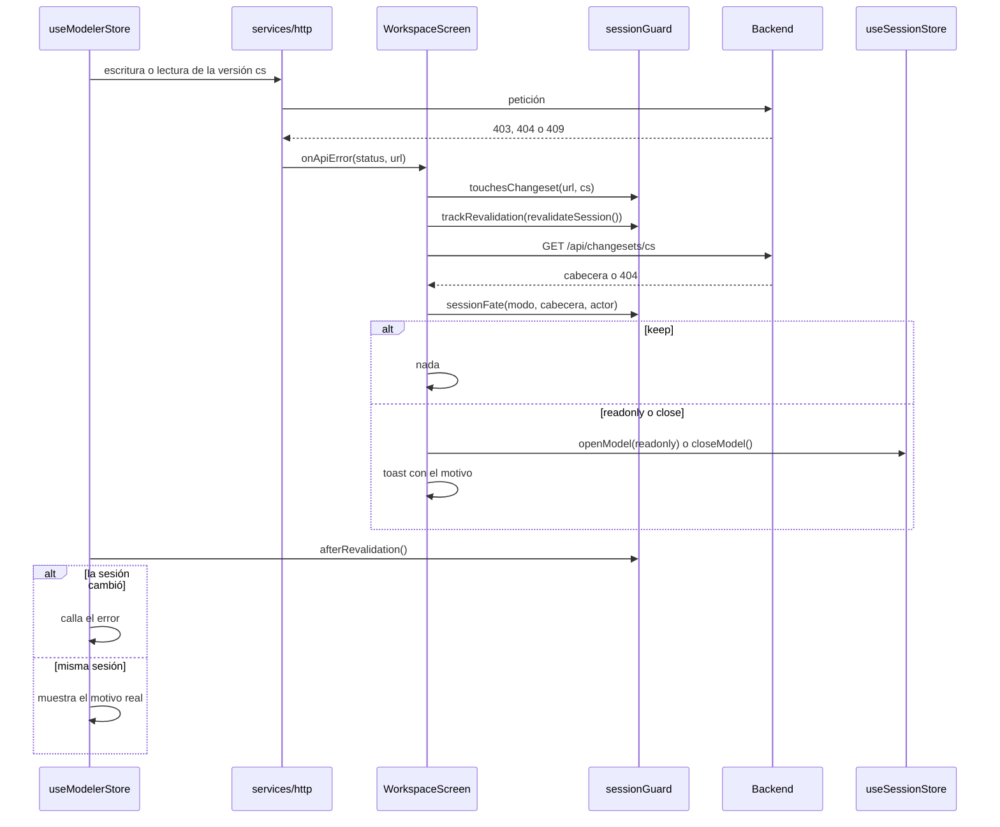

## Enviar a revisión, revisar, aprobar y publicar

### Enviar

El botón **Publish** de la Toolbar abre `PublishModal`. El autor escribe título y descripción opcionales y
elige al menos un revisor entre los usuarios activos con `review.decide` que acceden al proyecto
(`listUsers('review.decide', projectId)` → `GET /api/users?can=review.decide&projectId=<id>`).
**Send for Approval** llama a `submit(changesetId, { title, description, reviewers })` →
`POST /api/changesets/{id}/submit` bajo `runBlocking('Sending for approval…')`. Si un revisor fue
deshabilitado o perdió el acceso al proyecto entre tanto, el backend responde 400 y el toast muestra el
motivo.

Tras el envío:

1. `clearDirty()`: el envío es un punto de control.
2. La versión deja de estar en draft y el backend rechazaría más ediciones, así que la sesión pasa a solo
   lectura de producción: `getPublished(projectId)` y `openModel({ projectId, mode: 'readonly',
   versionLabel })`.
3. Aviso «Request sent — the canvas is now read-only (production)».

El cambio de sesión dispara lo descrito en
[Qué se refresca al cambiar de sesión](#qué-se-refresca-al-cambiar-de-sesión): Undo vacío, canvas limpio y
Explorer recargado sobre producción.

### Revisar

`ReviewScreen` (`src/screens/ReviewScreen.tsx`) es una bandeja con filtro de proyecto; `GET /api/versions` y
`GET /api/requests` devuelven solo los proyectos a los que el usuario accede. Al elegir un request, la
pantalla decide con la fila de la lista si el usuario puede ver su contenido (`canOpenVersion`: versión
publicada, dueño, revisor asignado, `versions.view_all` o `admin.manage`). Si no puede, muestra el aviso
de visibilidad y no pide nada más. Si puede, espera a que la lista termine de cargar y pide en paralelo el
detalle y el diff (`getChangeset`, `getDiff`):

- El resumen (`ChangesSummary`) se deriva del diff ya cargado con `summarizeDiff()`, sin otra petición.
- El popup de detalle pide `POST /api/changesets/{id}/diff/details` con `{ items }` en lotes de hasta 200
  entidades, y cachea por entidad. La respuesta trae el antes y el después por campo con los ids resueltos
  a nombres.
- Los conflictos (entidades modificadas en producción después de que el draft las editó) se marcan en el
  diff.

### Decidir y publicar

`review(id, { decision, note })` → `POST /api/changesets/{id}/review` bajo `runBlocking('Applying
decision…')`. Aprobar publica: la versión se aplica sobre producción. Un 403 trae el `detail` del backend,
que distingue la falta del permiso `review.decide` de no estar asignado como revisor.

Si la publicación queda bloqueada, el backend responde con un `detail` estructurado (`code`, `message`,
`items`, `next`); `publishBlockedDetail(err)` lo reconoce y la pantalla muestra el panel
`PublishBlockedPanel` con la lista completa, más el aviso «Publish blocked — nothing was published. See the
details on this page.».

Otras acciones del ciclo:

| Acción | Quién | Endpoint | Efecto |
|---|---|---|---|
| Withdraw | Dueño, request en revisión | `POST /api/changesets/{id}/withdraw` | Vuelve a draft; descarta las decisiones registradas. |
| Reopen | Dueño, request rechazado | `POST /api/changesets/{id}/reopen` | Vuelve a draft. |
| Comentar | Participantes | `POST /api/changesets/{id}/comments` | Hilo del request. |
| Rollback | Permiso `rollback` (Home) | `POST /api/changesets/{id}/rollback` | Crea un draft con los cambios inversos; sigue el mismo circuito de revisión. |

### Qué se refresca después

- **Tras decidir**: el detalle se reemplaza por el devuelto, se limpia el panel de bloqueo y en segundo
  plano se recargan la lista de versiones (`listVersions`) y el diff.
- **Tras withdraw o reopen**: se limpian detalle, diff y selección, se recarga la lista y queda un acceso
  directo para volver al canvas en edición sobre ese draft.
- **En otras pestañas**: una sesión que tenía abierta esa versión se entera en su siguiente revalidación
  (al cambiar de sesión o con el primer 403, 404 o 409 de la versión) y pasa a solo lectura.

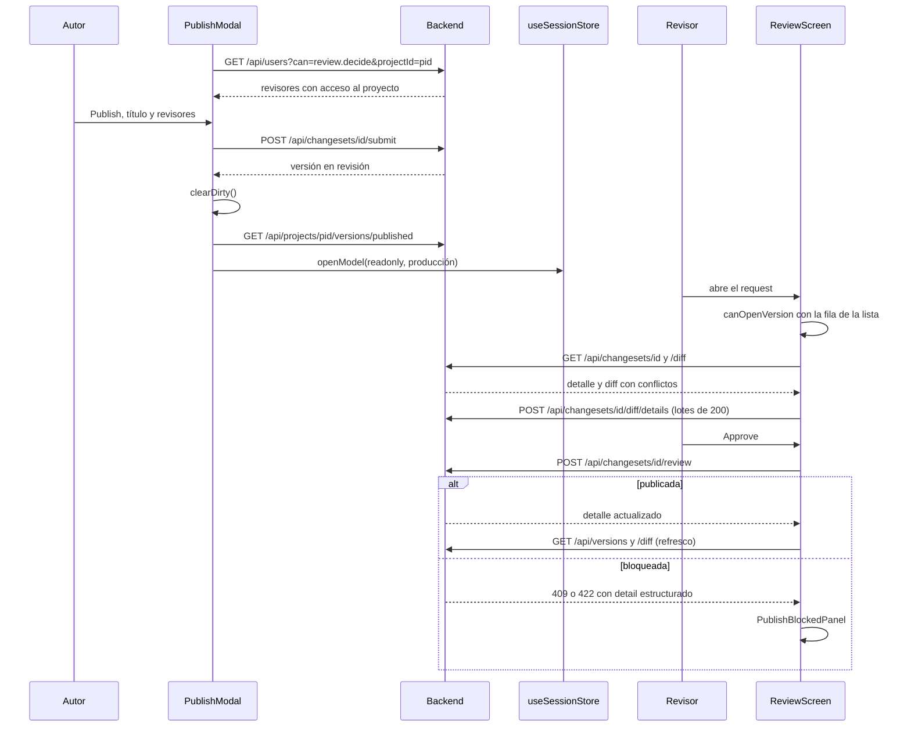

## Reporting

### Producción o versión propia

`ReportingScreenWrapper` (`src/screens/ReportingScreen.tsx`) fija el proyecto y la versión: producción o
una versión propia sin publicar (draft o en revisión) del mismo proyecto, que lista
`ownOpenVersions()` (`features/reporting/lib/reportVersions.ts`). Todas las lecturas van por
`src/services/reporting.service.ts` con `projectId` y, en modo versión, con `changesetId`.

Si al leer la versión elegida el backend responde 404 o 403, el wrapper vuelve a producción con «This
version was deleted — showing Production.» o «This version is no longer available to you — showing
Production.»; si al volver a listar la versión ya no está abierta, con «That version is no longer open —
showing Production.». Los errores del modo versión comparten un id de toast para no apilar dos avisos.

### Lecturas de la grilla

| Lectura | Endpoint | Uso |
|---|---|---|
| `listReportTables(projectId, { limit: 50, offset })` | `GET /api/reporting/tables` | Páginas de 50 tablas en producción sin filtros; la fila centinela pide la siguiente. |
| `listReportTables(projectId, {})` | `GET /api/reporting/tables` | El conjunto completo: al aplicar el primer filtro, para «Select all» con páginas pendientes y, en modo versión, desde el inicio. |
| `countReportTables(projectId)` | `GET /api/reporting/tables/count` | El total real. |
| `listReportFilters(projectId, changesetId)` | `GET /api/reporting/filters` | Opciones de los combos de esquema y canvas de todo el catálogo. |

La búsqueda y los combos filtran en el navegador las filas cargadas.

### Consultas por lotes

Las columnas, vistas y relaciones de las tablas elegidas se piden por POST con los ids en el cuerpo
(`{ projectId, tableIds, changesetId? }`): en la URL, cientos de ids más las cabeceras superan el límite de
cabeceras del proxy. `features/reporting/lib/reportFetch.ts` trocea y despacha con `mapPool`
(`src/lib/pool.ts`), con a lo sumo `LOTS_IN_FLIGHT` (4) lotes en vuelo:

| Función | Endpoint | Tamaño de lote |
|---|---|---|
| `fetchColumnsFor` | `POST /api/reporting/columns/query` | 300 tablas (`COLUMN_BATCH`). |
| `fetchViewsFor` | `POST /api/reporting/views/query` | 2000 tablas (`VIEW_BATCH`); una vista que aparece en dos lotes sale una vez. |
| `fetchRelationshipsFor` | `POST /api/reporting/insights/relationships/query` | 300 tablas (`RELATIONSHIP_BATCH`); una relación con padre e hijo en lotes distintos sale una vez. |

El primer lote que falla corta la lectura con su error, y los resultados conservan el orden de los lotes.

### Exports

- Ambos botones **Download .xlsx** exigen el permiso `export` (deshabilitados con el motivo si falta).
- **Export to Excel por niveles**: el workbook se arma en el navegador con SheetJS (`xlsx`). Se resuelven
  las filas (la selección, o todas las que pasan los filtros con «Select all»), se leen por lotes solo los
  niveles marcados y se agrega una hoja por nivel con las funciones puras de `lib/reportRows.ts`. El nombre
  sale de `levelsFileName()` e incluye la versión en modo versión.
- **Export with a template**: `SheetTemplateCard` usa las mismas filas y `fetchColumnsFor`;
  `templateRows()` (`lib/sheetTemplates.ts`) arma una fila por columna y aplica los filtros de la
  plantilla en el navegador (`compileFilters`). Las plantillas se leen y guardan en
  `/api/projects/{pid}/sheet-templates`; no hay endpoint de filtrado.

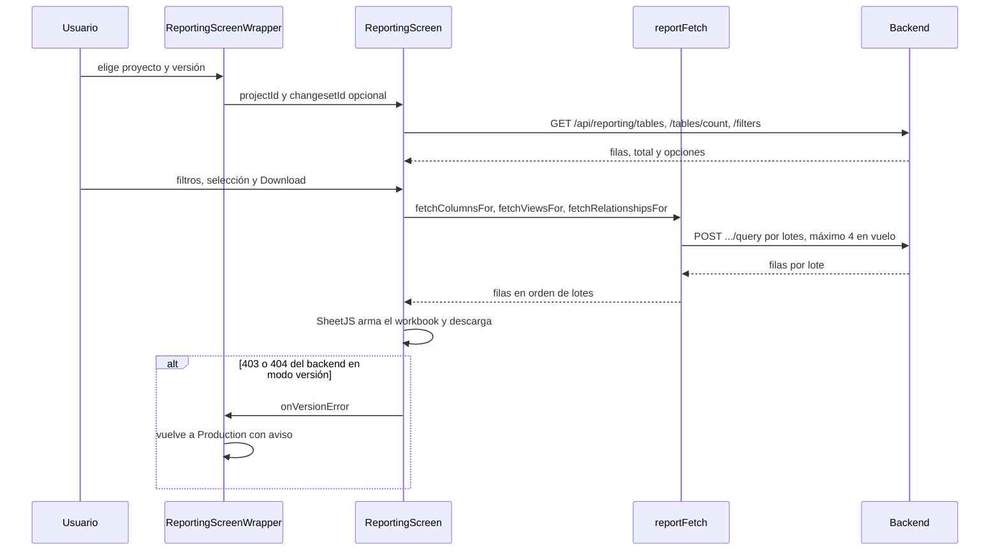

## Export DDL

El Export DDL genera el SQL a partir del diagrama ya cargado en el canvas (estado efectivo, drafts
incluidos) y no vuelve a pedir el modelo. El render en el backend solo interviene cuando hay DDL Export
Rules seleccionadas.

1. **Export DDL** de la Toolbar abre `ExportDdlModal` (`src/features/ddl/components/ExportDdlModal.tsx`).
   Las vistas son las miembro del canvas (`canvasDdlViews(diagram)`). «Tables to export» arranca sin
   ninguna tabla elegida.
2. Al abrir pide, con el proyecto de la sesión (`sessionProjectId()`), el catálogo de reglas
   (`GET /api/projects/{pid}/ddl-rules`), las definiciones de UDP (`GET /api/projects/{pid}/udp`) y la
   configuración (`GET /api/projects/{pid}/ddl-rules/config`). `mergeOutputSettings()` completa las Output
   settings guardadas con los valores por defecto; `selectableRules()` deja las reglas habilitadas y
   válidas, todas marcadas.
3. El preview se genera en el navegador: `databricksDdl()` (`generators.ts`) u `oracleDdl()` (`oracle.ts`)
   según el dialecto.
4. Con reglas seleccionadas y dialecto Databricks, **Download .zip** y **Copy** llaman a `renderWithRules()`
   (`rulesBridge.ts`): arma el payload con cada tabla (columnas, `udpValues`, CREATE base) y cada vista, y
   hace `POST /api/projects/{pid}/ddl-rules/render` (permiso `export`). El motor del backend es puro: todo
   el contexto viaja en el cuerpo. `assemble()` arma el SQL final con el sello `-- Export rules: <versión>
   · N applied · M skipped`.
5. Sin reglas, o con Oracle (cuyas reglas no aplican), el export no pasa por el backend.
6. **Download .zip** arma un `.zip` en el navegador (`ddlExportBundle.ts` y `src/lib/zip.ts`) con un `.sql` por
   objeto; **Copy** copia un solo SQL concatenado.

Las reglas y las Output settings se editan en Data Standards; el detalle de la generación está en
[Funcionalidades](05-funcionalidades.md).

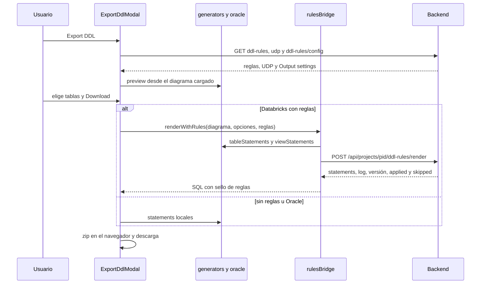

## Carga desde Excel

La carga masiva escribe en la working copy abierta. Los jobs viven en el backend bajo el changeset
(`/api/changesets/{cs}/uploads`); el front envía el workbook crudo y hace polling. El popup es
`UploadModal` (`src/features/upload/components/UploadModal.tsx`) y el servicio, `upload.service.ts`.

### Fases

`idle → parsed → validating → validated → applying → arranging → done`, con las salidas `failed` y
`unconfirmed`.

1. **Lectura**: `readWorkbook()` (`lib/parseWorkbook.ts`) lee todas las hojas en el navegador.
2. **Destino**: `GET /api/changesets/{cs}/uploads/targets` dice si el proyecto exige elegir un proyecto
   interno de destino.
3. **Validate**: `startUpload(cs, { fileName, profileId, sheets, targetFolderId })` →
   `POST /api/changesets/{cs}/uploads`, y `pollUploadJob()` hasta un estado terminal (cada 800 ms). El
   backend aplica el perfil de carga y devuelve el reporte. **Upload** solo se habilita con cero errores.
4. **Apply**: antes de empezar, si hay una inversa del Undo en vuelo, no se empieza. La pila de Undo se
   vacía y queda cerrada para esa versión hasta que la carga termine (`clear({ until })`). Luego
   `POST /api/changesets/{cs}/uploads/{job}/apply` y polling hasta `applied` o `failed`.
5. **Ubicación**: con `affectedCanvasIds` y `newMembers` del resultado, `placeUploadedObjects()` ubica solo
   lo que entró a cada canvas (en el centro de lo visible si es el canvas abierto) con
   `setSubjectAreaLayout`, que mezcla posiciones: lo existente no se mueve. No se reacomodan canvases
   completos.
6. **Cierre**: marca lo nuevo para pintarlo encima (`markFresh`), vacía el Undo, refresca el Explorer (que
   reabre el canvas) y avisa «Uploaded …».

### Resiliencia

- **Polling**: un fallo transitorio (status 0 o 5xx) se reintenta con espera creciente; tras 10 seguidos se
  rinde. Un 404 en el polling indica que el job ya no existe (por ejemplo, tras un reinicio del backend) y
  hay que validar de nuevo.
- **Apply sin respuesta**: el servidor pudo recibirlo. Lo decide el polling: si el job sigue `validated`
  tras unas relecturas, se descarta con `DELETE …/uploads/{job}?status=validated` (un 409 indica que la
  carga sí empezó y se sigue su polling).
- **Resultado no confirmado**: si el polling del apply se rinde o recibe 401 o 403, la fase es
  `unconfirmed` y no `failed`: «Couldn't confirm the result of the upload: … It may still be applied —
  check the model before continuing.».
- **Versión de la carga**: la ubicación corre con un pin propio que sigue la versión, no la época de la
  sesión (`inVersion`): con otra versión abierta corta antes de escribir; al volver a la misma, no salta
  canvases. Con otra versión abierta, el resultado se avisa nombrando la versión de la carga.
- **Cerrar el popup**: descarta un job validado y no aplicado. Mientras aplica o ubica, el popup no se
  cierra con su botón y, si otra cosa lo desmonta, la carga sigue y avisa con un toast (incluidos los
  canvases que no se pudieron ubicar).

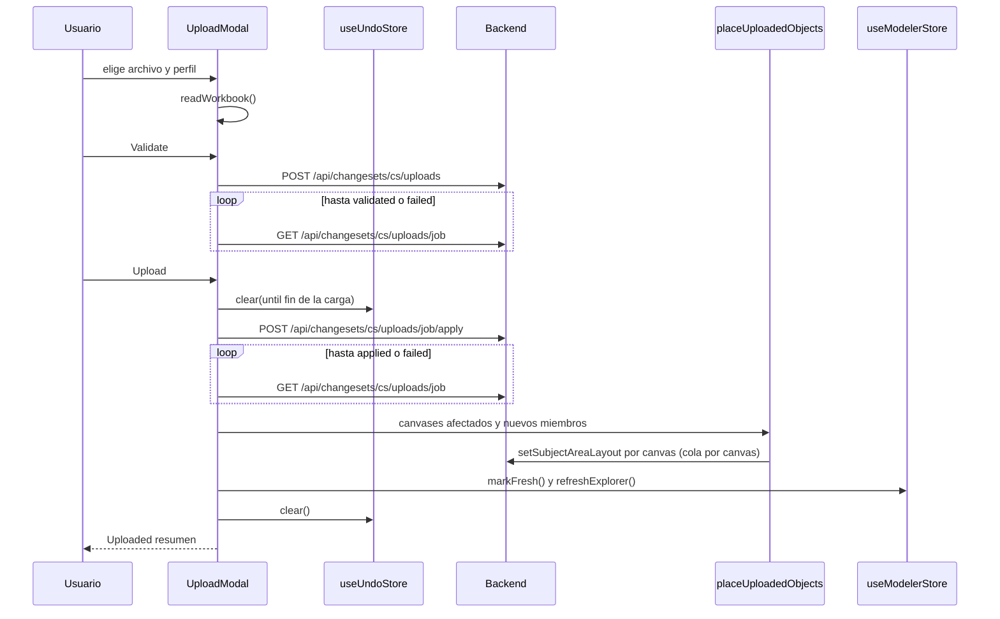

## Documentos relacionados

- [Arquitectura](02-arquitectura.md): capas del front, `server.mjs`, routing y stores a alto nivel.
- [Estructura del proyecto](03-estructura-del-proyecto.md): dónde vive cada archivo citado.
- [Funcionalidades](05-funcionalidades.md): cada pantalla y feature en detalle.
- [Integración con la API](07-integracion-con-la-api.md): cliente HTTP y tabla de servicios y endpoints.
- [Seguridad](08-seguridad.md): un solo origen, relay SSO, token de servicio y control de acceso en la UI.
- [Pruebas](10-pruebas.md): pruebas del store que cubren estos flujos.
- [Consideraciones técnicas](12-consideraciones-tecnicas.md): ELK, LOD, virtualización y límites conocidos.
