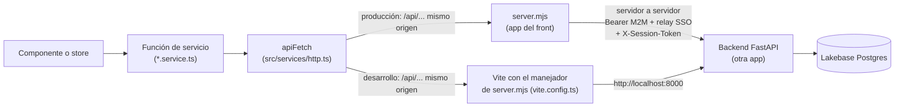
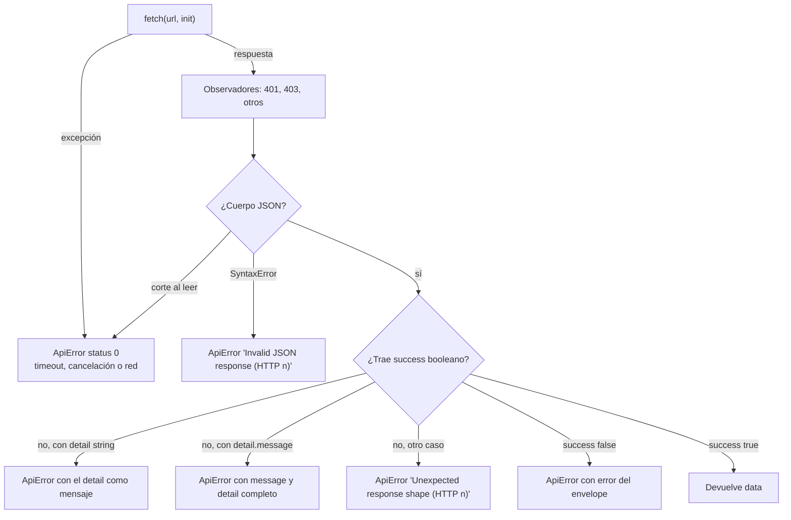

# Integración con la API

Este documento describe cómo la web de Data Model Hub se comunica con el backend: el cliente HTTP
(`src/services/http.ts`), la base de las URL (`src/services/apiBase.ts`), el warm-up de sesión
(`src/services/warmup.ts`), las cabeceras que viajan en cada request, la lectura del envelope y de los
errores, los tiempos de espera y reintentos, los errores propios del proxy de la plataforma y la tabla
completa que relaciona cada función de servicio con su endpoint del backend. Está dirigido a quien
agrega o modifica una llamada a la API, o diagnostica un error que la UI muestra en un aviso.

El contrato del lado del servidor (convenciones, permisos y detalle de cada endpoint) está en la
documentación del backend: `docs/07-api.md` y `docs/08-seguridad.md` del repositorio
`backend-data-model-hub`.

## Contenido

- [Panorama](#panorama)
- [Base de las URL](#base-de-las-url)
- [Cliente HTTP](#cliente-http)
- [Envelope y errores](#envelope-y-errores)
- [Respuestas 403 de alcance y visibilidad](#respuestas-403-de-alcance-y-visibilidad)
- [Tiempos de espera y reintentos](#tiempos-de-espera-y-reintentos)
- [Errores de infraestructura del proxy](#errores-de-infraestructura-del-proxy)
- [Parámetros transversales: proyecto y versión](#parámetros-transversales-proyecto-y-versión)
- [Tabla maestra service → endpoint](#tabla-maestra-service--endpoint)
- [Endpoints por pantalla](#endpoints-por-pantalla)
- [Contratos de tipos](#contratos-de-tipos)
- [Cómo agregar una llamada](#cómo-agregar-una-llamada)
- [Documentos relacionados](#documentos-relacionados)

## Panorama

Toda llamada a la API sale de una función de servicio (`src/services/*.service.ts` o
`src/features/*/…service.ts`) y pasa por `apiFetch` de `src/services/http.ts`. Los componentes y los
stores nunca llaman a `fetch` directamente; las dos únicas excepciones son la sonda de
`src/services/warmup.ts` y un buscador de tablas del editor de reglas DDL, que usa `apiGet` desde el
componente (`src/features/standards/components/DdlRuleEditor.tsx`).

El diagrama muestra el camino de un request en producción y en desarrollo. En ambos casos el
navegador habla con un solo origen y las URL son relativas (`/api/...`).



## Base de las URL

`src/services/apiBase.ts` exporta una constante única:

```ts
export const API_BASE: string = import.meta.env.VITE_API_URL ?? '';
```

Todas las funciones de servicio arman sus URL como `` `${API_BASE}/api/...` ``.

| Entorno | `VITE_API_URL` | Resultado |
|---|---|---|
| Producción (Databricks Apps) | No se define en el build | URL relativas `/api/...`; `server.mjs` sirve la SPA y reenvía `/api/*` al backend servidor a servidor. |
| Desarrollo (`npm run dev`) | No se define | URL relativas; `vite.config.ts` reenvía `/api` a `http://localhost:8000` (o a `BACKEND_API_URL`) con el manejador de `server.mjs`, con la misma cookie de sesión. |
| Front local contra otro backend | URL del backend (sin `/` final) | El navegador llama directamente a ese origen; se aplica CORS y entra en juego el warm-up de sesión. El backend entrega el token en el cuerpo y el front lo guarda en memoria (recargar pide entrar de nuevo). |

En producción `VITE_API_URL` no se define a propósito: si se definiera, el navegador cruzaría al
dominio del backend y chocaría con el SSO propio de esa app (cada Databricks App tiene su propio
muro SSO por subdominio y la cookie no se comparte). El detalle de `server.mjs` está en
[Arquitectura](02-arquitectura.md) y en [Seguridad](08-seguridad.md).

## Cliente HTTP

### `apiFetch` y atajos

`apiFetch<T>(url, opts)` hace el request, desempaqueta el envelope y devuelve `data` tipado como `T`.
Cualquier otra situación (red caída, timeout, 4xx/5xx, envelope inválido) termina en una excepción
`ApiError`. Los atajos fijan el método:

| Función | Método | Body |
|---|---|---|
| `apiGet<T>(url, opts?)` | GET | No |
| `apiPost<T>(url, body?, opts?)` | POST | Opcional |
| `apiPut<T>(url, body?, opts?)` | PUT | Opcional |
| `apiDelete<T>(url, opts?)` | DELETE | No |

`apiFetch` acepta además `PATCH`, aunque ningún servicio lo usa. Las opciones (`RequestOptions`) son:

| Opción | Uso |
|---|---|
| `method` | Método HTTP (por defecto `GET`). |
| `body` | Si es string se envía tal cual; si no, se serializa con `JSON.stringify` y se agrega `Content-Type: application/json`. |
| `headers` | Cabeceras adicionales; se aplican después de las del cliente. |
| `signal` | `AbortSignal` del llamador (por ejemplo, la limpieza de un `useEffect`); se combina con el timeout mediante `AbortSignal.any`. |
| `timeoutMs` | Timeout de la llamada; por defecto `DEFAULT_TIMEOUT_MS` (30 s). |

### Cabeceras y credenciales

| Cabecera | Cuándo viaja | Origen |
|---|---|---|
| Cookie de sesión | En toda llamada al mismo origen | La fija `server.mjs` en el login y en cada renovación (HttpOnly: el JavaScript no la lee ni la envía a mano); `server.mjs` la pasa al backend como `X-Session-Token`. |
| `X-Requested-With: XMLHttpRequest` | En toda llamada a `/api/` del mismo origen | `apiFetch`. `server.mjs` lo exige en las escrituras que usan la cookie (CSRF). |
| `X-Session-Token` | Solo con un token en memoria (front apuntado a otro origen, o `SESSION_COOKIE=false`) | `setAuthToken(token)`, llamado por `src/store/useAuthStore.ts` cuando la respuesta de login o de renovación trae el token y (con cadena vacía) al cerrar la sesión. |
| `X-Dev-User` | Solo en desarrollo (`import.meta.env.DEV`) y si hay usuario simulado | `setDevUser(id)`, llamado por `src/store/useSessionStore.ts`; `src/store/resetAppState.ts` lo limpia. |
| `Content-Type: application/json` | Cuando hay body | `apiFetch`. |

Hacia el backend, el token de sesión viaja en `X-Session-Token` y no en `Authorization: Bearer`: en
Databricks Apps la cabecera `Authorization` la consume el proxy SSO de la plataforma, y además `server.mjs`
la descarta y pone la suya (el token M2M de su service principal). El backend acepta el token en cualquiera de las
dos cabeceras; `Authorization` sirve para pruebas con `curl` o en local. `X-Dev-User` no se envía en
producción porque el backend con `REQUIRE_AUTH` lo ignora y su presencia solo complicaría el preflight
CORS cuando el front apunta a otro origen.

Todos los requests usan `credentials: 'include'` para que, con `VITE_API_URL` apuntando a otro
origen, el navegador envíe y acepte la cookie de sesión del proxy de la plataforma.

### Observadores globales

`http.ts` no conoce el router ni los stores. Expone cuatro registros que la aplicación configura al
arrancar:

| Registro | Quién lo configura | Cuándo se dispara | Efecto |
|---|---|---|---|
| `setAuthToken` | `useAuthStore` | — | Fija el valor de `X-Session-Token` (solo con un token en memoria). |
| `setOnUnauthorized` | `useAuthStore` | Cualquier respuesta 401 | Si la sesión estaba activa: detiene la renovación (`sessionKeeper`), reinicia el estado de la app (`resetAppState`) y deja el store en `anon` con el aviso de sesión terminada; el guard de rutas lleva a `/login`. |
| `setOnForbidden` | `useAuthStore` | Respuesta 403 de una ruta fuera de `/api/auth/` | Vuelve a leer `GET /api/auth/me` (con un intervalo mínimo entre lecturas) para reflejar un rol o permisos cambiados en Admin. |
| `setOnApiError` | `WorkspaceScreen` | Respuesta no exitosa distinta de 401 | El canvas revalida la versión abierta si un 403, 404 o 409 corresponde a esa versión (otra sesión pudo transferirla o eliminarla). |

Los observadores solo observan: un error dentro de ellos se ignora y la excepción que recibe el
llamador es siempre la misma. Con un 401 el cliente también lanza `ApiError`, para que el llamador no
continúe con datos vacíos.

### `ApiError` y auxiliares

`ApiError` extiende `Error` con tres campos:

| Campo | Contenido |
|---|---|
| `status` | Código HTTP; `0` cuando no hubo respuesta (red, timeout o cancelación). |
| `detail` | `detail` crudo de un `HTTPException` de FastAPI (string u objeto); `null` si no aplica. |
| `url` | URL pedida; el canvas la usa para saber si el error es de su versión. |

Auxiliares exportados por `http.ts`:

| Función | Uso |
|---|---|
| `apiErrorMessage(e, fallback)` | Mensaje legible del error (el `detail` del backend si vino) o `fallback`. |
| `errorReason(e, fallback)` | El mismo mensaje sin el consejo «try again…» ni punto final, para avisos que ya incluyen su propio botón de reintento. |
| `isTransientError(e)` | `true` con `status` 0 o ≥ 500: reintentar puede funcionar. |
| `isConflictError(e)` | `true` con 409 (conflicto de negocio, por ejemplo un nombre duplicado). |
| `NETWORK_ERROR_TEXT` | Texto del aviso cuando no hubo respuesta del servidor. |
| `LONG_TIMEOUT_MS` | Timeout de las acciones largas (120 s). |

Algunos servicios leen `ApiError.detail` estructurado: `publishBlockedDetail` (`versioning.service.ts`)
extrae `{code, message, items, next}` de un publish bloqueado (409 o 422 al aprobar, y el 409
`deleted_in_production` al enviar, que `discardDeleted` resuelve) y
`profileProblemsOf` (`upload.service.ts`) extrae `problems` del 422 de un perfil de carga.

## Envelope y errores

Las respuestas exitosas del backend usan el envelope `{success: true, data}` (función `ok` de
`app/core/api/envelope.py`). Los errores llegan con otras formas: un `HTTPException` de FastAPI
responde `{detail}`, el handler de excepciones no controladas responde
`{success: false, error}` con estado 500, y el proxy de la plataforma puede responder HTML. El tipo
del envelope en el front es `ApiResponse<T>` de `src/types/api.ts`:

```ts
export interface ApiResponse<T> {
  success: boolean;
  data?: T;
  error?: string;
}
```

El diagrama resume cómo `apiFetch` convierte cada caso en un resultado o en un `ApiError`.



| Respuesta | Resultado |
|---|---|
| `{success: true, data}` | Se devuelve `data` (aunque el estado sea 201 o 202). |
| `{success: false, error}` | `ApiError(error)` con el estado HTTP; si falta `error`, `Request failed (HTTP n)`. |
| `{detail: "texto"}` con estado de error | `ApiError("texto")`; `detail` queda en `ApiError.detail`. |
| `{detail: {message, …}}` con estado de error | `ApiError(message)`; el objeto completo queda en `ApiError.detail`. |
| JSON sin `success` en otro caso (por ejemplo `{}`) | `ApiError("Unexpected response shape (HTTP n)")`. |
| Cuerpo que no es JSON (HTML del proxy, cuerpo vacío) | `ApiError("Invalid JSON response (HTTP n)")`. |
| Sin respuesta | `ApiError` con `status` 0 y un texto según la causa (ver la tabla siguiente). |

| Causa sin respuesta | Mensaje |
|---|---|
| Venció el timeout de la llamada | `The server didn't respond within Ns — try again in a moment.` |
| El llamador canceló (su `signal`) | El mensaje del aborto; nadie lo muestra. |
| Red caída, DNS, CORS o preflight rechazado | `NETWORK_ERROR_TEXT` («Couldn't reach the server — check your connection or reload the page.»). |

Los textos de los avisos están en inglés porque son parte de la UI. Los mensajes `detail` del backend
también están en inglés y se muestran tal cual en los toasts.

## Respuestas 403 de alcance y visibilidad

El backend responde 403 con `{detail}` en estos casos, y la interfaz los maneja así:

| Caso | Mensaje del backend | Manejo en la interfaz |
|---|---|---|
| Proyecto fuera del alcance del usuario (ruta, query o cuerpo con un proyecto, versión o entidad no asignados) | `You don't have access to this project. Ask an administrator to assign it to you.` | Se muestra el mensaje y `refreshMe()` relee `/me`. Las listas de proyectos, versiones y requests ya llegan filtradas por alcance, por lo que el caso aparece solo con un enlace o un estado desactualizado. |
| Rol sin `model.view` | `Your role can't view models (model.view).` | Se muestra el mensaje y se relee `/me`. |
| Usuario borrado o deshabilitado con un token vigente | `Your access to the platform was removed or disabled…` | `refreshMe()` encuentra la sesión sin permisos, la cierra y muestra el aviso de acceso revocado. La renovación de ese usuario recibe 401 con `code: access_revoked`, con el mismo aviso. |
| Contenido de una versión no publicada ajena (cabecera, diff, detalle del diff, comentarios) | Mensaje del backend | Review no pide ese detalle: decide con la fila de la lista (`canOpenVersion`) y muestra el aviso de visibilidad. Si igual llega un 403, se muestra el mensaje. |
| Crear un proyecto con proyectos asignados (sin `admin.manage`) | Mensaje del backend | **New project** ya está deshabilitado con el motivo (`newProjectBlock`). |

Dos validaciones relacionadas responden 400, no 403: enviar a revisión con un revisor que no accede al
proyecto (`Reviewer(s) without access to this project: …`) y transferir un draft a un usuario sin acceso
al proyecto (`That user can't receive the version: they don't have access to this project.`). Los
selectores de revisores y de destino evitan ambos casos porque piden `/api/users` con el `projectId` de la
versión.

## Tiempos de espera y reintentos

`fetch` no tiene timeout propio; sin uno, un backend colgado dejaría la UI con indicadores de carga
indefinidos. Cada llamada lleva su timeout:

| Timeout | Valor | Llamadas |
|---|---|---|
| `DEFAULT_TIMEOUT_MS` | 30 s | Todas las que no indican otro. |
| `INVENTORY_TIMEOUT_MS` | 60 s | `projectInventory` (inventario del Explorer en una sola request). |
| `LONG_TIMEOUT_MS` | 120 s | `createProject`, `snapshot`, `submit`, `review`, `rollbackVersion`, `applyStandards` (y las mutaciones de reglas DDL que pasan por él) y `rollbackStandards`. |
| Proxy de `server.mjs` | 120 s | Tope del request servidor a servidor hacia el backend; al vencer responde 502. |

El cliente no reintenta por su cuenta. Los reintentos existen solo donde la operación es idempotente
o se puede verificar:

- `pollUploadJob` (`src/features/upload/upload.service.ts`) consulta el job de carga Excel cada
  800 ms hasta un estado terminal (`validated`, `applied`, `failed`). Un error transitorio
  (`isTransientError`) se reintenta con espera creciente hasta 10 veces seguidas; un 404 u otro error
  se propaga.
- `server.mjs` reintenta una sola vez un `GET` o `HEAD` cuando el backend responde 401 o 403 con un
  token M2M vigente: invalida el token, acuña uno nuevo y repite. Los métodos con body no se reintentan
  (el body ya se consumió).
- Las escrituras del canvas pasan por una cola por canvas (`structure.service.ts`): un guardado que
  falla avisa a quien lo pidió y no bloquea al siguiente. Como cada request tiene timeout, la cola no
  puede quedar detenida.

Los avisos con botón **Retry** de la UI reintentan a pedido del usuario; `errorReason` arma su texto.

## Errores de infraestructura del proxy

Entre el navegador y el backend hay dos piezas que pueden responder sin que el backend llegue a
procesar el request.

**`server.mjs` (app del front).** Responde con JSON `{detail}`, que `apiFetch` convierte en un
`ApiError` con ese texto:

| Estado | `detail` | Causa |
|---|---|---|
| 502 | `BACKEND_API_URL is not configured.` | Falta la variable con la URL del backend. |
| 502 | `Backend authorization unavailable.` | No se pudo acuñar el token OAuth M2M del service principal. |
| 502 | `Backend unreachable.` | Error de conexión o timeout hacia el backend. |

**Proxy de Databricks Apps.** Antes de entregar el request a una app, la plataforma valida la sesión
SSO del usuario. Sus respuestas no siguen el envelope:

| Situación | Lo que ve el front |
|---|---|
| Sesión SSO de la plataforma vencida en el dominio del front | Respuesta HTML o 401/403 propios. Un cuerpo HTML se reporta como `Invalid JSON response (HTTP n)`; un 401 dispara además el cierre de sesión de la app. Recargar la página renueva el SSO. |
| `VITE_API_URL` apunta a otro origen y no hay sesión con ese dominio | El proxy del backend responde sin cabeceras CORS y el navegador lo reporta como fallo de red (`status` 0). Lo resuelve el warm-up. |
| El service principal del front no tiene permiso `CAN_USE` sobre la app backend | 401/403 del proxy del backend en todas las llamadas. Es un problema de configuración del despliegue ([Despliegue](09-despliegue.md)). |

### Warm-up de sesión

`ensureBackendSession` (`src/services/warmup.ts`) se ejecuta al montar la pantalla de login
(`src/features/auth/LoginScreen.tsx`). Solo actúa cuando `API_BASE` no está vacío, es decir, cuando el
front llama a un backend en otro origen:

1. Hace `GET {API_BASE}/api/health` con `credentials: 'include'`. Cualquier respuesta HTTP indica que
   hay sesión con el dominio del backend.
2. Si `fetch` falla sin respuesta legible, hace una navegación de nivel superior a
   `{API_BASE}/api/auth/warmup/{token}`, donde `token` es la URL actual en base64url sin relleno. En
   esa navegación el proxy de la plataforma completa el SSO, deja su cookie y el backend redirige de
   vuelta a la URL original, solo si su origen está en el allowlist de CORS del backend (de lo
   contrario responde 400 y no actúa como redirección abierta). La URL de retorno va en la ruta y no en un query string porque la
   reproducción del request después del SSO no conserva bien los query strings.
3. Una marca en `sessionStorage` (`dmh-warmup-redirected`) evita un bucle de redirecciones: si al
   volver la sonda sigue fallando, no se redirige de nuevo y el login muestra su error normal.

Con `API_BASE` vacío (producción y desarrollo normales) el warm-up no hace nada.

## Parámetros transversales: proyecto y versión

Dos conceptos atraviesan casi todas las llamadas.

**Proyecto.** Las lecturas y configuraciones por proyecto llevan el id en la ruta
(`/api/projects/{project_id}/...`). Algunos servicios lo reciben como argumento y otros lo toman de la
sesión con `sessionProjectId()` (`governance.service.ts`, `schemas.service.ts`). Reporting lo envía
como query `projectId`.

**Versión activa (`changesetId`).** El store de sesión (`useSessionStore`) guarda
`activeChangesetId`: el draft abierto en edición, una versión abierta en solo lectura o `null` para
producción.

- Sin versión activa, los servicios leen el catálogo publicado (`/api/projects/{id}/catalog/...`,
  `/api/catalog/...`, `/api/views`, `/api/relationships`).
- Con versión activa, las lecturas pasan a `GET /api/changesets/{cs_id}/effective/{collection}`
  (producción más el overlay del draft) o agregan `?changesetId=` a las rutas que lo admiten
  (`loadDiagram`, `inspectTable`, `inspectView`, `tableUsage`, Explorer y Reporting).
- Un id con prefijo `asof:` (`asOfChangesetId(versionId)`) es una versión virtual que el backend
  resuelve como el modelo exacto de una versión publicada; sirve para abrir en solo lectura una
  versión anterior sin tocar producción. Si no se puede reconstruir, el backend responde 404 o 409
  con `{detail}`.

**Escrituras versionadas.** Las entidades versionadas (`projects`, `folders`, `subject_areas`,
`schemas`, `canonical_tables`, `canonical_columns`, `relationships`, `views`) no tienen endpoints de
creación o edición propios. Toda escritura es un cambio dentro del draft:
`PUT /api/changesets/{cs_id}/changes` o `PUT /api/changesets/{cs_id}/changes/bulk`, con
`{collection, entityId, op, payload}`. Por eso funciones como `createTable`, `updateColumn`,
`createView`, `createFolder` o `setSubjectAreaLayout` aparecen en la tabla maestra como usos de
`recordChange`. Solo se escribe con la sesión en modo edición (`openMode === 'editing'`); en otro
caso el servicio rechaza la operación antes de llamar a la API. Las operaciones de esquema que afectan
a varias entidades (`kind`, `rename`, `delete`, `impact`) tienen rutas propias bajo
`/api/changesets/{cs_id}/schemas/{schema_id}/...`.

Los estándares (glosario, dominios, UDP, naming, reglas DDL, themes) no se versionan con el draft del
modelo: se escriben con `POST /api/projects/{project_id}/standards/apply`, que crea una versión del
historial de Data Standards.

## Tabla maestra service → endpoint

Las tablas siguientes listan, por archivo, cada función que llama a la API. La columna «Permiso en el
backend» refleja las dependencias de la ruta en FastAPI:

- **Pública**: no exige sesión de la aplicación (salud, login, login SSO y warm-up); su acceso depende
  del perímetro de la plataforma (el proxy de Databricks Apps y `server.mjs`).
- **Sesión**: exige solo la sesión propia (`/me` y logout).
- **Control común**: el control que el backend monta en todas las rutas de datos: sesión válida,
  usuario vigente (ni borrado ni deshabilitado), permiso `model.view` y alcance por proyecto
  (`projectIds`).
- **`permiso`**: el control común más ese permiso del rol (en las rutas con guardia de escritura, las
  lecturas GET solo exigen el control común y las escrituras exigen el permiso). Las rutas de
  `/api/admin/*` exigen sesión y `admin.manage`.

Las rutas se escriben con los nombres de parámetro del backend. El permiso exacto y el detalle de cada
ruta se mantienen en `docs/07-api.md` y `docs/08-seguridad.md` del backend.

### `src/services/projects.service.ts`

| Función | Método | Endpoint | Permiso en el backend | Uso |
|---|---|---|---|---|
| `listProjects` | GET | `/api/projects` | Control común | Lista los proyectos visibles para el usuario. |
| `createProject` | POST | `/api/projects` | `model.edit` | Crea un proyecto; con `copyFrom` copia bloques de Data Standards de otro proyecto (timeout largo). |
| `getProjectCounts` | GET | `/api/projects/{project_id}/counts` | Control común | Conteos de activos del proyecto (tablas, vistas, relaciones, canvases). |

### `src/services/themes.service.ts`

| Función | Método | Endpoint | Permiso en el backend | Uso |
|---|---|---|---|---|
| `listThemes` | GET | `/api/projects/{project_id}/themes` | Control común | Themes de color del proyecto. |

### `src/services/dashboard.service.ts`

| Función | Método | Endpoint | Permiso en el backend | Uso |
|---|---|---|---|---|
| `getSummary` | GET | `/api/summary` | Control común | Resumen del Home (conteos y versiones), filtrable por `projectId` repetido. |

### `src/services/changeset.service.ts`

| Función | Método | Endpoint | Permiso en el backend | Uso |
|---|---|---|---|---|
| `recordChange` | PUT | `/api/changesets/{cs_id}/changes` | `model.edit` | Registra un cambio (`upsert`/`delete`) de una entidad en el draft. |
| `recordChangesBulk` | PUT | `/api/changesets/{cs_id}/changes/bulk` | `model.edit` | Registra un lote de cambios; el cliente parte la lista en trozos de 1000. |
| `effective` | GET | `/api/changesets/{cs_id}/effective/{collection}` | Control común | Estado efectivo de una colección en la versión (producción + overlay del draft); admite `tableId`, `tableIds`, `ids`, `q`, `limit`, `schema`. |
| `entityHistory` | GET | `/api/changesets/history/{collection}/{entity_id}` | Control común | Historial de una tabla, columna o vista derivado de las versiones publicadas. |

### `src/services/versioning.service.ts`

| Función | Método | Endpoint | Permiso en el backend | Uso |
|---|---|---|---|---|
| `listVersions` | GET | `/api/versions` | Control común | Versiones (changesets), opcionalmente de un proyecto. |
| `getPublished` | GET | `/api/projects/{project_id}/versions/published` | Control común | Versión publicada vigente del proyecto (o `null`). |
| `listRequests` | GET | `/api/requests` | Control común | Solicitudes en revisión, filtrables por `reviewer` y `owner`. |
| `snapshot` | POST | `/api/changesets/snapshot` | `model.edit` | Crea un draft (working copy) a partir de producción (timeout largo). |
| `listUsers(can, projectId)` | GET | `/api/users` | Control común | Usuarios activos para selectores: `can=<permiso>` filtra por permiso y `projectId=<id>` deja solo a quienes acceden a ese proyecto. Lo usan el selector de revisores (`can=review.decide`) y el de destino de una transferencia (`can=model.edit`), ambos con el proyecto de la versión. |
| `listUserNames` | GET | `/api/users` | Control común | Usuarios incluidos los deshabilitados (`includeDisabled=true`), para resolver nombres. |
| `submit` | POST | `/api/changesets/{cs_id}/submit` | `model.edit` | Envía el draft a revisión (publish request) (timeout largo). |
| `getChangeset` | GET | `/api/changesets/{cs_id}` | Control común | Cabecera y detalle de una versión. |
| `getDiff` | GET | `/api/changesets/{cs_id}/diff` | Control común | Diff estructurado por colección. |
| `getDiffDetails` | POST | `/api/changesets/{cs_id}/diff/details` | Control común | Diff campo a campo de un lote de entidades. |
| `review` | POST | `/api/changesets/{cs_id}/review` | `review.decide` | Aprueba (publica) o rechaza una solicitud (timeout largo). |
| `rollbackVersion` | POST | `/api/changesets/{cs_id}/rollback` | `rollback` | Crea un draft que restaura el modelo a una versión publicada (timeout largo). |
| `addComment` | POST | `/api/changesets/{cs_id}/comments` | Control común | Agrega un comentario a la versión. |
| `compareVersions` | GET | `/api/versions/compare` | Control común | Compara dos versiones (`from`, `to`). |
| `compareVersionDetails` | POST | `/api/versions/compare/details` | Control común | Detalle campo a campo de la comparación. |
| `withdraw` | POST | `/api/changesets/{cs_id}/withdraw` | `model.edit` | Retira una solicitud de revisión y la devuelve a draft. |
| `reopen` | POST | `/api/changesets/{cs_id}/reopen` | `model.edit` | Reabre una versión rechazada como draft. |
| `transferVersion` | POST | `/api/changesets/{cs_id}/transfer` | Control común | Transfiere un draft a otro usuario. |
| `deleteVersion` | DELETE | `/api/changesets/{cs_id}` | Control común | Elimina un draft con todos sus cambios; con `expectedOwner` solo borra si el dueño actual coincide. |

### `src/services/governance.service.ts`

| Función | Método | Endpoint | Permiso en el backend | Uso |
|---|---|---|---|---|
| `physicalize` | POST | `/api/projects/{project_id}/glossary/physicalize` | Control común | Traduce un nombre lógico a físico con el glosario del proyecto. |
| `listDomains` | GET | `/api/projects/{project_id}/domains` | Control común | Dominios (parent domains) del proyecto. |
| `listTables` | GET | `/api/projects/{project_id}/catalog/tables` | Control común | Tablas del catálogo publicado (sin versión activa). |
| `searchTables` | GET | `/api/projects/{project_id}/catalog/tables` | Control común | Búsqueda de tablas por nombre (`q`, `limit`, `schema`). |
| `searchModel` | GET | `/api/projects/{project_id}/catalog/search` | Control común | Buscador del Model: tablas, columnas y definiciones. |
| `listColumns` | GET | `/api/catalog/tables/{table_id}/columns` | Control común | Columnas publicadas de una tabla. |
| `listRelationships` | GET | `/api/relationships` | Control común | Relaciones publicadas, opcionalmente de una tabla. |
| `tableUsage` | GET | `/api/catalog/tables/{table_id}/usage` | Control común | Canvases donde aparece una tabla (con `changesetId`, incluye el overlay del draft). |
| `tableLinks` | GET | `/api/relationships/links` | Control común | Relaciones de una tabla en todos los canvases. |
| `columnImpact` | GET | `/api/relationships/impact` | Control común | Relaciones afectadas por una columna. |

### `src/services/naming.service.ts`

| Función | Método | Endpoint | Permiso en el backend | Uso |
|---|---|---|---|---|
| `validateTerm` | POST | `/api/projects/{project_id}/glossary/validate` | Control común | Valida un término contra el glosario. |
| `glossaryImpact` | POST | `/api/projects/{project_id}/glossary/impact` | Control común | Impacto de un cambio de glosario sobre el modelo. |
| `lockTerm` | POST | `/api/projects/{project_id}/glossary/{entry_id}/lock` | `admin.manage` | Bloquea un término del glosario. |
| `unlockTerm` | POST | `/api/projects/{project_id}/glossary/{entry_id}/unlock` | `admin.manage` | Desbloquea un término del glosario. |
| `getNamingConfig` | GET | `/api/projects/{project_id}/settings/naming` | Control común | Configuración de naming del proyecto. |
| `physicalize` | POST | `/api/projects/{project_id}/glossary/physicalize` | Control común | Traduce un nombre lógico a físico con el glosario (`scope` table/column). |
| `listDomainsGlobal` | GET | `/api/projects/{project_id}/domains` | Control común | Dominios completos del proyecto (pantalla Data Standards). |
| `getDomainColumnImpact` | GET | `/api/projects/{project_id}/domains/{domain_id}/impact/columns` | Control común | Columnas afectadas por un dominio. |

### `src/services/reporting.service.ts`

| Función | Método | Endpoint | Permiso en el backend | Uso |
|---|---|---|---|---|
| `listReportFilters` | GET | `/api/reporting/filters` | Control común | Opciones de filtro: esquemas y canvases del alcance. |
| `listReportTables` | GET | `/api/reporting/tables` | Control común | Filas de tablas para la grilla de Reporting. |
| `countReportTables` | GET | `/api/reporting/tables/count` | Control común | Total de tablas del alcance. |
| `listReportColumns` | GET | `/api/reporting/columns` | Control común | Columnas de una tabla o de todo el proyecto. |
| `queryReportColumns` | POST | `/api/reporting/columns/query` | Control común | Columnas de un lote de tablas. |
| `queryReportViews` | POST | `/api/reporting/views/query` | Control común | Vistas derivadas de un lote de tablas. |
| `queryRelationshipsReport` | POST | `/api/reporting/insights/relationships/query` | Control común | Filas de la hoja de relaciones para un lote de tablas. |

### `src/services/views.service.ts`

| Función | Método | Endpoint | Permiso en el backend | Uso |
|---|---|---|---|---|
| `listViews` | GET | `/api/views` | Control común | Vistas publicadas de una tabla (`tableId`). |
| `listViewsForTables` | GET | `/api/views` | Control común | Vistas de varias tablas (`tableIds`, en lotes de 100 ids por request). |
| `tableViews` | GET | `/api/views/for-table` | Control común | Vistas donde participa una tabla. |

### `src/features/auth/auth.service.ts`

| Función | Método | Endpoint | Permiso en el backend | Uso |
|---|---|---|---|---|
| `login` | POST | `/api/auth/login` | Pública | Login local con usuario y contraseña; devuelve `{user, expiresIn}` (el token queda en la cookie). |
| `ssoLogin` | POST | `/api/auth/sso/login` | Pública | Login con la identidad SSO que relaya `server.mjs`; devuelve `{user, expiresIn}`. |
| `refreshSession` | POST | `/api/auth/refresh` | Sesión | Renueva la sesión: token nuevo en la cookie y `{user, expiresIn}`. Lo usan `restore()` al arrancar y `sessionKeeper` con actividad. |
| `logout` | POST | `/api/auth/logout` | Sesión | Cierra la sesión en el backend; `server.mjs` borra la cookie. |
| `fetchMe` | GET | `/api/auth/me` | Sesión | Usuario en sesión con su rol y permisos. |

### `src/features/admin/admin.service.ts`

| Función | Método | Endpoint | Permiso en el backend | Uso |
|---|---|---|---|---|
| `listUsers` | GET | `/api/admin/users` | `admin.manage` | Lista los usuarios registrados. |
| `createUser` | POST | `/api/admin/users` | `admin.manage` | Crea un usuario. |
| `updateUser` | PUT | `/api/admin/users/{username}` | `admin.manage` | Actualiza un usuario (rol, proyectos, estado, contraseña). |
| `deleteUser` | DELETE | `/api/admin/users/{username}` | `admin.manage` | Elimina un usuario. |
| `listRoles` | GET | `/api/admin/roles` | `admin.manage` | Lista los roles. |
| `upsertRole` | PUT | `/api/admin/roles/{key}` | `admin.manage` | Crea o actualiza un rol con su mapa de permisos. |
| `deleteRole` | DELETE | `/api/admin/roles/{key}` | `admin.manage` | Elimina un rol. |
| `getPermissions` | GET | `/api/admin/permissions` | `admin.manage` | Catálogo de permisos. |

### `src/features/modeler/services/modeler.service.ts`

| Función | Método | Endpoint | Permiso en el backend | Uso |
|---|---|---|---|---|
| `listProjects` | GET | `/api/projects` | Control común | Lista los proyectos (árbol del Model). |
| `listFolders` | GET | `/api/projects/{project_id}/folders` | Control común | Carpetas del proyecto. |
| `listSubjectAreas` | GET | `/api/projects/{pid}/subject-areas` | Control común | Canvases del proyecto, opcionalmente de una carpeta (`folderId`). |
| `loadDiagram` | GET | `/api/subject-areas/{sa_id}/diagram` | Control común | Diagrama completo de un canvas (tablas, columnas, relaciones y vistas); con `changesetId` aplica el overlay. |

### `src/features/modeler/services/schemas.service.ts`

| Función | Método | Endpoint | Permiso en el backend | Uso |
|---|---|---|---|---|
| `listSchemas` | GET | `/api/projects/{project_id}/schemas` | Control común | Esquemas publicados del proyecto (con versión activa se usa `effective`). |
| `setSchemaKind` | POST | `/api/changesets/{cs_id}/schemas/{schema_id}/kind` | `model.edit` | Cambia qué contiene un esquema (`tables`, `views`, `both`). |
| `schemaImpact` | GET | `/api/changesets/{cs_id}/schemas/{schema_id}/impact` | Control común | Tablas, vistas y canvases que usan un esquema. |
| `renameSchema` | POST | `/api/changesets/{cs_id}/schemas/{schema_id}/rename` | `model.edit` | Renombra un esquema y propaga el nombre a sus tablas y vistas. |
| `deleteSchema` | POST | `/api/changesets/{cs_id}/schemas/{schema_id}/delete` | `model.edit` | Elimina un esquema en el draft. |

### `src/features/modeler/services/inspector.service.ts`

| Función | Método | Endpoint | Permiso en el backend | Uso |
|---|---|---|---|---|
| `inspectTable` | GET | `/api/catalog/inspect/tables/{table_id}` | Control común | Ficha de una tabla para el Inspector (columnas, links, vistas, uso). |
| `inspectView` | GET | `/api/catalog/inspect/views/{view_id}` | Control común | Ficha de una vista para el Inspector (fuentes, uso). |

### `src/features/modeler/services/explorer.service.ts`

| Función | Método | Endpoint | Permiso en el backend | Uso |
|---|---|---|---|---|
| `explorerViewColumns` | GET | `/api/projects/{project_id}/catalog/views/{view_id}/columns` | Control común | Columnas de una vista para el Explorer. |
| `projectInventory` | GET | `/api/projects/{project_id}/catalog/inventory` | Control común | Inventario del proyecto en una request (timeout de 60 s). |

### `src/features/upload/upload.service.ts`

| Función | Método | Endpoint | Permiso en el backend | Uso |
|---|---|---|---|---|
| `startUpload` | POST | `/api/changesets/{cs_id}/uploads` | `model.edit` | Inicia la validación de un libro Excel (202, job asíncrono). |
| `getUploadJob` | GET | `/api/changesets/{cs_id}/uploads/{job_id}` | `model.edit` | Estado y progreso del job (consultado por `pollUploadJob`). |
| `applyUpload` | POST | `/api/changesets/{cs_id}/uploads/{job_id}/apply` | `model.edit` | Aplica al draft una carga validada (202). |
| `discardUpload` | DELETE | `/api/changesets/{cs_id}/uploads/{job_id}` | `model.edit` | Descarta el job; `status=validated` solo si sigue validado. |
| `getUploadTargets` | GET | `/api/changesets/{cs_id}/uploads/targets` | `model.edit` | Destinos disponibles para la carga (esquemas, canvases). |
| `listProfiles` | GET | `/api/projects/{project_id}/upload-profiles` | `model.edit` | Perfiles de carga del proyecto. |
| `createProfile` | POST | `/api/projects/{project_id}/upload-profiles` | `model.edit` | Crea un perfil de carga. |
| `updateProfile` | PUT | `/api/projects/{project_id}/upload-profiles/{profile_id}` | `model.edit` | Actualiza un perfil de carga. |
| `deleteProfile` | DELETE | `/api/projects/{project_id}/upload-profiles/{profile_id}` | `model.edit` | Elimina un perfil de carga. |
| `setDefaultProfile` | POST | `/api/projects/{project_id}/upload-profiles/{profile_id}/default` | `model.edit` | Marca un perfil como predeterminado. |
| `getProfileCatalog` | GET | `/api/projects/{project_id}/upload-profiles/catalog` | `model.edit` | Catálogo de campos mapeables por hoja. |
| `validateProfile` | POST | `/api/projects/{project_id}/upload-profiles/validate` | `model.edit` | Valida un perfil sin guardarlo. |
| `suggestMappings` | POST | `/api/projects/{project_id}/upload-profiles/suggest` | `model.edit` | Sugiere mapeos de encabezados a campos. |
| `createDefaultProfile` | POST | `/api/projects/{project_id}/upload-profiles/default` | `model.edit` | Crea el perfil base del proyecto. |

### `src/features/standards/standards.service.ts`

| Función | Método | Endpoint | Permiso en el backend | Uso |
|---|---|---|---|---|
| `getSnapshot` | GET | `/api/projects/{project_id}/standards/snapshot` | Control común | Estado vigente de Data Standards (glosario, dominios, UDP, naming, DDL, themes). |
| `getVersions` | GET | `/api/projects/{project_id}/standards/versions` | Control común | Historial de versiones de Data Standards. |
| `getStandardsSummary` | GET | `/api/projects/{project_id}/standards/summary` | Control común | Resumen de Data Standards. |
| `applyStandards` | POST | `/api/projects/{project_id}/standards/apply` | `standards.edit` | Aplica un lote de cambios de estándares como una versión (timeout largo; también lo usan las reglas DDL). |
| `rollbackStandards` | POST | `/api/projects/{project_id}/standards/rollback` | `rollback` | Vuelve los estándares a una versión anterior (timeout largo). |
| `getDomainHistory` | GET | `/api/projects/{project_id}/standards/domains/{domain_id}/history` | Control común | Historial de un dominio. |
| `getRollbackPreview` | GET | `/api/projects/{project_id}/standards/rollback-preview` | Control común | Vista previa del rollback de estándares (`targetSeq`). |
| `getUdpDefs` | GET | `/api/projects/{project_id}/udp` | Control común | Definiciones de UDP del proyecto. |

### `src/features/standards/ddlRules.service.ts`

| Función | Método | Endpoint | Permiso en el backend | Uso |
|---|---|---|---|---|
| `getDdlArtifacts` | GET | `/api/projects/{project_id}/ddl-rules/artifacts` | Control común | Artefactos DDL disponibles. |
| `getDdlTemplates` | GET | `/api/projects/{project_id}/ddl-rules/templates` | Control común | Plantillas del ruleset base. |
| `validateDdlRule` | POST | `/api/projects/{project_id}/ddl-rules/validate` | Control común | Valida una regla DDL. |
| `testDdlRule` | POST | `/api/projects/{project_id}/ddl-rules/test` | Control común | Prueba una regla contra una tabla real. |
| `impactDdlRule` | POST | `/api/projects/{project_id}/ddl-rules/impact` | Control común | Estima las tablas afectadas por una regla. |

### `src/features/standards/components/DdlRuleEditor.tsx`

| Función | Método | Endpoint | Permiso en el backend | Uso |
|---|---|---|---|---|
| (buscador de tablas) | GET | `/api/projects/{project_id}/catalog/tables` | Control común | Buscador de tablas del editor de reglas (`q`, `limit=15`). |

### `src/features/ddl/rulesBridge.ts`

| Función | Método | Endpoint | Permiso en el backend | Uso |
|---|---|---|---|---|
| `fetchExportRules` | GET | `/api/projects/{project_id}/ddl-rules` | Control común | Reglas de export DDL del proyecto. |
| `fetchUdpDefs` | GET | `/api/projects/{project_id}/udp` | Control común | Definiciones de UDP para el export. |
| `fetchDdlConfig` | GET | `/api/projects/{project_id}/ddl-rules/config` | Control común | Configuración DDL (Output settings). |
| `renderWithRules` | POST | `/api/projects/{project_id}/ddl-rules/render` | `export` | Genera el DDL con el motor de reglas del backend. |

### `src/features/reporting/sheetTemplates.service.ts`

| Función | Método | Endpoint | Permiso en el backend | Uso |
|---|---|---|---|---|
| `listSheetTemplates` | GET | `/api/projects/{project_id}/sheet-templates` | Control común | Plantillas de hoja Excel visibles para el usuario. |
| `createSheetTemplate` | POST | `/api/projects/{project_id}/sheet-templates` | Control común | Crea una plantilla de hoja. |
| `updateSheetTemplate` | PUT | `/api/projects/{project_id}/sheet-templates/{template_id}` | Control común | Actualiza una plantilla de hoja. |
| `deleteSheetTemplate` | DELETE | `/api/projects/{project_id}/sheet-templates/{template_id}` | Control común | Elimina una plantilla de hoja. |
| `createDefaultSheetTemplate` | POST | `/api/projects/{project_id}/sheet-templates/default` | Control común | Crea la plantilla base del proyecto. |

### `src/services/warmup.ts`

| Función | Método | Endpoint | Permiso en el backend | Uso |
|---|---|---|---|---|
| `ensureBackendSession` | GET | `/api/health` | Pública | Sonda de sesión con el dominio del backend (solo con `API_BASE` definido). |
| ensureBackendSession (navegación) | GET | `/api/auth/warmup/{next_b64}` | Pública | Navegación de nivel superior para completar el SSO del backend. |

### Servicios sin llamadas propias

| Archivo | Cómo llega a la API |
|---|---|
| `src/features/modeler/services/structure.service.ts` | Proyectos, carpetas y canvases: lee con `listProjects`/`listFolders`/`listSubjectAreas` o con `effective`, y escribe con `recordChange` sobre `projects`, `folders` y `subject_areas` (renombrar y borrar proyectos, carpetas, canvases, miembros, layout, wires, dibujos, colores y UDP del canvas). |
| `src/features/modeler/services/pasteSource.service.ts` | Usa `getSnapshot` para leer los estándares del proyecto de origen al pegar entre proyectos; un 403 o 404 se interpreta como «sin estándares». |
| `src/features/modeler/services/schemaPartition.ts` | Lógica pura sobre esquemas ya leídos. |

### Endpoints del backend que la web no usa

`GET /api/admin/audit` (permiso `admin.manage`) existe en el backend y ninguna pantalla lo consume.
`GET /api/health` solo lo usa la sonda del warm-up.

Para regenerar la comparación entre las llamadas del front y las rutas del backend se pueden extraer
las URL con `grep -rnE "api(Get|Post|Put|Delete|Fetch)" src --include='*.ts' --include='*.tsx'` y
contrastarlas con la especificación OpenAPI del backend en local (`/openapi.json`, disponible sin
`REQUIRE_AUTH`).

## Endpoints por pantalla

| Pantalla o feature | Servicios | Grupos de endpoints |
|---|---|---|
| Login (`src/features/auth`) | `auth.service.ts`, `warmup.ts` | `/api/auth/*`, `/api/health` |
| Home (`src/screens/HomeScreen.tsx`, `src/screens/home`) | `dashboard.service.ts`, `projects.service.ts`, `versioning.service.ts` | `/api/summary`, `/api/projects`, `/api/versions`, `/api/requests`, `/api/changesets/{id}/rollback`, transferir y eliminar versiones, comparar versiones |
| Model (`src/features/modeler`) | `modeler.service.ts`, `structure.service.ts`, `governance.service.ts`, `changeset.service.ts`, `views.service.ts`, `schemas.service.ts`, `inspector.service.ts`, `explorer.service.ts`, `themes.service.ts`, `naming.service.ts`, `standards.service.ts` | Catálogo publicado (`/api/projects/{id}/catalog/*`, `/api/catalog/*`, `/api/relationships/*`, `/api/views/*`), diagrama (`/api/subject-areas/{id}/diagram`), escrituras y lecturas del draft (`/api/changesets/{id}/*`), glosario y dominios para pegar y validar, UDP y themes |
| Publicación desde el Model | `versioning.service.ts` | `/api/changesets/{id}/submit`, `/api/changesets/{id}`, `/api/users?can=&projectId=` |
| Carga Excel (`src/features/upload`) | `upload.service.ts` | `/api/changesets/{id}/uploads/*`, `/api/projects/{id}/upload-profiles/*` |
| Export DDL (`src/features/ddl`) | `rulesBridge.ts` | `/api/projects/{id}/ddl-rules`, `/ddl-rules/config`, `/ddl-rules/render`, `/udp` |
| Review (`src/screens/ReviewScreen.tsx`, `src/screens/review`) | `versioning.service.ts`, `projects.service.ts` | `/api/versions`, `/api/users`, `/api/changesets/{id}` y sus `diff`, `diff/details`, `review`, `comments`, `withdraw`, `reopen` |
| Reporting (`src/screens/ReportingScreen.tsx`, `src/features/reporting`) | `reporting.service.ts`, `sheetTemplates.service.ts`, `projects.service.ts`, `versioning.service.ts` | `/api/reporting/*`, `/api/projects/{id}/sheet-templates/*` |
| Data Standards (`src/features/standards`) | `standards.service.ts`, `naming.service.ts`, `ddlRules.service.ts` | `/api/projects/{id}/standards/*`, `/glossary/*`, `/domains/*`, `/settings/naming`, `/udp`, `/ddl-rules/*`, búsqueda en `/catalog/tables` |
| Admin (`src/features/admin`) | `admin.service.ts` | `/api/admin/users`, `/api/admin/roles`, `/api/admin/permissions` |

El funcionamiento de cada pantalla está en [Funcionalidades](05-funcionalidades.md) y las secuencias
de llamadas de los flujos principales (abrir un canvas, editar, enviar, revisar, publicar, cargar un
Excel, exportar DDL) en [Flujo de datos](06-flujo-de-datos.md).

## Contratos de tipos

Los tipos de request y response viven en TypeScript junto al código que los usa:

| Ubicación | Contenido |
|---|---|
| `src/types/api.ts` | `ApiResponse<T>` (envelope), `CreateProjectRequest`, `StandardsBlock`. |
| `src/types/model.ts` | Contratos transversales del modelo: `Project`, `Tag`, `SchemaKind`, catálogo de tipos de dato de columna. |
| `src/types/versioning.ts` | Versiones y dashboard: `VersionRow`, `ChangesetDetail`, `ChangesetDiff`, `DashboardSummary`, `ScopeCounts`, cuerpos de `snapshot`, `submit` y `review`, comparación de versiones. |
| Servicios | Formas de cada dominio junto a su servicio: `CanonicalTable`, `CanonicalColumn`, `Relationship`, `ParentDomain` (`governance.service.ts`), `View` (`views.service.ts`), `SubjectArea`, `Folder`, `Drawing` (`modeler.service.ts`), `SessionUser` y `Permission` (`auth.service.ts`), `AdminUser` y `Role` (`admin.service.ts`), perfiles y jobs de carga (`upload.service.ts`), snapshot de estándares (`standards.service.ts`), reportes (`reporting.service.ts`). |

Cada tipo espeja un modelo Pydantic del backend. Los más relevantes:

| Tipo TypeScript | Modelo del backend |
|---|---|
| `Project` | `ProjectDoc` (`app/features/projects/models.py`) |
| `SubjectArea` | `SubjectAreaDoc` (`app/features/projects/models.py`) |
| `Folder` | `FolderDoc` (`app/features/folders/models.py`) |
| `CanonicalTable`, `CanonicalColumn` | `CanonicalTableDoc`, `CanonicalColumnDoc` (`app/features/catalog/models.py`) |
| `Relationship` | `RelationshipDoc` (`app/features/relationships/models.py`) |
| `View` | `ViewDoc` (`app/features/views/models.py`) |
| `DbSchema`, `SchemaKind` | `SchemaDoc`, `SchemaKind` (`app/features/schemas/models.py`) |
| `ParentDomain` | `ParentDomainDoc` (`app/features/domains/models.py`) |
| `Tag` | `TagDoc` (`app/core/models.py`) |
| `COLUMN_DATA_TYPES` | `CATALOG` (`app/core/datatypes.py`) |
| `VersionRow`, `DashboardSummary`, `SimUserDto` | Funciones que arman la respuesta en `changesets/service.py`, `summary/service.py` e `identity/users.py` del backend |

**Invariante de round-trip.** Un campo nuevo debe existir a la vez en el tipo TypeScript y en el
modelo Pydantic. Los modelos de documento del backend usan `extra="ignore"`
(`DOC_CONFIG` en `app/core/models.py`): un campo que el front envía y que el modelo no declara se
descarta sin error, tanto al validar el payload de un cambio (`DOC_MODELS` en
`app/features/changesets/validation.py`) como al serializar las lecturas. El síntoma de romper la
invariante es un dato que se guarda sin aviso y desaparece al recargar. En sentido inverso, el front
solo tipa lo que consume: un campo extra de la respuesta se ignora.

Los tipos no se generan desde OpenAPI; se mantienen a mano. Al cambiar un contrato se actualizan el
modelo Pydantic, el tipo TypeScript y las pruebas de ambos lados ([Pruebas](10-pruebas.md)).

## Cómo agregar una llamada

1. Se ubica el servicio del dominio (`src/services/` si lo comparten varias features, o
   `src/features/<feature>/` si es propio de una) y se agrega una función que arme la URL con
   `API_BASE` y llame a `apiGet`/`apiPost`/`apiPut`/`apiDelete` con el tipo de `data` esperado.
2. Los segmentos variables de la ruta se codifican con `encodeURIComponent`; los query strings se
   arman con `URLSearchParams`.
3. Si la acción puede tardar (publicar, copiar o aplicar estándares), se pasa
   `{ timeoutMs: LONG_TIMEOUT_MS }`.
4. Si la lectura depende de la versión activa, se decide entre `effective` y `?changesetId=` según lo
   que acepte la ruta. Si es una escritura de una entidad versionada, se usa `recordChange` o
   `recordChangesBulk`, no una ruta nueva.
5. El componente captura `ApiError` y usa `apiErrorMessage` o `errorReason` para el aviso; no inspecciona
   `success` a mano.
6. Si la respuesta o el body agregan campos, se actualizan el tipo TypeScript y el modelo Pydantic.
7. Se agrega una prueba del servicio junto al archivo (`*.service.test.ts`), con `fetch` simulado.

## Documentos relacionados

- [Arquitectura](02-arquitectura.md): capas del front, `server.mjs` y stores.
- [Funcionalidades](05-funcionalidades.md): qué hace cada pantalla con estos endpoints.
- [Flujo de datos](06-flujo-de-datos.md): secuencias de llamadas de los flujos principales.
- [Seguridad](08-seguridad.md): autenticación en producción, relay SSO, token M2M y sesión en el cliente.
- [Despliegue](09-despliegue.md): variables `BACKEND_API_URL`, `VITE_API_URL` y permisos entre apps.
- [Pruebas](10-pruebas.md): pruebas de servicios y de `http.ts`.
- Backend: `docs/07-api.md` (contrato de la API) y `docs/08-seguridad.md` (permisos por endpoint).
