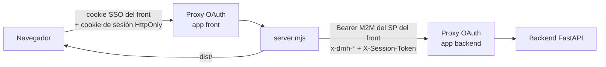
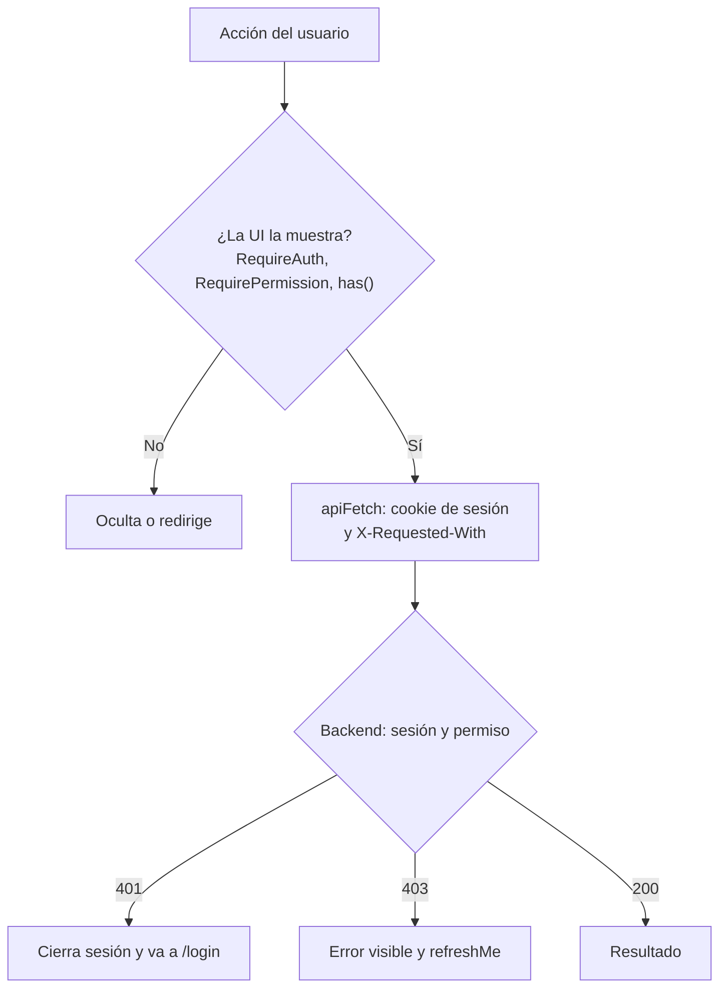

# Seguridad del frontend

Este documento describe cómo la web de Data Model Hub participa en la autenticación, cómo guarda y usa
la sesión, qué controla la interfaz según los permisos y qué no, y cómo se endurecen `server.mjs` y los
contenidos que genera el navegador. Está dirigido a quienes mantienen o despliegan el front y a quienes
revisan su postura de riesgo. La autoridad de seguridad es el backend: su modelo completo (login, JWT,
RBAC, auditoría) está en `docs/08-seguridad.md` del repositorio `backend-data-model-hub`.

## Contenido

- [Dos capas de control de acceso](#dos-capas-de-control-de-acceso)
- [Un solo origen](#un-solo-origen)
- [Relay de identidad y token M2M en server.mjs](#relay-de-identidad-y-token-m2m-en-servermjs)
- [Sesión en cookie HttpOnly](#sesión-en-cookie-httponly)
- [Inicio de sesión](#inicio-de-sesión)
- [Sesión en el cliente](#sesión-en-el-cliente)
- [Control de acceso en la UI](#control-de-acceso-en-la-ui)
- [Proyectos asignados](#proyectos-asignados)
- [Visibilidad de requests en Review](#visibilidad-de-requests-en-review)
- [Reglas de Admin](#reglas-de-admin)
- [Control del backend que la interfaz asume](#control-del-backend-que-la-interfaz-asume)
- [Sin secretos en el bundle](#sin-secretos-en-el-bundle)
- [Endurecimiento de server.mjs](#endurecimiento-de-servermjs)
- [XSS y contenidos generados](#xss-y-contenidos-generados)
- [Dependencias](#dependencias)
- [Limitaciones conocidas](#limitaciones-conocidas)
- [Checklist previo al despliegue](#checklist-previo-al-despliegue)
- [Documentos relacionados](#documentos-relacionados)

## Dos capas de control de acceso

1. **Plataforma.** El front es una Databricks App detrás del proxy OAuth de la plataforma: para abrirla
   hace falta iniciar sesión en el workspace y tener `CAN_USE` sobre la app. `databricks.yml` declara
   `CAN_MANAGE` para el usuario administrador de la app (`app_admin_user`) y `CAN_USE` para el grupo
   `users` del workspace.
2. **Aplicación.** Abrir la app no da permisos. El backend solo emite una sesión si el correo del usuario
   está en su whitelist (colección `users`) con un rol, y decide cada acción según la matriz de roles
   (colección `roles`). Ambas se administran en la pantalla **Admin**. La aplicación no usa grupos de red
   ni de directorio para autorizar.

## Un solo origen

En producción el navegador solo habla con la app front. `server.mjs` sirve el build de la SPA (`dist/`)
y reenvía `/api/*` al backend servidor a servidor. `src/services/apiBase.ts` deja `API_BASE` vacío (mismo
origen) salvo que se defina `VITE_API_URL`, que solo se usa en local para apuntar a otro backend.

El motivo es el modelo de Databricks Apps: cada app vive detrás de su propio proxy SSO, con una cookie por
subdominio. Si el navegador llamara directo al dominio del backend, ese proxy exigiría su propio SSO, que
un `fetch()` no puede completar. Con un solo origen, la cookie del proxy del front basta y el cruce al
backend se autentica con credenciales del service principal del front.

## Relay de identidad y token M2M en server.mjs

`buildUpstreamHeaders` y `proxyApi` (`server.mjs`) arman las cabeceras de cada request reenviada a `/api/*`:

| Paso | Cabeceras | Motivo |
|---|---|---|
| Se descartan | `host`, `connection`, `keep-alive`, `upgrade`, `te`, `trailer`, `proxy-authorization`, `proxy-authenticate`, `authorization`, `cookie` | Hop-by-hop, la autorización entrante y las cookies del navegador: la autorización hacia el backend la pone el servidor, nunca el cliente, y las cookies son del dominio del front. |
| Se descartan | Toda cabecera cuyo nombre empiece con `x-dmh-` | Un `fetch()` del navegador no puede suplantar el relay. |
| Se agrega | `authorization: Bearer <token M2M>` | Atravesar el proxy de la app backend (`CAN_USE` del service principal del front). |
| Se copian | `x-forwarded-email` → `x-dmh-sso-email`, `x-forwarded-preferred-username` → `x-dmh-sso-username`, `x-forwarded-user` → `x-dmh-sso-user-id` | Relevar la identidad que el proxy de la plataforma atestó en el dominio del front; el proxy del backend puede reescribir los `X-Forwarded-*`, pero no los `x-dmh-*`. |
| Se agrega | `x-dmh-proxy-secret: <PROXY_SHARED_SECRET>` | El backend exige este secreto, con comparación en tiempo constante, para aceptar el relay en `POST /api/auth/sso/login`. |
| Se conserva o se agrega | `x-forwarded-for` | Se conserva el recibido; si no vino, se usa la IP del socket. El backend toma la primera IP como clave del rate limit del login. |
| Se agrega | `x-session-token: <token de la cookie de sesión>` | El token de sesión propio sale de la cookie HttpOnly (ver [Sesión en cookie HttpOnly](#sesión-en-cookie-httponly)); con la cookie presente, reemplaza al `X-Session-Token` que traiga el cliente. |
| Se conservan | El resto, incluido el `X-Session-Token` de un cliente sin cookie | Un cliente que no es la SPA (un script con su token) llega intacto al backend. |

`server.mjs` copia `X-Forwarded-Email` tal como le llega. En Databricks Apps esa cabecera la fija el
proxy de la plataforma. Fuera de esa plataforma, el proxy de identidad que se ponga delante del front
debe descartar los `X-Forwarded-Email`, `X-Forwarded-Preferred-Username` y `X-Forwarded-User` que envíe el
cliente y escribir los suyos: el secreto compartido no protege ese tramo, porque lo agrega el propio
`server.mjs`.

**Token M2M.** `TokenCache` acuña el token con `client_credentials` contra `<DATABRICKS_HOST>/oidc/v1/token`
(`scope=all-apis`), con autenticación Basic del `DATABRICKS_CLIENT_ID` y `DATABRICKS_CLIENT_SECRET` que
inyecta el runtime de Apps. Lo reutiliza hasta 5 minutos antes de su expiración y permite un solo acuñado
en vuelo aunque haya muchas requests concurrentes. Si el acuñado falla, el servidor responde 502
`Backend authorization unavailable.`. Si el proxy del backend responde 401 o 403 a un `GET` o `HEAD`,
invalida el token y reintenta una vez con uno nuevo; los métodos con cuerpo no se reintentan porque el
cuerpo ya se consumió.

Sin `DATABRICKS_CLIENT_ID` y `DATABRICKS_CLIENT_SECRET` (corrida local) no se adjunta Bearer: así
`BACKEND_API_URL=http://localhost:8000 node server.mjs` simula producción contra un backend local.

El service principal del front necesita `CAN_USE` sobre la app backend. Lo aplican los workflows de
despliegue en cada corrida (`provider_app: bknd-data-model-hub` en `.github/workflows/deploy-databricks.yml`
de este repositorio, y el paso equivalente del workflow del backend), porque el bloque `permissions:` del
bundle redefine la ACL en cada despliegue.

## Sesión en cookie HttpOnly

El token de sesión que emite el backend no llega al JavaScript de la página. `server.mjs` lee enteras las
respuestas 2xx de `/api/auth/*`: si traen el token (login, login SSO y renovación), lo saca del cuerpo y lo
entrega en una cookie; en cada request a `/api` la cookie vuelve al backend como `X-Session-Token`. La SPA
recibe `{user, expiresIn}`. La ruta se evalúa como la resuelve el backend (`apiRoute`: `%XX`
decodificados y ruta normalizada), de modo que una ruta como `/api/auth/%72efresh` no saca el token por
otro camino; una ruta con una codificación inválida recibe 400 `Bad path.`.

| Atributo | Valor | Motivo |
|---|---|---|
| Nombre | `__Host-dmh_session` por HTTPS (`X-Forwarded-Proto: https`); `dmh_session` en una corrida local por http | El prefijo `__Host-` exige `Secure`, `Path=/` y ningún `Domain`: otro subdominio no puede fijarla ni pisarla. |
| `HttpOnly` | Siempre | El script de la página no la lee: un XSS no se lleva el token. |
| `SameSite` | `Strict` | El navegador no la envía en requests iniciados desde otro sitio. |
| `Secure` | Por HTTPS | Solo viaja cifrada. |
| `Max-Age` | `expiresIn` de la respuesta (3600 si falta) | La cookie vence junto con el token. |

Las respuestas que entregan la cookie llevan `Cache-Control: no-store`. Para leer su cuerpo, `server.mjs`
pide las rutas de `/api/auth/*` sin compresión (`accept-encoding: identity`) y, si igual llegan
comprimidas, las descomprime; una respuesta sin token o que no es JSON se entrega tal cual.

Protección contra CSRF:

- Un `POST`, `PUT`, `PATCH` o `DELETE` que llega con la cookie y sin la cabecera `X-Requested-With`
  recibe 403 `Request blocked: missing X-Requested-With header.` y no se reenvía. `apiFetch` agrega esa
  cabecera a toda llamada a `/api/` del mismo origen; otro origen no puede agregarla sin un preflight CORS
  aprobado.
- Las respuestas de `/api/*` salen sin las cabeceras `Access-Control-*` del backend: el origen del front
  no atiende pedidos de otros orígenes. El CORS del backend sigue aplicando a su propio dominio.

`POST /api/auth/logout` sale con un `Set-Cookie` que borra la cookie (`Max-Age=0`), también si el backend
responde con error, no responde o no está configurado (502).

`SESSION_COOKIE=false` apaga todo lo anterior: el token vuelve a viajar en el cuerpo y la SPA lo guarda en
memoria, sin sobrevivir a una recarga. Es un interruptor de contingencia y no figura en `app.yaml`; para
usarlo se agrega esa variable en el bloque `env` de `app.yaml` y se vuelve a desplegar.

En desarrollo, `vite.config.ts` monta el mismo manejador (`createApiHandler`) para `/api`, de modo que
`npm run dev` usa la misma cookie (por http, `dmh_session` sin `Secure`).

## Inicio de sesión

`src/features/auth/LoginScreen.tsx` ofrece dos formas de iniciar sesión, que terminan en el mismo
`enterSession` del store:

| Botón | Servicio | Endpoint | Resultado |
|---|---|---|---|
| **Continue with Databricks** | `auth.ssoLogin()` | `POST /api/auth/sso/login` (sin cuerpo) | Sesión si el correo de la plataforma está en la whitelist con un rol activo. Un 403 muestra el mensaje del backend (pedir a un administrador que asigne el correo a un rol). |
| **Sign in as administrator** | `auth.login('admin', password)` | `POST /api/auth/login` | Sesión de la cuenta local `admin`. La pantalla fija el usuario `admin`; la contraseña la valida el backend con rate limit y bloqueo por intentos. |

La cuenta local `admin` la crea `scripts/create_admin.py` del backend con una contraseña inicial escrita
en ese script; se cambia desde **Admin** después de cada corrida del script.

`src/services/warmup.ts` (`ensureBackendSession`) solo actúa si `API_BASE` apunta a otro origen (desarrollo
contra un backend remoto): si el `fetch` a `/api/health` no obtiene respuesta legible, navega una sola vez
a `GET /api/auth/warmup/{next_b64}` del backend para que su proxy haga el SSO; una marca en
`sessionStorage` evita bucles. Con mismo origen no hace nada. El backend solo redirige a destinos que
coinciden con su lista de orígenes CORS.

## Sesión en el cliente

`src/store/useAuthStore.ts` es la fuente de verdad del usuario y sus permisos; `src/features/auth/sessionKeeper.ts`
renueva la sesión mientras hay actividad y la cierra sin uso.

| Aspecto | Comportamiento |
|---|---|
| Dónde se guarda | En la cookie HttpOnly que fija `server.mjs`; el JavaScript de la página no la lee. `localStorage` guarda solo la marca `dmh.session` (usuario y vencimiento, sin el token), que coordina las pestañas. Si el backend entrega el token en el cuerpo (front apuntado a otro origen con `VITE_API_URL`, o `SESSION_COOKIE=false`), queda en memoria del módulo HTTP (`setAuthToken`) y no sobrevive a una recarga. |
| Cómo viaja | La cookie va sola en las llamadas al mismo origen y `server.mjs` la pasa al backend como `X-Session-Token`. Un token en memoria lo envía `apiFetch` en `X-Session-Token`. No se usa `Authorization: Bearer` porque el proxy de la plataforma consume esa cabecera. |
| `X-Requested-With` | `apiFetch` lo agrega a toda llamada a `/api/` del mismo origen: `server.mjs` lo exige en las escrituras que usan la cookie. |
| Credenciales | `fetch` con `credentials: 'include'`, para que una llamada a otro origen (con `VITE_API_URL`) lleve la cookie del proxy de la plataforma. |
| `X-Dev-User` | Solo se envía si `import.meta.env.DEV` (servidor de desarrollo de Vite); un build de producción nunca lo incluye. |
| Al iniciar sesión | `enterSession` limpia todo el estado de la app (`resetAppState`), refleja el usuario en `useSessionStore` y arranca `sessionKeeper` con la vida del token (`expiresIn`). |
| Al arrancar | `restore()` llama a `POST /api/auth/refresh`: con la cookie vigente renueva la sesión y trae el usuario. Un 401 se explica en el login: con `code: access_revoked`, el aviso de acceso quitado; con la marca vencida, `Your session expired due to inactivity. Please sign in again.`; con la marca vigente, `Your session ended. Please sign in again.`; sin marca, ningún aviso. Ante errores de red, 5xx o del proxy, la cookie se conserva (recargar restaura la sesión) y se muestra un aviso. |
| Renovación | Con actividad en la pestaña (puntero, tecla, rueda o toque), `sessionKeeper` llama a `POST /api/auth/refresh` como mucho una vez cada 5 minutos. Si la renovación queda sin respuesta, la reintenta con la actividad tras 30 segundos. Una sesión se renueva hasta 12 horas desde el login (tope del backend, `SESSION_MAX_HOURS`); después la renovación responde 401 y el login pide entrar de nuevo. |
| Cierre sin uso | Sin actividad nadie renueva y, al vencer el token (una hora), la pestaña cierra la sesión con `Your session expired due to inactivity. Please sign in again.` Una sesión sin uso dura entre 55 y 60 minutos. Al volver a la pestaña o al despertar el equipo, la revisión es inmediata. |
| Revalidación | `refreshMe()` vuelve a leer `/me` al recuperar el foco de la pestaña y tras un 403, con una sola lectura en vuelo y como mucho una cada 10 segundos (`ME_GAP_MS`). Un cambio de rol o de permisos se refleja sin recargar; un usuario deshabilitado sale de la sesión. |
| 401 global | Cualquier 401 de la API cierra la sesión de la pestaña: detiene la renovación, limpia el estado y la guarda de ruta lleva a `/login` con el aviso `Your session ended. Please sign in again.` Una renovación rechazada con `access_revoked` muestra el aviso de acceso quitado. |
| Logout | Cancela la renovación en vuelo de la pestaña (si su respuesta ya llegó, la cookie quedó antes y el logout la borra), llama a `POST /api/auth/logout` (el backend lo audita; `server.mjs` borra la cookie aunque el backend falle), borra la marca de pestañas, limpia el estado de los stores y vuelve a anónimo. |
| Varias pestañas | La cookie es del navegador: todas las pestañas comparten la sesión. Una renovación en una corre el vencimiento de todas (marca `dmh.session`), un logout en una cierra las demás y, si otra pestaña entra con otra cuenta, esta pide volver a entrar (`You signed in with another account in another tab. Sign in again to continue here.`). Si una renovación de esta pestaña responde después de ese logout o de ese ingreso, su respuesta volvió a dejar la cookie de esta sesión y la pestaña la borra con un logout, salvo que la sesión vigente sea de la misma cuenta; si la renovación o `/me` traen otra cuenta, la pestaña sale con el aviso de otra cuenta y esa cookie no se toca. Dos cuentas a la vez requieren otro perfil del navegador o una ventana privada. |

El token es un JWT firmado por el backend; el front no lo ve ni toma decisiones con sus claims: los
permisos vienen de `/me` y de la renovación. Dura `ACCESS_TOKEN_TTL_MIN` del backend (una hora por
defecto).

## Control de acceso en la UI

La interfaz usa los permisos de `/me` para ordenar lo que muestra:

| Control | Condición | Dónde |
|---|---|---|
| Todas las rutas salvo `/login` | Sesión iniciada; mientras se restaura, un splash | `RequireAuth` (`src/features/auth/guards.tsx`), `src/App.tsx` |
| Ruta y menú **Data Standards** | `model.view` | `RequirePermission` en `src/App.tsx`, `src/components/layout/TopNav.tsx` |
| Ruta y menú **Admin** | `admin.manage` | `RequirePermission`, `TopNav` |
| Aplicar cambios en Data Standards | `standards.edit` | `StandardsScreen.tsx` |
| Bloquear o desbloquear términos del glosario | `admin.manage` | `GlossaryPage.tsx` |
| Abrir drafts y solicitudes ajenos | `versions.view_all` o `admin.manage` | `WorkspaceScreen.tsx`, `src/services/versioning.service.ts` |
| Transferir o eliminar un draft | Dueño con `model.edit`, o `admin.manage` | `src/lib/versionAdmin.ts` |
| Rollback de una versión publicada del modelo (**Restore**) | `rollback` | `HomeScreen.tsx` |
| **Roll back** del historial de Data Standards | Se muestra con `standards.edit`; el backend exige `rollback` | `StandardsScreen.tsx` |
| Botones de descarga: **Export DDL** y **Export diagram** (SVG, HTML, PDF) de la barra del canvas, **Export HTML** y **Export PDF** del Model Explorer, descarga o copia del DDL en el diálogo de Export DDL y los dos **Download .xlsx** del Reporting | `export`; sin el permiso el botón se muestra deshabilitado y el motivo (`NO_EXPORT_HINT`) aparece al pasar el mouse | `Toolbar.tsx`, `ModelExplorer.tsx`, `ExportDdlModal.tsx`, `ReportingScreen.tsx`, `SheetTemplateCard.tsx`, `src/lib/permissionHints.ts` |
| **New project** (Home y **Open model**) | `model.edit` y sin proyectos asignados (o con `admin.manage`); si no, deshabilitado con el motivo de `newProjectBlock` | `HomeScreen.tsx`, `OpenModelModal.tsx`, `WorkspaceScreen.tsx`, `src/lib/permissionHints.ts` |
| Revisores elegibles al enviar a revisión | Usuarios con `review.decide` que acceden al proyecto de la versión | `PublishModal.tsx` (`listUsers('review.decide', projectId)`) |
| Destino de una transferencia de draft | Usuarios con `model.edit` que acceden al proyecto de la versión | `TransferVersionDialog.tsx` (`listUsers('model.edit', projectId)`) |
| Detalle de un request en Review | Dueño, revisor asignado, `versions.view_all` o `admin.manage` (las versiones publicadas las ve todo el que accede al proyecto) | `ReviewScreen.tsx` (`canOpenVersion`) |
| Plantillas de hoja compartidas | `admin.manage` | `SheetTemplateCard.tsx` |

`RequirePermission` redirige a Home si falta el permiso. Sin `admin.manage`, el menú no muestra **Admin**.

La matriz de permisos no tiene un permiso propio para publicar: aprobar un request publica la versión a
producción y lo exige `review.decide`, cuya etiqueta en **Admin** lo indica (**Approve / reject requests
(approving publishes to production)**). El permiso `export` cubre descargar DDL o metadata; en el backend
lo exige el render de las reglas DDL, y en la interfaz deshabilita los botones de descarga, porque los
exports del canvas, del Explorer y del Reporting se arman en el navegador con datos ya leídos.

Estos controles son de experiencia de usuario, no la barrera de seguridad:

- Varias acciones de edición no se ocultan por permiso. **Create new version from production** y la
  edición en el canvas no dependen de `model.edit` en la UI; quien no tiene el permiso recibe el 403 del
  backend al escribir.
- Cualquier código que corra en el navegador puede modificarse: un usuario puede alterar el estado del
  store o llamar a la API directamente. Por eso el backend vuelve a verificar sesión y permiso en cada
  request, y relee el rol desde la base en cada acción protegida.
- Un 403 del backend dispara `refreshMe()`, de modo que la interfaz se ajusta a los permisos vigentes.

## Proyectos asignados

Cada usuario tiene una lista `projectIds` (llega en `/me` y en el listado de **Admin**). Una lista vacía
da acceso a todos los proyectos; con ids, el usuario solo accede a esos. Quien tiene `admin.manage`
accede a todos aunque tenga ids asignados. El backend aplica la regla y la interfaz la refleja así:

| Dónde | Efecto |
|---|---|
| Listas de Home, Open model, Review y Reporting | Muestran solo lo que devuelve el backend: `GET /api/projects`, `GET /api/versions` y `GET /api/requests` ya vienen filtrados por alcance. |
| Selectores de revisores y de destino de transferencia | Piden `GET /api/users?can=…&projectId=…`, que devuelve solo usuarios con acceso al proyecto de la versión. |
| **New project** | Deshabilitado para quien tiene proyectos asignados sin `admin.manage`: el proyecto creado quedaría fuera de su alcance. |
| Columna **Projects** de Admin | Muestra **All projects** o la cantidad de proyectos asignados vigentes (los ids de proyectos borrados no cuentan). |
| Modal de usuario en Admin | Ofrece **All projects** u **Only these projects** con la lista de proyectos; exige al menos uno marcado en la segunda opción. Al editar, envía los proyectos solo si se tocó esa sección. |

Un request a un proyecto fuera del alcance responde 403 con el mensaje siguiente; la interfaz lo muestra y
revalida `/me`:

`You don't have access to this project. Ask an administrator to assign it to you.`

## Visibilidad de requests en Review

El contenido de una versión no publicada (cambios, diff y comentarios) solo lo ven su dueño, sus revisores
asignados y quien tiene `versions.view_all` o `admin.manage`. La lista de Review muestra igual la fila
(título, dueño, estado). `ReviewScreen.tsx` decide con la fila, mediante `canOpenVersion`
(`src/services/versioning.service.ts`), si pide el detalle:

- Si el usuario puede verlo, el detalle se pide cuando la lista termina de cargar.
- Si no, el panel no pide el detalle y muestra un aviso con quién pidió el request y quiénes pueden ver
  sus cambios y comentarios (su dueño, sus revisores asignados y los administradores).

El backend aplica la misma regla en la cabecera del changeset, el diff, el detalle del diff y los
comentarios.

## Reglas de Admin

La pantalla **Admin** (`src/features/admin`) impide dejar la plataforma sin administrador activo. Las
reglas están en funciones puras de `src/features/admin/components/helpers.ts`:

| Regla | Función | Efecto en la UI |
|---|---|---|
| El único administrador activo no cambia su rol ni su estado | `isOnlyAdmin` | En el modal de usuario, rol y estado quedan deshabilitados con el aviso `This is the only administrator: give the administrator role to someone else before changing this role or status.` |
| El único administrador activo no pierde el acceso | `isOnlyAdmin` | El botón de quitar acceso queda deshabilitado con el motivo al pasar el mouse. |
| La matriz conserva al menos un administrador | `matrixLeavesNoAdmin` | Quitar `admin.manage` de un rol que deja sin administrador activo se rechaza con **At least one active user must keep the administrator permission (admin.manage).** |
| Nivel de acceso del rol | `accessLevelOf` | **Full control** con `admin.manage`; **Edit** con `model.edit`, `standards.edit` o `review.decide`; **Read-only** en otro caso. |

El backend aplica las mismas reglas en el alta, la edición y el borrado de usuarios y al guardar la
matriz; el alta de un correo que ya tiene acceso responde 400 y los cambios de un usuario existente van
por su edición.

## Control del backend que la interfaz asume

La interfaz asume que el backend verifica, en toda ruta de datos y en este orden:

1. Sesión válida (401 sin token o con token vencido; la interfaz cierra la sesión).
2. Usuario vigente: el token de un usuario borrado o deshabilitado recibe 403 en el request siguiente,
   sin esperar a que venza el token.
3. Permiso `model.view` para ver el modelo y su metadata.
4. Alcance por proyecto (`projectIds`).

Solo quedan fuera las rutas públicas (salud, login, login SSO, warm-up), las de la sesión propia
(`/me`, logout) y las de administración, que exigen `admin.manage`. Por eso los controles de la UI se
limitan a no ofrecer lo que respondería 403 y a explicar el motivo.

## Sin secretos en el bundle

Vite incrusta en el JavaScript del navegador toda variable que empiece con `VITE_`; cualquier usuario
puede leerla. El código solo usa `VITE_API_URL` (`src/services/apiBase.ts`, `src/vite-env.d.ts`), que es
una URL y no un secreto, y que no se define en el build de producción.

Los secretos del front viven solo en el proceso de `server.mjs`, nunca en el bundle:

| Variable | Origen en Databricks Apps | Secreta | Uso |
|---|---|---|---|
| `PROXY_SHARED_SECRET` | `valueFrom: proxy_secret` en `app.yaml` (recurso `secret` de `databricks.yml`; scope y key desde las GitHub Variables `DATABRICKS_SCOPE_NAME` y `PROXY_SECRET_KEY`) | Sí | Autentica el relay ante el backend. Es el mismo valor que lee el backend. |
| `DATABRICKS_CLIENT_ID` / `DATABRICKS_CLIENT_SECRET` | Inyectadas por el runtime de Apps | Sí | Acuñar el token M2M. |
| `DATABRICKS_HOST` | Inyectada por el runtime de Apps | No | Endpoint OIDC del workspace. |
| `BACKEND_API_URL` | `app.yaml`, llenada por el workflow con la GitHub Variable homónima | No | URL de la app backend. |
| `DATABRICKS_APP_PORT` / `PORT` | Runtime de Apps / local | No | Puerto de escucha. |

`.env` y sus variantes están excluidos de git (`.gitignore`); `.env.example` es la plantilla.

## Endurecimiento de server.mjs

`server.mjs` no tiene dependencias externas (solo módulos `node:*`). Lo que hace:

| Medida | Detalle |
|---|---|
| Path traversal | `safeJoin` decodifica la ruta, la normaliza y rechaza con 400 `Bad path.` todo lo que salga de `dist/`. |
| Métodos | Los estáticos solo aceptan `GET` y `HEAD`; el resto recibe 405. |
| Tipos MIME | Lista cerrada por extensión (`contentTypeFor`); lo desconocido se sirve como `application/octet-stream`. |
| Caché | Los archivos de `/assets/` (con hash en el nombre) van con `public, max-age=31536000, immutable`; `index.html` y el resto, con `no-cache`, para que un despliegue nuevo se tome de inmediato. |
| Fallback SPA | Una ruta que no es archivo devuelve `index.html`. |
| Errores del proxy | 502 con mensajes genéricos (`Backend unreachable.`, `Backend authorization unavailable.`, `BACKEND_API_URL is not configured.`); el detalle va solo al log del servidor. |
| Timeout | 120 segundos por request reenviada. |
| Respuestas del backend | Se reenvían en streaming con sus cabeceras (incluidas las de seguridad del backend), salvo `connection`, `keep-alive`, `transfer-encoding` y las `Access-Control-*`. Las de login, login SSO y renovación se leen enteras para pasar el token a la cookie. |
| Sesión y CSRF | Cookie HttpOnly, `SameSite=Strict`, `__Host-` por HTTPS, y `X-Requested-With` exigido en las escrituras con la cookie (ver [Sesión en cookie HttpOnly](#sesión-en-cookie-httponly)). |
| Cabeceras de seguridad | Los estáticos y el fallback SPA llevan `SECURITY_HEADERS` (ver la tabla siguiente). Las respuestas de `/api/*` conservan las que pone el backend. |

`securityHeaders(req)` agrega estas cabeceras a toda respuesta propia de `server.mjs`:

| Cabecera | Valor | Motivo |
|---|---|---|
| `Content-Security-Policy` | Ver la tabla de directivas | Restringir el origen de scripts, estilos, imágenes y conexiones. |
| `X-Content-Type-Options` | `nosniff` | El navegador respeta el `Content-Type` declarado y no adivina el tipo. |
| `X-Frame-Options` | `SAMEORIGIN` | La app no se embebe en sitios ajenos (equivale a `frame-ancestors 'self'` para navegadores que no leen la CSP). |
| `Referrer-Policy` | `strict-origin-when-cross-origin` | Hacia otros orígenes solo viaja el origen, nunca la ruta ni la query. |
| `Permissions-Policy` | `camera=(), microphone=(), geolocation=()` | La app no usa cámara, micrófono ni ubicación. |
| `Cross-Origin-Opener-Policy` | `same-origin` | Una ventana de otro origen abierta desde la app no conserva referencia a ella. |
| `Strict-Transport-Security` | `max-age=31536000; includeSubDomains` | Solo cuando el request llegó por HTTPS (`X-Forwarded-Proto: https`, que fija el proxy que termina TLS); en una corrida local por HTTP no se envía. |

Directivas de la `Content-Security-Policy`:

| Directiva | Valor | Motivo |
|---|---|---|
| `default-src` | `'self'` | Todo sale del propio origen salvo lo que se abre explícitamente. |
| `script-src` | `'self'` | Solo los scripts del build; nada en línea ni `eval`. |
| `style-src` | `'self' 'unsafe-inline'` | Los componentes aplican estilos en línea y algunas librerías insertan `<style>` al cargar. |
| `img-src` | `'self' data: blob:` | Íconos embebidos e imágenes que el navegador arma al exportar. |
| `font-src` | `'self' data:` | Fuentes del build y fuentes embebidas. |
| `connect-src` | `'self'` | La API va por el mismo origen (`/api`). |
| `worker-src` | `'self' blob:` | Workers que se crean desde un `blob:`. |
| `object-src` | `'none'` | Sin plugins ni `<object>`. |
| `base-uri` | `'self'` | Un `<base>` inyectado no puede redirigir las rutas relativas. |
| `form-action` | `'self'` | Los formularios solo envían al propio origen. |
| `frame-ancestors` | `'self'` | La app no se embebe en sitios ajenos. |

TLS lo termina el proxy de la plataforma.

## XSS y contenidos generados

- **Renderizado de React.** Los textos del modelo (nombres, definiciones, comentarios) se muestran como
  texto: React los escapa. El código no usa `dangerouslySetInnerHTML`, `eval` ni `new Function`.
- **Export HTML.** `src/features/modeler/lib/exportHtml.ts` arma documentos autocontenidos. `escapeHtml`
  escapa `& < > " '` en todo texto que entra al HTML, y `jsStringLiteral` serializa los datos que van
  dentro de un `<script>` con `JSON.stringify` y neutraliza `</` y `<!--`, las secuencias que el parser
  HTML honra dentro de un script. El paquete multipágina (`exportPackagePages.ts`) incluye un buscador
  que usa `innerHTML`, pero cada valor pasa por una función `esc` equivalente y los anclas de tabla usan
  `encodeURIComponent`.
- **Export SVG.** `src/features/modeler/lib/sceneSvg.ts` escapa los textos (`esc`) y los atributos
  (`escAttr`) antes de componer el SVG.
- **Export PDF y Excel.** Se generan en el navegador a partir de los datos ya leídos; no interpretan
  HTML.
- **Carga Excel.** El archivo se lee en el navegador con `xlsx`; las celdas se envían al backend como
  texto y el backend valida su forma y tamaño. `parseWorkbook.ts` quita los caracteres NUL de las celdas y
  sustituye por U+FFFD los surrogates UTF-16 sueltos, que la base no admite.

Los exports son archivos que el usuario descarga y abre fuera de la app; no se ejecutan con la sesión de
la aplicación.

## Dependencias

- `package.json` fija todas las dependencias y devDependencies con versión exacta (sin `^` ni `~`), y
  `package-lock.json` fija el árbol completo. Local, CI y Databricks Apps instalan lo mismo.
- Para actualizar una dependencia se cambia la versión, se corren `npm install`, `npm test`, `tsc` y
  `eslint`, y luego se hace commit (ver [Stack tecnológico](04-stack-tecnologico.md)).
- `server.mjs` no usa paquetes de npm: su superficie se limita a Node.
- `xlsx` se instala en la versión `0.20.3` desde la copia `vendor/xlsx-0.20.3.tgz`: SheetJS publica sus
  versiones corregidas solo en su CDN, y la copia en el repositorio evita depender de él al instalar.
- `npm audit --omit=dev` no reporta avisos en las dependencias de ejecución. Los avisos que quedan son de
  herramientas de desarrollo (vitest 2, vite, esbuild), que no forman parte del build servido.

## Limitaciones conocidas

| Limitación | Efecto |
|---|---|
| Script inyectado con la página abierta | No puede leer el token (cookie HttpOnly), pero sí hacer llamadas desde la página mientras está abierta, como el usuario. La mitigación es la ausencia de vías de inyección (React, exports escapados), la CSP sin scripts en línea y el cierre de la sesión sin uso. |
| `style-src 'unsafe-inline'` en la CSP | Los estilos en línea están permitidos; los scripts no. |
| Gating parcial en la UI | Algunas acciones se muestran a usuarios sin el permiso y fallan con 403. |
| Una sesión por navegador | La cookie es del navegador: entrar con otra cuenta en una pestaña cierra la sesión de las demás. |
| Sin revocación en el servidor | El logout borra la cookie, pero el backend no lleva una lista de tokens revocados: un token copiado vale hasta su `exp` (una hora) y puede renovarse hasta 12 horas desde el login. |
| Relay dependiente del proxy de la plataforma | `server.mjs` confía en los `X-Forwarded-*` que recibe; fuera de Databricks Apps, el proxy delante del front debe fijarlos. |

## Checklist previo al despliegue

- [ ] `VITE_API_URL` no está definida en el build de producción (mismo origen).
- [ ] `BACKEND_API_URL` apunta a la app backend.
- [ ] El secret scope contiene la key de `PROXY_SECRET_KEY` y es la misma que lee el backend.
- [ ] El workflow aplicó `CAN_USE` del service principal del front sobre la app backend.
- [ ] La ACL del front (`permissions:` en `databricks.yml`) solo otorga lo necesario.
- [ ] Ninguna variable `VITE_*` contiene un secreto.
- [ ] El login **Continue with Databricks** funciona con un correo de la whitelist y responde 403 con uno
      que no lo está.
- [ ] Las respuestas de los estáticos llevan `Content-Security-Policy` y, por HTTPS, `Strict-Transport-Security`.
- [ ] Tras el login, el navegador tiene la cookie `__Host-dmh_session` (HttpOnly, Secure, SameSite=Strict),
      `localStorage` no guarda ningún token y recargar la página conserva la sesión.
- [ ] La contraseña de la cuenta `admin` difiere de la de `scripts/create_admin.py` del backend.
- [ ] `npm test`, `tsc --noEmit` y `eslint` pasan sobre el commit a desplegar.

## Documentos relacionados

- [Visión general](01-vision-general.md): pantallas y qué ve cada rol.
- [Arquitectura](02-arquitectura.md): `server.mjs`, routing, guardas y stores.
- [Flujo de datos](06-flujo-de-datos.md): arranque, login y restauración de la sesión.
- [Integración con la API](07-integracion-con-la-api.md): cliente HTTP, cabeceras y errores del proxy.
- [Despliegue](09-despliegue.md): bundle, `app.yaml`, variables y permisos de las apps.
- [Pruebas](10-pruebas.md): pruebas del store de autenticación y de `server.mjs`.
- [Consideraciones técnicas](12-consideraciones-tecnicas.md): exports y límites conocidos.
- Seguridad del backend: `docs/08-seguridad.md` del repositorio `backend-data-model-hub`.
