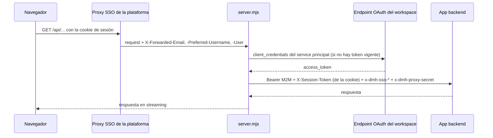

# Despliegue del frontend

Este documento describe cómo se compila, se despliega y se ejecuta la web de Data Model Hub: el
funcionamiento en Databricks Apps (plataforma de referencia), el bundle y el `app.yaml`, los workflows de
GitHub Actions, las variables de entorno, la ejecución local con Vite y con `server.mjs`, y qué cambiar
para desplegar en otra plataforma. Está dirigido a quien despliega u opera la web. La preparación del
workspace, el secret scope y la base de datos se describen en el documento de despliegue del backend
(`backend-data-model-hub/docs/09-despliegue.md`).

## Contenido

- [Cómo corre en producción](#cómo-corre-en-producción)
- [Databricks Apps: bundle y app.yaml](#databricks-apps-bundle-y-appyaml)
- [GitHub Actions](#github-actions)
- [Variables de entorno](#variables-de-entorno)
- [Ejecución local](#ejecución-local)
- [El build y la carpeta dist](#el-build-y-la-carpeta-dist)
- [Despliegue en otra plataforma](#despliegue-en-otra-plataforma)
- [Checklist de despliegue](#checklist-de-despliegue)
- [Documentos relacionados](#documentos-relacionados)

## Cómo corre en producción

La web se despliega como la Databricks App `frnt-data-model-hub`. En cada despliegue y en cada arranque de
la app, Databricks:

1. Instala las dependencias de `package.json` (`npm install`), incluidas las `devDependencies`, que hacen
   falta para compilar. `xlsx` se instala desde el tarball versionado `vendor/xlsx-0.20.3.tgz`, sin
   descargarlo de internet; el resto sale del registro de npm según `package-lock.json`.
2. Ejecuta el script `build` de `package.json`: `tsc --noEmit && vite build`. La verificación de tipos
   corre primero; si falla, no hay build. El resultado es la carpeta `dist/`.
3. Ejecuta el `command` de `app.yaml`: `npm run start`, que levanta `node server.mjs`.

`server.mjs` es un servidor Node sin dependencias (solo módulos `node:*`) con dos responsabilidades:

- **Servir `dist/`** con fallback de SPA: una ruta que no corresponde a un archivo (`/login`, `/model`,
  etc.) devuelve `index.html`. Los archivos bajo `/assets/` (con hash en el nombre) se sirven con
  `cache-control: public, max-age=31536000, immutable`; el resto, con `no-cache`, de modo que el navegador
  revalida `index.html` y toma el build desplegado. Solo acepta `GET` y `HEAD` y rechaza rutas que salen de
  `dist/`.
- **Reenviar `/api/*` a la app backend**, servidor a servidor, con un token OAuth M2M del service principal
  del front.
- **Guardar la sesión del usuario en una cookie HttpOnly**: el token que emite el backend no llega al
  JavaScript de la página.

El proxy existe porque cada Databricks App está detrás de su propio muro SSO por subdominio. Si el
navegador llamara directamente al dominio del backend, chocaría con ese muro: la cookie de sesión es por
app y el proxy de la plataforma no inicia el SSO dentro de un `fetch()` entre orígenes. Con `server.mjs`
el navegador habla con un solo origen, sin CORS, y el cruce al backend lleva `Authorization: Bearer` del
service principal del front.

El diagrama muestra un request a la API en producción.



Detalles del proxy (`server.mjs`):

- **Token M2M**: se acuña contra `<DATABRICKS_HOST>/oidc/v1/token` con `grant_type=client_credentials` y
  `scope=all-apis`, y se cachea hasta cinco minutos antes de su vencimiento. Las solicitudes concurrentes
  comparten la misma acuñación. Si la acuñación falla, el proxy responde `502` con
  `Backend authorization unavailable.`.
- **Reintento**: si el backend responde `401` o `403` a un `GET` o `HEAD`, el proxy invalida el token y
  reintenta una vez con uno nuevo (los métodos con cuerpo no se reintentan porque el cuerpo ya se
  consumió).
- **Relay de identidad SSO**: el proxy de la plataforma autentica al usuario en el dominio del front e
  inyecta `X-Forwarded-Email`, `X-Forwarded-Preferred-Username` y `X-Forwarded-User`. `server.mjs` las copia
  a `x-dmh-sso-email`, `x-dmh-sso-username` y `x-dmh-sso-user-id`, agrega el secreto compartido en
  `x-dmh-proxy-secret` y descarta cualquier cabecera `x-dmh-*` que envíe el cliente, de modo que un
  `fetch()` del navegador no puede suplantar la identidad. El backend acepta el login SSO solo si el
  secreto coincide.
- **Cabeceras**: no reenvía las cabeceras hop-by-hop, `host`, el `authorization` entrante ni las cookies
  del navegador; conserva el `X-Forwarded-For` de la plataforma (o pone la IP del cliente) para que el rate
  limiting del backend vea la IP real. Las respuestas de `/api` salen sin las cabeceras `Access-Control-*`
  del backend.
- **Sesión en cookie**: en las respuestas de login, login SSO y renovación saca el token del cuerpo y lo
  entrega en la cookie `__Host-dmh_session` (HttpOnly, `Secure`, `SameSite=Strict`, `Max-Age` igual a la
  vida del token); en cada request la pasa al backend como `X-Session-Token`; exige `X-Requested-With` en
  las escrituras que usan la cookie; y la borra en el logout, aunque el backend falle.
- **Errores propios**: `502` con `BACKEND_API_URL is not configured.` si falta la URL del backend; `502`
  con `Backend unreachable.` ante un error de red o un timeout (120 segundos) hacia el backend. La
  respuesta se transmite en streaming (reporting y diagramas generan payloads grandes).

Hacia el backend, la sesión propia de la aplicación (JWT) viaja en la cabecera `X-Session-Token`, no en
`Authorization`, porque el proxy de la plataforma consume `Authorization`. Detalle de la autenticación en
[Seguridad](08-seguridad.md).

## Databricks Apps: bundle y app.yaml

### databricks.yml

- **`bundle.name`**: `frnt-data-model-hub`; **`engine: direct`** (el CLI aplica el bundle con la API de
  Databricks, sin Terraform).
- **`variables`**, sin `default:` y llenadas desde GitHub Variables en mayúsculas como
  `BUNDLE_VAR_<variable>`:

  | Variable del bundle | GitHub Variable | Contenido | Ejemplo |
  |---|---|---|---|
  | `databricks_scope_name` | `DATABRICKS_SCOPE_NAME` | Scope de secretos (el mismo que usa el backend). | `mi-scope` |
  | `proxy_secret_key` | `PROXY_SECRET_KEY` | Key del secreto compartido del relay SSO (la misma que usa el backend). | `proxy-shared-secret` |
  | `app_admin_user` | `APP_ADMIN_USER` | Usuario del workspace que conserva `CAN_MANAGE` sobre la app. | `usuario@dominio.com` |

- **`resources.apps.frontend`**: resource key `frontend`, nombre real `frnt-data-model-hub`,
  `source_code_path: .`.
- **Recurso `secret`**: `proxy_secret` → `${var.databricks_scope_name}` / `${var.proxy_secret_key}`, permiso `READ`.
- **`permissions`**: `CAN_MANAGE` para `${var.app_admin_user}` y `CAN_USE` para el grupo `users`. El bloque
  es autoritativo: cada despliegue deja la ACL tal como la declara el archivo.
- **`targets.prod`**: `mode: production`, `default: true`, sin `host:` (el workspace sale de
  `DATABRICKS_HOST`).

El bundle sube la raíz del repositorio, incluida la carpeta `vendor/` con el tarball de `xlsx`.
`node_modules/`, `dist/`, `.databricks/` y los `.env*` (salvo `.env.example`) están en `.gitignore` y no se
suben: Databricks instala las dependencias y compila en el propio entorno de la app.

### app.yaml

```yaml
command: ["npm", "run", "start"]

env:
  - name: BACKEND_API_URL
    value: ""
  - name: PROXY_SHARED_SECRET
    valueFrom: proxy_secret
```

- **`command`**: `npm run start` (`node server.mjs`). El build no va en el `command`: Databricks ejecuta el
  script `build` antes de él.
- **`BACKEND_API_URL`**: URL pública de la app backend
  (`https://bknd-data-model-hub-<id>.<region>.databricksapps.com`). El workflow escribe el valor desde la
  GitHub Variable homónima. `server.mjs` usa solo el origen: la ruta del request se conserva tal cual
  (`/api/...`).
- **`PROXY_SHARED_SECRET`**: del recurso `proxy_secret`; el backend lee el mismo secreto.
- **`BUILD_SHA` y `BUILD_TIME`**: el workflow los agrega, igual que en el backend. `server.mjs` no los usa;
  el commit desplegado del backend se consulta en `GET /api/health`.

El `command` y las `env` viven en `app.yaml` porque el CLI ignora el bloque `config:` de `databricks.yml`
(issue databricks/cli #4901) y porque Databricks lee `app.yaml` en cada arranque de la app.

Dos variables no se definen a propósito:

- **`NODE_ENV=production`**: haría que la instalación omitiera las `devDependencies`, y `tsc` y `vite` son
  `devDependencies` necesarias para el build que Databricks ejecuta en cada arranque.
- **`VITE_API_URL`**: es la base de la API que se compila dentro del bundle del navegador. Definida, el
  navegador llamaría directamente al dominio del backend y chocaría con su muro SSO. Vacía, el navegador usa
  el mismo origen y `server.mjs` hace el cruce.

Variables que inyecta la plataforma y que `server.mjs` lee:

| Variable | Uso |
|---|---|
| `DATABRICKS_APP_PORT` | Puerto en que escucha `server.mjs`. |
| `DATABRICKS_HOST` | Workspace contra el que se acuña el token M2M (acepta host con o sin `https://`). |
| `DATABRICKS_CLIENT_ID` | Client ID del service principal de la app. |
| `DATABRICKS_CLIENT_SECRET` | Secreto del service principal de la app. |

## GitHub Actions

El repositorio usa los mismos dos workflows que el backend, en `.github/workflows/`:

- **`deploy-databricks.yml`**: se dispara con `push` a `deploy-dev`, `develop` o `main` y con
  `workflow_dispatch` (solo desde esas ramas). Las ramas corresponden a los GitHub Environments `dev`, `qa`
  y `prod`. Invoca el workflow reutilizable con `provider_app: bknd-data-model-hub`: la app del front
  consume la app backend, así que su service principal recibe `CAN_USE` sobre ella al final de cada
  despliegue.
- **`reusable-databricks-deploy.yml`**: la mecánica, idéntica en ambos repositorios salvo la redacción de
  los comentarios: verificar credenciales, resolver variables del bundle, inyectar el `env` de `app.yaml`,
  estampar `BUILD_SHA`/`BUILD_TIME`, `bundle validate`, adoptar la app si ya existe (`bundle deployment
  bind`), `bundle plan`, `bundle deploy`, permisos entre apps, `bundle run` y esperar `RUNNING`. La
  descripción paso a paso está en el documento de despliegue del backend.

Contrato de variables del environment para el front:

| Tipo | Nombre | Ejemplo |
|---|---|---|
| Secret | `DATABRICKS_TOKEN` | Token del workspace destino. |
| Variable | `DATABRICKS_HOST` | `https://<workspace>` |
| Variable | `BUNDLE_TARGET` | `prod` |
| Variable | `DATABRICKS_SCOPE_NAME` | `mi-scope` |
| Variable | `PROXY_SECRET_KEY` | `proxy-shared-secret` |
| Variable | `APP_ADMIN_USER` | `usuario@dominio.com` |
| Variable | `BACKEND_API_URL` | `https://bknd-data-model-hub-<id>.<region>.databricksapps.com` |

Si falta alguna, el run se corta antes de tocar la app y lista los nombres faltantes.

En un workspace nuevo, el backend se despliega primero: su URL (publicada por el paso «Esperar estado RUNNING»
del workflow del backend) es el valor de `BACKEND_API_URL`. El permiso `CAN_USE` del service principal del
front sobre el backend se aplica desde los dos workflows, así que el resultado no depende del orden.

Despliegue manual con el CLI (sin GitHub Actions), con `BACKEND_API_URL` escrito a mano en `app.yaml` sin
hacer commit de ese valor:

```bash
export DATABRICKS_HOST=https://<workspace>
export BUNDLE_VAR_databricks_scope_name=mi-scope
export BUNDLE_VAR_proxy_secret_key=proxy-shared-secret
export BUNDLE_VAR_app_admin_user=usuario@dominio.com
databricks bundle deploy --target prod
databricks bundle run frontend --target prod
```

## Variables de entorno

| Variable | Dónde se lee | Momento | Uso |
|---|---|---|---|
| `VITE_API_URL` | `src/services/apiBase.ts` | Build (Vite la incrusta en el bundle) | Base de la API para el navegador. Vacía o sin definir: mismo origen. Solo para apuntar el front local a otro backend. |
| `BACKEND_API_URL` | `server.mjs` | Ejecución | URL de la app backend para el proxy `/api`. |
| `PROXY_SHARED_SECRET` | `server.mjs` | Ejecución | Secreto que acompaña al relay de identidad (`x-dmh-proxy-secret`). |
| `DATABRICKS_APP_PORT` | `server.mjs` | Ejecución | Puerto (inyectado por Apps). |
| `PORT` | `server.mjs` | Ejecución | Puerto si no hay `DATABRICKS_APP_PORT`; si tampoco existe, `3000`. |
| `DATABRICKS_HOST` | `server.mjs` | Ejecución | Workspace para el token M2M (inyectado por Apps). |
| `DATABRICKS_CLIENT_ID` / `DATABRICKS_CLIENT_SECRET` | `server.mjs` | Ejecución | Credenciales del service principal (inyectadas por Apps). Sin ellas el proxy no adjunta `Bearer`. |
| `SESSION_COOKIE` | `server.mjs`, `vite.config.ts` | Ejecución | Opcional y fuera de `app.yaml`. `false` apaga la cookie de sesión: el token vuelve a viajar en el cuerpo y la SPA lo guarda en memoria, sin sobrevivir a una recarga. Interruptor de contingencia: se agrega al bloque `env` de `app.yaml` solo si hace falta. |

Solo las variables con prefijo `VITE_` llegan al código del navegador, y se fijan al compilar. Las demás
son del proceso de Node y nunca llegan al bundle. `.env.example` documenta `VITE_API_URL` (vacía); los
`.env*` locales no se versionan.

Al arrancar, `server.mjs` registra en el log el puerto, el backend configurado, si hay credenciales del
service principal y si hay secreto del relay:

```text
[server] escuchando en :<puerto> | backend: https://<url-del-backend> | auth SP: si | relay SSO: con secreto
```

## Ejecución local

Requisitos: Node.js y npm (las versiones de las dependencias están en [Stack tecnológico](04-stack-tecnologico.md))
y el backend corriendo en `http://localhost:8000` (ver el documento de despliegue del backend).

### Modo desarrollo con Vite

```bash
npm ci
npm run dev
```

Vite sirve la web en `http://localhost:3000` y reenvía `/api` a `http://localhost:8000` (o a
`BACKEND_API_URL`, si está definida) con el mismo manejador de `server.mjs` (`createApiHandler`, montado en
`vite.config.ts`): la sesión viaja en la cookie `dmh_session`, como en producción. `VITE_API_URL` queda
vacía: el navegador usa el mismo origen. En local no hay muro SSO ni relay: el botón **Continue with Databricks** entra con el usuario de
desarrollo que configura el backend.

Para apuntar la web local a otro backend (por ejemplo, uno desplegado que acepte el acceso directo), se
define `VITE_API_URL` en `.env.local` y se reinicia Vite:

```bash
VITE_API_URL=https://<url-del-backend>
```

### Simulación de producción con server.mjs

```bash
npm run build
BACKEND_API_URL=http://localhost:8000 node server.mjs
```

Sin `DATABRICKS_CLIENT_ID`/`DATABRICKS_CLIENT_SECRET`, el proxy no adjunta `Bearer` y reenvía los requests
tal cual al Uvicorn local; el resto del comportamiento (estáticos, fallback de SPA, cabeceras de caché,
relay) es el de producción. Escucha en `PORT` o en `3000`.

### Verificaciones previas al despliegue

```bash
npm test          # vitest run
npm run lint      # eslint .
npm run build     # tsc --noEmit && vite build
```

Detalle en [Pruebas](10-pruebas.md).

## El build y la carpeta dist

`npm run build` ejecuta `tsc --noEmit` (verificación de tipos, sin emitir archivos) y luego `vite build`,
que deja en `dist/`:

- `index.html`, que referencia los scripts y estilos compilados.
- `assets/`, con JavaScript y CSS minificados y con hash de contenido en el nombre; por eso admiten caché
  inmutable.
- Los archivos de `public/` copiados tal cual (íconos y la plantilla de carga masiva
  `templates/Plantilla.xlsx`).

`dist/` es un artefacto: no se versiona (está en `.gitignore`) y se regenera en cada despliegue y en cada arranque de la app en
Databricks. `server.mjs` responde `404` con `dist/ not built.` si falta `index.html`. `npm run preview`
(`vite preview`) sirve `dist/` para una revisión rápida, pero no tiene el proxy ni el relay de `server.mjs`.

## Despliegue en otra plataforma

La web no depende de Databricks para compilarse: el build es estándar y `dist/` es un conjunto de archivos
estáticos. Lo que depende de la plataforma es cómo llegan la identidad del usuario y la autorización hacia
el backend.

### Opción 1: cualquier host con Node

```bash
npm ci
npm run build
BACKEND_API_URL=https://<url-del-backend> PORT=8080 PROXY_SHARED_SECRET=<secreto> node server.mjs
```

- Se omiten `DATABRICKS_CLIENT_ID`/`DATABRICKS_CLIENT_SECRET`: el proxy reenvía sin `Bearer`. La
  protección del backend pasa a ser la red (backend accesible solo desde el front) u otra capa del
  destino.
- La identidad del usuario debe llegar a `server.mjs` en `X-Forwarded-Email` (y opcionalmente
  `X-Forwarded-Preferred-Username` y `X-Forwarded-User`), inyectadas por un proxy de identidad delante del
  front. Ese proxy debe descartar las cabeceras que envíe el cliente, porque `server.mjs` confía en ellas
  tal como llegan. Sin proxy de identidad, el login SSO no está disponible y solo queda el login con usuario
  y contraseña.
- `PROXY_SHARED_SECRET` debe coincidir con el del backend.
- Si se ejecuta un build fuera del destino, se conservan las `devDependencies` para compilar
  (`NODE_ENV=production` no se define durante la instalación) y luego basta con `dist/`, `server.mjs` y
  `package.json` para ejecutar.

### Opción 2: otro servidor web para dist

`dist/` se puede servir con cualquier servidor de estáticos (Nginx, un CDN, un bucket) siempre que:

- Toda ruta desconocida devuelva `index.html` (fallback de SPA).
- `/api` se reenvíe al backend en el mismo origen; si no, hay que definir `VITE_API_URL` en el build y
  configurar CORS en el backend (`CORS_ORIGINS`), y el navegador hablará con dos orígenes.
- El reenvío reproduzca lo que hace `server.mjs` si se usa el login SSO: copiar la identidad del proxy de
  identidad a `x-dmh-sso-*`, agregar `x-dmh-proxy-secret`, y descartar las `x-dmh-*` del cliente.
- `index.html` se sirva sin caché y `/assets/` con caché larga.

### Lo que requiere cambios de código

- **Token entre servicios distinto del OAuth de Databricks**: `server.mjs` acuña el token solo contra
  `<DATABRICKS_HOST>/oidc/v1/token`. Otro mecanismo (por ejemplo, un token de un proveedor de identidad
  distinto) requiere cambiar `TokenCache` en `server.mjs`.
- **Cabeceras de identidad con otros nombres**: el relay copia exactamente las tres `X-Forwarded-*`
  mencionadas; otros nombres requieren ajustar `buildUpstreamHeaders` en `server.mjs` o renombrarlas en el
  proxy de identidad.
- **Timeout del proxy**: 120 segundos fijos en `server.mjs`.

## Checklist de despliegue

- [ ] `npm test`, `npm run lint` y `npm run build` pasan en local.
- [ ] El backend está desplegado y en `RUNNING` antes de desplegar el front por primera vez.
- [ ] El environment de GitHub tiene `DATABRICKS_TOKEN`, `DATABRICKS_HOST`, `BUNDLE_TARGET`,
      `DATABRICKS_SCOPE_NAME`, `PROXY_SECRET_KEY`, `APP_ADMIN_USER` y `BACKEND_API_URL`.
- [ ] `PROXY_SECRET_KEY` apunta a la misma key del scope que usa el backend.
- [ ] `vendor/xlsx-0.20.3.tgz` está en el commit a desplegar (`npm install` lo necesita).
- [ ] No se definen `VITE_API_URL` ni `NODE_ENV=production` en `app.yaml`.
- [ ] El run termina con la app en `RUNNING` y el paso de permisos aplicó `CAN_USE` del service principal
      del front sobre el backend.
- [ ] El log de arranque de la app muestra `auth SP: si` y `relay SSO: con secreto`.
- [ ] Desde el navegador, `https://<url-del-front>/api/health` responde `status: ok` con el `build.sha`
      esperado del backend, y el login con **Continue with Databricks** funciona.

## Documentos relacionados

- [Arquitectura](02-arquitectura.md)
- [Stack tecnológico](04-stack-tecnologico.md)
- [Integración con la API](07-integracion-con-la-api.md)
- [Seguridad](08-seguridad.md)
- [Pruebas](10-pruebas.md)
- Despliegue del backend: `backend-data-model-hub/docs/09-despliegue.md`
