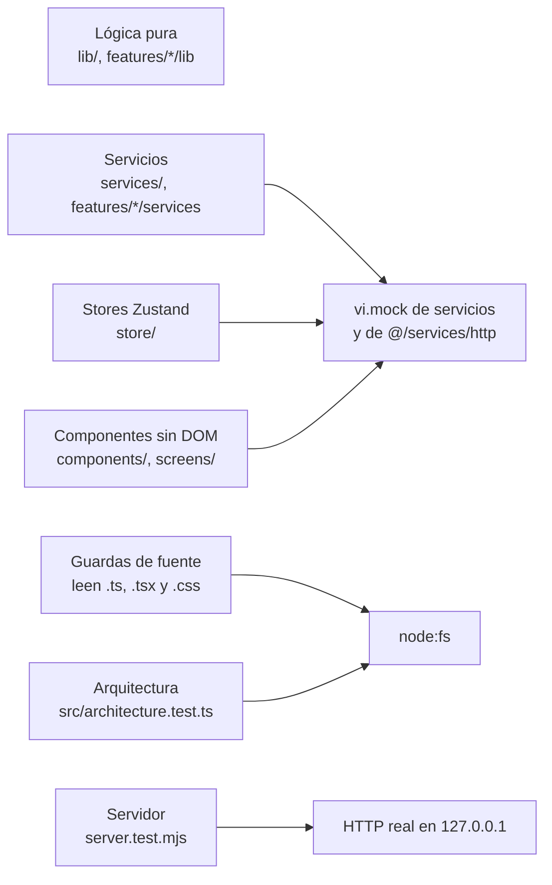

# Pruebas del frontend

Este documento describe cómo se prueba la web de Data Model Hub: la configuración de Vitest, los tipos de
prueba (lógica pura, stores, servicios, componentes sin DOM, guardas que leen el código fuente, el servidor
de producción y las reglas de arquitectura), las compuertas estáticas (`tsc` y ESLint), los comandos y
las convenciones. Está dirigido a quien modifica el frontend y necesita saber qué prueba escribir, dónde
ubicarla y cómo ejecutarla.

## Contenido

- [Vitest y su configuración](#vitest-y-su-configuración)
- [Tipos de prueba](#tipos-de-prueba)
- [Pruebas de stores](#pruebas-de-stores)
- [Componentes sin DOM](#componentes-sin-dom)
- [Guardas que leen el código fuente](#guardas-que-leen-el-código-fuente)
- [Permisos y Admin](#permisos-y-admin)
- [Pruebas de arquitectura](#pruebas-de-arquitectura)
- [Servidor de producción](#servidor-de-producción)
- [Compuertas estáticas](#compuertas-estáticas)
- [Comandos](#comandos)
- [Convenciones](#convenciones)
- [Documentos relacionados](#documentos-relacionados)

## Vitest y su configuración

Las pruebas corren con Vitest (versión fijada en `package.json`). No hay un `vitest.config.*` aparte: la
configuración está en el bloque `test` de `vite.config.ts`, que usa `defineConfig` de `vitest/config`.

```ts
// vite.config.ts (bloque test)
test: {
  environment: 'node',
  include: ['src/**/*.test.{ts,tsx}', 'server.test.mjs'],
},
```

- **Entorno `node`.** Las pruebas no tienen DOM: no se usa `jsdom` ni `happy-dom`, y ningún archivo
  cambia de entorno con `@vitest-environment`. Los componentes se prueban con las técnicas de
  [Componentes sin DOM](#componentes-sin-dom).
- **Descubrimiento.** Todo `*.test.ts` o `*.test.tsx` bajo `src/`, más `server.test.mjs` en la raíz, que
  está listado explícitamente en `include`.
- **Alias.** `@` apunta a `src/` (`resolve.alias`), igual que en la aplicación; las pruebas importan con
  `@/services/...`, `@/store/...`.
- **API.** Las pruebas importan `describe`, `it`, `expect`, `vi`, `beforeEach` y similares desde
  `vitest` (no hay globales).

Para ver qué pruebas existen se listan sin ejecutarlas:

```bash
npx vitest list
npx vitest list src/store
```

La versión 1 se publica con 246 archivos de prueba y 2639 pruebas en verde; el conteo vigente se obtiene
con `npx vitest list`.

## Tipos de prueba

Cada tipo de prueba vive junto al código que prueba, con el mismo nombre base y el sufijo `.test.ts` (o
`.test.tsx` si usa JSX). El siguiente diagrama ubica cada tipo según lo que ejecuta.



| Tipo | Ubicación típica | Qué ejecuta |
|---|---|---|
| Lógica pura | `src/lib`, `src/features/*/lib`, `src/features/ddl` | Funciones sin efectos: orden de llaves, nombres físicos, pares de relación, generadores DDL, filas del reporte, lectura de libros Excel, facetas, utilidades de zip y pools. Se llaman con datos armados en la prueba. |
| Servicios | `src/services`, `src/features/*/services`, `src/features/standards` | Funciones que llaman a la API. Se simula `@/services/http` (o `fetch` con `vi.stubGlobal`) y se verifica la URL, el payload y el manejo de errores. |
| Stores | `src/store` | Acciones de los stores de Zustand con los servicios simulados. Ver [Pruebas de stores](#pruebas-de-stores). |
| Componentes | `src/components/ui`, `src/features/*/components`, `src/screens` | Markup estático o el componente llamado como función con hooks falsos. |
| Guardas de fuente | Junto al componente que vigilan | Leen el archivo fuente y verifican un patrón (orden de llamadas, uso de un helper). |
| Arquitectura | `src/architecture.test.ts` | Reglas transversales sobre carpetas, imports y estilos. |
| Servidor | `server.test.mjs` | `server.mjs`: funciones unitarias y un servidor real contra un backend falso. |

### Servicios simulados

Los servicios se aíslan de la red con `vi.mock`. El mock de `@/services/http` incluye las constantes que
los servicios usan además de las funciones, por ejemplo `LONG_TIMEOUT_MS`:

```ts
// src/features/modeler/services/explorer.service.test.ts (extracto)
vi.mock('@/services/http', () => ({
  apiGet: vi.fn(),
  LONG_TIMEOUT_MS: 120_000,
  apiPost: vi.fn(),
  ...
}));
```

Cuando la prueba necesita el comportamiento real de parte del módulo, se usa `importOriginal` y se
sustituye solo lo que va a la red. Las pruebas del cliente HTTP y de la lectura del Reporting simulan
`fetch` directamente con `vi.stubGlobal('fetch', vi.fn(...))` para cubrir respuestas no JSON, timeouts y
cortes de red.

## Pruebas de stores

Las pruebas de `src/store` ejercitan los stores por su API imperativa (`useXStore.getState().accion()`)
y verifican el estado resultante y las llamadas a los servicios. `useModelerStore` tiene una prueba por
comportamiento, con el nombre `useModelerStore.<tema>.test.ts` (columnas, PK, copiar y pegar, Undo, pins
de sesión, recargas, vistas, colores, membresía de canvas, entre otros).

El patrón es:

1. `vi.mock` de los servicios que tocan la red (`governance.service`, `changeset.service`,
   `modeler.service`) y de `sonner` (toasts), antes de importar el store.
2. Estado inicial armado con `useModelerStore.setState({...})` en un helper o en `beforeEach`;
   `vi.clearAllMocks()` y el reinicio de los stores auxiliares (`useUndoStore`) en `beforeEach`.
3. Llamada a la acción y aserciones sobre el payload enviado, el estado y la pila de Undo.

```ts
// src/store/useModelerStore.pk.test.ts (extracto)
vi.mock('@/services/governance.service', async (importOriginal) => {
  const actual = await importOriginal<typeof import('@/services/governance.service')>();
  return { ...actual, updateColumn: vi.fn(async () => ({})), recordChangesBulk: vi.fn(async () => ({})) };
});
vi.mock('@/features/modeler/services/modeler.service', () => ({}));
vi.mock('sonner', () => ({ toast: { error: vi.fn(), success: vi.fn() } }));

beforeEach(() => {
  vi.clearAllMocks();
  useUndoStore.setState({ stack: [], busy: false });
});

it('marcar PK: sube al final del bloque PK y corre las no-PK en un lote', async () => {
  setCols([col('k', 0, true), col('a', 1), col('b', 2), col('c', 3)]);
  await useModelerStore.getState().updateColumn('c', { isPrimaryKey: true });
  expect(gov.recordChangesBulk).toHaveBeenCalledTimes(1);
  ...
});
```

Las pruebas `*.integration.test.ts` de `src/store` combinan el store real con el servicio real de
estructura (`structure.service`, con su cola de escrituras) contra un backend en memoria con latencia.
Comprueban invariantes que dependen del orden de las escrituras en segundo plano, por ejemplo que la
lista de miembros de un canvas se arme dentro de la cola y no se pierda una escritura concurrente.

Las pruebas con temporizadores (debounce de guardados, escrituras en segundo plano) usan
`vi.useFakeTimers()`; las que dependen de la fecha fijan el reloj con `vi.setSystemTime(...)`.

## Componentes sin DOM

Como el entorno es `node`, los componentes React se prueban de dos maneras:

- **Markup estático.** `renderToStaticMarkup` de `react-dom/server` produce el HTML del componente y la
  prueba busca textos, atributos (`aria-*`, `disabled`) o clases. Sirve para verificar lo que se dibuja en
  un estado dado. Si el componente necesita un contexto (por ejemplo `ReactFlowProvider`), se envuelve.

  ```tsx
  // src/features/modeler/components/ViewNode.test.tsx (extracto)
  const render = () => renderToStaticMarkup(
    <ReactFlowProvider>
      <ViewNode {...({ id: 'v1', data: { view, sourceTables: [], colTypes: {}, onEdit: () => {} }, selected: false } as unknown as NodeProps)} />
    </ReactFlowProvider>,
  );
  it('dice «No columns»', () => {
    expect(render()).toContain('No columns');
  });
  ```

- **Hooks falsos.** `src/features/reporting/components/fakeReact.testutil.ts` sustituye los hooks de
  React para llamar al componente como función: cada `useState` devuelve su valor inicial (o el que
  indique `fake.override`) y un setter que anota lo que recibe; `useEffect` guarda el efecto para
  correrlo a mano. Así se disparan los handlers reales del árbol de elementos devuelto y se recorre un
  ciclo de vida (montar, recibir datos, re-renderizar con `resetFake(…, { keepRefs: true })`, correr los
  efectos cuyas dependencias cambiaron con `runEffects()` y desmontar con `unmount()`). Se activa en cada
  archivo con:

  ```ts
  vi.mock('react', async (orig) => (await import('./fakeReact.testutil')).fakeReact(await orig<object>()));
  ```

  La utilidad tiene sus propias pruebas (`fakeReact.testutil.test.ts`). Los archivos `*.testutil.ts` son
  soporte de pruebas: no los importa la aplicación.

Los diálogos del sistema de diseño (`src/components/ui/Dialog.test.ts`, `Modal.test.ts`,
`ConfirmDialog.test.ts`) usan los mismos hooks falsos para verificar, por ejemplo, que el foco entra a la
caja al abrirse; la lógica de foco y teclado extraída a funciones (`focusTrap.test.ts`) se prueba como
lógica pura.

## Guardas que leen el código fuente

Algunas reglas de un componente no se pueden observar sin DOM o dependen del orden de las sentencias
dentro de un handler async. Para esas, la prueba lee el archivo fuente con `node:fs`, quita los
comentarios y verifica el patrón con expresiones regulares o un análisis propio.

`src/features/modeler/components/successToasts.test.ts` es un ejemplo: comprueba que en `CtasModal.tsx`
el pin de sesión se toma antes de `await createTableFromSources(` y que el aviso de éxito solo se muestra
si `pin.holds()`. Así, un toast de éxito no aparece sobre una versión que se abrió mientras la acción
estaba en curso.

```ts
// src/features/modeler/components/successToasts.test.ts (extracto)
const code = (name: string) => readFileSync(join(__dirname, name), 'utf-8')
  .replace(/\/\*[\s\S]*?\*\//g, '').replace(/(^|[^:])\/\/.*$/gm, '$1');

it('CtasModal › Create: el pin se toma al pedirlo y el aviso mira que siga', () => {
  const body = /const create = async \(\) => \{([\s\S]*?)\n {2}\};/.exec(code('CtasModal.tsx'))?.[1] ?? '';
  const pinAt = body.indexOf('const pin = pinSession();');
  expect(pinAt).toBeGreaterThan(-1);
  expect(pinAt).toBeLessThan(body.indexOf('await createTableFromSources('));
});
```

Otras guardas de este tipo en `src/features/modeler/components` (`pinnedFlows.test.ts`,
`undoPins.test.ts`, `workspaceWriteErrors.test.ts`, `sessionModals.test.ts`, entre otras) usan el
analizador de `pinnedFlows.testutil.ts`: dentro de una función async, toda escritura que sigue a un
`await` debe ir precedida de la verificación del pin de sesión (`.check()` o `.holds()`) o pasar por
`pinned(…)`. Los servicios toman la versión activa al llamarlos; sin esa verificación, una escritura que
espera podría caer en otra versión abierta mientras tanto.

Como estas guardas dependen del texto del archivo, al renombrar una función o variable vigilada se
actualiza también la expresión de la prueba.

## Permisos y Admin

Las reglas de acceso que la interfaz replica del backend se prueban como lógica pura o con el servicio y
`fetch` simulado:

| Archivo | Qué verifica |
|---|---|
| `src/lib/permissionHints.test.ts` | `newProjectBlock`: sin `model.edit` o con proyectos asignados (sin `admin.manage`) devuelve el motivo; en otro caso, `null`. |
| `src/features/admin/components/helpers.test.ts` | Regla de al menos un administrador activo (`activeAdminIds`, `isOnlyAdmin`, `matrixLeavesNoAdmin`) y etiqueta del alcance por proyecto (`projectScopeLabel`, sin contar proyectos borrados). |
| `src/services/versioning.access.test.ts` | `canOpenVersion`: las versiones publicadas las ve todo el que accede al proyecto; las no publicadas, el dueño y los revisores asignados; las ajenas, solo `versions.view_all` o `admin.manage`. |
| `src/services/versioning.admin.test.ts` | Parámetros de transferir y eliminar versiones y del directorio de usuarios (`listUsers` frente a `listUserNames`). |
| `src/screens/ReviewScreen.test.ts` | Un request ajeno muestra la fila con el aviso y no pide el detalle; el revisor asignado ve el detalle; un cambio de permisos por `refreshMe` vuelve a pedirlo. |

## Sesión

| Archivo | Qué verifica |
|---|---|
| `src/features/auth/sessionKeeper.test.ts` | Cadencia (una hora: renovación como mucho cada 5 minutos y revisión cada 30 s); con actividad renueva y la sesión no vence; sin uso cierra al vencer («idle»), también con actividad posterior al vencimiento o al volver a la pestaña; una renovación sin respuesta se reintenta y, si nunca funciona, el cierre es «ended»; el logout propio cancela la renovación en vuelo; detenerlo espera la limpieza de un keeper ya terminado; entre pestañas, adopta la renovación de otra, sale con el logout de otra y con el ingreso de otra cuenta; una renovación tardía frente al logout o a otra cuenta en otra pestaña (antes o después de su aviso) borra la cookie, y no la borra si su respuesta es de la otra cuenta, si la misma cuenta volvió a entrar o si es el logout propio; otras claves y `clear()` no cierran la sesión; sin `localStorage` la pestaña sigue sola; una sesión solo de la pestaña ignora la marca. |
| `src/store/useAuthStore.test.ts` | `refreshMe` (tope, `force`, usuario deshabilitado, `/me` de otra cuenta); avisos del login (`restore()` sin sesión previa, vencida sin uso, terminada, acceso quitado, sin respuesta, falla del servidor); restore tardío que no toca una sesión nueva; sesión de una hora con el store real: cierre sin uso, renovación con actividad, renovación de un usuario deshabilitado o de otra cuenta, logout que no sale antes de que la renovación en vuelo termine o se cancele, avisos entre pestañas, limpieza de una renovación tardía tras el logout de otra pestaña y no tras el ingreso de otra cuenta con su cookie, cookie sin token en memoria ni en el navegador y token en memoria cuando la respuesta lo trae. |

## Pruebas de arquitectura

`src/architecture.test.ts` reúne reglas transversales que leen el árbol de `src/`:

| Bloque | Regla |
|---|---|
| Data Standards es explícito por proyecto | Ningún archivo de `features/standards` importa `governance.service` ni usa `sessionProjectId`: Data Standards recibe el `projectId` explícito y no depende del proyecto de la sesión (que lanza error si no hay proyecto activo). |
| Fondos de popup sin `backdrop-filter` | Ninguna regla CSS de `.dmh-backdrop` o `.dmh-dialog-backdrop` (y sus variantes) usa `backdrop-filter`: el difuminado obliga a recomponer el área del canvas en cada cuadro y, sin aceleración por GPU, satura el navegador. |
| Export DDL: vistas del canvas | Ningún archivo de `features/ddl` lee las vistas por tablas (`listViewsForTables`): el DDL exporta las vistas del canvas. |
| Botones con texto se ven como botón | Un botón con texto visible no usa la variante `ghost` ni `rd-btn` sin variante (salvo con fondo propio); los botones de solo ícono sí pueden ser `ghost`. |

Cada bloque incluye una prueba que alimenta el detector con casos conocidos (válidos e inválidos) para que
una regla que deje de detectar no pase en verde.

El contrato de rutas entre el frontend y el backend (toda llamada `apiGet/apiPost/…` apunta a una ruta
que el backend expone) lo verifica la suite del backend (`tests/architecture/test_front_routes.py`), que
lee `src/` de este repositorio.

## Servidor de producción

`server.test.mjs` prueba `server.mjs` en dos planos:

- **Unitario.** `safeJoin` (rutas normales dentro de `dist` y bloqueo de path traversal, incluido
  `%2e%2e` y codificación inválida), `contentTypeFor` (tipos del build y `application/octet-stream` por
  defecto), `buildUpstreamHeaders` (las cabeceras que se envían al backend: descarta `host` y el
  `Authorization` y las cookies del cliente, pone el Bearer del service principal, conserva
  `X-Session-Token`, borra las cabeceras `x-dmh-*` que llegan del navegador, releva la identidad que atesta
  el proxy de la plataforma y adjunta el secreto compartido si está configurado), la cookie de sesión
  (`readCookie`, atributos por http y por https) y `TokenCache` (caché y renovación del token M2M).
- **Integración.** Levanta un backend falso con `http.createServer` y el servidor real con `createServer`
  sobre un `dist` temporal (`mkdtempSync`), ambos en `127.0.0.1` con puerto efímero. Verifica estáticos,
  fallback de la SPA, proxy de `/api` con el Bearer, streaming del cuerpo y el reintento cuando el proxy
  de la plataforma responde 401 con `{}`. También verifica las cabeceras de seguridad: los estáticos y el
  fallback de la SPA llevan la CSP y el resto de `SECURITY_HEADERS`, HSTS solo cuando el request llega
  con `X-Forwarded-Proto: https`, y las respuestas de `/api` conservan las cabeceras del backend sin CSP
  propia. El cliente de token es un `vi.fn` que entrega tokens sucesivos;
  las aserciones no dependen de cuál de ellos llega, para no depender del orden de las pruebas.
- **Sesión en cookie.** Con otro backend falso que, como el real, decodifica y normaliza la ruta: el token
  sale del cuerpo del login SSO y de la renovación (también comprimida y por rutas con `%XX`)
  y queda en la cookie con sus atributos; una codificación inválida recibe 400; las demás respuestas de
  `/api/auth/` y un login rechazado o sin token pasan tal cual; la cookie viaja al backend como
  `X-Session-Token` y las cookies del navegador no; una escritura con la cookie sin `X-Requested-With` no
  llega al backend; las respuestas de `/api` salen sin cabeceras CORS; el logout borra la cookie con éxito,
  con error, sin backend configurado, ante un error interno y con el backend caído; y con
  `sessionCookie: false` todo queda como token en el cuerpo.

`server.mjs` y `server.test.mjs` no pasan por `tsc` (`tsconfig.json` incluye solo `src`); su verificación
son estas pruebas y ESLint.

## Compuertas estáticas

| Compuerta | Comando | Qué verifica |
|---|---|---|
| Tipos | `npx tsc --noEmit` | `tsconfig.json` en modo estricto sobre `src/`, incluidas las pruebas. `npm run build` corre esta misma verificación antes de `vite build`. |
| ESLint | `npm run lint` | `eslint .` con `eslint.config.mjs`: reglas recomendadas de JavaScript y de `typescript-eslint`, `react-hooks/exhaustive-deps` (advertencia) y la guarda de límites de feature `no-restricted-imports` (advertencia), que exige importar una feature por su barrel `@/features/<name>`. Ignora `dist`, `node_modules`, `.next` y `scripts`. Los `.mjs` de la raíz se revisan con los globales de Node. |
| Pruebas | `npm test` | `vitest run`. |

## Comandos

```bash
# Suite completa, una sola corrida
npm test

# Modo observación (vuelve a correr al guardar)
npx vitest

# Un archivo o una carpeta
npx vitest run src/store/useModelerStore.pk.test.ts
npx vitest run src/features/ddl

# Por nombre de prueba
npx vitest run -t "marcar PK"

# Orden aleatorio, para detectar dependencias entre pruebas
npx vitest run --sequence.shuffle

# Listar sin ejecutar
npx vitest list

# Solo el servidor de producción
npx vitest run server.test.mjs

# Tipos y lint
npx tsc --noEmit
npm run lint
```

## Convenciones

- **Junto al código.** La prueba de `x.ts` es `x.test.ts` en la misma carpeta. Si un módulo tiene muchas
  reglas, se divide por tema: `useModelerStore.<tema>.test.ts`, `ReportingScreen.pages.test.ts`.
  Las pruebas que combinan el store con servicios reales llevan `.integration.test.ts`.
- **Soporte de pruebas.** Las utilidades compartidas se nombran `*.testutil.ts`, viven junto a las
  pruebas que las usan y no se importan desde la aplicación.
- **Nombres.** `describe` e `it` en español y describiendo la regla («marcar PK: sube al final del bloque
  PK…»). Los textos de la UI que la prueba busca se citan tal como aparecen, en inglés. Un comentario al
  inicio del archivo explica qué invariante protege la prueba.
- **Un comportamiento por prueba.** Cada `it` verifica una regla; los casos de una misma regla se
  expresan con `it.each`.
- **Sin red ni DOM.** Toda llamada HTTP se simula (`vi.mock` del servicio o de `@/services/http`, o
  `vi.stubGlobal('fetch', …)`); solo `server.test.mjs` abre sockets, y solo en `127.0.0.1`.
- **Independencia.** El estado de los stores se reinicia en `beforeEach` con `setState`, los mocks se
  limpian con `vi.clearAllMocks()` y los temporizadores falsos se restauran al terminar. La suite debe
  pasar igual con `--sequence.shuffle`. Una prueba que solo pasa en cierto orden depende de estado de
  módulo (un temporizador, una caché, un store sin reiniciar): se reinicia ese estado en la prueba en
  lugar de fijar el orden.
- **Determinismo.** Las fechas se fijan con `vi.setSystemTime`, las esperas con `vi.useFakeTimers` y los
  ids se escriben literales en la prueba.
- **Guardas de fuente.** Se quitan los comentarios del fuente antes de buscar el patrón, para que un
  comentario no satisfaga ni rompa la regla, y se acompañan de un caso que demuestre que el detector
  encuentra el error.

## Documentos relacionados

- [Arquitectura](02-arquitectura.md)
- [Estructura del proyecto](03-estructura-del-proyecto.md)
- [Stack tecnológico](04-stack-tecnologico.md)
- [Flujo de datos](06-flujo-de-datos.md)
- [Integración con la API](07-integracion-con-la-api.md)
- [Seguridad](08-seguridad.md)
- [Despliegue](09-despliegue.md)
- [Consideraciones técnicas](12-consideraciones-tecnicas.md)
