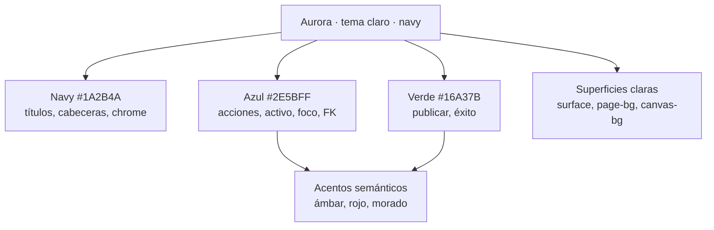
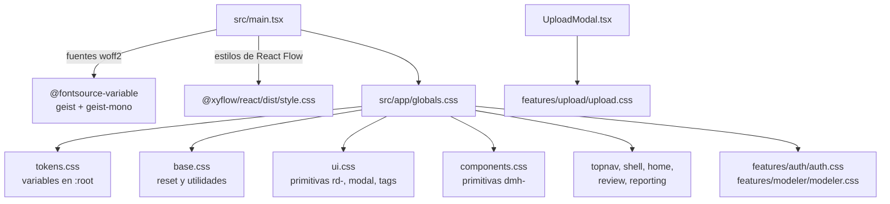
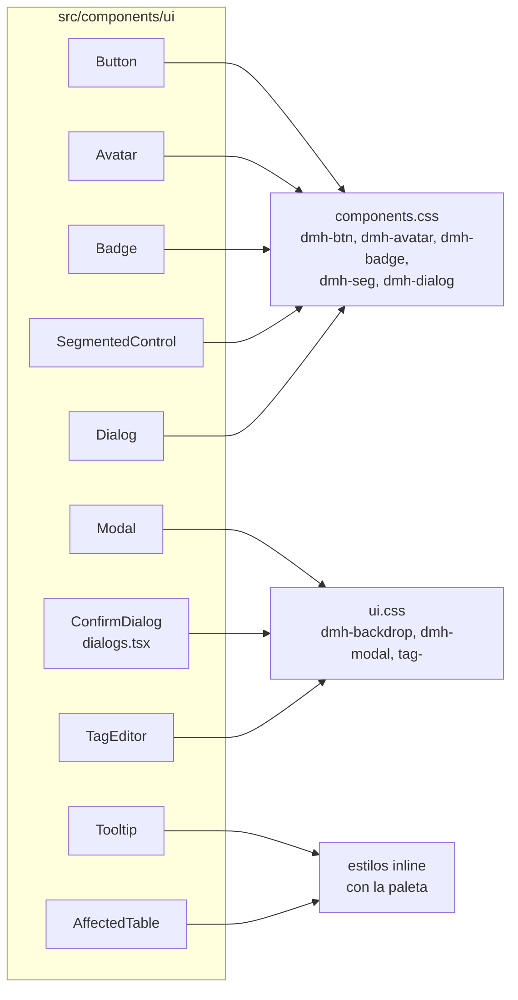
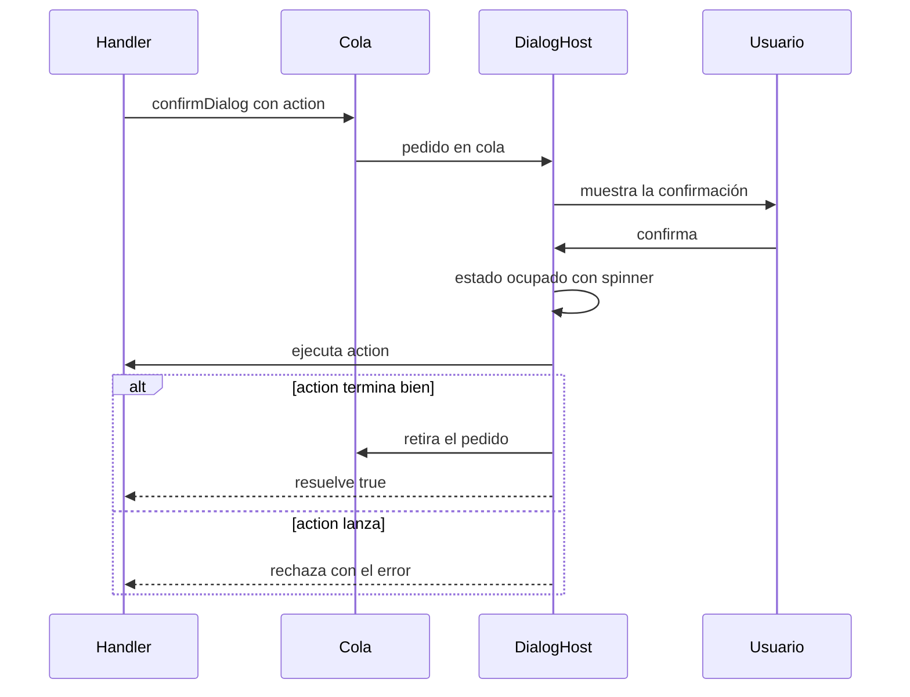

# Sistema de diseño

Referencia del sistema visual del frontend de Data Model Hub: tokens de color, tipografía, radios y
sombras; organización de las hojas de estilo; componentes UI compartidos y su API; patrones de
interacción (modales, foco, flotantes, toasts, íconos, botones); accesibilidad; y el vocabulario
visual del canvas de modelado. Está dirigido a quienes desarrollan pantallas o componentes y
necesitan mantener la coherencia visual y de comportamiento.

## Contenido

- [Principios visuales](#principios-visuales)
- [Organización de los estilos](#organización-de-los-estilos)
- [Tokens de color](#tokens-de-color)
- [Tipografía](#tipografía)
- [Radios, sombras, espaciado y capas](#radios-sombras-espaciado-y-capas)
- [Componentes UI compartidos](#componentes-ui-compartidos)
- [Patrones de interacción](#patrones-de-interacción)
- [Accesibilidad](#accesibilidad)
- [Vocabulario visual del canvas](#vocabulario-visual-del-canvas)
- [Referencia rápida de clases](#referencia-rápida-de-clases)
- [Checklist para una pantalla o componente](#checklist-para-una-pantalla-o-componente)
- [Documentos relacionados](#documentos-relacionados)

## Principios visuales

El sistema de diseño se llama **Aurora** en los comentarios del código (`src/app/globals.css`,
`src/styles/*.css`). Sus principios:

- **Un solo tema claro, de identidad azul marino.** No existe modo oscuro: `tokens.css` declara un
  único conjunto de variables y ninguna hoja usa `prefers-color-scheme`. Las superficies son blancas
  (`--surface`) sobre un fondo de página gris muy claro (`--page-bg`); el canvas usa `--canvas-bg` con
  una grilla de puntos `--canvas-dot`.
- **Tres colores base.** Navy `#1A2B4A` para títulos, cabeceras y chrome; azul `#2E5BFF` para acciones
  primarias, estados activos, foco y llaves foráneas; verde `#16A37B` / `#0E8C6A` para publicar y éxito. Ámbar, rojo y morado son acentos semánticos (PK y revisión, rechazo y peligro,
  dominio padre y surrogate keys).
- **Sin emojis.** Todos los glifos son íconos de trazo simple (1.5–2 px) con `currentColor`.
- **Geist para la UI, Geist Mono para datos.** Identificadores, tipos de columna, SQL y DDL van en
  monoespaciada, con las ligaduras apagadas.
- **Estética sobria y densa.** Radios suaves (7–14 px), sombras tenues con tinte navy y bordes
  gris azulados finos. La densidad responde a pantallas que muestran muchas tablas y columnas a la vez.
- **El color nunca es la única señal.** En el canvas las vistas se distinguen de las tablas por
  borde punteado y trama, y las relaciones por tipo de trazo; en la revisión, los verbos de cambio
  llevan además borde lateral, tachado o encabezado de columna.

El siguiente diagrama resume cómo se reparten los roles de color.



## Organización de los estilos

Todos los estilos son **globales** (no se usan CSS Modules ni CSS-in-JS como sistema). Se cargan por
cascada desde `src/app/globals.css`, que importa las hojas en este orden:

```text
tokens → base → ui → components → topnav → shell → home → review → reporting → auth → modeler
```

`src/main.tsx` importa primero las fuentes (`@fontsource-variable/geist`, `@fontsource-variable/geist-mono`),
luego la hoja de estilos de React Flow (`@xyflow/react/dist/style.css`) y por último `globals.css`.
La carga Excel es la excepción al registro central: `src/features/upload/components/UploadModal.tsx`
importa `../upload.css` directamente, de modo que esa hoja entra con el módulo.

El diagrama muestra la cadena de importación.



### Hojas y prefijos

Al ser globales, las clases se agrupan por prefijo para evitar colisiones. Los prefijos reales son:

| Hoja | Prefijos principales | Contenido |
|---|---|---|
| `src/styles/tokens.css` | (variables) | Paleta, alias semánticos, radios, sombras y familias tipográficas en `:root`. |
| `src/styles/base.css` | elementos, `.flex-1`, `.nodrag` | Reset global, fuente del `body`, ligaduras apagadas, utilidades mínimas. |
| `src/styles/ui.css` | `rd-`, `dmh-backdrop`, `dmh-modal`, `m-`, `tag-`, `ins-`, `code-` | Escala tipográfica, botones e inputs `rd-`, menú, tabs, toggle, badges de llave, shell de `Modal`, editor de tags, panel inspector. |
| `src/styles/components.css` | `dmh-btn`, `dmh-pill`, `dmh-chip`, `dmh-badge`, `dmh-avatar`, `dmh-seg`, `dmh-dialog`, `dmh-busy-` | Primitivas que consumen los componentes de `src/components/ui/` y la espera bloqueante. |
| `src/styles/topnav.css` | `dmh-topnav`, `dmh-nav-`, `dmh-usermenu` | Barra superior y menú de usuario. |
| `src/styles/shell.css` | `dmh-rail`, `dmh-top`, `dmh-page`, `dmh-pcard` | Shell de la app y tarjetas de proyecto. |
| `src/styles/home.css` | `dmh-` | Pantalla Home y sus popups. |
| `src/styles/review.css` | `dmh-rv` | Revisión de cambios (resumen, árbol de diferencias, comentarios). |
| `src/styles/reporting.css` | `dmh-rep-` | Grilla, filtros, rail de exports e indicadores de Reporting. |
| `src/features/auth/auth.css` | `dmh-login` | Pantalla de login. |
| `src/features/modeler/modeler.css` | `wk-`, `exd-`, `udp-`, `ppub-`, `tb-` | Workspace y canvas (`wk-`), Export DDL (`exd-`), UDP (`udp-`), publicación (`ppub-`), toolbar (`tb-`). |
| `src/features/upload/upload.css` | `up-` | Carga desde Excel. |

Convención para agregar estilos: una feature con estilos propios los declara en
`src/features/<feature>/<feature>.css` con un prefijo propio y usa los tokens de `tokens.css`; la hoja
se registra con un `@import` al final de `globals.css` (o se importa desde el componente raíz de la
feature, como la carga Excel).

### Estilos inline

Algunos módulos usan objetos `CSSProperties` en lugar de clases:

- **Admin** (`src/features/admin/components/`) no tiene hoja propia. `helpers.ts` exporta una paleta `C`
  que replica en constantes JS los hex de `tokens.css` (`navy`, `text`, `blue`, `green`, `amber`, `red`,
  `border`, `panel`…), estilos base (`inputStyle`, `labelStyle`, `primaryBtn`, `ghostBtn`, `dangerBtn`,
  `iconBtnStyle`, `chipStyle`) y utilidades (`avatarColor`, `initialsOf`, `statusMeta`, `accessLevelOf`,
  `projectScopeLabel`), junto con las reglas puras del único administrador (`isOnlyAdmin`,
  `matrixLeavesNoAdmin`). El módulo tiene
  además su propio shell de modal (`Modal.tsx`) y sus glifos SVG (`icons.tsx`).
- **Componentes puntuales** (`AffectedTable`, `Tooltip`, el editor de plantillas de Reporting) usan hex
  literales de la misma paleta.
- **Escena de los exports** (`lib/exportScene.ts`, `lib/sceneSvg.ts`): usa colores literales en lugar de
  variables CSS, porque el archivo que genera **Export diagram** no tiene acceso a las variables de la
  aplicación. Algunos símbolos del canvas (por ejemplo, `SubtypeSymbolNode.tsx`) también usan hex
  literales de la paleta.

Para pantallas nuevas se prefiere una hoja por feature con tokens; el inline con `C` es el patrón del
módulo Admin.

### Alias de importación

`vite.config.ts` mapea `@` a `src`; las primitivas se importan como
`import { Button, Dialog } from '@/components/ui'`.

## Tokens de color

`src/styles/tokens.css` define todo en `:root` (sin contenedor), en dos capas: la **paleta del diseño**
(hex exactos) y los **alias semánticos** que usan las clases (`--primary`, `--ink`, `--muted`…), que
apuntan a la paleta. Cambiar un hex de la paleta repercute en todas las clases que usan su alias.

### Paleta del diseño

| Variable | Valor | Uso |
|---|---|---|
| `--blue` | `#2E5BFF` | Azul primario: acciones, activo, FK. |
| `--blue-tint` | `#EAF0FF` | Nav y tab activos, rellenos seleccionados. |
| `--blue-border` | `#D4E0FF` | Pills y bordes suaves. |
| `--blue-border-2` | `#D9E3FB` | Borde alterno. |
| `--blue-soft` | `#F2F6FF` | Lavado azul muy suave. |
| `--blue-soft-2` | `#E3EBFF` | Franja PK del bloque de tabla. |
| `--green` | `#16A37B` | Botón Publish, pasos completados. |
| `--green-deep` | `#0E8C6A` | Texto agregado, ícono de partición. |
| `--green-tint` | `#E4F6EF` | Pills de éxito. |
| `--green-tint-2` | `#EFFAF4` | Filas agregadas. |
| `--green-tint-3` | `#F4F9F6` | Fila de la versión en producción. |
| `--amber` | `#E0A024` | Ícono PK. |
| `--amber-deep` | `#9A6B00` | Texto de advertencia. |
| `--amber-tint` | `#FFF6E6` | Pills de «en revisión». |
| `--amber-tint-2` | `#FFF1D6` | Overrides. |
| `--red` | `#C0392B` | Rechazo, peligro, error. |
| `--red-border` | `#F0C9C4` | Borde de acciones de peligro. |
| `--red-tint` | `#FBEAEA` | Fondo de acciones de peligro. |
| `--purple` | `#8B5CF6` | Glifo de dominio padre, badge de modificador, surrogate keys. |
| `--purple-tint` | `#F2EEFE` | Fondo morado suave. |
| `--navy` | `#1A2B4A` | Títulos, tarjetas oscuras, cabeceras de tabla. |
| `--text-body` | `#3A4658` | Texto por defecto. |
| `--text-muted` | `#56607A` | Texto secundario. |
| `--text-muted-2` | `#8A93A5` | Etiquetas, tipos en monoespaciada. |
| `--text-muted-3` | `#9AA3B2` | Etiquetas más tenues, ceros en matrices. |
| `--text-placeholder` | `#A9B1BE` | Placeholders de inputs. |
| `--border-1` | `#E2E6EE` | Tarjetas. |
| `--border-2` | `#EAEDF2` | Divisores, borde del top-nav. |
| `--border-3` | `#DDE2EC` | Inputs, botón secundario. |
| `--border-4` | `#E6EAF0` | Borde alterno. |
| `--fill-1` | `#F4F6F9` | Relleno sutil. |
| `--fill-2` | `#F7F9FC` | Cabecera de tabla. |
| `--fill-3` | `#FAFBFC` | Relleno claro. |
| `--fill-4` | `#F0F2F6` | Relleno alterno. |
| `--page-bg` | `#EDEFF3` | Fondo de la app. |
| `--canvas-bg` | `#FBFCFD` | Superficie de modelado. |
| `--canvas-dot` | `#D6DBE6` | Grilla de puntos del canvas. |
| `--blur-overlay` | `rgba(16,27,48,0.42)` | Scrim de los popups sobre el canvas (solo oscurece, sin blur). |

### Alias semánticos

| Alias | Apunta a | Uso |
|---|---|---|
| `--bg` / `--canvas` | `--page-bg` / `--canvas-bg` | Fondo de página y de canvas. |
| `--surface` / `--surface-2` | `#ffffff` / `--fill-2` | Superficies. |
| `--border` / `--border-soft` / `--border-strong` | `--border-1` / `--border-2` / `--border-3` | Bordes. |
| `--ink` / `--ink-2` | `--navy` / `--text-body` | Texto principal. |
| `--muted` / `--subtle` / `--placeholder` | `--text-muted` / `--text-muted-2` / `--text-placeholder` | Texto secundario. |
| `--inverse` / `--on-primary` | `#ffffff` | Texto sobre fondos oscuros o primarios. |
| `--primary` | `--blue` | Acción primaria. |
| `--primary-700` | `#1F46E0` | Hover del primario. |
| `--primary-soft` | `--blue-tint` | Fondo suave del primario. |
| `--primary-muted` | `rgba(46,91,255,.10)` | Anillo de foco, hover de ghost. |
| `--success` / `--success-soft` | `--green-deep` / `--green-tint` | Éxito. |
| `--warning` / `--warning-soft` | `--amber-deep` / `--amber-tint` | Advertencia. |
| `--error` / `--error-soft` | `--red` / `--red-tint` | Error. |
| `--flow` / `--flow-700` / `--flow-soft` | `--green` / `--green-deep` / `--green-tint` | Vista previa del nombre físico derivado, badges `rd-badge-flow` e ícono de los toasts de `ui.css`. |
| `--accent2` | `--blue` | Acento secundario. |

Los chips de llaves ER (clase `.rd-key`) tienen su par de tokens:

| Tokens | Color | Llave |
|---|---|---|
| `--k-pk` / `--k-pk-soft` | ámbar | Primary key |
| `--k-fk` / `--k-fk-soft` | azul | Foreign key |
| `--k-sk` / `--k-sk-soft` | morado | Surrogate key |
| `--k-pt` / `--k-pt-soft` | verde oscuro | Partición |

## Tipografía

Las dos familias se autoalojan con `@fontsource-variable` (sin CDN): `src/main.tsx` importa los
`.woff2` de `@fontsource-variable/geist` y `@fontsource-variable/geist-mono` (versiones fijadas en
`package.json`) y `globals.css` nombra las familias.

| Familia | Variable | Uso |
|---|---|---|
| Geist Variable | `--ui` | Toda la UI: texto, botones, navegación, etiquetas. |
| Geist Mono Variable | `--mono` | Datos, identificadores, tipos de columna, SQL y DDL. |

```css
/* globals.css */
--font-geist:      'Geist Variable', system-ui, sans-serif;
--font-geist-mono: 'Geist Mono Variable', ui-monospace, monospace;

/* tokens.css */
--ui:   var(--font-geist), 'Geist Variable', -apple-system, BlinkMacSystemFont, 'Segoe UI', sans-serif;
--mono: var(--font-geist-mono), 'Geist Mono Variable', ui-monospace, 'JetBrains Mono', monospace;
```

`base.css` aplica `font-family: var(--ui)` al `body`. El `Toaster` de sonner recibe la misma familia
por `toastOptions.style`.

### Ligaduras apagadas

Geist Mono trae ligaduras de código en la feature `liga` (por ejemplo, `<>` se dibuja como un solo
glifo). En esta aplicación se muestran identificadores y tipos como `STRUCT<...>`, `ARRAY<>` o `MAP<>`,
donde cada carácter debe verse por separado. Por eso `base.css` apaga todas las ligaduras en el `body`
con el override de más bajo nivel, y obliga a los controles de formulario a heredarlo (la hoja del
navegador los reinicia con el shorthand `font`):

```css
body {
  font-variant-ligatures: none;
  font-feature-settings: 'liga' 0, 'clig' 0, 'dlig' 0, 'calt' 0;
}
button, input, textarea, select {
  font-family: inherit;
  font-variant-ligatures: inherit;
  font-feature-settings: inherit;
}
```

### Escala tipográfica

Las clases de texto viven en `ui.css`:

| Clase | Tamaño | Peso | Notas |
|---|---|---|---|
| `.rd-eyebrow` | 11 px | 700 | Mayúsculas, `letter-spacing .12em`, color `--subtle`. |
| `.rd-h1` | 26 px | 800 | `letter-spacing -.02em`, color `--ink`. |
| `.rd-h2` | 19 px | 700 | `letter-spacing -.01em`. |
| `.rd-h3` | 15 px | 700 | |
| `.rd-body` | 13.5 px | normal | `line-height 1.6`, color `--ink-2`. |
| `.rd-small` | 12 px | normal | Color `--muted`. |
| `.rd-mono` | hereda | hereda | Aplica `var(--mono)`. |

El cuerpo general de la app trabaja entre 11 y 13.5 px; los badges usan 10 px en mayúsculas.

## Radios, sombras, espaciado y capas

### Radios

| Variable | Valor | Uso |
|---|---|---|
| `--r-chip` | 7 px | Chips chicos. |
| `--r-sm` | 9 px | Inputs, botones, botones de ícono. |
| `--r` | 11 px | Tarjetas chicas. |
| `--r-lg` | 13 px | Tarjetas. |
| `--r-xl` | 14 px | Tarjetas grandes y diálogos. |
| `--r-full` | 999 px | Pills. |

### Sombras

Todas usan el tinte navy `rgba(16,27,48,…)`.

| Variable | Definición | Uso |
|---|---|---|
| `--shadow-xs` | `0 1px 2px rgba(16,27,48,.05)` | Botón secundario, segmento activo. |
| `--shadow-sm` | `0 1px 3px rgba(16,27,48,.06)` | Tarjetas planas. |
| `--shadow-md` | `0 6px 18px -4px …, 0 2px 6px -2px …` | Menús, tooltips. |
| `--shadow-lg` | `0 16px 40px -8px rgba(16,27,48,.20)` | Flotantes grandes. |
| `--shadow-card` | `0 1px 3px …, 0 18px 50px rgba(16,27,48,.07)` | Tarjetas destacadas. |
| `--shadow-table` | `0 2px 6px …, 0 10px 28px rgba(16,27,48,.07)` | Bloques de tabla y vista del canvas. |
| `--shadow-popup` | `0 30px 90px rgba(16,27,48,.34)` | Diálogos. |

### Espaciado

No hay tokens de espaciado: los márgenes y rellenos se escriben en píxeles en cada hoja. Los valores
recurrentes son 4, 6, 8, 11, 12, 14, 18 y 30 px (por ejemplo, botones de 36 px de alto con relleno
lateral de 14 px, y 30 px de relleno alrededor de los diálogos). Al agregar estilos se reutilizan esos
valores para mantener la densidad.

### Capas (z-index)

Tampoco hay tokens de z-index; las capas se fijan en cada hoja. Las relevantes para superponer
elementos son:

| Capa | z-index | Dónde |
|---|---|---|
| Barra superior / menú de usuario | 40 / 50 | `topnav.css` |
| Shell de `Modal` (`.dmh-backdrop`) | 200 | `ui.css` |
| Shell de `Dialog` (`.dmh-dialog-backdrop`) | 300 | `components.css` |
| Confirmaciones y prompts (`.dmh-backdrop--top`) | 400 | `ui.css` |
| Tooltip | 1000 | `Tooltip.tsx` (inline) |
| Espera bloqueante (`.dmh-busy-overlay`) | 1300 | `components.css` |

Las confirmaciones y prompts quedan siempre encima de cualquier diálogo abierto, y la espera bloqueante
encima de todo.

## Componentes UI compartidos

Viven en `src/components/ui/` y se reexportan desde el barrel `src/components/ui/index.ts`:

```tsx
import { Button, Dialog, Badge, Avatar, SegmentedControl, Tooltip, Modal, ConfirmDialog, AffectedTable } from '@/components/ui';
```

`Icon`, `TagEditor` y los diálogos imperativos (`confirmDialog`, `promptDialog`, `DialogHost`) se
importan desde su propio archivo. El diagrama muestra qué hoja estiliza cada componente.



| Componente | Archivo | Para qué sirve |
|---|---|---|
| `Button` | `Button.tsx` | Botón con variante, tamaño e íconos lucide. |
| `Badge` | `Badge.tsx` | Etiqueta chica de esquinas cuadradas (conteos, PK/FK, tipos de palabra). |
| `Avatar` | `Avatar.tsx` | Círculo con iniciales. |
| `SegmentedControl` | `SegmentedControl.tsx` | Grupo de opciones excluyentes en forma de pills. |
| `Dialog` | `Dialog.tsx` | Diálogo modal con ícono lucide y scrim de pantalla o de canvas. |
| `Modal` | `Modal.tsx` | Shell de modal con íconos del set propio por nombre. |
| `ConfirmDialog` | `ConfirmDialog.tsx` | Confirmación accesible que sustituye a `window.confirm`. |
| `confirmDialog` / `promptDialog` / `DialogHost` | `dialogs.tsx` | Diálogos imperativos basados en promesas, con cola global. |
| `Tooltip` | `Tooltip.tsx` | Rótulo flotante al pasar el puntero. |
| `TagEditor` | `TagEditor.tsx` | Editor de etiquetas clave/valor. |
| `AffectedTable` | `AffectedTable.tsx` | Lista virtualizada con buscador y columnas redimensionables para «objetos afectados». |
| `Icon` | `Icon.tsx` | Set propio de glifos de trazo, por nombre. |
| `focusTrap`, `dialogStack`, `useFloating`, `affectedRows` | `.ts` | Lógica de foco, pila de diálogos, ubicación de flotantes y filtrado de listas; sin JSX. |

### Button

Renderiza `<button class="dmh-btn dmh-btn--<variant>">`, con `type="button"` por defecto. Acepta todos
los atributos de `<button>`.

| Prop | Tipo | Por defecto | Notas |
|---|---|---|---|
| `variant` | `'primary' \| 'success' \| 'secondary' \| 'ghost' \| 'danger'` | `'primary'` | Ver tabla de variantes. |
| `size` | `'md' \| 'sm'` | `'md'` | 36 px o 30 px de alto. |
| `icon` | `LucideIcon` | | Ícono al inicio. |
| `iconRight` | `LucideIcon` | | Ícono al final. |

Los íconos se pintan con `strokeWidth={1.6}` y `aria-hidden`.

| Variante | Fondo | Texto | Hover |
|---|---|---|---|
| `primary` | `--blue` | blanco | `--primary-700` |
| `success` | `--green` | blanco | `--green-deep` |
| `secondary` | `--surface` con borde `--border-3` | `--text-body` | borde y texto `--blue` |
| `ghost` | transparente | `--text-muted` | fondo `--blue-tint`, texto `--blue` |
| `danger` | `--red-tint` con borde `--red-border` | `--red` | fondo `#f6dcd8` |

```tsx
import { Button } from '@/components/ui';
import { ArrowUpToLine, Search } from 'lucide-react';

<Button variant="secondary" onClick={onClose}>Cancel</Button>
<Button variant="success" icon={ArrowUpToLine} onClick={send} disabled={!canSend}>Send for Approval</Button>
<Button variant="ghost" size="sm" icon={Search}>Search</Button>
```

### Badge y Avatar

`Badge` renderiza `.dmh-badge--<tone>` con texto en mayúsculas de 10 px; `tone` es `'blue' | 'green' |
'amber' | 'red' | 'purple' | 'neutral'` (por defecto `'neutral'`). Para pills más redondeadas, con ícono
opcional, existe la clase `.dmh-pill--<tone>`, y para chips filtrables `.dmh-chip` con `.is-active`;
ambas se aplican por clase.

`Avatar` renderiza `.dmh-avatar--<tone>` con `aria-hidden`. Props: `initials` (se usan dos caracteres en
mayúsculas), `size` (diámetro en px, por defecto 30) y `tone` (`'blue' | 'purple' | 'green' | 'navy'`, por
defecto `'blue'`). En Admin el color se deriva por hash con `avatarColor(seed)` de `helpers.ts`.

```tsx
<Badge tone="amber">PK</Badge>
<Avatar initials="UD" size={24} tone="purple" />
```

### SegmentedControl

Grupo controlado de opciones excluyentes. Renderiza `role="tablist"` con un `role="tab"` y
`aria-selected` por opción; el segmento activo es blanco con texto azul sobre una bandeja sutil.

| Prop | Tipo | Notas |
|---|---|---|
| `options` | `SegmentOption<T>[]` | `{ value, label, icon? }` |
| `value` | `T` | Opción seleccionada. |
| `onChange` | `(value: T) => void` | |
| `aria-label` | `string` | Nombre accesible del grupo. |
| `className` | `string` | Clase extra. |

```tsx
<SegmentedControl
  aria-label="UDP scope"
  value={mode}
  onChange={setMode}
  options={[
    { value: 'table', label: 'Table', icon: Table2 },
    { value: 'column', label: 'Column', icon: Columns },
  ]}
/>
```

### Dialog

Diálogo modal del sistema, renderizado con un portal en `document.body`. Esc y el botón de cierre lo
cierran; el clic en el fondo no. Expone `role="dialog"`, `aria-modal="true"` y `aria-label={title}`.

| Prop | Tipo | Por defecto | Notas |
|---|---|---|---|
| `open` | `boolean` | | Controlado. |
| `title` / `subtitle` | `string` | | Encabezado. |
| `icon` | `LucideIcon` | | Chip de ícono en el encabezado. |
| `onClose` | `() => void` | | Esc (solo el diálogo del tope) y botón de cierre. |
| `footer` | `ReactNode` | | Acciones alineadas a la derecha; lo de la izquierda va en `.dmh-dialog-foot-left`. |
| `width` | `number` | `560` | Ancho en px. |
| `backdrop` | `'screen' \| 'canvas'` | `'screen'` | `screen` oscurece toda la ventana; `canvas` solo la región del canvas. |
| `canvasTop` | `number` | `52` | Con `backdrop="canvas"`, px desde arriba donde empieza el scrim (52 = solo TopNav; 116 con la barra del canvas). |

El modo `canvas` deja nítidos el TopNav y la barra de herramientas, y las tarjetas de tablas siguen
visibles a través del scrim (`--blur-overlay`). Ningún fondo de popup usa `backdrop-filter`:
difuminar el canvas en cada cuadro vuelve lento el navegador en equipos sin aceleración por GPU. La
prueba `src/architecture.test.ts` impide que una regla de fondo de popup lo incorpore.

```tsx
import { Dialog, Button } from '@/components/ui';
import { FileCode2, Copy } from 'lucide-react';

<Dialog
  open={open}
  title="Export DDL"
  subtitle={`Generate DDL from the model · ${tables.length} tables`}
  icon={FileCode2}
  onClose={onClose}
  footer={<Button variant="secondary" icon={Copy} onClick={copy}>Copy</Button>}
  width={920}
  backdrop="canvas"
  canvasTop={136}
>
  {/* cuerpo */}
</Dialog>
```

### Modal

Shell de modal con scrim (`.dmh-backdrop`, sin blur), encabezado (ícono · título · subtítulo · cerrar),
cuerpo con scroll y pie a la derecha (`.dmh-modal`, `.m-head`, `.m-body`, `.m-foot`). Usa los íconos del
set propio por nombre. Comparte con `Dialog` la pila de diálogos (Esc cierra solo el del tope) y el
manejo de foco.

| Prop | Tipo | Notas |
|---|---|---|
| `title` / `subtitle` | `string` | Encabezado. |
| `icon` | `IconName` | Nombre de un glifo de `Icon.tsx`. |
| `onClose` | `() => void` | Esc del tope y botón de cierre. |
| `footer` | `ReactNode` | Acciones; el contenido de la izquierda va en `.left`. |
| `size` | `'md' \| 'lg'` | 560 px o 760 px. |

Criterio: `Dialog` cuando se necesita ícono lucide o el scrim de canvas; `Modal` donde se usa el set de
íconos por nombre o la pantalla ya está construida sobre él.

### ConfirmDialog y diálogos imperativos

`ConfirmDialog` sustituye a `window.confirm`. Esc cancela; el botón de confirmar toma el foco al abrir,
salvo con `initialFocus: 'cancel'`, que se usa para lo que no se deshace (un Enter doble no confirma).
Con `dontAskKey` ofrece «no volver a preguntar en esta sesión», guardado en `sessionStorage` con el
prefijo `confirm-skip:` (`shouldSkipConfirm` y `clearSkipConfirm` lo leen y lo borran). `variant` es
`'danger'` o `'primary'`; `busy` deshabilita botones, Esc y fondo, y muestra un spinner en el botón de
confirmar.

`dialogs.tsx` ofrece la versión imperativa: `confirmDialog(opts)` devuelve `Promise<boolean>` y
`promptDialog(opts)` devuelve `Promise<string | null>` (`null` = cancelado). Los pedidos se encolan en un
store y los pinta `<DialogHost/>`, montado una sola vez al final de `App.tsx`, en la capa
`.dmh-backdrop--top`. Con `action`, el diálogo no se cierra al confirmar: queda ocupado hasta que la
promesa termina; si `action` lanza, la promesa del diálogo se rechaza y quien la llamó muestra el error.

El diagrama muestra el recorrido de una confirmación con `action`.



```tsx
import { confirmDialog, promptDialog } from '@/components/ui/dialogs';

const ok = await confirmDialog({
  title: 'Delete column',
  message: 'This cannot be undone.',
  variant: 'danger',
  confirmLabel: 'Delete',
  action: () => deleteColumn(id),
});

const name = await promptDialog({ title: 'New changeset', label: 'Title' });
```

### Tooltip

`Tooltip` envuelve a su hijo y, al pasar el puntero, pinta `role="tooltip"` con fondo `--ink`, texto
blanco de 11 px y `--shadow-md`. Props: `label` (texto), `children` y `side` (`'bottom'` o `'right'`). Se
ubica con `placeNextTo` / `placeBeside` de `src/lib/floating.ts`. Es solo visual: un botón de ícono lleva
además su `aria-label`.

### TagEditor

Editor de etiquetas clave/valor: chips más una fila «key = value» para agregar. Props: `value`
(`Tag[]`), `onChange`, `compact` (para paneles densos), `keyPlaceholder` y `valuePlaceholder` (por
defecto «key» y «value»). Cada chip tiene un botón de quitar con `aria-label="Remove tag"`.

### AffectedTable

Lista de objetos afectados que comparten los popups de conflictos y renombres del glosario y la cascada
de un dominio padre. Está virtualizada con `@tanstack/react-virtual`, tiene buscador «contiene» sin
mayúsculas ni tildes, columnas redimensionables (`role="separator"`; doble clic restaura el ancho) y
paginación incremental (`onEndReached`). Props principales: `rows`, `columns` (`{ key, header, width,
render, title?, mono? }`), `rowKey`, `total`, `query` / `onQuery`, `toolbar`, `loading`, `emptyText` y
`height`. La lógica pura (filtro, fusión de páginas, rótulo del conteo, redimensionado y marcado de
caracteres invisibles con «⍽») está en `affectedRows.ts`.

## Patrones de interacción

### Modales y foco

Todos los diálogos (`Dialog`, `Modal`, `ConfirmDialog` y el de `promptDialog`) comparten tres piezas:

- **Pila de diálogos** (`dialogStack.ts`). Cada diálogo registra un `Symbol` estable al montarse; Esc lo
  consume solo el diálogo del tope (`isTopDialog`). Con un diálogo abierto sobre otro, un Esc cierra
  solo el de arriba y no se pierde lo que se editaba debajo.
- **Trampa de foco** (`focusTrap.ts`). `focusInto(box, opener)` mete el foco en la caja al abrir (sin
  quitárselo a un `autoFocus` interno) y devuelve la función que, al cerrar, devuelve el foco a quien
  abrió el diálogo si sigue en pantalla y habilitado; si se desmontó, a quien abrió ese diálogo, y si
  tampoco, al último diálogo modal que sigue abierto. `trapTab` hace que Tab y Shift+Tab circulen dentro
  de la caja; `recoverTab` recupera un Tab con el foco perdido. Quien abrió se lee en el render de
  apertura con `activeElementNow()`.
- **Devolución de foco tras Enter.** Un diálogo que se cierra en el keydown de un Enter no devuelve el
  foco hasta el keyup de ese Enter (o hasta el `blur` de la ventana, o un segundo después del último
  keydown): si se devolviera en el keydown, el keypress del mismo Enter activaría el botón que abrió el diálogo.
  `isFocusReturn(el)` permite al `onFocus` de un control distinguir el foco devuelto del que pone la
  persona usuaria (así `SearchSelect` no reabre su menú).

`modalOpen()` indica si hay algo modal en pantalla (`.dmh-backdrop`, `[aria-modal="true"]`,
`.dmh-busy-overlay` o `.wk-nav-overlay`); los atajos del canvas (copiar, pegar, deshacer, Esc y la
búsqueda con ⌘K / Ctrl+K) no actúan mientras sea verdadero.

### Esperas bloqueantes

`runBlocking(title, fn, detail?)` (`src/store/useBusyStore.ts`) muestra `.dmh-busy-overlay` («Saving
working copy…», «Creating table…») mientras corre una operación que no admite interacción en paralelo.
El overlay (`src/components/BusyOverlay.tsx`) se anuncia con `role="status"`, `aria-live="polite"` y
`aria-busy="true"`. La navegación del Locate del buscador usa `.wk-nav-overlay` con la misma semántica.

### Flotantes

`src/lib/floating.ts` es la regla única para ubicar tooltips, menús y popovers, con las prácticas de
Floating UI sin la librería:

- **flip**: si no entra del lado pedido, se abre del opuesto;
- **shift**: se desplaza sobre el otro eje para quedar dentro del área, con margen `pad`;
- **size**: si no entra en ningún lado, toma el lado con más espacio y limita el alto (`maxHeight`, con
  scroll interno).

Las funciones son puras: `placeNextTo`, `placeBeside`, `placeAtPoint`, `placeAnchored` (oculta el
flotante si el ancla sale de su contenedor), `intersectRects`, `contentBounds`, `clipRect` y
`viewportBounds`. El hook `useFloating` (`src/components/ui/useFloating.ts`) mide el cuadro en un layout
effect antes de pintarlo, lo reubica ante cambios de tamaño de la ventana o del propio cuadro
(ResizeObserver) y, con `follow`, ante el scroll de cualquier contenedor. Hasta medir, el cuadro queda
transparente y sin eventos (no `visibility: hidden`), para que un `autoFocus` interno sí reciba el foco.

### Toasts

Las notificaciones usan **sonner**. `App.tsx` monta un único
`<Toaster richColors closeButton position="bottom-center" />` con la fuente `--ui`. Se emiten con
`toast.success`, `toast.error`, `toast.warning` y `toast.info`: éxito tras una operación completada,
error con el mensaje que devuelve el backend, advertencia para resultados parciales e información para
casos neutros (por ejemplo, un export sin filas que cumplan los filtros). El botón de cierre permite
descartarlas sin esperar.

### Íconos

Hay dos sets, ambos de trazo redondeado con `currentColor` y sin emojis:

- **lucide-react** (versión fijada en `package.json`) es el set por defecto. Cada ícono se importa por
  nombre y se pasa como componente (tipo `LucideIcon`) a `Button`, `Dialog` o `SegmentedControl`. En
  las primitivas se pintan con `size` 14–16 y `strokeWidth={1.6}`.
- **`Icon.tsx`** es un set propio de glifos en un objeto `PATHS`, con API por nombre (`IconName`):
  `<Icon name="trash" size={16} sw={2} />`. Props: `name`, `size` (16), `sw` (grosor, 2), `fill`
  (`none`), `className`, `style`. Lo usan `Modal`, `ConfirmDialog`, `TagEditor` y los lugares donde el
  nombre del ícono se guarda como dato.

Los íconos decorativos llevan `aria-hidden`; un botón que solo tiene ícono lleva `aria-label`.

### Botones y estados deshabilitados

La jerarquía de botones es:

- **Primario** (`primary`, azul): la acción principal de una pantalla o diálogo. Uno por contexto.
- **Éxito** (`success`, verde): acciones que publican o completan (**Send for Approval**, publicar,
  descargas del Reporting).
- **Secundario** (`secondary`): cancelar y acciones alternativas.
- **Ghost**: acciones de barra o de baja jerarquía.
- **Peligro** (`danger`): eliminar o retirar; suele ir acompañado de una confirmación con
  `variant: 'danger'`.

Las clases `.rd-btn-*` de `ui.css` siguen la misma jerarquía (`rd-btn-primary`, `-secondary`, `-ghost`,
`-danger`, con tamaños `-xs`, `-sm`, `-lg` e `-icon`) y se usan donde se estila por clase.

Un botón deshabilitado (`.dmh-btn:disabled`, `.rd-btn:disabled`) se ve con opacidad 0.5 y
`cursor: not-allowed`, y los hover se declaran con `:not(:disabled)`. Cuando el motivo no es evidente, el
botón lo explica en su `title` o `aria-label`: en una versión publicada abierta en solo lectura, los
botones de la barra del canvas suman «Read-only — published version» a su nombre.

Los botones que el rol no puede usar se muestran deshabilitados, no ocultos, con el motivo en el `title`
para que aparezca al pasar el mouse. Los motivos compartidos viven en `src/lib/permissionHints.ts`:
`NO_EXPORT_HINT` para los botones de descarga (Export DDL, Export diagram, Export HTML y Export PDF del
Explorer, **Download .xlsx** del Reporting) y `newProjectBlock` para **New project**. En Admin, los
controles bloqueados por la regla del único administrador siguen el mismo patrón: el botón de quitar
acceso queda deshabilitado con su motivo, y el modal de usuario deshabilita rol y estado y muestra el aviso
en una nota ámbar.

## Accesibilidad

- **Teclado.** Esc cierra el diálogo del tope; Tab y Shift+Tab no salen de un diálogo abierto; el foco
  entra al diálogo al abrirse y vuelve a quien lo abrió al cerrarse. Los combos de búsqueda
  (`SearchSelect`, `src/features/modeler/components/SearchSelect.tsx`) se navegan con flechas y Enter.
  Las altas que se confirman con Enter crean una sola vez aunque lleguen dos Enter seguidos o uno
  sostenido.
- **Foco visible.** Los inputs muestran un anillo de 3 px en `--primary-muted` con borde `--blue`
  (`.rd-input:focus`, buscadores del TopNav y de Reporting); algunos controles usan
  `outline: 2px solid var(--blue)` en `:focus-visible` (menú de usuario, zona de soltado de la carga
  Excel).
- **Roles ARIA presentes en el código.** `dialog` con `aria-modal` en todos los diálogos;
  `tablist` / `tab` con `aria-selected` en `SegmentedControl` y pestañas; `menu`, `menuitem` y
  `menuitemradio` en menús contextuales; `combobox`, `listbox` y `option` en los combos de búsqueda y
  selectores; `toolbar` en la barra de formato de los dibujos; `switch` en interruptores; `status` con
  `aria-live` en esperas y progreso; `alert` en errores en línea; `tooltip`; `separator` en divisores
  redimensionables. Los botones de alternar usan `aria-pressed`, y los desplegables `aria-expanded` y
  `aria-haspopup`.
- **Nombres accesibles.** Los botones de ícono llevan `aria-label` (el `Tooltip` es solo visual), y los
  diálogos se nombran con su título.
- **Color.** Ninguna información depende solo del color: los verbos de cambio en la revisión y los
  tipos de objeto y relación del canvas tienen una segunda señal (borde, tachado, trazo o trama).

Hay pruebas que lo verifican; por ejemplo, `src/features/modeler/components/Toolbar.a11y.test.tsx`
renderiza la barra del canvas y comprueba que cada botón de ícono tenga nombre accesible.

## Vocabulario visual del canvas

El canvas (React Flow, `src/features/modeler/`) codifica el tipo de objeto por forma y textura, no solo
por color. Las clases viven en `modeler.css` con el prefijo `wk-`.

### Bloques de tabla y de vista

- **Tabla** (`TableNode.tsx`, `.wk-node`): tarjeta blanca con cabecera navy (`.wk-node-head`) que muestra
  el esquema y el nombre. Las columnas de la llave van agrupadas arriba sobre una franja azulada
  (`.wk-node-pk`, `--blue-soft-2`); debajo, el resto de las columnas con su tipo en monoespaciada. La
  tabla seleccionada se resalta con borde y anillo azul.
- **Vista** (`ViewNode.tsx`, `.wk-vnode`): la misma tarjeta en gris («medio plomo»): cabecera pizarra
  `#5D6675`, borde punteado de 2 px `#C5CCD8` y cuerpo `#EDEFF4` con trama diagonal a 45°. Se distingue
  de la tabla por textura y borde, no por un color de acento. Las vistas solo aparecen en la faceta
  física.
- **Dibujos** (`ShapeNode.tsx`): rectángulo, cuadrado, círculo, elipse, línea, estrella, rombo y texto,
  con su barra de formato (`DrawingToolbar.tsx`, `role="toolbar"`).

### Relaciones

Las relaciones usan la notación **crow's foot** (`CrowFootMarkers.tsx`, `CrowFootEdge.tsx`): los
marcadores se referencian como `url(#cf-<cardinalidad>)` y se orientan solos según la dirección de la
línea. La pata de «muchos» abre hacia la tabla; la barra indica «uno» (doble barra para «uno y solo
uno») y el círculo indica «cero».

| Wire | Trazo | Componente |
|---|---|---|
| Relación identifying | Sólido, ortogonal | `CrowFootEdge` |
| Relación non-identifying | Punteado (`7 4`), ortogonal | `CrowFootEdge` |
| Relación pendiente de confirmar | Punteado aireado (`6 5`) | `CrowFootEdge` |
| Subcategoría | Doble trazo sólido, sin crow's foot | `SubtypeEdge` |
| Derivación tabla → vista | Curva bezier gris tenue `#94A3B8`, anillo hueco en la vista, sin etiqueta | `DerivationEdge` |

El padre (lado PK) es el origen y el hijo (lado FK) el destino. Las salidas de varias relaciones desde
un mismo padre se reparten en la zona de llave. El trazo de una relación usa `--ink-2`; la relación
activa o pendiente de confirmar, `--primary`, y una cuyo par de columnas está desincronizado con la
llave del padre, `--red`. Cada relación puede llevar su frase (verb phrase) como etiqueta (`RelationshipEdgeLabel.tsx`),
que se oculta con el botón de la barra o en zoom lejano. Los wires aceptan un trazo manual que se guarda
por canvas (`WireRouteHandles.tsx`).

Al pasar el puntero sobre un bloque o un wire, el canvas recibe la clase `.wk-canvas--hover`
(`lib/hoverIntent.ts`, con una breve espera de intención) y los wires no relacionados se atenúan a
opacidad 0.22. El atenuado es una clase CSS en el contenedor para no re-renderizar cada wire.

### Subcategorías

Un grupo supertipo → subtipos se dibuja con un **símbolo de subcategoría** (`SubtypeSymbolNode.tsx`): un
rombo con barra discriminadora, variante de la notación de Erwin. El símbolo es un nodo derivado de las
relaciones del grupo (no es una entidad); su posición se guarda en el layout del canvas. Del supertipo
al símbolo va el tronco y del símbolo a cada subtipo una rama, ambos con doble trazo; las ramas llevan
la frase de su relación y el tronco no. Doble clic en el símbolo abre la gestión del grupo.

### Colores y themes

Las tablas y vistas pueden pintarse. La regla está en `src/lib/colors.ts` (espejo de
`app/core/colors.py` del backend): un color se guarda como referencia (`ColorRef`):

| Referencia | Significado |
|---|---|
| `theme:<id>` | Un theme del proyecto (Data Standards → **Color themes**): si cambia el color del theme, cambian todas las cajas que lo usan. |
| `#RRGGBB` | Un color fijo. |
| `none` | «Sin color», solo como excepción de un canvas. |

El color de la tabla o vista (`CanonicalTable.color`, `View.color`) se ve en todos sus canvases; un canvas
puede tener excepciones por caja (`SubjectArea.colors`). La precedencia es: excepción del canvas → color
de la tabla → sin color. El selector ofrece los colores estándar (`STANDARD_COLORS`) y los themes del
proyecto. La sección **Colors on this canvas** de **Model properties** lista qué cajas pinta distinto el
canvas abierto (`lib/canvasColors.ts`).

Una caja pintada no se rellena con el color puro: `boxTints(hex)` deriva dos tintes, uno para el cuerpo
y otro, más intenso, para la franja de llave, que `tintStyle` expone como `--tint-body` y `--tint-key`
(`lib/boxColor.ts`). En las vistas el tinte sustituye al gris de base y la trama se mantiene.

### LOD (zoom semántico)

Con zoom bajo, cada bloque se pinta como caja compacta (`.wk-lod`): solo la cabecera con esquema,
nombre y conteo de filas, sin las filas (que a esa escala medirían menos de un píxel). Reglas:

- **Mismo tamaño que el bloque detallado.** `src/features/modeler/lib/lodSize.ts` replica las métricas de
  `.wk-node` y `.wk-vnode`, así el layout no salta al cruzar el umbral.
- **Fidelidad de lejos.** Las tablas conservan la franja de llave proporcional a sus filas de llave; las
  vistas conservan el borde punteado y la trama.
- **Histéresis.** Entra en modo compacto con zoom menor que `LOD_ENTER = 0.1` y sale con zoom mayor que
  `LOD_EXIT = 0.2`, para que no parpadee alrededor del umbral.
- **Wires intactos.** La caja compacta conserva handles con los mismos ids que las filas, de modo que los
  wires no pierden su ancla; las etiquetas de relación se ocultan.
- **Export siempre detallado.** Los exports del diagrama dibujan su propia escena
  (`lib/exportScene.ts`) a partir de los datos y no del DOM, así que salen con el detalle completo
  aunque el canvas esté en modo compacto.

`.wk-lod` usa `contain: layout paint` para que el modo compacto sea barato de pintar. El detalle del
algoritmo de layout y del rendimiento del canvas está en
[Consideraciones técnicas](12-consideraciones-tecnicas.md).

### Paneles laterales redimensionables

La grilla del workspace se parametriza con `--expl-w` (explorador a la izquierda, 264 px por defecto) y
`--props-w` (panel Properties, `min(472px, 38vw)` por defecto). `WorkspaceScreen.tsx` los fija inline al
arrastrar el divisor y guarda los anchos en `localStorage` (`dmh:explWidth`, `dmh:propsWidth`).

## Referencia rápida de clases

| Clase | Qué es | Hoja |
|---|---|---|
| `.dmh-btn` + `--primary` / `--success` / `--secondary` / `--ghost` / `--danger` + `--sm` | Botón | `components.css` |
| `.dmh-pill--<tone>` | Pill redondeada | `components.css` |
| `.dmh-chip` + `.is-active`, `.dmh-chip--sm` | Chip filtrable | `components.css` |
| `.dmh-badge--<tone>` | Badge cuadrado en mayúsculas | `components.css` |
| `.dmh-avatar--<tone>` | Avatar circular | `components.css` |
| `.dmh-seg`, `.dmh-seg-btn.is-active` | Control segmentado | `components.css` |
| `.dmh-dialog*`, `.dmh-dialog-backdrop--canvas` | Diálogo | `components.css` |
| `.dmh-busy-overlay`, `.dmh-busy-card` | Espera bloqueante | `components.css` |
| `.rd-btn` + `-primary` / `-secondary` / `-ghost` / `-danger` + `-xs` / `-sm` / `-lg` / `-icon` | Botón por clase | `ui.css` |
| `.rd-input`, `.rd-label`, `.rd-search`, `.rd-field`, `.dmh-select` | Inputs y etiquetas | `ui.css` |
| `.rd-badge-*`, `.rd-key`, `.rd-engine` | Badges y llaves ER | `ui.css` |
| `.rd-toggle`, `.rd-tabs`, `.rd-seg`, `.rd-menu*` | Interruptor, pestañas, segmentado, menú | `ui.css` |
| `.rd-card`, `.rd-tip`, `.rd-spin`, `.rd-swatch`, `.dmh-empty` | Tarjeta, nota, spinner, muestra de color, estado vacío | `ui.css` |
| `.dmh-backdrop`, `.dmh-backdrop--top`, `.dmh-modal`, `.m-head` / `.m-body` / `.m-foot` | Shell de `Modal` y confirmaciones | `ui.css` |
| `.tag-editor`, `.tag-chip*` | Editor de tags | `ui.css` |
| `.dmh-topnav`, `.dmh-nav-link`, `.dmh-usermenu*` | Barra superior | `topnav.css` |
| `.dmh-rail`, `.dmh-page`, `.dmh-pcard*` | Shell y tarjetas de proyecto | `shell.css` |
| `.dmh-rvs-table`, `.dmh-rvd-row.is-added` / `.is-edited` / `.is-deleted` | Matriz y árbol de cambios por verbo | `review.css` |
| `.dmh-rep-rail`, `.dmh-rep-card*`, `.dmh-rep-sumcard` | Rail de exports e indicadores | `reporting.css` |
| `.wk-node`, `.wk-node-pk`, `.wk-vnode`, `.wk-lod`, `.wk-canvas--hover` | Bloques del canvas | `modeler.css` |
| `.exd-*` | Diálogo **Export DDL** | `modeler.css` |
| `.up-*` | Carga desde Excel | `upload.css` |

En la revisión, los cambios usan el mismo código en dos patrones (`review.css`): la matriz de conteos
(columnas **Added**, **Modified** y **Deleted** en verde, ámbar y rojo, con ceros como «—» y cifras
tabulares) y el árbol de cambios, donde cada fila lleva fondo suave y borde izquierdo de 3 px según el
verbo, y las eliminadas además el nombre tachado.

## Checklist para una pantalla o componente

- Se usan los tokens de `tokens.css` (alias semánticos de preferencia) en lugar de hex nuevos; un hex
  literal solo se justifica en SVG que se exporta.
- Los estilos van en la hoja de la feature con su prefijo, registrada en `globals.css`.
- Los botones usan `Button` (o `.rd-btn`) con la variante que corresponde a su jerarquía.
- Los diálogos usan `Dialog`, `Modal` o `confirmDialog` / `promptDialog`; no se usan `window.confirm` ni
  `window.prompt`, y no se agrega `backdrop-filter` a ningún fondo.
- Los flotantes se ubican con `src/lib/floating.ts` / `useFloating`.
- Los íconos son de lucide-react (o del set propio) con `aria-hidden`; los botones de solo ícono tienen
  `aria-label`.
- Los mensajes al usuario se muestran con `toast` de sonner, y los textos de la UI van en inglés.
- La información no depende solo del color.

## Documentos relacionados

- [Arquitectura](02-arquitectura.md): capas del frontend, stores y canvas a alto nivel.
- [Estructura del proyecto](03-estructura-del-proyecto.md): árbol de `src/` y convenciones de CSS global.
- [Stack tecnológico](04-stack-tecnologico.md): versiones de lucide-react, sonner, fuentes y React Flow.
- [Funcionalidades](05-funcionalidades.md): pantallas y features que usan estos componentes.
- [Pruebas](10-pruebas.md): pruebas de componentes y de arquitectura.
- [Consideraciones técnicas](12-consideraciones-tecnicas.md): layout ELK, LOD, virtualización y exports.
