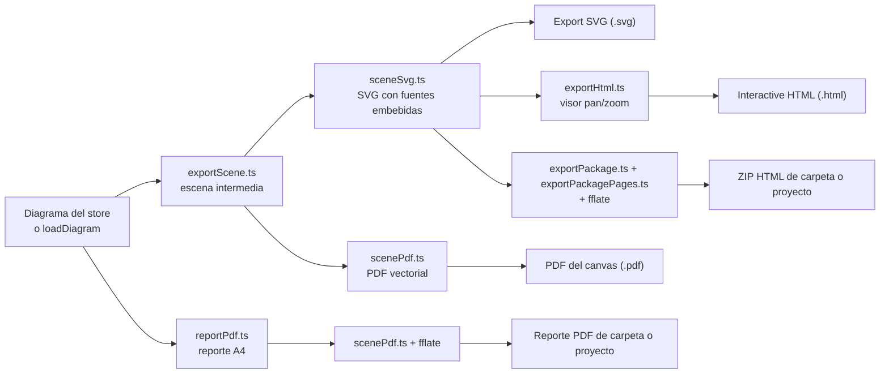

# Consideraciones técnicas del frontend

Este documento explica las decisiones técnicas de rendimiento y layout de la web de Data Model Hub: cómo
funciona el auto-layout con ELK y por qué usa cada opción, cómo se pintan canvases de cientos de nodos sin
trabar el navegador, cómo se generan los exports del diagrama y qué límites conocidos tiene el cliente.
Está escrito para desarrolladores que tocan el canvas, los exports o las listas grandes.

## Contenido

- [Auto-layout con ELK](#auto-layout-con-elk)
- [Renderizado a escala](#renderizado-a-escala)
- [Escala fuera del canvas](#escala-fuera-del-canvas)
- [Exports del diagrama](#exports-del-diagrama)
- [Límites conocidos del cliente](#límites-conocidos-del-cliente)
- [Documentos relacionados](#documentos-relacionados)

## Auto-layout con ELK

### Motor y carga

El botón **Auto-arrange** delega el layout en el Eclipse Layout Kernel (ELK) a través de `elkjs` 0.11.1, con
la build `elk.bundled.js`. Es JavaScript autocontenido: corre en el navegador sin worker obligatorio, sin
WASM y sin pedir recursos externos, igual en desarrollo y detrás de `server.mjs`.

`src/features/modeler/lib/elkLayout.ts` es el único módulo que importa `elkjs`, y siempre se carga con
`import()` dinámico (desde `arrangeGraph.ts` y `placeNewMembers.ts`): el kernel no entra al bundle inicial
y se descarga la primera vez que se ordena un canvas.

### El algoritmo `layered`

Se usa `elk.algorithm: 'layered'`, la implementación de ELK del método de Sugiyama para grafos dirigidos.
Sus fases explican qué controla cada opción:

1. **Eliminación de ciclos.** Invierte temporalmente las aristas mínimas para obtener un grafo acíclico y
   las restaura al final. Un modelo ER puede tener ciclos legítimos; esta fase permite ordenarlo sin
   preprocesamiento propio.
2. **Asignación de capas.** Cada nodo recibe una columna de modo que toda arista avance hacia adelante:
   las tablas padre quedan a la izquierda de sus hijas y cada vista a la derecha de sus fuentes.
3. **Minimización de cruces.** Decide el orden vertical dentro de cada capa con barridos sucesivos.
4. **Posicionamiento.** Asigna coordenadas con alineación por bloques, que equilibra las columnas.
5. **Ruteo de aristas.** Reserva canales ortogonales entre capas.

Un algoritmo por capas encaja con los diagramas de la plataforma porque las relaciones son dirigidas (de la
tabla padre, que aporta la llave, a la hija) y las derivaciones tabla → vista también. El resultado se lee
como un flujo de dependencias de izquierda a derecha, coherente con los handles de los nodos (origen a la
derecha, destino a la izquierda). Un layout de fuerzas no garantiza esa lectura direccional ni la
separación en columnas.

### Opciones

| Opción | Valor | Motivo |
|---|---|---|
| `elk.algorithm` | `layered` | Método por capas (ver arriba). |
| `elk.direction` | `RIGHT` | Flujo de izquierda a derecha, alineado con los handles. |
| `elk.edgeRouting` | `ORTHOGONAL` | Reserva canales ortogonales entre capas. |
| `elk.separateConnectedComponents` | `true` | Las tablas sin relaciones y los subgrafos sueltos se empaquetan en bloques compactos en lugar de formar una tira larga; es decisivo en canvases con muchas tablas aisladas. |
| `elk.spacing.componentComponent` | `64` | Separación entre esos bloques. |
| `elk.layered.spacing.nodeNodeBetweenLayers` | `140` | Separación horizontal entre capas, holgada para nodos anchos y para los marcadores de cardinalidad de los wires. |
| `elk.spacing.nodeNode` | `72` | Separación vertical entre nodos de una misma capa. |
| `elk.spacing.edgeNode` | `28` | Aire entre wire y nodo. |
| `elk.spacing.edgeEdge` | `16` | Aire entre wires paralelos. |
| `elk.layered.spacing.edgeNodeBetweenLayers` | `28` | Aire entre wire y nodo dentro del canal entre capas. |
| `elk.layered.nodePlacement.strategy` | `BRANDES_KOEPF` | Alineación por bloques: columnas equilibradas y aristas rectas. |
| `elk.layered.nodePlacement.favorStraightEdges` | `true` | Prioriza wires horizontales rectos al equilibrar. |
| `elk.layered.crossingMinimization.strategy` | `LAYER_SWEEP` | Barridos capa por capa con heurísticas de orden. |
| `elk.layered.thoroughness` | `10` | Más esfuerzo que el valor por defecto de ELK (7): menos cruces a cambio de más CPU, aceptable porque el arrange es una acción puntual y no un costo por cuadro. |

### Tamaños de los nodos

ELK recibe el tamaño real de cada nodo. El ancho de una tabla es dinámico (el de su fila más larga, con
tope), y con un tamaño fijo las tablas anchas o altas se superpondrían tras el arrange.

- En el canvas abierto, `autoOrganize` (`src/store/useModelerStore.ts`) toma el tamaño medido por React
  Flow (`n.measured`).
- Si un nodo no fue medido, o si el canvas no está abierto (el arrange de la carga Excel), se usa la
  estimación de `src/features/modeler/lib/lodSize.ts`, que replica las métricas CSS de los nodos (ver
  [Zoom semántico](#zoom-semántico-lod)).
- El fallback final de `elkLayout.ts` es 240 × 160 px.

### División del trabajo con React Flow

ELK solo posiciona: `elkLayout()` devuelve `{ id: { x, y } }` y descarta los puntos de quiebre que calcula.
El trazado visual de los wires lo hace React Flow en cada cuadro: las relaciones (`CrowFootEdge`) usan
`getSmoothStepPath` (ortogonal con esquinas suaves) o el trazo manual guardado del wire, y las derivaciones
tabla → vista (`DerivationEdge`) usan `getBezierPath` con curvatura 0.35, distinto a propósito para
diferenciarlas. Así los wires siguen a los nodos durante el arrastre sin volver a calcular el layout.

### Flujo del Auto-arrange

`autoOrganize` arma el grafo con `arrangeDiagram` (`src/features/modeler/lib/arrangeGraph.ts`): las tablas
del canvas, las relaciones como aristas y, en el modelo físico, las vistas con alguna fuente en el canvas
y sus derivaciones como aristas. Los símbolos de subcategoría no pasan por ELK: se recalculan al punto medio
entre el padre y sus hijas.

- **En edición**, las posiciones se graban con `arrangeSubjectArea` en una sola escritura del canvas, que
  además reinicia los trazos manuales de los wires (unas posiciones nuevas con trazos que no les
  corresponden dejarían wires sueltos). La acción entra al Undo con el layout y los trazos previos.
- **En modo visor**, el resultado vive solo en la sesión (`viewerLayout`) y nunca viaja al backend.

La carga Excel no ejecuta el Auto-arrange completo, que movería todos los bloques y reiniciaría los trazos:
`placeNewMembers.ts` ordena con ELK solo el grupo de tablas y vistas que entra y lo ubica sin mover lo
existente.

### Paridad con el backend

El script `scripts/arrange_all.cjs` del repositorio del backend usa la misma configuración de ELK y la
misma librería; la busca en `ELKJS_PATH` o en `node_modules` de este repositorio. Como en un proceso por
lotes no hay DOM que medir, el script estima los tamaños con las mismas fórmulas de `lodSize.ts`. Un cambio
en las opciones de `elkLayout.ts` o en las métricas de los nodos se replica en ese script.

## Renderizado a escala

### El costo está en el DOM

El diagrama completo de un canvas llega en una sola respuesta (`GET /api/subject-areas/{sa_id}/diagram`,
comprimida con GZip por el backend) y la navegación posterior es local. En un canvas de cientos de nodos el
cuello de botella no es la red ni la base, sino la cantidad de elementos del DOM: cada fila de columna
lleva dos handles, varios spans y un ícono. Un canvas de unos 400 nodos con alrededor de cien mil filas
supera el medio millón de elementos, y al encuadrarlo completo (zoom de 0.03 a 0.08) cada fila mide menos de
un píxel: el navegador paga estilo, layout y pintado de contenido que nadie puede leer.

La virtualización del viewport de React Flow (`onlyRenderVisibleElements`) no ayuda en ese caso: con el
canvas encuadrado completo, todos los nodos son visibles.

Tampoco ayuda si los nodos llegan sin tamaño medido: React Flow trata un nodo sin `measured` como nuevo, le
borra las anclas medidas y lo dibuja aunque esté fuera de pantalla para medirlo (`forceInitialRender`). Por
eso, al re-armar los nodos con cada carga del diagrama, `keepMeasured` (`features/modeler/lib`) conserva el
`measured` de cada bloque cuyas anclas y caja no cambiaron: en una tabla, el orden de sus filas (llave
primero, cada parte por `ordinal`) y su ancho estimado; en modo compacto, las columnas con wires y el tamaño
de la caja; en una vista, el tamaño de la caja (su ancla está en la cabecera); un símbolo no tiene anclas que
se muevan. Vuelven a medirse el bloque cuyas anclas o caja cambiaron (alta, baja, reorden, llave, un nombre
más largo, una vista que perdió una fila), los extremos de un wire nuevo o re-apuntado (`wireChanges`) y todos
al cambiar de faceta. Así los wires quedan en la fila correcta aunque la tabla no cambie de alto, y fuera de
pantalla solo se dibuja lo que cambió. Sin esto, borrar una columna en un canvas de 200 tablas montaba y
desmontaba ~900 mil elementos.

Un bloque medido en modo compacto (al abrir un canvas gigante todo se ve de lejos) conserva esa caja hasta que
se dibuja de cerca, cuando React Flow lo vuelve a medir. Si es extremo de un wire de relación o de
subcategoría, que anclan en sus filas y en su caja, se vuelve a medir en la carga siguiente aunque esté fuera
de pantalla (`measuredCompact`). Hasta que se dibuja, el recorte por viewport y el Auto-arrange usan su caja
estimada, como cuando se ordena con el canvas alejado, y un wire de derivación sale de su borde derecho
estimado (unos 60–100 px más a la derecha): re-medir las fuentes de todas las vistas sería re-medir casi todo
el canvas.

Lo otro que pesaba en un canvas gigante era bajar el diagrama completo tras cada edición (~3 MB comprimidos y
más de 1 s en el servidor en Analytics). La recarga pide solo el recorte de las tablas que tocó lo escrito y
lo funde en el diagrama abierto (`lib/diagramSlice`; detalle en [Flujo de datos](06-flujo-de-datos.md)): unas
decenas de KB y milisegundos en el servidor, y lo que no cambió conserva su objeto, así `keepMeasured` no
tiene nada que volver a medir fuera del lote.

### Zoom semántico (LOD)

Por debajo de un umbral de zoom, cada tabla y cada vista se pintan como una caja compacta del mismo tamaño
que el nodo detallado; por encima vuelve el detalle completo. Solo se deja de pintar lo que a ese zoom ya
no es legible.

**Umbrales con histéresis** (`src/features/modeler/lib/lodSize.ts`):

```ts
export const LOD_ENTER = 0.1;   // pasa a compacto al bajar de 0.10
export const LOD_EXIT = 0.2;    // vuelve a detalle al superar 0.20

export function nextLod(current: boolean, zoom: number): boolean {
  if (current) return zoom <= LOD_EXIT;
  return zoom < LOD_ENTER;
}
```

La banda entre 0.10 y 0.20 evita el parpadeo al navegar cerca del umbral. A 0.10, una fila de 12 px mide
1.2 px. Si se recalibran, `LOD_ENTER` debe seguir siendo menor que `LOD_EXIT`, con una brecha similar.

**Evaluación barata.** El handler `onMove` de `ModelerCanvas.tsx` evalúa `nextLod` en cada pan o zoom, y
`setLod` del store solo escribe al cruzar el umbral:

```ts
setLod: (v) => { if (get().lod !== v) set({ lod: v }); },
```

El pan normal no provoca renders. Al cruzar, un efecto actualiza solo `data.lod` de las tablas y vistas;
posiciones, selección y wires quedan intactos.

**Primera pintura liviana.** `lod` arranca en `true`: un canvas grande se monta compacto en su primera
pintura, que es la más cara. En `onInit` el LOD se reevalúa tras el encuadre inicial con un doble
`requestAnimationFrame` (React Flow no emite `onMove` por el movimiento programático del encuadre), y un
canvas chico vuelve de inmediato al detalle.

**Mismo tamaño en ambos modos.** `tableLodSize` y `viewLodSize` replican las métricas de `.wk-node` y
`.wk-vnode`:

```text
ancho = clamp(caracteres × 8 + 72, 240, 880)
alto  = 32 (encabezado) + filas × 28
```

Los caracteres son el máximo entre el encabezado (`esquema.nombre` del modo lógico o físico activo) y la
fila más larga (nombre más tipo, con el tipo complejo colapsado; +3 de margen en tablas, +6 en vistas). La
caja compacta de una tabla conserva una franja proporcional a sus filas de llave primaria, y la de una
vista conserva su borde punteado y su trama. Como ambos modos miden lo mismo, cruzar el umbral no mueve
nada.

**Wires intactos.** El nodo compacto no tiene filas, pero conserva handles invisibles con los mismos ids
que las filas del modo detallado: `ModelerCanvas` calcula por tabla las columnas ancladas por algún wire
(`refCols`) y el nodo compacto las materializa, más los handles de encabezado de las derivaciones. Los
wires no se vuelven a armar al cruzar el umbral; el cambio ocurre en un solo commit de React.

### Virtualización y props de React Flow

| Prop | Valor | Motivo |
|---|---|---|
| `onlyRenderVisibleElements` | activa | Solo montan DOM los nodos visibles; es la palanca principal con zoom cercano. Con el canvas encuadrado completo, la palanca es el LOD. |
| `minZoom` | `0.02` | Un canvas grande ordenado ocupa decenas de miles de píxeles; el mínimo por defecto (0.5) no permite verlo completo. `fitViewOptions` usa el mismo piso y un `padding` de 0.12. |
| `deleteKeyCode` | `null` | La tecla de borrado por defecto quitaría tablas o wires solo en pantalla, sin persistir. Los borrados reales van por la UI. |
| `connectionMode` | `ConnectionMode.Loose` | Cada columna tiene handle a ambos lados; una relación puede empezar y terminar en cualquiera, y `onConnect` orienta padre e hija según el gesto. |
| `nodesDraggable` | `true` | En modo visor también se pueden mover bloques para leer mejor el diagrama, sin persistir. |
| `nodeDragThreshold`, `nodeClickDistance`, `paneClickDistance` | `4` | Con 1 px, un temblor del trackpad convierte un clic en arrastre; a 4 px el clic sigue siendo clic y se evitan grabaciones de layout por micro-arrastres. |

### Memoización y selectores estables

- `TableNode`, `ViewNode`, `CrowFootEdge`, `DerivationEdge`, `SubtypeEdge` y `SubtypeSymbolNode` se exportan
  con `React.memo`. React Flow re-renderiza los componentes personalizados en cada actualización del grafo;
  sin memo, un canvas de cien tablas con treinta columnas repintaría miles de filas por cuadro.
- La selección se lee como un booleano por nodo (`s.selectedTableId === table.id`): cambiar de selección
  re-renderiza dos nodos, no todos.
- El resaltado de columnas (`hotColsKey`, `selColsKey`) se expone como un string estable: `''` para las
  tablas no afectadas e `id1|id2|…` para las afectadas. Solo se re-renderizan las tablas involucradas.

### Hover con intención

Si cada bloque o wire que el mouse cruza encendiera y apagara el resaltado, todos los wires se
re-renderizarían dos veces por bloque cruzado y la selección respondería con retraso en canvases grandes.
`src/features/modeler/lib/hoverIntent.ts` resuelve esto:

- el resaltado solo se activa si el mouse permanece `HOVER_INTENT_MS` (90 ms) sobre el bloque o el wire;
  salir lo apaga en el acto;
- el atenuado del resto lo aplica una clase CSS del canvas (`wk-canvas--hover`), no una prop de cada wire:
  ningún wire se suscribe a «¿hay hover?».

### Popups sin `backdrop-filter`

Los fondos de los popups solo oscurecen; no usan `backdrop-filter: blur`. El blur obliga al navegador a
volver a difuminar toda el área del canvas en cada cuadro (cada tecla, clic o parpadeo del cursor) y, sin
aceleración por GPU (escritorio remoto, drivers bloqueados por política), satura el proceso de composición
de todo el navegador. Una prueba de `src/architecture.test.ts` falla si alguna regla CSS aplica
`backdrop-filter` a `.dmh-backdrop`, `.dmh-dialog-backdrop` o sus variantes.

## Escala fuera del canvas

### Grilla del Reporting

La grilla de `src/screens/ReportingScreen.tsx` no se virtualiza: acota lo que trae.

- Sin filtros pide páginas de 50 tablas (`TABLE_PAGE`) y la siguiente llega cuando la fila centinela del
  final entra en vista.
- Las columnas, vistas y relaciones de la selección se piden por lote con los ids en el cuerpo
  (`src/features/reporting/lib/reportFetch.ts`): columnas en tandas de 300 tablas, vistas en tandas de
  2 000 y relaciones en tandas de 300, con a lo sumo 4 lotes en vuelo (`LOTS_IN_FLIGHT`). Con todos los
  lotes a la vez, el timeout de cada pedido correría mientras espera en cola; el primer lote que falla
  corta la lectura.
- Los exports a Excel se arman en el navegador solo con la selección y se escriben en flujo
  (`src/features/reporting/lib/xlsxWriter.ts`): la memoria queda acotada al archivo comprimido, no al
  libro entero, y los límites de Excel (32 767 caracteres por celda, 1 048 576 filas por hoja) se
  cumplen con columnas y hojas de continuación.

### Listas virtualizadas

`src/components/ui/AffectedTable.tsx` es la tabla de las listas de impacto de los popups (conflictos y
aplicación del glosario, cascada de un dominio, confirmación de un rollback). Es el único consumidor de
`@tanstack/react-virtual` 3.14.5:

```ts
const virt = useVirtualizer({
  count: rows.length, getScrollElement: () => scrollRef.current, estimateSize: () => ROW_H, overscan: 12,
});
```

Solo montan DOM las filas visibles más 12 de margen. Con `onEndReached`, al quedar a menos de 8 filas del
final se pide la página siguiente al servidor.

## Exports del diagrama

Ninguno de los exports captura el DOM del canvas. Capturar el DOM obliga a clonar cientos de miles de
elementos con sus estilos calculados y a serializar cientos de MB, con minutos de bloqueo y errores de
memoria en canvases grandes. En su lugar, `src/features/modeler/lib/exportScene.ts` dibuja el diagrama a
partir del modelo con las mismas métricas y los mismos ruteos del canvas (las funciones de camino de React
Flow son puras) y produce una escena intermedia (rectángulos, caminos y textos con coordenadas absolutas).
Los serializadores convierten esa escena en cada formato.

El flujo siguiente muestra qué módulo produce cada formato a partir de la misma escena.



Todos los módulos de export se cargan con `import()` dinámico al usarse.

| Export | Dónde se inicia | Cómo se genera | Límites |
|---|---|---|---|
| **SVG image (.svg)** | Menú **Export diagram** de la barra del canvas | `sceneSvg.ts`: texto como `<text>` vectorial, trama de vistas como `<pattern>`, fuentes Geist embebidas como data URLs (`exportFonts.ts`, subset latino) para que el archivo se vea igual sin conexión. | Abierto suelto en el navegador, el zoom de página llega a un máximo de alrededor de 500 %: en modelos grandes no alcanza para leer una columna. |
| **Interactive HTML (.html)** | Mismo menú | `exportHtml.ts`: un HTML autocontenido con el mismo SVG y un visor propio (rueda = zoom al cursor de 0.01× a 64×, arrastre = pan, doble clic = acercar). El SVG se embebe como literal JS y se parsea con `DOMParser` como XML, porque el parser HTML reinterpreta los tags auto-cerrados. | El archivo pesa lo que el SVG más las fuentes; el render es vectorial en cada cuadro. |
| **PDF document (.pdf)** | Mismo menú | `scenePdf.ts`: PDF vectorial sin dependencias, con fuentes core Type1 (Helvetica y Courier) y codificación WinAnsi. Escala px → pt a 0.75. | La página se limita a 14 400 pt por lado (el máximo del estándar ISO 32000); un canvas más grande se reduce para caber. Caracteres fuera de Latin-1 salen como `?`. La trama de las vistas va como fondo plano. |
| **Paquete HTML** | Menú del Model Explorer sobre un proyecto, carpeta o canvas | `exportPackage.ts` baja cada diagrama con `loadDiagram` (3 en paralelo), arma con `exportPackagePages.ts` una página HTML por canvas (dos SVG, lógico y físico, en pestañas) y un índice, y los empaqueta en un ZIP con `fflate` (nivel 6). Un canvas suelto sale como un solo HTML, sin ZIP. | Todo el ZIP se arma en memoria antes de descargarse. Un canvas que falla al leerse se informa y el resto sigue; la exportación se puede cancelar. |
| **Reporte PDF** | Mismo menú, formato PDF | `reportPdf.ts` arma un reporte A4 con portada, índice, áreas temáticas, tablas y columnas de cada canvas, e índice alfabético al final (sin diagramas); `scenePdf.ts` lo serializa con streams comprimidos por `fflate`. | Igual que el paquete HTML: se arma en memoria y se descarga al final. |

En edición, el export de la barra toma las posiciones vivas de los nodos y los trazos manuales vivos; en
modo visor exporta lo publicado, sin los movimientos de la sesión. Respeta **Show/Hide relationship
labels**.

## Límites conocidos del cliente

- **Arrange en el hilo principal.** ELK corre en el hilo principal (la build `bundled` sin worker). En
  canvases de cientos de nodos el cálculo puede bloquear la interfaz durante algunos segundos; el botón
  muestra el estado de espera.
- **Memoria del canvas.** El diagrama completo (tablas, columnas, relaciones y vistas) vive en el store
  mientras el canvas está abierto. Un canvas con cientos de miles de filas de columnas se puede navegar
  gracias al LOD, pero su memoria crece con el tamaño del modelo y la primera apertura paga la descarga y
  el parseo de esa respuesta.
- **Exports en memoria.** El SVG, el HTML, los PDF y el ZIP se construyen completos como `Blob` antes de
  descargarse. Exportar un proyecto entero con muchos canvases grandes ocupa memoria del navegador en
  proporción.
- **PDF de un canvas muy grande.** Por el tope de 14 400 pt por lado, un canvas enorme se reduce en el PDF
  y el texto puede quedar ilegible al imprimir; para esos casos el formato adecuado es el HTML interactivo.
- **Trazos manuales.** Un wire admite hasta 32 puntos de quiebre (`MAX_ROUTE_POINTS` en
  `src/features/modeler/lib/wireRoute.ts`, espejo de los topes del backend).
- **Navegadores.** La aplicación apunta a navegadores de escritorio modernos con soporte de ES modules,
  `IntersectionObserver` y `ResizeObserver`. Sin aceleración por GPU el canvas sigue funcionando, pero los
  efectos de composición cuestan más; por eso la interfaz evita `backdrop-filter`.
- **Sesión del navegador.** El token vive en una cookie HttpOnly que fija `server.mjs`: el JavaScript no
  lo lee. La sesión dura una hora y se renueva solo con actividad, hasta 12 horas desde el login; sin uso,
  la pestaña vuelve al login. La cookie es del navegador, por lo que todas las pestañas comparten la
  sesión y entrar con otra cuenta en una cierra la de las demás (dos cuentas a la vez requieren otro
  perfil o una ventana privada). Con el front apuntado a otro origen (`VITE_API_URL`) o con
  `SESSION_COOKIE=false`, el token queda en memoria y recargar pide entrar de nuevo. El logout borra la
  cookie; el backend no lleva una lista de tokens revocados, así que un token copiado vale hasta su
  vencimiento. Ver [Seguridad](08-seguridad.md).
- **Avisos de `npm audit` en herramientas de desarrollo.** `npm audit --omit=dev` no reporta avisos; los
  que quedan corresponden a vitest 2, vite y esbuild, que solo se usan para compilar y probar y no forman
  parte del build servido.
- **Exports sujetos al permiso `export`.** Los exports se arman en el navegador con datos ya leídos; la
  interfaz deshabilita sus botones sin el permiso, y el backend solo lo exige en el render de las reglas
  DDL.

## Documentos relacionados

- [Arquitectura](02-arquitectura.md)
- [Funcionalidades](05-funcionalidades.md)
- [Flujo de datos](06-flujo-de-datos.md)
- [Integración con la API](07-integracion-con-la-api.md)
- [Pruebas](10-pruebas.md)
- [Sistema de diseño](11-sistema-de-diseno.md)

Los límites del backend (adaptador, lotes, concurrencia y pool) se documentan en
`docs/12-consideraciones-y-limites.md` del repositorio del backend.
